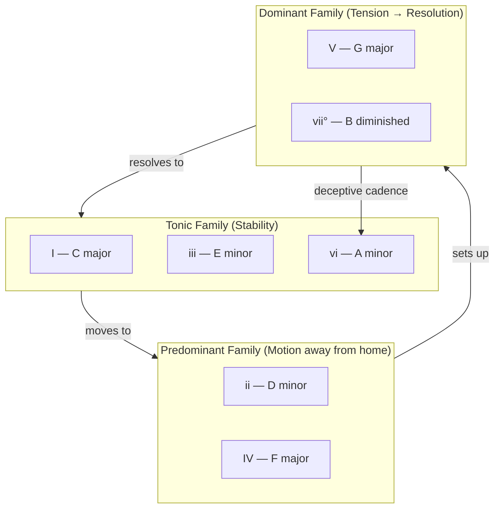
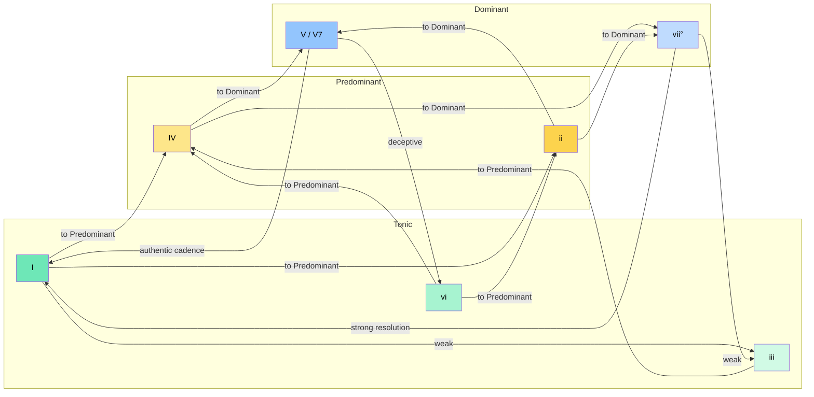
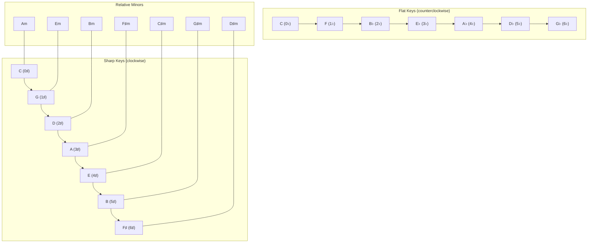

# Lesson 1: Diatonic Chords at the Piano — From Keyboard Geometry to Musical Fluency

## 1. First-Principles Intuition (The 15%)

Diatonic chords are the seven chords that live entirely within a single key — no borrowed notes, no accidentals. Every chord in a major or natural minor key is built by stacking every-other scale degree: root, skip one, third, skip one, fifth. That stacking interval is a third, and the specific size of each third (major = 4 semitones, minor = 3 semitones) determines whether the resulting triad sounds bright (major), dark (minor), or tense (diminished).

The reason thirds stack into consonant chords connects directly to the overtone series. When you play a low C on the piano, the string vibrates at 261 Hz but also produces ghost tones at 522 Hz (octave), 783 Hz (fifth above that), 1044 Hz (two octaves), 1305 Hz (major third above two octaves), and so on. The major triad C–E–G mirrors this natural harmonic alignment almost exactly — the fifth and third are acoustically "baked in" to the fundamental. That is why major chords feel stable and complete with no acoustic justification needed. Minor chords slightly distort this alignment (the minor third sits slightly lower), which gives them their characteristic introspective quality. Diminished chords stack two minor thirds and produce a tritone (augmented fourth / diminished fifth) spanning exactly half the octave — maximally ambiguous, maximally tense, demanding resolution.

That is all the physics you need. Everything else in this lesson is hands-on.

---

## 2. Keyboard Geometry: Where Diatonic Chords Live

Before touching a chord, you need to see the keyboard as a visual map. Here is the fundamental truth about white-key triads in C major: **three shapes cover all seven chords.**

### The Three White-Key Triad Shapes

Look at any three consecutive white keys that form a triad. The black-key gaps between them create a visual fingerprint:

```
Shape A (Major: C, F, G)    — gap on LEFT and MIDDLE
  [C] [_] [E] [F] [G]
   ●       ●       ●
   Root   3rd    5th
   Black key between 1-2, black key between 2-3

Shape B (Minor: D, E, A)    — gap on MIDDLE and RIGHT  
   but visually: Root and 3rd are closer, 3rd and 5th wider

Shape C (Diminished: B)     — both gaps are smaller (all white, tight)
```

Stop trying to memorize shapes abstractly. Instead, use this physical anchor:

**C major:** thumb on C (white, left edge of two-black group), middle finger on E (white, right of two-black group), pinky on G (white, left of three-black group). Your hand makes a natural arc.

**D minor:** index on D (white, between two-black group), middle on F (white, left of three-black group), pinky on A (white, between three-black group). Slightly more stretch.

**E minor:** thumb on E, middle on G, pinky on B. Almost identical stretch to D minor, shifted right.

**F major:** thumb on F, middle on A, pinky on C (next octave). Wide span — 8 white keys, but only 7 semitone positions. This one feels like C major mirrored.

**G major:** thumb on G, middle on B, ring on D (next octave). The B–D gap is tight because there is no black key between B and C.

**A minor:** thumb on A, middle on C, pinky on E. Identical shape to C major, just starting from A.

**B diminished:** thumb on B, middle on D, pinky on F. The tightest-feeling chord — both intervals are minor thirds.

### Full Diatonic Chord Map — C Major

| Roman | Chord | Pitches | Quality | RH Fingering (root pos.) |
|-------|-------|---------|---------|--------------------------|
| I | C | C E G | Major | 1 – 3 – 5 |
| ii | Dm | D F A | Minor | 1 – 3 – 5 |
| iii | Em | E G B | Minor | 1 – 3 – 5 |
| IV | F | F A C | Major | 1 – 3 – 5 |
| V | G | G B D | Major | 1 – 2 – 5 |
| vi | Am | A C E | Minor | 1 – 3 – 5 |
| vii° | B° | B D F | Diminished | 1 – 3 – 5 |

> **Note on V chord (G major):** Finger 2 on B instead of 3 because B–D is a tight minor third with no black key — using 2–5 gives your hand more natural arch over the gap.

### Full Diatonic Chord Map — A Natural Minor

| Roman | Chord | Pitches | Quality | RH Fingering |
|-------|-------|---------|---------|--------------|
| i | Am | A C E | Minor | 1 – 3 – 5 |
| ii° | B° | B D F | Diminished | 1 – 3 – 5 |
| III | C | C E G | Major | 1 – 3 – 5 |
| iv | Dm | D F A | Minor | 1 – 3 – 5 |
| v | Em | E G B | Minor | 1 – 3 – 5 |
| VI | F | F A C | Major | 1 – 3 – 5 |
| VII | G | G B D | Major | 1 – 2 – 5 |

> **Harmonic minor raises the 7th:** In A harmonic minor, the v chord becomes V (E **major**: E–G♯–B). This introduces a leading tone (G♯) that pulls strongly toward the tonic A. Use fingering 1–3–5 on E–G♯–B.

---

## 3. Hand Posture and Ergonomics at the Piano

This is non-negotiable before you play a single chord. Poor posture causes tendinitis and blocks technique.

**Bench height:** Sit so your forearms are roughly parallel to the floor, elbows slightly below the keyboard level. Too high creates downward-angling wrists; too low causes upward-angling wrists. Both create tension.

**Wrist position:** Float the wrist — never let it collapse below the keyboard surface or stiffen above it. The wrist should be a suspension bridge, not a roadblock. Imagine holding a small water balloon in each hand: curved fingers, relaxed palm, no gripping.

**Finger curve:** Strike keys with the fleshy pad of the fingertip, not the flat of the finger. Each finger should curve like a small arch. This transfers the weight of your forearm down through the finger into the key — that forearm-weight mechanism is the source of a full, singing tone.

**Thumb placement (finger 1):** The thumb plays on its side-tip, not its flat face. When playing a chord, the thumb should be slightly under the hand, not sticking out horizontally.

**Forearm weight transfer:** To play chords with resonance, lean your forearm weight toward the keys as you depress them, then release the weight as the keys come back up. This is fundamentally different from pushing or hammering — you are dropping, not attacking.

**Wrist "cushion" on release:** After each chord attack, let the wrist bounce slightly upward on the release. This prevents forearm tension from accumulating across a practice session.

---

## 4. Chord Inversions: Same Notes, Different Bass

A triad has three positions: root position (root on bottom), first inversion (third on bottom), second inversion (fifth on bottom).

### C Major Through All Inversions

```
Root Position    1st Inversion    2nd Inversion
   G (5)            C (8va)          E (8va)
   E (3)            G (5)            C (5)
   C (R)            E (3)            G (R)

RH: 1–3–5         RH: 1–2–5        RH: 1–3–5
LH: 5–3–1         LH: 5–3–1        LH: 5–2–1
```

**Why inversions matter physically:** Root position chords require jumping your hand position for every chord change. Inversions let your hand stay in one area of the keyboard and voice-lead smoothly by moving the minimum number of fingers.

### I – IV – V – I with Smooth Voice Leading (C Major, RH)

This is the most important inversion exercise you can do. The goal is that no single finger moves more than a step or two between chords.

```
  I (root)    IV (2nd inv.)    V (1st inv.)    I (root)
  G           C                B               G
  E           F                G               E
  C           C                G               C
              (C held)         (G held)

Fingers:
  1–3–5       1–2–5            1–2–5           1–3–5
```

**What is happening:** The common tone C is held between I and IV (second inversion). Then C moves down to B and F stays as G shifts up — minimal motion. Then everything resolves home.

This three-chord sequence (I – IV – V – I with these specific inversions) is the voice-leading skeleton of thousands of songs. Internalize it in every key.

---

## 5. Harmonic Function: Tonic, Subdominant, Dominant

Every diatonic chord belongs to one of three functional families:



**Tonic chords (I, iii, vi):** Feel like home or rest. I is the strongest tonic. vi (A minor) is a weaker tonic substitute — the same notes as C major with a different root, so it can fool the ear into hearing partial resolution. iii is rarely a goal; it functions more as a passing chord.

**Predominant chords (ii, IV):** Pull you away from tonic and toward the dominant. IV has a warm, hymn-like quality (the "plagal" direction). ii is harmonically stronger because it sets up a full ii–V–I motion.

**Dominant chords (V, vii°):** Generate the highest tension. V contains the leading tone (B in C major) which pulls by half-step to the tonic (C). vii° is an incomplete V7 — it contains B, D, and F, three of the four notes in G7.

---

## 6. Voice Leading Rules — The Four That Matter

**Rule 1 — Hold common tones.** When two adjacent chords share a note, keep that note in the same voice (same hand position). C major → F major share C. Keep C in place, move E down to F, move G up to A.

**Rule 2 — Move by step when possible.** Leaping by fourth or fifth is jarring. If a voice can move by half-step or whole step to reach the next chord tone, do that.

**Rule 3 — No parallel perfect fifths or octaves.** Two voices that move in the same direction by the same interval (both moving up a fifth, or both moving up an octave) collapse into one audible line instead of two. This eliminates textural depth.

**Rule 4 — Resolve the tritone.** In G7 (G–B–D–F), the tritone is B–F. B (the leading tone) must resolve **up** to C. F (the fourth scale degree) must resolve **down** to E. Any voicing of G7 → C must honor this, or the progression sounds evasive.

---

## 7. Seventh Chords on the Keyboard

Add the note a seventh above the root to any triad and you get a seventh chord. In C major:

| Roman | Chord | Pitches | Quality | RH Fingering |
|-------|-------|---------|---------|--------------|
| Imaj7 | Cmaj7 | C E G B | Major 7th | 1–2–3–5 |
| ii7 | Dm7 | D F A C | Minor 7th | 1–2–3–5 |
| iii7 | Em7 | E G B D | Minor 7th | 1–2–3–5 |
| IVmaj7 | Fmaj7 | F A C E | Major 7th | 1–2–3–5 |
| V7 | G7 | G B D F | Dominant 7th | 1–2–3–5 (or 1–2–4–5) |
| vi7 | Am7 | A C E G | Minor 7th | 1–2–3–5 |
| viiø7 | Bm7♭5 | B D F A | Half-dim 7th | 1–2–3–5 |

**Fingering note on V7 (G7):** G–B–D–F in root position is a wide spread. Use 1–2–3–5 if your hand spans an octave easily; use 1–2–4–5 if D and F feel cramped together on 3–5.

### V7 → I Resolution — Hear the Tritone Snap

```
G7 (V7)      Cmaj (I)
   F              E       ← F resolves DOWN by half-step
   D              C       ← D resolves DOWN by step  
   B              C       ← B resolves UP by half-step (leading tone)
   G              C       ← G leaps down to C (or holds if doubled)
```

Play G7 in root position with the full four-note voicing, then resolve to C major. Feel B pulling up and F pulling down — that is the acoustic engine of tonal music.

---

## 8. Harmonic Progressions Map



---

## 9. Practice Drills — Metronome Targets

Work through these in order. Do not advance to the next drill until the current one is effortless at the target tempo.

### Drill 1: Block Chord Diatonic Cycle (Root Position)

Play all seven diatonic chords up the scale in root position, both hands together, then back down. Legato touch, listen for even voicing balance.

```
C major scale chords:
RH: C/E/G — D/F/A — E/G/B — F/A/C — G/B/D — A/C/E — B/D/F — back down

LH mirrors one octave lower, same fingering (5–3–1 on each chord)

Tempo: ♩= 60 BPM (quarter note per chord)
Target: ♩= 80 BPM
```

**What to listen for:** Each chord should have even volume across all three notes. The top note (5th finger) often goes softer — consciously lean into it.

### Drill 2: I – IV – V – I with Inversions (Voice-Led)

This is the fundamental harmonic motion. All in RH, then add LH bass notes.

```
Key of C:
I (root)   →  IV (2nd inv.)  →  V (1st inv.)  →  I (root)
C/E/G      →  C/F/A          →  B/G/D          →  C/E/G

LH plays bass notes: C — F — G — C (roots, single notes, one octave below)

Tempo: ♩= 60 BPM (one chord per beat, 4/4 time — chord on beat 1 of each bar)
Target: ♩= 100 BPM
Advanced: ♩= 120 BPM, arpeggiate the RH chords (1-3-5-3 pattern per bar)
```

Transpose this to G major, D major, F major, and A minor before moving on.

### Drill 3: ii – V – I (The Jazz Cadence)

The most important three-chord sequence in jazz and pop harmony.

```
Key of C, with 7ths:
ii7 (Dm7)   →   V7 (G7)   →   Imaj7 (Cmaj7)
D/F/A/C     →   G/B/D/F   →   C/E/G/B

Voice-led version (keep common tones, move others by step):
LH: D        →   G          →   C
RH: C/F/A    →   B/F/G      →   B/E/G   (note: F resolves to E, B held, A→G)

Tempo: ♩= 60 BPM
Target: ♩= 90 BPM
Practice in all 12 keys going around the Circle of Fifths:
C → F → B♭ → E♭ → A♭ → D♭ → G♭ → B → E → A → D → G
```

### Drill 4: Diatonic Chord Cadences

Practice the four standard cadences in C major, then in three other keys of your choice:

```
1. Authentic (Perfect): V → I
   G major (1st inv: B/G/D) → C major (root: C/E/G)
   Strongest possible rest.

2. Half Cadence: I → V  (or ii → V)
   C/E/G → G/B/D
   Ends on tension — like a question mark.

3. Plagal: IV → I
   F/A/C → C/E/G
   "Amen" cadence. Warmer, less urgent than authentic.

4. Deceptive: V → vi
   G/B/D → A/C/E
   The ear expects I, gets vi — surprise resolution.
   
Tempo for each: ♩= 60 BPM, hold each chord for 2 full beats.
```

### Drill 5: Broken Chord (Alberti Bass) + Melody

The Alberti bass pattern (low–high–middle–high) in the LH while the RH holds melody notes is the fundamental Classical texture.

```
Key of C, 4/4 time, one chord per bar:
LH pattern per bar: C2 – G2 – E2 – G2  (Alberti on C major)
RH: Hold E4 for one bar, then G4, then G4, then C4

Chords: I — V — IV — I

LH fingering: 5 – 2 – 1 – 2 (thumb on middle note each time)
RH fingering: Sustain single notes, finger 3 for E, finger 5 for G, finger 1 for C

Tempo: ♩= 60 BPM
Target: ♩= 100 BPM clean
```

---

## 10. Circle of Fifths as a Practice Map



Use the circle as your transposition schedule. After mastering Drills 1–4 in C major, move to G major (one sharp, F♯), then D major (two sharps, F♯ and C♯), and so on. Each new key deepens pattern recognition and builds fingerboard independence — you stop thinking "C E G" and start thinking "root–third–fifth" anywhere on the keyboard.

**Keys to prioritize in order:**
1. C major (no accidentals — learn all patterns here first)
2. G major / E minor
3. F major / D minor
4. D major / B minor
5. B♭ major / G minor
6. A major / F♯ minor

---

## 11. Common Mistakes and How to Fix Them

**Mistake: Chords are uneven — the bottom note drowns out the top.**
Fix: Practice the chord one note at a time (block just the top voice, then just the middle, then just the bass). Then put them together, consciously listening for the melody note (top) to project above the others. Use forearm weight directed slightly toward finger 5.

**Mistake: The hand tenses up between chords.**
Fix: After each chord, consciously release weight before the next attack. Add a physical "float" of the wrist between chords — even a tiny lift. This prevents accumulated forearm tension.

**Mistake: The thumb (finger 1) sticks out horizontally and bangs notes.**
Fix: Curl the thumb so it plays on its side-tip. Practice holding a loose fist, then open only the minimum needed for the chord shape.

**Mistake: Voice leading sounds jumpy — large leaps everywhere.**
Fix: Check whether you are using root position for every chord. Switch to inversions. The I–IV–V–I inversion drill (Drill 2) is the cure.

**Mistake: The V7–I resolution sounds muddy in the low register.**
Fix: Keep V7 voicings above C3 (middle C minus an octave). In the bass register, voice chords with wider spacing: bass note alone in LH, then the upper chord tones spread across the RH an octave higher.

---

## 12. Applying Diatonic Chords: Real Song Structures

Here are three fundamental progression templates. Learn these in C major first, then transpose.

### Template A: I – V – vi – IV (The Pop Axis)

Used in literally thousands of pop and rock songs.

```
C major: C — G — Am — F
Voicing (all 1st/2nd inversions for smooth voice leading):
  C (root):  C/E/G   fingers 1–3–5
  G (1st):   B/G/D   fingers 1–2–5  (B on top, 1st inversion)
  Am (root): A/C/E   fingers 1–3–5
  F (2nd):   C/F/A   fingers 1–2–5  (C in bass, 2nd inversion)

LH: Plays roots C – G – A – F, one per bar, half notes or whole notes.

Metronome: ♩= 70 BPM, 4/4, one chord per bar.
```

### Template B: i – VII – VI – VII (Natural Minor Loop)

The classic rock and film music minor loop.

```
A minor: Am — G — F — G
  Am (root): A/C/E   1–3–5
  G (root):  G/B/D   1–2–5
  F (root):  F/A/C   1–3–5
  G (root):  G/B/D   1–2–5

LH: A – G – F – G bass notes.
Metronome: ♩= 72 BPM.
```

### Template C: ii – V – I (Jazz Cadence, Extended)

```
Dm7 — G7 — Cmaj7
LH:   D  —  G  —   C
RH: F/A/C — F/B/D — E/G/B   (rootless voicings, voice-led)

Note: These are "A-form" rootless voicings for jazz:
  Dm7:   the 3rd, 5th, 7th above the LH root  → F, A, C
  G7:    the 3rd, 7th, 9th (or 7th, 3rd, 13th) → B, F, A  (tritone in RH)
  Cmaj7: the 3rd, 5th, 7th → E, G, B

Metronome: ♩= 80 BPM swing feel (eighth notes slightly uneven: long–short).
```

---

## 13. Diatonic Chord Reference — Key of C Major (Full Summary)

| Roman | Name | Pitches (R.P.) | Quality | Function | Resolves To |
|-------|------|----------------|---------|----------|-------------|
| I | Tonic | C E G | Major | Stability | — |
| ii | Supertonic | D F A | Minor | Predominant | V |
| iii | Mediant | E G B | Minor | Weak Tonic | vi or IV |
| IV | Subdominant | F A C | Major | Predominant | V or I |
| V | Dominant | G B D | Major | Dominant tension | I or vi |
| V7 | Dom. 7th | G B D F | Dom. 7th | Strongest tension | I |
| vi | Submediant | A C E | Minor | Tonic substitute | ii or IV |
| vii° | Leading tone | B D F | Diminished | Dominant substitute | I |
| Imaj7 | Tonic 7th | C E G B | Maj7 | Color tonic | — |
| IVmaj7 | Subdominant 7th | F A C E | Maj7 | Rich predominant | V |

---

## Summary

You now have the complete toolkit for diatonic harmony at the piano: the visual keyboard geometry for all seven chords in major and minor keys, the correct hand posture and forearm-weight mechanics that prevent injury, all four inversions with smooth voice leading, the functional family model (tonic / predominant / dominant), the four cadence types, and five progressive drills with metronome targets.

The single most important thing you can do right now: sit at the keyboard and play Drill 2 (I–IV–V–I with inversions) in C major at ♩= 60 BPM until the voice leading feels completely automatic. Then transpose it to G major. That loop is the DNA of Western harmony, and muscle memory in it will unlock every progression that follows.
