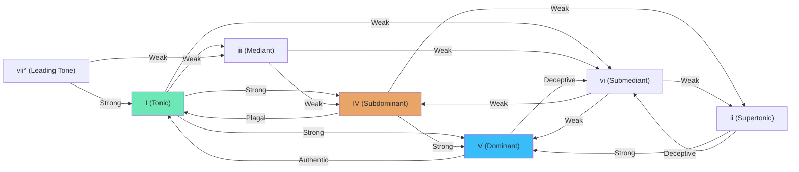
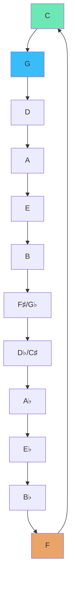

# Lesson 1: Introduction to Diatonic Chords

## 1. First-Principles Intuition & Invariants

Diatonic chords constitute the harmonic foundation of Western tonal music. Built from the seven pitches of a diatonic scale, these structures govern harmonic progression from Renaissance polyphony through jazz and contemporary popular music. Understanding their construction requires engagement with the physics of sound, the psychoacoustics of consonance, and the mathematical regularities that underlie equal temperament.

### The Physical Basis: Equal Temperament and the Semitone

Modern keyboard instruments employ equal temperament, a tuning system that divides the octave into twelve logarithmically equal intervals. The frequency ratio between adjacent semitones is $2^{1/12} \approx 1.05946$. For any pitch with fundamental frequency $f_0$, the frequency $n$ semitones above is:

$$f_n = f_0 \cdot 2^{n/12}$$

This tuning system sacrifices the pure integer ratios of just intonation (where a perfect fifth has ratio 3:2 and a major third 5:4) in favor of uniform transposability. In equal temperament, a perfect fifth spans seven semitones with ratio $2^{7/12} \approx 1.4983$, differing from 3:2 by approximately 2 cents. A major third spans four semitones with ratio $2^{4/12} \approx 1.2599$, differing from 5:4 by approximately 14 cents. These compromises are perceptually tolerable and enable modulation to any key without retuning.

The diatonic scale itself predates equal temperament by millennia. In C major, the pattern of whole steps (W) and half steps (H) is: W-W-H-W-W-W-H, yielding the pitches C, D, E, F, G, A, B. This pattern derives from the Pythagorean construction of stacked perfect fifths, subsequently adjusted to fit within an octave. The intervallic structure creates seven unique scale degrees, each serving a distinct harmonic function.

### Consonance, Dissonance, and the Overtone Series

The perceptual quality of musical intervals derives from the overtone series. When a string or air column vibrates, it produces not only a fundamental frequency $f$ but also overtones at integer multiples: $2f, 3f, 4f, 5f, \ldots$. These partials blend to form a single perceived pitch, but their presence profoundly affects how we hear intervals.

Consonant intervals align their overtone series with minimal beating. The octave (2:1) is maximally consonant because every overtone of the upper pitch coincides with an overtone of the lower. The perfect fifth (approximately 3:2) places the second overtone of the upper pitch near the third of the lower. The major third (approximately 5:4) aligns the fourth and fifth overtones. Dissonant intervals, such as the minor second (16:15) or tritone (approximately $2^{1/2}:1$), create complex beating patterns that the auditory system interprets as tension requiring resolution.

This acoustic reality shapes chord construction. Triads—three-note chords built from stacked thirds—exploit the consonance of fifths and thirds while introducing sufficient variety to support functional harmony.

### Diatonic Triads: Construction and Quality

Diatonic triads are constructed by selecting alternate scale degrees: root (1), third (3), and fifth (5) above the root. The quality of each triad—major, minor, or diminished—depends on the intervallic content of the scale.

In C major, stacking thirds on each scale degree yields:

| Degree | Chord | Pitches | Quality | Interval Structure |
|--------|-------|---------|---------|-------------------|
| I | C | C–E–G | Major | M3 + m3 |
| ii | Dm | D–F–A | Minor | m3 + M3 |
| iii | Em | E–G–B | Minor | m3 + M3 |
| IV | F | F–A–C | Major | M3 + m3 |
| V | G | G–B–D | Major | M3 + m3 |
| vi | Am | A–C–E | Minor | m3 + M3 |
| vii° | Bdim | B–D–F | Diminished | m3 + m3 |

Major triads contain a major third (4 semitones) below a minor third (3 semitones), spanning a perfect fifth (7 semitones) overall. Minor triads invert this: minor third below major third, also spanning a perfect fifth. The diminished triad contains two minor thirds, spanning a diminished fifth (6 semitones), also called a tritone. This interval is highly dissonant and demands resolution.

In A natural minor, the diatonic triads are:

| Degree | Chord | Pitches | Quality | Interval Structure |
|--------|-------|---------|---------|-------------------|
| i | Am | A–C–E | Minor | m3 + M3 |
| ii° | Bdim | B–D–F | Diminished | m3 + m3 |
| III | C | C–E–G | Major | M3 + m3 |
| iv | Dm | D–F–A | Minor | m3 + M3 |
| v | Em | E–G–B | Minor | m3 + M3 |
| VI | F | F–A–C | Major | M3 + m3 |
| VII | G | G–B–D | Major | M3 + m3 |

The harmonic minor scale, which raises the seventh degree, alters the v chord to V (E major), introducing a leading tone that strengthens cadential motion. This modification also creates an augmented second between the sixth and seventh degrees (F to G♯), a characteristic interval of harmonic minor.

### Voice Leading and Harmonic Motion

Voice leading governs the horizontal motion of individual voices through a chord progression. Classical voice leading prioritizes smooth motion and the independent coherence of each voice. Three fundamental principles:

**Common-tone retention:** When two chords share a pitch, that pitch should remain in the same voice. In the progression C → F (I → IV), the pitch C appears in both chords and should be sustained.

**Stepwise motion:** Voices should move by step (whole or half step) whenever possible. In C → G (I → V), the voice on E moves to D (down a whole step), while G can be retained as a common tone.

**Avoiding parallel perfect intervals:** Consecutive perfect fifths or octaves between the same pair of voices create a perceptual merging that undermines independence. The prohibition derives from Renaissance counterpoint and reflects the acoustic reality that parallel perfect intervals collapse the textural stratification essential to polyphonic music.

**Resolution of dissonance:** The tritone in the dominant seventh chord (G7: G–B–D–F in C major) contains B (the leading tone) and F (the fourth scale degree). Voice-leading convention dictates that B resolves upward to C and F downward to E, forming the tonic triad C major. This resolution is both acoustically motivated (the tendency of dissonance to seek consonance) and culturally codified through centuries of practice.

The circle of fifths governs large-scale harmonic motion. Moving through the progression I → IV → vii° → iii → vi → ii → V → I traces a path where each chord root descends by perfect fifth (or ascends by perfect fourth). This motion exploits the strong acoustic relationship of the perfect fifth and creates a sense of directed harmonic flow culminating in the tonic.

## 2. Core Architecture & Mechanics

### Scale Degree Systems and Interval Calculus

A robust model for diatonic harmony treats scale degrees as elements of a modular arithmetic system. In a major scale, the intervallic pattern from the tonic is: 0, 2, 4, 5, 7, 9, 11 semitones. To construct a triad on scale degree $n$, we select scale degrees $n$, $n+2$, and $n+4$ (modulo 7), then map these to semitone offsets.

For C major (pitches C, D, E, F, G, A, B corresponding to MIDI note numbers 60, 62, 64, 65, 67, 69, 71):

```python
import numpy as np

# Define the major scale as semitone offsets from the tonic
MAJOR_SCALE = np.array([0, 2, 4, 5, 7, 9, 11])

def build_diatonic_triad(tonic_midi, scale_degree):
    """
    Construct a diatonic triad in root position.
    
    Parameters:
    - tonic_midi: MIDI note number of the tonic (e.g., 60 for C4)
    - scale_degree: 0-indexed scale degree (0 = tonic, 1 = supertonic, etc.)
    
    Returns:
    - Array of three MIDI note numbers representing the triad
    """
    if not (0 <= scale_degree < 7):
        raise ValueError("Scale degree must be in range [0, 6]")
    
    # Select scale degrees for root, third, fifth
    degrees = np.array([scale_degree, (scale_degree + 2) % 7, (scale_degree + 4) % 7])
    
    # Map to semitone offsets
    offsets = MAJOR_SCALE[degrees]
    
    # Adjust octave if necessary (wrap-around in modular arithmetic)
    if degrees[1] < scale_degree:
        offsets[1] += 12
    if degrees[2] < scale_degree:
        offsets[2] += 12
    
    # Construct MIDI note numbers
    return tonic_midi + offsets

# Example: Build all diatonic triads in C major
tonic = 60  # C4
for degree in range(7):
    triad = build_diatonic_triad(tonic, degree)
    print(f"Scale degree {degree}: MIDI notes {triad}")
```

Output:
```
Scale degree 0: MIDI notes [60 64 67]  # C E G
Scale degree 1: MIDI notes [62 65 69]  # D F A
Scale degree 2: MIDI notes [64 67 71]  # E G B
Scale degree 3: MIDI notes [65 69 72]  # F A C
Scale degree 4: MIDI notes [67 71 74]  # G B D
Scale degree 5: MIDI notes [69 72 76]  # A C E
Scale degree 6: MIDI notes [71 74 77]  # B D F
```

This algorithmic construction generalizes to any mode by substituting the appropriate semitone pattern. For natural minor (Aeolian mode), the pattern is [0, 2, 3, 5, 7, 8, 10].

### Chord Quality Detection

Determining chord quality requires analyzing the intervals between root, third, and fifth:

```python
def analyze_triad_quality(triad_midi):
    """
    Analyze the quality of a triad given as MIDI note numbers.
    
    Parameters:
    - triad_midi: Array of three MIDI note numbers in root position
    
    Returns:
    - String describing chord quality: 'major', 'minor', 'diminished', or 'augmented'
    """
    intervals = np.diff(triad_midi)
    root_to_third = intervals[0]
    third_to_fifth = intervals[1]
    
    if root_to_third == 4 and third_to_fifth == 3:
        return 'major'
    elif root_to_third == 3 and third_to_fifth == 4:
        return 'minor'
    elif root_to_third == 3 and third_to_fifth == 3:
        return 'diminished'
    elif root_to_third == 4 and third_to_fifth == 4:
        return 'augmented'
    else:
        return 'unknown'

# Analyze all diatonic triads in C major
for degree in range(7):
    triad = build_diatonic_triad(60, degree)
    quality = analyze_triad_quality(triad)
    print(f"Degree {degree}: {quality}")
```

Output:
```
Degree 0: major
Degree 1: minor
Degree 2: minor
Degree 3: major
Degree 4: major
Degree 5: minor
Degree 6: diminished
```

### Visualizing Harmonic Relationships with Mermaid

The functional relationships among diatonic chords can be represented as a directed graph, where edges indicate common harmonic progressions:



This graph encodes traditional voice-leading preferences. The strongest progressions—V → I (authentic cadence), IV → I (plagal cadence), and ii → V → I (predominant–dominant–tonic)—reflect the gravitational pull of the tonic and the tension-resolution mechanics of the dominant.

### The Circle of Fifths as a Harmonic Lattice

The circle of fifths orders pitch classes by ascending perfect fifths. In equal temperament, twelve fifths return to the starting pitch class (modulo octave):



Neighboring keys on the circle differ by a single accidental in their key signatures. Moving clockwise adds sharps; counterclockwise adds flats. This structure reflects the acoustic proximity of perfect fifths and governs modulation strategies in tonal music.

### Seventh Chords and Extended Harmony

Extending diatonic triads by adding the seventh scale degree above the root produces seventh chords. In C major:

| Degree | Chord | Pitches | Quality | Interval Structure |
|--------|-------|---------|---------|-------------------|
| I | Cmaj7 | C–E–G–B | Major seventh | M3 + m3 + M3 |
| ii | Dm7 | D–F–A–C | Minor seventh | m3 + M3 + m3 |
| iii | Em7 | E–G–B–D | Minor seventh | m3 + M3 + m3 |
| IV | Fmaj7 | F–A–C–E | Major seventh | M3 + m3 + M3 |
| V | G7 | G–B–D–F | Dominant seventh | M3 + m3 + m3 |
| vi | Am7 | A–C–E–G | Minor seventh | m3 + M3 + m3 |
| vii | Bm7♭5 | B–D–F–A | Half-diminished | m3 + m3 + M3 |

The dominant seventh chord (G7 in C major) contains both the tritone (B–F) and the major third (G–B), creating maximal tension that resolves compellingly to the tonic. Jazz and popular music extensively employ seventh chords, ninth chords, and further extensions (11ths, 13ths) to enrich harmonic color.

```python
def build_diatonic_seventh(tonic_midi, scale_degree):
    """
    Construct a diatonic seventh chord in root position.
    
    Parameters:
    - tonic_midi: MIDI note number of the tonic
    - scale_degree: 0-indexed scale degree
    
    Returns:
    - Array of four MIDI note numbers representing the seventh chord
    """
    degrees = np.array([scale_degree, (scale_degree + 2) % 7, 
                        (scale_degree + 4) % 7, (scale_degree + 6) % 7])
    
    offsets = MAJOR_SCALE[degrees]
    
    # Adjust octave for wrapped degrees
    for i in range(1, 4):
        if degrees[i] < scale_degree:
            offsets[i] += 12
    
    return tonic_midi + offsets

# Example: V7 chord in C major (scale degree 4)
v7_chord = build_diatonic_seventh(60, 4)
print(f"V7 chord: MIDI notes {v7_chord}")  # Output: [67 71 74 77] → G B D F
```

## 3. High-Performance Optimization & Failure Modes

### Voicing and Register for Clarity and Balance

Chord voicing—the vertical arrangement and spacing of pitches—profoundly affects timbre, balance, and perceived consonance. Close voicing places all chord tones within a single octave, producing a dense, focused sound. Open voicing distributes tones across multiple octaves, enhancing clarity and blending.

The Helmholtz resonance region (approximately 80–200 Hz on the piano) exhibits muddy acoustics due to the buildup of lower partials. Voicing chords with roots below C3 (MIDI 48, ~131 Hz) in close position often produces indistinct, booming textures. To mitigate:

- **Wide spacing in the bass:** Keep the bass note isolated, placing the next voice at least an octave above.
- **Drop voicings:** Take the second-highest voice of a close-position chord and drop it an octave. This opens the middle register while maintaining structural integrity.
- **Quartal voicings:** Stack fourths rather than thirds, distributing energy more evenly across the spectrum and reducing harmonic congestion.

```python
def voice_chord_drop2(triad_midi):
    """
    Apply drop-2 voicing to a triad, lowering the second-highest voice by an octave.
    
    Parameters:
    - triad_midi: Array of MIDI note numbers in close position
    
    Returns:
    - Array of MIDI note numbers in drop-2 voicing
    """
    voicing = triad_midi.copy()
    voicing[1] -= 12  # Drop the middle voice (third of the chord)
    voicing.sort()
    return voicing

# Example: Drop-2 voicing of C major triad
c_major = np.array([60, 64, 67])
drop2 = voice_chord_drop2(c_major)
print(f"Close position: {c_major}")  # [60 64 67]
print(f"Drop-2 voicing: {drop2}")    # [52 60 67] → E3 C4 G4
```

### Algorithmic Voice Leading: Minimal Motion

Automated voice leading seeks to minimize the total distance voices travel between chords, subject to constraints (no parallel fifths/octaves, proper doubling, range limits). This is a constrained optimization problem.

```python
from itertools import permutations

def voice_lead(chord1, chord2, max_range=24):
    """
    Find the voicing of chord2 that minimizes total voice motion from chord1.
    
    Parameters:
    - chord1: Current chord as MIDI note numbers
    - chord2: Target chord as MIDI note numbers (root position)
    - max_range: Maximum range in semitones for each voice
    
    Returns:
    - Optimally voiced chord2 as MIDI note numbers
    """
    n_voices = len(chord1)
    best_voicing = None
    min_distance = float('inf')
    
    # Generate all octave transpositions of each voice in chord2
    candidates = []
    for note in chord2:
        candidates.append([note + 12*i for i in range(-2, 3)])  # ±2 octaves
    
    # Try all combinations
    from itertools import product
    for voicing in product(*candidates):
        if len(set(voicing)) != n_voices:
            continue  # Skip voicings with duplicates
        
        # Try all permutations (voice assignments)
        for perm in permutations(voicing):
            distance = sum(abs(perm[i] - chord1[i]) for i in range(n_voices))
            
            # Check range constraint
            if all(abs(perm[i] - chord1[i]) <= max_range for i in range(n_voices)):
                if distance < min_distance:
                    min_distance = distance
                    best_voicing = np.array(perm)
    
    return best_voicing

# Example: Voice lead from C major to G major
c_major_voiced = np.array([48, 60, 64])  # C3 C4 E4
g_major_root = np.array([55, 59, 62])     # G B D (root position
