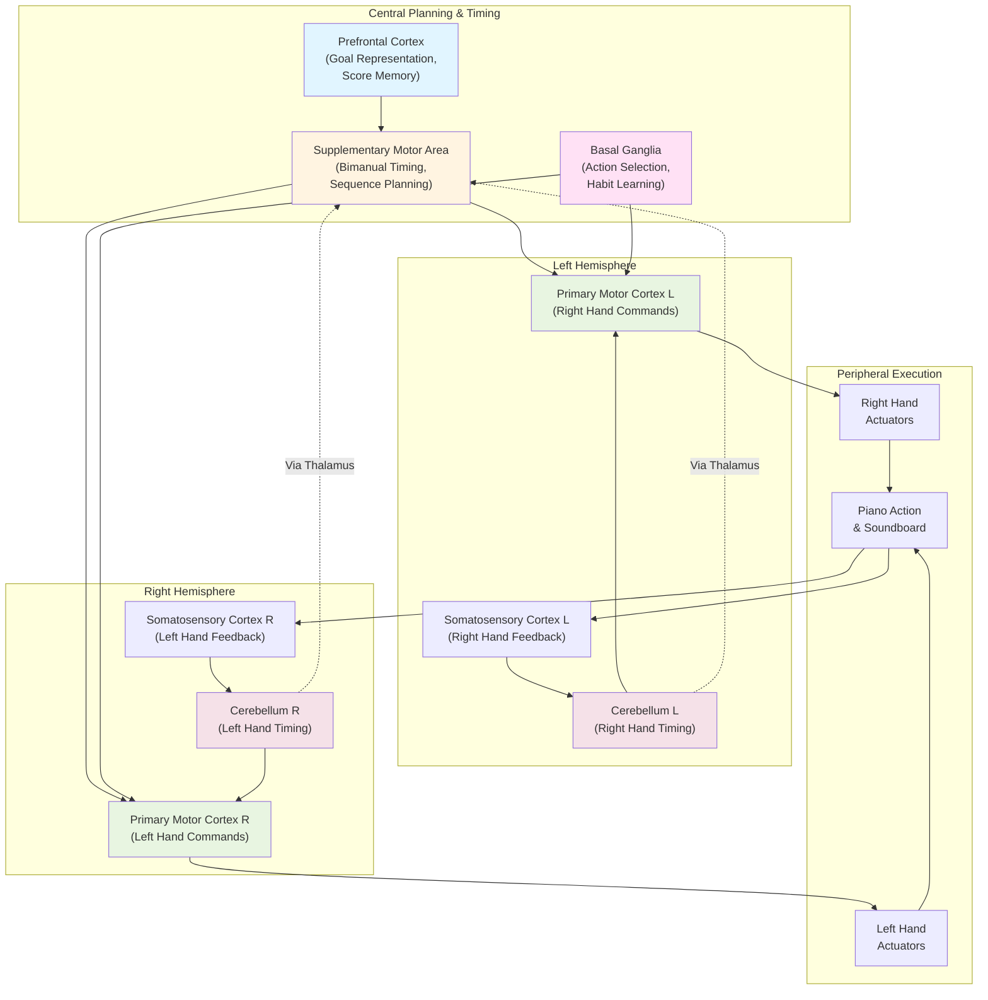

# Lesson 1: Introduction to Two-Handed Coordination

## 1. First-Principles Intuition & Invariants

Two-handed piano coordination is the foundation of polyphonic keyboard performance, enabling the execution of counterpoint, polyrhythm, and the simultaneous expression of independent musical ideas. This skill emerges from the interaction of three domains: neuromuscular control, acoustic physics, and structural music theory. Understanding coordination at first principles requires examining how the brain partitions motor control, how mechanical energy transfers through the arm-hand system to the piano action, and how musical structures define the coordination problem space.

### Neuromuscular Architecture

The human motor system exhibits hierarchical control. The primary motor cortex (M1) sends descending commands through the corticospinal tract to spinal motor neurons, which innervate muscle groups. For piano performance, the motor cortex develops specialized representations—motor maps—where finger movements are disproportionately represented relative to body size (cortical magnification). This neural real estate enables fine-grained control but requires extensive training to develop independent activation patterns for each digit.

Two-handed coordination exploits the brain's bilateral organization. Each hemisphere primarily controls the contralateral hand, with interhemispheric communication mediated by the corpus callosum. Studies using fMRI and EEG demonstrate that skilled pianists exhibit enhanced connectivity in the corpus callosum and supplementary motor area (SMA), which coordinates bimanual timing. The SMA acts as a temporal orchestrator, synchronizing motor commands to both hemispheres while maintaining phase relationships required for polyrhythmic execution.

Independence between hands emerges from differential activation patterns. When the left hand plays a bass line in quarter notes while the right executes a melodic passage in sixteenth notes, the motor system must generate two concurrent pulse streams at a 4:1 ratio. This requires decoupling: suppressing the natural tendency toward phase locking (where rhythms gravitate toward simple integer ratios) and mirror movements (where homologous muscles activate symmetrically). Training establishes dedicated neural pathways that inhibit cross-talk between hemispheric motor programs.

### Biomechanical Constraints

The hand's anatomy imposes structural constraints on coordination. Each finger is controlled by a combination of extrinsic muscles (forearm flexors and extensors) and intrinsic muscles (interossei, lumbricals). The extensor digitorum communis, which extends fingers 2-5, has interconnected tendons that limit independent extension—moving one finger creates passive tension in adjacent digits. The flexor digitorum profundus similarly exhibits mechanical coupling. Only the thumb and index finger possess dedicated extrinsic muscles (flexor pollicis longus, extensor indicis proprius), granting them greater independence.

Intrinsic muscles provide the fine control necessary for piano technique. The lumbricals flex the metacarpophalangeal (MCP) joint while extending the interphalangeal (IP) joints, enabling the curved finger posture essential for articulation. The interossei abduct and adduct fingers, controlling lateral spacing and enabling the execution of chords and intervals. Training strengthens these muscles and develops neural pathways that activate them selectively, reducing unwanted co-contraction.

Force transmission from the body to the piano key follows a kinetic chain: torso → shoulder → upper arm → forearm → hand → finger. Each joint introduces compliance and potential energy loss. Efficient technique minimizes unnecessary tension and aligns joint angles to optimize force transfer. The forearm acts as a lever with the elbow as fulcrum. Pronation and supination (rotation about the forearm axis) facilitate thumb crossings and position shifts. The wrist acts as a shock absorber and fine-positioning mechanism, adjusting height and angle to place fingers optimally over keys.

The piano action itself is a mechanical system with nonlinear response characteristics. Pressing a key pivots a lever that propels a hammer toward the string. The escapement mechanism allows the hammer to fall back immediately after striking, preventing damping. Key resistance increases nonlinearly with displacement due to spring stiffness and friction. The break point—where the escapement releases the hammer—occurs at approximately 10mm depth. After the break, the key continues to bottom out with minimal additional resistance. This nonlinearity requires anticipatory motor control: the finger must accelerate through the break to achieve the desired hammer velocity, which determines note volume (velocity in MIDI terms, measured 0-127).

### Acoustic Physics

Piano sound generation is a transduction process: mechanical energy → kinetic energy → acoustic energy. When a hammer strikes a string, it imparts momentum proportional to its velocity at impact. The string vibrates in a complex pattern of modes: a fundamental frequency determined by string length, tension, and mass per unit length (given by the wave equation f = (1/2L)√(T/μ)), plus integer multiple overtones (harmonics). Real piano strings are slightly inharmonic due to stiffness, causing upper partials to be sharper than perfect integer multiples.

The soundboard acts as an acoustic amplifier. String vibrations transfer through the bridge to the soundboard, which has a larger surface area and couples efficiently to air. The soundboard's modal structure—its natural resonance frequencies—colors the instrument's timbre. High-quality pianos have carefully engineered soundboard dimensions, thickness gradients, and bracing patterns to achieve even response across the keyboard range.

When both hands play simultaneously, the acoustic interaction becomes complex. Notes played together produce combination tones (sum and difference frequencies) due to nonlinear air response and cochlear processing. Chord voicing—the vertical spacing of notes—determines the prominence of these interactions. Close voicing (narrow intervals) in the bass register creates muddy textures due to critical band overlap, where partials are too close in frequency for the ear to resolve. Open voicing (wide intervals) allows partials to separate perceptually.

Temporal aspects of two-handed coordination affect the acoustic result through phase relationships. When hands play in unison, even microsecond timing differences create comb filtering effects, where constructive and destructive interference shape the frequency response. Deliberately staggered attacks (arpeggiating chords) create a sweeping spatial effect. Sustain pedal usage extends note duration by lifting dampers, allowing sympathetic resonance: strings not directly struck vibrate in response to partials from struck strings that match their natural frequencies.

### Musical Structure

Two-handed coordination serves musical structure. Western tonal music organizes pitches into scales, chords, and voice-leading conventions that define normative motion patterns. The left hand typically articulates bass lines and harmonic foundations, while the right hand carries melody and embellishment. This functional division reflects harmonic series principles: lower frequencies provide spectral roots that define tonality, while higher frequencies carry melodic contour and detail.

Counterpoint—the art of combining independent melodic lines—defines coordination requirements. In strict counterpoint (species counterpoint), voices must maintain intervallic consonance or resolve dissonance according to rules. First species (1:1 note ratio) requires simultaneous attacks with coordinated note durations. Second species (2:1 ratio) introduces metrical hierarchy, where one voice moves at half the rate of the other. Fifth species (florid counterpoint) permits arbitrary ratios, demanding fully independent rhythmic control.

Polyrhythm generalizes this to arbitrary integer ratios: 3:2 (triplet vs. duplet), 4:3, 5:4, and beyond. Executing a polyrhythm requires establishing a common temporal grid—the greatest common divisor of the two pulse streams—and placing each note at the correct subdivision. For 3:2, the common grid is 6 subdivisions per measure, with one hand placing notes at positions 0,3,6 and the other at 0,2,4,6. Internalizing polyrhythms involves training the motor system to generate two simultaneous pulse streams without mutual interference.

Harmonic coordination involves vertical sonorities—the simultaneous sounding of multiple pitches. Chord inversions (reordering chord tones) distribute notes between hands based on voicing principles and ergonomic considerations. Root position triads in close spacing may be played by one hand, while extended voicings (7ths, 9ths, 11ths, 13ths) require distribution across both hands. Voice leading—the melodic motion of individual chord tones across harmonic progressions—determines which notes move and which remain stationary, creating coordination constraints where some fingers sustain while others move.

### Invariant Principles

Several invariants underlie effective two-handed coordination:

**Independence with synchronization**: Each hand executes its own motor program (independence) while maintaining precise temporal relationships (synchronization). This is not contradiction but complementarity—each hand has autonomy within constraints defined by the musical structure.

**Hierarchical rhythm**: Pulse streams organize into metrical hierarchies (beat → division → subdivision). Both hands share the same metrical framework even when playing different rhythmic patterns. The downbeat acts as a synchronization anchor.

**Functional asymmetry**: Hands typically assume different musical roles (bass vs. treble, harmony vs. melody, foundation vs. elaboration), which maps to cortical lateralization where the left and right hemispheres process different aspects of musical structure.

**Proprioceptive feedback loops**: Sensory feedback from mechanoreceptors in skin, joints, and muscles continuously updates motor commands. This closed-loop control enables error correction and adaptation to instrument response characteristics.

**Practice-dependent plasticity**: Coordination skill emerges from synaptic changes in motor cortex, cerebellum, and basal ganglia. Repetition strengthens task-specific neural pathways (long-term potentiation) and prunes unused connections, creating efficient, automatized movement patterns.

## 2. Core Architecture & Mechanics

Two-handed piano coordination can be modeled as a distributed real-time control system where two semi-independent motor subsystems (left and right hand controllers) are orchestrated by a central timing and planning system. This architecture maps to known neuroanatomy and exhibits properties analogous to concurrent computing systems.

### System Architecture

The prefrontal cortex (PFC) maintains the high-level representation of the musical score and performance goals. Working memory circuits hold upcoming musical material, enabling anticipatory planning. The dorsolateral prefrontal cortex (DLPFC) implements attentional control, suppressing irrelevant motor programs and maintaining focus on the current passage.

The supplementary motor area (SMA) and pre-SMA serve as the temporal orchestrator. SMA neurons fire in relation to specific phases of sequential movements, creating a temporal template for the entire bimanual sequence. The SMA receives input from both hemispheres via the corpus callosum and projects bilaterally to M1, enabling it to synchronize motor commands. Lesions to the SMA disrupt bimanual coordination, causing timing errors and mirror movements.

The basal ganglia (striatum, globus pallidus, substantia nigra, subthalamic nucleus) implement action selection and habit formation. During learning, the basal ganglia evaluate action outcomes via dopaminergic reinforcement signals from the ventral tegmental area (VTA) and substantia nigra pars compacta (SNc). Successful actions strengthen cortico-striatal synapses (reward-dependent plasticity), gradually automating frequently executed motor sequences into "motor chunks" or programs that can be triggered by single commands.

Primary motor cortex (M1) contains the final common pathway for voluntary movement. M1 neurons exhibit somatotopic organization (the motor homunculus), with disproportionate representation of the hands and fingers. M1 sends axons down the corticospinal tract, crossing at the medullary pyramids (decussation), to synapse on spinal motor neurons controlling contralateral muscles. In pianists, M1 hand areas show expansion and enhanced intracortical connectivity compared to non-musicians.

The cerebellum acts as a forward model and timing controller. Cerebellar Purkinje cells receive input from mossy fibers (carrying sensory and motor copies) and climbing fibers (carrying error signals). The cerebellum predicts sensory consequences of motor commands, enabling rapid error correction without waiting for delayed sensory feedback (feedforward control). Cerebellar timing circuits generate precisely timed motor commands necessary for executing rapid passages and maintaining polyrhythmic ratios.

Somatosensory cortex (S1) processes tactile and proprioceptive feedback from the hands. Mechanoreceptors in fingertips (Meissner corpuscles, Merkel discs, Pacinian corpuscles, Ruffini endings) encode pressure, texture, and vibration. Muscle spindles and Golgi tendon organs provide proprioceptive information about limb position and muscle tension. This sensory feedback updates internal models and enables adaptive control in response to instrument variability.

### Temporal Control & Synchronization

Bimanual coordination requires solving the temporal binding problem: how do spatially distributed motor commands achieve precise temporal alignment? The solution involves hierarchical timing control with multiple oscillators operating at different timescales.

At the fastest timescale (1-10ms), spinal motor neurons generate tonic firing patterns that maintain muscle tension. At intermediate timescales (10-100ms), M1 and cerebellum generate phasic commands for individual finger movements. At slower timescales (100-1000ms), SMA generates timing signals for note sequences and phrases.

The beat—the periodic pulse underlying musical meter—serves as a synchronization anchor. The SMA and basal ganglia contain neurons that fire phase-locked to the beat, creating an internal metronome. Both hands' motor programs reference this common temporal framework. Polyrhythmic execution requires generating two derived pulse streams at different subdivisions of the beat while maintaining phase-lock to the fundamental beat.

Temporal precision depends on sensory feedback latency. Auditory feedback from note onsets arrives approximately 10-20ms after key depression (assuming sound travels ~3.4m at 340m/s, plus transduction delays). Tactile feedback from key contact is faster (~5-10ms including afferent conduction and synaptic delays). Motor commands must be issued 50-100ms before desired note onset to account for descending conduction delays and muscle activation dynamics. This means skilled performance operates largely in feedforward mode, using predictive internal models rather than reactive feedback control.

### Movement Mechanics & Kinematics

Individual finger movements can be decomposed into elemental actions: flexion (curling), extension (straightening), abduction (spreading), and adduction (closing). Piano technique primarily uses flexion and extension in the sagittal plane, with secondary abduction/adduction for lateral key approaches.

A key press involves a kinematic chain: initiate with proximal joints (shoulder, elbow) to position the hand over the target key, then execute with distal joints (MCP, PIP, DIP) to depress the key. Efficient technique minimizes proximal movement, using forearm rotation and wrist adjustment to position fingers while reserving finger flexion for the actual key depression. This reduces inertia and enables faster repetition rates.

The range of motion for finger joints varies by joint and individual anatomy:
- MCP (metacarpophalangeal): 0-90° flexion, 20-30° hyperextension
- PIP (proximal interphalangeal): 0-110° flexion
- DIP (distal interphalangeal): 0-80° flexion

Piano technique typically uses partial range of motion, maintaining a curved hand shape where MCP joints are flexed 30-45°, PIP joints 45-60°, and DIP joints 20-40°. This mid-range position maximizes force generation (length-tension relationship of muscles) and allows rapid bidirectional movement.

Finger striking velocity determines note loudness. Piano hammers reach the string with velocity v = ∫a(t)dt, where a(t) is finger acceleration profile. Achieving high velocities requires rapid muscle contraction, which depends on motor unit recruitment and firing rate. Fast-twitch muscle fibers (type II) generate high force rapidly but fatigue quickly, while slow-twitch fibers (type I) generate sustained low force. Training increases fast-twitch fiber cross-sectional area and neural drive efficiency.

Key depression force varies throughout the stroke. Initial resistance comes from spring compliance (typically 50-60g force). At the break point (~10mm depth), escapement releases the hammer, dropping resistance sharply. Continuing to the bottom (10-12mm total travel) encounters increased resistance from the key bed. Efficient technique applies force smoothly through the break, avoiding harsh bottoming out which wastes energy and risks injury.

### Hand Position & Ergonomics

Optimal hand position minimizes biomechanical stress and maximizes control. The wrist should align with the forearm axis, avoiding extreme flexion or extension (neutral position ± 10-15°). Ulnar or radial deviation (lateral wrist bending) should be minimal. The forearm forms a roughly horizontal plane with the keyboard surface, allowing gravity to assist key depression.

Finger curvature creates an arch structure that efficiently transfers force from the forearm through the fingers to the keys. The first knuckle (MCP joint) acts as the primary pivot for key depression, with PIP and DIP joints providing fine control and stability. Collapsing the arch (hyperextending MCP or PIP joints) reduces force transmission efficiency and risks joint injury.

Thumb position is particularly critical due to its unique anatomy. The thumb's carpometacarpal (CMC) joint allows opposition—the ability to rotate and touch the other digits. For piano, the thumb typically approaches keys from the side (radial edge) rather than the tip, using a slightly flatter angle than the fingers. In scale passages, the thumb tucks under (thumb-under technique) or passes over (thumb-over technique) to enable position shifts without breaking legato.

The span—the maximum comfortable distance between thumb and fifth finger—limits chord voicing options. Average adult spans range from 7-9 keys (octave to tenth), with significant individual variation. Stretching beyond comfortable span introduces tension and risks strain injuries. Chord voicings that exceed comfortable span require redistribution (arpeggiation, omission of notes, or assigning notes to the other hand).

Bench height and distance from the keyboard affect posture and mechanics. The forearm should be approximately parallel to the floor when fingers rest on keys. Elbows positioned slightly above keyboard height allows gravity-assisted key depression. Sitting too low forces upward arm angles, requiring sustained deltoid contraction and causing fatigue. Sitting too high reduces downward force availability and compromises finger curvature.

### Failure Modes & Error Patterns

Common coordination failures arise from predictable mechanisms:

**Phase locking**: The motor system exhibits a natural tendency toward synchronization. When attempting polyrhythms, the hands drift toward simple integer ratios (1:1, 2:1) or even unison. This reflects coupled oscillator dynamics where two periodic systems mutually entrain. Overcoming phase locking requires establishing strong internal representations of independent pulse streams through deliberate practice.

**Mirror movements**: Due to bilateral connectivity in motor cortex and corpus callosum, activating muscles in one hand can trigger homologous muscle activation in the other hand (mirroring). This is more pronounced during learning and under fatigue. Suppressing mirror movements requires developing interhemispheric inhibitory connections that selectively block unwanted cross-talk.

**Timing jitter**: Variability in inter-onset intervals (IOI) increases with tempo and rhythmic complexity. At very fast tempos (>10 notes/second), central timing noise dominates. At slow tempos (<1 note/second), sensory feedback delays introduce variability. Optimal timing precision occurs at moderate tempos (2-6 notes/second) where feedforward and feedback mechanisms operate synergistically.

**Attention bottlenecks**: Bimanual tasks requiring independent attentional monitoring of both hands exceed working memory capacity. Attention can focus on only one hand at a time; coordination of the other hand must be automatized. During learning, attention shifts between hands, creating errors in the unattended hand. With practice, coordination patterns become procedural (implicit memory), freeing attention for musical expression.

**Mechanical interference**: Physical collisions between hands or awkward arm crossings disrupt smooth execution. Repertoire sometimes demands crossing the left hand over the right or vice versa, requiring path planning to avoid interference. Fingering choices and pedaling strategies can reduce such demands.

**Fatigue accumulation**: Sustained contraction and repetitive motion cause metabolic depletion and lactate accumulation in muscle tissue. Intrinsic hand muscles fatigue faster than extrinsic forearm muscles due to smaller cross-sectional area. Fatigue manifests as decreased force output, increased timing variability, and elevated injury risk. Proper technique distributes work across larger muscle groups (weight transfer from torso) and incorporates rest intervals.

## 3. High-Performance Optimization & Training Strategies

Developing expert-level two-handed coordination requires structured training targeting specific neuromuscular adaptations. Optimization strategies derive from motor learning research, biomechanics, and deliberate practice methodologies.

### Progressive Skill Acquisition

Motor skill acquisition follows three stages (Fitts & Posner model):

**Cognitive stage**: Initial learning where movements are slow, effortful, and require conscious attention. The learner relies on explicit rules and visual feedback, frequently making errors. Neural activity is distributed across prefrontal, parietal, and motor cortices. Training in this stage emphasizes accuracy over speed, establishing correct movement patterns.

**Associative stage**: Movements become smoother and more consistent as error rates decrease. The learner develops perceptual-motor associations, recognizing visual or auditory cues that predict required actions. Neural activity becomes more focused in motor and sensory cortices. Training emphasizes refining timing and coordination.

**Autonomous stage**: Movements become automatic, requiring minimal attention and executing rapidly with high consistency. The learner can perform while simultaneously doing other tasks (dual-task performance). Neural activity shifts to basal ganglia and cerebellum as procedural memories consolidate. Training emphasizes integration into musical contexts and expressive control.

Progression through these stages requires structured practice that gradually increases task difficulty while maintaining achievable challenge (zone of proximal development). Each skill component—finger independence, rhythmic coordination, harmonic coordination—follows this trajectory independently.

### Finger Independence Training

Finger independence requires overcoming anatomical coupling (shared tendons) and establishing selective motor control. Training protocols isolate individual fingers while suppressing sympathetic activation in adjacent digits.

**Hanon-style exercises**: Systematic patterns that exercise all finger combinations across the keyboard. Example pattern (right hand ascending C major): 1-2-3-4-5-4-3-2, 2-3-4-5-4-3-2-1, repeating up the scale. This cycles through all finger pairs, strengthening interossei and lumbricals while training selective activation.

**Trill exercises**: Rapid alternation between two fingers (e.g., 2-3, 3-4, 4-5) develops fast-twitch muscle fibers and neural control at high firing rates. Start slowly (e.g., 60 BPM eighth notes), gradually increase tempo to maximum speed while maintaining evenness. Measure inter-onset interval consistency using a metronome or MIDI recording for quantitative feedback.

**Held-note exercises**: Hold one or more fingers down while moving others. Example: hold finger 1 on C, play 2-3-4-5 on D-E-F-G repeatedly. This strengthens intrinsic muscles and trains selective inhibition of extensor digitorum communis coupling. Progress to holding multiple non-adjacent fingers while moving others (e.g., hold 1 and 5, move 2-3-4).

**Independence assessment**: Quantify finger independence by measuring maximum tapping rate for each finger and each pair. Record 10 seconds of maximum-speed tapping, count taps, normalize by baseline rate for middle finger (typically fastest). Identify weak pairs and target them with focused training.

### Rhythmic Coordination Protocols

Polyrhythmic execution requires establishing independent internal pulse generators while maintaining phase-lock to a common beat. Training proceeds from simple to complex ratios.

**Foundation: 2:1 ratio**: One hand plays quarter notes, the other hand plays eighth notes. Lock to a metronome at moderate tempo (60-80 BPM quarter note). Focus on precise alignment: the eighth notes must divide the quarter note interval exactly in half. Gradually increase tempo. Switch hands to eliminate asymmetry.

**Intermediate: 3:2 ratio**: One hand plays triplet eighth notes (three per beat), the other hand plays duplet eighth notes (two per beat). The common grid has six subdivisions per beat. Triplet onsets at subdivisions 0,2,4; duplet onsets at 0,3. Practice counting "1-2-3-4-5-6" while tapping the pattern to internalize the grid.

**Advanced ratios**: Progress to 4:3, 5:4, and other ratios. Use the greatest common divisor to determine the subdivision grid. For 4:3, the grid has 12 subdivisions: one hand at 0,3,6,9,12; the other at 0,4,8,12. Extremely complex ratios (e.g., 7:5) may exceed working memory capacity and require chunking strategies.

**Layered rhythmic loops**: Create ostinato (repeating) patterns in one hand, add varying patterns in the other. Example: left hand repeats a bass line in quarter notes, right hand improvises different rhythmic figures (syncopation, triplets, dotted rhythms). This develops the ability to maintain an independent pulse stream while attentionally focusing on the other hand.

**Tempo variation**: Practice polyrhythms at different tempos. Very slow tempos (40 BPM) challenge timing precision and working memory. Fast tempos (120+ BPM) require automaticity. Intermediate tempos are optimal for learning.

**Metric modulation**: Systematically shift the pulse relationship. Start in 4:3, gradually increase the triple hand's tempo until it becomes the new quarter note pulse, then the other hand adapts. This develops temporal flexibility and internal beat malleability.

### Harmonic Coordination & Voicing

Harmonic coordination involves vertical alignment of sonorities and voice leading across chord progressions. Training targets perceptual recognition of intervallic relationships and motor execution of voicings.

**Interval training**: Practice all interval types (minor 2nd through octave, plus compound intervals) with both hands simultaneously. Start with harmonic intervals (both notes together), then melodic intervals (one note after the other). Focus on intonation recognition: can you hear the interval quality without looking at the keys?

**Chord progressions**: Practice standard progressions (e.g., I-IV-V-I in all keys) with different voicings. Start with close position root voicings, progress to inversions and open voicings. Analyze voice leading: which notes move, which remain stationary (common tones). Train smooth voice leading where each voice moves by the smallest possible interval.

**Broken chord patterns**: Arpeggiate chords in various patterns (ascending, descending, alternating). Example: C major triad → C-E-G-E-C. This develops the motor memory for chord shapes distributed across sequential notes. Extend to seventh chords, ninths, and extended harmonies.

**Block chord vs. rolled execution**: Practice the same chord progression with simultaneous note attacks (block chords) and staggered attacks (rolled or arpeggiated chords). Block chords require precise alignment; rolled chords require controlled timing of the arpeggio speed. Develop the ability to grade from instantaneous (block) to molto arpeggiato (very rolled).

**Voicing exercises**: Take a four-part chorale (e.g., Bach chorales) and redistribute notes between hands in different ways. Original voicing might be soprano-alto-tenor-bass with right hand playing soprano/alto, left hand tenor/bass. Redistribute to put tenor in the right hand, or double the soprano in the left hand. This develops spatial flexibility and voicing awareness.

### Technical Studies & Repertoire

Systematic technical studies target specific coordination challenges in controlled contexts before integrating them into musical repertoire.

**Czerny Op. 299 (School of Velocity)**: 40 études progressing from basic coordination to advanced virtuosity. Early études focus on evenness and articulation, later études introduce polyrhythm, hand crossings, and extended passages. Practice slowly with metronome, gradually increase tempo while maintaining precision.

**Hanon "The Virtuoso Pianist"**: 60 exercises covering all finger combinations, scales, arpeggios, and repeated notes. While sometimes criticized as musically dry, these exercises efficiently build finger independence and endurance when practiced correctly (relaxed hand, attention to evenness, gradual tempo increase).

**Bach Two-Part Inventions**: 15 short contrapuntal pieces where each hand plays an independent melodic line. These develop contrapuntal awareness: ability to hear and control two simultaneous melodies with independent phrasing, articulation, and dynamics. Start with Invention No. 1 in C major (relatively simple), progress to more complex inventions with wider intervals and faster note values.

**Bach Three-Part Inventions (Sinfonias)**: Extension to three-voice counterpoint, often with two voices in one hand and one voice in the other. This challenges both vertical (harmonic) and horizontal (melodic) coordination. Example: Sinfonia No. 15 in B minor distributes three voices such that the right hand must sometimes articulate two independent lines simultaneously.

**Chopin Études**: Each étude targets a specific technical challenge. Op. 10 No. 1 (C major) develops right-hand arpeggios spanning wide intervals. Op. 10 No. 12 (Revolutionary) develops left-hand velocity and evenness. Op. 25 No. 6 develops parallel thirds in both hands. These are musically sophisticated while being technically focused, motivating sustained practice.

**Polyrhythmic études**: Specialized études targeting polyrhythm. Ligeti Études (particularly "Fém" and "Désordre") use extreme polyrhythmic complexity. Conlon Nancarrow's Studies for Player Piano (transcribed for human performance) explore mechanical polyrhythmic limits. These push coordination boundaries and expand possible pattern repertoires.

### Practice Methodology

Effective practice optimizes learning rate while minimizing injury risk and inefficient repetition.

**Chunking**: Decompose complex passages into small manageable units (4-8 measures). Master each chunk to criterion (e.g., 5 consecutive error-free repetitions) before moving to the next. Gradually combine chunks into larger units. This leverages working memory constraints and consolidates motor programs incrementally.

**Interleaved practice**: Rather than drilling a single passage repeatedly (blocked practice), alternate between multiple passages or different sections (interleaved practice). Research shows interleaved practice produces better long-term retention and transfer despite initially slower learning. Alternate between different keys, different patterns, or different pieces.

**Varied practice**: Introduce systematic variation (different tempos, dynamics, articulations, or rhythm variations) rather than identical repetition. This strengthens the underlying motor schema and improves adaptability. Example: practice a passage at 60%, 80%, 100%, and 120% of target tempo in randomized order.

**Hands separate then together**: Learn each hand's part independently to high proficiency before combining. This reduces cognitive load and allows focused attention on each hand's technical challenges. When combining, start at reduced tempo and gradually increase.

**Slow practice**: Practice at 50-70% of target tempo with deliberate attention to every detail (fingering, articulation, dynamics, voicing). Slow practice allows conscious monitoring and error correction, establishing accurate motor patterns. Alternate slow practice with faster attempts to develop both accuracy and fluency.

**Mental practice**: Mentally rehearse without physical execution. Visualize hand positions, finger movements, and sound production. Audiate (internally hear) the music. Research demonstrates mental practice activates similar neural circuits as physical practice and produces measurable skill improvement, particularly for expert performers with well-established motor representations.

**Recording and analysis**: Record practice sessions (audio or MIDI) and analyze quantitatively. Measure timing accuracy (deviation from metronome), velocity consistency (standard deviation of note velocities), and error rates. Objective data reveals patterns not apparent to subjective experience.

**Distributed practice**: Distribute practice across multiple sessions rather than massing in single long sessions (spacing effect). Distribute practice across days and weeks for long-term retention (distributed retrieval practice). Sleep consolidates motor memories, making post-sleep performance typically better than end-of-session performance.

**Deliberate practice**: Identify specific weaknesses through objective assessment, set focused goals, engage in effortful practice targeting those weaknesses with immediate feedback, and iterate. Deliberate practice differs from mindless repetition by maintaining focused attention and systematic problem-solving.

### Neuromuscular Optimization

Optimize physiological parameters to maximize performance and minimize injury.

**Warm-up protocols**: Begin practice with 5-10 minutes of gentle movement to increase blood flow and tissue temperature. Play slow scales, arpeggios, and simple patterns across the full keyboard range. Gradually increase tempo and dynamic range. Warm-up prepares muscles metabolically and primes neural pathways.

**Micro-breaks**: Take 30-60 second breaks every 15-20 minutes of practice. Shake hands out, stretch fingers and forearms, rotate wrists. Micro-breaks prevent metabolic waste accumulation and allow muscle recovery.

**Posture monitoring**: Maintain neutral spine alignment, relaxed shoulders, and stable core. Avoid hunching forward or twisting the torso. Proper posture distributes mechanical load efficiently and prevents cumulative strain.

**Tension release**: Systematically scan the body for unnecessary tension. Common sites: shoulders (elevated), neck (forward head posture), forearms (overgripping), jaw (clenching). Consciously release tension in these areas. Efficient technique uses only the minimal muscle activation required for the task.

**Cross-training**: Engage in complementary physical activities. Cardiovascular exercise improves overall metabolic capacity. Resistance training strengthens postural muscles. Yoga and stretching improve flexibility and body awareness. Avoid activities that overstress the hands and forearms (extended computer use, repetitive gripping).

**Injury prevention**: Recognize warning signs of overuse injury: persistent pain, swelling, numbness, tingling, weakness. Stop immediately if pain occurs and allow recovery. Chronic overuse can cause tendinitis, carpal tunnel syndrome, or focal dystonia. Gradual progression of practice intensity, proper technique, and adequate rest are essential prevention strategies.

### Advanced Concepts

**Speed building through relaxation**: Maximum speed is achieved not through increased force but through minimal tension and maximal efficiency. Fast passages require rapid muscle activation-deactivation cycles. Unnecessary co-contraction of antagonist muscles (simultaneous activation of flexors and extensors) wastes energy and slows movement. Practice fast passages with focus on relaxation between notes.

**Weight transfer**: Use body weight rather than isolated finger strength for forte playing. Transfer weight from the torso through the arm to the fingertips by subtle forward lean or arm weight release. This accesses larger muscle groups (latissimus dorsi, pectorals) and reserves hand muscles for fine control.

**Rotation**: Use forearm pronation/supination to facilitate lateral movement and thumb passages. For ascending right-hand scales, pronate (thumb side down) as the thumb plays, then supinate (pinky side down) as fingers cross over. This creates a natural wave-like motion that reduces effort.

**Voicing control**: In chordal passages, bring out specific voices by playing those notes slightly louder or with different attack. This requires differential finger velocity: the emphasized note receives higher velocity while others receive lower velocity. Train by playing chords with one note accented, alternating which note is emphasized.

**Pedal integration**: The sustain pedal (damper pedal) is sometimes called the "third hand" because it extends note duration and blends harmonies. Coordinate pedal depression and release with hand movements. Common technique: depress pedal after key attack (legato pedaling) to avoid blurring. Advanced pedaling includes half-pedaling (partial damper lift) and flutter pedaling (rapid oscillation).

**Expressive timing**: Musical performance incorporates micro-timing deviations from strict metronomic time (rubato, agogic accents). Train the ability to execute systematic timing variations: ritardando (gradual slowing), accelerando (gradual speeding), rubato (expressive flexibility). Practice with metronome to establish baseline, then introduce controlled deviations.

### Diagnostic Protocols

Systematically identify coordination weaknesses through targeted testing:

**Maximal tapping rate test**: Measure maximum speed for each finger tapping a single key over 10 seconds. Typical rates: 6-8 Hz for well-trained fingers, 3-5 Hz for weak fingers. Identify rate-limiting fingers for focused training.

**Polyrhythm precision test**: Play standard polyrhythms (2:1, 3:2, 4:3) at various tempos while recording MIDI. Analyze inter-onset intervals to quantify timing precision. Calculate coefficient of variation (standard deviation / mean) for each hand's pulse stream. Values <5% indicate high precision.

**Scale evenness test**: Play scales at moderate tempo (4 notes per second) while recording velocity values. Calculate standard deviation of note velocities. Lower values indicate better evenness. Typical expert pianists achieve <10 MIDI velocity units SD.

**Fatigue accumulation test**: Perform a sustained passage (e.g., Hanon exercise) for 5 minutes while monitoring accuracy and speed. Quantify degradation over time. Rapid degradation indicates insufficient endurance; train with lower intensity but longer duration.

**Cross-hand coordination test**: Play passages requiring hand crossings or complex hand interdependencies. Measure error rates and identify specific coordination failures. Target those patterns with isolated drills.

## 4. Detailed Practice Routines

### Routine 1: Finger Independence Foundation (15 minutes)

**Objective**: Develop selective finger control and overcome anatomical coupling.

1. **Isolate weak pairs** (5 min): Identify weakest finger pair from diagnostic test (commonly 4-5). Play alternating pattern slowly (60 BPM quarter notes): play both fingers together, then separately in alternation. Focus on relaxation and even articulation. Example for right hand 4-5:
   - Both fingers on E-F, press together
   - Press 4 alone, release 5 completely
   - Press 5 alone, release 4 completely
   - Repeat 20 times, rest, repeat

2. **Held-note patterns** (5 min): Hold finger 1 on C while playing 2-3-4-5 ascending and descending on D-E-F-G. Maintain steady held note without wavering. 10 repetitions. Switch hands. Progress to holding multiple fingers (e.g., 1+5, 1+3+5).

3. **Trill progression** (5 min): Practice trills 2-3, 3-4, 4-5 at increasing speeds. Start at 60 BPM eighths, increase by 10 BPM increments until maximum speed with maintained evenness. Record maximum clean speed for each pair. Goal: achieve 8+ Hz for all pairs over weeks of training.

### Routine 2: Polyrhythmic Coordination (20 minutes)

**Objective**: Establish independent pulse generators for each hand.

1. **2:1 warm-up** (3 min): Left hand quarter notes (C-D-E-F-G-F-E-D), right hand eighth notes (scale passages). Lock to metronome at 80 BPM. Ensure eighth notes precisely subdivide quarters. Switch hands.

2. **3:2 grid internalization** (7 min): 
   - Count aloud "1-2-3-4-5-6" while tapping 3:2 pattern on table
   - Transfer to piano: LH triplet eighth notes (C-E-G pattern), RH duplet eighth notes (C-G-C pattern)
   - Start at 50 BPM quarter note, increase to 80 BPM in 10 BPM steps
   - Switch hands
   - Verify alignment: triplet note 1 and duplet note 1 align (subdivision 0), triplet note 2 between duplets (subdivision 2), triplet note 3 and duplet note 2 align (subdivision 3)

3. **4:3 grid internalization** (7 min): 
   - Count twelve subdivisions: "1-2-3-4-5-6-7-8-9-10-11-12"
   - LH quadruplet sixteenths (subdivisions 0,3,6,9), RH triplet eighths (subdivisions 0,4,8)
   - 40 BPM quarter note initially, progress to 60 BPM
   - Use simple melodic patterns rather than repeated notes to maintain attention

4. **Polyrhythmic improvisation** (3 min): LH maintains steady quarter note ostinato, RH improvises freely with varying rhythms (syncopation, triplets, quintuplets). Focus on maintaining LH stability regardless of RH complexity. This simulates real musical contexts.

### Routine 3: Harmonic Coordination & Voicing (20 minutes)

**Objective**: Develop vertical alignment precision and voice leading control.

1. **Interval drills** (5 min): Play all intervals 2nd through octave, both hands simultaneously in contrary motion (hands moving apart and together). Start with C as common center, expand outward and return. 50 BPM half notes. Listen for precise simultaneity and intervallic tuning.

2. **Four-part chord progressions** (7 min): Practice I-IV-V-I progression in all major keys. Use close position four-note voicings distributed between hands (e.g., LH plays bass + tenor, RH plays alto + soprano). Focus on smooth voice leading:
   - I→IV: soprano moves 1→1 (common tone), alto 3→4, tenor 5→6, bass 1→4
   - IV→V: soprano 1→7, alto 4→5, tenor 6→5, bass 4→5  
   - V→I: soprano 7→1, alto 5→3, tenor 5→5 (common tone), bass 5→1
   Execute with legato (connected) touch, no gaps between chords. Then practice with staccato (detached) touch for comparison.

3. **Block vs. rolled chords** (5 min): Take a single chord (e.g., C major seventh: C-E-G-B). Practice:
   - Simultaneous attack (block)
   - Slow roll bottom to top (500ms arpeggio)
   - Medium roll (250ms)
   - Fast roll (100ms)
   Develop kinesthetic control over arpeggio speed. Apply to progression from previous drill.

4. **Voicing redistribution** (3 min): Take a simple four-bar phrase (e.g., melody with accompaniment). Redistribute notes between hands in three different ways. Original: RH melody, LH harmony. Alternate 1: LH melody, RH harmony. Alternate 2: split melody between hands, split harmony between hands. This develops spatial flexibility.

### Routine 4: Integration & Musical Context (25 minutes)

**Objective**: Apply coordination skills to actual repertoire.

1. **Bach Two-Part Invention** (10 min): Select one invention at appropriate difficulty level. Hands separate practice (3 min each hand), focusing on melodic independence and phrasing. Hands together slowly (50% performance tempo), 4 min. Focus on contrapuntal clarity: can you hear both lines equally? Bring out one voice, then the other, then balance.

2. **Technical étude** (10 min): Select one Czerny or Hanon étude targeting current weakness. Practice protocol:
   - Identify 4-measure challenge chunk
   - Hands separate, 2 min
   - Hands together slow (60% tempo), 2 min
   - Hands together medium (80% tempo), 2 min
   - Hands together target tempo (100%), 2 min
   - Full run-through with metronome, 2 min
   Record any measures with errors for next session's focused work.

3. **Musical repertoire** (5 min): Work on current piece in your repertoire that integrates coordination challenges. Apply coordination principles: identify polyrhythmic passages and verify grid alignment, identify contrapuntal passages and practice voice independence, identify harmonic passages and execute voicing control. Focus on one problematic passage, apply chunking and slow practice, integrate into surrounding context.

### Long-Term Progression

Structure training over weeks and months:

**Weeks 1-4**: Foundation establishment. Focus on finger independence and basic 2:1 rhythmic coordination. Master Hanon exercises 1-10 at moderate tempo (80 BPM). Practice Bach Invention No. 1.

**Weeks 5-8**: Expansion. Introduce 3:2 polyrhythm. Progress to Hanon 11-20. Add Bach Invention No. 4 or No. 8. Begin Czerny Op. 299 études 1-5.

**Weeks 9-12**: Consolidation. Master 3:2 polyrhythm, introduce 4:3. Complete Hanon 21-31 (scales). Begin Bach Three-Part Invention (Sinfonia) No. 1. Progress to Czerny Op. 299 études 6-10.

**Months 4-6**: Advanced coordination. Master 4:3 polyrhythm, explore 5:4 and others. Complete full Hanon book. Work through Bach Sinfonias 1-5. Select challenging Czerny études from Op. 299 or progress to Op. 740.

**Months 7-12**: Virtuosity development. Apply coordination skills to concert repertoire: Chopin études, Liszt Transcendental Études, Rachmaninoff Preludes, or other advanced repertoire matching musical interests. Maintain technical exercises as warm-up rather than primary focus.

## 5. Measurement & Assessment

Quantify progress through objective metrics to guide training adjustments.

### Performance Metrics

**Timing precision**: Record passages and analyze inter-onset intervals. Calculate:
- Mean IOI for each rhythmic value
- Standard deviation of IOI (lower is more precise)
- Coefficient of variation: CV = SD/mean (normalizes across tempos)
- Target: CV < 5% for expert performance, < 10% for advanced, < 15% for intermediate

**Dynamic consistency**: Measure MIDI velocity values for passages intended to be even. Calculate:
- Mean velocity across notes
- Standard deviation (lower is more even)
- Range (max - min)
- Target: SD < 8 velocity units for pianissimo passages, < 12 for forte passages

**Error rates**: Count wrong notes, rhythmic errors, and coordination failures per 100 notes. Track over time. Skilled performance typically maintains < 1% error rate under performance conditions.

**Tempo capabilities**: Measure maximum clean tempo for standard technical patterns (scales, arpeggios, specific études). Track improvement over weeks. Typical progression: gain 5-10 BPM per month on practiced patterns.

### Diagnostic Tests

**Finger independence matrix**: Test all 10 pairwise finger combinations (excluding same-hand 1-5 which is anatomically limited). Measure maximum even tapping rate for each pair. Create heat map showing strong and weak pairs. Retake monthly to track improvement.

**Polyrhythmic battery**: Test accuracy of standard polyrhythms (2:1, 3:2, 4:3, 3:4, 5:4, 4:5) at various tempos (40, 60, 80, 100 BPM). Record and analyze grid alignment. Score pass/fail for each condition. Track expansion of passed conditions over months.

**Endurance test**: Play continuous scales and arpeggios for 10 minutes while monitoring speed and accuracy. Calculate decline in performance from minute 1 to minute 10. Smaller decline indicates better endurance. Train by gradually extending practice duration while maintaining quality.

**Repertoire proficiency**: Maintain list of pieces learned to performance standard (memorized, tempo accurate, error-free, expressive). Track accumulation over years. Expert pianists typically maintain 20-50+ pieces at performance-ready status, with hundreds more at sight-readable level.

### Tools & Technology

**MIDI recording**: Connect piano to computer via MIDI, use DAW (Digital Audio Workstation) software to record and analyze. Most DAWs display piano roll view showing exact timing and velocity of each note. Export MIDI data for statistical analysis in Python/R.

**High-speed video**: Record practice sessions at 120+ fps to analyze hand and finger biomechanics. Identify technique inefficiencies: excess motion, inappropriate joint angles, tension patterns. Use slow-motion playback for detailed analysis.

**Metronome variants**: Use programmable metronomes that can generate polyrhythmic clicks (e.g., click patterns for 3:2 with different sounds for each pulse). Apps like PolyNome or Time Guru provide advanced features.

**Biofeedback sensors**: Surface EMG (electromyography) sensors measure muscle activation levels. Place on forearm flexors/extensors to monitor tension. Train relaxation by minimizing EMG signal while maintaining performance quality.

**Motion capture**: Professional motion capture systems (optical marker tracking) can quantify 3D kinematics: joint angles, velocity, acceleration. This is typically research-grade equipment but provides unparalleled biomechanical insight.

## 6. Theoretical Foundations & Further Exploration

### Motor Control Theory

Two-handed coordination is modeled by several theoretical frameworks in motor control:

**Dynamic Systems Theory**: Views coordination as an emergent property of coupled oscillators. The hands are coupled periodic systems that can exhibit various phase relationships (in-phase, anti-phase, or complex polyrhythmic ratios). The HKB (Haken-Kelso-Bunz) model describes how coupling strength and intrinsic frequency differences determine stability of coordination patterns. This predicts that simple ratios (1:1, 2:1) are more stable than complex ratios (5:4, 7:5), consistent with empirical difficulty.

**Optimal Control Theory**: Views motor planning as an optimization problem: select a control policy (trajectory through state space) that minimizes cost (energy, error, time) subject to biomechanical and task constraints. This framework explains many aspects of movement: minimum jerk trajectories, speed-accuracy tradeoff (Fitts's law), and selection of fingering patterns that minimize hand displacement and awkward angles.

**Internal Models**: The cerebellum maintains forward models (predict sensory consequences of motor commands) and inverse models (compute motor commands needed to achieve desired sensory outcome). Skilled performance relies on accurate internal models that enable feedforward control. Training updates these models through error-based learning.

**Hierarchical Control**: Motor control operates at multiple levels: strategic (task goals), tactical (movement sequences), and operational (muscle activations). Higher levels set parameters for lower levels. This hierarchical structure allows abstract musical intentions (expressive phrasing) to be translated into concrete finger movements without requiring conscious attention to low-level details.

### Neuroplasticity & Learning

Skill acquisition induces structural and functional brain changes:

**Synaptic plasticity**: Long-term potentiation (LTP) strengthens synaptic connections between frequently co-activated neurons, while long-term depression (LTD) weakens unused connections. This implements Hebbian learning: "neurons that fire together wire together." Repeated practice of specific movement patterns strengthens the neural circuits representing those patterns.

**Structural plasticity**: Extended training induces macroscopic brain changes visible on MRI: increased gray matter density in motor cortex, auditory cortex, and cerebellum; increased white matter integrity (fractional anisotropy) in corticospinal tract and corpus callosum. Studies comparing pianists to non-musicians show these structural differences correlate with training duration (years of practice).

**Cortical map reorganization**: Motor cortex representations are not fixed but reorganize based on experience. Training expands the cortical area devoted to trained movements. In pianists, finger representations in M1 are enlarged and partially overlap, reflecting the frequent simultaneous activation of multiple fingers. This cortical reorganization is experience-dependent and reversible: it develops with training and partially regresses if training ceases.

**Sleep consolidation**: Motor memory consolidation occurs during sleep, particularly during slow-wave sleep (SWS) and REM sleep. Sleep-dependent consolidation produces gains in performance (offline learning) not explained by rest alone. The hippocampus and neocortex engage in memory replay during sleep, strengthening recently learned movement patterns. This suggests distributed practice with sleep intervals is superior to massed practice.

### Music Theory Integration

Two-handed coordination serves musical structures rooted in Western tonal theory:

**Functional harmony**: Tonal music organizes chords into functional categories: tonic (I, stable), subdominant (IV, pre-dominant), dominant (V, tension), and elaborations. Chord progressions follow normative patterns (e.g., I-IV-V-I, I-vi-ii-V-I). The left hand typically articulates harmonic roots and fifths, the right hand provides upper chord tones and melody. Training harmonic coordination involves internalizing these functional relationships so hands automatically distribute chord tones appropriately.

**Voice leading**: Rules governing melodic motion of individual voices: prefer stepwise motion, avoid parallel fifths/octaves, resolve tendency tones (7→8, 4→3). These rules emerged from acoustic properties (avoiding frequency masking) and perceptual principles (smooth motion is more coherent). Coordination training incorporates voice leading so hands execute smooth connections between chords with minimal motion.

**Counterpoint**: Independent melodic lines following contrapuntal rules. Species counterpoint provides graded complexity: first species (1:1 rhythm), second species (2:1), third species (4:1), fourth species (suspensions), fifth species (florid/free). Training progresses through species systematically, building independence. Bach's inventions and fugues represent apex of contrapuntal thinking, requiring complete melodic independence while maintaining harmonic coherence.

**Rhythmic hierarchy**: Meter organizes beats into strong-weak patterns (duple, triple, compound). Hypermeter groups measures into phrases. Coordination operates within this hierarchy: downbeats serve as synchronization points, subdivisions determine polyrhythmic grids. Understanding metric structure aids coordination by providing perceptual anchors.

### Cross-Domain Transfer

Skills developed through piano coordination transfer to other domains:

**Drumming**: Requires limb independence (each limb may play different rhythms) similar to piano. Polyrhythmic skills transfer directly. However, drumming involves larger muscle groups and different biomechanics (rebound timing, stick grip).

**Typing**: Expert typing involves bimanual coordination of finger sequences. Some research suggests musical training correlates with improved typing speed, though causal relationship is unclear. Both skills benefit from finger independence and automaticity.

**Sports**: Many sports require bimanual coordination (swimming, rowing, basketball). Motor learning principles (chunking, deliberate practice, feedback) transfer across domains. However, specific motor patterns do not transfer directly due to different biomechanics.

**Surgery**: Fine motor control and bimanual coordination in microsurgery or laparoscopic surgery shares principles with piano technique: precise finger movements, visual-motor integration, maintenance of steady hand position. Some surgical training programs incorporate piano practice or video game training to develop coordination skills.

**Cognitive benefits**: Extensive debate exists about far transfer of musical training to general cognitive abilities (IQ, working memory, attention). While some correlational studies show musicians outperform non-musicians on cognitive tests, causal evidence from randomized controlled trials is mixed. Music training clearly develops domain-specific skills (auditory processing, motor control), but claims of broad cognitive enhancement remain controversial.

## 7. Advanced Topics

### Hand Independence in Complex Repertoire

Advanced piano repertoire demands extreme hand independence:

**Polymetric music**: Pieces where hands operate in different meters simultaneously (e.g., 3/4 in one hand, 4/4 in the other). Example: Brahms Intermezzo Op. 118 No. 2 contains passages with implied polymetric subdivisions. This requires establishing independent metrical frameworks for each hand.

**Extreme polyrhythm**: Ratios beyond 5:4. Examples include Conlon Nancarrow's Studies for Player Piano, originally composed for mechanical piano because they exceeded human capability, but later transcribed and performed by virtuosi. These works explore ratios like 11:7, 13:12, requiring either perfect internal timing or reliance on perceptual grouping strategies.

**Contrapuntal complexity**: Bach's fugues, particularly the late works (Art of Fugue, Musical Offering), contain 3-4 independent voices distributed between two hands. The right hand may play two voices simultaneously while the left plays one or two. This requires partitioning attention across multiple melodic streams and controlling differential voicing to bring out individual lines.

**Extended techniques**: Contemporary music introduces non-traditional piano techniques: plucking strings directly, playing clusters with forearm, preparing piano with objects on strings, playing both keyboard and inside piano simultaneously. These expand coordination challenges beyond traditional keyboard technique.

### Biomechanical Optimization

Advanced technique refines biomechanics to approach physical performance limits:

**Fast repetition techniques**: Executing rapid repeated notes (>10 Hz) requires specialized techniques. The "drum stroke" technique uses rebound: the finger initiates depression, the key's spring force rebounds the hammer, the finger quickly re-cocks for the next stroke. This exploits mechanical resonance rather than relying solely on muscle contraction cycles.

**Octave techniques**: Playing rapid octave passages (e.g., Tchaikovsky Piano Concerto No. 1) requires coordinating thumb and fifth finger with wrist rotation. The wrist oscillates in supination-pronation to assist finger articulation. Attempting octaves with finger strength alone causes rapid fatigue; integrating wrist rotation distributes load across larger muscle groups.

**Jump optimization**: Large leaps between registers require ballistic arm movements. Optimal technique uses visual targeting (looking at the target before initiating movement), anticipatory muscle pre-activation, and reliance on proprioceptive memory (kinesthetic sense of distance). Practice jumps with eyes closed to develop proprioceptive accuracy.

**Injury-resistant technique**: Minimize risk of repetitive strain injuries (tendinitis, focal dystonia, carpal tunnel syndrome) through proper biomechanics:
- Maintain neutral wrist angles (avoid extreme flexion/extension)
- Use larger muscle groups (arm weight, torso rotation) rather than isolated finger/hand strength
- Avoid excessive force (fortissimo should come from velocity and mass, not gripping tension)
- Take regular breaks (20-minute practice segments with rest intervals)
- Gradual progression of practice intensity (avoid sudden increases in practice duration or difficulty)
- Early intervention if pain or discomfort arises (rest, modify technique, seek medical evaluation)

### Technology & Augmentation

Modern technology provides new training and performance tools:

**Digital pianos with feedback**: Advanced digital pianos provide visual feedback (LED strips under keys, tablet displays) showing timing accuracy, velocity, and fingering. Some systems gamify practice with rhythm games and scoring systems. While useful for beginners, expert training still requires nuanced acoustic feedback from quality acoustic pianos.

**Motion tracking**: Systems like Leap Motion or Kinect can track hand and finger positions in 3D space. Combined with machine learning, these can analyze technique and provide automated feedback. Research prototypes demonstrate real-time posture correction prompts.

**Neurofeedback**: EEG-based systems can detect mental states (focus, relaxation, mental fatigue) and provide feedback. Some experimental systems use neurofeedback to optimize practice by detecting optimal arousal states or identifying when attention lapses.

**Virtual reality**: VR piano training systems simulate keyboards with hand tracking, allowing practice without physical instrument. Current VR lacks haptic fidelity (no realistic key resistance), limiting training effectiveness. As haptic technology improves, VR may offer new possibilities for remote learning and visualization of technique.

**Augmented instruments**: Experimental "hyperpianos" incorporate sensors, actuators, and computing to extend piano capabilities: keys that sense multiple touch points, hammers with controllable damping, integrated synthesis. These challenge traditional coordination by introducing new control dimensions.

### Future Directions

Emerging research areas:

**Brain-computer interfaces**: Direct neural control of music synthesis, bypassing motor execution. Current BCIs have insufficient bandwidth and precision for musical expression, but improving rapidly. Future systems may enable paralyzed individuals to perform music or augment able-bodied performers with additional control dimensions.

**Computational motor learning**: Machine learning models of motor skill acquisition could optimize training protocols by predicting learning curves and prescribing individualized practice regimens. Reinforcement learning models may discover novel coordination strategies not found in traditional pedagogy.

**Genetic influences**: Twin studies suggest musical ability has heritable components (40-60% heritability). Identifying specific genetic variants associated with motor learning, auditory processing, or practice motivation could enable personalized training approaches. However, environmental factors (practice quantity/quality) remain dominant predictors of expert performance.

**Collective performance**: Ensemble coordination (duets, concertos) introduces additional layers: interpersonal synchronization, leader-follower dynamics, mutual adaptation. Research using motion capture and audio analysis reveals sophisticated implicit communication between performers through timing, dynamics, and body movement cues.

## 8. Conclusion

Two-handed piano coordination is a complex skill emerging from the interaction of neuromuscular control, biomechanics, acoustics, and musical structure. Mastery requires systematic training that develops finger independence, polyrhythmic control, and harmonic coordination while optimizing technique to approach physical performance limits and minimize injury risk.

The path from novice to expert spans years and thousands of practice hours. Motor learning principles—deliberate practice, interleaving, spacing, feedback—guide efficient training. Neuroplasticity enables the brain to reorganize in response to training, strengthening motor circuits and automating movement patterns. With sustained effort, the coordination of both hands becomes fluid, expressive, and seemingly effortless—though this effortlessness reflects years of accumulated expertise, not innate talent.

Understanding coordination at first principles—from neural circuits to mechanical systems to musical structures—provides a foundation for intelligent practice. Rather than mindless repetition, effective training involves problem-solving: diagnosing weaknesses, targeting specific adaptations, and systematically expanding capabilities. This engineering approach to skill development, grounded in neuroscience and biomechanics, offers a path to musical mastery.
