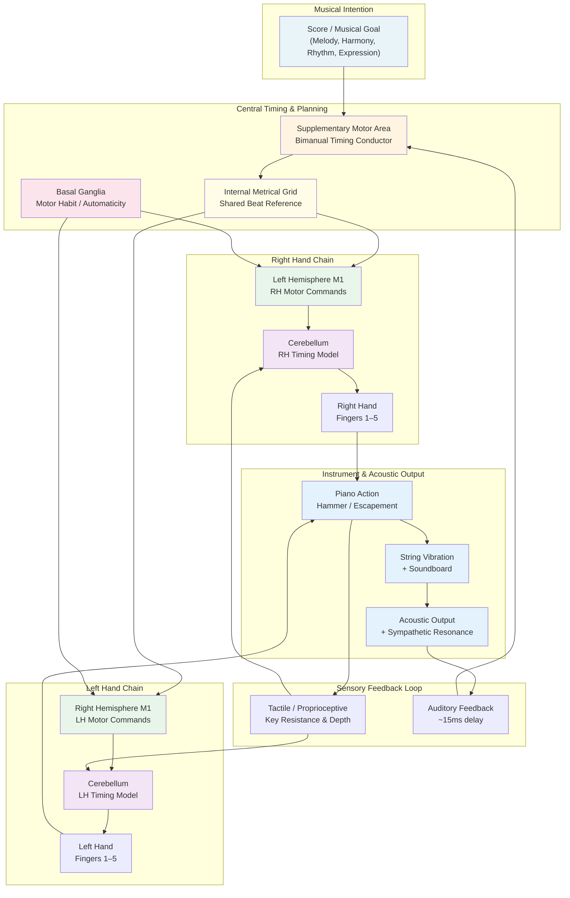
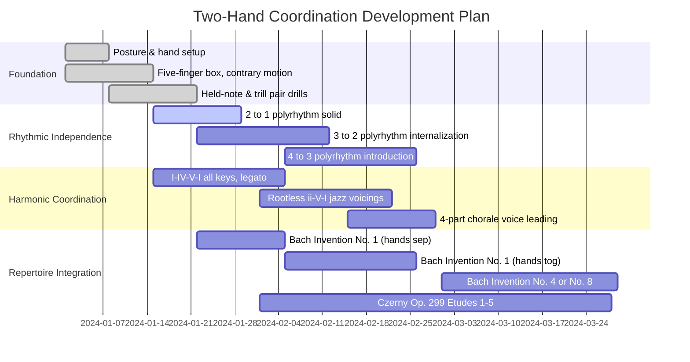
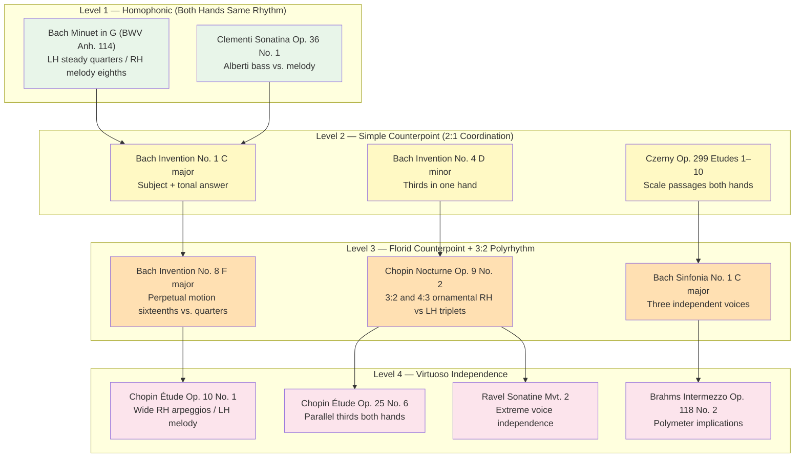
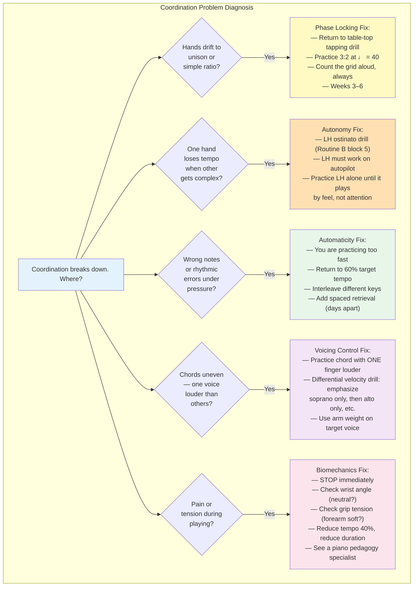

# Lesson 1: Two-Handed Piano Coordination — From First Touch to Fluent Counterpoint

---

## 1. First-Principles Intuition (The 15%)

Two-handed coordination is the foundational skill of polyphonic keyboard performance. Before drilling exercises, understand *why* the hands resist independence and *what* you're physically training against.

**The core problem:** Your two hands are wired for symmetry. The corpus callosum — the neural bridge between hemispheres — tends to synchronize homologous muscles. When your right hand lifts finger 3, your left finger 3 wants to lift too. This mirror-movement tendency is normal neurology; overcoming it is the entire project.

**The core solution:** Repetition builds dedicated inhibitory pathways that selectively block cross-hemisphere crosstalk. The cerebellum stores timing templates for each hand as separate motor programs. The supplementary motor area (SMA) acts as conductor, triggering both programs from a shared metrical grid without letting them collapse into unison.

**Acoustic consequence of timing:** Notes struck with even millisecond offsets produce comb filtering — constructive and destructive interference across the frequency spectrum. Perfectly simultaneous attacks in block chords create maximum spectral fusion; slightly staggered attacks (arpeggiaton) create a sweeping spatial bloom. You are controlling acoustic physics with finger timing, not just hitting notes together or apart.

**Anatomical constraint you must know:** Fingers 3, 4, and 5 share tendons from the extensor digitorum communis. Moving finger 4 alone creates passive drag on 3 and 5. This is why the 4–5 pair is the hardest to train independently. No amount of willpower bypasses the tendon; you must train the intrinsic hand muscles (interossei, lumbricals) to compensate.

**The key action physics:** A piano key is a lever. The escapement releases the hammer at roughly 10mm depth, after which key resistance drops sharply. Your finger must accelerate *through* that break point — if you decelerate before the break, the hammer loses velocity and the note goes soft or misses. This is why hesitant, timid playing sounds weak even at marked forte dynamics.

---

## 2. Hand Setup & Posture — Non-Negotiables

Get these right before any drill. Poor mechanics make every exercise a training in injury, not skill.

### 2.1 Bench Position

- **Height:** Forearms roughly parallel to the floor when fingers rest on the keys. Elbows should be level with or *very slightly above* the keybed. Sitting too low forces your shoulders up; sitting too high pushes your wrists into extension.
- **Distance:** Sit far enough that your elbows stay in front of your torso — not behind your body — when your hands are on middle-register keys. A fist's width of clearance between your body and the keyboard is a reasonable starting point.
- **Seat depth:** Sit on the front half of the bench. This encourages a slight forward tilt of the pelvis and a neutral lumbar curve. Do not slump.

### 2.2 Hand Arch & Finger Curve

The ideal hand shape resembles holding a large apple:

- MCP joints (knuckle line) form the apex of an arch — elevated, not collapsed
- PIP joints (middle knuckle) bent approximately 50–60°
- DIP joints (fingertip) bent 20–30°, contacting the key on the fingertip pad, not the flat of the finger
- Fingernails short enough that they never contact the key surface

**Common collapse failure:** The first knuckle (MCP) of finger 3 or 4 hyperextends inward, causing the arch to cave. This destroys force transfer efficiency and stresses the joint capsule. Correct it immediately — it does not self-correct with speed.

### 2.3 Wrist Alignment

- Wrist should be in neutral position: level with or very slightly below the knuckle line
- Avoid sustained wrist flexion (wrist dropped below keyboard level) — this compresses the carpal tunnel
- Avoid sustained wrist extension (wrist raised above knuckles) — this strains the extensor tendons
- The wrist acts as a shock absorber and fine-positioning device, not a primary power generator

### 2.4 Arm Weight vs. Finger Pressure

This distinction is central to mature technique:

| Source | Use For | Avoid When |
|--------|---------|------------|
| Arm weight (gravity + forearm drop) | Forte chords, octaves, full-tone melody | Rapid repeated notes, soft passages |
| Finger flexion | Fast passagework, articulation control, staccato | Playing fortissimo alone — causes gripping |
| Forearm rotation (pronation/supination) | Scale thumb crossings, chord roll direction | Lateral wrist deviation as a substitute |

**Practical test:** With your right hand in position, let your arm go completely loose from the shoulder. Your hand should drop onto the keys with a natural "thunk" that produces a moderate forte. If you have to actively push down to get a sound, you're working against yourself.

---

## 3. Keyboard Geography & Hand Coordination Maps

Before the drills, internalize the spatial logic.

### 3.1 Five-Finger Position Box

The foundation of all two-hand coordination is the five-finger box in each hand:

```
Right Hand (C4–G4):
  C    D    E    F    G
  1    2    3    4    5

Left Hand (C3–G3):
  C    D    E    F    G
  5    4    3    2    1
```

Both hands share the same finger-number logic relative to their own thumbs (1). The hands are mirror images of each other in position but not in musical function — the left hand carries bass/harmony, the right carries melody.

### 3.2 Two-Hand Interval Relationship Map

```
LH plays:   C    E    G    C (octave)
RH plays:   C    E    G    C (octave)
Interval:  Uni   3rd  5th  Oct
```

When both hands play the same pitch class in different octaves, you're reinforcing harmonics (octave doubling). When hands play different pitch classes, you're creating intervals whose acoustic interaction depends on spacing. **Rule of thumb:** Bass register intervals of a third or less create muddiness due to critical band overlap — space them out.

### 3.3 The Two-Hand Coordination Architecture



The key insight from this diagram: **both hands share one metrical grid** (the METER node) but execute from independent motor programs (separate M1 and cerebellum chains). Your practice goal is to make the shared grid rock-solid while giving each chain its own autonomous program.

---

## 4. Finger Independence Drills

Work through these in order. Do not rush to the next drill until the current one is clean at the target tempo.

### Drill 1: Five-Finger Warm-Up (Hanon #1 Pattern)

**Goal:** Even tone, controlled descent, no accent bumps on 3–4 crossing.

**Right Hand only, C position:**
```
Fingers:  1-2-3-4-5-4-3-2 | 2-3-4-5-4-3-2-1 | ...ascending by half step
Notes:    C-D-E-F-G-F-E-D | D-E-F-G-F-E-D-C | ...
```

**Left Hand only, same position:**
```
Fingers:  5-4-3-2-1-2-3-4 | 4-3-2-1-2-3-4-5 | ...ascending
Notes:    C-D-E-F-G-F-E-D | D-E-F-G-F-E-D-C | ...
```

**Metronome targets:** ♩ = 60 → 80 → 100 → 120 (sixteenth notes per beat)
- At 60: Listen for complete evenness. If any note is louder, that finger is gripping.
- At 100+: Keep the hand arch. The moment the knuckles collapse, stop and reset.

**Common error:** Accent on beat 1 of each group. Practice with a "negative accent" — consciously play beat 1 quieter until the accent reflex dies.

---

### Drill 2: Held-Note Independence (Intrinsic Muscle Isolator)

This targets the specific anatomical problem — training fingers to move independently despite shared tendons.

**Setup (Right Hand):**
```
Hold finger 1 on C4 (sustained, do not release)
Play: D-E-F-G with fingers 2-3-4-5, ascending then descending
```

**Sequence:**
1. Hold 1 + play 2 alone — feel if 1 trembles (it should not)
2. Hold 1 + play 3 alone
3. Hold 1 + play 4 alone — hardest. 4 wants to drag 3 and 5. Let it.
4. Hold 1 + play 5 alone
5. Hold 1+5, play 2-3-4 in sequence
6. Hold 1+3+5, play 2 and 4 alone

**Metronome:** ♩ = 60, one held note per beat. No target tempo for this drill — accuracy only.

**Left Hand:** Mirror exactly. The LH fourth finger (finger 2 in bass clef positions, but finger 4 by anatomy from thumb = 1) is typically even weaker due to less musical use historically.

---

### Drill 3: Trill Pairs — The 4–5 Problem Solver

```
Right Hand trill pairs to drill (weakest to strongest):
  4–5 on E–F (adjacent semitone — hardest)
  3–4 on D–E
  2–3 on C–D (usually strong by this point)
  1–2 on C–D (thumb-index, usually strong)
```

**Protocol per pair:**
- 10 seconds slow alternation at ♩ = 60 (eighth notes)
- 10 seconds at ♩ = 80
- 10 seconds at maximum clean speed
- 20-second rest — shake out the hand completely
- Record your maximum clean trill speed for 4–5

**Target benchmark:**
- Beginner: 4 Hz (4 notes per second) on weakest pairs
- Intermediate: 6 Hz
- Advanced: 8+ Hz with uniform velocity

**Left Hand:** Repeat the entire sequence. LH finger 4 (ring finger) is statistically the weakest finger in most pianists due to right-hand bias in practice history.

---

### Drill 4: Two-Hand Contrary Motion — C Major Scale

This is where coordination actually begins. Both hands move simultaneously but in opposite directions.

```
Both hands start on C4 (middle C):
  RH ascends: C-D-E-F-G-A-B-C  (fingers: 1-2-3-1-2-3-4-5)
  LH descends: C-B-A-G-F-E-D-C  (fingers: 1-2-3-4-1-2-3-4... wait, see below)
```

**Left Hand fingering for descending C major (starting C4 going down):**
```
C4: 1 (thumb)
B3: 2
A3: 3
G3: 4 — thumb tucks under here to 1 on F3
F3: 1
E3: 2
D3: 3
C3: 4 (or 5 if continuing lower)
```

**Why contrary motion first?** The hands mirror each other anatomically — when RH thumb goes under, LH thumb goes under too, in the opposite direction. This symmetry makes contrary motion *easier* than parallel motion as a first hands-together step.

**Metronome targets:** ♩ = 60 → 72 → 84 → 96 (quarter notes, one note per beat initially)

**Common errors:**
- Hesitation at the thumb-under crossing: practice the crossings in isolation (3-note loops around the crossing point) before combining
- Accent on the note after the thumb: the thumb lands quietly, like any other finger

---

## 5. Rhythmic Coordination — Building the Polyrhythm System

### 5.1 The Grid Concept

Every polyrhythm has a hidden common grid. Internalize this framework before touching the piano:

```
2:1 → grid of 2:   | 1 . 2 . |   LH: 1 . 2 .   RH: 1 2 1 2
3:2 → grid of 6:   | 1 2 3 4 5 6 |   LH: 1 . . 4 . .   RH: 1 . 3 . 5 .
4:3 → grid of 12:  | 1 2 3 4 5 6 7 8 9 10 11 12 |
                      LH: 1 . . . 5 . . . 9 . . .
                      RH: 1 . . 4 . . 7 . . 10 . .
```

The grid number = LH subdivisions × RH subdivisions ÷ GCD. Count it aloud before you play it.

### 5.2 Drill: 2:1 Coordination

**Setup:**
- LH: Whole notes or half notes (C major chord shell — C + G)
- RH: Quarter note scale passage (C-D-E-F | G-F-E-D, repeating)
- Metronome: ♩ = 72

```
Beat:  1    2    3    4
LH:    C...............G (hold)
RH:    C    D    E    F  (quarter notes)
```

**Practice sequence:**
1. LH alone — hold notes cleanly, listen to resonance
2. RH alone — even quarter notes, clean articulation
3. Hands together — LH releases *exactly* on beat 1 of next measure, RH doesn't care about LH's note changes

**Metronome targets:** ♩ = 60 → 80 → 100

---

### 5.3 Drill: 3:2 — The Musician's Polyrhythm

This is the most practically useful polyrhythm. It appears in Chopin nocturnes, ragtime, and jazz consistently.

**Mnemonic before piano:** Say aloud: **"Not dif-fi-cult"** = 3 syllables over **"hard"** = 2 syllables.
Or count: **1-2-3 / 1-2** simultaneously, feeling how "1" aligns and the other notes diverge.

**At the keyboard:**

```
Tempo: ♩ = 60 (triplet = ♩ = 90 effective)

Beat subdivisions (6 units per beat):
Position:  1  2  3  4  5  6
LH (3s):   X        X        X        (hits on 1, 3, 5)
RH (2s):   X     X     X     X     (hits on 1, 2.5, 4, 5.5 — or in 6-grid: 1, 4)

Wait — let's be precise:

One measure of 2 beats:
  6-unit grid:   1  2  3  4  5  6
  LH triplets:   X  .  .  X  .  .   (3 notes per measure pair of beats)
  RH duplets:    X  .  .  X  .  .   ...

For ONE BEAT:
  3-unit subgrid:   1    2    3
  LH triplet:       X    .    .    (plays on 1)  — wait, let's do it properly:
```

**Correct 3:2 over ONE measure of 2/4:**
```
Subdivide the measure into 6 equal parts:
  Sub-beat:   1   2   3   4   5   6
  LH (3):     X           X           X        ← beats at 1, 3, 5
  RH (2):     X               X               ← beats at 1, 4
```

**Piano voicing for the drill:**
```
LH: C – E – G (triplet eighth notes, low register, C3-E3-G3 arpeggiated upward)
RH: C5 – G5 (duplet, two half-beats apart)
```

**Step-by-step learning:**
1. **Table drill (no piano):** Tap LH on knee in triplets, RH on knee in duplets to a metronome at ♩ = 60. Count the 6-grid aloud.
2. **LH triplets alone on piano:** C3–E3–G3 in a triplet loop. Metronome ♩ = 60.
3. **RH duplets alone:** C5–G5 in duplets. Same metronome.
4. **Hands together:** Start extremely slow (♩ = 40). Verify that sub-beat 1 aligns (both hands), sub-beat 4 is RH only, sub-beats 3 and 5 are LH only.

**Metronome targets:** ♩ = 40 → 60 → 80 → 100

---

### 5.4 Drill: 4:3 — The Advanced Grid

```
One measure, subdivide into 12 equal parts:
  Sub-beat:   1  2  3  4  5  6  7  8  9  10  11  12
  LH (4):     X        X        X        X              ← 1, 4, 7, 10
  RH (3):     X           X           X                 ← 1, 5, 9
```

**Mnemonic:** Say **"Pass the god-damn but-ter"** = 4 syllables over **"pas-sa-ca-glia"** = 3 syllables. Feel the two rhythms diverge after the downbeat.

**Piano drill:**
- LH: C–G–C–G (four even quarter notes per measure in 3/4... wait)

**Correct metric framing for 4:3:** Use **one measure of 12/8** or think of it as **three beats** (LH gets 4 even notes, RH gets 3 even notes across the same span).

```
Span = 3 beats of ♩ = 60

LH (4 equal notes across 3 beats):   plays every 0.75 beats
RH (3 equal notes across 3 beats):   plays every 1.0 beat

12-unit grid (triplet sixteenths):
  1  2  3  4  5  6  7  8  9  10 11 12
  LH: X     X     X     X     X     X  ... no

LH 4 against RH 3 over 12 units:
  LH hits: 1, 4, 7, 10  (every 3 units)
  RH hits: 1, 5, 9      (every 4 units)
```

**Metronome targets:** ♩ = 40 → 54 → 66. This is genuinely hard. Budget 2–4 weeks of daily work.

---

### 5.5 Polyrhythm Progression Map


---

## 6. Harmonic Coordination — Chords, Voicing & Voice Leading

### 6.1 The Two-Hand Chord Distribution System

For any four-voice chord (SATB or root-7th-9th-3rd), the standard distribution is:

```
Right Hand: upper two voices (Soprano + Alto, or melodic top notes)
Left Hand:  lower two voices (Tenor + Bass, or root + 5th / root + 7th)
```

**C Major 7 chord (Cmaj7 = C–E–G–B):**
```
RH: G4 (finger 2) + B4 (finger 1 or 4) — upper voices
LH: C3 (finger 5) + E3 (finger 3) — lower voices
```

**G Dominant 7 (G7 = G–B–D–F) in second position (B bass):**
```
RH: D5 (finger 2) + F5 (finger 4)
LH: B2 (finger 5) + G3 (finger 2)
```

### 6.2 Drill: I–IV–V–I Voice Leading in C Major

**The smoothest voice leading possible — minimize every voice's motion:**

```
         I        IV       V        I
Chord:   C maj    F maj    G maj    C maj
Soprano: E5  →   F5  →    G5  →   E5     (stepwise up, then down)
Alto:    C5  →   C5  →    B4  →   C5     (common tone, then half-step)
Tenor:   G4  →   A4  →    G4  →   G4     (step, back, hold)
Bass:    C3  →   F3  →    G3  →   C3     (roots)

Fingering:
  RH:   (3,1) → (4,1) → (5,2) → (3,1)   [Alto on 1, Soprano on 3–5]
  LH:   (5,2) → (5,2) → (5,1) → (5,2)   [Bass on 5, Tenor on 2–1]
```

**Practice protocol:**
1. **LH alone:** play bass + tenor as blocked dyads, ♩ = 60. Legato — no gap between chords.
2. **RH alone:** play alto + soprano as blocked dyads, ♩ = 60. Legato.
3. **Hands together:** ♩ = 50, then 60, then 72. Listen for precise simultaneity on each chord change.
4. **Add pedal:** Depress sustain pedal immediately *after* the bass note lands on each beat (legato pedaling). This blurs nothing but sustains everything.

**Extend to all 12 keys** — cycle through the circle of fifths over weeks.

### 6.3 Rootless Jazz Voicings (A-Form & B-Form)

Jazz pianists frequently drop the root (left to the bass player) and voice the remaining chord tones for richness. These two shapes are moveable across all keys.

**A-Form (3rd in bass of RH voicing):**
```
Cmaj7 A-Form:
  LH: E3 + D4   (3rd + 9th)
  RH: G4 + B4   (5th + 7th)

G7 A-Form:
  LH: B2 + A3   (3rd + 9th... wait — G7 = G B D F)
  LH: B3 + F4... 

Correct G7 A-Form:
  LH: B2 (3rd) + F3 (7th)
  RH: A4 (9th) + D5 (5th... actually the 13th works better here)

Standard pedagogical A/B form for dominant 7ths:
  G7 "A" voicing (3rd on bottom):
    LH: B2 + F3   (3rd + ♭7th)
    RH: A4 + D5   (9th + 5th)

  G7 "B" voicing (7th on bottom):
    LH: F3 + B3   (♭7th + 3rd, inverted)
    RH: A4 + D5   (same top)
```

**Key insight:** The 3rd and 7th are the "guide tones" that define chord quality. Everything else (9ths, 11ths, 13ths) adds color. Train LH to always find the 3rd–7th pair automatically.

**Drill:** ii–V–I in C major with rootless voicings:
```
Dm7:   LH: F3 + C4  (3rd + ♭7th)    RH: E4 + A4  (9th + 5th)
G7:    LH: B2 + F3  (3rd + ♭7th)    RH: A4 + D5  (13th + 5th)
Cmaj7: LH: E3 + B3  (3rd + 7th)     RH: D5 + G5  (9th + 5th)
```

**Metronome:** ♩ = 60. Smooth voice leading — listen for the F in Dm7 moving to F in G7 (hold!), then resolving down to E in Cmaj7.

---

## 7. Formal Practice Routines

### Routine A: Finger Independence Foundation (15 minutes)

**Who this is for:** Anyone whose 4–5 pair is weaker than 2–3, or who notices tone unevenness in scales.

| Block | Exercise | Duration | Metronome | Focus |
|-------|----------|----------|-----------|-------|
| 1 | Held-note drill (hold 1, play 2–5 sequentially) | 3 min | ♩ = 60 | No sympathetic trembling in held finger |
| 2 | Trill pairs: 2–3, 3–4, 4–5 each hand | 5 min | ♩ = 60 → 100 | Evenness, not speed |
| 3 | Hanon #1 pattern, C → G (ascending by whole step) | 4 min | ♩ = 72 → 92 | Uniform tone, relaxed wrist |
| 4 | Contrary motion C major scale, 2 octaves | 3 min | ♩ = 60 → 80 | Clean thumb crossing, no accent |

---

### Routine B: Polyrhythmic Coordination (20 minutes)

**Who this is for:** Anyone working toward 3:2 or 4:3, or who loses their LH pulse when the RH gets complex.

| Block | Exercise | Duration | Metronome | Focus |
|-------|----------|----------|-----------|-------|
| 1 | 2:1 warm-up: LH half notes, RH quarters (C major scale) | 3 min | ♩ = 72 | RH subdivides LH exactly |
| 2 | Table drill — tap 3:2 on knees, count 6-grid aloud | 2 min | ♩ = 60 | Internalize grid before piano |
| 3 | 3:2 on piano: LH triplet C–E–G / RH duplet C5–G5 | 7 min | ♩ = 40 → 72 | Sub-beat 1 always aligns |
| 4 | 4:3 on piano, simple notes only (C3 / C4) | 5 min | ♩ = 40 → 54 | Count 12-grid aloud |
| 5 | LH ostinato (steady quarters) + RH free rhythm improv | 3 min | ♩ = 80 | LH unshakeable regardless of RH |

---

### Routine C: Harmonic Coordination & Voice Leading (20 minutes)

**Who this is for:** Anyone working on chord accuracy, legato between changes, or jazz voicings.

| Block | Exercise | Duration | Metronome | Focus |
|-------|----------|----------|-----------|-------|
| 1 | Interval drill: all intervals 2nd–octave, contrary motion | 4 min | ♩ = 50 | Exact simultaneity |
| 2 | I–IV–V–I in 3 keys (C, F, G), close voicing, legato | 5 min | ♩ = 60 | No gap between chords, listen to voice leading |
| 3 | Block → arpeggiated chord: same chord 4 speeds | 3 min | No metro | Control over arpeggio speed gradient |
| 4 | ii–V–I rootless voicings, C and F major | 5 min | ♩ = 60 | 3rd + 7th guide tones in LH always |
| 5 | 4-bar phrase: soprano held in RH, LH plays bass | 3 min | ♩ = 60 | Independence of phrasing between hands |

---

### Routine D: Bach Two-Part Invention Integration (25 minutes)

**Who this is for:** Anyone at intermediate level building genuine contrapuntal independence.

**Piece: Invention No. 1 in C Major (BWV 772)**

The opening subject:
```
RH (bars 1–2): C-D-E-F-E-D | C-E-G-C-B-C
Fingering:     1-2-3-4-3-2 | 1-2-3-5-4-5
```

```
LH enters in bar 3 with the same subject transposed:
LH (bars 3–4): C-D-E-F-E-D | C-E-G-C-B-C  (one octave lower)
Fingering:     5-4-3-2-3-4 | 5-3-2-1-2-1
```

**Step-by-step practice protocol:**

1. **RH alone, bars 1–4** (3 min): ♩ = 60. Sing the other voice aloud as you play.
2. **LH alone, bars 1–4** (3 min): ♩ = 60. Clear articulation, match the RH articulation style.
3. **Hands together, bars 1–2 only** (5 min): ♩ = 50. When LH holds, RH moves; when LH moves in bar 3, can you still hear the RH counter-subject clearly?
4. **Voicing exercise** (5 min): Play through bars 1–4 and deliberately bring out *only the LH* as the primary voice — make it louder than the RH. Then reverse. Then balance equally.
5. **Full run-through, bars 1–8** (5 min): ♩ = 60 → 72. Count every bar number aloud to stay oriented.
6. **Identify problem bar** (4 min): Find the one bar where coordination breaks down. Practice it in a 2-bar loop: bar before the problem + problem bar, 10 repetitions.

**Common trouble spots in Invention No. 1:**
- Bar 11: stretto entry (voices overlap at short interval) — learn each voice's entry note separately before combining
- Bars 15–19: running sixteenth notes in both hands in contrary motion — slow to ♩ = 44 and subdivide in four

---

## 8. The Long-Term Skill Progression

### 8.1 Weekly Milestone Map (3-Month Plan)



### 8.2 Repertoire Progression by Coordination Challenge



---

## 9. Troubleshooting — Diagnosing Your Specific Failure Mode

Before blindly drilling more, identify which coordination failure you're experiencing:

### Failure Mode Diagnostic



### Common Errors & Instant Fixes

| Symptom | Root Cause | Immediate Fix |
|---------|-----------|---------------|
| RH races ahead of LH in fast passages | LH hasn't automatized its pattern | 20 reps LH alone at target tempo before combining |
| "Lumpy" tone — some notes louder | Uneven finger velocity, residual tendon coupling | Held-note drills, focus on 3–4 pair specifically |
| Thumb crossing causes audible accent | Thumb landing too hard, arm not rotating | Pronate forearm INTO the thumb crossing; thumb lands gently |
| 3:2 collapses to 1:1 or 2:2 | No internal grid — relying on feel | Go back to table tapping + verbal counting. Piano only after grid is solid. |
| Chord changes have gaps | Fingers releasing too early, not overlapping | Use finger legato: keep one finger down until the next chord's finger lands |
| Left hand plays louder than right | LH habits from bass function; RH not weighted enough | Explicitly practice RH arm weight release; bring RH up 20% |
| Fatigue after 10 minutes | Gripping — sustained co-contraction | Stop, shake out, restart at half volume. Forte from velocity, not squeeze. |

---

## 10. Measurement & Benchmarks

Track these monthly to know if training is working:

### Progress Benchmarks by Stage

| Skill | Beginner | Intermediate | Advanced |
|-------|----------|--------------|----------|
| Trill rate (4–5 pair) | 3–4 Hz | 5–6 Hz | 7–8+ Hz |
| C major scale, both hands | ♩ = 60 | ♩ = 100 | ♩ = 132+ |
| 3:2 polyrhythm steady tempo | ♩ = 50 | ♩ = 80 | ♩ = 120 |
| 4:3 polyrhythm | Not yet | ♩ = 50 | ♩ = 80 |
| I–IV–V–I all 12 keys, legato | 3 keys | 8 keys | All 12 |
| Bach Invention No. 1 (clean) | Hands sep | ♩ = 60 HT | ♩ = 100 HT |
| Timing CV (polyrhythm) | > 15% | 10–15% | < 5% |

**How to measure timing CV without studio equipment:**
1. Record yourself on your phone playing 2 measures of a polyrhythm
2. Clap along to a metronome playback and notice where you diverge
3. If you can't hear divergence, you're consistent; if you can, the CV is too high

**Free MIDI analysis option:** Most digital pianos output MIDI. Connect USB to computer, open GarageBand (free on Mac) or LMMS (free, cross-platform), record, then view the piano roll. You can see note timing visually against the grid.

---

## 11. Practice Methodology Essentials

These aren't optional refinements — they determine whether your practice time converts to skill or just repetition.

**Chunk size:** Work on 2–4 measure units maximum. Mastery criterion: 5 consecutive clean repetitions. Only then expand.

**Slow practice rule:** If you can't play it slowly and cleanly, you cannot play it fast and cleanly. Speed is not the goal — it's the byproduct of accuracy under gradually increasing pressure.

**Interleaving (most important):** Do not drill the same passage 20 times in a row. Practice passage A, then B, then C, then back to A. This feels less productive but produces 40% better retention at the one-week mark. Blocked practice (AAABBBCCC) feels efficient but fades fast.

**The 3-day test:** After learning something new, don't touch it for 3 days. When you return, what remains is real retention. What dropped out needs more spaced repetition, not more same-day grinding.

**Hands-separate to hands-together ratio:** For genuinely difficult passages, spend 60% of time hands-separate, 40% hands-together. For passages you mostly know, flip it: 20% HS, 80% HT.

**Mental practice:** Sit away from the piano and play through a 4-bar passage mentally — hear every note, feel every finger motion. Research confirms this activates the same motor cortex regions as physical practice. Use it on travel days or when hands need rest.

**Record and listen:** Record yourself once per week on the same passage. Your ear in real-time is biased toward what you intended to play. The recording is objective. The gap between intention and recording *is* the work.

---

## 12. Sustain Pedal Integration

The damper pedal (right pedal) is the third hand — but it's the hand most beginners use incorrectly.

**Legato pedaling technique:**
```
Attack note → (slight delay, ~50ms) → Depress pedal
                                        ↑
                     This delay prevents blurring the attack
On next chord: Release pedal → Immediately re-depress (syncopated pedaling)
```

**Timing diagram:**
```
Beat:       1              2              3              4
Keys:       [chord 1]      [chord 2]      [chord 3]      [chord 4]
Pedal:      ↓ (hold)      ↑↓ (change)   ↑↓ (change)   ↑↓ (change)
                   ↑
            Pedal down just AFTER beat 1 attack
```

**Common mistake:** Depressing pedal *before or on* the attack. This blurs the bass note into whatever was ringing from before.

**Three pedal applications to drill:**

1. **Legato pedaling** (above) — standard for Romantic music
2. **Staccato with pedal** — depress pedal, play staccato notes; the pedal sustains while touch is dry. Creates a "singing staccato" (Chopin's style).
3. **No pedal** — Bach, most Classical period music. Legato comes entirely from finger overlap, not pedal blur.

---

## Summary: What You're Actually Training

Two-hand piano coordination is not a single skill — it's a cluster of three semi-independent capabilities that must all reach threshold before the music sounds like music:

1. **Finger independence** — the mechanical ability to move each digit selectively despite shared tendons. Trained through held-note drills and trill pairs. The 4–5 pair is always the bottleneck.

2. **Rhythmic independence** — the neurological ability to run two pulse streams simultaneously without phase locking. Trained through the 6-unit and 12-unit grids, always with verbal counting before piano contact.

3. **Harmonic coordination** — the perceptual and motor ability to distribute chord voices, execute smooth voice leading, and control differential voicing. Trained through I–IV–V–I progressions, Bach inventions, and rootless jazz voicings.

The hands become independent when each has its own automated motor program. They become coordinated when both programs share one metrical grid. Practice the programs separately first. Then merge them on the grid.
