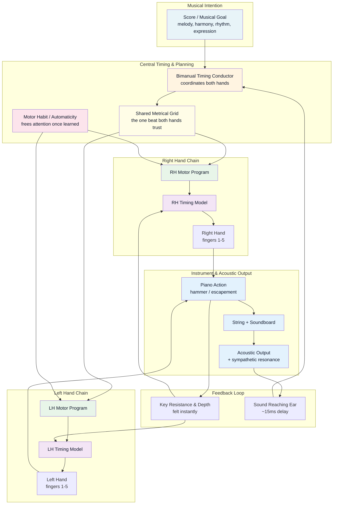
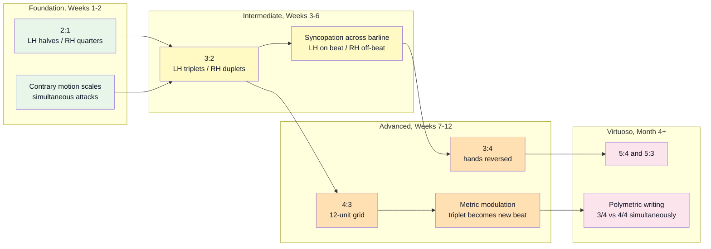
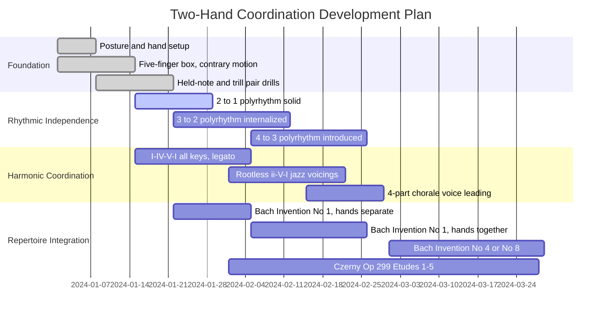
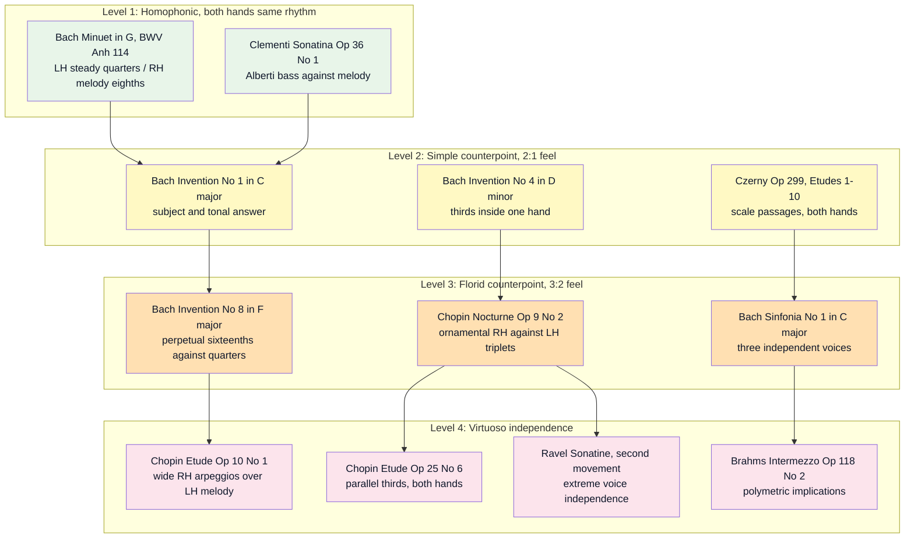
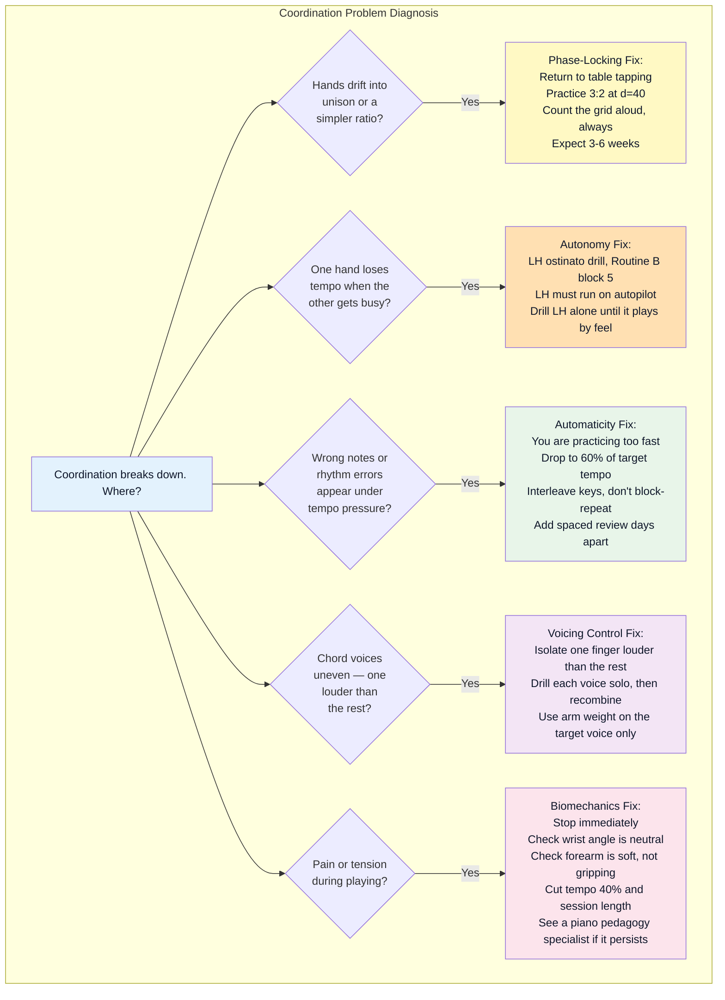

# Lesson 1: Two-Handed Piano Coordination — From First Touch to Fluent Counterpoint

---

## 1. First-Principles Intuition (The 15%)

Two-handed coordination is the foundation of all polyphonic keyboard playing. Before drilling, understand why the hands resist independence and what you're training against.

**The problem:** Your two hands are neurologically biased toward symmetry. When right-hand finger 3 lifts, left-hand finger 3 wants to lift too — this mirroring tendency is normal and universal. Training independence means building inhibitory control that lets each hand run its own motor program while both stay locked to one shared sense of beat.

**The anatomical catch:** Fingers 3, 4, and 5 share tendons from the extensor digitorum communis. Move finger 4 alone and it drags on 3 and 5 — this is why the 4–5 pair is always the hardest to separate. You can't out-will a tendon; you train the small intrinsic hand muscles (interossei, lumbricals) to compensate, which is slow, deliberate work, not strength training.

**The key-action physics you need to feel, not calculate:** A piano key is a lever with a catch point. The escapement releases the hammer at roughly 10mm of key depth — past that point, resistance drops sharply and the hammer is already in free flight toward the string. If your finger decelerates before that break, the hammer loses velocity and the note goes soft or doesn't sound, no matter how hard you "meant" to play. This is why tentative playing sounds weak even when the dynamic marking says forte: you have to commit through the key, not onto it.

**Why this matters for two hands together:** when both hands commit through the escapement point with the same timing, you get a fused, percussive attack (good for block chords and unison passages). When one hand's attack lags the other by even 20–30ms, you get a smeared, arpeggiated effect — useful on purpose, a flaw by accident. Coordination training is ultimately about controlling *when* each hand commits through that break point, on purpose, every time.

---

## 2. Hand Setup & Posture — Non-Negotiables

Fix these before any drill. Bad mechanics turn every exercise into a rehearsal for injury.

### 2.1 Bench Position
- **Height:** forearms roughly parallel to the floor, elbows level with or very slightly above the keybed. Too low and your shoulders hike up; too high and your wrists get pushed into extension.
- **Distance:** elbows should stay in front of your torso when your hands are on the middle keys — not pinned behind you. A fist's width between your body and the fallboard is a reasonable starting distance.
- **Seat:** sit on the front half of the bench, pelvis tilted slightly forward, lumbar curve neutral. Don't slump into the backrest — most piano benches don't have one anyway.

### 2.2 Hand Arch & Finger Curve
Picture holding a small apple in your palm:
- Knuckle line (MCP joints) forms the top of the arch — elevated, never caved in.
- Middle joint (PIP) bent about 50–60°.
- Fingertip joint (DIP) bent 20–30°, striking the key on the pad of the fingertip, not the flat.
- Nails trimmed short enough that they never touch the key.

**Watch for:** the knuckle of finger 3 or 4 buckling inward under pressure. This kills force transfer and stresses the joint capsule. It will not self-correct with speed — fix it the moment you see or feel it, even if that means stopping mid-phrase.

### 2.3 Wrist Alignment
- Neutral: level with, or a hair below, the knuckle line.
- No sustained wrist drop (compresses the carpal tunnel) and no sustained wrist hike (strains the extensor tendons).
- The wrist absorbs shock and makes small positional adjustments. It is not a power source.

### 2.4 Arm Weight vs. Finger Pressure

| Source | Use for | Avoid when |
|---|---|---|
| Arm weight (gravity + forearm drop) | Forte chords, octaves, singing melody tone | Fast repeated notes, quiet passages |
| Finger flexion from the knuckle | Fast passagework, staccato, articulation | Playing loud by gripping instead of dropping weight |
| Forearm rotation (pronation/supination) | Thumb crossings in scales, rolled chords | Substituting sideways wrist wobble for rotation |

**Quick test:** Let your right arm go completely dead from the shoulder and let it fall onto the keys. You should get a natural "thunk" at a moderate forte with zero conscious pushing. If you have to actively press to get sound, you're fighting your own arm.

---

## 3. Keyboard Geography & Coordination Maps

### 3.1 Five-Finger Position Box

```
Right Hand (C4–G4):
  C    D    E    F    G
  1    2    3    4    5

Left Hand (C3–G3):
  C    D    E    F    G
  5    4    3    2    1
```

Both hands number fingers from their own thumb (1), making them geometric mirror images — but musically they have opposite jobs: left carries bass and harmony, right usually carries melody.

### 3.2 Two-Hand Interval Spacing Rule

```
LH plays:   C    E    G    C (octave up)
RH plays:   C    E    G    C (octave up)
Interval:  Uni   3rd  5th  Oct
```

When both hands double the same pitch class an octave or more apart, you reinforce the harmonic series and the sound fuses. When the hands play close intervals *in the bass register* (a third or closer, below roughly C3), you get mud — the ear can't separate the overtones because they fall inside the same critical band. **Rule of thumb:** keep left-hand intervals a fourth or wider below middle C; you can voice thirds and seconds tightly only in the mid-to-upper register.

### 3.3 The Two-Hand Coordination Architecture



The practical takeaway: both hands answer to **one** shared beat, but each runs its own independent motor program. Your practice job splits in two — make the shared beat rock-solid, and make each hand's program automatic enough to run without supervision.

---

## 4. Finger Independence Drills

Work these in order. Don't advance until the current drill is clean at target tempo.

### Drill 1: Five-Finger Warm-Up (Hanon-Style Pattern)

**Goal:** even tone, no accent bump on the 3–4 crossing.

**Right Hand, C position:**
```
Fingers:  1-2-3-4-5-4-3-2 | 2-3-4-5-4-3-2-1 | ...up by half step each group
Notes:    C-D-E-F-G-F-E-D | D-E-F-G-F-E-D-C | ...
```

**Left Hand, same position:**
```
Fingers:  5-4-3-2-1-2-3-4 | 4-3-2-1-2-3-4-5 | ...up by half step each group
Notes:    C-D-E-F-G-F-E-D | D-E-F-G-F-E-D-C | ...
```

**Metronome targets (sixteenth notes, one group per beat):** ♩ = 60 → 80 → 100 → 120
- At 60: listen for perfect evenness. Any note poking out means that finger is gripping instead of releasing cleanly.
- At 100+: watch the knuckle arch in a mirror. The instant it collapses, stop and reset — don't push through a collapsed hand.

**Common error:** an automatic accent on beat 1 of every group. Fix it by deliberately playing beat 1 *quieter* than the rest until the reflex disappears.

---

### Drill 2: Held-Note Independence (The Tendon Isolator)

Targets the actual anatomical bottleneck.

**Setup, Right Hand:**
```
Hold finger 1 on C4 — sustained, do not release.
Play D-E-F-G with fingers 2-3-4-5, ascending then descending.
```

**Sequence:**
1. Hold 1, play 2 alone — check that 1 doesn't tremble.
2. Hold 1, play 3 alone.
3. Hold 1, play 4 alone — hardest. Finger 4 will try to drag 3 and 5 with it; let it happen at first, don't fight it with tension.
4. Hold 1, play 5 alone.
5. Hold 1+5 together, play 2-3-4 in sequence.
6. Hold 1+3+5 together, play 2 and 4 alone.

**Metronome:** ♩ = 60, one held note change per beat. This drill is about accuracy, not speed — there's no tempo ceiling to chase.

**Left Hand:** mirror the sequence exactly. LH finger 4 tends to be weaker than its RH counterpart simply from less lifetime use — give it extra reps.

---

### Drill 3: Trill Pairs — The 4–5 Problem Solver

```
Right Hand pairs, weakest to strongest:
  4-5 on E-F  (adjacent semitone — hardest)
  3-4 on D-E
  2-3 on C-D  (usually already fairly strong)
  1-2 on C-D  (thumb-index, usually strongest)
```

**Protocol per pair:**
1. 10 seconds slow alternation, ♩ = 60 (eighth notes)
2. 10 seconds at ♩ = 80
3. 10 seconds at your maximum *clean* speed
4. 20-second rest, shake the hand out completely
5. Log your maximum clean 4–5 trill rate for the week

**Benchmarks:**
- Beginner: 4 Hz (4 notes/second)
- Intermediate: 6 Hz
- Advanced: 8+ Hz with even velocity across all notes

**Left Hand:** repeat the full sequence. Statistically the LH ring finger is the weakest digit most pianists own, purely from historical right-hand bias in practice — don't skip it.

---

### Drill 4: Two-Hand Contrary Motion — C Major Scale

This is where real coordination starts: both hands move at once, in opposite directions.

```
Both hands start on middle C (C4):
  RH ascends: C-D-E-F-G-A-B-C
  Fingering:  1-2-3-1-2-3-4-5

  LH descends: C4-B3-A3-G3-F3-E3-D3-C3
  Fingering:   1 -2 -3 -4 -1 -2 -3 -4
```

The LH thumb tucks under at G3→F3 (between fingers 4 and 1), mirroring the RH thumb tuck at E4→F4 (fingers 3 to 1). This is why contrary motion is easier as a first hands-together exercise than parallel motion — the crossings happen in anatomical mirror image, so both hands "feel" the same gesture at the same moment.

**Metronome targets (quarter notes, one note per beat initially):** ♩ = 60 → 72 → 84 → 96

**Common errors:**
- Hesitation at the thumb crossing — isolate it. Loop just the three notes around the crossing point until it's seamless, then reinsert into the full scale.
- An audible bump on the note right after the thumb lands — the thumb should land as quietly as any other finger, which means rotating the forearm into it rather than dropping it from above.

---

## 5. Rhythmic Coordination — Building the Polyrhythm System

### 5.1 The Grid Concept

Every polyrhythm has a hidden common grid — the least common multiple of the two subdivisions. Internalize the grid away from the piano first.

```
2:1 → grid of 2:    LH hits 1       RH hits 1, 2
3:2 → grid of 6:    LH hits 1, 3, 5     RH hits 1, 4
4:3 → grid of 12:   LH hits 1, 4, 7, 10     RH hits 1, 5, 9
```

Grid size = LCM(LH subdivision, RH subdivision). Count the grid number aloud before you touch a key.

### 5.2 Drill: 2:1 Coordination

**Setup:**
- LH: half notes, a C major shell (C + G)
- RH: quarter-note scale fragment, C-D-E-F | G-F-E-D repeating
- Metronome: ♩ = 72

```
Beat:  1    2    3    4
LH:    C --(hold)-- G --(hold)--
RH:    C    D    E    F
```

**Sequence:**
1. LH alone — clean, resonant half notes.
2. RH alone — even quarters, clear articulation.
3. Together — LH changes exactly on beat 1 of the measure; RH keeps going regardless of what LH is doing.

**Metronome targets:** ♩ = 60 → 80 → 100

---

### 5.3 Drill: 3:2 — The Musician's Polyrhythm

The most useful polyrhythm in the repertoire — Chopin nocturnes, ragtime, jazz comping all depend on it.

**Mnemonic, away from the piano:** say "*not dif-fi-cult*" (3 syllables) against "*hard*" said twice evenly (2 syllables) in the same span. Feel beat 1 land together and everything else diverge.

**The 6-unit grid for one measure of 2 beats:**
```
Sub-beat:   1   2   3   4   5   6
LH (3):     X           X           X        ← hits on 1, 3, 5
RH (2):     X                   X            ← hits on 1, 4
```

**Piano voicing:**
```
LH: C3-E3-G3, arpeggiated upward, one triplet per beat
RH: C5 and G5, one duplet per beat
```

**Step-by-step:**
1. **Table drill, no piano:** tap LH triplets on one knee, RH duplets on the other, metronome ♩ = 60, counting the 6-grid aloud the whole time.
2. **LH alone on piano:** C3-E3-G3 triplet loop, ♩ = 60.
3. **RH alone on piano:** C5-G5 duplet loop, same metronome.
4. **Hands together:** start at ♩ = 40. Confirm sub-beat 1 lands together, sub-beat 4 is RH-only, sub-beats 3 and 5 are LH-only.

**Metronome targets:** ♩ = 40 → 60 → 80 → 100

---

### 5.4 Drill: 4:3 — The Advanced Grid

**The 12-unit grid, spanning 3 beats:**
```
Sub-beat:   1  2  3  4  5  6  7  8  9  10  11  12
LH (4):     X        X        X        X          ← hits on 1, 4, 7, 10
RH (3):     X              X              X       ← hits on 1, 5, 9
```

**Mnemonic:** say "*pass the god-damn but-ter*" (4 syllables) against "*pas-sa-ca-glia*" (3 syllables) over the same span. You'll feel the two rhythms split apart right after the shared downbeat.

**Piano drill:** strip it down to single notes first — LH plays C3 four times evenly across 3 beats, RH plays C4 three times evenly across the same 3 beats.

**Metronome targets:** ♩ = 40 → 54 → 66. This is genuinely difficult — budget 2–4 weeks of daily short sessions rather than expecting it in one sitting.

---

### 5.5 Polyrhythm Progression Map



---

## 6. Harmonic Coordination — Chords, Voicing & Voice Leading

### 6.1 Two-Hand Chord Distribution

For a standard four-voice chord, split it evenly:

```
Right Hand: the two upper voices (soprano + alto, or the melodic top notes)
Left Hand:  the two lower voices (tenor + bass, or root + 5th / root + 7th)
```

**Cmaj7 (C-E-G-B), close position:**
```
RH: G4 (finger 2) + B4 (finger 5) — upper voices
LH: C3 (finger 5) + E3 (finger 3) — lower voices
```

**G7 (G-B-D-F), second inversion with D in the bass:**
```
RH: F5 (finger 4) + B5... more practically keep it compact:
RH: D5 (finger 2) + F5 (finger 4)
LH: B2 (finger 5) + G3 (finger 2)
```

### 6.2 Drill: I–IV–V–I Voice Leading in C Major

The point of this drill is minimizing motion in every voice except the bass.

```
         I         IV        V         I
Chord:   C major   F major   G major   C major
Soprano: E5   →    F5   →    G5   →    E5     (up a step, up a step, down a third)
Alto:    C5   →    C5   →    B4   →    C5     (common tone, then half step, back)
Tenor:   G4   →    A4   →    G4   →    G4     (step up, step down, hold)
Bass:    C3   →    F3   →    G3   →    C3     (the roots)

Fingering:
  RH (alto, soprano): (1,3) → (1,4) → (2,5) → (1,3)
  LH (tenor, bass):   (2,5) → (2,5) → (1,5) → (2,5)
```

**Practice protocol:**
1. LH alone, blocked dyads, ♩ = 60, fully legato — no gap between chords.
2. RH alone, blocked dyads, same tempo, same legato standard.
3. Hands together: ♩ = 50, then 60, then 72. Listen for every chord change landing as one simultaneous event.
4. Add pedal: depress the sustain pedal immediately *after* the bass note lands on each new chord (legato pedaling, covered fully in Section 12). This connects the chords without blurring the bass attack.

Cycle this progression through all 12 keys over several weeks, following the circle of fifths — it's the fastest route to comfort in unfamiliar key signatures.

### 6.3 Rootless Jazz Voicings (A-Form & B-Form)

Jazz pianists typically drop the root — the bassist has it covered — and voice the remaining tones for color and smooth motion. These two shapes are moveable to any key.

**Guide tones rule:** the 3rd and 7th of a dominant or major 7th chord define its quality. Everything else (9th, 11th, 13th) is color on top. Train your left hand to find the 3rd–7th pair automatically before adding anything else.

**ii–V–I in C major, rootless:**
```
Dm7:    LH: F3 + C4   (3rd + b7th)     RH: E4 + A4   (9th + 5th)
G7:     LH: B2 + F3   (3rd + b7th)     RH: A4 + D5   (13th + 5th)
Cmaj7:  LH: E3 + B3   (3rd + 7th)      RH: D5 + G5   (9th + 5th)
```

**What to listen for:** the F in Dm7's left hand holds static into G7's left hand (same note, same finger if comfortable), then resolves down a half step to E in Cmaj7. That static-then-resolving motion in the inner voice is the entire sound of jazz ii-V-I language — train your ear to track it every time you play this progression.

**Metronome:** ♩ = 60, smooth connection between each voicing.

---

## 7. Formal Practice Routines

### Routine A: Finger Independence Foundation (15 minutes)

**For:** anyone whose 4–5 pair lags behind 2–3, or who hears uneven tone in scales.

| Block | Exercise | Duration | Metronome | Focus |
|---|---|---|---|---|
| 1 | Held-note drill (hold 1, play 2–5 in sequence) | 3 min | ♩ = 60 | No trembling in the held finger |
| 2 | Trill pairs 2-3, 3-4, 4-5, each hand | 5 min | ♩ = 60 → 100 | Evenness first, speed second |
| 3 | Five-finger pattern, C → G by whole steps | 4 min | ♩ = 72 → 92 | Uniform tone, relaxed wrist |
| 4 | Contrary motion C major scale, 2 octaves | 3 min | ♩ = 60 → 80 | Clean thumb crossing, no accent |

---

### Routine B: Polyrhythmic Coordination (20 minutes)

**For:** anyone building toward 3:2 or 4:3, or whose left hand drifts off tempo when the right hand gets busy.

| Block | Exercise | Duration | Metronome | Focus |
|---|---|---|---|---|
| 1 | 2:1 warm-up: LH halves, RH quarters, C major scale | 3 min | ♩ = 72 | RH divides LH's pulse exactly |
| 2 | Table drill: tap 3:2 on knees, count the 6-grid aloud | 2 min | ♩ = 60 | Internalize the grid before piano |
| 3 | 3:2 on piano: LH triplet C-E-G, RH duplet C5-G5 | 7 min | ♩ = 40 → 72 | Sub-beat 1 always aligns |
| 4 | 4:3 on piano, single notes only (C3 vs C4) | 5 min | ♩ = 40 → 54 | Count the 12-grid aloud |
| 5 | LH steady-quarter ostinato + RH free improvised rhythm | 3 min | ♩ = 80 | LH doesn't budge, regardless of RH |

---

### Routine C: Harmonic Coordination & Voice Leading (20 minutes)

**For:** anyone working on chord accuracy, legato chord changes, or jazz voicings.

| Block | Exercise | Duration | Metronome | Focus |
|---|---|---|---|---|
| 1 | Interval drill: 2nd through octave, contrary motion | 4 min | ♩ = 50 | Exact simultaneity on each interval |
| 2 | I-IV-V-I in C, F, and G, close voicing, legato | 5 min | ♩ = 60 | No gaps; track the voice leading |
| 3 | Same chord, block then arpeggiated at 4 speeds | 3 min | free | Control of arpeggio speed |
| 4 | ii-V-I rootless voicings in C and F | 5 min | ♩ = 60 | 3rd + 7th guide tones in LH, every time |
| 5 | 4-bar phrase: RH holds the melodic line, LH plays bass independently | 3 min | ♩ = 60 | Phrasing independence between hands |

---

### Routine D: Bach Two-Part Invention Integration (25 minutes)

**For:** intermediate players building genuine contrapuntal independence — two real, equal melodic lines, not melody-plus-accompaniment.

**Piece: Invention No. 1 in C Major, BWV 772**

```
RH, bars 1-2:  C-D-E-F-E-D | C-E-G-C-B-C
Fingering:     1-2-3-4-3-2 | 1-2-3-5-4-5

LH enters bar 3, same subject one octave lower:
LH, bars 3-4:  C-D-E-F-E-D | C-E-G-C-B-C
Fingering:     5-4-3-2-3-4 | 5-3-2-1-2-1
```

**Protocol:**
1. **RH alone, bars 1–4** (3 min), ♩ = 60. Sing the left-hand part aloud while you play the right hand — this forces you to know both lines, not just your hand's own.
2. **LH alone, bars 1–4** (3 min), ♩ = 60. Match the articulation style you used in the right hand.
3. **Hands together, bars 1–2 only** (5 min), ♩ = 50. When the left hand holds its long note, the right hand is moving — can you still track the right hand clearly as its own line, not background noise?
4. **Voicing balance drill** (5 min): play bars 1–4 bringing out only the left hand, louder than the right. Then reverse it. Then balance both equally. This trains independent dynamic control, the real goal of counterpoint.
5. **Full run, bars 1–8** (5 min), ♩ = 60 → 72. Count bar numbers aloud to stay oriented inside the form.
6. **Isolate the weak bar** (4 min): find the one bar where it falls apart. Loop it with the bar before it, 10 clean repetitions, before rejoining the full passage.

**Known trouble spots in this piece:**
- Bar 11: a stretto entry (the voices overlap at a short time interval) — learn each voice's entrance pitch in isolation before combining.
- Bars 15–19: running sixteenths in both hands moving in contrary motion — slow to ♩ = 44 and subdivide the beat into four when counting aloud.

---

## 8. The Long-Term Skill Progression

### 8.1 Three-Month Milestone Map



### 8.2 Repertoire Progression by Coordination Challenge



---

## 9. Troubleshooting — Diagnosing Your Specific Failure Mode

Identify which failure you're actually having before drilling blindly.



### Common Errors & Instant Fixes

| Symptom | Root cause | Immediate fix |
|---|---|---|
| RH races ahead of LH in fast passages | LH pattern isn't automatized yet | 20 reps LH alone at target tempo before recombining |
| "Lumpy" tone, some notes louder than others | Uneven finger velocity from tendon coupling | Held-note drills, with focus specifically on the 3-4 pair |
| Audible accent on thumb crossings | Thumb landing heavy, no forearm rotation | Rotate the forearm into the crossing; let the thumb land soft |
| 3:2 collapses into 1:1 or 2:2 | No internalized grid, relying on feel alone | Back to table tapping plus verbal counting; piano only after the grid is solid |
| Gaps between chord changes | Fingers releasing early, no overlap | Finger legato: hold the previous chord's finger down until the next one lands |
| Left hand consistently louder than right | LH habituated to carrying bass weight | Explicitly practice RH arm-weight release; bring RH volume up deliberately |
| Fatigue inside 10 minutes | Sustained co-contraction, i.e. gripping | Stop, shake out, restart at half volume; forte comes from velocity, not squeeze |

---

## 10. Measurement & Benchmarks

Check these monthly to confirm the training is actually working.

| Skill | Beginner | Intermediate | Advanced |
|---|---|---|---|
| Trill rate, 4-5 pair | 3-4 Hz | 5-6 Hz | 7-8+ Hz |
| C major scale, both hands | ♩ = 60 | ♩ = 100 | ♩ = 132+ |
| 3:2 polyrhythm, steady | ♩ = 50 | ♩ = 80 | ♩ = 120 |
| 4:3 polyrhythm | not yet | ♩ = 50 | ♩ = 80 |
| I-IV-V-I in all 12 keys, legato | 3 keys | 8 keys | all 12 |
| Bach Invention No. 1, clean | hands separate | ♩ = 60, hands together | ♩ = 100, hands together |

**Measuring polyrhythm consistency without a lab:**
1. Record yourself on a phone playing two measures of the polyrhythm.
2. Play it back and clap along with a metronome — you'll hear exactly where you drift.
3. If you can't detect drift by ear, you're consistent. If you can, that's your practice target for the week.

**Free MIDI option if your piano has USB-MIDI out:** connect to a computer, open GarageBand (free on Mac) or LMMS (free, cross-platform), record the passage, and look at the piano roll. You'll see your actual note timing laid against the grid lines — much more honest than your ears in the moment.

---

## 11. Practice Methodology Essentials

These determine whether practice time converts into skill or just burns time.

**Chunk size:** work in 2–4 measure units. Mastery criterion: 5 clean repetitions in a row, no near-misses. Only then expand the chunk.

**Slow practice rule:** if you can't play a passage slowly and cleanly, you cannot play it fast and cleanly — speed is the byproduct of accuracy repeated under gradually rising tempo, not a separate skill to chase.

**Interleaving:** don't drill the same passage 20 times in a row. Practice A, then B, then C, then back to A. It feels less efficient in the moment but produces meaningfully better retention a week later. Repeating one thing over and over (AAABBBCCC) feels productive and fades fast.

**The 3-day test:** after learning something new, leave it alone for 3 days. What you can still play when you return is real retention. What's gone needs spaced review, not more same-day repetition.

**Hands-separate to hands-together ratio:** for genuinely hard passages, spend roughly 60% of practice time hands-separate, 40% together. For passages you basically know, flip it — 20% separate, 80% together.

**Mental practice:** away from the piano, play a 4-bar passage in your head — hear every note, feel every finger motion as if playing it. This engages much of the same motor planning as physical practice and is useful on travel days or when your hands need rest.

**Record and listen:** record yourself once a week on the same passage. Your in-the-moment hearing is biased toward what you intended to play, not what actually happened. The gap between the recording and your memory of the take is the real information.

---

## 12. Sustain Pedal Integration

The damper pedal is effectively a third hand — and the one most self-taught players use backwards.

**Legato pedaling:**
```
Attack the note first → wait roughly 30-50ms → then depress the pedal
```
That brief delay is what keeps the attack of each new note clean instead of blurring it into whatever was ringing before it.

**Timing across a chord progression:**
```
Beat:    1                2                3                4
Keys:    [chord 1]        [chord 2]        [chord 3]        [chord 4]
Pedal:   down, holds      up-then-down     up-then-down     up-then-down
              ↑ pedal goes down just after the beat-1 attack lands, not on it
```

**The common mistake:** depressing the pedal before or exactly on the attack, which smears the new bass note into the previous chord's decay.

**Three pedaling techniques worth drilling separately:**
1. **Legato pedaling** (above) — the default for Romantic repertoire.
2. **Staccato with pedal** — depress the pedal once, then play detached, dry-touch notes over it. The pedal sustains the resonance while the fingers stay short — this is Chopin's "singing staccato" effect.
3. **No pedal** — Bach and most Classical-period keyboard music. Legato comes entirely from overlapping fingers, never from pedal blur.

---

## Summary: What You're Actually Training

Two-hand coordination isn't one skill — it's three semi-independent capabilities that all need to clear a threshold before the music starts sounding like music instead of an exercise:

1. **Finger independence** — moving each digit selectively despite shared tendons. Built through held-note drills and trill pairs. The 4–5 pair is always the bottleneck; budget it the most time.

2. **Rhythmic independence** — running two pulse streams at once without one collapsing into the other. Built through the 6-unit and 12-unit grids, always counted aloud before the hands touch the keys.

3. **Harmonic coordination** — distributing chord voices, executing smooth voice leading, and controlling the relative volume of individual voices inside a chord. Built through I–IV–V–I cycles, Bach inventions, and rootless jazz voicings.

Hands become independent once each one has its own automated motor program. They become coordinated once both programs answer to the same shared beat. Train the two programs separately first — then merge them on the grid, not before.
