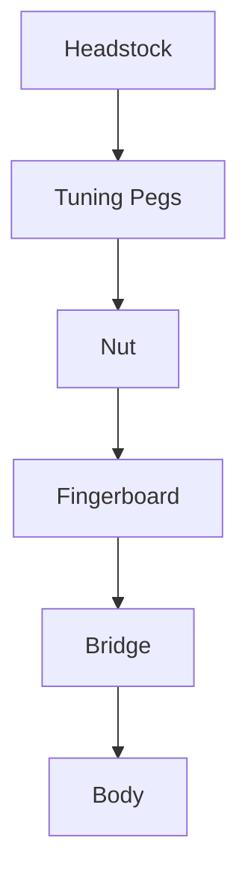

# Beginner Foundation: Strings
## 1. Everyday Intuition & First Principles
Imagine you have a rubber band. When you pluck it, it vibrates and makes a sound. Strings on a musical instrument work in a similar way. By plucking, strumming, or bowing the strings, you make them vibrate, producing musical notes. Just like how tightening or loosening a rubber band changes its pitch, adjusting the tension on a string instrument alters the sound it produces.

## 2. Foundational Vocabulary & Glossary
- **String:** A thin, usually metal or nylon, wire that vibrates to produce sound when plucked, strummed, or bowed.
- **Bridge:** A component that transfers the vibrations of the strings to the body of the instrument, amplifying the sound.
- **Nut:** A small piece of material that guides the strings over the headstock and helps maintain proper tension.
- **Tuning Pegs:** Mechanisms used to adjust the tension of the strings, thereby changing their pitch.
- **Fret:** A raised strip of material on the neck of a stringed instrument that divides the fingerboard into semitones, helping to produce specific notes.
- **Bow:** A tool used to play stringed instruments by drawing it across the strings to produce sound.

## 3. Visual System Flow
### ASCII Diagram
```
+-------------------+
|    Headstock      |
|  +-------------+  |
|  | Tuning Pegs |  |
|  +-------------+  |
|    +---------+    |
|    |   Nut   |    |
|    +---------+    |
|    |           |    |
|    |  Finger-  |    |
|    |   board   |    |
|    |           |    |
|    +---------+    |
|    |   Bridge  |    |
|    +---------+    |
|    |           |    |
|    |   Body    |    |
|    |           |    |
+-------------------+
```

### Mermaid Flowchart


## 4. Common Beginner Misconceptions & Mental Traps
- **Misconception:** All strings are the same. **Reality:** Strings can be made of different materials (e.g., steel, nylon) and have varying gauges, which affect the sound and playability of the instrument.
- **Misconception:** Tightening strings makes them sound better. **Reality:** Over-tightening strings can damage the instrument and make it difficult to play. Proper tension is crucial for optimal sound quality.
- **Misconception:** You need to learn complex techniques right away. **Reality:** Mastering the basics is essential before moving on to advanced techniques. Focus on building a strong foundation first.

## 5. Socratic Discussion Starters
- What are the primary differences between a nylon string and a steel string?
- How does the tension of a string affect its pitch and sound?
- Can you describe the role of the bridge in a stringed instrument?
- What are some common mistakes beginners make when tuning their instruments?
- How does the fingerboard and frets help in producing specific notes?
