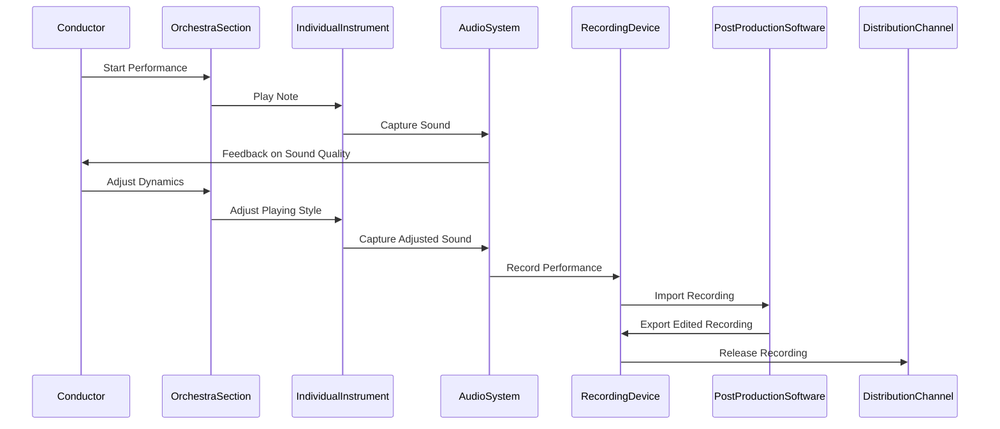

# Intermediate Foundation: Strings
## 1. Architectural Mental Model
In the realm of music performance, particularly with strings, the architectural mental model shifts from individual technique to the orchestration of multiple components. This involves understanding how individual strings (instruments) interact within a larger ensemble, the role of each component in the overall sound, and the technical infrastructure that supports performance and recording.

### Key Components:
- **Instruments:** Violin, Viola, Cello, Double Bass, etc.
- **Orchestra Sections:** Strings, Woodwinds, Brass, Percussion
- **Conductors:** Lead the ensemble, interpret scores, and guide performance.
- **Acoustic Spaces:** Concert halls, recording studios, and outdoor venues.
- **Audio Systems:** Microphones, amplifiers, mixers, and digital audio workstations (DAWs).

### Production Architecture:
- **Setup:** Proper placement of instruments, acoustics, and stage layout.
- **Rehearsal:** Coordination among musicians, section leaders, and conductors.
- **Performance:** Live or recorded, with emphasis on timing, dynamics, and expression.
- **Post-Production:** Editing, mixing, and mastering of recorded performances.

## 2. Systems Taxonomy & Component Protocols
### Standard Interfaces:
- **MIDI (Musical Instrument Digital Interface):** Protocol for electronic musical instruments to communicate with each other and with computers.
- **Open Sound Control (OSC):** Protocol for networked applications to communicate in real-time.
- **Audio Interfaces:** Hardware and software for capturing and processing audio signals.

### Protocols:
- **MIDI Protocol:** Used for controlling instruments, synthesizers, and other electronic devices.
- **OSC Protocol:** Used for real-time control and communication between software applications.

### Data Models:
- **Score Notation:** Standardized way to represent musical compositions.
- **Audio Files:** Formats like WAV, AIFF, and FLAC for high-quality audio storage.
- **MIDI Files:** Standard file format for storing sequences of MIDI messages.

## 3. Multi-Component Interaction Flow
### ASCII Sequence Diagram:
```
[Conductor] -> [Orchestra Section]: Start Performance
[Orchestra Section] -> [Individual Instrument]: Play Note
[Individual Instrument] -> [Audio System]: Capture Sound
[Audio System] -> [Conductor]: Feedback on Sound Quality
[Conductor] -> [Orchestra Section]: Adjust Dynamics
[Orchestra Section] -> [Individual Instrument]: Adjust Playing Style
[Individual Instrument] -> [Audio System]: Capture Adjusted Sound
[Audio System] -> [Recording Device]: Record Performance
[Recording Device] -> [Post-Production Software]: Import Recording
[Post-Production Software] -> [Recording Device]: Export Edited Recording
[Recording Device] -> [Distribution Channel]: Release Recording
```

### Mermaid Sequence Diagram:


## 4. Architectural Trade-offs & Production Pitfalls
### Trade-offs:
- **Quality vs. Cost:** High-quality instruments and equipment can significantly impact sound quality but come at a higher cost.
- **Flexibility vs. Specialization:** General-purpose instruments and systems can adapt to various styles and genres but may not excel in any one area.
- **Real-time Performance vs. Post-Production:** Live performances offer spontaneity and energy but may lack the precision and control of post-production.

### Production Pitfalls:
- **Poor Acoustics:** Can degrade sound quality and affect performance.
- **Inadequate Rehearsal:** Lack of preparation can lead to mistakes and inconsistencies.
- **Technical Failures:** Equipment malfunctions can disrupt performances and recordings.
- **Ineffective Communication:** Misunderstandings among musicians and conductors can lead to poor coordination.

## 5. Socratic Discussion Starters
1. **How do different string instruments interact within an orchestra to create a cohesive sound?**
2. **What are the advantages and disadvantages of using MIDI and OSC in live performances?**
3. **How can acoustic spaces be optimized for string performances?**
4. **What are the key considerations when choosing audio interfaces and recording devices for string ensembles?**
5. **How can post-production techniques enhance the quality of string recordings?**
6. **What are the most common technical challenges faced by string musicians and how can they be addressed?**
7. **How do different recording techniques (e.g., live vs. overdubbing) affect the final sound of a string performance?**
8. **What role does the conductor play in the architectural design of a string performance?**
9. **How can musicians and engineers collaborate to achieve the best possible sound in a string ensemble?**
10. **What are the ethical considerations in the production and distribution of string music?**
