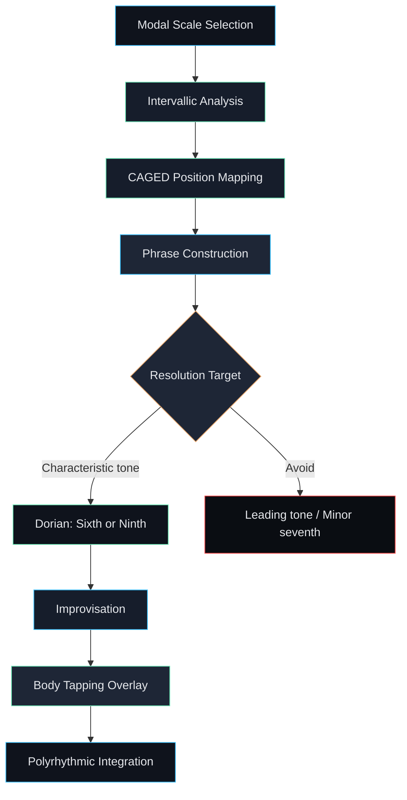

# Operational Verification Labs: String Instruments — Mechanics, Acoustics, and Performance Systems

## Objective & Laboratory Infrastructure

This laboratory establishes a rigorous, hands-on framework for understanding the mechanical, acoustic, and technique-specific properties of stringed instruments across four principal families: keyboard (piano), electric (solid-body guitar), acoustic (hollow-body guitar), and bass (electric bass). Participants will isolate and measure the relationship between physical technique, vibrational mechanics, and tonal output through controlled experimentation, parametric variation, and spectral analysis.

Unlike introductory music instruction, this curriculum treats instruments as **coupled mechanical-acoustic systems** governed by vibrational physics, harmonic series resonance, and energy transfer mechanisms. Each exercise bridges the gap between physiological motor control and acoustic outcomes, leveraging both physical practice and digital signal processing (DSP) analysis to validate theoretical predictions.

### Required Domain-Specific Tools, Environments, Packages, or Simulators

Participants must provision the following infrastructure:

**Physical Instruments:**
- **Piano:** Acoustic grand or upright with functional damper and una corda pedals (minimum 88 keys)
- **Electric Guitar:** Solid-body instrument with dual pickups (bridge and neck position), adjustable action, and standard tuning (E-A-D-G-B-E)
- **Acoustic Guitar:** Steel-string dreadnought or concert body with adjustable truss rod
- **Bass Guitar:** 4-string electric bass, standard tuning (E-A-D-G), passive or active electronics

**Software Tools:**
- **Digital Audio Workstation (DAW):** Ableton Live 12, Logic Pro X, Reaper, or Ardour (must support multi-track recording at 48 kHz / 24-bit minimum)
- **Spectral Analysis Tools:** iZotope RX (spectrogram), Sonic Visualiser, or Python with `librosa` and `matplotlib` for FFT-based harmonic analysis
- **Tuning & Pitch Detection:** GuitarTuna, Peterson StroboClip HD, or `aubio` (Python library)
- **MIDI Sequencer:** Optional for piano exercises with MIDI-enabled instruments

**Recording Equipment:**
- **Microphone:** Large-diaphragm condenser (e.g., Audio-Technica AT2020) for acoustic piano and guitar; dynamic mic (Shure SM57) for amplified guitar and bass
- **Audio Interface:** USB interface with >90 dB dynamic range (Focusrite Scarlett, Universal Audio Volt)
- **Headphones:** Closed-back studio monitors with flat frequency response (Beyerdynamic DT 770 Pro, Sony MDR-7506)

**Measurement & Timing:**
- **Metronome:** Digital metronome with subdivisions (Boss DB-90, Soundbrenner Core 2, or DAW-integrated click track)
- **Tuner:** Strobe or polyphonic tuner accurate to ±0.1 cent

### Laboratory Safety & Instrument Care

- Maintain consistent temperature (18–24°C) and humidity (40–60%) to prevent string breakage and neck warping
- Inspect strings for corrosion and replace at manufacturer-recommended intervals
- Ground all electrical equipment to prevent shock hazards and electromagnetic interference during recording

---

## Exercise 1: Foundational Practical Implementation — Technique as Mechanical Control

### Exercise 1.1: Piano Finger Independence and Damper Pedal Harmonic Enrichment

**Objective:** Isolate finger independence as a motor control problem and quantify the acoustic effect of sustain pedal engagement on harmonic envelope and sympathetic resonance.

**Theoretical Context:**

The piano is a **percussive chordophone**: hammers strike strings under tension, initiating transverse waves that propagate to the bridge, soundboard, and surrounding air. Each key actuates a mechanical escapement that accelerates a felt hammer to strike one to three strings tuned in unison (or slightly detuned for chorus effect).

Finger independence arises from the motor cortex's ability to execute **asynchronous muscle activation** across flexor digitorum superficialis and extensor digitorum tendons. Without independent control, adjacent fingers collapse into coupled motion, producing rhythmic errors and dynamic inconsistencies.

The **sustain (damper) pedal** lifts all dampers simultaneously, allowing strings to vibrate freely. When a note is struck with the pedal depressed, **sympathetic resonance** occurs: strings tuned to harmonic partials (octaves, fifths, major thirds at 2:1, 3:2, 5:4 frequency ratios) vibrate passively, enriching the timbre with overtones absent in the struck note's isolated spectrum.

**Procedure:**

1. **Postural Calibration:**
   - Sit with bench height adjusted so forearms are parallel to floor when hands rest on keys
   - Position center of body at middle C; feet flat, right foot near damper pedal
   - Wrists should float at key height, never sagging below or raised above
   - Fingers curve naturally as if holding a small ball; thumb lateral to palm plane

2. **Finger Independence Drills (Hanon Exercise 1):**
   - Execute Hanon Exercise No. 1 (ascending/descending five-finger patterns in C major) at 60 BPM quarter note pulse
   - **Isolation Protocol:** Play each note with deliberate finger lift (5–10 mm key depression), holding all other fingers stationary
   - Monitor for **parasitic motion**: if finger 3 lifts when finger 4 descends, the motor pattern is coupled
   - Record one repetition using a condenser microphone placed 30 cm above keyboard at dynamic marking **mezzo-forte** (consistent strike velocity)
   - Increment tempo by 10 BPM every two minutes until parasitic motion reappears; note threshold tempo

3. **Sustain Pedal Harmonic Analysis:**
   - Play a C major chord (C4-E4-G4) staccato (no pedal), holding each note for one beat
   - Repeat with damper pedal depressed throughout
   - Record both versions at 48 kHz sample rate
   - Load recordings into spectral analysis tool; generate FFT spectrogram with 4096-point window
   - **Expected Observation:** Pedal-engaged version exhibits extended decay envelopes and additional spectral peaks at harmonic partial frequencies (1046.5 Hz for C6, 1568 Hz for G6, etc.) absent in damped version

4. **Advanced Pedaling Techniques:**
   - **Half-pedaling:** Depress pedal 30–50% to partially lift dampers, allowing selective resonance while maintaining clarity
   - **Syncopated pedaling:** Engage pedal immediately *after* note attack to avoid blurring adjacent notes
   - Practice Chopin Prelude Op. 28 No. 4 in E minor (mm. 1–4) using syncopated pedaling; record and compare against legato pedaling (pedal engaged before attack)

**Validation Metrics:**
- Finger independence: Maximum tempo (BPM) before rhythmic error rate exceeds 5%
- Harmonic enrichment: Increase in spectral energy above 2 kHz when pedal engaged (measure RMS amplitude in frequency band)

---

### Exercise 1.2: Electric Guitar Alternate Picking and Pickup Position Spectral Variance

**Objective:** Develop **alternate picking** as a repeatable mechanical system with minimal variance in attack timing and amplitude, and measure the frequency-domain differences between bridge and neck pickup positions.

**Theoretical Context:**

Electric guitars convert string vibration into electrical signals via **electromagnetic induction**. A pickup consists of a magnet wrapped in thousands of turns of copper wire; when a ferromagnetic string vibrates in the magnetic field, it induces a time-varying voltage proportional to string velocity (first derivative of displacement). This signal is amplified and shaped by tone circuits before reaching the amplifier.

**Alternate picking** minimizes the time between successive note attacks by alternating downstroke and upstroke motions, reducing the pick's travel path compared to consecutive downstrokes. Efficient alternate picking requires:
- **Minimal pick angle variance:** Consistent pick angle (45–60° relative to string plane) ensures uniform string displacement
- **Wrist rotation vs. forearm motion:** Elite players favor wrist-driven oscillation (higher frequency ceiling) over forearm-driven motion (lower fatigue, lower peak tempo)

**Pickup position determines spectral content:**
- **Bridge pickup:** Senses string vibration near a node for low harmonics but antinode for high harmonics, emphasizing treble (>2 kHz) with pronounced attack transient
- **Neck pickup:** Positioned near an antinode for fundamental and low harmonics, yielding warmer tone with attenuated high-frequency content

**Procedure:**

1. **Pick Grip and Angle Calibration:**
   - Hold pick (0.73–1.0 mm thickness recommended) between thumb and index finger, exposing 2–3 mm of tip
   - Rest wrist lightly on bridge or float 1–2 cm above strings
   - Angle pick 45° in direction of motion (downstroke: trailing edge deeper; upstroke: leading edge deeper)

2. **Alternate Picking Chromatic Drill:**
   - Set metronome to 80 BPM eighth notes
   - Execute chromatic scale ascending from low E string (frets 5–8), strict alternate picking: down-up-down-up
   - **Timing constraint:** Each note must align within ±10 ms of metronome pulse (use DAW grid quantization to verify)
   - Record one octave at bridge pickup position with moderate gain (amplifier or DI signal)
   - Increment tempo by 10 BPM every two minutes until timing error exceeds threshold; note maximum sustainable tempo

3. **CAGED System Position Shifting:**
   - The **CAGED system** maps five geometric shapes (C, A, G, E, D open chord forms) across the fretboard, enabling scale and arpeggio visualization in any key
   - Practice G major pentatonic scale (G-A-B-D-E) in all five CAGED positions:
     - **Position 1 (E shape):** Root on 6th string, 3rd fret
     - **Position 2 (D shape):** Root on 4th string, 5th fret
     - **Position 3 (C shape):** Root on 5th string, 10th fret
     - **Position 4 (A shape):** Root on 5th string, 12th fret
     - **Position 5 (G shape):** Root on 6th string, 15th fret
   - Execute two-octave ascending/descending runs in each position at 100 BPM sixteenth notes, alternate picking throughout
   - **Objective:** Eliminate position shifts mid-run; each CAGED shape is a closed system requiring no lateral hand motion

4. **Pickup Position Spectral Comparison:**
   - Select bridge pickup; play open A string (110 Hz) with moderate attack
   - Record 2-second sample at 48 kHz
   - Switch to neck pickup; repeat identical attack
   - Load both recordings into spectral analysis tool; generate FFT magnitude spectrum (linear frequency axis, 0–5 kHz)
   - **Expected Observation:** Bridge pickup exhibits higher amplitude at 2.2 kHz, 3.3 kHz (harmonics 20, 30); neck pickup exhibits higher amplitude at 220 Hz, 330 Hz (harmonics 2, 3)
   - Calculate **spectral centroid** (frequency-weighted mean) for each pickup; bridge centroid should exceed neck by 500–1000 Hz


**Validation Metrics:**
- Alternate picking accuracy: Percentage of notes within ±10 ms of metronome grid at maximum tempo
- Spectral centroid difference: Bridge vs. neck pickup centroid separation (Hz)

---

### Exercise 1.3: Acoustic Guitar Modal Soloing and Percussive Body Tapping

**Objective:** Construct improvisational phrases using **modal scales** (non-major/minor tonal centers) and integrate **percussive body tapping** to generate polyrhythmic textures.

**Theoretical Context:**

**Modes** are rotations of the diatonic scale, each beginning on a different scale degree:
- **Ionian (major):** W-W-H-W-W-W-H (e.g., C-D-E-F-G-A-B-C)
- **Dorian:** W-H-W-W-W-H-W (e.g., D-E-F-G-A-B-C-D) — minor with raised sixth
- **Phrygian:** H-W-W-W-H-W-W (e.g., E-F-G-A-B-C-D-E) — minor with lowered second
- **Lydian:** W-W-W-H-W-W-H (e.g., F-G-A-B-C-D-E-F) — major with raised fourth
- **Mixolydian:** W-W-H-W-W-H-W (e.g., G-A-B-C-D-E-F-G) — major with lowered seventh
- **Aeolian (natural minor):** W-H-W-W-H-W-W (e.g., A-B-C-D-E-F-G-A)
- **Locrian:** H-W-W-H-W-W-W (e.g., B-C-D-E-F-G-A-B) — diminished

Each mode possesses a unique **intervallic signature** that defines its tonal color. Dorian's major sixth distinguishes it from Aeolian; Lydian's augmented fourth creates tension absent in Ionian.

**Body tapping** exploits the acoustic guitar's hollow body as a **Helmholtz resonator**: striking the soundboard generates percussive transients (broadband noise bursts) while simultaneously exciting the air cavity's resonant frequency (typically 80–120 Hz for dreadnought bodies). This technique overlays rhythm and pitch, common in flamenco (golpe) and modern fingerstyle (Andy McKee, Tommy Emmanuel).

**Procedure:**

1. **Modal Scale Construction:**
   - Select **D Dorian** (D-E-F-G-A-B-C-D)
   - Map scale across two octaves using CAGED position 2 (D shape), root on 4th string, 5th fret:
     ```
     e|-----5--7--8--10-----------
     B|--6--8--10----------------
     G|--7--9---------------------
     D|--5--7--9--10--------------
     A|---------------------------
     E|---------------------------
     ```
   - Practice ascending/descending at 60 BPM quarter notes, emphasizing the characteristic major sixth (B natural) over D minor root

2. **Modal Phrase Construction:**
   - Improvise 8-bar solo over D minor backing track (available via YouTube or iReal Pro app)
   - **Constraint:** Resolve phrases to sixth (B) or ninth (E) rather than tonic (D) to emphasize Dorian color
   - Avoid C# (leading tone from D major) and C (minor seventh from D natural minor)
   - Record improvisation; transcribe and analyze resolution points

3. **Body Tapping Integration:**
   - **Basic tapping pattern:** Right thumb alternates between bass note (6th string) and percussive strike on soundboard above sound hole
   - Notate rhythm: `[ Bass - Tap - Bass - Tap ]` in 4/4 time, quarter note pulse
   - Overlay tapping pattern with left-hand chord progression: Dm7 (2 bars) - G7 (2 bars)
   - Record pattern; generate waveform visualization
   - **Expected Observation:** Tap transients appear as sharp vertical spikes (attack <5 ms) superimposed on sustained bass note decay envelopes

4. **Advanced Polyrhythmic Tapping:**
   - Establish 3-against-4 polyrhythm: left hand plays triplet chord stabs (3 per bar) while right hand taps quarter-note pulse (4 per bar)
   - Record 4 bars; verify rhythmic alignment using DAW grid



**Validation Metrics:**
- Modal consistency: Percentage of phrase resolution points landing on characteristic modal tones (sixth/ninth for Dorian)
- Tapping transient clarity: Peak amplitude ratio of tap transient to bass note sustain (should exceed 3:1)

---

### Exercise 1.4: Bass Guitar Walking Bass Lines and Right-Hand Muting Mechanics

**Objective:** Construct **walking bass lines** that outline chord progressions through scalar and chromatic voice leading, and master **right-hand palm muting** to control sustain and articulation.

**Theoretical Context:**

Walking bass lines emerged in jazz as a contrapuntal device: the bass moves in quarter notes (or eighth notes in faster tempos) through chord tones (root, third, fifth, seventh) and passing tones (chromatic or diatonic connectors). Effective walking bass requires:
- **Harmonic awareness:** Each beat must imply the underlying chord without requiring other instruments
- **Voice leading:** Stepwise motion (half- or whole-step) between chords minimizes leaps and maintains melodic flow
- **Rhythmic precision:** Metronomic quarter-note pulse anchors the ensemble's timing

**Right-hand muting** involves resting the palm's thenar eminence (fleshy base of thumb) on the bridge or strings near the bridge, dampening high-frequency overtones and reducing sustain. This technique produces:
- **Articulative clarity:** Each note decays quickly, preventing harmonic smear in fast passages
- **Percussive attack:** Emphasis on the initial transient (first 10–20 ms) rather than sustained tone
- **Dynamic control:** Muting pressure varies from
