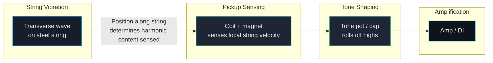
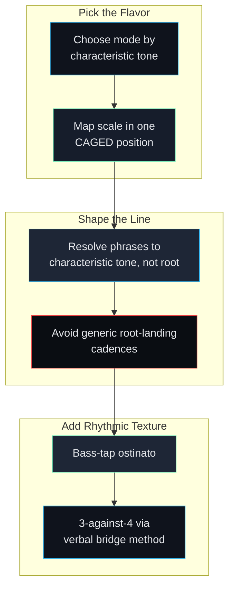
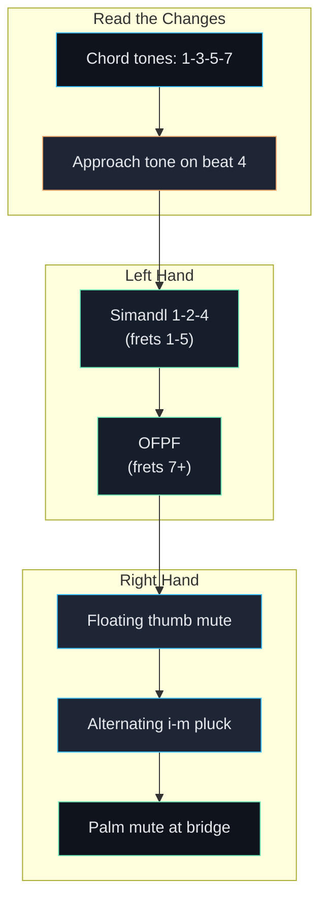
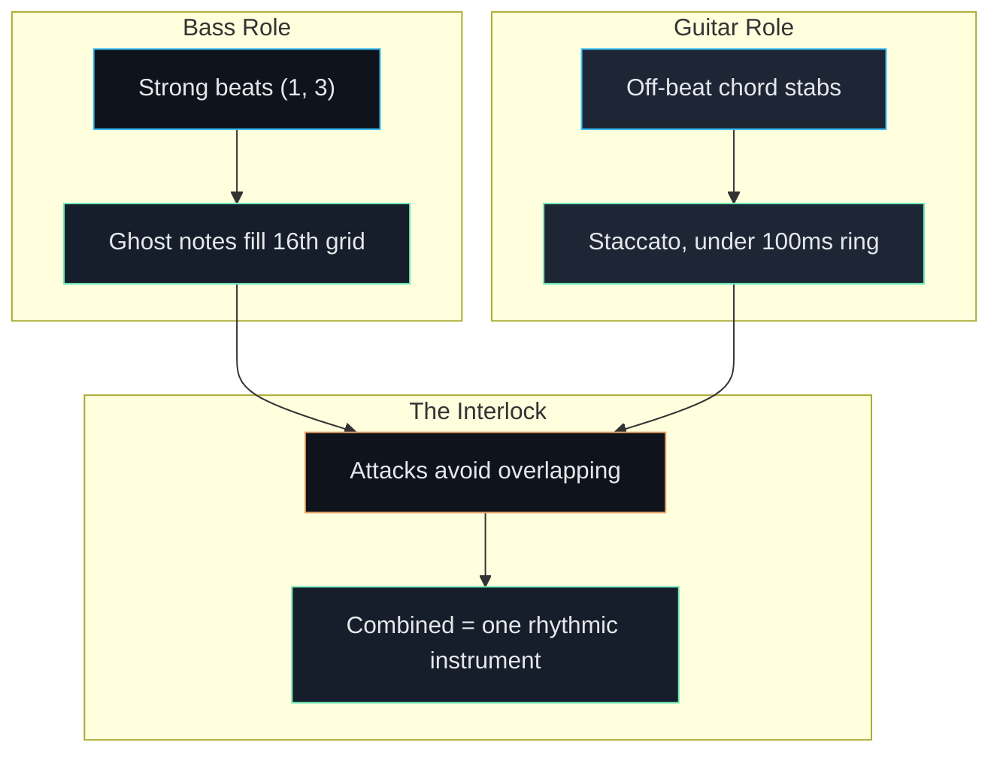
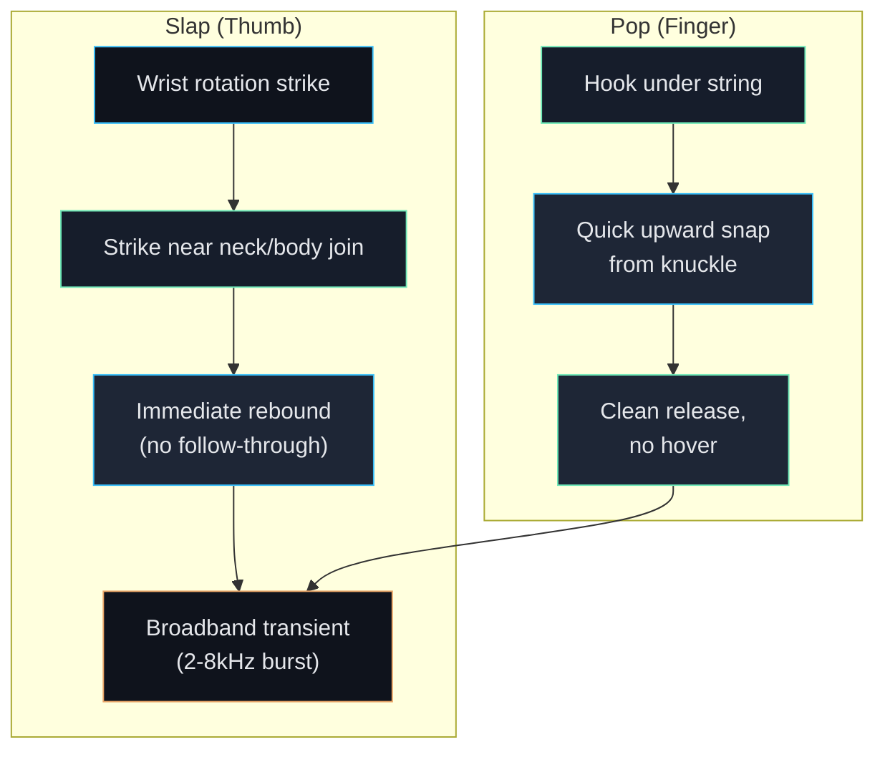

# Strings Masterclass: Piano, Guitar, and Bass — Technique, Harmony, and Groove

## How to Use This Course

This is a practice manual, not a reading assignment. Every section gives you a drill, a tempo ladder, and a way to check your own work by ear. You need four things on hand to get full value:

- **A metronome** (phone app is fine; Soundbrenner or Boss DB-90 if you want tap tempo and subdivision flashing)
- **A tuner** (clip-on chromatic tuner, ±1 cent accuracy is plenty)
- **A way to record yourself** (phone voice memo is fine to start; an audio interface + DAW if you want to actually look at waveforms)
- **Patience at slow tempos** — every drill below has a "too fast" failure mode, and starting there wires in bad habits that cost you months later.

Spectral analysis (FFT, spectrograms) shows up in a few places where *seeing* the difference between two techniques teaches something your ear might miss on day one — pickup position, una corda, slap vs. pluck. It is a confirmation tool, not the point of practice. If you don't have Python/librosa handy, skip those boxes; your ear and a tuner will get you 90% of the way.

---

## Part 1: Piano — Hand Independence, Pedaling, and Touch

### 1.1 Posture and Hand Shape (fix this before anything else)

- Bench height: forearms parallel to the floor, elbows slightly in front of the body line.
- Sit so middle C is roughly centered on your torso.
- Fingers curved as if lightly gripping a tennis ball — the fingertip, not the pad, contacts the key.
- Wrist floats level with the hand, never dipping below the keybed or cocking upward.
- The motion that produces a good piano tone is **arm weight dropped into the key**, not finger-poking from a stiff wrist. Isolated finger motion matters for *independence drills* (below), but musical playing uses a relaxed arm transferring weight through a stable hand frame.

### 1.2 Finger Independence: Hanon No. 1 with a Real Diagnostic

Hanon's five-finger patterns are a motor-control drill, not music — don't expect them to sound good, expect them to make your hands obedient.

**The drill:**
1. Right hand, C major, fingers 1-2-3-4-5 ascending then 5-4-3-2-1 descending, repeating up the keyboard in Hanon's standard pattern.
2. Metronome at 60 BPM, one note per click, quarter notes.
3. While finger 4 depresses its key, fingers 1, 2, 3, and 5 must stay still and relaxed on their keys. This is the actual skill — most pianists' ring finger (4) drags its neighbors down with it because they share a tendon sheath (flexor digitorum profundus). That's anatomy, not laziness; you're training independent *tendon excursion*, which is possible but takes repetition.

**The coin test:** balance a coin flat on the back of your playing hand. Play the exercise. If the coin stays put, your hand frame is stable and the motion is coming from the fingers. If it slides or falls, you're rocking the wrist or hand to compensate for weak fingers — slow down until the coin stays.

**Tempo ladder (don't skip steps):**
| Week | Tempo | Pass condition |
|---|---|---|
| 1 | 60 BPM | Coin stays still, zero missed notes, both hands separately |
| 2 | 80 BPM | Coin stays still, hands together |
| 3 | 100 BPM | Clean at mezzo-forte, consistent volume note-to-note |
| 4 | 120 BPM | Add dynamic shaping (crescendo across the ascending run) |

If parasitic motion (coin sliding) reappears at a given tempo, drop back 20 BPM and rebuild. This is the single most common mistake in Hanon practice: pushing tempo through sloppy motion instead of earning the next tempo with clean motion.

### 1.3 The Damper Pedal: What It Actually Does and How to Control It

**Why it works:** lifting the dampers lets *every* string vibrate freely, not just the ones you struck. Strings tuned to harmonic partials of your struck note (the octave, the fifth above that, etc.) pick up sympathetic vibration from the air and the soundboard, thickening the tone. That's the "glow" you hear under a sustained pedal chord that you don't get playing dry.

**Three pedaling techniques you need in your hands, not just your head:**

**1. Legato pedaling (pedal down before or exactly at the attack)** — used for sustained singing lines where you want zero gap between notes.

**2. Syncopated pedaling (pedal changes just *after* the attack)** — this is the one that actually keeps harmony clean. Sequence:
   - Play the note/chord with pedal *up*
   - The instant the key bottoms out, depress the pedal
   - Hold the note, then play the next note/chord *while still holding the old pedal*
   - The moment the new note sounds, release and immediately redepress the pedal (a "pedal change")

   This avoids smearing the old harmony into the new one while still giving you sustain. Practice it on a simple progression: C major chord, pedal down right after attack, play G major chord, change pedal right after that attack. Listen for clean harmonic separation — no leftover C-chord overtones bleeding into the G chord.

**3. Half-pedaling** — depress only 30–50% of the pedal's travel (roughly 1–2 cm on most grands). This partially lifts the dampers: enough to let some resonance through, not enough for full sustain blur. Use your heel as a pivot on the floor; control depth with ankle flexion, not leg lift. Practice: play a C major scale ascending, holding a constant half-pedal throughout. You want audible warmth without mud. If notes blur into each other, you're pressing too deep; if there's no glow at all, you're not pressing enough.

**Ear check (no equipment needed):** Play a C major chord with no pedal, let it ring until silent — note how fast it dies (under a second). Play the same chord with full pedal down — it should ring 3+ seconds and sound noticeably richer in the upper harmonics, almost shimmering. If you don't hear a clear difference, your dampers may need regulation (have a technician check it) or your pedal isn't going down far enough to fully clear the dampers.

**Repertoire application:** Chopin's Prelude Op. 28 No. 4 (E minor), first four bars — practice it twice, once with legato pedaling (pedal down before each chord change) and once with syncopated pedaling (pedal down just after). You'll hear the syncopated version keep the chromatic bass line distinct, while legato pedaling smears it. Use syncopated pedaling for this piece.

### 1.4 Rootless Jazz Voicings and Comping Rhythm

**Why rootless voicings exist:** in a trio or combo, the bassist owns the root. If the pianist also plays the root, you get doubled, muddy bass register and a less transparent chord. Drop the root, and the voicing becomes lighter and more harmonically focused — this is standard practice from bebop through modern jazz piano.

**The two core shapes for a maj7 chord, built on Cmaj7 (C-E-G-B):**

**A-form (3rd on the bottom):** E–G–B–D (3-5-7-9), right hand fingers 1-2-3-5
**B-form (7th on the bottom):** B–D–E–G (7-9-3-5), right hand fingers 1-2-3-5

For a ii-V-I in C major (Dm7 – G7 – Cmaj7), here are both forms with real voice leading:

**A-form voicings (3rd in bass):**
```text
Dm7:   F-A-C-E   (fingers 1-2-3-5)
G7:    B-D-F-A   (fingers 1-2-3-5)
Cmaj7: E-G-B-D   (fingers 1-2-3-5)
```

**B-form voicings (7th in bass):**
```text
Dm7:   C-E-F-A   (fingers 1-2-3-5)
G7:    F-A-B-D   (fingers 1-2-3-5)
Cmaj7: B-D-E-G   (fingers 1-2-3-5)
```

Play through the A-form progression as whole notes and *watch your hand shape stay almost still* — most voices move by a step or less between chords. That's the entire point: minimal motion, maximum harmonic clarity. Then do the same with B-form. In real playing you alternate between A and B forms depending on which sits better under the next chord (this is called "voicing in fourths from either form" in jazz piano pedagogy — don't worry about the label, just feel which one leads more smoothly into the next chord by ear).

**Comping rhythm — get off the downbeat:**

A pianist who plays a chord on every beat 1 sounds stiff and gets in the drummer's way. Real comping anticipates or delays the attack:

```text
Beat:     1    2    3    4
Comp:     .    C    .    .     ← chord lands on beat 2
Beat:     1    2    3    4
Comp:     .    .    .    D+    ← chord lands on the "and" of 4 (anticipating next bar)
```

**Drill:** Loop Dm7–G7–Cmaj7 at 100 BPM. Tap your foot on 1 and 3 out loud while comping only on beat 2 and the "and" of 4. This trains your internal pulse to stay steady while your hands play around it — the actual skill of jazz comping. Aim for most of your chord attacks landing off the beat; a comp that's all downbeats will sound mechanical regardless of how good the voicings are.

### 1.5 Una Corda and Touch Control

**Mechanism (one paragraph, then we move on):** the soft pedal shifts the whole keyboard and hammer action sideways so hammers strike two strings per note instead of three (on notes with triple stringing). Fewer strings struck means less total energy transferred, and the hammer also contacts a slightly different, less-compacted felt surface, softening the attack. Net effect: quieter, warmer, more veiled tone, with the treble losing more top-end sparkle than the bass.

**Practical use, not just theory:** Use una corda for sustained pp-p passages where you want *color change*, not just quietness — you can already play quietly without the pedal by controlling touch. Una corda is for when you want the *character* to shift, like a muted trumpet versus an open one.

**Drill:** play Debussy's "Clair de Lune," mm. 15–27 (the floating middle section) twice at matched soft dynamic — once with una corda held down throughout, once without. Listen for the difference in color, not volume: una corda should sound more distant and veiled even at the same loudness. If you can't hear a difference, you're probably still playing too loud for the pedal's effect to register — un corda matters most in the ppp–mp range.

**Touch ladder:** play middle C five times at pp, p, mf, f, ff, aiming for even, deliberate jumps in volume rather than a blur between them. This is arm-weight control, not finger force — more weight dropped from a relaxed shoulder, not harder finger strikes.

---

## Part 2: Electric Guitar — Picking Mechanics, CAGED, Pickups

### 2.1 Pick Grip and Alternate Picking

**Grip:** hold the pick between thumb pad and the side of the index finger, exposing about 2–3 mm of tip. Thickness 0.73–0.88 mm is a forgiving starting point — thinner picks are springier and easier for fast alternate picking; thicker picks give more attack and control for riffing.

**Angle:** tilt the pick roughly 15–20° off the plane of the strings, trailing edge down on downstrokes. This small slant lets the pick glance off the string instead of catching it dead-on, which is what lets you move fast without snagging.

**The real mechanical goal of alternate picking:** minimize the distance the pick travels between strokes. The motion comes from a small wrist rotation (pivoting near the base of the hand), not the forearm or elbow. If you watch a fast alternate-picker's hand, the visible motion is tiny — almost all of the "work" is happening in millimeters, not inches.

**Chromatic drill (builds the basic down-up reflex and left-right sync):**

Metronome at 80 BPM, eighth notes. One finger per fret, frets 5-6-7-8 on the low E string:

```text
e|------------------------------
B|------------------------------
G|------------------------------
D|------------------------------
A|------------------------------
E|--5--6--7--8--8--7--6--5------
   1  2  3  4  4  3  2  1  (fret-hand fingers)
   D  U  D  U  D  U  D  U  (pick strokes: down-up strictly alternating)
```

Move this same four-fret block up one string at a time (A string, D string, G string, B string, high E string) to cover the whole neck.

**Tempo ladder:**
| Week | Target | Notes |
|---|---|---|
| 1 | 80 BPM eighth notes | Zero buzzing, even volume on down and up strokes |
| 2 | 100 BPM eighth notes | Record yourself; downstrokes should not be louder than upstrokes |
| 3 | 120 BPM eighth notes | Add string changes (move the pattern across all 6 strings in one pass) |
| 4 | 100 BPM sixteenth notes | Same physical pattern, double the density |

**The three failure modes you will hit, and the actual fix:**

- **String hopping** — pick traveling up and away from the strings between notes instead of staying close. Fix: practice picking *through* the string with almost no follow-through height, as if the string were barely there.
- **Downstroke bias** — upstrokes sound thinner/quieter. This is normal at first because downstrokes use gravity-assisted motion. Fix: practice upstroke-only repetitions on an open string until the attack sounds as full as a downstroke, then reintroduce alternation.
- **Tension creep** — forearm tightens progressively over a minute of playing. Fix: stop every 20–30 seconds, shake the hand out completely, and restart. Tension is the #1 speed ceiling, not finger dexterity.

### 2.2 CAGED System: Five Positions, One Fretboard

CAGED maps the five open-position chord shapes (C, A, G, E, D) as movable templates that tile the entire neck. Once you see a scale or arpeggio as "the shape that lives inside a G-shape chord," you stop thinking in isolated scale boxes and start seeing the whole fretboard as one connected system.

**G major pentatonic (G-A-B-D-E) across the five CAGED positions:**

**Position 1 — E-shape (root on 6th string, fret 3):**
```text
e|--------------------3--5--
B|------------------3--5----
G|------------2--5----------
D|---------5----------------
A|------3--5-----------------
E|---3------------------------
```

**Position 2 — D-shape (root on 4th string, fret 5):**
```text
e|-----------------------5--8--
B|-------------------5--8------
G|-----------5--7---------------
D|------5--7---------------------
A|---5--7--------------------------
E|---------------------------------
```

**Position 3 — C-shape (root on 5th string, fret 10):**
```text
e|------------------8--10--
B|----------------8--10----
G|-----------7--10----------
D|------7--10----------------
A|--10------------------------
E|----------------------------
```

**Position 4 — A-shape (root on 5th string, fret 12):**
```text
e|-------------------10--12--
B|-------------10--13--------
G|--------10--12--------------
D|---12------------------------
A|---12------------------------
E|----------------------------
```

**Position 5 — G-shape (root on 6th string, fret 15):**
```text
e|--12--15--
B|--13--15--
G|--12--14--
D|--12--14--
A|--15------
E|--15------
```

**Drill:** spend five focused minutes per position per day. Within one position, play two octaves ascending and descending at 100 BPM sixteenth notes with strict alternate picking, keeping your hand anchored — no lateral shifting mid-run. Master positions 1 and 2 solidly (one week each) before adding 3–5.

**The actual payoff drill, once you know all five shapes:** play the G major pentatonic scale ascending, but shift to the *next* CAGED position every two notes instead of staying in one box. This forces you to see the connections between shapes rather than treating them as five separate scales, which is the real point of learning CAGED.

### 2.3 Pickup Position and Tone

**Why bridge and neck pickups sound different:** a pickup senses string velocity at the point along the string where it sits. Near the bridge, the string's vibration pattern has a lot of high-frequency content because that point is close to a node for the fundamental but an antinode for many upper harmonics. Near the neck, the pickup sits closer to where the fundamental's antinode is strongest and farther from where the highest harmonics peak, so you get a fuller, bassier, "rounder" capture.

**Practical ear drill, no equipment needed:** play the open A string with identical attack strength on bridge pickup, then neck pickup, then blend both (if your guitar has a 3-way or 5-way switch, try the middle position too). Bridge should sound thinner and more cutting/aggressive; neck should sound warmer and rounder; the blend sits between, often slightly hollow/quacky due to partial phase cancellation (classic "in-between" Strat tone).

**If you want to see it, not just hear it:** record 2 seconds of the open A string on each pickup at 48kHz, then run this:

```python
import librosa
import numpy as np

bridge, sr = librosa.load('bridge_pickup.wav', sr=48000)
neck, _ = librosa.load('neck_pickup.wav', sr=48000)

bridge_fft = np.abs(np.fft.rfft(bridge))
neck_fft = np.abs(np.fft.rfft(neck))
freqs = np.fft.rfftfreq(len(bridge), 1/sr)

bridge_centroid = np.sum(freqs * bridge_fft) / np.sum(bridge_fft)
neck_centroid = np.sum(freqs * neck_fft) / np.sum(neck_fft)

print(f"Bridge spectral centroid: {bridge_centroid:.0f} Hz")
print(f"Neck spectral centroid: {neck_centroid:.0f} Hz")
```

A bridge-vs-neck centroid gap of roughly 500–1000 Hz on the same note is typical — bridge pulls brighter. If you see almost no difference, check that your pickup selector switch is actually seated in the detent position (a common false reading from a switch resting between positions).



---

## Part 3: Acoustic Guitar — Modal Soloing and Percussive Tapping

### 3.1 Modes You Can Actually Use (Not Just Memorize)

Modes are the same seven notes as a major scale, starting from a different degree, but what matters in practice is the **one note that gives each mode its flavor** — learn that note, not the whole formula.

| Mode | Flavor relative to natural minor/major | Characteristic tone |
|---|---|---|
| Dorian | minor with a brighter 6th | raised 6th |
| Phrygian | minor with a dark, flamenco 2nd | lowered 2nd |
| Lydian | major but floating/unresolved | raised 4th |
| Mixolydian | major but bluesy/rock | lowered 7th |

**D Dorian (D-E-F-G-A-B-C), mapped in CAGED position 2 (D-shape, root fret 5):**
```text
e|----------------------------5--7--8--10--12--
B|----------------------6--8--10---------------
G|----------------7--9--------------------------
D|-----------5--7--9--10------------------------
A|------------------------------------------------
E|------------------------------------------------
```

**Drill:** play the scale at 60 BPM, but every time you hit B (the 6th) or E (the 9th, an octave up), hold it slightly longer and lean into it dynamically. That's the characteristic color of Dorian — everything else is just the connective tissue of a minor scale.

**A/B ear test:** record yourself playing D Dorian (B natural), then record D natural minor (same scale but Bb instead of B). Play them back to back. Dorian should sound noticeably brighter/less melancholic — if you can't hear the difference, you're probably not landing on the 6th degree with enough emphasis in the Dorian version.

**Improvising with intent:** over a Dm7-G7 vamp, the single biggest thing that makes a solo "sound Dorian" rather than "sound like generic D minor" is *where you end your phrases*. Ending on D (the root) sounds fine but generic. Ending on B or E — the characteristic tones — immediately signals Dorian color to the listener's ear.

- **Strong Dorian cadence:** D–E–G–A–B (lands on the 6th)
- **Strong Dorian cadence:** A–B–C–D–E (lands on the 9th)
- **Generic minor cadence (avoid over-using):** D–E–F–G–A–C–D (lands on the root, sounds like plain natural minor)

### 3.2 Percussive Body Tapping

**Why this works acoustically:** an acoustic guitar body is a Helmholtz resonator — the sound hole and air cavity have a natural resonant frequency (roughly 80–120 Hz for a dreadnought), and the top itself responds to a direct strike with a broadband percussive "thump" independent of string vibration. Tapping the top gives you a drum sound built into the instrument you're already holding.

**Where and how to strike:** tap roughly 5 cm above the sound hole, using a quick wrist-rotation strike (think bouncing a basketball — rebound off the wood immediately, don't press in). Striking closer to the bridge gives a higher-pitched knock; closer to the edge of the lower bout gives a deeper thump. Experiment and pick the spot that gives you the clearest "thwack" without buzzing against nearby strings.

**Basic bass-tap pattern (right-hand thumb):**
```text
Beat:     1       2       3       4
Action:   Bass    Tap     Bass    Tap
```

Thumb alternates: pluck the low E string on beats 1 and 3, strike the top (near the sound hole) on beats 2 and 4. Keep the motion coming from the wrist, not the whole arm.

**Add the left hand:** hold Dm7 (x-x-0-2-1-1) for two bars, then G7 (3-2-0-0-0-1) for two bars, changing chords exactly on beat 1 while the bass-tap pattern in the right hand never interrupts. This chord-change-under-a-continuous-rhythm coordination is the actual skill — most players' rhythm hiccups the instant their fretting hand has to move.

**3-against-4 polyrhythm (once bass-tap feels automatic):**

Left hand plays a triplet chord stab three times per bar (evenly spaced); right-hand thumb keeps a steady quarter-note tap four times per bar. This is genuinely hard the first week — here's the actual learning sequence that works:

1. Tap your right hand (quarter notes) against a 60 BPM click until it's automatic and boring.
2. While still tapping quarters, say "1-2-3, 1-2-3, 1-2-3, 1-2-3" out loud, evenly spacing the triplets across the four clicks.
3. Once the spoken triplets lock in against your tapping hand, replace the spoken "1" of each triplet group with a left-hand chord stab, keeping the other two triplet syllables silent (just felt internally).
4. Only after that's solid, fill in all three triplet notes with chord stabs.

Most people try to do step 4 immediately and fail — the verbal bridge in steps 2-3 is what actually makes the polyrhythm learnable instead of guessed-at.



---

## Part 4: Bass Guitar — Left-Hand Ergonomics, Walking Lines, and Right-Hand Control

### 4.1 Left Hand: Simandl 1-2-4 vs. One-Finger-Per-Fret

**Why the fingering changes depending on fret position:** fret spacing is widest near the nut and narrows as you go up the neck (each fret is roughly 94.4% the width of the previous one on a standard bass scale). In frets 1–5, the gaps are wide enough that stretching one finger per fret strains the hand and risks tendon irritation over time. Franz Simandl's classical double-bass fingering solves this with a 1-2-4 system:

- **Index (1):** covers two adjacent low frets
- **Middle (2):** covers the next fret up
- **Pinky (4):** covers one fret further, doing the reaching work instead of the weaker ring finger

**Example on the low E string, frets 1–5:**
```text
Note:    F    F#   G    G#   A
Fret:    1    2    3    4    5
Finger:  1    2    1    2    4
```

Notice index (1) covers both fret 1 and fret 2 by *shifting*, not stretching — the hand moves slightly rather than splaying the finger. Middle (2) likewise covers fret 3 (after a small shift) and fret 4. Pinky (4) takes fret 5, the farthest reach, because it's naturally positioned there when the hand is anchored.

**Thumb position:** anchor the thumb on the back of the neck, roughly opposite the middle finger. This acts as a pivot and spreads the muscular load across the whole hand instead of concentrating it in the fingers — the single most important habit for avoiding long-term strain.

**Wrist:** keep it straight. A bent wrist under load is the single biggest contributor to tendon irritation in bass players. If your wrist is bending noticeably to reach a fret, your elbow/shoulder should be adjusting position instead.

**Switch to one-finger-per-fret (OFPF) at fret 7 and above** — the frets are close enough that each finger comfortably covers one fret without shifting:
```text
Fret:    7    8    9    10
Finger:  1    2    3    4
```

**Drill:** play a chromatic scale from open E up to fret 12, using Simandl 1-2-4 through fret 5 then switching cleanly to OFPF at fret 7 onward (frets 5→7 is the transition zone — use finger 4 for fret 5, then shift the whole hand up for fret 7 with finger 1). Metronome at 60 BPM quarter notes. Focus on minimal finger lift (a few millimeters) and landing each finger just behind the fret wire, not on top of it.

### 4.2 Right Hand: Floating Thumb and Finger Plucking

**Floating thumb muting:** rest your plucking-hand thumb on the string immediately below (lower in pitch than) whichever string you're currently playing. Playing the A string → thumb rests on the low E string. Playing the D string → thumb moves up to rest on the A string. This silences sympathetic ringing from the unplayed lower strings without any extra motion — the thumb's resting position *is* the mute.

**Plucking mechanics:** pull the string with the index/middle fingers (alternating i-m-i-m) in a direction roughly perpendicular to the fretboard, not toward your face. After plucking, let the finger come to rest against the next string up (a "rest stroke") for a fuller, more controlled tone — this is the default technique for most playing. Switch to a "free stroke" (finger doesn't land on the next string, floats above) only when you need faster passages where resting would slow you down.

**Drill:** alternate i-m plucking an open E string at 80 BPM eighth notes for one minute, focusing on matching volume between the index and middle strokes — a common beginner tell is the middle finger sounding weaker. Record yourself and listen specifically for that imbalance.

### 4.3 Walking Bass Lines

**The logic, in one paragraph:** a walking bass line is quarter notes outlining the chord changes — beat 1 almost always states the root (so the harmony is unambiguous even without a chord instrument), beats 2–3 fill in other chord tones (3rd, 5th, 7th), and beat 4 is an "approach tone" that leads chromatically or diatonically into the next chord's root, creating forward pull into the next bar.

**Worked example over Cmaj7 | Dm7 | G7 | Cmaj7:**

```text
Bar 1 (Cmaj7, C-E-G-B):
Beat:    1       2       3       4
Note:    C       E       G       A
String:  A(3)    D(0)    G(3)    D(0)
Finger:  1       0       1       0

Bar 2 (Dm7, D-F-A-C):
Beat:    1       2       3       4
Note:    D       F       A       B
String:  D(5)    G(3)    D(0)    D(2)
Finger:  2       1       0       4

Bar 3 (G7, G-B-D-F):
Beat:    1       2       3       4
Note:    G       B       D       E
String:  E(3)    A(2)    D(0)    D(2)
Finger:  1       2       0       4

Bar 4 (Cmaj7, C-E-G-G#):
Beat:    1       2       3       4
Note:    C       E       G       G#
String:  A(3)    D(0)    G(3)    G(4)
Finger:  1       0       1       2
```

The G# on the last beat of bar 4 is a chromatic approach tone, climbing a half-step toward A (which would be the 5th of the next Dm7 if the progression loops) — this half-step pull is what makes a walking line feel like it's *going somewhere* instead of just stating chord tones in a row.

**Tempo ladder:** 80 → 100 → 120 BPM, quarter notes, metronome clicking every beat. Each note attack should land within a hair of the click — if you're consistently early or late, you're probably anticipating the fret instead of trusting the pulse; slow back down.

**Chromatic approach variations, once the basic line is solid:**
- **From below:** approach D (next root) with C# on the previous beat 4.
- **From above:** approach D with Eb on the previous beat 4.
- **Double chromatic:** use beats 3–4 together as C–C#, both stepping chromatically into the D root.

### 4.4 Palm Muting for Articulation

**Mechanism:** resting the fleshy base of your plucking-hand thumb (the thenar eminence) lightly on the strings right at the bridge dampens the string's higher-frequency overtones and shortens how long it rings. This gives you tighter, more percussive note separation — critical for walking lines so that notes don't blur into each other and obscure the harmonic rhythm.

**Calibration:** apply just enough pressure that an open string rings for roughly half a second instead of three or four. Too much pressure kills the pitch entirely into a thud; too little leaves full sustain and no articulation benefit. Play open E muted vs. unmuted back to back and find the pressure that gives you a clean, short "thump" with the pitch still clearly audible.

**Drill:** play the walking bass line from 4.3 with constant light palm muting. Each note should have a clear attack and then get out of the way before the next note arrives — no sustained overlap smearing the chord changes.



---

## Part 5: Ensemble Interlock — Funk Groove for Bass and Guitar

### 5.1 The Principle: Play the Gaps, Not Just the Notes

A tight funk groove is built from **negative space** — bass and guitar deliberately avoid hitting at the same instant, interlocking like gears so the combined rhythm feels like one instrument instead of two competing for the same beat. Ghost notes (deliberately muted, near-silent plucks) fill in the 16th-note grid with *rhythmic texture* without adding harmonic clutter.

### 5.2 Bass Pattern with Ghost Notes (Em7, 90 BPM, 16th-note feel)

```text
Count:   1   e   &   a   2   e   &   a   3   e   &   a   4   e   &   a
Note:    E   .   g   .   .   .   g   .   E   .   .   .   .   .   g   B
Fret:    0   .   0   .   .   .   0   .   0   .   .   .   .   .   0   2
Attack:  ^   .   (   .   .   .   (   .   ^   .   .   .   .   .   (   ^
```
`^` = full-volume attack, `(` = ghost note (left hand barely touches the string, no fretting pressure, right hand plucks normally for a percussive "chik" with no clear pitch).

**Ghost note technique:** left hand rests lightly on the string without pressing to the fretboard; right hand plucks at normal attack strength. The result is a muted percussive thud roughly 15–20 dB quieter than a full note — audible as rhythm, not as pitch.

**Drill:** 60 BPM first, strict attention to making ghost notes *consistently* quiet (not randomly quiet), then climb by 10 BPM every few minutes to 90 BPM.

### 5.3 Guitar Chord Stabs (Em9, voiced at fret 7)

```text
e|---7---  (B)
B|---8---  (F#, the 9th)
G|---7---  (D)
D|---9---  (B)
A|---7---  (E, root)
E|---X---  (muted)
```

```text
Count:   1   e   &   a   2   e   &   a   3   e   &   a   4   e   &   a
Hit:     .   .   X   .   X   .   .   .   .   .   X   .   .   .   .   X
```

**Staccato technique:** strike the chord with a downstroke, then almost immediately lift left-hand finger pressure (keep fingers touching the strings, just stop pressing) so the chord dies within roughly 100ms instead of ringing. Right-hand palm muting right after the strike reinforces the chop.

### 5.4 Locking Them Together

```text
Bass:    E   .   g   .   .   .   g   .   E   .   .   .   .   .   g   B
Guitar:  .   .   X   .   X   .   .   .   .   .   X   .   .   .   .   X
```

Notice the bass takes the strong beats (1, 3) while the guitar fills the gaps around beat 2 and the "and" positions — this is the interlock. If you record both parts and look at a waveform, their attacks should almost never land at the exact same instant except where you've intentionally written a unison hit.

**Practice protocol:** record the bass part alone first as a guide track, then play the guitar part against the bass recording in headphones. This forces you to actually listen and fit into the gaps rather than playing your part in isolation and hoping it locks later.

**If you want to verify the lock objectively**, this onset-detection script flags rhythmic attacks and measures their spacing consistency:

```python
import librosa
import numpy as np

audio, sr = librosa.load('funk_groove.wav', sr=48000)
onsets = librosa.onset.onset_detect(y=audio, sr=sr, units='time')
ioi = np.diff(onsets)

print(f"Mean gap between attacks: {np.mean(ioi):.3f} s")
print(f"Timing consistency (lower = tighter): {np.std(ioi):.3f} s")
# At 90 BPM, 16th notes = 0.167s apart. A std dev under ~0.02s
# across a steady section indicates a tight, consistent groove.
```

**Progression:** week 1 at 80 BPM focusing on clean ghost notes and short staccato chords, week 2 at 90 BPM adding a syncopated bass fill in bar 4, week 3 at 100 BPM varying dynamics (quiet for three bars, loud accent on the fourth), week 4 at 110 BPM improvising variations over the locked pattern.



---

## Part 6: Guitar Harmonics — Bell Tones and Artificial Overtones

### 6.1 Natural Harmonics: Why Touching (Not Pressing) Works

**The physics in one paragraph:** a vibrating string supports standing waves with fixed points of zero motion (nodes). If you lightly touch the string exactly at a node instead of pressing it to the fretboard, you suppress any vibration mode that *doesn't* have a node there — including the fundamental — while letting modes that naturally have a node at that point ring freely. The 12th fret sits exactly at the halfway point of the string, so touching there kills the fundamental and lets the octave (2nd harmonic) ring clean and bell-like.

**Key nodal points on any string, relative to the open string pitch:**
| Fret | Harmonic | Interval above open string |
|---|---|---|
| 12 | 2nd | Octave |
| 7 (and 19) | 3rd | Octave + fifth |
| 5 (and 24) | 4th | Two octaves |
| 4 (and 9, 16) | 5th | Two octaves + major third |

**Technique:** place a left-hand finger directly *above* the fret wire (not in the space behind it like normal fretting) with very light contact — 10-20 grams of pressure, barely touching. Pluck firmly with the right hand, then lift the left-hand finger away immediately after the pluck. You should hear a clear, chime-like tone.

**Common mistakes:**
- **Dull thud, no ring:** pressing too hard — you're fretting the note, not touching a node. Lighten up drastically.
- **Mixed/buzzy tone:** finger not positioned precisely over the fret wire. Nodes are narrow; a few millimeters off kills the effect.
- **Nothing at all:** either plucking too softly, or lifting the finger too early (before the pluck lands) or too late (damping the ring right after).

**Drill:** play natural harmonics ascending on the low E string at frets 12, 7, 5, 4 — same bell-like quality should come through each time. If the 7th-fret harmonic is consistently weaker than the 12th, check your touch point; the 7th fret node is narrower and less forgiving.

### 6.2 Artificial Harmonics: Taking Bell Tones Anywhere on the Neck

Natural harmonics only give you the pitches that live at the string's fixed nodal points. Artificial harmonics let you get a harmonic *at any fretted pitch* by creating a new, temporary node 12 frets above wherever you fret.

**Technique:**
1. Fret a note normally with your index finger — say, A at the 5th fret on the low E string.
2. Lightly touch (don't press) the same string exactly 12 frets higher — the 17th fret — with your ring finger or pinky of the same hand.
3. Pluck the string with your right hand just behind the touching finger.
4. You'll hear A an octave up (220 Hz), produced as a pure harmonic rather than a fretted note.

**Coordination tip:** the touching finger and the pick attack need to happen almost simultaneously — pluck right as the touching finger lands, don't wait. This is awkward the first several tries; that's normal, it's a three-way coordination task (fret, touch, pluck) your hand hasn't done before.

**Drill:** play a one-octave major scale entirely in artificial harmonics on the low E string:
```text
Fretted note:   E   F#   G#   A   B   C#   D#   E
Fret:           0   2    4    5   7   9    11   12
Touch point:    12  14   16   17  19  21   23   24
```
Start at 40 BPM, one note every two beats to give yourself time to coordinate all three actions. Speed comes later — accuracy of tone first.

### 6.3 Natural Harmonic Melody (All Six Strings)

Once natural harmonics at frets 12, 7, and 5 feel reliable, you can write entire melodic lines using only harmonics — a distinctly glassy, bell-choir texture used in pieces like Mason Williams' "Classical Gas" intro.

**Available pitches (standard tuning, natural harmonics):**
```text
String:   E    A    D    G    B    E
Fret 12:  E    A    D    G    B    E   (octave above open string)
Fret 7:   B    E    A    D    F#   B   (octave + fifth above open string)
Fret 5:   E    A    D    G    B    E   (two octaves above open string)
```

Compose a short 4-8 bar melody using only these pitches — the constraint forces interesting leaps (you can't just walk up a scale, since adjacent harmonics often aren't adjacent scale degrees), which is part of what gives harmonic melodies their distinctive character.

```mermaid
graph TD
    subgraph sub_natural ["Natural Harmonic"]
        A["Light touch at<br/>fixed nodal fret (12, 7, 5, 4)"]
        B["Fundamental suppressed"]
        C["Bell tone rings"]
    end
    subgraph sub_artificial ["Artificial Harmonic"]
        D["Fret note normally<br/>(index finger)"]
        E["Touch 12 frets higher<br/>(ring/pinky)"]
        F["Pluck just behind touch point"]
        G["Octave harmonic of<br/>fretted note rings"]
    end

    A --> B --> C
    D --> E --> F --> G

    style A fill:#0F131C,stroke:#38BDF8,color:#E5E7EB
    style B fill:#161D2B,stroke:#6EE7B7,color:#E5E7EB
    style C fill:#1E2636,stroke:#6EE7B7,color:#E5E7EB
    style D fill:#161D2B,stroke:#38BDF8,color:#E5E7EB
    style E fill:#1E2636,stroke:#6EE7B7,color:#E5E7EB
    style F fill:#1E2636,stroke:#E9A568,color:#E5E7EB
    style G fill:#0F131C,stroke:#6EE7B7,color:#E5E7EB
```



---

## Part 7: Bass Slap and Pop

### 7.1 Slap (Thumb)

**Why it sounds the way it does:** the thumb strikes the string hard enough to rebound it against the frets, generating a burst of broadband noise (energy spread across a wide frequency range, especially 2–8 kHz) layered on top of the fundamental pitch. That extra high-frequency "crack" is what makes slap cut through a mix like a drum hit, not just a bass note.

**Hand position:** forearm resting on the body's upper bout, thumb extended and roughly perpendicular to the strings. The striking motion is a quick **wrist rotation** — thumb starts relaxed and nearly parallel to the strings, then rotates sharply to strike.

**Where to strike:** over the last few frets near the neck/body join (roughly frets 19-24), where string tension is highest and the rebound is sharpest and brightest.

**Critical detail — the bounce:** after impact, the thumb must bounce immediately away from the string, not follow through and rest on it. A thumb that follows through dampens the string and kills the transient ("dead slap," the most common beginner problem).

**Drill:** slap the open low E string at 80 BPM quarter notes for one minute, focusing entirely on the rebound — the thumb should feel like it's bouncing off a trampoline, requiring almost no conscious effort to return to the ready position.

### 7.2 Pop (Index or Middle Finger)

**Mechanics:** hook a finger under the string (usually G or D string to start), pull it up and away from the fretboard about 1-2 cm, then release so it snaps back against the frets with a sharp "pop." The motion originates from the knuckle (metacarpophalangeal joint), not the fingertip joints — think of it as a quick flick, not a slow pull.

**Drill:** pop the open D string at 80 BPM quarter notes, focusing on a consistent, decisive snap rather than a tentative pull. The finger should release cleanly off the string during the upward motion rather than hooking and holding.

### 7.3 Combined Pattern (Em, Funk Feel)

```text
Count:    1      &      2      &      3      &      4      &
Action:   Slap   .      Pop    .      Slap   .      Pop    Pop
String:   E      .      G      .      E      .      D      G
Note:     E      .      G      .      E      .      F#     G
```

Slap lands on the strong beats (1, 3); pops fill the off-beats. This mirrors the same "strong beats vs. fills" logic from the funk interlock pattern in Part 5 — slap bass is really a one-handed version of the same groove principle.

**Tempo ladder:** 60 BPM to get the motions clean and separate, climbing by 5 BPM every few minutes toward 90 BPM as the target groove tempo.

### 7.4 Hearing the Difference: Slap/Pop vs. Plucked Tone

If you want to confirm by ear (or by eye, with a recording) that slap/pop really does add more high-frequency transient energy than a standard pluck: record all three at matched volume, then compare the first 100ms of each waveform. Slap and pop show a sharp initial spike reaching peak amplitude within just a few milliseconds; a standard pluck ramps up more gradually. If you have Python handy:

```python
import librosa
import numpy as np

slap, sr = librosa.load('slap.wav', sr=48000)
pluck, _ = librosa.load('pluck.wav', sr=48000)

window = int(0.1 * sr)
slap_fft = np.abs(np.fft.rfft(slap[:window]))
pluck_fft = np.abs(np.fft.rfft(pluck[:window]))
freqs = np.fft.rfftfreq(window, 1/sr)

band = (freqs >= 2000) & (freqs <= 8000)
slap_energy = 10 * np.log10(np.sum(slap_fft[band]**2))
pluck_energy = 10 * np.log10(np.sum(pluck_fft[band]**2))

print(f"Slap 2-8kHz energy: {slap_energy:.1f} dB")
print(f"Pluck 2-8kHz energy: {pluck_energy:.1f} dB")
print(f"Difference: {slap_energy - pluck_energy:.1f} dB")
```

A healthy slap technique typically shows 8-15 dB more energy in that 2-8kHz band than a standard pluck at the same note and volume. If your slap doesn't show much of a gap, you're likely striking with too much thumb surface area or following through instead of bouncing off.



---

## Practice Infrastructure

**Minimum viable setup:** any instrument in tune, a metronome, and a way to record yourself. Recording is not optional if you're serious — your hands and ears lie to you in real time about timing and tone in ways a playback immediately exposes.

**Useful but optional:** an audio interface (Focusrite Scarlett or similar) and a DAW (Reaper is free to trial indefinitely and fully functional) if you want to zoom into waveforms for timing analysis or run the Python snippets above. Sonic Visualiser is a free, dedicated spectrogram viewer if you don't want to touch code at all.

**Instrument care basics that protect your practice time:** keep instruments in a stable environment (18-24°C, 40-60% humidity) — dry air is the most common cause of fret buzz and cracked soundboards in acoustic guitars, and it detunes pianos within days. Change strings when they sound dull or show visible corrosion; dead strings make even good technique sound lifeless and can mask whether a problem is you or your gear.

---

## 12-Week Progression Plan

**Weeks 1–3 — Foundations**
- Piano: Hanon No. 1 with the coin test, syncopated pedaling, 60→100 BPM
- Electric guitar: alternate picking chromatic drill, 80→120 BPM; begin CAGED positions 1-2
- Acoustic guitar: D Dorian in one position, basic bass-tap pattern, 60→100 BPM
- Bass: Simandl 1-2-4 chromatic drill, floating thumb plucking, 60→100 BPM

**Weeks 4–6 — Integration**
- Piano: rootless voicings over a recorded bass walking line, off-beat comping
- Guitar + bass: funk interlock pattern (Part 5), ghost notes and staccato chords, 80→100 BPM
- Continue CAGED positions 3-5; continue walking bass with chromatic approaches

**Weeks 7–9 — Advanced Color**
- Piano: una corda A/B comparison, five-level dynamic ladder
- Guitar: natural and artificial harmonics, harmonic melody composition
- Bass: slap/pop combined pattern, 60→90 BPM

**Weeks 10–12 — Full Integration**
- Record a multi-track arrangement combining piano comping, guitar (picking or harmonics), and bass (walking or slap) over a chosen chord progression
- Listen back specifically for: rhythmic lock between instruments, harmonic clarity (no instrument buried or clashing), and consistency of your hardest technique under tempo
- Target benchmarks: piano Hanon at 120 BPM, guitar alternate picking at 120 BPM, bass slap-pop at 90-100 BPM steady

Progress here is not linear — expect plateaus, especially around week 3 and week 8, where a technique that felt like it was improving suddenly feels stuck. That's normal motor-learning consolidation, not regression. Keep the tempo honest (don't rush past a plateau by faking cleanliness) and it resolves within a week or two.
