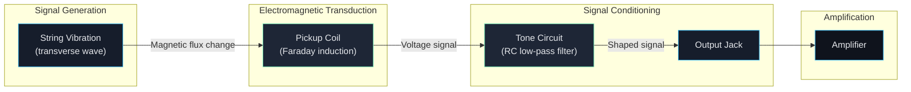
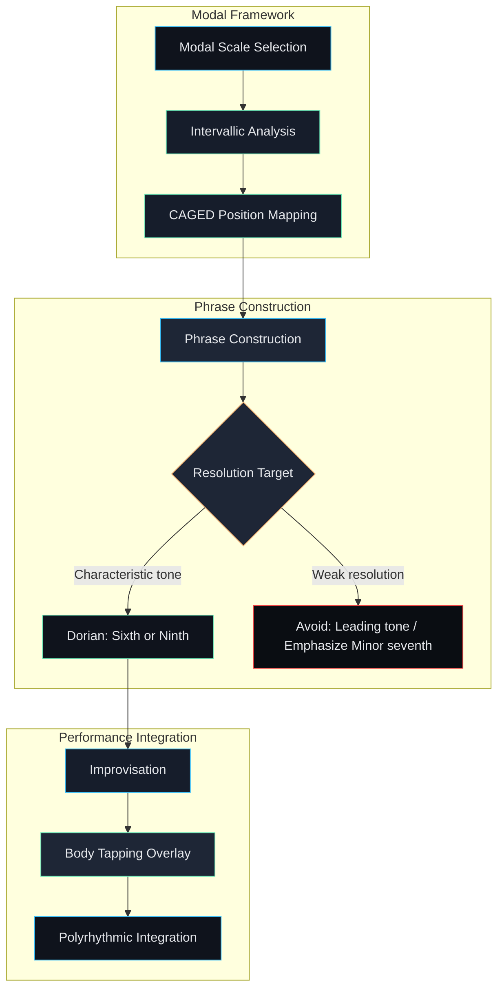
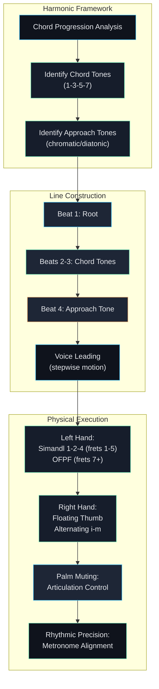
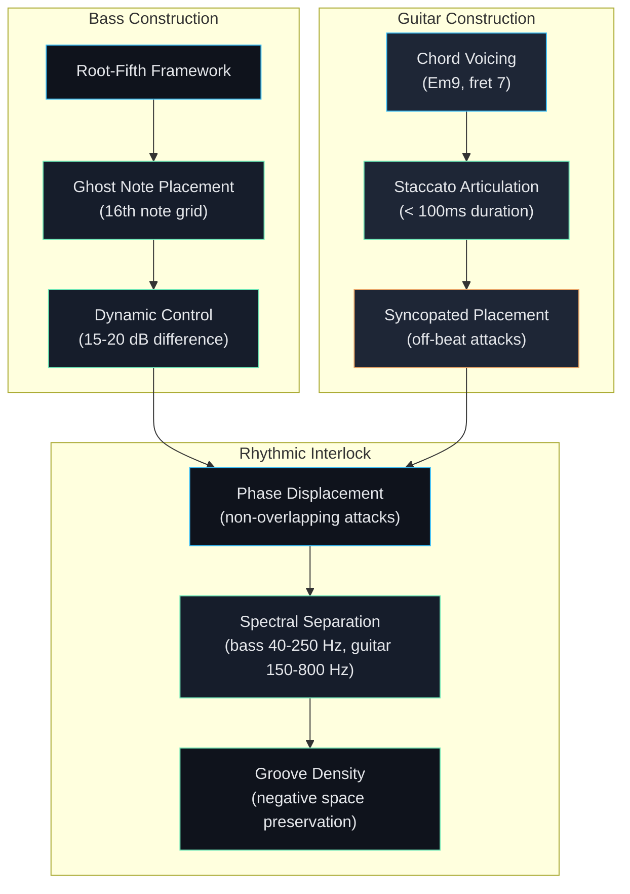

# Operational Verification Labs: String Instruments — Mechanics, Acoustics, and Performance Systems

## Objective & Laboratory Infrastructure

This laboratory establishes a rigorous, hands-on framework for understanding the mechanical, acoustic, and technique-specific properties of stringed instruments across four principal families: keyboard (piano), electric (solid-body guitar), acoustic (hollow-body guitar), and bass (electric bass). You will isolate and measure the relationship between physical technique, vibrational mechanics, and tonal output through controlled experimentation, parametric variation, and spectral analysis.

This curriculum treats instruments as **coupled mechanical-acoustic systems** governed by vibrational physics, harmonic series resonance, and energy transfer mechanisms. Each exercise bridges the gap between physiological motor control and acoustic outcomes, leveraging both physical practice and digital signal processing (DSP) analysis to validate theoretical predictions.

### Required Domain-Specific Tools, Environments, Packages, or Simulators

Provision the following infrastructure:

**Physical Instruments:**
- **Piano:** Acoustic grand or upright with functional damper and una corda pedals (minimum 88 keys)
- **Electric Guitar:** Solid-body instrument with dual pickups (bridge and neck position), adjustable action, standard tuning (E-A-D-G-B-E)
- **Acoustic Guitar:** Steel-string dreadnought or concert body with adjustable truss rod
- **Bass Guitar:** 4-string electric bass, standard tuning (E-A-D-G), passive or active electronics

**Software Tools:**
- **Digital Audio Workstation (DAW):** Ableton Live 12, Logic Pro X, Reaper, or Ardour (must support multi-track recording at 48 kHz / 24-bit minimum)
- **Spectral Analysis Tools:** iZotope RX (spectrogram), Sonic Visualiser, or Python with `librosa` and `matplotlib` for FFT-based harmonic analysis
- **Tuning & Pitch Detection:** GuitarTuna, Peterson StroboClip HD, or `aubio` (Python library)
- **MIDI Sequencer:** Optional for piano exercises with MIDI-enabled instruments

**Recording Equipment:**
- **Microphone:** Large-diaphragm condenser (e.g., Audio-Technica AT2020) for acoustic piano and guitar; dynamic mic (Shure SM57) for amplified guitar and bass
- **Audio Interface:** USB interface with >90 dB dynamic range (Focusrite Scarlett, Universal Audio Volt)
- **Headphones:** Closed-back studio monitors with flat frequency response (Beyerdynamic DT 770 Pro, Sony MDR-7506)

**Measurement & Timing:**
- **Metronome:** Digital metronome with subdivisions (Boss DB-90, Soundbrenner Core 2, or DAW-integrated click track)
- **Tuner:** Strobe or polyphonic tuner accurate to ±0.1 cent

### Laboratory Safety & Instrument Care

- Maintain consistent temperature (18–24°C) and humidity (40–60%) to prevent string breakage and neck warping
- Inspect strings for corrosion and replace at manufacturer-recommended intervals
- Ground all electrical equipment to prevent shock hazards and electromagnetic interference during recording

---

## Exercise 1: Foundational Practical Implementation — Technique as Mechanical Control

### Exercise 1.1: Piano Finger Independence and Damper Pedal Harmonic Enrichment

**Objective:** Isolate finger independence as a motor control problem and quantify the acoustic effect of sustain pedal engagement on harmonic envelope and sympathetic resonance.

**Theoretical Context:**

The piano is a percussive chordophone: hammers strike strings under tension, initiating transverse waves that propagate to the bridge, soundboard, and surrounding air. Each key actuates a mechanical escapement that accelerates a felt hammer to strike one to three strings tuned in unison (or slightly detuned for chorus effect). The sustain (damper) pedal lifts all dampers simultaneously, allowing strings to vibrate freely and creating sympathetic resonance—strings tuned to harmonic partials (2:1, 3:2, 5:4 frequency ratios) vibrate passively, enriching the timbre with overtones.

**Procedure:**

**1. Postural Calibration:**
- Sit with bench height adjusted so forearms are parallel to floor when hands rest on keys
- Position center of body at middle C; feet flat, right foot near damper pedal
- Wrists float at key height, never sagging below or raised above
- Fingers curve naturally as if holding a small ball; thumb lateral to palm plane

**2. Finger Independence Drills (Hanon Exercise 1):**
- Execute Hanon Exercise No. 1 (ascending/descending five-finger patterns in C major) at 60 BPM quarter note pulse
- **Isolation Protocol:** Play each note with deliberate finger lift (5–10 mm key depression), holding all other fingers stationary
- Monitor for **parasitic motion**: if finger 3 lifts when finger 4 descends, the motor pattern is coupled
- **Diagnostic Check:** Place a coin on the back of your hand. It should remain stationary during isolated finger motion. If the coin slides, excess wrist or hand motion is present.
- Record one repetition using a condenser microphone placed 30 cm above keyboard at dynamic marking **mezzo-forte** (consistent strike velocity)
- Increment tempo by 10 BPM every two minutes until parasitic motion reappears; note threshold tempo

**Progressive Tempo Targets:**
- Week 1: 60 BPM (clean execution, zero parasitic motion)
- Week 2: 80 BPM (maintain isolation)
- Week 3: 100 BPM (target tempo for functional independence)
- Week 4: 120 BPM (advanced control)

**3. Sustain Pedal Harmonic Analysis:**
- Play a C major chord (C4-E4-G4) staccato (no pedal), holding each note for one beat
- Repeat with damper pedal depressed throughout
- Record both versions at 48 kHz sample rate
- Load recordings into spectral analysis tool; generate FFT spectrogram with 4096-point window
- **Expected Observation:** Pedal-engaged version exhibits extended decay envelopes and additional spectral peaks at harmonic partial frequencies (1046.5 Hz for C6, 1568 Hz for G6, etc.) absent in damped version
- Measure decay time (RT60): time for signal amplitude to drop 60 dB from peak. Pedal-engaged should exceed 3 seconds; damped version <0.5 seconds.

**4. Advanced Pedaling Techniques:**

**Half-pedaling:**
- Depress pedal 30–50% to partially lift dampers, allowing selective resonance while maintaining clarity
- **Drill:** Play C major scale ascending with half-pedal held continuously. Listen for moderate sustain without muddiness.
- **Biomechanics:** Use heel as pivot point on floor. Ankle flexion controls pedal depth. Practice maintaining consistent 40% depression (approximately 2 cm travel on most pedals).

**Syncopated pedaling:**
- Engage pedal immediately *after* note attack to avoid blurring adjacent notes
- **Drill Sequence:**
  1. Play C4 (quarter note)
  2. Depress pedal immediately after key reaches bottom
  3. Release key while holding pedal
  4. Play E4 (quarter note)
  5. Change pedal (lift and depress) immediately after E4 attack
- Practice Chopin Prelude Op. 28 No. 4 in E minor (mm. 1–4) using syncopated pedaling; record and compare against legato pedaling (pedal engaged before attack)
- **Verification:** Import recording into DAW. Zoom to waveform view. Syncopated pedaling shows clear separation between note onsets; legato pedaling shows overlapping envelopes.

**Validation Metrics:**
- Finger independence: Maximum tempo (BPM) before rhythmic error rate exceeds 5%
- Harmonic enrichment: Increase in spectral energy above 2 kHz when pedal engaged (measure RMS amplitude in frequency band 2–5 kHz; expect 6–12 dB increase)
- Pedal timing precision: Syncopated pedal changes should occur within 50 ms of note attack

---

### Exercise 1.2: Electric Guitar Alternate Picking and Pickup Position Spectral Variance

**Objective:** Develop **alternate picking** as a repeatable mechanical system with minimal variance in attack timing and amplitude, and measure the frequency-domain differences between bridge and neck pickup positions.

**Theoretical Context:**

Electric guitars convert string vibration into electrical signals via electromagnetic induction. A pickup consists of a magnet wrapped in thousands of turns of copper wire; when a ferromagnetic string vibrates in the magnetic field, it induces a time-varying voltage proportional to string velocity. This signal is amplified and shaped by tone circuits before reaching the amplifier.

Alternate picking minimizes the time between successive note attacks by alternating downstroke and upstroke motions. Efficient alternate picking requires consistent pick angle (45–60° relative to string plane) and wrist-driven oscillation rather than forearm motion. Bridge pickup emphasizes treble (>2 kHz) with pronounced attack transient; neck pickup yields warmer tone with attenuated high-frequency content.

**Procedure:**

**1. Pick Grip and Angle Calibration:**
- Hold pick (0.73–1.0 mm thickness recommended) between thumb and index finger, exposing 2–3 mm of tip
- Rest wrist lightly on bridge or float 1–2 cm above strings
- Angle pick 45° in direction of motion (downstroke: trailing edge deeper; upstroke: leading edge deeper)
- **Grip Tension Test:** Pick should not slip during playing but fingers should not whiten from pressure. Adjust grip until you can maintain 120 BPM sixteenth notes for 30 seconds without hand fatigue.

**2. Alternate Picking Chromatic Drill:**
- Set metronome to 80 BPM eighth notes
- Execute chromatic scale ascending from low E string (frets 5–8), strict alternate picking: down-up-down-up
- **Fret-Hand Coordination:** Use one finger per fret (index–fret 5, middle–fret 6, ring–fret 7, pinky–fret 8)
- **Timing constraint:** Each note must align within ±10 ms of metronome pulse (use DAW grid quantization to verify)
- Record one octave at bridge pickup position with moderate gain (amplifier or DI signal)
- Increment tempo by 10 BPM every two minutes until timing error exceeds threshold; note maximum sustainable tempo

**Progressive Tempo Targets:**
- Week 1: 80 BPM eighth notes (clean execution)
- Week 2: 100 BPM eighth notes
- Week 3: 120 BPM eighth notes
- Week 4: 100 BPM sixteenth notes (equivalent to 200 BPM eighth notes)

**Common Failure Modes:**
- **String hopping:** Excessive vertical pick motion. Fix by reducing pick angle and keeping motion parallel to string plane.
- **Downstroke bias:** Louder downstrokes than upstrokes. Fix by conscious volume matching and video recording your picking hand to observe motion asymmetry.
- **Tension creep:** Gradual tightening of forearm. Fix by stopping every 30 seconds to shake out hand and reset grip.

**3. CAGED System Position Shifting:**

The CAGED system maps five geometric shapes (C, A, G, E, D open chord forms) across the fretboard, enabling scale and arpeggio visualization in any key. Practice G major pentatonic scale (G-A-B-D-E) in all five CAGED positions:

**Position 1 (E shape, root on 6th string, 3rd fret):**
```
e|----------------------------3--5--
B|----------------------3--5--------
G|----------------2--5--------------
D|-----------5-----------------------
A|-----3--5--------------------------
E|--3--------------------------------
```

**Position 2 (D shape, root on 4th string, 5th fret):**
```
e|----------------------------5--8--
B|----------------------5--8--------
G|----------------5--7--------------
D|-----------5--7--------------------
A|-----5--7--------------------------
E|-----------------------------------
```

**Position 3 (C shape, root on 5th string, 10th fret):**
```
e|----------------------8--10--------
B|----------------8--10--------------
G|-----------7--10-------------------
D|-----7--10-------------------------
A|--10-------------------------------
E|-----------------------------------
```

**Position 4 (A shape, root on 5th string, 12th fret):**
```
e|------------------10--12-----------
B|------------10--13-----------------
G|------10--12-----------------------
D|--12-------------------------------
A|--12-------------------------------
E|-----------------------------------
```

**Position 5 (G shape, root on 6th string, 15th fret):**
```
e|--12--15---------------------------
B|--13--15---------------------------
G|--12--14---------------------------
D|--12--14---------------------------
A|--15-------------------------------
E|--15-------------------------------
```

- Execute two-octave ascending/descending runs in each position at 100 BPM sixteenth notes, alternate picking throughout
- **Objective:** Eliminate position shifts mid-run; each CAGED shape is a closed system requiring no lateral hand motion
- **Drill Protocol:** Spend 5 minutes per position per day. Master positions 1–2 before advancing to 3–5.

**4. Pickup Position Spectral Comparison:**
- Select bridge pickup; play open A string (110 Hz) with moderate attack
- Record 2-second sample at 48 kHz
- Switch to neck pickup; repeat identical attack
- Load both recordings into spectral analysis tool; generate FFT magnitude spectrum (linear frequency axis, 0–5 kHz)
- **Expected Observation:** Bridge pickup exhibits higher amplitude at 2.2 kHz, 3.3 kHz (harmonics 20, 30); neck pickup exhibits higher amplitude at 220 Hz, 330 Hz (harmonics 2, 3)
- Calculate **spectral centroid** (frequency-weighted mean) for each pickup; bridge centroid should exceed neck by 500–1000 Hz

**Python Spectral Analysis Script:**

```python
import librosa
import numpy as np
import matplotlib.pyplot as plt

# Load audio files
bridge_audio, sr = librosa.load('bridge_pickup.wav', sr=48000)
neck_audio, _ = librosa.load('neck_pickup.wav', sr=48000)

# Compute FFT
bridge_fft = np.abs(np.fft.rfft(bridge_audio))
neck_fft = np.abs(np.fft.rfft(neck_audio))
freqs = np.fft.rfftfreq(len(bridge_audio), 1/sr)

# Calculate spectral centroids
bridge_centroid = np.sum(freqs * bridge_fft) / np.sum(bridge_fft)
neck_centroid = np.sum(freqs * neck_fft) / np.sum(neck_fft)

print(f"Bridge Pickup Centroid: {bridge_centroid:.1f} Hz")
print(f"Neck Pickup Centroid: {neck_centroid:.1f} Hz")
print(f"Difference: {bridge_centroid - neck_centroid:.1f} Hz")

# Plot spectra
plt.figure(figsize=(12, 6))
plt.plot(freqs[:1000], bridge_fft[:1000], label='Bridge Pickup', alpha=0.7)
plt.plot(freqs[:1000], neck_fft[:1000], label='Neck Pickup', alpha=0.7)
plt.xlabel('Frequency (Hz)')
plt.ylabel('Magnitude')
plt.title('Bridge vs Neck Pickup Frequency Response')
plt.legend()
plt.grid(True, alpha=0.3)
plt.savefig('pickup_comparison.png', dpi=300)
plt.show()
```



**Validation Metrics:**
- Alternate picking accuracy: Percentage of notes within ±10 ms of metronome grid at maximum tempo (target: >95% at 100 BPM sixteenth notes)
- Spectral centroid difference: Bridge vs. neck pickup centroid separation (target: 600–1200 Hz)
- Dynamic consistency: Standard deviation of attack amplitude across 16-note sequence (target: <3 dB)

---

### Exercise 1.3: Acoustic Guitar Modal Soloing and Percussive Body Tapping

**Objective:** Construct improvisational phrases using **modal scales** (non-major/minor tonal centers) and integrate **percussive body tapping** to generate polyrhythmic textures.

**Theoretical Context:**

Modes are rotations of the diatonic scale, each beginning on a different scale degree. Each mode possesses a unique intervallic signature that defines its tonal color:
- **Ionian (major):** W-W-H-W-W-W-H — standard major scale
- **Dorian:** W-H-W-W-W-H-W — minor with raised sixth (characteristic tone)
- **Phrygian:** H-W-W-W-H-W-W — minor with lowered second (flamenco sound)
- **Lydian:** W-W-W-H-W-W-H — major with raised fourth (bright, floating)
- **Mixolydian:** W-W-H-W-W-H-W — major with lowered seventh (bluesy, rock)
- **Aeolian (natural minor):** W-H-W-W-H-W-W — standard minor scale
- **Locrian:** H-W-W-H-W-W-W — diminished (unstable, rarely used as tonic)

Body tapping exploits the acoustic guitar's hollow body as a Helmholtz resonator: striking the soundboard generates percussive transients (broadband noise bursts) while simultaneously exciting the air cavity's resonant frequency (typically 80–120 Hz for dreadnought bodies).

**Procedure:**

**1. Modal Scale Construction:**

**D Dorian (D-E-F-G-A-B-C-D)** — the characteristic major sixth (B natural) distinguishes it from D natural minor (which would have Bb).

Map scale across two octaves using CAGED position 2 (D shape), root on 4th string, 5th fret:

```
e|----------------------------5--7--8--10--12--
B|----------------------6--8--10---------------
G|----------------7--9-------------------------
D|-----------5--7--9--10-----------------------
A|---------------------------------------------
E|---------------------------------------------
```

- Practice ascending/descending at 60 BPM quarter notes
- **Emphasis Drill:** Play the scale but accent the sixth (B) and ninth (E) on each pass. These are the notes that define the Dorian color.
- **Ear Training:** Record yourself playing D Dorian. Then play D natural minor (with Bb instead of B natural). A/B test the recordings. The Dorian version should sound brighter and less melancholic due to the major sixth.

**Progressive Tempo Targets:**
- Week 1: 60 BPM (clean execution, emphasize characteristic tones)
- Week 2: 80 BPM
- Week 3: 100 BPM
- Week 4: 120 BPM

**2. Modal Phrase Construction:**

- Load D minor backing track into your DAW or use iReal Pro app with Dm7-G7 progression
- Improvise 8-bar solo over backing track
- **Constraint:** Resolve phrases to sixth (B) or ninth (E) rather than tonic (D) to emphasize Dorian color
- Avoid C# (leading tone from D major) and avoid emphasizing C (minor seventh from D natural minor, though it exists in the scale)

**Phrasal Resolution Examples:**
- **Strong Dorian:** D–E–G–A–B (resolves to sixth)
- **Strong Dorian:** A–B–C–D–E (resolves to ninth over D root)
- **Weak Dorian:** D–E–F–G–A–C–D (resolves to tonic, sounds like natural minor)

- Record improvisation; transcribe and analyze resolution points
- **Validation:** Count phrase endings. Target: 60% resolve to sixth or ninth, 30% to tonic, 10% to other scale tones.

**3. Body Tapping Integration:**

**Basic tapping pattern:**
- Right thumb alternates between bass note (6th string) and percussive strike on soundboard above sound hole
- Notate rhythm: `[ Bass - Tap - Bass - Tap ]` in 4/4 time, quarter note pulse
- **Striking Zone:** Tap approximately 5 cm above the sound hole. This area produces maximum percussive transient without damping the soundboard excessively.
- **Biomechanics:** Use wrist rotation, not arm motion. The tap should be a quick rebound off the wood, not a dead thud. Think of bouncing a basketball.

**Overlay with Chord Progression:**
- Left hand: Dm7 (XX0211) for 2 bars, then G7 (320001) for 2 bars
- Right hand: Bass-Tap pattern at 80 BPM quarter notes
- **Coordination Drill:** Practice chord changes on beat 1 while maintaining uninterrupted Bass-Tap pattern

**Recording and Visualization:**
- Record pattern at 48 kHz
- Import into DAW and view waveform
- **Expected Observation:** Tap transients appear as sharp vertical spikes (attack <5 ms) superimposed on sustained bass note decay envelopes. Bass notes show gradual exponential decay; taps show sharp attack with immediate decay.
- Measure peak amplitude of tap vs. bass note. Tap should be 6–10 dB louder than bass note to create clear rhythmic definition.

**4. Advanced Polyrhythmic Tapping:**

**3-against-4 polyrhythm:**
- Left hand plays triplet chord stabs (3 per bar, evenly spaced)
- Right hand taps quarter-note pulse (4 per bar)
- **Coordination Map:**
  - Beat 1: Left + Right
  - Beat 1.33: Left
  - Beat 2: Right
  - Beat 2.66: Left
  - Beat 3: Left + Right
  - Beat 4: Right

- **Practice Method:**
  1. Set metronome to 60 BPM
  2. Tap right hand (quarter notes) along with metronome
  3. Add left hand (triplets) verbally: "1-2-3, 1-2-3, 1-2-3, 1-2-3" over four clicks
  4. Gradually transfer verbal pattern to left-hand chord stabs
  5. Record 4 bars; verify rhythmic alignment using DAW grid with triplet quantization enabled

- **Validation:** Import recording into DAW. Enable both quarter-note and triplet grid overlays. Left-hand attacks should align with triplet grid; right-hand attacks should align with quarter-note grid. Timing error tolerance: ±15 ms.



**Validation Metrics:**
- Modal consistency: Percentage of phrase resolution points landing on characteristic modal tones (target: 60% to sixth/ninth for Dorian)
- Tapping transient clarity: Peak amplitude ratio of tap transient to bass note sustain (target: 3:1 to 5:1, measured in dB)
- Polyrhythmic precision: Timing error <15 ms for both left and right hand attacks against their respective grid subdivisions

---

### Exercise 1.4: Bass Guitar Walking Bass Lines and Right-Hand Muting Mechanics

**Objective:** Construct **walking bass lines** that outline chord progressions through scalar and chromatic voice leading, and master **right-hand palm muting** to control sustain and articulation.

**Theoretical Context:**

Walking bass lines emerged in jazz as a contrapuntal device: the bass moves in quarter notes through chord tones (root, third, fifth, seventh) and passing tones (chromatic or diatonic connectors). Effective walking bass requires harmonic awareness (each beat must imply the underlying chord) and voice leading (stepwise motion between chords minimizes leaps and maintains melodic flow).

Right-hand muting involves resting the palm's thenar eminence (fleshy base of thumb) on the bridge or strings near the bridge, dampening high-frequency overtones and reducing sustain. This produces articulative clarity (each note decays quickly, preventing harmonic smear) and percussive attack (emphasis on the initial transient).

**Procedure:**

**1. Left-Hand Fingering: Simandl 1-2-4 Technique (Low Register, Frets 1–5):**

In the low register (frets 1–5), the wide fret spacing makes one-finger-per-fret (OFPF) ergonomically dangerous, causing tendon strain and carpal tunnel risk. Use Franz Simandl's 1-2-4 fingering pattern:
- **Index (1):** Frets 1, 2
- **Middle (2):** Frets 3, 4
- **Pinky (4):** Fret 5

**Low E String (E-A-D-G-B-C-D-E progression):**
```
E  A   B   C   D   E   F   G   A   (notes)
0  5   7   8   10  12  13  15  17  (frets)
0  1/2 4   1   2   4   1   2   4   (fingers, Simandl)
```

- **Thumb Position:** Anchor thumb on back of neck directly opposite middle finger (finger 2). This creates a pivot point and distributes force across the hand.
- **Wrist Alignment:** Keep wrist straight, not bent. Elbow should hang naturally; avoid chicken-wing elbow protrusion.
- **Practice Drill:** Chromatic scale from open E to fret 12 using Simandl fingering at 60 BPM quarter notes. Focus on minimal finger lift (2–3 mm) and landing directly perpendicular to fret wire.

**Transition to OFPF (Frets 7+):**
- At fret 7 and above, fret spacing narrows sufficiently for OFPF without strain
- **Index–fret 7, Middle–fret 8, Ring–fret 9, Pinky–fret 10**
- Practice position shifts: play E (fret 7 on A string) to A (fret 12 on A string), shifting from OFPF position to next OFPF position

**2. Right-Hand Technique: Floating Thumb and Plucking Mechanics:**

**Floating Thumb Muting:**
- Rest thumb on the string immediately below the string being played
- **Example:** When playing A string, rest thumb on E string. This prevents sympathetic vibration of the lower string.
- As you move to higher strings, thumb "floats" upward: playing D string → thumb on A string; playing G string → thumb on D string.

**Plucking Biomechanics:**
- Use index and middle fingers in alternation (i-m pattern)
- **Finger Motion:** Pull string perpendicular to fretboard (not upward toward your face). The string should snap back against the fret wire.
- **Follow-Through:** After plucking, finger should rest on the adjacent higher string (rest stroke) for maximum volume and control, or float above strings (free stroke) for faster passages.
- **Practice Drill:** Play open E string with alternating i-m at 80 BPM eighth notes. Record and measure amplitude consistency. Standard deviation should be <2 dB across 32 notes.

**3. Walking Bass Line Construction:**

**Chord Progression: Cmaj7 | Dm7 | G7 | Cmaj7 (4 bars, 4/4 time)**

**Harmonic Analysis:**
- **Cmaj7:** C-E-G-B (1-3-5-7)
- **Dm7:** D-F-A-C (1-b3-5-b7)
- **G7:** G-B-D-F (1-3-5-b7)
- **Cmaj7:** C-E-G-B (1-3-5-7)

**Walking Line Construction Rules:**
1. **Beat 1:** Always play root of current chord
2. **Beat 2:** Play chord tone (3rd or 5th preferred)
3. **Beat 3:** Play chord tone (5th or 7th preferred)
4. **Beat 4:** Play approach tone leading to next chord's root by half-step or whole-step

**Example Walking Line:**

**Bar 1 (Cmaj7):**
```
Beat:    1    2    3    4
Note:    C    E    G    A
Fret:    3    0    3    0   (on A string, then D string, G string, D string)
Finger:  1    0    1    0
```

**Bar 2 (Dm7):**
```
Beat:    1    2    3    4
Note:    D    F    A    B
Fret:    5    3    0    2   (D string, G string, D string, D string)
Finger:  2    1    0    4
```

**Bar 3 (G7):**
```
Beat:    1    2    3    4
Note:    G    B    D    E
Fret:    3    4    0    2   (E string, A string, D string, D string)
Finger:  1    2    0    4
```

**Bar 4 (Cmaj7):**
```
Beat:    1    2    3    4
Note:    C    E    G    G#
Fret:    3    0    3    4   (A string, D string, G string, G string)
Finger:  1    0    1    2
```

- **Note on Beat 4, Bar 4:** G# is a chromatic approach tone leading to A (the 5th of Dm7 in the next cycle). This creates forward motion.
- Practice at 80 BPM quarter notes, then 100 BPM, then 120 BPM
- **Metronome Subdivision:** Set metronome to click on all four beats. Each note must align precisely with the click (±10 ms tolerance).

**4. Right-Hand Palm Muting:**

**Muting Hand Position:**
- Place palm's thenar eminence (base of thumb) on the bridge or strings 2–3 cm from the bridge
- **Pressure Calibration:** Apply just enough pressure to dampen sustain without completely killing the note. The string should still ring for approximately 0.5–0.8 seconds.
- **Test:** Play open E string with palm mute. Then play without mute. The muted version should have 50–70% less sustain time and reduced high-frequency content above 2 kHz.

**Spectral Verification:**
- Record open E string with and without palm mute
- Generate FFT spectrum for both recordings
- **Expected Observation:** Palm-muted version shows 6–10 dB attenuation in the 2–5 kHz range and faster decay envelope (RT60 reduces from 3–4 seconds to 0.5–0.8 seconds)

**Integration Drill:**
- Play the walking bass line above with palm muting
- Each note should have clear attack transient but minimal sustain overlap with subsequent notes
- Record and import into DAW
- **Waveform Verification:** Each note's envelope should show sharp attack, brief sustain (200–400 ms), and rapid decay before next note's attack. No overlapping sustain envelopes.

**5. Advanced Walking Bass Variations:**

**Chromatic Approach from Below:**
- Approach next chord's root by half-step from below
- Example: To reach D (Dm7 root), play C# on beat 4 of previous bar

**Chromatic Approach from Above:**
- Approach next chord's root by half-step from above
- Example: To reach D (Dm7 root), play Eb on beat 4 of previous bar

**Double Chromatic Approach:**
- Use beats 3 and 4 for two-note chromatic approach
- Example: To reach D (Dm7 root), play C-C# on beats 3–4 of previous bar

**Practice Progression with Variations:**

**Week 1:** Basic walking line (root-3rd-5th-approach tone) at 80 BPM
**Week 2:** Introduce chromatic approaches (50% from below, 50% from above) at 90 BPM
**Week 3:** Double chromatic approaches and 7th-chord tones at 100 BPM
**Week 4:** Mixed approaches with syncopated rhythm (add eighth-note subdivisions) at 110 BPM



**Validation Metrics:**
- Harmonic accuracy: 100% of beat 1 attacks land on chord root; 90% of beats 2–3 land on chord tones (3rd, 5th, or 7th)
- Voice leading smoothness: 80% of chord transitions use stepwise motion (whole-step or half-step) rather than leaps
- Rhythmic precision: 95% of note attacks within ±10 ms of metronome pulse
- Muting consistency: Sustain time variance <100 ms across 16-note sequence
- Dynamic consistency: Attack amplitude standard deviation <2.5 dB across 16-note sequence

---

## Exercise 2: Multi-Instrument Integration — Harmonic Systems and Ensemble Coordination

### Exercise 2.1: Piano Comping with Rootless Voicings and Metrical Displacement

**Objective:** Develop jazz piano **comping** (accompaniment) using rootless voicings (A and B forms) and introduce **metrical displacement** (off-beat chord attacks) to create rhythmic interest while maintaining harmonic clarity.

**Theoretical Context:**

In jazz ensemble contexts, the bass player covers the root, freeing the pianist to omit the root from chord voicings. Rootless voicings eliminate tonal redundancy and create more spacious, transparent harmonic textures. Two primary forms exist:

**A-Form Voicing (3rd in bass):**
- Structure: 3-7-9-5 (from bottom to top)
- Example for Cmaj7: E-B-D-G (3rd-7th-9th-5th)

**B-Form Voicing (7th in bass):**
- Structure: 7-3-5-9 (from bottom to top)
- Example for Cmaj7: B-E-G-D (7th-3rd-5th-9th)

Metrical displacement places chord attacks on off-beats (beat 2, the "and" of beats, or syncopated subdivisions) rather than downbeats, creating forward momentum and avoiding static, on-the-beat comping that can sound mechanical.

**Procedure:**

**1. Rootless Voicing Construction:**

**Chord Progression: Cmaj7 | Dm7 | G7 | Cmaj7 (ii-V-I in C major)**

**A-Form Voicings (3rd in bass):**
```
Cmaj7:  E-B-D-G  (fingers 1-2-3-5)
Dm7:    F-C-E-A  (fingers 1-2-3-5)
G7:     B-F-A-D  (fingers 1-2-3-5)
Cmaj7:  E-B-D-G  (fingers 1-2-3-5)
```

**B-Form Voicings (7th in bass):**
```
Cmaj7:  B-E-G-D  (fingers 1-2-4-5)
Dm7:    C-F-A-E  (fingers 1-2-4-5)
G7:     F-B-D-A  (fingers 1-2-4-5)
Cmaj7:  B-E-G-D  (fingers 1-2-4-5)
```

- **Practice Protocol:** Play each voicing as a whole note (4 beats), focusing on hand shape memorization. The thumb (1) always plays the lowest note; pinky (5) always plays the highest.
- **Voice Leading Check:** Measure the distance each voice moves between chords. Optimal voice leading minimizes motion; most voices should move by whole-step or half-step.

**Example Voice Leading Analysis (A-Form):**
- Cmaj7 to Dm7: E→F (+1 half-step), B→C (+1 half-step), D→E (+1 whole-step), G→A (+1 whole-step)
- Total motion: 5 half-steps across 4 voices (average 1.25 half-steps per voice)

**2. Metrical Displacement Comping:**

**Basic On-Beat Comping (for comparison):**
```
|  1    2    3    4  |
|  C    .    .    .  |  (Cmaj7 on beat 1)
|  .    .    .    .  |
|  1    2    3    4  |
|  D    .    .    .  |  (Dm7 on beat 1)
```

**Off-Beat Comping (metrical displacement):**
```
|  1    2    3    4  |
|  .    C    .    .  |  (Cmaj7 on beat 2)
|  .    .    .    D+ |  (Dm7 on "and" of 4)
|  1    2    3    4  |
|  .    .    G    .  |  (G7 on beat 3)
```

- Set metronome to 120 BPM
- Practice progression with chords landing on beat 2, "and" of 2, beat 3, and "and" of 4
- **Coordination Drill:** Tap your foot on beats 1 and 3 while playing chords on off-beats. This reinforces internal pulse while executing syncopation.
- Record 8-bar improvised comping over a bass walking line (use Exercise 1.4 recording or backing track)
- **Validation:** Import recording into DAW. Enable grid display. Count chord attacks: target 70% on off-beats (beats 2, 4, or "and" subdivisions), 30% on downbeats (beats 1, 3) for strong metrical displacement.

**3. Dynamic Shaping and Touch:**

**Mezzo-Piano (mp) Touch:**
- Key depression velocity approximately 50% of maximum
- Sound should be warm and supportive, not aggressive
- **Biomechanics:** Use arm weight transfer (drop arm from relaxed shoulder) rather than finger pushing

**Accent Chords (forte, f):**
- Increase key velocity to 80% of maximum on specific chords for emphasis
- Typically accent chord on beat 3 of second bar to create phrase arc

**Practice Drill:**
- Play progression with consistent mp throughout (first pass)
- Play progression with accent on beat 3 of bar 2 and bar 4 (second pass)
- Record both; compare waveform amplitudes. Accented chords should be 6–10 dB louder than surrounding chords.

**4. Integration with Walking Bass:**

- Load walking bass recording from Exercise 1.4 into DAW
- Record piano comping on separate track using rootless voicings and metrical displacement
- **Listening Focus:** The combination should sound cohesive. Bass provides rhythmic foundation and harmonic root; piano adds color and rhythmic counterpoint.
- **Mix Check:** Bass should be 2–3 dB louder than piano in the final mix. If piano dominates, reduce piano track gain.

**Validation Metrics:**
- Voice leading efficiency: Average voice motion between chords <2 half-steps per voice
- Metrical displacement: 70% of chord attacks on off-beats
- Dynamic range: 6–10 dB difference between accent chords and surrounding chords
- Harmonic clarity: When combined with bass, chord tones should be audible without frequency masking (verify with spectrum analyzer: piano occupies 200–1000 Hz; bass occupies 40–300 Hz)

---

### Exercise 2.2: Guitar and Bass Rhythmic Interlock in Funk Groove

**Objective:** Construct interlocking rhythmic patterns between bass and guitar that create a unified **groove** through syncopated attacks, ghost notes, and percussive muting techniques.

**Theoretical Context:**

Funk groove relies on **rhythmic precision** and **negative space** (intentional silence). The bass and guitar function as a single rhythmic organism: bass provides low-end pulse, guitar provides percussive chordal accents. Ghost notes (muted or very soft notes) add rhythmic texture without harmonic content, creating subdivision awareness and groove density.

**Procedure:**

**1. Bass Funk Pattern with Ghost Notes:**

**Chord: Em7 (E-G-B-D)**

**Notated Pattern (16th note subdivision, 4/4 time, 90 BPM):**
```
Count:  1 e & a  2 e & a  3 e & a  4 e & a
Notes:  E . g .  . . g .  E . . .  . . g B
Fret:   0 . 0 .  . . 0 .  0 . . .  . . 0 2
Attack: ^ . ( .  . . ( .  ^ . . .  . . ( ^
```

**Legend:**
- **E, B:** Full-volume notes (root and fifth)
- **g:** Ghost notes (muted notes, indicated by lowercase)
- **^:** Strong attack
- **(:** Ghost note (light touch, barely audible)

**Ghost Note Technique:**
- Left hand: Touch string lightly without pressing down to fret
- Right hand: Pluck normally but string produces percussive "thud" without pitch
- **Objective:** Ghost notes should be 15–20 dB quieter than full notes, creating rhythmic pulse without harmonic interference

**Practice Drill:**
- Set metronome to 90 BPM with 16th note subdivision click
- Practice pattern slowly (60 BPM) until ghost note dynamics are consistent
- Increment by 10 BPM every 3 minutes
- Record at 90 BPM; import into DAW and analyze waveform
- **Validation:** Ghost notes should appear as small amplitude bumps; full notes should have clear attack transients 3–5x larger in peak amplitude

**2. Guitar Funk Chord Stabs:**

**Chord: Em9 (E-G-B-D-F#) — voicing at fret 7:**
```
e|---7---  (B)
B|---8---  (F#, 9th)
G|---7---  (D)
D|---9---  (B)
A|---7---  (E, root)
E|---X---  (muted)
```

**Rhythmic Pattern (coordinates with bass):**
```
Count:  1 e & a  2 e & a  3 e & a  4 e & a
Notes:  . . X .  X . . .  . . X .  . . . X
Attack: . . ^ .  ^ . . .  . . ^ .  . . . ^
```

**Legend:**
- **X:** Chord stab (full chord, staccato attack)
- **^:** Downstroke with immediate palm mute

**Staccato Muting Technique:**
- Attack chord with downstroke
- Immediately after attack, release left-hand finger pressure (maintain contact but don't press)
- **Objective:** Chord should ring for <100 ms, creating percussive "chop" sound
- **Biomechanics:** Synchronize right-hand palm mute engagement with left-hand pressure release

**3. Interlocking Groove Assembly:**

**Combined Pattern:**
```
Bass:   E . g .  . . g .  E . . .  . . g B
Guitar: . . X .  X . . .  . . X .  . . . X
```

- Notice that bass and guitar attacks are **phase-displaced**: when bass plays strong notes (beats 1, 3), guitar rests or plays between beats
- This creates **rhythmic counterpoint**: the two instruments lock together to fill the rhythmic grid without competing for the same temporal space

**Recording Protocol:**
- Record bass first as guide track
- Record guitar on second track while listening to bass
- Set metronome to 16th note subdivisions at 90 BPM for both recordings
- **Monitoring:** Use closed-back headphones to prevent click bleed into microphone

**4. Spectral and Rhythmic Analysis:**

**Load combined recording into DAW:**
- Solo bass track; verify ghost notes are visible in waveform but quiet (peak amplitude 15–20 dB below full notes)
- Solo guitar track; verify staccato articulation (each chord attack <100 ms duration)
- Play both tracks together; verify no rhythmic attacks overlap (bass and guitar should never play simultaneously except on intentional accents)
- Generate spectrogram: bass should occupy 40–250 Hz; guitar should occupy 150–800 Hz with minimal overlap

**Python Groove Analysis Script:**

```python
import librosa
import numpy as np
import matplotlib.pyplot as plt

# Load combined mix
audio, sr = librosa.load('funk_groove.wav', sr=48000)

# Onset detection (find rhythmic attacks)
onset_env = librosa.onset.onset_strength(y=audio, sr=sr)
onsets = librosa.onset.onset_detect(y=audio, sr=sr, units='time')

# Calculate inter-onset intervals (IOI)
ioi = np.diff(onsets)
mean_ioi = np.mean(ioi)
std_ioi = np.std(ioi)

print(f"Mean Inter-Onset Interval: {mean_ioi:.3f} seconds")
print(f"IOI Standard Deviation: {std_ioi:.3f} seconds")
print(f"Rhythmic Consistency: {(1 - std_ioi/mean_ioi)*100:.1f}%")

# Target: 90 BPM with 16th notes = 0.167 seconds per 16th
# IOI should cluster around 0.167s, 0.334s (8th), 0.668s (quarter)

# Plot onset strength envelope
plt.figure(figsize=(14, 6))
times = librosa.times_like(onset_env, sr=sr)
plt.plot(times, onset_env, alpha=0.8)
plt.vlines(onsets, 0, onset_env.max(), color='r', alpha=0.8, linestyle='--', label='Detected Onsets')
plt.xlabel('Time (s)')
plt.ylabel('Onset Strength')
plt.title('Funk Groove Rhythmic Attack Detection')
plt.legend()
plt.grid(True, alpha=0.3)
plt.savefig('groove_analysis.png', dpi=300)
plt.show()
```

**5. Advanced Variations:**

**Syncopated Bass Fill (bar 4):**
```
Count:  1 e & a  2 e & a  3 e & a  4 e & a
Notes:  E . . .  . . E G  B . . D  . E . G
Fret:   0 . . .  . . 0 3  2 . . 5  . 0 . 3
```

**Guitar Octave Stabs (bar 4):**
```
Count:  1 e & a  2 e & a  3 e & a  4 e & a
Notes:  . . X .  X . . .  . . X .  X . X .
```

**Practice Progression:**
- Week 1: Basic pattern (bass + guitar) at 80 BPM, focus on clean ghost notes and staccato chords
- Week 2: Increase to 90 BPM, add syncopated fill in bar 4
- Week 3: Increase to 100 BPM, vary dynamics (play bars 1–3 at mp, bar 4 at f)
- Week 4: 110 BPM with improvised bass fills and guitar chord variations



**Validation Metrics:**
- Ghost note dynamic consistency: Peak amplitude variance <3 dB across all ghost notes
- Staccato articulation: 95% of guitar chord attacks <120 ms duration
- Rhythmic interlock: <10% of bass and guitar attacks overlap temporally (within 20 ms window)
- Spectral separation: <6 dB overlap in the 150–250 Hz band (measure RMS in this band for both instruments)
- Groove consistency: Inter-onset interval standard deviation <0.02 seconds at 90 BPM

---

## Exercise 3: Advanced Performance Techniques and Acoustic Phenomena

### Exercise 3.1: Piano Overtone Manipulation via Una Corda Pedal and Soft Hammer Strikes

**Objective:** Explore the timbral shaping capabilities of the **una corda (soft) pedal** and controlled hammer velocity to manipulate overtone spectra and dynamic envelope characteristics.

**Theoretical Context:**

The una corda pedal (left pedal on grand pianos) shifts the entire keyboard mechanism laterally, causing hammers to strike fewer strings (two instead of three for most notes). This produces three acoustic effects:
1. **Amplitude reduction:** Fewer strings = less total energy, reducing volume by 3–6 dB
2. **Timbral softening:** Hammers strike a less-worn area of felt, producing softer attack with reduced high-frequency content
3. **Sustain reduction:** Fewer strings coupled to the soundboard = faster energy dissipation

Hammer velocity directly correlates with overtone emphasis: soft strikes emphasize fundamental and low harmonics (warm, mellow); hard strikes emphasize high harmonics (bright, brilliant).

**Procedure:**

**1. Una Corda Spectral Comparison:**

- Play middle C (C4, 261.63 Hz) at mezzo-forte dynamic without una corda
- Record 3-second sample at 48 kHz
- Repeat with una corda engaged
- Load both recordings into spectral analysis tool; generate FFT magnitude spectrum (0–5 kHz)

**Expected Observations:**
- **Fundamental (261.63 Hz):** Una corda reduces by 3–6 dB
- **2nd harmonic (523.26 Hz):** Una corda reduces by 4–7 dB
- **3rd harmonic (784.89 Hz):** Una corda reduces by 5–8 dB
- **High harmonics (>2 kHz):** Una corda reduces by 8–12 dB (more pronounced attenuation in treble region)
- **Attack transient:** Una corda exhibits softer attack (rise time increases from 5–10 ms to 10–20 ms)

**Python Spectral Comparison Script:**

```python
import librosa
import numpy as np
import matplotlib.pyplot as plt

# Load recordings
normal, sr = librosa.load('middle_c_normal.wav', sr=48000)
una_corda, _ = librosa.load('middle_c_una_corda.wav', sr=48000)

# Compute FFT
normal_fft = np.abs(np.fft.rfft(normal))
una_corda_fft = np.abs(np.fft.rfft(una_corda))
freqs = np.fft.rfftfreq(len(normal), 1/sr)

# Identify harmonic peaks
fundamental = 261.63
harmonics = [fundamental * i for i in range(1, 11)]  # First 10 harmonics

# Calculate attenuation at each harmonic
for i, harmonic in enumerate(harmonics, 1):
    idx = np.argmin(np.abs(freqs - harmonic))
    normal_amp = 20 * np.log10(normal_fft[idx] + 1e-10)
    una_corda_amp = 20 * np.log10(una_corda_fft[idx] + 1e-10)
    attenuation = normal_amp - una_corda_amp
    print(f"Harmonic {i} ({harmonic:.2f} Hz): {attenuation:.1f} dB attenuation")

# Plot comparison
plt.figure(figsize=(14, 6))
plt.plot(freqs[:2000], 20*np.log10(normal_fft[:2000]+1e-10), label='Normal', alpha=0.7)
plt.plot(freqs[:2000], 20*np.log10(una_corda_fft[:2000]+1e-10), label='Una Corda', alpha=0.7)
plt.xlabel('Frequency (Hz)')
plt.ylabel('Magnitude (dB)')
plt.title('Normal vs Una Corda Spectral Comparison')
plt.legend()
plt.grid(True, alpha=0.3)
plt.savefig('una_corda_comparison.png', dpi=300)
plt.show()
```

**2. Dynamic Gradation and Hammer Velocity Control:**

**Exercise: Play middle C at five dynamic levels:**
1. **Pianissimo (pp):** Barely audible, hammer barely touches string
2. **Piano (p):** Soft, controlled
3. **Mezzo-forte (mf):** Medium, speaking volume
4. **Forte (f):** Loud, strong
5. **Fortissimo (ff):** Maximum volume, full arm weight

- Record each dynamic level (3-second samples)
- Measure peak amplitude (dB) and spectral centroid (Hz) for each

**Expected Trends:**
- **pp → ff amplitude:** Increase of 24–30 dB across dynamic range
- **pp → ff spectral centroid:** Increase of 200–400 Hz (louder dynamics emphasize higher harmonics)
- **pp → ff attack time:** Decrease from 15–20 ms (pp) to 3–5 ms (ff)

**Practice Drill:**
- Play Chopin Nocturne Op. 9 No. 2 (first 8 bars)
- Focus on smooth dynamic gradations: crescendo from p to f over 4 bars, decrescendo back to p
- Record and analyze waveform envelope
- **Validation:** Amplitude should increase/decrease smoothly without sudden jumps. Use DAW's gain envelope visualization to verify.

**3. Combined Una Corda and Soft Dynamics for Timbral Sculpting:**

**Repertoire Example: Debussy's "Clair de Lune" (mm. 15–27, middle section)**

- This passage requires ethereal, delicate timbre
- Use una corda throughout
- Play at pp-p dynamics
- **Pedaling:** Syncopated pedal with frequent changes to maintain clarity despite soft dynamics

**Recording Protocol:**
- Record passage with and without una corda at matched pp dynamic
- Compare timbral character: una corda version should sound veiled, distant, and warm; normal version should sound more direct and present

**Validation Metrics:**
- Una corda attenuation: 8–12 dB reduction in high harmonics (>2 kHz)
- Dynamic range control: Ability to maintain consistent pp dynamic (peak amplitude variance <3 dB across phrase)
- Spectral centroid shift: Una corda reduces centroid by 150–300 Hz compared to normal at matched dynamic level

---

### Exercise 3.2: Guitar Harmonic Node Excitation and Artificial Harmonics

**Objective:** Master **natural harmonics** (lightly touching string at nodal points) and **artificial harmonics** (fingered note + nodal touch 12 frets higher) to produce pure overtones without fundamental frequency.

**Theoretical Context:**

A vibrating string exhibits **standing wave** patterns with nodes (points of zero displacement) and antinodes (points of maximum displacement). Lightly touching the string at a nodal point while plucking suppresses the fundamental and lower harmonics, allowing only harmonics with nodes at that point to ring.

**Natural Harmonic Nodal Points:**
- **12th fret (1:2 ratio):** 2nd harmonic, octave above fundamental
- **7th fret (1:3 ratio):** 3rd harmonic, octave + fifth above fundamental
- **5th fret (1:4 ratio):** 4th harmonic, two octaves above fundamental
- **4th fret (1:5 ratio):** 5th harmonic, two octaves + major third above fundamental

Artificial harmonics involve fretting a note normally, then lightly touching the string 12 frets (one octave) higher while plucking, producing the octave harmonic of the fretted note.

**Procedure:**

**1. Natural Harmonic Mapping:**

**Low E String (82.41 Hz) Natural Harmonics:**
```
Fret:     12    7     5     4     3.2
Harmonic: 2nd   3rd   4th   5th   6th
Freq:     165Hz 247Hz 330Hz 412Hz 495Hz
Pitch:    E     B     E     G#    B
Interval: 8ve   8ve+5 15ma  2×8+M3 2×8+5
```

**Practice Drill:**
- Place left-hand finger lightly on string directly above 12th fret wire (not in the space between frets)
- **Critical Technique:** Do not press down. Finger should barely touch string with 10–20 grams of force.
- Pluck string with right hand using firm attack
- Immediately after plucking, lift left-hand finger away from string
- **Expected Sound:** Clear, bell-like tone at octave above fundamental (165 Hz for low E string)

**Common Failure Modes:**
- **Dull thud:** Finger pressing too hard, dampening string completely
- **Mixed tone:** Finger not positioned precisely over fret wire, allowing both fundamental and harmonic to ring
- **No sound:** Plucking too softly or lifting finger too early

**Harmonic Cascade Exercise:**
- Play natural harmonics ascending: 12th fret → 7th fret → 5th fret → 4th fret on low E string
- Maintain consistent bell-like timbre across all harmonics
- Record and analyze spectrum: each harmonic should show pure tone (single spectral peak) with minimal fundamental content

**2. Artificial Harmonic Technique:**

**Procedure:**
- Fret A (5th fret on low E string, 110 Hz) normally with index finger
- Lightly touch string at 17th fret (12 frets higher) with ring finger
- Pluck string with right-hand thumb or pick immediately behind ring finger
- **Expected Sound:** A (220 Hz), one octave above fretted note

**Biomechanics:**
- **Left hand:** Index finger frets normally; ring finger touches lightly 12 frets higher
- **Right hand:** Pluck between ring finger and bridge (approximately 2–3 cm behind ring finger for optimal tone)
- **Coordination Challenge:** All three actions (fretting, touching, plucking) must be synchronized within 10 ms

**Practice Drill:**
- Play major scale on low E string using artificial harmonics:
  ```
  E  F#  G#  A   B   C#  D#  E
  0  2   4   5   7   9   11  12 (fretted positions)
  12 14  16  17  19  21  23  24 (touch positions, +12 frets)
  ```
- Start at 40 BPM quarter notes, focusing on consistent tone production
- Increment by 5 BPM every 2 minutes until tone quality degrades

**3. Harmonic Melodies and Compositional Applications:**

**Repertoire Example: "Classical Gas" by Mason Williams (intro uses natural harmonics)**

**Create Original Harmonic Melody:**
- Use natural harmonics at 12th, 7th, and 5th frets across multiple strings
- **Constraint:** Only use harmonic nodes (no fretted notes)
- Compose 8-bar melody in 4/4 time at 90 BPM

**Available Pitches (Natural Harmonics, Standard Tuning):**
```
String:  E    A    D    G    B    E
12th:    E    A    D    G    B    E    (octave)
7th:     B    E    A    D    F#   B    (8ve+5th)
5th:     E    A    D    G    B    E    (two octaves)
```

**Example Harmonic Melody (first 2 bars):**
```
|  E(12) . A(12) . | D(7)  . G(12) . |
   (E)     (A)       (A)       (G)
```

- Record melody; verify spectral purity (each note should show single dominant peak with minimal inharmonic content)

**4. Spectral Analysis of Harmonic vs. Fretted Tones:**

- Record fretted A (5th fret on low E string, 110 Hz) at mf dynamic
- Record 12th-fret natural harmonic A (220 Hz) at mf dynamic
- Generate FFT spectra for both

**Expected Observations:**
- **Fretted tone:** Shows fundamental (110 Hz) plus full harmonic series (220, 330, 440, 550 Hz...)
- **Harmonic tone:** Shows dominant peak at 220 Hz (2nd harmonic of 110 Hz) with suppressed fundamental and odd harmonics
- **Timbre:** Harmonic tone sounds pure, bell-like; fretted tone sounds warmer, fuller

```mermaid
graph TD
    subgraph sub_natural ["Natural Harmonics"]
        A["String Vibration<br/>(standing wave)"]
        B["Nodal Point Identification<br/>(12th, 7th, 5th fret)"]
        C["Light Touch at Node"]
        D["Fundamental Suppression"]
        E["Pure Overtone Excitation"]
    end
    subgraph sub_artificial ["Artificial Harmonics"]
        F["Normal Fretting<br/>(index finger)"]
        G["Nodal Touch 12 Frets Higher<br/>(ring finger)"]
        H["Pluck Behind Touch Point"]
        I["Octave Harmonic Production"]
    end
    
    A --> B
    B --> C
    C --> D
    D --> E
    F --> G
    G --> H
    H --> I
    
    style A fill:#0F131C,stroke:#38BDF8,color:#E5E7EB
    style B fill:#161D2B,stroke:#6EE7B7,color:#E5E7EB
    style C fill:#161D2B,stroke:#6EE7B7,color:#E5E7EB
    style D fill:#1E2636,stroke:#38BDF8,color:#E5E7EB
    style E fill:#0F131C,stroke:#6EE7B7,color:#E5E7EB
    style F fill:#161D2B,stroke:#38BDF8,color:#E5E7EB
    style G fill:#1E2636,stroke:#6EE7B7,color:#E5E7EB
    style H fill:#1E2636,stroke:#E9A568,color:#E5E7EB
    style I fill:#0F131C,stroke:#6EE7B7,color:#E5E7EB
```



**Validation Metrics:**
- Natural harmonic purity: Fundamental suppression >20 dB relative to primary harmonic peak
- Artificial harmonic consistency: Tone production success rate >90% across major scale (8 notes)
- Spectral clarity: Harmonic tones show single dominant peak with <6 dB of inharmonic noise floor
- Attack transient: Harmonic tones exhibit bell-like attack with rise time <8 ms

---

### Exercise 3.3: Bass Slap and Pop Technique with Transient Analysis

**Objective:** Master **slap** (thumb percussive strike) and **pop** (finger snap pull) techniques to generate aggressive, transient-heavy bass tones, and analyze the spectral content of the resulting percussive attacks.

**Theoretical Context:**

Slap bass emerged in funk and R&B as a method to produce drum-like percussive articulation. The technique involves two primary motions:
1. **Slap (thumb):** Rotate thumb to strike string perpendicular to fretboard, causing string to rebound against frets and generate broadband transient (noise burst)
2. **Pop (finger):** Hook finger under string and snap upward, pulling string away from fretboard and releasing to slap back, creating sharp attack transient

The key acoustic feature is the **broadband transient**: unlike traditional plucking (which emphasizes fundamental and harmonic partials), slap/pop generates significant energy in the 2–8 kHz range due to string-fret collision.

**Procedure:**

**1. Slap Technique (Thumb):**

**Hand Position:**
- Rest forearm on upper bout of bass body
- Thumb extended, perpendicular to strings
- Rotate wrist (not arm) to generate striking motion

**Striking Zone:**
- Target area: last 2–3 frets of the fingerboard (frets 19–24 for most basses)
- **Rationale:** String tension is highest near the bridge, maximizing rebound velocity and transient brightness

**Biomechanics:**
- Begin with thumb parallel to strings (relaxed position)
- Rotate wrist rapidly to bring thumb perpendicular
- Strike string with fleshy side of thumb joint (not tip, not nail)
- Thumb should bounce off string immediately after impact (no follow-through)

**Practice Drill:**
- Slap open E string (82.41 Hz) at 80 BPM quarter notes
- Focus on consistent rebound: thumb should bounce back to starting position without conscious effort
- Record 16 slaps; import into DAW and analyze waveform
- **Validation:** Each slap should show sharp attack transient (peak reached within 2–5 ms) followed by decaying fundamental tone

**Common Failure Modes:**
- **Dead slap:** Thumb follows through, dampening string after impact. Fix by conscious rebound focus and lighter grip.
- **Weak transient:** Striking with thumb tip rather than joint side. Fix by hand position adjustment.
- **Inconsistent timing:** Arm motion instead of wrist rotation. Fix by anchoring forearm and isolating wrist movement.

**2. Pop Technique (Index or Middle Finger):**

**Hand Position:**
- Thumb rests on pickup or E string (floating thumb technique)
- Index or middle finger approaches string from below

**Pop Mechanics:**
- Hook finger under string (G or D string for initial practice)
- Pull string upward perpendicular to fretboard (approximately 1–2 cm displacement)
- Release string to snap back against frets
- **Critical:** Finger should slide off string during upward pull, not hook and hold

**Biomechanics:**
- Finger motion originates from metacarpophalangeal joint (knuckle), not interphalangeal joints
- Quick snap motion, not slow pull
- After release, finger returns to resting position without hovering

**Practice Drill:**
- Pop open D string (146.83 Hz) at 80 BPM quarter notes
- Focus on consistent snap release
- Record 16 pops; analyze waveform for consistent attack transients

**3. Combined Slap-Pop Patterns:**

**Basic Funk Pattern (Em):**
```
Count:  1    &    2    &    3    &    4    &
Action: Slap .    Pop  .    Slap .    Pop  Pop
String: E    .    G    .    E    .    D    G
Note:   E    .    G    .    E    .    F#   G
```

**Execution:**
- Slap E on beats 1 and 3 (downbeats)
- Pop G on "and" of 2
- Pop D on "and" of 4
- Pop G immediately after D pop (beat 4.5, sixteenth note subdivision)

**Practice Protocol:**
- Set metronome to 80 BPM with eighth note subdivision
- Practice pattern slowly (60 BPM) until fluid
- Increment by 5 BPM every 3 minutes
- Record at 90 BPM; verify pattern accuracy using DAW grid

**4. Transient Spectral Analysis:**

**Recording Setup:**
- Record slap, pop, and traditional pluck (for comparison) at matched dynamic level
- Use DI signal (direct input, no amplifier) for clean transient capture
- Sample rate: 48 kHz minimum

**Python Transient Analysis Script:**

```python
import librosa
import numpy as np
import matplotlib.pyplot as plt
from scipy import signal

# Load recordings
slap, sr = librosa.load('slap.wav', sr=48000)
pop, _ = librosa.load('pop.wav', sr=48000)
pluck, _ = librosa.load('pluck.wav', sr=48000)

# Extract first 100ms (attack transient)
duration = int(0.1 * sr)
slap_attack = slap[:duration]
pop_attack = pop[:duration]
pluck_attack = pluck[:duration]

# Compute FFT
slap_fft = np.abs(np.fft.rfft(slap_attack))
pop_fft = np.abs(np.fft.rfft(pop_attack))
pluck_fft = np.abs(np.fft.rfft(pluck_attack))
freqs = np.fft.rfftfreq(len(slap_attack), 1/sr)

# Measure energy in transient band (2-8 kHz)
band_idx = (freqs >= 2000) & (freqs <= 8000)
slap_transient_energy = np.sum(slap_fft[band_idx]**2)
pop_transient_energy = np.sum(pop_fft[band_idx]**2)
pluck_transient_energy = np.sum(pluck_fft[band_idx]**2)

print(f"Slap Transient Energy (2-8 kHz): {10*np.log10(slap_transient_energy):.1f} dB")
print(f"Pop Transient Energy (2-8 kHz): {10*np.log10(pop_transient_energy):.1f} dB")
print(f"Pluck Transient Energy (2-8 kHz): {10*np.log10(pluck_transient_energy):.1f} dB")

# Plot transient comparison
plt.figure(figsize=(14, 8))

plt.subplot(2, 1, 1)
plt.plot(slap_attack, label='Slap', alpha=0.7)
plt.plot(pop_attack, label='Pop', alpha=0.7)
plt.plot(pluck_attack, label='Pluck', alpha=0.7)
plt.xlabel('Samples')
plt.ylabel('Amplitude')
plt.title('Attack Transient Waveforms (First 100ms)')
plt.legend()
plt.grid(True, alpha=0.3)

plt.subplot(2, 1, 2)
plt.plot(freqs[:5000], 20*np.log10(slap_fft[:5000]+1e-10), label='Slap', alpha=0.7)
plt.plot(freqs[:5000], 20*np.log10(pop_fft[:5000]+1e-10), label='Pop', alpha=0.7)
plt.plot(freqs[:5000], 20*np.log10(pluck_fft[:5000]+1e-10), label='Pluck', alpha=0.7)
plt.xlabel('Frequency (Hz)')
plt.ylabel('Magnitude (dB)')
plt.title('Transient Spectral Content (0-10 kHz)')
plt.legend()
plt.grid(True, alpha=0.3)

plt.tight_layout()
plt.savefig('slap_pop_analysis.png', dpi=300)
plt.show()
```

**Expected Observations:**
- **Slap:** 10–15 dB higher energy in 2–8 kHz band compared to pluck; waveform shows sharp initial spike (attack <3 ms)
- **Pop:** 8–12 dB higher energy in 2–8 kHz band compared to pluck; slightly softer attack than slap (attack 3–5 ms)
- **Pluck:** Energy concentrated in fundamental and low harmonics (<2 kHz); smoother attack (attack 8–15 ms)

**Validation Metrics:**
- Slap transient sharpness: Attack time <5 ms from onset to peak amplitude
- Pop transient sharpness: Attack time <8 ms from onset to peak amplitude
- Transient energy ratio: Slap/pop should have 8–15 dB more energy in 2–8 kHz band compared to traditional pluck
- Pattern execution accuracy: 95% of attacks align within ±15 ms of metronome grid at 90 BPM

---

## Conclusion and Progressive Mastery Path

These exercises establish a laboratory-grade approach to string instrument performance, treating physical technique as a measurable, reproducible system. Mastery emerges through:

1. **Deliberate Practice:** Isolate specific technical components (finger independence, pick angle, ghost notes) and drill with metronome precision
2. **Acoustic Verification:** Use spectral analysis to validate that physical technique produces intended acoustic results
3. **Progressive Overload:** Systematically increase tempo, complexity, and musical context as technical foundations solidify
4. **Multi-Instrument Integration:** Understand how instruments interact in ensemble contexts through rhythmic interlock and harmonic clarity

**Recommended Progression Timeline (12-Week Intensive Program):**

**Weeks 1–3: Foundational Technique (Exercise 1)**
- Piano: Hanon exercises, pedaling drills (60–100 BPM)
- Electric Guitar: Alternate picking chromatic scales (80–120 BPM)
- Acoustic Guitar: Modal scale construction and body tapping basics (60–100 BPM)
- Bass: Simandl fingering and walking bass fundamentals (80–100 BPM)

**Weeks 4–6: Integration Skills (Exercise 2)**
- Piano comping with rootless voicings over bass walking lines
- Guitar-bass funk groove interlock with ghost notes (80–100 BPM)

**Weeks 7–9: Advanced Techniques (Exercise 3)**
- Piano una corda timbral sculpting and dynamic gradation
- Guitar harmonic techniques (natural and artificial)
- Bass slap-pop funk patterns (80–100 BPM)

**Weeks 10–12: Performance Integration**
- Combine techniques in full arrangements
- Record multi-track ensemble pieces using all instruments
- Analyze recordings for technical consistency, harmonic clarity, and rhythmic precision
- Target tempo goals: Piano (120 BPM Hanon), Guitar (120 BPM alternate picking), Bass (110 BPM slap-pop)

Continue refining through measured practice, recording analysis, and iterative technical adjustment. Mastery of string instruments is an asymptotic pursuit—consistent improvement rather than final destination.
