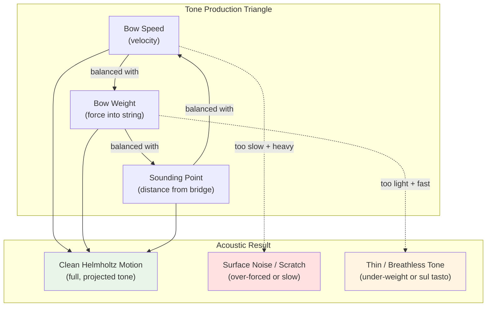
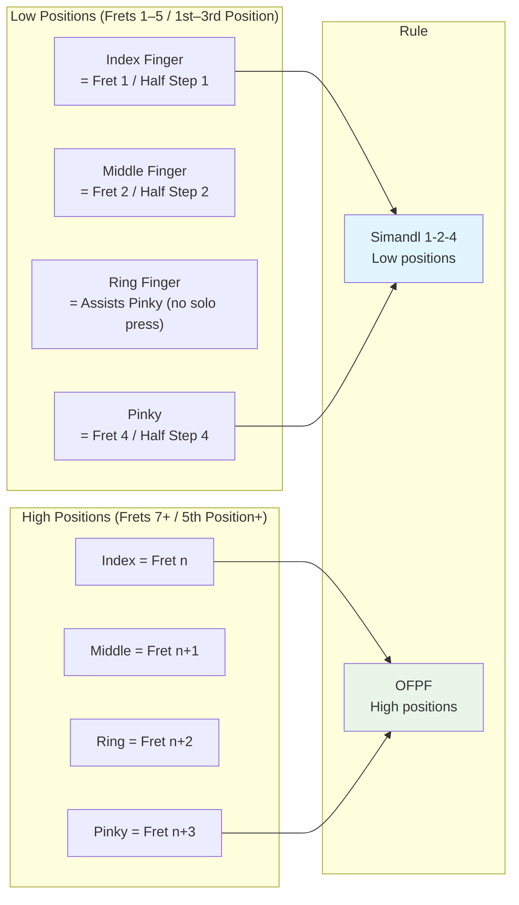
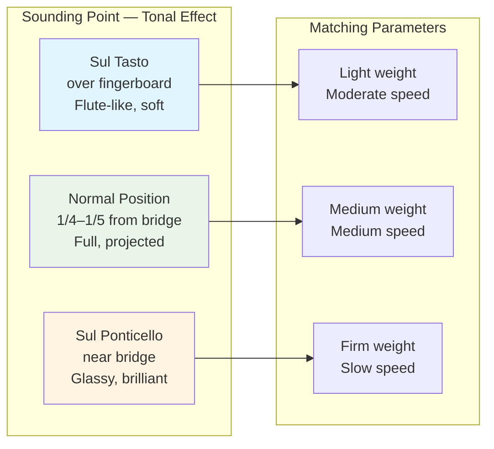
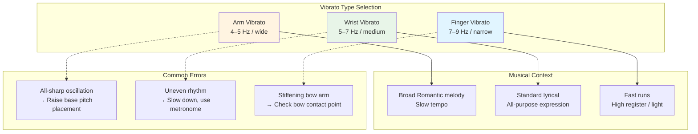
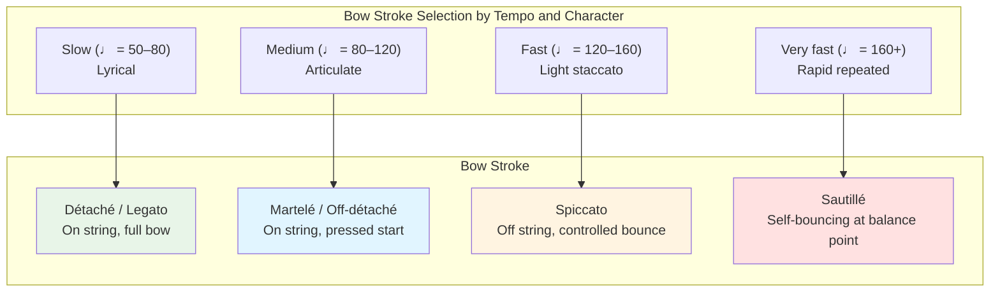
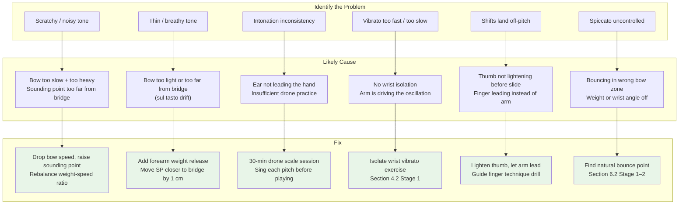
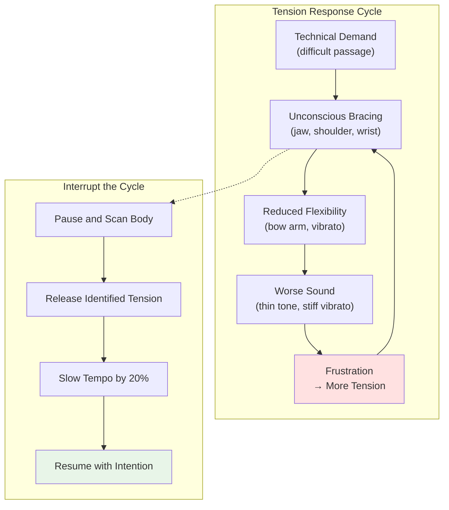
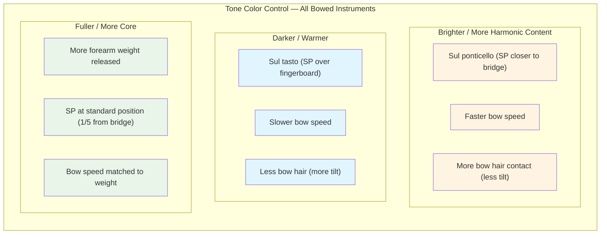

# Strings Masterclass: Technique, Tone, and Expressive Control

## Overview

This masterclass covers the full arc of string technique — from raw first-contact ergonomics to elite bow control, intonation systems, vibrato mastery, and injury prevention. Every concept connects directly to what your hands are doing right now. Physics appears only where it makes you a better player, not as an end in itself.

Applies to: violin, viola, cello, double bass, and electric/acoustic bass guitar. Instrument-specific callouts are marked.

---

## Table of Contents

1. [First Principles: What You Need to Know (and Nothing More)](#1-first-principles)
2. [Left-Hand Architecture: Posture, Finger Placement, and Intonation](#2-left-hand-architecture)
3. [Right-Hand Architecture: Bow Control and Plucking Mechanics](#3-right-hand-architecture)
4. [Vibrato: Rate, Width, and Expressive Control](#4-vibrato)
5. [Position Work and Shifting](#5-position-work-and-shifting)
6. [Articulation and Bow Strokes](#6-articulation-and-bow-strokes)
7. [Practice Architecture: Drills, Metronome Targets, and Diagnostics](#7-practice-architecture)
8. [Failure Modes and Self-Diagnosis](#8-failure-modes-and-self-diagnosis)
9. [Injury Prevention and Tension Management](#9-injury-prevention)
10. [Advanced Applications: Harmonics, Extended Techniques, and Tone Shaping](#10-advanced-applications)

---

## 1. First Principles

You need three ideas from physics, then we move on.

**The vibrating string:** Pitch is controlled by three variables — string length (shortened by your left hand), tension (set by your pegs/tuning head), and string mass (fixed by string gauge). Your left hand is your pitch machine. Everything else is tone.

**The harmonic series:** When you play an open G, you are not producing one frequency. You are producing G + an octave up + a fifth above that + a third above that, stacking upward. This series determines your instrument's timbre. Bowing closer to the bridge amplifies upper harmonics (bright, edgy sound). Bowing closer to the fingerboard suppresses them (soft, hollow sound). This is not theory — it is the dial you adjust with every bow placement decision.

**Stick-slip dynamics (bowed instruments):** Your bow hair grips the string, pulls it sideways, releases it, grips it again. This "Helmholtz motion" repeats 220 times per second on an open A string. The cycle requires three things in balance: bow speed, bow weight, and sounding point (distance from bridge). When all three are matched, the tone locks in. When one is off, you get scratch, squeak, or breathiness. Every bowing exercise in this lesson trains the coordination of exactly these three variables.

That is all the physics you need. Everything that follows is technique.



---

## 2. Left-Hand Architecture

### 2.1 Hand Frame and Thumb Position

The left hand does not grip the neck. It cradles it.

**Universal rule across all string instruments:** The thumb sits opposite the middle finger (index for smaller hands), making a relaxed C-shape. No knuckle-wrapping. No thumb creeping over the top of the neck. The neck should rest lightly in the thumb-index channel — if you remove your thumb, the hand frame holds its shape.

**Violin/Viola first position:**
- Thumb rests lightly on the neck, slightly bent, opposite the first or second finger
- The base knuckles (MCP joints) stay low and roughly parallel to the string
- All four fingers curve over the strings, tips contacting the string approximately 2–3 mm behind the nail
- The elbow swings under the neck (further for violin, less for viola) to bring the finger pads squarely onto the strings

**Cello first position:**
- Thumb on the back-left side of the neck, never squeezing
- Simandl 1-2-4 fingering applies in lower positions (thumb, index, middle, ring — skipping the pinky for bass clef registers)
- The elbow leads each finger shift — do not reach with the finger alone

**Double bass and bass guitar (Simandl 1-2-4):**
- In frets/positions 1–5: use index (1), middle (2), and pinky (4) only. The ring finger assists the pinky but does not press independently
- In frets/positions 7+: One Finger Per Fret (OFPF) becomes viable as string tension relaxes
- Thumb anchors on the back of the neck opposite the second finger at all times
- Wrist stays straight — not cocked, not collapsed. If your wrist bends toward the headstock, you are setting up for tendinitis



### 2.2 Intonation: The Auditory-Motor Loop

Intonation on a fretless instrument is not about memorizing finger distances. It is about training your ear to hear the target pitch before your hand moves, and then correcting toward it in real time.

**The three-stage process:**

1. **Audiate** the target pitch (sing or hear it internally before playing)
2. **Place** the finger at your best estimate
3. **Listen and adjust** — your ear makes the final correction

The key insight: finger placement is an approximation. The ear is the precision tool. This is why practicing with a drone (sustained pitch) is more valuable than practicing with a tuner. A tuner tells you after the fact. A drone gives you continuous feedback during the action.

**Intonation drill — open string drone (all fretless instruments):**

1. Set a drone on your open string (use a tuner app, keyboard, or electronic drone)
2. Play the scale of that string's key slowly (e.g., G major on the G string)
3. For each note, sustain it and listen for beating against the drone's harmonics
4. A pure fifth above the open string will sound "locked" — zero beating
5. Any note slightly sharp or flat will beat against an overtone of the drone

Metronome targets for drone scale work:
- Week 1: ♩ = 50, one bow per note, four beats each
- Week 2: ♩ = 60, two notes per bow
- Week 3: ♩ = 72, one note per beat, sustain
- Week 4: ♩ = 88, begin slurring pairs

### 2.3 First Position Box Shapes (Violin)

The first position on violin covers a minor third per string, one finger per semitone (approximately):

```
E string:  E  F  F# G  G# A
           0  1  1  2  2  3    (finger numbers, low-to-high)

A string:  A  Bb B  C  C# D
           0  1  1  2  2  3

D string:  D  Eb E  F  F# G
           0  1  1  2  2  3

G string:  G  Ab A  Bb B  C
           0  1  1  2  2  3
```

**Key posture checkpoints before every practice session:**
- [ ] Thumb is relaxed and not gripping
- [ ] Wrist is straight (not bent toward or away from the scroll)
- [ ] Base knuckles of the fingers stay close to the string even when fingers lift
- [ ] Elbow is under the instrument, not behind the body

---

## 3. Right-Hand Architecture

### 3.1 Bow Hold (Violin/Viola/Cello)

The bow hold is not a grip. It is a suspension system.

**Russian/Franco-Belgian bow hold (most common modern approach):**
- Thumb tip rests on the stick at the frog, slightly bent — never locked straight
- Index finger contacts the stick at the middle phalanx (between first and second joint), not at the tip
- Middle and ring fingers drape over the top, curved
- Pinky sits on top of the stick, curved — it is the counterbalance, not an ornament
- The thumb and middle finger form the primary axis; everything else refines it

**Common beginners' error:** All five fingers cramped together at the frog, thumb locked straight. This kills bow arm flexibility and transfers every micro-tremor into the string.

**Diagnostic test:** Hold the bow in playing position and gently shake the bow horizontally. The fingers should absorb the movement with a slight ripple. If the bow is rigid, loosen the fingers.

### 3.2 The Three-Parameter System in Practice

Every bow stroke you make involves adjusting three variables simultaneously. Here is how to train each one in isolation, then combine them.

**Parameter 1 — Bow Speed**

Drill: Long-bow exercise on an open string.
- Use the entire bow, heel to tip, in 8 counts
- Target: smooth, even sound with no dynamic swell or fade
- Common error: rushing near the tip (bow arm wants to collapse)
- Fix: slow the forearm consciously in the final third of the bow

Metronome targets:
- ♩ = 50: one bow per 4 beats (slow and controlled)
- ♩ = 60: one bow per 4 beats (begin adding dynamic shape)
- ♩ = 72: one bow per 2 beats (integrate into scales)

**Parameter 2 — Bow Weight**

Bow weight is not finger pressure. It is forearm weight released into the string.

Drill: Weight drop exercise.
- Rest the bow flat on the string (no movement)
- Gradually release arm tension, letting gravity pull the stick into the string
- Note the sound change: more fundamental, more "core" in the tone
- Then reduce weight until you hear breathiness — that is the lower threshold
- Find the middle: full tone, no scratch

**Parameter 3 — Sounding Point**

The standard sounding point (SP) positions on violin:
```
Sul tasto:      above fingerboard       — soft, flute-like, pp-mp
Normal:         1/4 to 1/5 from bridge  — full tone, mp-mf
Sul ponticello: very close to bridge    — glassy, nasal, harmonics emphasized, ff
```

Drill: Sounding point ladder.
- Play 4 open A string bows at each position moving from sul tasto → normal → sul ponticello
- Use the same bow speed and weight throughout
- Listen to the timbral shift — this is you operating the instrument's EQ



### 3.3 Plucking Mechanics (Bass Guitar and Double Bass)

**Fingerstyle bass — floating thumb technique:**

The floating thumb is non-negotiable for clean tone and string muting above the 4-string standard.

- Thumb rests on the string one below the string being played (e.g., playing D string → thumb on A string)
- As you move to the A string, thumb migrates to the E string
- As you move to the E string, thumb rests on the pickup housing or body
- This eliminates sympathetic ringing and unwanted overtones from adjacent strings

**Two-finger alternation drill:**
1. Set a metronome to ♩ = 60
2. Play eighth notes on an open E string, strictly alternating index and middle finger
3. Each stroke pulls the string toward the body and comes to rest on the adjacent lower string (rest-stroke technique, à la classical guitar)
4. Listen for evenness — the two fingers should produce the same attack and tone
5. Advance to ♩ = 80 → 100 → 120 as evenness is achieved

**Slap mechanics (bass guitar):**
- Thumb strikes the string directly above the last fret of the neck, bouncing off immediately (not pressing through)
- The thumb joint snaps from the wrist, not the forearm — think "flick," not "hit"
- Pop: index or middle finger hooks under the G or D string at the end of the fingerboard and snaps away from the body perpendicularly
- Slap note: strings 4–5 (E, A); Pop note: strings 1–2 (G, D) — the anatomy of the standard slap/pop pattern

**Slap coordination drill (bass guitar):**
```
Pattern: S = Slap (thumb), P = Pop (index hook), . = rest

Beat:    1    +    2    +    3    +    4    +
         S    .    P    .    S    .    P    .

String:  E         G         E         G
Fret:    0         0         0         0

Tempo: Start ♩ = 60, target ♩ = 100
```

---

## 4. Vibrato

### 4.1 Three Sources, Three Sounds

Vibrato is not an ornament applied to a note. It is a continuous expressive dimension available throughout the note's duration. Train all three types — they serve different musical contexts.

**Arm vibrato:**
- Pivot: forearm rotation (elbow as fulcrum)
- Character: wide, slow, emotionally intense
- Rate range: 4–5 Hz
- Width: ±0.4–0.5 semitones
- Use: sustained singing melodies, Romantic-era style, cello and bass registers

**Wrist vibrato:**
- Pivot: wrist joint oscillates (forearm stays relatively still)
- Character: medium rate and width, most versatile
- Rate range: 5–7 Hz
- Width: ±0.2–0.3 semitones
- Use: standard expressive playing across all contexts

**Finger vibrato:**
- Pivot: MCP (knuckle) joint flexion
- Character: narrow, fast, precise
- Rate range: 7–9 Hz
- Width: ±0.1–0.2 semitones
- Use: fast passages, light upper-register playing, violin/viola in high positions

### 4.2 Vibrato Activation Drill (Wrist Vibrato)

The key error most students make: they oscillate the finger sharp and flat of center. Correct vibrato oscillates below the pitch and returns to it — the natural resting point of the fingertip is the pitch target, and the motion releases away from it.

**Step 1 — Passive oscillation (no bow yet):**
- Place second finger on D string (violin) or G string (cello) at the target pitch
- Rest the bow on the string but do not draw it
- Begin rocking the wrist forward and back — not the arm, not just the finger
- Let the finger pad rock on the string; feel the string tension change
- Target: a smooth, motorized feeling, not a jab

**Step 2 — Activate sound:**
- Begin a slow, sustained bow stroke (whole bow, 6 beats)
- Add the wrist oscillation — start deliberately slow (3–4 Hz) and wide so you can hear it clearly
- Listen: the pitch should undulate. If you only hear pitch going flat, your center placement is too high
- Adjust the base finger placement slightly sharp, then re-oscillate until the undulation is symmetric

**Step 3 — Rate and width control:**
- Play the same note with vibrato deliberately wide and slow
- Then narrow and fast
- Then find the expressive "home" rate for the musical character (lyrical = moderate width, 5–6 Hz)

Metronome targets for vibrato consistency:
- Week 1: ♩ = 60, whole notes, one vibrato cycle per beat (consciously slow)
- Week 2: ♩ = 60, half notes, two cycles per beat
- Week 3: ♩ = 72, quarter notes, free vibrato
- Week 4: ♩ = 88, integrate into a melodic passage



---

## 5. Position Work and Shifting

### 5.1 Position Geography (Violin/Viola Reference)

```
Position    First Finger on:    Range (A string)
1st         B                   B – E (4th finger)
2nd         C                   C – F#
3rd         D                   D – G#
4th         E                   E – A
5th         F                   F – B
6th         F#                  F# – C
7th         G (octave)          G – D (thumb)
```

For cello, positions shift in half-steps from C (open C string). Thumb position begins around 7th position on cello, where the thumb comes off the neck and pivots behind the string.

For double bass: positions are wider-spaced due to string length. Simandl 1-2-4 applies throughout lower positions; harmonics become critical above 7th position.

### 5.2 The Mechanics of a Clean Shift

A shift is not a jump. It is a glide along the string with the bow sustaining through the transition.

**The four-step shift:**
1. **Lighten** — reduce left-hand pressure (do not remove the finger, just reduce weight to a feather touch)
2. **Slide** — the entire arm moves as a unit up or down the neck; the thumb leads, not the finger
3. **Land** — the finger contacts the new position with appropriate pressure for intonation
4. **Confirm** — the ear checks the pitch and micro-adjusts

**Shift drill (violin, 1st to 3rd position):**
```
Exercise: shift on a single string (A string), one finger

1st pos: D (3rd finger, A string) — hold for 2 beats
Lighten → slide first finger up to 3rd position D (now first finger on D)
3rd pos: D (now 1st finger) → E (2nd finger) → F# (3rd finger) — hold 2 beats
Reverse shift back to 1st position

Metronome: ♩ = 50 → 60 → 72
Key marker: no audible glissando "squeak" — the pressure reduction prevents it
```

**Guide finger technique:** When shifting, leave one finger (usually the finger you are leaving from) lightly on the string to guide the hand to the new position. It acts as an intonation checkpoint rather than pressing through — the light contact helps the ear find the new pitch center before full weight lands.

### 5.3 Movable Box Patterns (Bass Guitar)

The movable box covers root, major/minor 3rd, 5th, and octave — the core vocabulary for walking bass and groove lines.

**Major box (root on E string, example: G major):**
```
String:   E    A    D    G
Fret:     3    5    5    7     ← Root, 5th, Root (8va), 5th (8va)
          3    5    4    5     ← Root, 5th, 3rd (ma), 3rd (8va)
          5    5    7    7     ← 2nd, 5th, 7th, ...
```

More usefully, the four-note box that moves up the neck:

```
Root position box (G at 3rd fret, E string):

E ——3——5——         Root(G) — 2nd(A)
A ——3——5——         4th(C)  — 5th(D)
D ——5——7——         Root(8va, G) — Maj2nd(A)
G ——5——7——         3rd(B)  — 4th(C)

Minor box shifts: flatten the 3rd (G → Gb, one fret back on D string in this example)
```

Move this box to any root on the E or A string. The shape stays identical.

---

## 6. Articulation and Bow Strokes

The bow is a vocabulary. Each stroke is a word with a specific meaning and a specific mechanical execution.

### 6.1 Core Bow Strokes Reference

| Stroke | Description | Bow Location | Contact | Musical Use |
|---|---|---|---|---|
| Détaché | Separate, full bow | Middle–full | On string | Standard singing tone |
| Legato | Slurred, connected | Full bow | On string | Lyrical phrases |
| Martelé | Hammered, pressed start | Heel or upper | On string | Accented, articulate |
| Spiccato | Controlled bounce | Middle | Off string | Light, staccato passages |
| Sautillé | Rapid self-bouncing | Middle | Off string | Very fast staccato |
| Ricochet | Thrown, multiple bounces | Upper third | Off string | Virtuosic repeated notes |
| Col legno | Wood of bow on string | Any | Wood side | Percussive effect |

### 6.2 Spiccato: The Skill Most Players Avoid

Spiccato is the controlled off-string bounce. It lives at the bow's natural balance point (roughly the middle of the bow's length). The bow will bounce on its own at this point if you drop it. Spiccato exploits that physics.

**Spiccato development sequence:**

**Stage 1 — Find the bounce point:**
- Hold the bow at its middle
- Rest it on the string with no pressure
- Begin détaché strokes, gradually reducing bow weight until the bow naturally leaves the string
- Do not force the bounce — reduce control until physics takes over

**Stage 2 — Control the depth:**
- Higher wrist = shallower bounce (lighter, faster spiccato)
- Lower wrist = deeper bounce (heavier, slower spiccato)
- Practice adjusting wrist height while maintaining the rhythm of the bounce

**Stage 3 — Set the tempo:**
- Spiccato is tempo-dependent. It becomes natural between ♩ = 100–132 (sixteenth notes)
- Below that tempo, use off-string détaché (manual lift); above ♩ = 160, sautillé takes over
- Metronome drill: scale in spiccato, start ♩ = 80, increase by 4 each day until spiccato activates spontaneously



---

## 7. Practice Architecture

### 7.1 Session Structure

A complete practice session for an intermediate-to-advanced string player:

```
Total: 60 minutes

1. Physical warm-up (5 min)
   — Long bows on open strings, all four strings
   — Slow finger taps on the neck without bowing (activate left hand)
   — Shoulder rolls, wrist circles

2. Scales and arpeggios (15 min)
   — One scale per session, two octaves minimum
   — First pass: détaché, ♩ = 60, full bow per note, intonation focus
   — Second pass: slurred (4 notes per bow), ♩ = 72
   — Third pass: chosen articulation (spiccato, martelé), ♩ = 88

3. Targeted technique drill (15 min)
   — One isolated problem: shifting, vibrato, spiccato, etc.
   — Use the diagnostic procedures in Section 8 to select the drill
   — Never do more than one primary technical focus per session

4. Repertoire (20 min)
   — Work the hardest passage first (not warm-up → hard → cool-down — this wastes prime motor learning time)
   — Chunk into 4-bar units; perfect each unit before connecting
   — At tempo and below tempo in alternation

5. Run-through / musical integration (5 min)
   — Play a section or movement from start to finish without stopping
   — Trains recovery and musical continuity

```

### 7.2 The Chunk-and-Connect Method

Repertoire learning fails when players run through the whole piece repeatedly. The chunk-and-connect method accelerates memorization and technical security.

1. **Isolate** the two hardest measures in a passage
2. **Drill** each at 70% target tempo until error-free for 10 consecutive repetitions
3. **Connect** the drilled measure to the measure immediately before it
4. **Expand** backward — connect the preceding measure, then the one before that
5. **Final run** at target tempo

This reverse-chaining approach means the hardest material is always followed by material you have already secured.

### 7.3 Metronome Protocols for String Technique

| Goal | Start BPM | Increase | Target BPM | Key Metric |
|---|---|---|---|---|
| Long bow evenness | 50 | +5/session | 76 | No dynamic swell at bow changes |
| Scale intonation | 50 | +4/session | 92 | Zero cents deviation on drone check |
| Spiccato activation | 80 | +4/session | 132 | Bounce spontaneous, even, no scratching |
| Shifting accuracy | 50 | +6/session | 100 | No audible slide, correct pitch on landing |
| Vibrato rate control | 60 | +4/session | 96 | Even undulation, centered on target pitch |
| Slap/pop groove (bass) | 60 | +5/session | 110 | Even attack, clean mute on unused strings |

**Golden rule:** Never increase tempo until the current tempo is achieved with musical intention, not just mechanical accuracy. If you can play it at ♩ = 92 but it sounds mechanical, stay there.

---

## 8. Failure Modes and Self-Diagnosis

### 8.1 Diagnostic Map



### 8.2 Intonation Self-Assessment Protocol

Do this once a week with a recording device and a tuner app that shows cents:

1. Record yourself playing a two-octave G major scale at ♩ = 60, full bow per note
2. Import the audio into a tuner app (Tonal Energy, Cleartune, or pitch visualization in a DAW)
3. Mark each note's deviation in cents from equal temperament
4. Look for patterns:
   - Consistently flat fourth finger → hand frame too small; widen the stretch
   - Consistently sharp in upper positions → thumb tension causing arm to shorten; release thumb
   - Randomly off across all fingers → ear not leading; begin drone practice before all scale work

### 8.3 Bow Consistency Self-Assessment

1. Record a sustained open A, one full bow (8 beats at ♩ = 60)
2. Watch the waveform in any audio editor (Audacity is free)
3. A well-executed sustained tone shows a consistent amplitude envelope across the entire bow
4. Common failures visible in the waveform:
   - Amplitude dip at the bow change (tip) → running out of bow arm before stroke ends
   - Amplitude swell in the middle → pressing unconsciously at the heaviest bow balance point
   - Short spikes at onset → bow not moving before contact (the bow must already be traveling when it contacts the string for a clean attack)

---

## 9. Injury Prevention

String playing requires sustained, asymmetric muscle loading. The injuries are predictable and preventable.

### 9.1 High-Risk Zones and Warning Signs

| Zone | Instrument(s) | Warning Sign | Do Not Ignore |
|---|---|---|---|
| Left forearm / wrist | All fretless | Tingling in ring/pinky fingers | Ulnar nerve compression |
| Left thumb | Bass, cello | Aching at base of thumb | Flexor pollicis overuse |
| Right shoulder | Violin, viola | Persistent ache after playing | Rotator cuff strain |
| Right forearm | All bowed | Fatigue within 20 min of bowing | Pronator teres overuse |
| Neck / jaw | Violin, viola | Headaches, jaw clicking | Chin rest pressure |

### 9.2 The 5-Minute Warm-Up (Non-Negotiable)

Before touching the instrument:

```
1. Wrist circles — 10 clockwise, 10 counterclockwise, both hands
2. Finger fans — spread fingers wide, hold 3 sec, relax, repeat 5x
3. Forearm stretch — extend arm, flex hand back toward you (hold 20 sec), then point fingers down (hold 20 sec)
4. Shoulder rolls — 5 forward, 5 backward
5. Chin tucks — gently tuck chin to chest, hold 10 sec, 3 reps (critical for violin/viola neck compression)
```

### 9.3 Practice Load Management

- **Maximum continuous playing time before a micro-break:** 25–30 minutes
- **Micro-break duration:** 3–5 minutes (put the instrument down, walk around, shake out the hands)
- **Total daily practice ceiling for healthy development:**
  - Beginners (< 1 year): 30–45 min/day
  - Intermediate (1–3 years): 60–90 min/day
  - Advanced (3+ years): 2–4 hours/day split across multiple sessions
- **Red line:** Any sharp or shooting pain is a stop signal. Fatigue is normal. Pain is not.

### 9.4 Tension Detection Exercise

Do this once per week to recalibrate body awareness:

1. Begin playing a scale at ♩ = 60
2. After 4 bars, pause — without changing your posture, scan from feet to head
3. Where are you holding unnecessary tension? Common finds: jaw, left shoulder, right shoulder elevated, breath held
4. Release each one consciously, then resume playing
5. Notice whether the tone changes when tension releases — it almost always does, and always for the better



---

## 10. Advanced Applications

### 10.1 Natural Harmonics

A harmonic is produced by lightly touching the string at a nodal point — a location where the string divides evenly — without pressing to the fingerboard. The touch must be a feather contact, not a press.

**Harmonic nodes and resulting pitches (violin E string, open = E5):**

```
Node position         Fraction    Resulting pitch    Interval above open
Midpoint (12th fret)  1/2         E6                 Octave
1/3 from nut          1/3         B6                 Octave + 5th
1/4 from nut          1/4         E7                 Two octaves
1/5 from nut          1/5         G#7                Two octaves + 3rd
```

**Playing harmonics cleanly:**
- Touch is perpendicular to the string — no sideways pressure
- Bow sounding point moves closer to the bridge (SP ≈ 0.05L) to reinforce the harmonic overtones
- Faster bow speed with lighter weight (harmonics are fragile — too much bow pressure damps them)
- For electric bass: thumb touches the string at the 12th fret while the picking hand plucks — the resulting octave harmonic rings clearly on clean amplification

### 10.2 Artificial Harmonics (Violin/Viola/Cello)

The first (index) finger stops the string normally to create a new fundamental. The fourth finger touches lightly at the perfect fourth above that fundamental (a natural harmonic of the stopped string). The resulting pitch is two octaves above the first finger.

```
Example: 1st finger on A (D string, violin) = stopped fundamental
4th finger touch: D (a perfect fourth above) = node at 1/4 of remaining length
Result: A, two octaves above first finger (A6 on violin)
```

This technique is essential for high-register solo passages (Saint-Saëns, Ravel) and requires very precise fourth finger placement.

### 10.3 Double Stops and Chord Voicings

**Double stops** are two strings sounded simultaneously. The left hand must maintain intonation on both strings while the bow contacts both simultaneously.

**Bow technique for double stops:**
- Flatten the bow hair slightly (reduce stick tilt) so more hair contacts more string surface
- Sounding point stays consistent across both strings — a common error is angling the bow, privileging one string
- Begin with open string + stopped string combinations to isolate intonation checking

**Essential double stop intervals by difficulty:**

| Interval | Difficulty | Why |
|---|---|---|
| Octaves | Medium | Wide hand frame, but pitch relationships clear |
| Fifths | Medium | Open resonant check possible (tune to ring) |
| Thirds | Harder | Close spacing, fine intonation ear required |
| Sixths | Harder | Similar to thirds, awkward hand position in some keys |
| Seconds | Hardest | Semitone adjacent string contact is sonically brutal if off |

**Thirds drill (violin, A and E strings simultaneously):**
```
A string: 1st finger B → 2nd finger C# → 3rd finger D# (1st pos)
E string: 1st finger F# → 2nd finger G# → 3rd finger A# (1st pos)

Metronome: ♩ = 50, long bow, listen for both pitches to ring cleanly
Advance: ♩ = 60 → 72, increase bow speed while maintaining SP
```

### 10.4 Tone Shaping Through Bow Distribution

Professional-level phrasing uses strategic bow distribution to create natural musical breathing within a phrase. The bow is not a metronomic resource — it is expressive currency.

**Principle:** More bow = more sound and energy. Less bow = restraint, intimacy, mystery.

**Practical phrase shaping example (8-bar melody, violin):**

```
Bar 1–2: Start near the frog, slow bow (conserving bow = soft arrival)
Bar 3–4: Moving toward middle, increasing bow speed (phrase building)
Bar 5–6: Full bow at middle to tip (peak — full tone, slight SP shift toward bridge)
Bar 7:   Return toward middle (tapering)
Bar 8:   Arrive at frog, nearly stopped bow (phrase ending, natural decay)
```

This is not about metronome accuracy. It is about musical architecture expressed through arm mechanics.

### 10.5 Tone Color Palette — Quick Reference



---

## Synthesis: Putting It Together

String mastery is the product of three converging loops running simultaneously:

**Loop 1 — Ear leads hand.** You hear the pitch, the tone color, the dynamic before your hand moves. The hand executes what the musical imagination has already specified. This is why singing your part before playing it is the highest-leverage practice habit at any level.

**Loop 2 — Minimal tension, maximum efficiency.** Every technique in this lesson works best in a state of organized relaxation. Tension is not strength. The bow arm that releases its weight into the string produces more tone with less effort than the arm that presses. The left hand that lightens before a shift shifts more accurately than the hand that grips through. Scan your body continuously.

**Loop 3 — Diagnosis drives practice.** Vague repetition produces vague improvement. Use the diagnostic tools in Section 8, record yourself weekly, and address one specific failure mode per session. Know what you are practicing and why.

The instrument does not reward effort alone. It rewards focused, embodied attention — applied thousands of times, with ears wide open.
