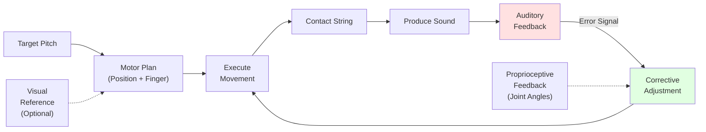
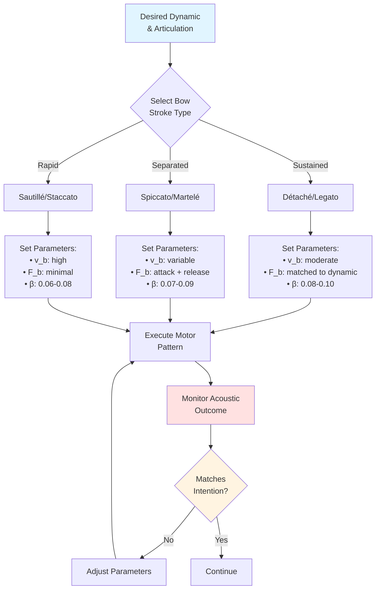
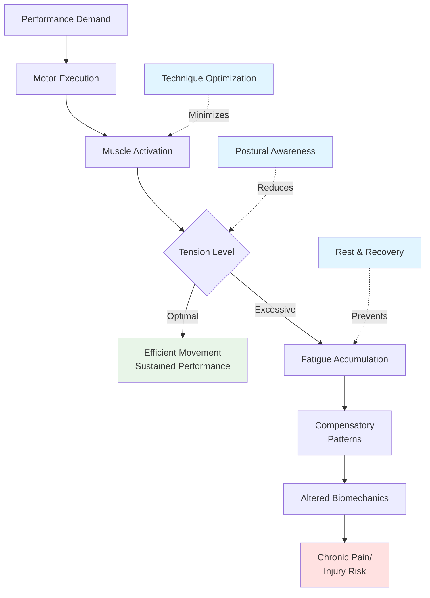

# Lesson 1: Essential String Techniques

## 1. First-Principles Intuition & Invariants

The mastery of string instruments emerges from the convergence of three fundamental domains: the physics of wave propagation, the biomechanics of human motor control, and the psychoacoustics of timbre perception. Understanding these foundations reveals why certain techniques produce specific sonic results and how players can systematically develop control over their instrument's acoustic behavior.

### The Physics of String Vibration

Sound production on string instruments begins with the fundamental physics of transverse wave propagation on a tensioned string. When a string is displaced from equilibrium—whether by bow friction, finger plucking, or hammer strike—it returns to rest through a series of oscillations governed by the one-dimensional wave equation:

$$\frac{\partial^2 y}{\partial t^2} = \frac{T}{\mu} \frac{\partial^2 y}{\partial x^2}$$

where $y(x,t)$ represents string displacement at position $x$ and time $t$, $T$ is string tension (in Newtons), and $\mu$ is linear mass density (kg/m). The wave velocity $v = \sqrt{T/\mu}$ determines fundamental frequency according to the boundary condition relationship:

$$f_n = \frac{n}{2L}\sqrt{\frac{T}{\mu}}, \quad n = 1, 2, 3, \ldots$$

where $L$ is the vibrating string length and $n$ denotes the harmonic number. This equation reveals three critical control parameters available to the performer:

1. **Tension ($T$)**: Adjusted via tuning pegs, affecting pitch and mechanical compliance
2. **Vibrating length ($L$)**: Controlled by finger stopping position, the primary mechanism for pitch selection
3. **Linear density ($\mu$)**: Fixed by string construction (core material, winding), determining the instrument's timbral palette

The string's motion decomposes into a Fourier series of harmonics, each with amplitude $A_n$ and phase $\phi_n$:

$$y(x,t) = \sum_{n=1}^{\infty} A_n \sin\left(\frac{n\pi x}{L}\right) \cos(2\pi f_n t + \phi_n)$$

The relative amplitudes of these harmonics—the **spectral envelope**—constitute the instrument's timbre. Bowing position directly shapes this envelope: bowing closer to the bridge emphasizes higher harmonics (producing a *ponticello* brightness), while bowing near the fingerboard suppresses them (yielding a *sul tasto* warmth). This relationship is quantified by the missing harmonic principle: bowing at position $x_b = L/k$ suppresses the $k$-th harmonic and its integer multiples.

```mermaid
graph TB
    A["String Displacement<br/>(Initial Condition)"] -->|"Wave Equation"| B["Vibrational Modes<br/>(Harmonics 1, 2, 3...n)"]
    B --> C["Bridge Transmission"]
    C --> D["Body Resonances<br/>(Top Plate, Back Plate, Air Cavity)"]
    D --> E["Radiated Sound<br/>(Timbre + Amplitude)"]
    
    F["Bow Position x_b"] -.->|"Suppresses harmonics<br/>at k = L/x_b"| B
    G["Bow Pressure & Velocity"] -.->|"Controls stick-slip<br/>regime"| A
    H["Left-Hand Stopping<br/>(Vibrating Length L)"| -.->|"Determines f₀"| B
    
    style B fill:#e1f5ff
    style D fill:#fff4e1
    style E fill:#e8f5e8
```

### The Helmholtz Motion and Stick-Slip Dynamics

The characteristic tone of bowed strings arises from the **Helmholtz motion**, a stick-slip phenomenon where the string alternates between traveling with the bow (stick phase) and snapping back against bow direction (slip phase). High-speed photography reveals that during steady-state bowing, the string forms a sharp corner that travels back and forth along the string length, creating a sawtooth displacement waveform rich in harmonics.

This stick-slip cycle depends critically on the relationship between bow velocity $v_b$, bow force $F_b$, and the distance from the bridge $\beta = x_b/L$. The **Schelleng diagram** defines the playable region bounded by:

- **Maximum bow force**: $F_{max} \propto v_b / \beta$ (above which double-slipping occurs)
- **Minimum bow force**: $F_{min} \propto v_b \cdot \beta$ (below which multiple slips create surface noise)

The optimal bow force follows approximately $F_{optimal} \approx \sqrt{F_{max} \cdot F_{min}}$, establishing that effective bowing requires continuous adjustment of pressure relative to both velocity and sounding point. This explains why beginners struggle with tone production—they lack the calibrated feedback loop connecting proprioceptive bow pressure to acoustic outcome.

### Biomechanical Foundations

String technique is fundamentally a motor learning problem involving the acquisition of precise, repeatable movement patterns. The human motor system operates through a hierarchical control architecture:

1. **Cortical planning layer**: Sequences and timing of notes
2. **Subcortical coordination**: Posture, balance, and inter-limb coupling
3. **Spinal reflexes**: Fine force modulation and error correction

Effective string technique exploits the body's kinematic chain to amplify small proximal movements into precise distal control. In violin playing, for example, bow control emerges from coordinated shoulder rotation, elbow flexion/extension, and wrist pronation/supination. The arm acts as a multi-joint linkage where proximal stability enables distal precision—a principle known as **proximal-to-distal sequencing**.

Finger placement accuracy is constrained by the proprioceptive resolution of mechanoreceptors in the fingertips (approximately 0.5-1 mm discrimination threshold) and the biomechanical compliance of finger joints. The fastest professional string players achieve finger independence through differential motor unit recruitment, activating specific flexor digitorum profundus and superficialis subdivisions while maintaining extensor tone for positional stability.

## 2. Core Architecture & Mechanics

### Left-Hand Technique: Finger Placement and Intonation

Intonation accuracy on fretless string instruments requires the player to internalize an auditory-motor map that associates finger positions with target pitches. Unlike keyboard instruments where pitches are pre-determined, string players continuously adjust finger placement based on real-time auditory feedback—a process that engages both feed-forward motor planning and feed-back error correction.

**Geometric finger spacing** follows the logarithmic nature of equal temperament. For a string vibrating at fundamental frequency $f_0$, producing a pitch $n$ semitones higher requires shortening the vibrating length by the ratio:

$$\frac{L_{new}}{L_0} = 2^{-n/12}$$

On the violin's E string ($f_0 = 659.25$ Hz), the first position spans approximately 5 semitones, requiring finger spacings that decrease exponentially from the nut. The distance from the nut to the first finger (producing F♯) is approximately:

$$d_1 = L_0 \left(1 - 2^{-2/12}\right) \approx 0.122 L_0$$

while the distance from first to fourth finger (producing B) spans:

$$d_{1 \to 4} = L_0 \left(2^{-2/12} - 2^{-7/12}\right) \approx 0.092 L_0$$

This geometric compression means that first position requires expanding hand frames as players shift to higher positions, a biomechanical constraint that drives position change strategy.

**Optimal finger pressure** balances two competing requirements: sufficient force to ensure clean string-to-fingerboard contact (eliminating sympathetic vibrations and ensuring fundamental clarity) while minimizing muscle tension that impedes finger independence and velocity. Empirical measurements show effective finger forces range from 1.5-3 N, with higher positions requiring greater force due to increased string height off the fingerboard.

The finger contact point should occur at the fingertip pad, approximately 2-3 mm behind the nail. This positioning maximizes the contact surface area while maintaining the curved finger posture essential for rapid position changes. The metacarpophalangeal (MCP) joint should remain flexible, allowing the finger to collapse slightly under string resistance rather than transmitting excess force through rigid joint locking.



### Right-Hand Technique: Bow Control and Articulation

Bow control represents the most complex motor skill in string performance, requiring simultaneous regulation of three independent parameters: **bow velocity**, **bow force**, and **sounding point** (distance from bridge). These parameters interact non-linearly to determine both tonal quality and dynamic range.

**Bow velocity** ($v_b$) directly controls sound amplitude through the stick-slip energy transfer rate. However, this relationship is not linear—doubling bow velocity does not double loudness. The sound intensity $I$ scales approximately as:

$$I \propto \sqrt{v_b \cdot F_b}$$

indicating that velocity and force must increase together to achieve forte dynamics while maintaining Helmholtz motion.

**Bow weight** (the component of gravitational and applied arm weight perpendicular to the string) is the primary determinant of bow force. Effective bow weight management involves:

1. **Forearm pronation/supination**: Rotating the arm to adjust the vertical component of bow weight
2. **Wrist height modulation**: Raising or lowering the wrist to shift weight distribution along the bow
3. **Finger pressure**: Fine adjustments through index finger pressure or thumb release

The bow's center of percussion (typically 1/3 of the bow length from the frog) provides optimal weight distribution for sustained tones. Playing near the frog requires active weight reduction via thumb support and wrist elevation, while playing at the tip demands forearm weight transfer and possible finger pressure augmentation.

**Sounding point** ($\beta$) represents the most sensitive tonal control parameter. Moving the bow 1 cm closer to the bridge on a violin can shift the spectral centroid by several hundred Hz, dramatically brightening the tone. Professional players continuously adjust sounding point in response to dynamic and articulation requirements:

- **Pianissimo**: $\beta \approx 0.15$ (sul tasto region)
- **Mezzo forte**: $\beta \approx 0.08$ (normal bowing position)
- **Fortissimo**: $\beta \approx 0.04$ (sul ponticello region)

**Bow angle** relative to the bridge (perpendicular vs. angled) affects which harmonics are excited and how evenly bow hair contacts the string. The optimal angle varies by bow stroke type:

- **Détaché** (separate bow strokes): Perpendicular, maximizing contact and tone evenness
- **Spiccato** (bouncing bow): Slightly angled (5-10°), facilitating bow hair release
- **Sautillé** (rapid off-string): More pronounced angle (10-15°), exploiting bow spring resonance



### Vibrato: Acoustic and Expressive Dimensions

Vibrato is a periodic pitch modulation produced by oscillating the finger's stopping position on the fingerboard. The vibrato waveform can be characterized by three parameters:

1. **Rate** ($f_v$): Oscillation frequency, typically 5-8 Hz for expressive vibrato
2. **Extent** ($\Delta f$): Pitch deviation amplitude, usually ±0.25 to ±0.50 semitones
3. **Waveform**: Shape of the modulation (sinusoidal, triangular, or asymmetric)

Vibrato affects perception through multiple psychoacoustic mechanisms. The pitch oscillation creates temporal spectral variation that the auditory system integrates as increased timbral richness. Additionally, vibrato masks small intonation errors by distributing the pitch center across a range rather than exposing a single frequency.

The biomechanics of vibrato can be generated from three anatomical pivots:

**Arm vibrato**: Originating from forearm rotation, producing slow, wide oscillations (4-5 Hz, ±0.5 semitones). This vibrato type is historically associated with early 20th-century performance practice and is characterized by a pronounced, emotional quality.

**Wrist vibrato**: Driven by radiocarpal joint flexion/extension, yielding moderate rate and extent (5-7 Hz, ±0.3 semitones). This is the most commonly taught vibrato style, offering a balance between control and warmth.

**Finger vibrato**: Initiated by metacarpophalangeal joint articulation, producing fast, narrow oscillations (7-9 Hz, ±0.2 semitones). This vibrato is typical in rapid passages where larger-amplitude oscillations would destabilize intonation.

Effective vibrato requires that the oscillation remain centered on the target pitch rather than oscillating exclusively sharp or flat. This necessitates precise initial finger placement followed by symmetric modulation—a motor control challenge that often takes years to fully develop.

The interaction between vibrato and bow control creates additional expressive possibilities. Starting a note without vibrato and gradually increasing vibrato rate and extent (**crescendo vibrato**) produces a sense of increasing emotional intensity. Conversely, decaying vibrato toward the end of a note can create a sense of resolution or release.

## 3. High-Performance Optimization & Failure Modes

### Systematic Practice Architecture

Achieving high-performance string technique requires structured practice that addresses the specific failure modes inherent to each technical component. Effective practice operates on three timescales:

**Micro-practice** (minutes): Focused repetition of specific movement patterns with immediate feedback correction. This targets the refinement of motor programs through error-based learning. Example: 20 repetitions of a single bow stroke with attention to contact point consistency, followed by acoustic analysis (e.g., recording and spectral review).

**Meso-practice** (weeks): Integration of isolated techniques into musical contexts, developing the ability to chain movement patterns seamlessly. Example: Two-octave scales combining position changes, string crossings, and varied bow distributions.

**Macro-practice** (months-years): Consolidation of technique into implicit, automatized skill that operates below conscious awareness. This enables attention to be directed toward interpretive decisions rather than mechanical execution.

Research in motor learning demonstrates that distributed practice (shorter sessions spread over multiple days) produces superior long-term retention compared to massed practice (extended single sessions). For string players, this suggests that two 45-minute sessions separated by several hours yield better results than a single 90-minute block.

### Common Failure Modes and Diagnostic Approaches

**Finger placement errors** manifest as intonation inconsistencies. Diagnostic procedure:

1. Record a slow chromatic scale across all positions
2. Analyze pitch accuracy using tuning software (e.g., measuring cents deviation from equal temperament)
3. Identify systematic biases (e.g., consistently sharp fourth finger suggests insufficient hand frame extension)
4. Prescribe targeted exercises addressing the specific kinematic deficiency

**Bow contact point drift** produces inconsistent timbre within a stroke. Diagnostic procedure:

1. Record sustained tones with constant bow velocity
2. Perform spectral analysis, plotting spectral centroid over time
3. High-frequency drift indicates bow creep toward the bridge; low-frequency drift indicates sul tasto migration
4. Remediation involves visual feedback training (e.g., practicing before a mirror) and proprioceptive awareness exercises

**Vibrato asymmetry** (oscillating predominantly sharp or flat of center pitch) degrades intonation. Diagnostic procedure:

1. Record sustained notes with vibrato
2. Extract pitch track using autocorrelation or YIN algorithm
3. Calculate mean pitch deviation from target—non-zero mean indicates asymmetry
4. Corrective exercises involve vibrato practice with drone reference, adjusting finger placement to center the oscillation

### Advanced Optimization: String Instrument Physics

Professional-level players actively exploit the instrument's resonance characteristics to maximize acoustic output. String instruments possess several resonant modes:

**Body resonances**: The top and back plates vibrate in complex modal patterns, with the **A0 resonance** (typically 270-290 Hz on violins) providing a low-frequency boost. Notes near this frequency exhibit enhanced projection and warmth.

**Air resonance**: The air cavity resonates through the f-holes, typically around 260-280 Hz. This resonance couples strongly with the A0 body mode, creating the instrument's most responsive frequency region.

**Bridge hill**: A broad resonance around 2.5-3.5 kHz imparts brightness and carrying power. Over-damping (e.g., through excessive rosin buildup or overly compliant bridge feet) attenuates this resonance, reducing brilliance.

Expert players unconsciously adjust bow pressure and velocity to compensate for these resonances—applying more bow force on weak-resonance notes to maintain perceived dynamic consistency across the range. This compensatory behavior can be systematically trained by practicing scales with a sound level meter, aiming for uniform dB output across all pitches.

### Tension Management and Injury Prevention

String performance demands sustained isometric muscle contractions, particularly in the left shoulder, neck, and forearm. Chronic tension leads to performance-related musculoskeletal disorders, including focal dystonia, tendinitis, and nerve compression synergies.

**Primary failure modes:**

1. **Left-hand over-gripping**: Excessive thumb pressure against the neck, causing forearm flexor fatigue and potential median nerve compression (carpal tunnel symptoms)
2. **Right-shoulder elevation**: Holding the bow arm in sustained abduction, causing trapezius strain and potential thoracic outlet syndrome
3. **Locked wrist**: Rigid wrist joints preventing natural articulation, transferring stress to elbow and shoulder

**Optimization strategies:**

- **Frequent micro-breaks**: 30-second rest intervals every 5-10 minutes to allow metabolic waste clearance from contracted muscles
- **Postural variability**: Alternating between sitting and standing, shifting weight distribution to avoid sustained loading
- **Antagonist activation**: Periodic stretching of extensor muscles to counterbalance flexor dominance
- **Alexander Technique integration**: Awareness-based postural re-education emphasizing head-neck-spine alignment and release of excess muscular effort



### Acoustic Feedback and Self-Monitoring

Elite string players develop acute auditory discrimination, enabling real-time error detection and correction. This capability can be systematically trained through:

**Spectral awareness exercises**: Recording and analyzing one's own playing using spectrum analyzers, learning to associate visual spectral patterns with perceived tonal qualities. For example, recognizing that a "thin" tone corresponds to attenuated low-order harmonics (200-600 Hz region).

**Differential listening**: Comparing recorded performances against reference recordings, identifying specific acoustic differences (e.g., bow noise ratio, vibrato rate consistency, dynamic range compression).

**Drone practice**: Playing scales or etudes against sustained electronic drones, developing sensitivity to beat frequencies that reveal intonation errors. A pitch deviation of 10 cents produces readily audible beating at approximately 3 Hz (for pitches around 500 Hz).

**Blind A/B testing**: Recording multiple takes with systematic parameter variations (e.g., bow speed, contact point), then performing blind comparisons to objectively assess which technical approach yields superior acoustic results.

These monitoring strategies transform practice from vague repetition into data-informed optimization, accelerating the development of internalized performance standards.

## 4. Integration and Advanced Applications

### Cross-Domain Transfer: String Technique and Other Skills

The motor control principles underlying string technique generalize to other domains requiring fine motor precision:

**Surgical microsurgery**: Similar proprioceptive demands and tool-mediated manipulation
**Calligraphy**: Pressure modulation and trajectory control through arm-wrist-finger coordination
**Precision manufacturing**: Haptic feedback integration and force-displacement control

This suggests that string training may confer broader benefits to motor learning capacity, though empirical research on such transfer remains limited.

### Historical Evolution of String Technique

Contemporary string technique represents the culmination of centuries of empirical optimization. Key historical developments include:

**Baroque (1600-1750)**: Shorter, lighter bows with lower tension; focus on articulated, dance-derived bow strokes; minimal vibrato (primarily as ornament rather than continuous modulation)

**Classical (1750-1820)**: Bow lengthening and increased tension; development of the modern Tourte bow design; expanded position use enabling greater melodic range

**Romantic (1820-1900)**: Continuous vibrato as default tonal enhancement; increased dynamic range; exploitation of extreme registers and color effects (sul ponticello, col legno)

**Modern (1900-present)**: Diversification of vibrato styles; extended techniques (harmonics, multiple stops, extreme dynamics); historically informed performance practice reintroducing Baroque techniques

Understanding this evolution reveals that string technique is not static—current practices reflect specific aesthetic priorities that may continue to evolve.

### Future Directions: Technology-Augmented String Practice

Emerging technologies offer new possibilities for string pedagogy:

**Motion capture systems**: High-resolution tracking of bow and finger kinematics, providing objective feedback on movement efficiency and consistency

**Acoustic analysis software**: Real-time spectral feedback, allowing players to visualize tonal quality and intonation accuracy during practice

**Haptic feedback devices**: Wearable sensors providing tactile cues for proper bow pressure or finger placement, accelerating motor pattern acquisition

**Machine learning models**: Analysis of large performance datasets to identify optimal technique patterns and individual-specific error modes

These tools promise to make explicit the implicit knowledge traditionally transmitted through extended teacher-student apprenticeship, potentially accelerating skill acquisition and democratizing access to high-quality instruction.

---

## Summary

String instrument mastery emerges from the integration of three foundations: the wave physics governing sound production, the biomechanics of human motor control, and the psychoacoustics of timbre perception. Effective technique requires understanding how left-hand finger placement determines pitch through vibrating length control, how right-hand bow parameters (velocity, force, sounding point) shape timbre through stick-slip dynamics, and how vibrato adds expressive richness through periodic pitch modulation.

High-performance optimization demands systematic practice architecture, diagnostic awareness of common failure modes, and strategic exploitation of the instrument's resonance characteristics. Tension management and acoustic feedback training are essential for sustainable, injury-free performance development.

The principles presented here generalize across all bowed and plucked string instruments, with specific implementation details varying by instrument geometry and performance context. Mastery requires thousands of hours of deliberate practice, but understanding these first principles accelerates learning by replacing trial-and-error exploration with theory-guided optimization.
