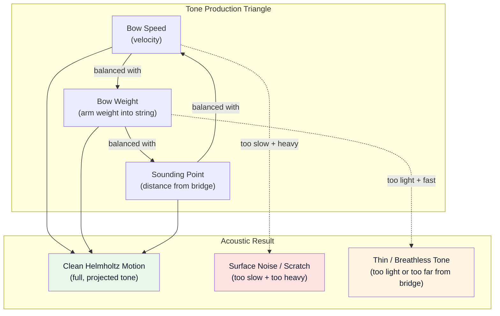
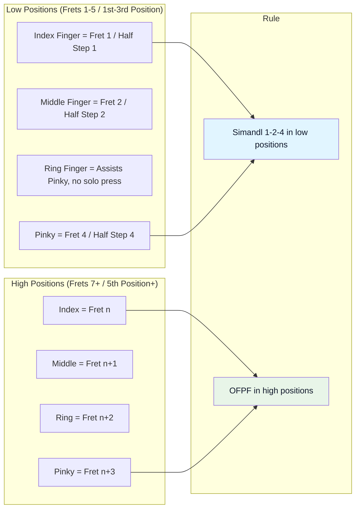
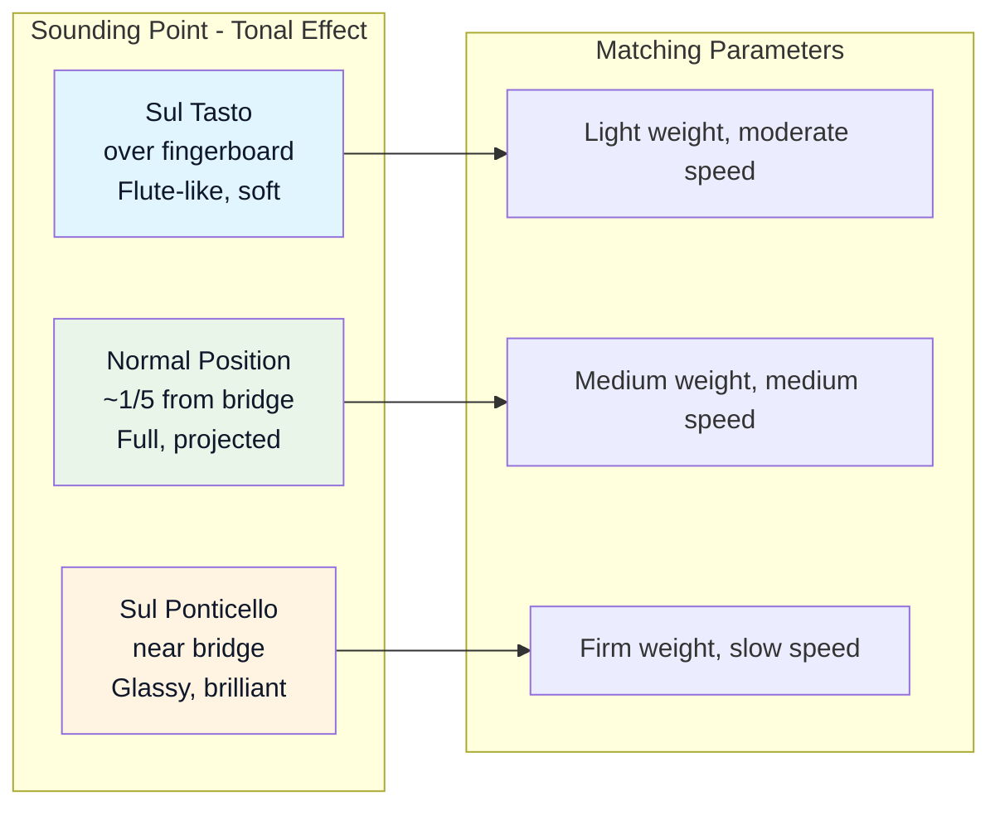
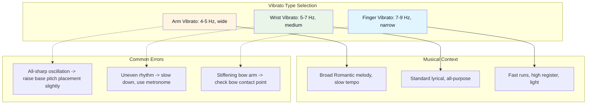
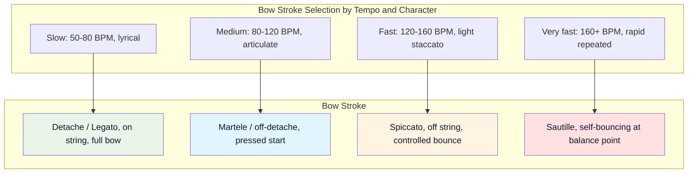
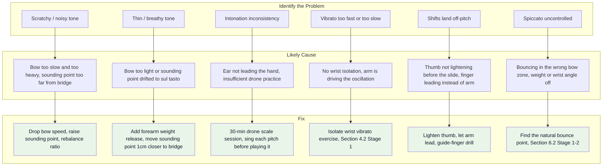
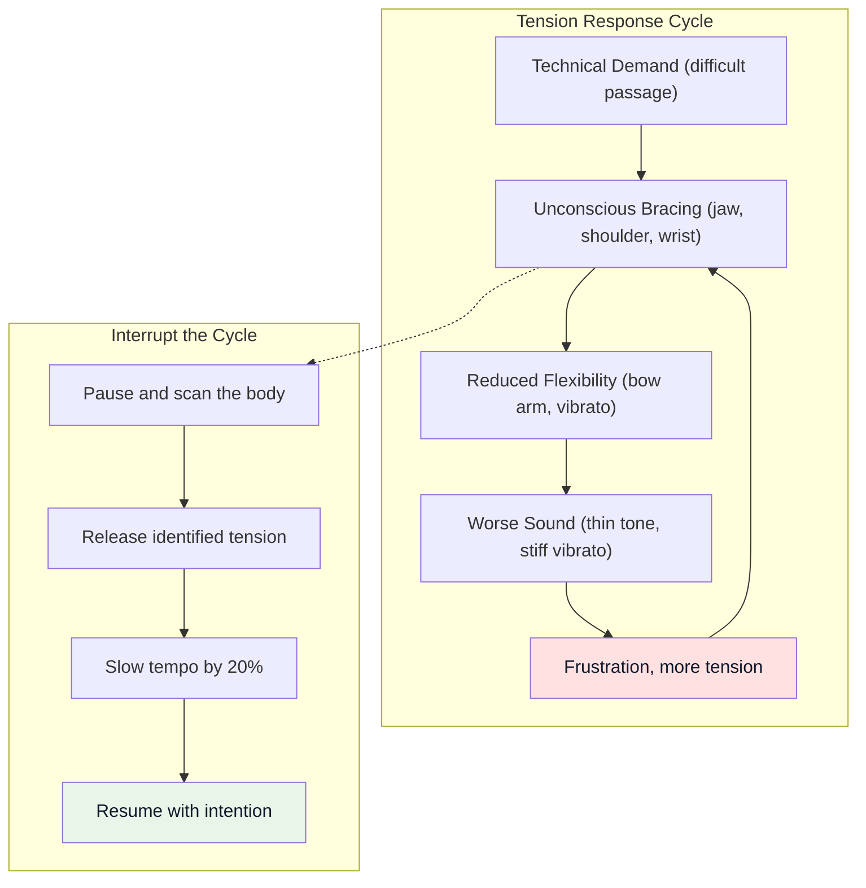
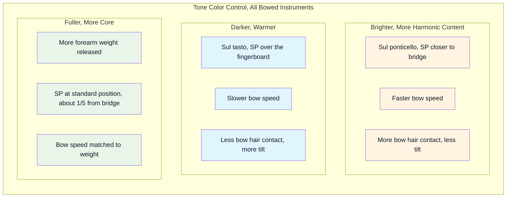

# Strings Masterclass: Technique, Tone, and Expressive Control

## Overview

This masterclass covers the full arc of string technique — from first-contact ergonomics to elite bow control, intonation systems, vibrato mastery, and injury prevention. Every concept connects directly to what your hands are doing right now. Physics appears only where it changes what you do with your hands, not as an end in itself.

Applies to: violin, viola, cello, double bass, and electric/acoustic bass guitar. Instrument-specific callouts are marked throughout.

---

## Table of Contents

1. [First Principles: The Physics That Actually Matters](#1-first-principles)
2. [Left-Hand Architecture: Posture, Finger Placement, and Intonation](#2-left-hand-architecture)
3. [Right-Hand Architecture: Bow Control and Plucking Mechanics](#3-right-hand-architecture)
4. [Vibrato: Rate, Width, and Expressive Control](#4-vibrato)
5. [Position Work and Shifting](#5-position-work-and-shifting)
6. [Articulation and Bow Strokes](#6-articulation-and-bow-strokes)
7. [Practice Architecture: Drills, Metronome Targets, and Diagnostics](#7-practice-architecture)
8. [Failure Modes and Self-Diagnosis](#8-failure-modes-and-self-diagnosis)
9. [Injury Prevention and Tension Management](#9-injury-prevention)
10. [Advanced Applications: Harmonics, Double Stops, and Tone Shaping](#10-advanced-applications)

---

## 1. First Principles

Three ideas, then straight into technique.

**The vibrating string.** Pitch depends on length, tension, and mass per unit length. Your left hand controls length — shorten the string, raise the pitch. Tension is set once at the peg/machine head. Mass is fixed by the string gauge you bought. In practice this means: *all your expressive pitch control lives in the left hand's placement and release, nothing else.* There is no secondary pitch control to fall back on — if intonation is off, it is always a left-hand placement or ear-training issue, never a setup issue (assuming the instrument is in tune and properly set up).

**The harmonic series.** An open string doesn't produce a single frequency — it produces a fundamental plus a stack of overtones (octave, fifth, third, etc.) at diminishing amplitude. Where you bow or pluck along the string's length changes which overtones get emphasized. Near the bridge, you excite more of the short-wavelength upper harmonics — bright, edgy, "sul ponticello" sound. Near the fingerboard, the string's wider excursion favors the fundamental and low overtones — soft, dark, "sul tasto" sound. This is the physical basis for every tone-color decision you make with bow or plucking-hand placement.

**Stick-slip dynamics (bowed instruments).** Bow hair, dressed with rosin, grips the string, drags it sideways until tension overcomes friction, releases it, and grips again. This is Helmholtz motion — on an open A string (440 Hz) it repeats 440 times per second. Clean Helmholtz motion requires three variables in balance: bow speed, bow weight (arm weight into the string), and sounding point (distance from the bridge). Every bowing exercise in this lesson is training your coordination of exactly these three variables. There is no fourth variable and no shortcut — scratchy tone, breathy tone, and "it won't speak" are all solved by rebalancing speed, weight, and sounding point relative to each other.



---

## 2. Left-Hand Architecture

### 2.1 Hand Frame and Thumb Position

The left hand does not grip the neck. It cradles it. If the hand frame is correct, you could let go with the thumb entirely and the fingers would still hover over the strings in playable position — test this directly on your own hand right now.

**Universal rule across all string instruments:** thumb opposite the middle finger (index finger on smaller hands or on bass instruments), forming a relaxed C. No knuckle-wrapping, no thumb creeping over the top of the neck. The neck rests lightly in the thumb–index web, not clamped.

**Violin/Viola first position:**
- Thumb rests lightly on the neck, gently curved, roughly opposite the first or second finger.
- Base knuckles (MCP joints) stay low, roughly parallel to the string plane.
- Fingertips contact the string about 2–3 mm behind the nail, with a curved, not flat, final joint.
- The elbow swings under the instrument (more for violin, less for viola) to square the finger pads onto the strings rather than attacking at an angle.

**Cello first position:**
- Thumb on the back-left of the neck, resting, never squeezing.
- Simandl 1-2-4 fingering governs lower positions: thumb anchors, index (1), middle (2), ring+pinky (4, fingers work together) — the ring finger alone does not press independently in low positions.
- The elbow initiates every shift. If you reach with just the finger, you will consistently land short of the target pitch.

**Double bass and bass guitar (Simandl 1-2-4):**
- Frets/positions 1–5: use index (1), middle (2), pinky (4) only. Ring finger assists pinky by resting alongside it, doesn't press independently. This exists because string tension and fret spacing in low positions would overstretch the ring finger if used solo — using it anyway, even if it "works," accumulates tendon strain over months.
- Frets/positions 7+: One Finger Per Fret (OFPF) becomes viable because fret spacing narrows and string tension per semitone drops.
- Thumb anchors on the back of the neck, roughly opposite the second finger, at all times.
- Wrist stays straight. A wrist cocked toward the headstock is the single most common setup for ulnar nerve irritation in bassists — check this in a mirror during your first week on any new piece.



### 2.2 Intonation: The Auditory-Motor Loop

Intonation on a fretless instrument is not memorized finger distances. It is training the ear to specify the target pitch *before* the hand moves, then using the ear to correct in real time.

**The three-stage process:**

1. **Audiate** the target pitch — hear it internally, or sing it, before the finger moves.
2. **Place** the finger at your best estimate.
3. **Listen and adjust** — the ear makes the final correction, continuously, not after the fact.

Finger placement is an approximation. The ear is the precision tool. This is why drone practice outperforms tuner practice: a tuner reports after the fact; a drone gives continuous feedback during the note, the same feedback loop you need onstage with no tuner visible.

**Drone scale drill (all fretless instruments):**

1. Sound a drone on your open string (tuner app with drone mode, keyboard, or a looped recording of the open string).
2. Play the scale in that string's key, slowly — e.g., G major on the G string.
3. Sustain each note and listen for beating against the drone's overtones. A pure fifth above the drone locks in with zero beating — you'll feel it as the sound "widening" and settling rather than shimmering.
4. A note slightly sharp or flat beats audibly against an overtone of the drone — a pulsing, rough quality that disappears the instant you land in tune.

Metronome targets, drone scale work:
- Week 1: ♩ = 50, one bow (or pluck + sustain-listen) per note, four beats each.
- Week 2: ♩ = 60, two notes per bow.
- Week 3: ♩ = 72, one note per beat, full sustain.
- Week 4: ♩ = 88, begin slurring pairs while maintaining the drone check.

### 2.3 First Position Box Shapes (Violin)

First position on violin spans roughly a minor third per string, with finger spacing alternating half-step / half-step / whole-step patterns depending on key:

```
E string:  E  F  F# G  G# A
           0  1  1  2  2  3    (finger numbers, low-to-high)

A string:  A  Bb B  C  C# D
           0  1  1  2  2  3

D string:  D  Eb E  F  F# G
           0  1  1  2  2  3

G string:  G  Ab A  Bb B  C
           0  1  1  2  2  3
```

Note the pattern: finger 1 sits a half step above the open string, finger 2 a whole step, finger 3 a minor third. This shape repeats identically across all four strings in first position — learn it once, apply it four times.

**Posture checkpoints before every practice session:**
- [ ] Thumb relaxed, not gripping.
- [ ] Wrist straight — not bent toward the scroll, not collapsed toward the body.
- [ ] Base knuckles stay close to the string even when individual fingers lift off.
- [ ] Elbow is under the instrument, not swung behind the body.

---

## 3. Right-Hand Architecture

### 3.1 Bow Hold (Violin/Viola/Cello)

The bow hold is a suspension system, not a grip. The bow should feel like it's hanging from your hand, with the hand shaping its motion, not clenched to prevent it from falling.

**Franco-Belgian/Russian bow hold (most common modern approach):**
- Thumb tip contacts the stick at the frog, gently bent — never locked straight. A locked thumb transmits every tremor in your arm straight into the string.
- Index finger contacts the stick at the middle phalanx (between the first and second knuckle), not at the fingertip. Fingertip contact reduces leverage and encourages gripping.
- Middle and ring fingers drape over the top of the stick, curved, lightly touching.
- Pinky rests on top of the stick, curved, acting as a counterbalance at the frog — it lifts off naturally as the bow moves toward the tip.
- Thumb and middle finger form the primary axis of control; index and pinky add and remove leverage as needed for dynamics and string crossings.

**Beginner error:** all five fingers clenched together at the frog, thumb locked straight. This kills bow-arm flexibility and transmits micro-tremors directly into tone as unwanted scratch.

**Diagnostic test:** hold the bow in playing position, off the string, and gently shake it side to side. The fingers should absorb the motion with a visible ripple through the knuckles. If the bow moves as a rigid unit with the hand, the grip is too tight — consciously soften until the ripple appears.

### 3.2 The Three-Parameter System in Practice

Every bow stroke adjusts bow speed, bow weight, and sounding point simultaneously. Train each in isolation first, then combine.

**Parameter 1 — Bow speed**

Drill: long-bow exercise on an open string.
- Use the full bow, heel to tip, over 8 counts.
- Target: even sound with no swell or fade across the stroke.
- Common error: rushing the final third near the tip because the arm wants to collapse as it extends.
- Fix: consciously decelerate the forearm in the last third of the bow — the bow arm should feel like it's *resisting* straightening out, not falling into it.

Metronome targets:
- ♩ = 50: one bow per 4 beats, slow and controlled.
- ♩ = 60: one bow per 4 beats, begin adding dynamic shape (swell or taper on purpose, evenly).
- ♩ = 72: one bow per 2 beats, integrate directly into scale practice.

**Parameter 2 — Bow weight**

Bow weight is arm weight released into the string, not finger pressure from a tensed hand.

Drill: weight-drop exercise.
- Rest the bow flat on the string with zero intentional pressure.
- Gradually release tension in the upper arm and shoulder, letting gravity pull the stick toward the string.
- Listen for the tone gaining "core" — more fundamental, rounder sound — as weight increases.
- Keep releasing weight until the sound breaks into breathiness; that's your lower threshold.
- Back off slightly from that threshold: that's your working weight for a full, clean tone.

**Parameter 3 — Sounding point**

Standard sounding-point zones, violin:
```
Sul tasto:      over the fingerboard        — soft, flute-like, pp-mp
Normal:         roughly 1/5 of string length from the bridge — full tone, mp-mf
Sul ponticello: very close to the bridge    — glassy, nasal, harmonics emphasized, ff
```

Drill: sounding-point ladder.
- Play four open-A bows at each position, moving sul tasto → normal → sul ponticello.
- Hold bow speed and weight constant throughout — only the sounding point changes.
- This isolates the timbral effect of sounding point alone; you are operating the instrument's built-in EQ with your bow arm.



### 3.3 Plucking Mechanics (Bass Guitar and Double Bass)

**Fingerstyle bass — floating thumb technique**

The floating thumb is non-negotiable for clean tone on any string above the lowest one you're currently playing.

- Thumb rests on the string immediately below the one being played (playing the D string → thumb floats on the A string).
- Moving to the A string → thumb migrates down to the E string.
- Moving to the E string → thumb rests on the pickup housing or the body edge.
- This kills sympathetic ringing from the unplayed lower strings without you having to think about it mid-phrase — it becomes automatic muting.

**Two-finger alternation drill:**
1. Metronome at ♩ = 60.
2. Play eighth notes on an open E string, strictly alternating index and middle finger.
3. Each stroke pulls the string toward the body and comes to rest against the next lower string (rest-stroke, borrowed directly from classical guitar technique) — this doubles as muting.
4. Listen for evenness: index and middle should produce identical attack and volume. Record yourself; asymmetry between fingers is much easier to hear played back than live.
5. Progress ♩ = 80 → 100 → 120 only once evenness holds at the current tempo.

**Slap mechanics (bass guitar):**
- Thumb strikes the string directly over the last fret of the neck and bounces off immediately — it does not press through to the fretboard.
- The motion snaps from the wrist, not the forearm: think "flick," not "hit." A forearm-driven slap is slower and less controllable.
- Pop: index or middle finger hooks under the G or D string near the end of the fingerboard and snaps straight away from the body, perpendicular to the string plane.
- Standard pattern anatomy: slap on strings 4–5 (low E, A); pop on strings 1–2 (G, D).

**Slap coordination drill (bass guitar):**
```
Pattern: S = Slap (thumb), P = Pop (index hook), . = rest

Beat:    1    +    2    +    3    +    4    +
         S    .    P    .    S    .    P    .

String:  E         G         E         G
Fret:    0         0         0         0

Tempo: start at ♩ = 60, target ♩ = 100
```
Isolate slap alone for the first week (muting the pop notes), then pop alone, then combine. Combining too early is the single biggest cause of uneven slap grooves.

---

## 4. Vibrato

### 4.1 Three Sources, Three Sounds

Vibrato is not an ornament stuck onto a note — it's a continuous expressive dimension available throughout the note's duration. Train all three types; they serve different musical contexts and most advanced players blend them within a single phrase.

**Arm vibrato**
- Pivot: forearm rotation, elbow as the fulcrum.
- Character: wide, slow, emotionally intense.
- Rate: 4–5 Hz. Width: roughly ±0.4–0.5 semitones.
- Use: sustained Romantic-era melodies; cello and bass register playing where arm mass naturally drives the oscillation.

**Wrist vibrato**
- Pivot: wrist joint oscillates, forearm stays relatively still.
- Character: medium rate and width — the default, most versatile vibrato.
- Rate: 5–7 Hz. Width: roughly ±0.2–0.3 semitones.
- Use: general-purpose expressive playing across nearly all contexts and tempos.

**Finger vibrato**
- Pivot: MCP (knuckle) joint flexion only.
- Character: narrow, fast, precise.
- Rate: 7–9 Hz. Width: roughly ±0.1–0.2 semitones.
- Use: fast passages, light high-register playing, violin/viola in upper positions where arm vibrato is too slow to track the rhythm.

### 4.2 Vibrato Activation Drill (Wrist Vibrato)

The single most common student error: oscillating the pitch symmetrically sharp *and* flat of the target. Correct vibrato oscillates *below* the target pitch and releases back up to it — the fingertip's resting, fully-weighted position is the true pitch, and the motion momentarily relaxes away from that, then returns.

**Step 1 — Passive oscillation (no bow):**
- Place the second finger on the D string (violin) or G string (cello) at the target pitch.
- Rest the bow on the string without drawing it.
- Rock the wrist forward and back — isolate the wrist joint; the forearm and upper arm stay still.
- Feel the string tension change slightly as the fingertip rocks. Aim for a smooth, motorized feeling rather than a jab or a flick.

**Step 2 — Activate sound:**
- Begin a slow sustained bow stroke (whole bow, 6 beats).
- Add wrist oscillation, deliberately slow and wide at first (3–4 Hz) so you can hear the shape clearly.
- Listen critically: if the pitch only seems to go flat and never returns cleanly to center, your resting finger placement is already slightly low. Nudge the base placement very slightly sharp, then re-test — the undulation should feel and sound symmetric around the target.

**Step 3 — Rate and width control:**
- Play the same note with vibrato deliberately wide and slow.
- Then deliberately narrow and fast.
- Then settle into the expressive "home" rate for the musical character you're after — lyrical passages typically sit around moderate width at 5–6 Hz.

Metronome targets, vibrato consistency:
- Week 1: ♩ = 60, whole notes, one vibrato cycle per beat (consciously slow and countable).
- Week 2: ♩ = 60, half notes, two cycles per beat.
- Week 3: ♩ = 72, quarter notes, vibrato now free-running rather than counted.
- Week 4: ♩ = 88, integrated into an actual melodic passage from your repertoire.



---

## 5. Position Work and Shifting

### 5.1 Position Geography (Violin/Viola Reference)

```
Position    First Finger on:    Range (A string)
1st         B                   B - E (4th finger)
2nd         C                   C - F#
3rd         D                   D - G#
4th         E                   E - A
5th         F                   F - B
6th         F#                  F# - C
7th         G (octave)          G - D (thumb)
```

For cello, positions shift in half steps starting from open C. Thumb position begins around 7th position, where the thumb leaves the neck entirely and pivots behind the string, acting as a movable "capo" finger.

For double bass, positions are wider-spaced because of the longer string length. Simandl 1-2-4 governs the lower positions; harmonics become essential for anything above roughly 7th position, since the hand simply cannot reach that far up comfortably in a stopped position.

### 5.2 The Mechanics of a Clean Shift

A shift is a controlled glide along the string, with the bow sustaining tone through the transition — not a jump, and not a scheduled stop-and-restart.

**The four-step shift:**
1. **Lighten** — reduce left-hand pressure to a feather touch without lifting the finger off the string.
2. **Slide** — the whole arm moves as a unit; the thumb and elbow lead the motion, the finger is along for the ride, not driving it.
3. **Land** — the finger re-engages full pressure at the new position, at the pitch dictated by the ear, not by counting distance.
4. **Confirm** — the ear checks the landed pitch immediately and the finger micro-adjusts if needed.

**Shift drill (violin, 1st to 3rd position, single string):**
```
On the A string, one finger throughout:

1st pos: D (3rd finger) - hold 2 beats
Lighten -> slide 1st finger up to 3rd position D (now played by 1st finger)
3rd pos: D (1st finger) -> E (2nd finger) -> F# (3rd finger) - hold 2 beats each
Reverse shift back down to 1st position

Metronome: 50 -> 60 -> 72
Key marker: no audible glissando/squeak during the shift — correct pressure
reduction during the slide prevents the slide itself from sounding.
```

**Guide finger technique:** when shifting, leave the finger you're leaving *from* lightly resting on the string as the hand travels. It acts as a continuous intonation checkpoint — light contact helps the ear track the pitch continuously through the shift, rather than guessing blind and hoping the new finger lands correctly.

### 5.3 Movable Box Patterns (Bass Guitar)

The movable box covers root, 3rd (major or minor), 5th, and octave — core vocabulary for walking bass lines and groove construction, and it transposes to any key by sliding the entire shape up or down the neck.

**Root-position box, major (example rooted on G, 3rd fret of E string):**
```
E --3--5--      Root (G)  -- 5th (D)
A --3--5--      4th (C)   -- 5th (D, higher octave)
D --5--7--      Root (G, 8va) -- Maj2nd (A)
G --5--7--      3rd (B)   -- 4th (C)
```

Minor-box conversion: flatten the 3rd by moving it back one fret (in this shape, the note on the D string drops one fret, B → Bb).

The shape is identical regardless of which fret you start it on — move the whole box to any root on the E or A string and the finger pattern doesn't change, only the key does. This is the real payoff of learning it as a box rather than as individual notes: one motor pattern, twelve keys.

---

## 6. Articulation and Bow Strokes

The bow is a vocabulary. Each stroke is a word with a specific musical meaning and a specific mechanical execution — mixing them up is the bowed-instrument equivalent of mispronouncing a word badly enough to change its meaning.

### 6.1 Core Bow Strokes Reference

| Stroke | Description | Bow Location | Contact | Musical Use |
|---|---|---|---|---|
| Détaché | Separate, full bow | Middle-full | On string | Standard singing tone |
| Legato | Slurred, connected | Full bow | On string | Lyrical phrases |
| Martelé | Hammered, pressed start, released | Heel or upper | On string | Accented, articulate |
| Spiccato | Controlled bounce | Middle | Off string | Light staccato passages |
| Sautillé | Rapid self-bouncing | Middle | Off string | Very fast staccato |
| Ricochet | Thrown, multiple bounces | Upper third | Off string | Virtuosic repeated notes |
| Col legno | Wood of the stick on the string | Any | Wood side | Percussive special effect |

### 6.2 Spiccato: The Skill Most Players Avoid

Spiccato is the controlled off-string bounce, and it lives at the bow's natural balance point — roughly the middle of its length. Drop the bow there and it will bounce on its own; spiccato technique exploits that physical fact rather than fighting it.

**Spiccato development sequence:**

**Stage 1 — Find the bounce point:**
- Hold the bow at its middle.
- Rest it on the string with no added pressure.
- Begin détaché strokes, gradually reducing bow weight until the bow lifts off the string on its own between strokes.
- Do not force the bounce by lifting the wrist manually — reduce control and weight until physics takes over. The bow should feel like it's doing the bouncing, not you.

**Stage 2 — Control the depth:**
- Higher wrist position = shallower bounce = lighter, faster spiccato.
- Lower wrist position = deeper bounce = heavier, slower spiccato.
- Practice adjusting wrist height mid-passage while keeping the bounce rhythm steady — this is the control knob you'll use musically.

**Stage 3 — Set the tempo:**
- Spiccato activates naturally between roughly ♩ = 100–132 for sixteenth notes; below that range, use a manually-lifted off-string détaché instead, since true spiccato won't engage reliably at slow tempos.
- Above roughly ♩ = 160, sautillé (self-bouncing, smaller amplitude) takes over as the physically efficient choice.
- Drill: play a scale in spiccato starting at ♩ = 80, increasing by 4 BPM per day until the bounce activates and sustains spontaneously without conscious lifting.



---

## 7. Practice Architecture

### 7.1 Session Structure

A full 60-minute session for an intermediate-to-advanced string player:

```
1. Physical warm-up (5 min)
   - Long bows on open strings, all four strings
   - Slow finger taps on the neck, no bowing (activates left hand independently)
   - Shoulder rolls, wrist circles

2. Scales and arpeggios (15 min)
   - One scale per session, minimum two octaves
   - Pass 1: detache, Q=60, full bow per note, intonation focus
   - Pass 2: slurred 4 notes per bow, Q=72
   - Pass 3: chosen articulation (spiccato, martele), Q=88

3. Targeted technique drill (15 min)
   - One isolated problem only: shifting, vibrato, spiccato, etc.
   - Use Section 8's diagnostic map to select the drill
   - Never run more than one primary technical focus per session

4. Repertoire (20 min)
   - Work the hardest passage first, not last — this is when motor
     learning capacity is highest, not after it's been spent on warm-up material
   - Chunk into 4-bar units; perfect each unit before connecting it to the next
   - Alternate full tempo and below-tempo passes

5. Run-through / musical integration (5 min)
   - Play a section or movement start to finish without stopping
   - Trains recovery from small errors and musical continuity under pressure
```

### 7.2 The Chunk-and-Connect Method

Repertoire learning stalls when players repeatedly run the whole piece top to bottom. Chunk-and-connect accelerates both memorization and technical security by reversing the usual order of attack.

1. **Isolate** the two hardest measures in the passage.
2. **Drill** each at 70% of target tempo until it's error-free for 10 consecutive repetitions.
3. **Connect** the drilled measure to the measure immediately before it.
4. **Expand backward** — connect the preceding measure, then the one before that.
5. **Final run** at target tempo, start to finish.

Because you work backward from the hardest material, the hardest passage is always immediately followed by material you've already secured — not the reverse, which is what happens when you practice start to finish and exhaust your focus right before the hard part.

### 7.3 Metronome Protocols for String Technique

| Goal | Start BPM | Increase | Target BPM | Key Metric |
|---|---|---|---|---|
| Long bow evenness | 50 | +5/session | 76 | No dynamic swell at bow changes |
| Scale intonation | 50 | +4/session | 92 | Zero cents deviation on drone check |
| Spiccato activation | 80 | +4/session | 132 | Bounce spontaneous, even, no scratch |
| Shifting accuracy | 50 | +6/session | 100 | No audible slide, correct landing pitch |
| Vibrato rate control | 60 | +4/session | 96 | Even undulation, centered on target |
| Slap/pop groove (bass) | 60 | +5/session | 110 | Even attack, clean mute on unused strings |

**Golden rule:** never raise the tempo until the current tempo sounds musical, not merely mechanically correct. If you can hit ♩ = 92 but it sounds like a machine, stay at 92 until it doesn't.

---

## 8. Failure Modes and Self-Diagnosis

### 8.1 Diagnostic Map



### 8.2 Intonation Self-Assessment Protocol

Run this weekly with a recording device and a cents-reading tuner app:

1. Record a two-octave G major scale at ♩ = 60, full bow per note.
2. Load the recording into a tuner app with pitch tracking (Tonal Energy, Cleartune) or a DAW's pitch display.
3. Mark each note's deviation in cents from equal temperament.
4. Look for patterns, not isolated errors:
   - Consistently flat on the 4th finger → hand frame is too cramped; practice widening the stretch deliberately.
   - Consistently sharp in upper positions → thumb tension is pulling the arm short; consciously release thumb contact before shifting up.
   - Random deviation across all fingers with no pattern → the ear isn't leading; return to drone practice before resuming scale work.

### 8.3 Bow Consistency Self-Assessment

1. Record a sustained open A: one full bow stroke, 8 beats at ♩ = 60.
2. Load the waveform into a free editor (Audacity works fine).
3. A well-executed sustained tone shows a flat, consistent amplitude envelope across the full stroke.
4. Common visible failures:
   - Amplitude dip at the bow change near the tip → running out of usable bow arm before the stroke actually ends; practice conserving bow in the final third.
   - Amplitude swell in the middle of the stroke → unconscious extra pressure at the bow's natural balance point; consciously release weight there instead of adding it.
   - Sharp onset spikes → the bow wasn't already moving at string contact; the bow must be in motion the instant it touches the string for a clean, non-percussive attack.

---

## 9. Injury Prevention

String playing demands sustained, asymmetric muscle loading held for long periods. The resulting injuries are predictable, well-documented, and preventable with the right habits.

### 9.1 High-Risk Zones and Warning Signs

| Zone | Instrument(s) | Warning Sign | Do Not Ignore |
|---|---|---|---|
| Left forearm / wrist | All fretless | Tingling in ring/pinky fingers | Ulnar nerve compression |
| Left thumb | Bass, cello | Aching at the base of the thumb | Flexor pollicis overuse |
| Right shoulder | Violin, viola | Persistent ache after playing | Rotator cuff strain |
| Right forearm | All bowed instruments | Fatigue within 20 minutes of bowing | Pronator teres overuse |
| Neck / jaw | Violin, viola | Headaches, jaw clicking | Chin rest pressure |

### 9.2 The 5-Minute Warm-Up (Non-Negotiable)

Before touching the instrument:

```
1. Wrist circles: 10 clockwise, 10 counterclockwise, both hands
2. Finger fans: spread fingers wide, hold 3 sec, relax, repeat 5x
3. Forearm stretch: extend arm, flex hand back toward you (hold 20 sec),
   then point fingers down toward the floor (hold 20 sec)
4. Shoulder rolls: 5 forward, 5 backward
5. Chin tucks: gently tuck chin to chest, hold 10 sec, 3 reps
   (critical for violin/viola — directly counters chin-rest compression)
```

### 9.3 Practice Load Management

- **Maximum continuous playing time before a micro-break:** 25–30 minutes.
- **Micro-break duration:** 3–5 minutes — put the instrument down entirely, walk, shake out the hands.
- **Daily practice ceiling for sustainable development:**
  - Beginners (under 1 year): 30–45 minutes/day.
  - Intermediate (1–3 years): 60–90 minutes/day.
  - Advanced (3+ years): 2–4 hours/day, split across multiple sessions with real breaks, not one unbroken block.
- **Red line:** any sharp or shooting pain is a stop signal, immediately. Fatigue is a normal part of building endurance. Pain is never normal and never something to "play through."

### 9.4 Tension Detection Exercise

Run this once per week to recalibrate body awareness:

1. Begin a scale at ♩ = 60.
2. After 4 bars, pause — without changing posture, scan your body from feet to head.
3. Identify where you're holding unnecessary tension. Common finds: clenched jaw, elevated left shoulder, elevated right shoulder, held breath.
4. Consciously release each one, then resume playing.
5. Notice whether the tone changes as tension releases. It almost always does, and it's always an improvement — louder isn't the point, freer is.



---

## 10. Advanced Applications

### 10.1 Natural Harmonics

A harmonic is produced by touching the string lightly at a nodal point — a location where the string naturally divides into even segments — without pressing down to the fingerboard. The touch must be a feather contact, not a press; pressing converts it into a (usually out-of-tune) stopped note.

**Harmonic nodes and resulting pitches (violin E string, open = E5):**

```
Node position         Fraction    Resulting pitch    Interval above open
Midpoint (~12th fret) 1/2         E6                  Octave
1/3 from the nut      1/3         B6                  Octave + 5th
1/4 from the nut      1/4         E7                  Two octaves
1/5 from the nut      1/5         G#7                 Two octaves + 3rd
```

**Playing harmonics cleanly:**
- Contact is perpendicular to the string — no sideways drag, which damps the harmonic instantly.
- Move the bow's sounding point noticeably closer to the bridge than normal — this reinforces the thinner, more fragile upper-harmonic content.
- Use faster bow speed with lighter weight. Harmonics are acoustically fragile; too much bow weight physically damps the node and kills the harmonic, producing a dead thud or the fundamental instead.
- Electric bass: touch the string lightly at the 12th fret with the fretting hand while the picking hand plucks normally — the resulting octave harmonic rings clearly through a clean amp signal and is a staple technique for bass solos and intros.

### 10.2 Artificial Harmonics (Violin/Viola/Cello)

The first finger stops the string normally, creating a new fundamental. The fourth finger then touches lightly — not pressing — at a perfect fourth above that stopped note, which is itself a natural node of the now-shortened string. The resulting pitch sounds two octaves above the first finger's stopped note.

```
Example: 1st finger stops A (D string, violin) = new fundamental
4th finger touches D (a perfect fourth above) = node at 1/4 of the remaining string length
Result: A, two octaves above the first finger (A6 on violin)
```

Artificial harmonics are essential in high-register solo repertoire (Saint-Saëns, Ravel) and demand very precise fourth-finger placement — the margin for the touch point is only a few millimeters before the harmonic fails to speak cleanly.

### 10.3 Double Stops and Chord Voicings

Double stops sound two strings simultaneously. The left hand must hold accurate intonation on both strings at once while the bow contacts both strings evenly.

**Bow technique for double stops:**
- Flatten the bow hair slightly (reduce stick tilt) so more hair surface contacts both strings evenly.
- Keep the sounding point consistent across both strings — a common error is unconsciously angling the bow and favoring one string's tone over the other.
- Start with open-string-plus-stopped-string combinations, which isolate the intonation check to a single finger against a known, unchanging reference pitch.

**Essential double-stop intervals by difficulty:**

| Interval | Difficulty | Why |
|---|---|---|
| Octaves | Medium | Wide hand frame, but the pitch relationship is unambiguous |
| Fifths | Medium | Open, resonant — you can tune by listening for the ring |
| Thirds | Harder | Close finger spacing demands a fine intonation ear |
| Sixths | Harder | Similar demand to thirds, awkward hand shape in some keys |
| Seconds | Hardest | Adjacent semitones on neighboring strings are brutally exposed if either is off |

**Thirds drill (violin, A and E strings together, 1st position):**
```
A string: 1st finger B -> 2nd finger C# -> 3rd finger D#
E string: 1st finger F# -> 2nd finger G# -> 3rd finger A#

Metronome: Q=50, long bow, listen for both pitches ringing cleanly together
Progress: 60 -> 72, increasing bow speed while holding sounding point steady
```

### 10.4 Tone Shaping Through Bow Distribution

Professional-level phrasing distributes the bow strategically to create natural musical breathing within a phrase. The bow is expressive currency, not a metronomic resource to be spent evenly regardless of musical content.

**Principle:** more bow length and speed = more sound and energy. Less bow = restraint, intimacy, hesitation — used deliberately, not as a fallback when you're running out of bow unexpectedly.

**Practical phrase-shaping example (8-bar melody, violin):**
```
Bar 1-2: start near the frog, slow bow (conserved bow = soft, quiet arrival)
Bar 3-4: move toward the middle, bow speed increasing (phrase building)
Bar 5-6: full bow, middle to tip (the peak — full tone, sounding point edges toward the bridge)
Bar 7:   return toward the middle (tapering back down)
Bar 8:   arrive at the frog, bow nearly stopped (natural decay, phrase ending)
```
This is not a metronome exercise. It's musical architecture expressed directly through where and how fast the arm moves.

### 10.5 Tone Color Palette — Quick Reference



---

## Synthesis: Putting It Together

String mastery runs on three converging loops, operating simultaneously every time you play.

**Loop 1 — Ear leads hand.** You hear the pitch, the tone color, and the dynamic shape before your hand moves. The hand executes what the musical imagination has already specified, not the other way around. Singing your part before playing it is the single highest-leverage practice habit at any skill level, because it forces the ear to lead instead of following the hand's guesswork.

**Loop 2 — Minimal tension, maximum efficiency.** Every technique in this lesson works best from a state of organized relaxation. Tension is not strength. A bow arm that releases its own weight into the string produces more tone with less effort than one that presses. A left hand that lightens before a shift lands more accurately than one that grips through the motion. Scan your body continuously, not just during the weekly tension-detection exercise.

**Loop 3 — Diagnosis drives practice.** Vague repetition produces vague improvement. Use the diagnostic map in Section 8, record yourself weekly, and work one specific, named failure mode per session — not "practice more," but "fix the flat fourth finger in upper positions this week."

The instrument doesn't reward effort alone. It rewards focused, embodied attention, applied consistently, with the ears doing most of the actual work.
