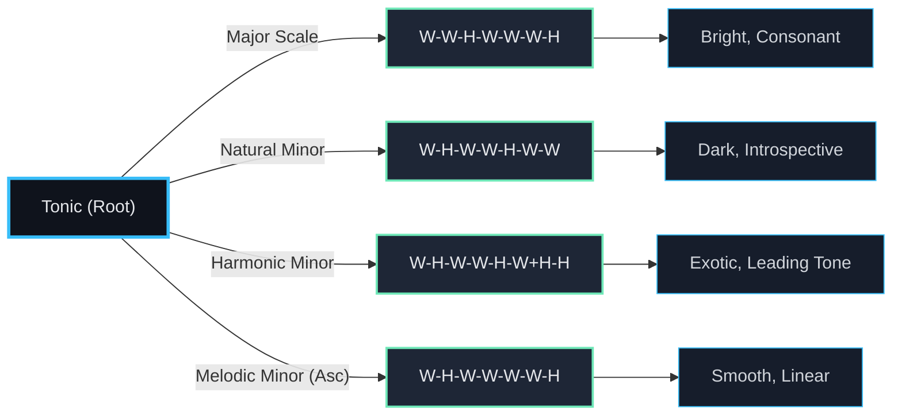

# Lesson 2: Music Theory for Strings

## First-Principles Intuition & Invariants

The study of music theory for strings is an investigation into the intersection of mathematical precision, physical law, and aesthetic expression. String instruments—from the gut strings of Baroque violins to the steel-wound bass strings of a modern cello to the magnetic pickups over electric guitar coils—share a common foundation in the physics of vibrating systems. These principles are not metaphorical; they are quantifiable relationships that govern pitch, timbre, and intonation across all stringed instruments.

### The Physics of Vibrating Strings

A string fixed at both ends exhibits transverse wave motion when excited by plucking, bowing, or striking. The string's boundary conditions—fixed endpoints that cannot move—constrain the possible vibrational modes to standing waves. These standing waves occur only at specific resonant frequencies, and the lowest such frequency is the fundamental.

For a uniform string of length $L$, tension $T$, and linear mass density $\mu$ (mass per unit length), the wave velocity $v$ along the string is:

$$v = \sqrt{\frac{T}{\mu}}$$

This relationship emerges directly from the wave equation for a flexible string under tension. The velocity $v$ is independent of frequency—a property that makes strings dispersive-free in the linear regime—and depends only on the mechanical properties of the string itself.

The fundamental frequency $f_0$ corresponds to the longest wavelength standing wave that fits within the length $L$. For a string fixed at both ends, the fundamental wavelength is $\lambda_0 = 2L$, yielding:

$$f_0 = \frac{v}{\lambda_0} = \frac{v}{2L} = \frac{1}{2L}\sqrt{\frac{T}{\mu}}$$

This inverse relationship with length is the reason shorter strings produce higher pitches. It is also why pressing a string against a fret or fingerboard raises the pitch: the effective vibrating length decreases. The square root dependence on tension explains why tuning a string by tightening it raises the pitch, but not linearly—doubling the tension raises the pitch by only a factor of $\sqrt{2}$ (approximately 1.414), corresponding to a musical interval slightly larger than a perfect fifth.

The linear mass density $\mu$ is why thicker strings sound lower. A cello's C string, wound with metal to increase mass without requiring impractically high tension, vibrates at a much lower frequency than a violin's E string, even when both are tuned to the same tension per unit cross-sectional strength.

### The Harmonic Series and Overtones

The fundamental frequency is only the lowest mode of vibration. A real string vibrates simultaneously at multiple frequencies, producing a spectrum of overtones or partials. For an ideal string, these overtones form a harmonic series:

$$f_n = n \cdot f_0, \quad n = 1, 2, 3, 4, \ldots$$

Each harmonic corresponds to a standing wave with $n$ antinodes. The second harmonic ($n=2$) has a node at the midpoint, the third harmonic ($n=3$) has nodes at $L/3$ and $2L/3$, and so forth. These harmonics are integer multiples of the fundamental, a consequence of the boundary conditions and the linear wave equation.

The relative amplitudes of these harmonics determine the timbre of the instrument. A bowed violin string emphasizes different harmonics than a plucked guitar string, even when both produce the same fundamental pitch. The attack transient, decay envelope, and spectral evolution over time further shape the perceived tone color.

The harmonic series has profound musical implications. The interval between $f_1$ and $f_2$ is an octave (2:1 ratio). The interval between $f_2$ and $f_3$ is a perfect fifth (3:2 ratio). The interval between $f_3$ and $f_4$ is a perfect fourth (4:3 ratio). These simple integer ratios correspond to the most consonant intervals in Western music theory, and they arise naturally from the physics of the vibrating string.

The seventh harmonic ($f_7 = 7f_0$) occupies a unique position: it does not correspond cleanly to any interval in the twelve-tone equal temperament system used in Western music. Its frequency is approximately 969 cents above the fundamental (where an octave is 1200 cents), falling between the minor seventh (1000 cents) and the major sixth (900 cents). This "harmonic seventh" or "blue note" appears in the natural overtone series but is deliberately excluded from the standard tuning system. Its presence in the overtone spectrum of brass instruments and the human voice gives those timbres a distinctive color.

### Equal Temperament and the Compromise of Tuning

Equal temperament divides the octave into twelve equal logarithmic steps, each separated by a semitone. The frequency ratio between adjacent semitones is the twelfth root of two:

$$r = 2^{1/12} \approx 1.059463$$

To find the frequency of a note $n$ semitones above a reference frequency $f_0$:

$$f_n = f_0 \cdot 2^{n/12}$$

This system enables modulation between keys without retuning the instrument. A piece written in C major can be transposed to D major, and all intervals retain their size in cents. This was not possible in earlier tuning systems such as Pythagorean tuning or meantone temperament, which favored certain keys at the expense of others.

The cost of equal temperament is that most intervals deviate slightly from the pure integer ratios of the harmonic series. The equal-tempered perfect fifth, for example, has a ratio of $2^{7/12} \approx 1.498307$, while the just perfect fifth (the 3:2 ratio from the harmonic series) is exactly $1.5$. The difference is approximately 2 cents—small, but perceptible to trained ears and measurable in the beating of simultaneous tones.

The following table compares just intonation ratios (derived from the harmonic series) with their equal-tempered approximations:

| Interval | Just Ratio | Just (cents) | Equal Temp (cents) | Difference (cents) |
|----------|------------|--------------|--------------------|--------------------|
| Unison | 1:1 | 0 | 0 | 0 |
| Minor second | 16:15 | 112 | 100 | −12 |
| Major second | 9:8 | 204 | 200 | −4 |
| Minor third | 6:5 | 316 | 300 | −16 |
| Major third | 5:4 | 386 | 400 | +14 |
| Perfect fourth | 4:3 | 498 | 500 | +2 |
| Perfect fifth | 3:2 | 702 | 700 | −2 |
| Minor sixth | 8:5 | 814 | 800 | −14 |
| Major sixth | 5:3 | 884 | 900 | +16 |
| Minor seventh | 16:9 | 996 | 1000 | +4 |
| Major seventh | 15:8 | 1088 | 1100 | +12 |
| Octave | 2:1 | 1200 | 1200 | 0 |

The major third in equal temperament is 14 cents sharp compared to the pure 5:4 ratio. This sharpness is audible when a string quartet tunes a major triad: skilled players will instinctively adjust their intonation toward just intervals, "bending" the equal-tempered grid to achieve a more resonant, beating-free sonority. This flexibility is a hallmark of unfretted string instruments; guitarists, by contrast, are bound by the fixed fret positions calculated for equal temperament.

### Scales and Intervallic Structure

A scale is an ordered collection of pitches spanning an octave, defined by a specific pattern of intervals. In Western music, the two foundational scale types are major and minor, each characterized by a distinct sequence of whole steps (W = 2 semitones) and half steps (H = 1 semitone).

The major scale pattern is:

$$\text{W – W – H – W – W – W – H}$$

Starting from C, this produces: C, D, E, F, G, A, B, C. The intervals above the tonic are: major second, major third, perfect fourth, perfect fifth, major sixth, major seventh, and octave. This pattern encodes the sound of major tonality—bright, stable, and consonant.

The natural minor scale pattern is:

$$\text{W – H – W – W – H – W – W}$$

Starting from A, this produces: A, B, C, D, E, F, G, A. The intervals above the tonic are: major second, minor third, perfect fourth, perfect fifth, minor sixth, minor seventh, and octave. The minor third (rather than major third) is the defining feature, lending the scale a darker, more introspective character.

Two other minor scale variants are essential in string music:

**Harmonic minor** raises the seventh scale degree by a semitone:

$$\text{W – H – W – W – H – W+H – H}$$

In A harmonic minor: A, B, C, D, E, F, G♯, A. The augmented second (W+H = 3 semitones) between F and G♯ creates a distinctive, quasi-exotic sound. This raised seventh degree functions as a leading tone, pulling strongly toward the tonic in cadential progressions.

**Melodic minor** raises both the sixth and seventh scale degrees ascending, but reverts to natural minor descending:

Ascending: $\text{W – H – W – W – W – W – H}$  
Descending: $\text{W – H – W – W – H – W – W}$ (natural minor)

In A melodic minor ascending: A, B, C, D, E, F♯, G♯, A. Descending: A, G, F, E, D, C, B, A. The melodic minor smooths out the augmented second of the harmonic minor, creating a more singable, linear melodic contour. This asymmetry reflects historical voice-leading practices, though contemporary jazz and classical composers often use the ascending form in both directions.

Modes—rotations of the major scale starting on different scale degrees—provide additional tonal colors. Dorian (starting on the second degree), Phrygian (third), Lydian (fourth), Mixolydian (fifth), Aeolian (sixth, equivalent to natural minor), and Locrian (seventh) each have characteristic intervals that define their sound. Modal harmony and melody are central to folk traditions, jazz improvisation, and 20th-century classical composition.

### Chords and Harmonic Structure

A chord is a simultaneity of three or more pitches, typically built by stacking intervals of thirds. The triad—consisting of root, third, and fifth—is the fundamental harmonic unit.

**Major triad**: root, major third (4 semitones), perfect fifth (7 semitones)  
Example: C major = C, E, G

The frequency ratios in just intonation are approximately 4:5:6, a simple and consonant relationship. The major triad corresponds to the fourth, fifth, and sixth harmonics of a fundamental two octaves below the root.

**Minor triad**: root, minor third (3 semitones), perfect fifth (7 semitones)  
Example: C minor = C, E♭, G

The frequency ratios are approximately 10:12:15. The minor triad is slightly less consonant than the major triad due to the more complex ratios, but it remains stable and foundational.

**Diminished triad**: root, minor third, diminished fifth (6 semitones)  
Example: B diminished = B, D, F

The diminished fifth (tritone, 6 semitones) introduces significant dissonance. In the harmonic series, the tritone appears between the fourth and seventh harmonics (approximated but not exact), giving it an unstable, tension-filled character.

**Augmented triad**: root, major third, augmented fifth (8 semitones)  
Example: C augmented = C, E, G♯

The augmented triad divides the octave into three equal major thirds, creating a symmetrical structure. It lacks a clear tonal center and functions as a chromatic passing chord or a coloristic device.

Extended chords add notes beyond the fifth:

- **Seventh chords** add a seventh above the root. The dominant seventh (major triad + minor seventh, e.g., C7 = C, E, G, B♭) creates tension that resolves to the tonic, forming the basis of functional harmony.
- **Ninth, eleventh, and thirteenth chords** continue stacking thirds, incorporating upper extensions. These chords are ubiquitous in jazz and impressionistic classical music, adding harmonic color and ambiguity.

The voice leading of chords—how individual notes move from one chord to the next—is central to string writing. Smooth voice leading minimizes large intervallic leaps, creating a sense of continuity and coherence. In a string quartet, the composer carefully balances the independence of each voice with the harmonic progression, ensuring that each line is both melodically satisfying and harmonically functional.

```mermaid
graph TD
    A["Triad (3 notes)"] --> B["Major: 4-3 semitones"]
    A --> C["Minor: 3-4 semitones"]
    A --> D["Diminished: 3-3 semitones"]
    A --> E["Augmented: 4-4 semitones"]
    
    F["Seventh Chords (4 notes)"] --> G["Major 7: Maj triad + Maj 7"]
    F --> H["Dominant 7: Maj triad + min 7"]
    F --> I["Minor 7: Min triad + min 7"]
    F --> J["Half-diminished 7: Dim triad + min 7"]
    F --> K["Fully-diminished 7: Dim triad + dim 7"]
    
    L["Extended Chords"] --> M["9th: add 9th above root"]
    L --> N["11th: add 11th above root"]
    L --> O["13th: add 13th above root"]
    
    style A fill:#0F131C,stroke:#38BDF8,stroke-width:3px,color:#E5E7EB
    style F fill:#0F131C,stroke:#38BDF8,stroke-width:3px,color:#E5E7EB
    style L fill:#0F131C,stroke:#38BDF8,stroke-width:3px,color:#E5E7EB
    style B fill:#1E2636,stroke:#6EE7B7,stroke-width:2px,color:#E5E7EB
    style C fill:#1E2636,stroke:#6EE7B7,stroke-width:2px,color:#E5E7EB
    style D fill:#1E2636,stroke:#6EE7B7,stroke-width:2px,color:#E5E7EB
    style E fill:#1E2636,stroke:#6EE7B7,stroke-width:2px,color:#E5E7EB
    style G fill:#1E2636,stroke:#6EE7B7,stroke-width:2px,color:#E5E7EB
    style H fill:#1E2636,stroke:#6EE7B7,stroke-width:2px,color:#E5E7EB
    style I fill:#1E2636,stroke:#6EE7B7,stroke-width:2px,color:#E5E7EB
    style J fill:#1E2636,stroke:#6EE7B7,stroke-width:2px,color:#E5E7EB
    style K fill:#1E2636,stroke:#6EE7B7,stroke-width:2px,color:#E5E7EB
    style M fill:#1E2636,stroke:#6EE7B7,stroke-width:2px,color:#E5E7EB
    style N fill:#1E2636,stroke:#6EE7B7,stroke-width:2px,color:#E5E7EB
    style O fill:#1E2636,stroke:#6EE7B7,stroke-width:2px,color:#E5E7EB
```

### Intonation and Performance Practice

The physical design of the instrument imposes constraints on intonation. Fretted instruments like the guitar and mandolin have fixed fret positions calculated for equal temperament. The distance $d$ from the nut to the $n$-th fret is:

$$d_n = L \left(1 - 2^{-n/12}\right)$$

where $L$ is the scale length (nut to bridge). This formula ensures that pressing the string at the $n$-th fret shortens the vibrating length by a factor of $2^{n/12}$, raising the pitch by $n$ semitones. Luthiers carefully position frets to this logarithmic spacing, and even small errors in fret placement (on the order of fractions of a millimeter) are audible as out-of-tune notes.

Unfretted string instruments—violin, viola, cello, double bass—grant the performer continuous control over pitch. This freedom allows for expressive intonation: vibrato, portamento, and the subtle adjustment of intervals to match just intonation in harmonic contexts. A violinist playing in a string quartet will adjust the pitch of a major third downward (compared to equal temperament) to align with the 5:4 ratio, creating a more resonant, beatless chord. This practice, often called "expressive intonation," is a hallmark of advanced string playing.

Vibrato—periodic pitch modulation around a central frequency—adds warmth and emotional depth to the tone. The rate (typically 5-7 Hz) and depth (typically ±10-30 cents) of vibrato are highly variable and stylistically determined. Baroque performance practice often uses narrower, faster vibrato or none at all, while Romantic and modern styles favor wider, slower vibrato.

### String Construction and Timbre

Real strings deviate from the ideal model in ways that affect timbre. Stiffness, non-uniform density, and boundary conditions introduce inharmonicity—deviations from the perfect harmonic series. In wound strings (common for lower-pitched strings), the core and winding have different densities, causing the overtones to be slightly sharp compared to integer multiples of the fundamental. This inharmonicity contributes to the characteristic "bite" and complexity of cello and bass tones.

The attack
