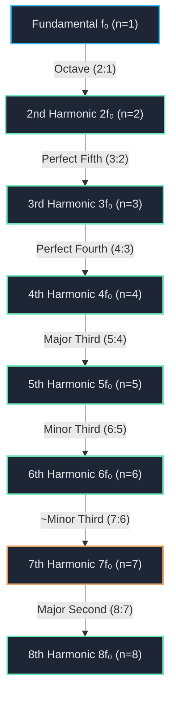
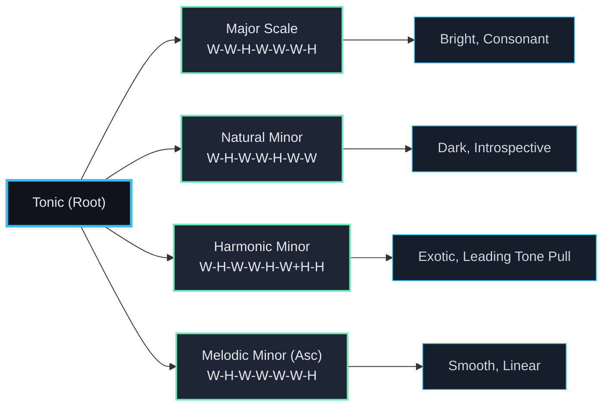

# Strings: Performance Mechanics, Harmonic Theory, and Tone Production

## Acoustic Foundations: Why Strings Behave the Way They Do

A string fixed at both ends vibrates as a combination of standing waves. The lowest frequency (fundamental) determines the pitch you hear, while higher vibrational modes (overtones) shape the tone color. Three physical properties control the fundamental: length, tension, and mass. Shortening the string raises pitch. Tightening it raises pitch. Making it heavier lowers pitch. That is the entire physics you need under your fingers.

The harmonic series — integer multiples of the fundamental — is the acoustic scaffolding behind every chord, scale, and tuning system used in string music. When you lightly touch a string at its midpoint and pluck it, you hear the second harmonic (one octave up). Touch at the one-third point and you hear the fifth above that. These are not abstract concepts; they are physical locations on the instrument you can find and play right now.



The seventh harmonic sits between the minor seventh and major sixth of equal temperament. It is the "blue note" you hear in brass timbres and vocal overtones. Fretted instruments approximate it but never nail it exactly. Unfretted instruments let you chase it.

Equal temperament divides the octave into twelve equal semitones (ratio $2^{1/12}$). This enables modulation to any key but slightly compromises every interval compared to the pure integer ratios of the harmonic series. The equal-tempered major third is about 14 cents sharp of the pure 5:4 ratio. Skilled string quartet players adjust intonation toward just ratios in real time, creating beatless chords. Guitarists live with the compromise of fixed frets but can still adjust through bends, vibrato, and barre pressure.

| Interval | Just Ratio | Just (cents) | Equal Temp (cents) | Difference |
|----------|------------|-------------|---------------------|------------|
| Unison | 1:1 | 0 | 0 | 0 |
| Minor second | 16:15 | 112 | 100 | −12 |
| Major second | 9:8 | 204 | 200 | −4 |
| Minor third | 6:5 | 316 | 300 | −16 |
| Major third | 5:4 | 386 | 400 | +14 |
| Perfect fourth | 4:3 | 498 | 500 | +2 |
| Perfect fifth | 3:2 | 702 | 700 | −2 |
| Minor sixth | 8:5 | 814 | 800 | −14 |
| Major sixth | 5:3 | 884 | 900 | +16 |
| Minor seventh | 16:9 | 996 | 1000 | +4 |
| Major seventh | 15:8 | 1088 | 1100 | +12 |
| Octave | 2:1 | 1200 | 1200 | 0 |

The practical takeaway: when you play a major triad on a fretted instrument, the third will always sound slightly sharp compared to the overtone-derived pure interval. When you play the same chord on violin or cello, you can lower the third by a few cents to eliminate the beating. This is expressive intonation, and it is one of the core advantages of unfretted strings.

---

## Bass Guitar: Left-Hand Mechanics and Fingering Systems

### Hand Posture and Thumb Anchor

The left hand on bass operates under high string tension with long scale lengths (typically 34 inches). Poor ergonomics lead to fatigue and injury. The rules:

- Place the thumb on the back of the neck, roughly opposite the middle finger (between frets, not on top of a fret). The thumb pad makes contact, not the tip.
- Keep the wrist relatively straight. A bent wrist compresses the carpal tunnel and reduces finger speed.
- Fingers curve naturally. Press with the fingertips, not the pads. The knuckle closest to the fingertip (DIP joint) should remain rounded, not collapsed flat.
- Forearm weight does the work. Do not squeeze the neck. Think of the thumb as a pivot point, not a clamp.

### Franz Simandl 1-2-4 System (Frets 1–5)

In the low positions (frets 1 through 5), the stretches between frets are wide. Attempting one-finger-per-fret (OFPF) here strains the tendons and compromises intonation. The Simandl system solves this:

- **Finger 1 (index):** covers frets 1 and 2 (pivot between them)
- **Finger 2 (middle):** covers fret 3
- **Finger 4 (pinky):** covers frets 4 and 5 (pivot between them)
- The ring finger (3) supports the pinky. They move as a unit.

This means in a four-fret span, you use three fingers, not four. The stretch is manageable, intonation is consistent, and the hand stays relaxed.

### One-Finger-Per-Fret (OFPF) — Frets 7 and Above

From fret 7 upward, the fret spacing narrows enough that OFPF becomes natural and efficient. Use fingers 1-2-3-4 across a four-fret window. This gives you faster chromatic access and better legato articulation in the upper register.

### Floating Thumb Muting

Sympathetic ringing from unplayed strings is the bassist's enemy. The floating thumb technique solves it:

- Rest your plucking-hand thumb on the string immediately below the one you are playing. If you are playing the D string, the thumb rests on the A string. If you are playing the G string, the thumb rests on the D string.
- When playing the E string (lowest), rest the thumb on the body or on a thumb rest mounted near the pickup.
- This mutes the lower strings and prevents them from resonating when you play notes on higher strings.

Left-hand muting supplements this: after fretting a note and moving to the next string, release the previous finger just enough to dampen the string against the fretboard without lifting off entirely.

### Practice Drill: Simandl Chromatic Walk

String: E string only. Play each note as a quarter note at a steady tempo.

| Fret | Finger | Note |
|------|--------|------|
| 1 | 1 | F |
| 2 | 1 (shift) | F♯ |
| 3 | 2 | G |
| 4 | 4 | G♯ |
| 5 | 4 (shift) | A |

Metronome progression: 60 BPM → 70 → 80 → 90 → 100. Play with a clean tone, no fret buzz. Listen for even note duration and consistent volume across all fingers. The pinky should sound as strong as the index.

---

## Bass Guitar: Movable Box Patterns and Walking Lines

### The Root–Third–Fifth–Octave Box

This is the foundational movable shape on the bass. Learn it in two positions and you can play the core of any major or minor chord in any key.

**Major Box (root on E string, fret 3 = G):**

```
   E string:  3  (root G)     — finger 1 (Simandl) or 2 (OFPF)
   A string:  2  (major 3rd B) — finger 1
   A string:  5  (perfect 5th D) — finger 4
   D string:  5  (octave G)   — finger 4
```

**Minor Box (root on E string, fret 3 = G):**

```
   E string:  3  (root G)     — finger 1 or 2
   A string:  1  (minor 3rd B♭) — finger 1
   A string:  5  (perfect 5th D) — finger 4
   D string:  5  (octave G)   — finger 4
```

The only difference between major and minor is the third: one fret lower for minor. The fifth and octave remain the same. This is the entire basis for chord-tone bass playing.

**Second position box (root on A string):**

```
   A string:  5  (root D)     — finger 1 or 2
   D string:  4  (major 3rd F♯) — finger 1
   D string:  7  (perfect 5th A) — finger 4
   G string:  7  (octave D)  — finger 4
```

For minor, lower the third by one fret (D string fret 3 instead of 4).

### Walking Bass Line Construction

A walking bass line connects chord tones with scalar or chromatic approach notes. The formula for each bar:

1. **Beat 1:** Root of the current chord
2. **Beat 2:** Another chord tone (third, fifth, or seventh)
3. **Beat 3:** Chord tone or passing tone (scale degree between two chord tones)
4. **Beat 4:** Approach note to the next chord's root — either chromatic (one semitone above or below) or scale-wise (diatonic step into the next root)

Approach note rules:
- **Chromatic approach from below:** Play the note one semitone below the next root, then resolve up. Strong pull toward the downbeat.
- **Chromatic approach from above:** Play the note one semitone above the next root, then resolve down.
- **Diatonic approach:** Use a scale degree of the current key that leads stepwise into the next root.

### Practice Drill: ii–V–I Walking Line in C Major

Chord progression: Dm7 → G7 → Cmaj7. Tempo: 120 BPM (jazz walking speed).

| Bar | Beat 1 | Beat 2 | Beat 3 | Beat 4 | Next Root |
|-----|--------|--------|--------|--------|-----------|
| Dm7 | D (open A string, fret 5) | F (D string, fret 3) | A (G string, fret 7) | G♯ (G string, fret 4) → chromatic approach from below to G | G |
| G7 | G (E string, fret 3) | B (A string, fret 2) | D (D string, fret 5) | B (A string, fret 2) → diatonic approach (scale step down to C) | C |
| Cmaj7 | C (A string, fret 3) | E (D string, fret 2) | G (G string, fret 5) | B (D string, fret 9 or G string, fret 4) → chromatic approach from below to C | C |

Start at 80 BPM and increase by 10 BPM increments to 140. The goal is even quarter notes with no rushing on the approach notes and no hesitation on the downbeat root.

---

## Bass Guitar: Slap and Pop Biomechanics

### Thumb (Slap) Technique

The slap is not a hit. It is a controlled bounce off the string using the bony side of the thumb joint.

1. Hold the plucking hand in a loose fist. The thumb extends at roughly a 30-degree angle from the hand.
2. Rotate the forearm (pronation) so the thumb bone strikes the string near the end of the fretboard (last fret or just past it). The contact point is the side of the thumb knuckle, not the flat face.
3. The thumb bounces off the string immediately after contact. The string hits the fretwire, producing the characteristic percussive "clank." If your thumb stays on the string, you choke the note.
4. The motion comes from the wrist and forearm rotation, not from the shoulder. Keep the elbow relatively still.

**Octave slap pattern drill (key of E):**

Slap the open E string (low octave), then pop the G string at fret 9 (D) or fret 11 (E octave). The pop is executed with the index or middle finger hooking under the string and snapping upward.

| Beat | Action | Note |
|------|--------|------|
| 1 | Slap | E (open E string) |
| & | Pop | E octave (D string, fret 9 or G string, fret 14) |
| 2 | Slap | E (open E string) |
| & | (rest) | — |
| 3 | Slap | E (open E string) |
| & | Pop | G (G string, fret 12 or D string, fret 12) |
| 4 | Slap | E (open E string) |
| & | (rest) | — |

Metronome: 60 BPM → 75 → 90 → 105 → 120. The popped notes should ring freely. If they choke, you are not releasing the string fast enough after the snap.

### Pop (Pluck) Technique

1. Hook the index or middle finger under the target string, perpendicular to the string plane (pointing down toward the floor).
2. Snap the finger upward in a quick arc. The string releases from the fingertip, hits the fretboard, and rings.
3. The wrist provides the power. The finger acts as a lever that releases stored tension.
4. Immediately return the finger to resting position to prepare for the next pop.

Common error: pulling the string outward (away from the body) instead of upward toward the player. Outward pulling produces a weak, thin sound and can pull the string off the fretboard entirely.

---

## Guitar: The CAGED System

The CAGED system maps five open-position chord shapes (C, A, G, E, D) across the entire fretboard as movable barre chords and arpeggio forms. Each shape connects to the next by sharing a root note location, forming an interlocking chain that covers the neck.

### The Five Shapes

Each shape is named after the open chord it derives from. When you add a barre, the shape becomes movable to any fret.

**C Shape** — Root on the A string (within the shape), voicing from low to high: R-5-R-3-5-R

```
   fret:  3   4   5
   E  ---|---|-R-|---     (5th of chord)
   B  ---|-3-|---|---     
   G  ---|---|-R-|---     
   D  ---|-5-|---|---     
   A  -R-|---|---|---     
   E  ---|---|-5-|---     
```

**A Shape** — Root on the E string (within the shape), barre across strings

```
   fret:  3   4   5
   E  -R-|---|---|---     
   B  ---|---|-5-|---     
   G  ---|-3-|---|---     
   D  ---|---|-R-|---     
   A  ---|-5-|---|---     
   E  -R-|---|---|---     
```

**G Shape** — Root on the low E string, stretches wide

```
   fret:  3   4   5   6
   E  -R-|---|---|-3-     
   B  ---|---|-R-|---     
   G  -5-|---|---|---     
   D  ---|---|-R-|---     
   A  ---|-3-|---|---     
   E  -R-|---|---|---     
```

**E Shape** — Root on low E string, the standard barre chord shape

```
   fret:  3   4   5
   E  -R-|---|-5-|---     
   B  ---|---|-R-|---     
   G  ---|-3-|---|---     
   D  -5-|---|---|---     
   A  -R-|---|-5-|---     
   E  -R-|---|-5-|---     
```

**D Shape** — Root on the D string within the shape

```
   fret:  3   4   5
   E  ---|---|-5-|---     
   B  ---|---|-R-|---     
   G  ---|-3-|---|---     
   D  -R-|---|---|---     
   A  ---|---|---|---     
   E  ---|---|---|---     
```

### Connecting the Shapes

The shapes interlock by shared roots. If you play a G major chord using the E shape at fret 3 (barre at 3, E shape), the root is on the low E string fret 3. The next shape up the neck that shares this root is the D shape, where the root is on the D string. The chain is: C → A → G → E → D → (C shape one octave higher).


### Practice Drill: CAGED Arpeggio Sweep

Key of G major. Play the major arpeggio (root, major 3rd, 5th, octave) through all five shapes ascending the neck.

1. **C shape (fret 3 area):** G on D string fret 5, B on G string fret 4, D on B string fret 3, G on high E string fret 3
2. **A shape (fret 5 area):** G on A string fret 10, B on D string fret 9, D on G string fret 7, G on B string fret 8
3. **G shape (fret 7 area):** G on low E fret 3, B on G string fret 4, D on B string fret 3, G on high E fret 3 (this overlaps with C shape — use the higher fret version)
4. **E shape (fret 8 area, barre at fret 3 for G):** G on low E fret 3, B on G string fret 4, D on B string fret 3, G on high E fret 3 (same shape, different octave context)
5. **D shape (fret 10 area):** G on D string fret 5, B on G string fret 4, D on B string fret 3, G on high E fret 3

Metronome: 60 BPM, eighth notes. Ascend through all shapes, then descend. Goal: smooth position shifts with no fret buzz and no timing gaps between shapes.

---

## Guitar: Picking Mechanics

### Alternate Picking

The foundation of efficient lead playing. Down-up-down-up consistently, regardless of string changes. This keeps the picking hand in rhythm and eliminates the cognitive load of deciding stroke direction.

**Drill — Chromatic staircase:**

```
   String (high to low):  E  B  G  D  A  E
   Frets (each string):   1  2  3  4
   Picking:               D  U  D  U  (repeat per string)
   Fingers:               1  2  3  4
```

Play frets 1-2-3-4 on the high E string, then move to B string and repeat, descending through all six strings. Then reverse: start on low E and ascend. Start at 70 BPM (sixteenth notes) and build to 120 BPM.

### Economy Picking

Economy picking uses a single downstroke when crossing to a higher-numbered (thinner) string and a single upstroke when crossing to a lower-numbered (thicker) string. This eliminates the extra pick stroke that alternate picking requires on string changes.

Pattern for a three-note-per-string scale run:

```
   String:  E    B    G    D    A    E
   Notes:   1-2-3  1-2-3  1-2-3  ...
   Pick:    D-U-D  D-U-D  D-U-D  ...  (downstroke into each new string)
```

Compare with alternate picking on the same run:

```
   String:  E    B    G    D
   Notes:   1-2-3  1-2-3  1-2-3
   Pick:    D-U-D  U-D-U  D-U-D  ...  (extra string-crossing stroke)
```

Economy picking saves one pick stroke per string crossing. At high tempos (160+ BPM with sixteenth notes), this is the difference between clean execution and falling behind.

### Pick Slant Angle

Tilt the pick slightly so the leading edge faces the direction of string travel. When ascending strings (moving toward thicker strings), slant the pick so the upstroke edge leads. When descending strings (moving toward thinner strings), slant so the downstroke edge leads. This slant lets the pick glide over the string rather than catching on it, reducing friction and increasing speed.

The slant is subtle — about 10-15 degrees of rotation. Too much slant and you lose attack clarity. Too little and the pick catches on the windings of thicker strings.

### String Muting

Both hands participate in muting. The picking hand:
- Palm (karate-chop edge) rests lightly on the strings behind the bridge to mute strings not being played.
- The side of the thumb damps the string immediately below the one being picked.

The fretting hand:
- Fingers not currently fretting a note lightly rest on the strings to prevent sympathetic ringing.
- When lifting a barre, release pressure but maintain contact to dampen.

**Drill — Power chord muting:**

Play a G5 power chord (low E string fret 3, A string fret 5). Strum only the two fretted strings. Then release pressure (do not lift fingers off the strings) and strum. The strings should be completely silent. Re-apply pressure and strum. Repeat at 80 BPM, alternating between ringing and muted every beat.

---

## Guitar: Fingerstyle and Travis Picking

### Travis Picking Pattern

Named after Merle Travis, this pattern uses the thumb to alternate bass notes while the index and middle fingers play syncopated treble notes independently. The thumb is the metronome; the fingers play around it.

**Standard pattern in C major:**

Left-hand chord: C major (x32010). Thumb alternates between the bass note (A string, fret 3) and a middle string (D string open or fret 2 for the G bass note).

| Beat | Thumb | Finger | String/Note |
|------|-------|--------|-------------|
| 1 | Down | — | A string fret 3 (C bass) |
| & | — | Index | G string fret 0 (E) |
| 2 | Down | — | D string fret 0 (D bass) — or fret 2 (G bass) |
| & | — | Middle | B string fret 1 (C) |
| 3 | Down | — | A string fret 3 (C bass) |
| & | — | Index | G string fret 0 (E) |
| 4 | Down | — | D string fret 0 (D bass) |
| & | — | Middle | High E string fret 0 (E) |

Notation: T = thumb, I = index, M = middle. Pattern: T-I-T-M T-I-T-M. The thumb plays on every beat and the fingers play on every off-beat.

**Practice progression:**

1. Thumb only, alternating bass notes at 60 BPM. Steady as a metronome.
2. Add index finger on off-beats. 60 BPM.
3. Add middle finger. Full pattern at 60 BPM.
4. Increase to 70 → 80 → 90 → 100 → 110 BPM.
5. Apply to chord progression: C → G → Am → F. One bar each, continuous pattern.

The key challenge is keeping the thumb bass steady while the fingers play independently. If the thumb starts syncing to the fingers, the groove collapses. The thumb is the foundation.

---

## Violin Family: Bowing and Left-Hand Mechanics

### Bow Hold (Violin/Viola)

The right hand controls tone production through the bow. The grip is not a squeeze — it is a balanced hold with specific contact points:

1. Place the tip of the thumb on the stick near the frog, touching the space between the stick and the frog. The thumb is curved, not locked.
2. The middle and ring fingers drape over the stick opposite the thumb, with their fingertips touching the frog's eyelet area.
3. The index finger rests on top of the stick, slightly separated from the middle finger. It provides downward pressure control.
4. The pinky curves and touches the top of the stick near the end of the frog. It controls bow angle and acts as a counterbalance to the index finger.
5. All fingers are rounded. No locked joints. The wrist is flexible and leads changes of direction.

The bow is drawn perpendicular to the string, between the bridge and the fingerboard. The contact point (sounding point) controls tone: closer to the bridge produces a brighter, louder tone; closer to the fingerboard produces a softer, breathier tone.

### Bow Arm Mechanics

The bow stroke uses a combination of arm segments that change depending on which part of the bow you are using:

- **Upper half (tip):** The forearm opens and closes from the elbow. The wrist drops slightly as you approach the tip.
- **Lower half (frog):** The upper arm opens from the shoulder. The wrist lifts slightly as you approach the frog.
- **Middle:** The forearm and upper arm share the work equally. This is the most balanced playing zone.

The wrist and fingers act as shock absorbers at the bow changes (direction changes). A stiff wrist produces a scratchy bow change. A flexible wrist produces seamless legato.

### Left-Hand Position (Violin/Viola)

1. The thumb rests on the side of the neck, opposite the first or second finger. It does not wrap over the top of the neck (except in thumb position for cello, or for vibrato on violin where it may release slightly from the neck).
2. Fingers curve and press the string against the fingerboard with the fingertips. The base knuckles are roughly level with the top of the fingerboard.
3. The elbow swings under the instrument to bring the fingers to the lower strings (G on violin). On the higher strings (E), the elbow shifts slightly right.
4. The wrist is neutral, not collapsed against the neck or pulled away.

### Intonation: Expressive Tuning in Practice

Unfretted string instruments allow the performer to adjust pitch continuously. In ensemble playing, skilled string players adjust intervals toward just intonation:

- **Major thirds:** Play slightly lower than the equal-tempered pitch (about 14 cents lower). This eliminates the beating caused by the 5:4 ratio mismatch.
- **Minor thirds:** Play slightly higher than equal temperament (about 16 cents higher) to approach the pure 6:5 ratio.
- **Perfect fifths and fourths:** Nearly identical to equal temperament (2 cents). Minimal adjustment needed.
- **Leading tones:** Raise slightly (sharper than equal temperament) to increase the pull toward the tonic. This is expressive intonation in the Romantic tradition.

**Drill — Drone intonation practice:**

Use a drone pitch (a sustained G from a tuner or app). Play a G major triad arpeggio against the drone, adjusting each note by ear:

1. G (root — match the drone exactly, zero beats)
2. B (major third — lower it until all beating stops; this is the just 5:4 third)
3. D (fifth — match with minimal beating)
4. G (octave — match the drone)

Repeat with the minor triad (G, B♭, D), raising the minor third until beating stops (approaching 6:5). This trains the ear to hear the difference between equal-tempered and just intonation. Practice slowly, listening for the pulse (beating) that indicates an impure interval.

### Vibrato Mechanics

Vibrato is a controlled oscillation of pitch, produced by a rocking motion of the finger on the string. It is not a wrist shake or an arm pump. The motion:

1. Place a fingertip on the string (not the pad — the bone of the fingertip).
2. The motion originates from the arm, traveling through a relaxed wrist to the hand. The finger rolls forward and backward on the string, slightly changing the pitch. The pitch oscillates above and below the central note, though traditionally the oscillation leans toward the sharp side (the lower side of the pitch is the anchor).
3. **Rate:** 5-7 oscillations per second. Too fast sounds nervous; too slow sounds like a wobble.
4. **Width:** ±15-30 cents. Wider vibrato suits Romantic and modern repertoire. Narrower vibrato suits Baroque and Classical styles.

**Drill — Slow-motion vibrato:**

At 60 BPM, rock the finger forward (sharp) on beat 1 and back (neutral) on beat 2. This is one cycle per two beats — far too slow for actual vibrato, but it builds the muscle memory of the motion. Gradually increase: one cycle per beat (60 cycles/min), then two cycles per beat (120 cycles/min, which is 2 Hz — still slow), then accelerate naturally to 5-7 Hz. The motion should remain relaxed throughout. If the forearm tenses, slow down and reset.

### Shifting Positions

On violin, positions are numbered by the fret equivalent of the first finger. First position means finger 1 plays the first scale degree above the open string. Third position means finger 1 plays the note three semitones above the open string (e.g., on the A string, first finger plays C in third position).

**Shift mechanics:**

1. Release finger pressure just before the shift — the finger maintains contact with the string but does not press into the fingerboard.
2. Slide along the string to the new position. The thumb moves with the hand, staying opposite the first or second finger.
3. At the target position, re-apply pressure and land on the correct note.
4. The motion is smooth and continuous. No jumping or lifting the finger off the string during the shift (for audible shifts / portamento). For silent shifts, the slide is fast enough that no intermediate pitch is audible.

**Drill — First to third position shift (A string):**

Play A (open) → C (finger 2, first position) → slide finger 1 from B (first position) to D (third position). The shift happens between the second and first finger placement. Practice at 60 BPM, then 70, 80, 90. Listen for a clean slide with no tension in the hand or wrist.

---

## Natural and Artificial Harmonics on String Instruments

### Guitar and Bass Natural Harmonics

Lightly touch the string at a harmonic node (do not press the string to the fret). Pluck, then immediately release the touching finger. The string vibrates in two, three, or more segments, producing a pure bell-like tone.

Key harmonic locations (relative to the open string):

| Touch point | Harmonic | Pitch produced |
|-------------|----------|----------------|
| Fret 12 (midpoint) | 2nd harmonic | One octave above open string |
| Fret 7 (1/3 length) | 3rd harmonic | Octave + perfect fifth |
| Fret 5 (1/4 length) | 4th harmonic | Two octaves above open string |
| Fret 4 (1/5 length) | 5th harmonic | Two octaves + major third |
| Fret 3 (1/6 length, near fret 3) | 6th harmonic | Two octaves + fifth |
| Fret 9 (2/5 length, near fret 9) | 5th harmonic | Same as fret 4 harmonic |

The 4th, 5th, and 6th harmonics become progressively quieter and harder to produce. Use the neck pickup for a warmer harmonic tone, and pluck near the bridge for more harmonic content.

**Drill — Harmonic chord chimes:**

On guitar, play the natural harmonics at fret 12 on all six strings simultaneously:

```
   String:  E   B   G   D   A   E
   Fret:    12  12  12  12  12  12
   Notes:   E   B   G   D   A   E  → Em7 chord
```

This produces an Em7 voicing spread across two octaves. Next, play harmonics at fret 7:

```
   String:  E   B   G   D   A   E
   Fret:    7   7   7   7   7   7
   Notes:   B   F♯  D   A   E   B  → Bm7(no5) / D6
```

Alternate between fret 12 and fret 7 harmonics at 80 BPM. Let each chord ring for a full bar (4 beats). Listen for the purity of the overtones and the absence of beating.

### Artificial Harmonics (Guitar)

Artificial harmonics let you produce harmonics from fretted notes, not just open strings. The technique:

1. Fret a note normally with the left hand (e.g., fret 2 on the G string = A).
2. With the right hand, lightly touch the string exactly 12 frets above the fretted note (fret 14 in this case) using the index fingertip.
3. Pluck the string with the ring finger or pick, immediately after the index finger touches the node.
4. Release the index finger from the string to let the harmonic ring.

The touch point is always 12 frets above the fretted note for the octave harmonic. For the fifth-above harmonic (3rd harmonic), touch 7 frets above the fretted note. The distance must be precise — even a half-fret error kills the harmonic.

### Violin Family Harmonics (Flageolet)

On violin, viola, cello, and double bass, natural harmonics are produced by lightly touching the string at a node point with the left hand while bowing. The technique is identical to the guitar concept but executed with a bow instead of a pluck.

**Natural harmonics (violin, A string):**

| Touch point | Pitch produced | Notation |
|-------------|----------------|----------|
| Midpoint (octave node) | A5 | ○ on the note |
| 1/3 from nut (or 2/3 from nut) | E6 | ○ higher |
| 1/4 from nut | A6 | ○ highest |

The small circle above the note indicates a harmonic. The pitch sounds an octave (or more) above the notated open string.

**Artificial harmonics on cello/double bass:**

Lower-pitched instruments can comfortably produce artificial harmonics. The technique:

1. Stop a note with finger 1 (the "base" note).
2. Lightly touch the string a perfect fourth above the stopped note with finger 4 (this is the 1/3 point of the vibrating segment between finger 1 and the bridge).
3. Bow normally. The resulting pitch is two octaves above the stopped note.

This four-finger stretch is comfortable on cello and bass due to the longer scale length. On violin, the stretch is extreme and typically reserved for high-position playing.

---

## Scale Fingerings and Practice Protocols

### Bass Guitar: One-Octave Major Scale (Simandl Position)

Key of G major. E string root position. Uses 1-2-4 fingering in lower frets and transitions to OFPF above fret 7.

```
   String:  E       E       A       A       A       D       D       D
   Fret:    3       5       2       4       5       2       4       5
   Note:    G       A       B       C       D       E       F♯      G
   Finger:  1       4       1       2       4       1       2       4
```

Metronome progression: 60 BPM (quarter notes) → 80 → 100 → 120 → 80 (eighth notes) → 100 → 120 → 80 (sixteenths) → 100 → 120.

Play ascending and descending. At each tempo, play through three times cleanly before advancing. If you fumble, drop back 10 BPM and rebuild.

### Guitar: Two-Octave Major Scale (G Major, E Shape Root)

Using the E-shape CAGED position (barre at fret 3):

```
   String:  E   E   A   A   A   D   D   D   G   G   B   B   e   e
   Fret:    3   5   2   4   5   2   4   5   2   4   3   5   3   5
   Note:    G   A   B   C   D   E   F♯  G   A   B   C   D   E   G(oct)
   Finger:  1   3   1   2   4   1   3   4   1   3   1   3   1   3
   Pick:    D   U   D   U   D   U   D   U   D   U   D   U   D   U
```

Alternate picking throughout. The string crossings from E to A, A to D, D to G, G to B, B to e are the key challenges. Keep the pick angle consistent across string changes.

**Minor scale fingering (G natural minor, E shape, barre at fret 3):**

```
   String:  E   E   A   A   A   D   D   D   G   G   B   B   e   e
   Fret:    3   5   1   3   5   1   3   5   1   3   2   3   3   5
   Note:    G   A   B♭  C   D   E♭  F   G   A   B♭  C   D   E♭  G
   Finger:  1   3   1   3   4   1   3   4   1   3   1   2   1   3
```

The minor third (B♭ on A string fret 1) and the minor sixth (E♭ on D string fret 1) are the only differences from the major fingering. The finger pattern changes at these points: use finger 1 for fret 1 instead of finger 2 for fret 2.

### Violin: Two-Octave G Major Scale (First and Third Positions)

```
   String:  G   G   A   A   A   D   D   D   D   A   A   A   A   E   E   E
   Fing:    0   1   2   3   0   1   2   3   0   1   2   3   0   1   2   3
   Note:    G   A   B   C   D   E   F♯  G   A   B   C   D   E   F♯  G   A
   Pos:     1st               shift      1st               shift
```

The shifts happen at the string crossing (open string), which masks the position change. This is standard first-position fingering with the open string acting as a pivot point. For a continuous-legato version, use third position on the A string (finger 1 plays B, finger 2 plays C, etc.) to avoid the open-string shift.

Metronome: 60 BPM (quarter notes, one note per beat) → 80 → 100. Then eighth notes at 60 → 80 → 100. Then triplets at 60 → 80. Play with a drone on the tonic (G) to monitor intonation.

---

## Tone Production: Plucking and Bowing Position

### Bass and Guitar: Plucking Location

Where you pluck the string changes the harmonic content of the tone:

- **Near the bridge:** Bright, focused, more upper harmonics, sharper attack. Good for cutting through a mix, slapping, and lead lines.
- **Over the neck pickup (middle):** Balanced, full-spectrum tone. The default position for most playing.
- **Over the fretboard (neck):** Warm, dark, reduced upper harmonics. Good for ballads, mellow passages, and upright-style tone on electric bass.

The physics: plucking near the bridge excites more high-frequency harmonics because the plucking point is far from the antinodes of the lower harmonics. Plucking near the center of the string excites the fundamental and lower harmonics more strongly, producing a rounder tone.

**Drill — Tone sweep:**

On bass, play an open E string. Start plucking near the bridge. Move your plucking hand gradually toward the neck over four bars. Listen for the brightness decreasing as you move toward the center. Then move back toward the bridge over four bars. This builds awareness of how plucking position shapes tone.

### String Muting and Staccato Control

Clean string playing requires as much attention to what you stop as what you start.

**Bass palm muting:** The side of the plucking hand rests on the strings near the bridge. To play staccato, pluck the note and immediately let the palm dampen the string. The duration of the note is controlled by how quickly you return the palm to the string.

**Guitar fret-hand staccato:** After fretting and plucking a note, release finger pressure (maintain string contact) to immediately stop the note. This produces a clean staccato without relying on the picking hand.

**Violin bow staccato:** The bow stops between notes. For détaché (separate but connected), the bow changes direction but maintains pressure. For staccato, the bow lifts or stops completely between notes. The wrist absorbs the direction change.

**Drill — Staccato pyramid:**

Play a G major scale (bass or guitar). Each note is a staccato eighth note followed by a rest of equal duration:

| Note | Duration | Rest |
|------|----------|------|
| G | 1/8 note | 1/8 rest |
| A | 1/8 note | 1/8 rest |
| B | 1/8 note | 1/8 rest |
| ... | ... | ... |

Then repeat with quarter notes followed by quarter rests. Then with half notes followed by half rests. The goal is clean note stops — no ringing, no buzzing — at every duration. Start at 80 BPM and build to 120.

---

## Harmony on Strings: Chord Voicings and Voice Leading

### Triads and Their Construction

A triad is three notes stacked in thirds: root, third, and fifth. The quality of the third and fifth determines the chord type.

| Triad Type | Root | Third | Fifth | Example | Character |
|------------|------|-------|-------|---------|-----------|
| Major | R | Major 3rd (4 semitones) | Perfect 5th (7 semitones) | C–E–G | Bright, stable |
| Minor | R | Minor 3rd (3 semitones) | Perfect 5th (7 semitones) | C–E♭–G | Dark, introspective |
| Diminished | R | Minor 3rd (3 semitones) | Diminished 5th (6 semitones) | C–E♭–G♭ | Tense, unstable |
| Augmented | R | Major 3rd (4 semitones) | Augmented 5th (8 semitones) | C–E–G♯ | Floating, ambiguous |

Extended chords stack additional thirds above the triad. The dominant seventh chord (major triad + minor seventh) is the engine of functional harmony: it creates tension that resolves to the tonic. In the key of C major, G7 (G–B–D–F) resolves to C major (C–E–G). The tritone between B and F (the third and seventh of G7) contracts inward to E and C (the third and root of C major), producing the strongest resolution in tonal music.


### Voice Leading on String Instruments

Smooth voice leading means each note moves the shortest possible distance to its next target. This produces a coherent, connected sound — essential for string quartet writing, guitar chord melodies, and bass line construction.

**Rule of thumb:** Common tones between consecutive chords stay on the same string/finger. Moving voices step by semitone or whole step, not by leap.

**Example — I–vi–IV–V in G major (guitar chord melody):**

| Chord | Voicing (string: fret) | Notes |
|-------|----------------------|-------|
| G major | B:3, G:0, B:0, e:3 | D, G, B, G |
| E minor | B:0, G:0, B:0, e:3 | B, G, B, G (common tones G and B hold; D moves down to B on B string) |
| C major | A:3, G:0, B:1, e:3 | C, G, C, G (G holds; B moves to C on B string) |
| D major | A:0, D:0, G:2, e:2 | D, A, D, F♯ (shift: C drops to A on A string; G stays; C moves to D on B string; G moves to F♯ on e string) |

The e string fret 3 (G) stays constant across the first three chords, then moves to fret 2 (F♯) for D major — a single semitone drop. This is smooth voice leading in action.

### String Quartet Voice Leading

In a string quartet (two violins, viola, cello), each instrument carries one voice. The composer or arranger ensures:

1. No voice makes an unnecessary leap when a stepwise alternative exists.
2. Common tones are sustained across chord changes to create harmonic glue.
3. Parallel fifths and octaves are avoided between any two voices (they eliminate the independence of the lines).
4. The bass (cello) provides the harmonic foundation; the inner voices (viola, second violin) fill in chord tones; the first violin carries the melody or highest structural voice.

**Tritone resolution (G7 → C major):**

| Voice | G7 note | Resolves to | Direction |
|-------|---------|-------------|-----------|
| First violin | F (7th of G7) | E (3rd of C) | Down one semitone |
| Second violin | B (3rd of G7) | C (root of C) | Up one semitone |
| Viola | D (5th of G7) | C or E | Common or step |
| Cello | G (root of G7) | C (root of C) | Down a fourth or up a fifth |

The tritone (B–F) contracts inward to the tonic and third of C major. This is the strongest voice-leading resolution in tonal music, and it works identically whether played by a string quartet, a guitar, or a piano.

---

## Scales and Modes: Practical Application

### The Major Scale Pattern

Whole-Whole-Half-Whole-Whole-Whole-Half (W-W-H-W-W-W-H).

Starting on C: C, D, E, F, G, A, B, C. Bright, stable, consonant.

### The Minor Scale Variants

**Natural minor:** W-H-W-W-H-W-W. Starting on A: A, B, C, D, E, F, G, A. The minor third (C instead of C♯) defines the darker character.

**Harmonic minor:** W-H-W-W-H-W+H-H. The raised seventh (G♯ in A minor) creates a leading tone that pulls strongly toward the tonic. The augmented second between F and G♯ (three semitones) gives this scale its exotic, almost Middle Eastern flavor.

**Melodic minor (ascending):** W-H-W-W-W-W-H. Raises both the sixth and seventh ascending (A, B, C, D, E, F♯, G♯, A). This smooths out the augmented second of harmonic minor and creates a more singable melodic line. Descending, traditional practice reverts to natural minor (A, G, F, E, D, C, B, A), though jazz players often use the ascending form in both directions.



### Modes from the Major Scale

Each mode is the major scale starting on a different degree. Same notes, different tonal center, different character.

| Mode | Start degree | Pattern (from root) | Character | Example (C major parent) |
|------|-------------|---------------------|----------|---------------------------|
| Ionian | 1 | W-W-H-W-W-W-H | Major (bright) | C to C |
| Dorian | 2 | W-H-W-W-W-H-W | Minor with raised 6th (jazz, folk) | D to D |
| Phrygian | 3 | H-W-W-W-H-W-W | Minor with flat 2nd (flamenco, dark) | E to E |
| Lydian | 4 | W-W-W-H-W-W-H | Major with raised 4th (dreamy, floating) | F to F |
| Mixolydian | 5 | W-W-H-W-W-H-W | Major with flat 7th (blues, rock) | G to G |
| Aeolian | 6 | W-H-W-W-H-W-W | Natural minor (dark) | A to A |
| Locrian | 7 | H-W-W-H-W-W-W | Diminished, unstable (rare) | B to B |

### Practical Modal Drill (Bass or Guitar)

Play each mode of the C major scale starting on the same string (E string on bass, low E on guitar). Use the scale pattern for each mode and listen for its characteristic note:

1. **C Ionian:** Play C to C (frets 3-5-7-8-10-12-14-15 on E string). The major third (E, fret 7) and major seventh (B, fret 12) define the brightness.
2. **D Dorian:** Play D to D (frets 5-7-9-10-12-14-16-17). The raised sixth (B, fret 12) against the minor third (F, fret 8) is the Dorian signature.
3. **E Phrygian:** Play E to E (frets 0-1-3-5-7-8-10-12). The flat second (F, fret 1) immediately against the root (E, open) creates the dark, flamenco tension.
4. **F Lydian:** Play F to F (frets 1-3-5-7-8-10-12-13). The raised fourth (B, fret 7) against the major third (A, fret 5) produces the dreamy, floating quality.
5. **G Mixolydian:** Play G to G (frets 3-5-7-9-10-12-14-15). The flat seventh (F, fret 8) against the major third (B, fret 12) gives the bluesy, dominant feel.
6. **A Aeolian:** Play A to A (frets 5-7-8-10-12-13-15-17). The minor third (C, fret 8) and minor sixth (F, fret 13) define the natural minor darkness.
7. **B Locrian:** Play B to B (frets 7-8-10-12-13-15-16-18). The flat second (C, fret 8) and diminished fifth (F, fret 13) make this mode unstable and unresolved.

Play each mode at 80 BPM, quarter notes, ascending and descending. The goal is to internalize the character of each mode by ear, not by theory. After playing through all seven, pick one at random and identify it by sound alone.

---

## Construction Notes: String Choice and Maintenance

### String Gauge and Tension

Heavier gauge strings produce more tension at the same pitch, which increases sustain, volume, and fundamental content. Lighter strings are easier to bend and fret but produce less output and a thinner tone.

**Bass string gauge guidelines (4-string, standard tuning E-A-D-G):**

| Style | E | A | D | G | Character |
|-------|---|---|---|---|-----------|
| Light | .040 | .060 | .080 | .100 | Easy fretting, bright, less low end |
| Medium | .045 | .065 | .085 | .105 | Balanced default for most players |
| Heavy | .050 | .070 | .090 | .110 | Big tone, harder to play, more tension |

**Guitar string gauge guidelines (standard tuning E-A-D-G-B-e):**

| Style | e | B | G | D | A | E | Character |
|-------|---|---|---|---|---|---|-----------|
| Extra light | .009 | .011 | .016 | .024 | .032 | .042 | Easy bending, bright, thin |
| Light | .010 | .013 | .017 | .026 | .036 | .046 | Standard rock/pop default |
| Medium | .011 | .014 | .018 | .028 | .038 | .049 | Fuller tone, harder bends |

### Wound vs Unwound Strings

Lower-pitched strings are wound (a outer wrap wire around a core) to increase mass without excessive thickness. The core provides tensile strength; the winding adds mass per unit length, lowering the fundamental frequency. Wound strings have more inharmonicity (overtones slightly sharp of integer multiples) due to the stiffness of the winding, which contributes to the complex, rich tone of cello, bass, and low guitar strings.

Upper strings (violin E, guitar high E and B) are typically plain (unwound) because they are thin enough to achieve the necessary tension at the target pitch without additional mass.

### Changing Strings: Tension Sequence

When restringing, bring all strings up to approximate pitch before fine-tuning any individual string. The neck and bridge respond to the total tension across all strings. If you tune one string to pitch while the others are slack, the neck relief changes when you bring the next string up, throwing the first string out of tune.

1. Install all strings and bring each to roughly one step below target pitch.
2. Stretch each string by gently pulling it away from the fretboard at the 12th fret. Retune to rough pitch.
3. Repeat the stretch-and-retune cycle two or three times until the string holds pitch.
4. Fine-tune all strings to pitch, checking with a tuner or by playing harmonics (fret 12 vs open string octave).

New strings sound brighter and have more overtone content due to the clean surface of the winding. As strings age, skin oils and oxidation dull the surface, reducing high-frequency content and making the tone muddier. Change strings when the tone loses brightness or when intonation becomes inconsistent (old strings can develop uneven wear that causes fretted notes to be out of tune).
