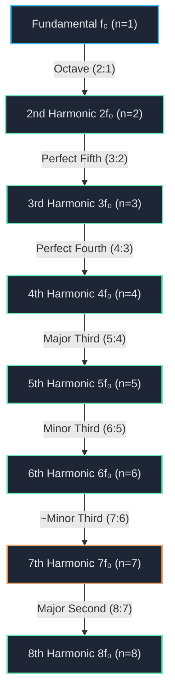
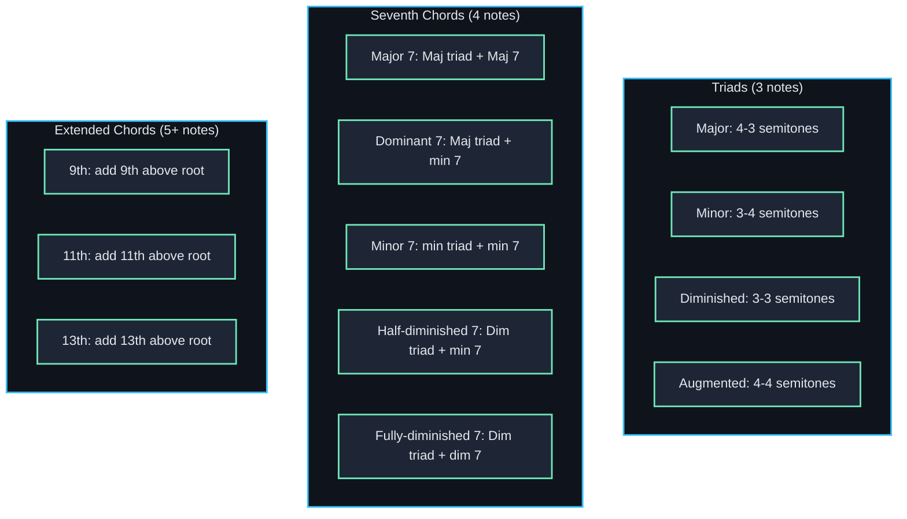
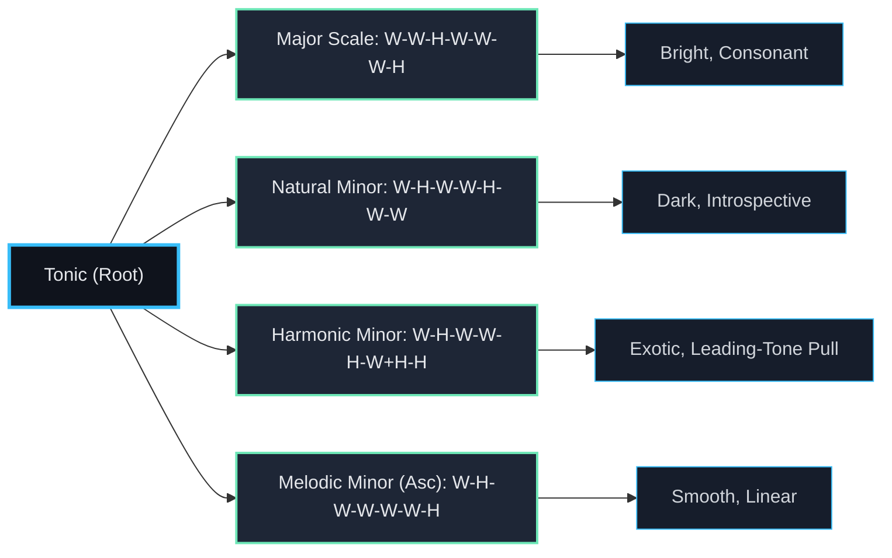

# Strings: Performance Mechanics, Harmonic Theory, and Tone Production

## Acoustic Foundations: Why Strings Behave the Way They Do

A string fixed at both ends vibrates as a sum of standing waves. The lowest one (the fundamental) is the pitch you hear; the higher ones (overtones) shape the tone color. Three physical variables control the fundamental: length, tension, and mass per unit length. Shorten the string, pitch rises. Tighten it, pitch rises. Add mass, pitch falls. That's the entire physics you need under your fingers — everything else in this lesson is about controlling it with your hands.

The harmonic series — integer multiples of the fundamental — is the scaffolding behind every chord, scale, and tuning system in string music, and it's not abstract: you can find these ratios as physical locations on the string right now. Touch a string lightly at its exact midpoint (don't press it to the fretboard) and pluck — you get the octave. Touch at the one-third point and you get the octave plus a fifth. This is the same principle used to find natural harmonics later in this lesson.



The 7th harmonic sits between a minor seventh and major sixth of equal temperament — the "blue note" color you hear in brass and in vocal overtone singing. Fretted instruments can't land on it exactly; unfretted instruments (violin family, fretless bass, slide guitar) can chase it with a finger adjustment, which is one reason fretless tone feels "vocal."

Equal temperament divides the octave into 12 equal semitones so you can modulate to any key on a fixed-pitch instrument, but it compromises every interval slightly compared to the pure integer ratios above. The equal-tempered major third is about 14 cents sharp of the pure 5:4 ratio you'd get from the harmonic series.

| Interval | Just Ratio | Just (cents) | Equal Temp (cents) | Difference |
|----------|------------|-------------|---------------------|------------|
| Minor third | 6:5 | 316 | 300 | −16 |
| Major third | 5:4 | 386 | 400 | +14 |
| Perfect fourth | 4:3 | 498 | 500 | +2 |
| Perfect fifth | 3:2 | 702 | 700 | −2 |
| Major sixth | 5:3 | 884 | 900 | +16 |
| Octave | 2:1 | 1200 | 1200 | 0 |

**Why this matters at the instrument:** on a fretted guitar or bass, the major third of any chord is locked 14 cents sharp of pure — you can't fix it except by bending or finger-rolling. On violin, viola, cello, and bass (unfretted), you actively lower that third by ear when playing a sustained chord, which kills the beating and makes the chord lock in. Section 6 gives you a concrete drone drill for training this.

---

## 1. Bass Guitar: Left-Hand Mechanics and Fingering Systems

### Hand Posture and Thumb Anchor

Bass operates under higher string tension and a longer scale (typically 34") than guitar, so sloppy ergonomics cost you faster — tendon strain shows up in weeks, not years.

- Thumb on the back of the neck, roughly opposite the middle finger, resting *between* frets, not on top of one. Contact is the thumb pad, not the tip.
- Wrist stays close to straight. A bent wrist compresses the carpal tunnel and slows down your fourth finger specifically — if your pinky feels weak, check your wrist angle before you blame the finger.
- Fingers curve naturally and press with the fingertip. The joint nearest the tip (DIP joint) stays rounded; if it collapses flat, you lose leverage and buzz the fret.
- Forearm weight does the work, not grip strength. Treat the thumb as a pivot, never a clamp. If your forearm feels tired after five minutes, you're squeezing.

### Simandl 1-2-4 System (Frets 1–5)

In the lowest frets, the physical gap between fret slots is widest, so one-finger-per-fret (OFPF) overstretches the hand and drags intonation flat on the stretched notes. Simandl's fix uses three fingers across a four-fret span:

- **Finger 1 (index):** covers frets 1 and 2, pivoting at the knuckle between them
- **Finger 2 (middle):** covers fret 3
- **Finger 4 (pinky):** covers frets 4 and 5, pivoting between them
- **Finger 3 (ring):** does not fret independently — it rides alongside the pinky as mechanical support, so the pinky doesn't hyperextend

This keeps the hand's span manageable and the intonation consistent, because you're never forcing a stretch that pulls the fingertip off-center on the fret.

### OFPF — Fret 7 and Above

From fret 7 up, fret spacing narrows enough that fingers 1-2-3-4 map cleanly to four consecutive frets with no pivot needed. Use OFPF here for faster chromatic runs and cleaner legato — don't keep using Simandl pivots once the frets get close together, it wastes motion.

### Floating Thumb Muting

Unplayed strings ring sympathetically and muddy your low end. Fix it at the source:

- Resting (plucking-hand) thumb sits on the string immediately *below* the one you're playing. Playing the D string → thumb rests on A. Playing G → thumb rests on D.
- Playing the E string (lowest) → thumb rests on the pickup edge or a mounted thumb rest.
- As you move to a higher string, the thumb "floats" down to the new neighbor — it travels with you, string by string.

Pair this with left-hand muting: after fretting a note, as you move to the next string, ease pressure on the previous finger just enough to deaden the string against the fretboard without lifting fully off.

### Drill: Simandl Chromatic Walk

E string only, quarter notes, clean tone, no fret buzz.

| Fret | Finger | Note |
|------|--------|------|
| 1 | 1 | F |
| 2 | 1 (pivot) | F♯ |
| 3 | 2 | G |
| 4 | 4 | G♯ |
| 5 | 4 (pivot) | A |

Metronome: 60 → 70 → 80 → 90 → 100 BPM. Listen for the pinky note (G♯/A) matching the index note (F/F♯) in volume and sustain — a weak pinky is the single most common tell of a beginner bassist, and this drill is the direct fix.

---

## 2. Bass Guitar: Movable Box Patterns and Walking Lines

### Root–Third–Fifth–Octave Box

One shape, moved anywhere on the neck, gives you the core tones of any major or minor chord.

**Major box, root on E string fret 3 (G major):**

```text
E string:  fret 3  — Root (G)          — finger 1
A string:  fret 2  — Major 3rd (B)     — finger 1
A string:  fret 5  — Perfect 5th (D)   — finger 4
D string:  fret 5  — Octave (G)        — finger 4
```

**Minor box, same root:**

```text
E string:  fret 3  — Root (G)          — finger 1
A string:  fret 1  — Minor 3rd (B♭)    — finger 1
A string:  fret 5  — Perfect 5th (D)   — finger 4
D string:  fret 5  — Octave (G)        — finger 4
```

Only the third moves — one fret lower for minor. Fifth and octave stay put. Internalize this one shift and you can play chord-tone bass over any major/minor progression without reading anything.

**Second box, root on A string (D major/minor):**

```text
A string:  fret 5  — Root (D)              — finger 1
D string:  fret 4  — Major 3rd (F♯)        — finger 1   [fret 3 for minor: F]
D string:  fret 7  — Perfect 5th (A)       — finger 4
G string:  fret 7  — Octave (D)            — finger 4
```

### Walking Bass Line Formula

Four beats, four jobs:

1. **Beat 1:** root of the current chord
2. **Beat 2:** another chord tone (3rd, 5th, or 7th)
3. **Beat 3:** chord tone or a scale-wise passing tone between two chord tones
4. **Beat 4:** approach note into the *next* chord's root — chromatic (half step above or below) or diatonic (scale step)

### Drill: ii–V–I Walking Line in C Major, 80→140 BPM

Dm7 → G7 → Cmaj7, swing quarter-note feel.

| Bar | Beat 1 | Beat 2 | Beat 3 | Beat 4 (approach) |
|-----|--------|--------|--------|--------|
| Dm7 | D (A str, fr 5) | F (D str, fr 3) | A (G str, fr 7) | G♯ (G str, fr 4) — chromatic from below into G7's root |
| G7 | G (E str, fr 3) | B (A str, fr 2) | D (D str, fr 5) | B (A str, fr 2) — diatonic step down into Cmaj7's root |
| Cmaj7 | C (A str, fr 3) | E (D str, fr 2) | G (G str, fr 5) | B (D str, fr 9) — chromatic from below back into Dm7 |

Start at 80 BPM, climb in 10 BPM steps to 140. The approach note on beat 4 is the tell for rushing — if it lands early, you're anticipating the next root instead of committing to the full quarter note.

---

## 3. Bass Guitar: Slap and Pop Biomechanics

### Thumb (Slap)

The slap is a bounce, not a hit — if your thumb stays on the string after contact, the note chokes dead.

1. Loose fist, thumb extended at roughly 30° from the hand.
2. Pronate the forearm so the *side* of the thumb's first knuckle (not the flat pad) strikes the string over the last fret or just past it.
3. The string slaps the fretwire on impact — that's the "clank." Thumb rebounds immediately off the string after contact.
4. Motion comes from wrist/forearm rotation. Keep the elbow nearly still — if your whole arm is moving, you're using too much force and losing speed.

### Drill: Octave Slap Pattern (Key of E), 60→120 BPM

| Beat | Action | Note |
|------|--------|------|
| 1 | Slap | E (open E string) |
| & | Pop | E octave (D string fret 9) |
| 2 | Slap | E (open E string) |
| 3 | Slap | E (open E string) |
| & | Pop | G (G string fret 12) |
| 4 | Slap | E (open E string) |

If popped notes choke, you're not releasing the string fast enough after the snap — the finger should already be moving away before the string finishes its swing.

### Pop (Pluck)

1. Hook index or middle finger under the target string, perpendicular to the string plane, pointing toward the floor.
2. Snap upward in a quick arc — the string slaps the fretboard and rings.
3. Power comes from the wrist, not the forearm. The finger is a lever releasing stored tension, not a hook pulling outward.
4. Common error: pulling the string *away* from the body instead of up. This produces a thin, weak sound and risks pulling the string off the fretboard entirely.

---

## 4. Guitar: The CAGED System

CAGED maps five open-position chord shapes (C-A-G-E-D) as movable barre forms across the neck. Each shape shares a root location with its neighbor, forming an interlocking chain that covers every fret.

### The Five Shapes (key of G major shown, barre positions marked)

**E Shape** — root on low E string, the standard barre chord shape, barre at fret 3:

```text
fret:   3   4   5
E  --- R  ---  5  ---
B  --- -- ---  R  ---
G  --- 3  ---  -- ---
D  --- -- ---  5  ---
A  --- R  ---  -- ---
E  --- R  ---  5  ---
```

**D Shape** — root on D string, barre at fret 10:

```text
fret:  10  11  12
E  --- -- ---  5  ---
B  --- -- ---  R  ---
G  --- 3  ---  -- ---
D  --- R  ---  -- ---
```

**C Shape** — root on A string, barre at fret 15 (one octave above the original C-shape G chord at the open position):

```text
fret:  15  16  17
E  --- -- ---  R  ---
B  --- 3  ---  -- ---
G  --- -- ---  R  ---
D  --- 5  ---  -- ---
A  --- R  ---  -- ---
```

**A Shape** — root on low E and high E strings, barre at fret 5 (moved up from the open-position A shape):

```text
fret:   5   6   7
E  --- R  ---  -- ---
B  --- -- ---  5  ---
G  --- 3  ---  -- ---
D  --- -- ---  R  ---
A  --- 5  ---  -- ---
E  --- R  ---  -- ---
```

**G Shape** — root on low E string, barre at fret 7, widest stretch of the five:

```text
fret:   7   8   9  10
E  --- R  ---  --  3
B  --- -- ---  R  ---
G  --- 5  ---  --  ---
D  --- -- ---  R  ---
A  --- 3  ---  --  ---
E  --- R  ---  --  ---
```

### Chain Order

C → A → G → E → D → C (octave higher), with barres landing at frets 3, 5, 7, 8, 10, 15 for the key of G.


### Drill: CAGED Arpeggio Sweep, Key of G Major

Play the G major arpeggio (R-3-5-octave) through each shape, ascending the neck, then descend back down. 60 BPM, eighth notes, no gap in timing between shape changes.

1. **C shape (barre fret 15):** A string fret 15 (G, R), B string fret 16 (B, 3rd), D string fret 17 (D, 5th), E string fret 17 (G, octave)
2. **A shape (barre fret 5):** E string fret 5 (G, R), D string fret 7 (D, 5th), G string fret 4 (B, 3rd), B string fret 7 (D, 5th)
3. **G shape (barre fret 7):** E string fret 7 (G, R), A string fret 9 (B, 3rd), G string fret 7 (D, 5th), E string fret 10 (B, 3rd)
4. **E shape (barre fret 8):** E string fret 8 (G, R), A string fret 8 (D... wait — use D string fret 7 (D, 5th), G string fret 9 (B, 3rd), B string fret 8 (G, octave)
5. **D shape (barre fret 10):** D string fret 10 (G, R), G string fret 9 (B, 3rd), B string fret 10 (D, 5th), E string fret 12 (G, octave)

The goal is clean position shifts with zero fret buzz and no stall between shapes — if you hear a gap, you're lifting the whole hand instead of sliding the anchor finger into the next position.

---

## 5. Guitar: Picking Mechanics

### Alternate Picking

Down-up-down-up, unconditionally, regardless of string changes. This removes the cognitive overhead of deciding stroke direction mid-run.

**Drill — Chromatic staircase**, frets 1-2-3-4 on each string, picking D-U-D-U, fingers 1-2-3-4:

```text
High E → B → G → D → A → low E, frets 1-2-3-4 each string, descending
then reverse: low E → high E, ascending
```

Start at 70 BPM sixteenth notes, build to 120 BPM.

### Economy Picking

A single downstroke crossing to a thinner (higher-pitched) string, a single upstroke crossing to a thicker (lower-pitched) string — this removes the extra stroke alternate picking forces on string crossings.

```text
Alternate picking (3-note-per-string run):
E str: D-U-D | B str: U-D-U | G str: D-U-D   ← extra stroke at each crossing

Economy picking, same run:
E str: D-U-D | B str: D-U-D | G str: D-U-D   ← downstroke leads into each new string
```

At 160+ BPM sixteenth notes, this one-stroke saving per crossing is the difference between clean execution and falling behind the click.

### Pick Slant

Tilt the pick 10–15° so its leading edge faces the direction of travel: ascending in string number (toward thicker strings) → upstroke edge leads; descending (toward thinner strings) → downstroke edge leads. This lets the pick glide instead of catching on the string winding. Too much slant kills attack clarity; too little and the pick snags on wound strings.

### Muting, Both Hands

- **Picking hand:** palm edge rests lightly on strings behind the bridge to mute unplayed strings; the side of the thumb dampens the string directly below the one being picked.
- **Fretting hand:** idle fingers rest lightly on adjacent strings to kill sympathetic ring; releasing a barre keeps light contact rather than lifting clean off.

**Drill — Power chord mute:** G5 power chord (low E fret 3, A fret 5). Strum fretted and ringing. Release pressure without lifting fingers off the strings, strum again — should be dead silent. Re-apply, strum. Alternate ringing/muted every beat at 80 BPM.

---

## 6. Guitar: Fingerstyle and Travis Picking

Named after Merle Travis — the thumb alternates bass notes as a steady pulse while index and middle fingers play syncopated treble notes independently around it. The thumb is the metronome; the fingers are decoration on top.

**Pattern in C major** (chord: x32010), T-I-T-M T-I-T-M:

| Beat | Thumb | Finger | Note |
|------|-------|--------|------|
| 1 | Down | — | A string fret 3 (C bass) |
| & | — | Index | G string open (E) |
| 2 | Down | — | D string open (D bass) |
| & | — | Middle | B string fret 1 (C) |
| 3 | Down | — | A string fret 3 (C bass) |
| & | — | Index | G string open (E) |
| 4 | Down | — | D string open (D bass) |
| & | — | Middle | High E string open (E) |

**Build-up progression:**

1. Thumb alone, alternating bass notes, 60 BPM, metronome-steady
2. Add index on off-beats, 60 BPM
3. Add middle, full pattern, 60 BPM
4. Climb 70 → 80 → 90 → 100 → 110 BPM
5. Apply to C → G → Am → F, one bar each, continuous pattern without a stumble at the chord change

The failure mode to watch for: the thumb syncing to the fingers instead of leading them. If the groove collapses, slow down until the thumb feels independent again — it is the foundation, not a response to what the fingers are doing.

---

## 7. Violin Family: Bowing and Left-Hand Mechanics

### Bow Hold

A balanced hold, not a squeeze, with five specific contact points:

1. Thumb tip curved against the stick near the frog, touching the gap between stick and frog.
2. Middle and ring fingers drape over the stick opposite the thumb, fingertips near the frog's eyelet.
3. Index finger rests on top of the stick, slightly separated from the middle finger — it supplies downward pressure control.
4. Pinky curves onto the top of the stick near the frog's end, counterbalancing the index finger and controlling bow angle.
5. All joints rounded, no locking. The wrist stays flexible and leads every change of bow direction.

Bow travels perpendicular to the string, between bridge and fingerboard. Contact point (sounding point) controls tone: closer to the bridge is brighter and louder; closer to the fingerboard is softer and breathier.

### Bow Arm by Zone

- **Upper half (toward the tip):** forearm opens/closes from the elbow; wrist drops slightly near the tip.
- **Lower half (toward the frog):** upper arm opens from the shoulder; wrist lifts slightly near the frog.
- **Middle:** forearm and upper arm share the work evenly — the most balanced zone to practice tone production in.

The wrist absorbs bow changes like a shock absorber. A stiff wrist produces an audible scratch at every direction change; a flexible wrist makes the change inaudible.

### Left-Hand Position

1. Thumb rests on the side of the neck, opposite finger 1 or 2 — it doesn't wrap over the top (exceptions: cello thumb position, or violin vibrato where the thumb releases slightly).
2. Fingers curve, pressing with the fingertip; base knuckles roughly level with the top of the fingerboard.
3. Elbow swings under the instrument for lower strings (G on violin), shifts right for higher strings (E).
4. Wrist stays neutral — not collapsed against the neck, not pulled away from it.

### Drone Intonation Drill

Sustain a drone G (tuner, app, or open string on a second instrument). Arpeggiate a G major triad against it, adjusting by ear:

1. **G** (root) — match the drone with zero beating
2. **B** (major 3rd) — lower it until the beating disappears; this is the pure 5:4 third, about 14 cents flat of equal temperament
3. **D** (5th) — match with minimal beating; almost identical to equal temperament
4. **G** (octave) — match the drone

Repeat with G minor (G, B♭, D) — raise the minor third until beating stops, approaching the pure 6:5 ratio (about 16 cents sharp of equal temperament). Go slow: you're training your ear to hear the pulse of an impure interval, and that pulse is the entire skill.

### Vibrato Mechanics

A controlled pitch oscillation from a rocking motion of the fingertip on the string — not a wrist shake, not an arm pump.

1. Fingertip bone contacts the string (not the soft pad).
2. Motion originates in the arm, passes through a relaxed wrist into the hand; the finger rolls forward and back, bending the pitch slightly above and below center. Traditional practice anchors the lower edge of the oscillation at the true pitch and leans sharp above it.
3. **Rate:** 5–7 oscillations/second. Faster reads as nervous; slower reads as a wobble.
4. **Width:** roughly ±15–30 cents. Wider suits Romantic/modern repertoire; narrower suits Baroque/Classical.

**Drill — Slow-motion vibrato:** At 60 BPM, rock sharp on beat 1, back to center on beat 2 (one cycle per two beats — far slower than real vibrato, but it builds the motor pattern). Progress to one cycle per beat, then two cycles per beat, then let it accelerate naturally toward 5–7 Hz. If the forearm tenses at any point, slow back down and reset — tension at speed is the single most common vibrato failure.

### Shifting Positions

First position: finger 1 plays the first scale degree above the open string. Third position: finger 1 plays the note three semitones above the open string (on the A string, that's C).

**Shift mechanics:**

1. Ease finger pressure just before the shift — maintain string contact, stop pressing into the fingerboard.
2. Slide along the string to the new position; the thumb travels with the hand, staying opposite finger 1 or 2.
3. At the target position, reapply pressure and land precisely on the note.
4. Keep the motion smooth and continuous — no lifting mid-shift for audible portamento; for a silent shift, move fast enough that no intermediate pitch is heard.

**Drill — 1st-to-3rd position shift (A string):** Play A (open) → C (finger 2, 1st position) → slide finger 1 from B (1st position) up to D (3rd position). Practice at 60 → 70 → 80 → 90 BPM, listening for a clean slide with zero tension in the hand or wrist.

---

## 8. Natural and Artificial Harmonics

### Guitar and Bass Natural Harmonics

Touch the string lightly at the node (don't press to the fret), pluck, then release the touching finger immediately. The string segments into multiple vibrating loops, producing a pure, bell-like tone.

| Touch point | Harmonic | Pitch produced |
|-------------|----------|----------------|
| Fret 12 (midpoint) | 2nd | One octave above open string |
| Fret 7 (1/3 length) | 3rd | Octave + perfect fifth |
| Fret 5 (1/4 length) | 4th | Two octaves above open string |
| Fret 4 (1/5 length) | 5th | Two octaves + major third |
| Fret 9 (2/5 length) | 5th | Same pitch as fret 4 harmonic |

Harmonics above the 4th get progressively quieter and harder to speak cleanly. Pluck closer to the bridge for more harmonic content, and use the neck pickup if you want a warmer harmonic tone.

**Drill — Harmonic chord chimes (guitar):** play fret-12 harmonics on all six strings together — produces an Em7 voicing (E-B-G-D-A-E) spread across two octaves. Then play fret-7 harmonics across all six strings — produces a Bm(no5)/D6-type color (B-F♯-D-A-E-B). Alternate between the two at 80 BPM, letting each ring a full bar. Listen for the absence of beating — that purity is what a correctly fretted octave or fifth should sound like, and it's a good ear-reference for checking your regular intonation.

### Artificial Harmonics (Guitar)

Produce harmonics from a fretted note, not just an open string:

1. Fret normally with the left hand (e.g., fret 2 on G string = A).
2. Lightly touch the string exactly 12 frets above the fretted note (fret 14) with the right-hand index fingertip.
3. Pluck with the ring finger or pick immediately as the index touches the node.
4. Release the index finger to let the harmonic ring.

Touch point is 12 frets above the fretted note for the octave harmonic, 7 frets above for the fifth-above harmonic. The distance has to be exact — even a half-fret error kills the harmonic entirely, so this takes real repetition to locate by feel.

### Violin Family Harmonics (Flageolet)

Same physical principle as guitar, executed with the bow instead of a pluck.

| Touch point (A string) | Pitch produced |
|-------------------------|-----------------|
| Midpoint | A5 (octave) |
| 1/3 from nut | E6 |
| 1/4 from nut | A6 |

A small circle above the notated pitch marks a harmonic in the score.

**Artificial harmonics on cello/bass** (comfortable due to the longer scale — on violin this stretch is extreme and reserved for high positions):

1. Stop a note with finger 1 (the base note).
2. Lightly touch the string a perfect fourth above with finger 4 — this is the 1/3 point of the segment between finger 1 and the bridge.
3. Bow normally. The result sounds two octaves above the stopped note.

---

## 9. Scale Fingerings and Practice Protocols

### Bass: One-Octave G Major, Simandl Position

```text
String:  E    E    A    A    A    D    D    D
Fret:    3    5    2    4    5    2    4    5
Note:    G    A    B    C    D    E    F♯   G
Finger:  1    4    1    2    4    1    2    4
```

Metronome ladder: 60 → 80 → 100 → 120 BPM quarters, then 80 → 100 → 120 eighths, then 80 → 100 → 120 sixteenths. Three clean passes at each tempo before advancing; drop back 10 BPM on any fumble.

### Guitar: Two-Octave G Major, E-Shape Root (barre fret 3)

```text
String:  E   E   A   A   A   D   D   D   G   G   B   B   e   e
Fret:    3   5   2   4   5   2   4   5   2   4   3   5   3   5
Note:    G   A   B   C   D   E   F♯  G   A   B   C   D   E   G
Finger:  1   3   1   2   4   1   3   4   1   3   1   3   1   3
Pick:    D   U   D   U   D   U   D   U   D   U   D   U   D   U
```

Alternate picking throughout. Watch the pick angle stay consistent across every string crossing (E→A, A→D, D→G, G→B, B→e) — a wandering angle is the usual cause of uneven volume between strings.

**Minor scale fingering** (G natural minor, same position):

```text
String:  E   E   A   A   A   D   D   D   G   G   B   B   e   e
Fret:    3   5   1   3   5   1   3   5   1   3   2   3   3   5
Note:    G   A   B♭  C   D   E♭  F   G   A   B♭  C   D   E♭  G
Finger:  1   3   1   3   4   1   3   4   1   3   1   2   1   3
```

Only the minor 3rd (B♭, A string fret 1) and minor 6th (E♭, D string fret 1) differ from the major fingering — note the finger change at those points, from finger 2 to finger 1, because the fret moved down.

### Violin: Two-Octave G Major, First Position with Pivot Shift

```text
String:  G   G   A   A   A   D   D   D   D   A   A   A   A   E   E   E
Finger:  0   1   2   3   0   1   2   3   0   1   2   3   0   1   2   3
Note:    G   A   B   C   D   E   F♯  G   A   B   C   D   E   F♯  G   A
```

The shift happens at each open-string crossing, which masks the position change entirely. For continuous legato without the open-string pivot, play third position on the A string (finger 1 = B, finger 2 = C, etc.).

Metronome: 60 → 80 → 100 BPM quarters, then 60 → 80 → 100 eighths, then 60 → 80 triplets. Play against a tonic drone throughout to monitor intonation in real time.

---

## 10. Tone Production: Plucking and Bowing Position

### Plucking Location (Bass and Guitar)

- **Near the bridge:** bright, cutting, strong upper harmonics, sharp attack — good for slapping, lead lines, mixes with a lot of competing midrange.
- **Over the neck pickup:** balanced, full-spectrum default for most playing.
- **Over the fretboard:** warm, dark, reduced highs — good for ballads and upright-style tone on electric bass.

Why: plucking near the bridge excites higher harmonics because the pluck point sits far from their antinodes; plucking near the string's center favors the fundamental and low harmonics, which rounds the tone out.

**Drill — Tone sweep:** open E string on bass, pluck near the bridge, then migrate the plucking hand gradually toward the neck over four bars, listening for the brightness fading. Reverse over the next four bars. Repeat until you can predict the tone shift before you hear it.

### Staccato Control

- **Bass:** palm rests near the bridge; pluck, then let the palm re-contact the string to stop it — note length is controlled by how fast the palm returns.
- **Guitar:** release fret-hand pressure (string stays in contact) immediately after plucking to stop the note cleanly without touching the picking hand.
- **Violin:** for détaché, the bow changes direction under continuous pressure; for true staccato, the bow stops or lifts completely between notes, with the wrist absorbing the direction change.

**Drill — Staccato pyramid:** play a G major scale as staccato eighth notes with equal rests, then repeat as quarters with quarter rests, then halves with half rests. At every duration, the note must stop completely — no ring, no buzz. Start at 80 BPM, build to 120.

---

## 11. Harmony on Strings: Chord Voicings and Voice Leading

### Triads

| Triad Type | Third | Fifth | Example | Character |
|------------|-------|-------|---------|-----------|
| Major | Major 3rd (4 semitones) | Perfect 5th (7 semitones) | C–E–G | Bright, stable |
| Minor | Minor 3rd (3 semitones) | Perfect 5th (7 semitones) | C–E♭–G | Dark, introspective |
| Diminished | Minor 3rd (3 semitones) | Diminished 5th (6 semitones) | C–E♭–G♭ | Tense, unstable |
| Augmented | Major 3rd (4 semitones) | Augmented 5th (8 semitones) | C–E–G♯ | Floating, ambiguous |

The dominant 7th (major triad + minor 7th) drives functional harmony: G7 (G-B-D-F) resolving to C major (C-E-G) works because the tritone between B and F (the 3rd and 7th of G7) contracts inward to C and E — the strongest resolution motion in tonal music.



### Voice Leading on Strings

Each voice should move the shortest distance to its next target. Common tones between consecutive chords stay put; moving voices step by semitone or whole step rather than leaping.

**I–vi–IV–V in G major, guitar chord melody (top note highlighted):**

| Chord | Voicing (string: fret) | Top-voice motion |
|-------|------------------------|-------------------|
| G major | B:3, G:0, B:0, e:3 | — |
| E minor | B:0, G:0, B:0, e:3 | G and B common tones hold; D drops to B |
| C major | A:3, G:0, B:1, e:3 | G common tone holds; B moves to C |
| D major | A:0, D:0, G:2, e:2 | G drops to F♯ — a single semitone |

The e string holds fret 3 (G) across the first three chords, then drops a single semitone to fret 2 (F♯) for D major. That one-semitone motion at the top of the voicing is what makes the progression sound connected instead of four separate chord grabs.

### String Quartet Voice Leading

Each player carries one voice. The working rules:

1. No voice leaps when a stepwise alternative exists.
2. Common tones sustain across chord changes for harmonic glue.
3. Parallel fifths and octaves between any two voices are avoided — they collapse the independence of the lines into a single doubled voice.
4. Cello carries the harmonic foundation; viola and second violin fill inner chord tones; first violin carries the melody or top structural voice.

**Tritone resolution (G7 → C major):**

| Voice | G7 note | Resolves to | Motion |
|-------|---------|-------------|--------|
| First violin | F (7th) | E (3rd of C) | Down a semitone |
| Second violin | B (3rd) | C (root of C) | Up a semitone |
| Viola | D (5th) | C or E | Common tone or step |
| Cello | G (root) | C (root of C) | Down a 4th or up a 5th |

This B–F tritone contracting into C–E is the strongest resolution gesture in tonal harmony, and it works identically on a quartet, a guitar chord-melody voicing, or a piano.

---

## 12. Scales and Modes: Practical Application

### Major and Minor Scale Formulas

- **Major:** W-W-H-W-W-W-H (C: C D E F G A B C)
- **Natural minor:** W-H-W-W-H-W-W (A: A B C D E F G A)
- **Harmonic minor:** raises the 7th (G♯ in A minor) — the augmented 2nd between F and G♯ gives the exotic, Middle-Eastern-leaning color
- **Melodic minor (ascending):** raises both 6th and 7th (A B C D E F♯ G♯ A), smoothing the augmented 2nd for a more singable line; descending, traditional practice reverts to natural minor, though jazz players often keep the raised form both ways



### Modes of the Major Scale

| Mode | Start degree | Character | Example (C major parent) |
|------|-------------|----------|---------------------------|
| Ionian | 1 | Major, bright | C to C |
| Dorian | 2 | Minor with raised 6th — jazz, folk | D to D |
| Phrygian | 3 | Minor with flat 2nd — flamenco, dark | E to E |
| Lydian | 4 | Major with raised 4th — dreamy | F to F |
| Mixolydian | 5 | Major with flat 7th — blues, rock | G to G |
| Aeolian | 6 | Natural minor | A to A |
| Locrian | 7 | Diminished, unstable | B to B |

### Drill: Modal Ear-Training on the Low E String (Bass or Guitar)

Play each mode starting from the same string so only the fret pattern changes, isolating the sound of the mode itself:

1. **C Ionian** — frets 3-5-7-8-10-12-14-15. The major 3rd (fret 7) and major 7th (fret 12) define the brightness.
2. **D Dorian** — frets 5-7-9-10-12-14-16-17. The raised 6th (fret 12) against the minor 3rd (fret 8) is the signature.
3. **E Phrygian** — frets 0-1-3-5-7-8-10-12. The flat 2nd (fret 1) against the open root creates the flamenco tension.
4. **F Lydian** — frets 1-3-5-7-8-10-12-13. The raised 4th (fret 7) against the major 3rd (fret 5) gives the floating quality.
5. **G Mixolydian** — frets 3-5-7-9-10-12-14-15. The flat 7th (fret 8) against the major 3rd (fret 12) gives the bluesy dominant feel.
6. **A Aeolian** — frets 5-7-8-10-12-13-15-17. Minor 3rd and minor 6th define the natural-minor darkness.
7. **B Locrian** — frets 7-8-10-12-13-15-16-18. Flat 2nd and diminished 5th make it unstable.

80 BPM quarters, ascending and descending each mode. Once you've played through all seven, have someone play one at random (or shuffle a recording of yourself) and identify it by ear alone — that's the actual skill this drill builds, not the fingerings.

---

## 13. String Choice and Maintenance

### Gauge and Tension

Heavier strings carry more tension at the same pitch, which increases sustain, volume, and fundamental content, at the cost of fretting ease. Lighter strings bend and fret more easily but give less output and a thinner tone.

**Bass (4-string, E-A-D-G):**

| Style | E | A | D | G | Character |
|-------|---|---|---|---|-----------|
| Light | .040 | .060 | .080 | .100 | Easy fretting, bright, less low end |
| Medium | .045 | .065 | .085 | .105 | Balanced default |
| Heavy | .050 | .070 | .090 | .110 | Big tone, harder to play |

**Guitar (E-A-D-G-B-e):**

| Style | e | B | G | D | A | E | Character |
|-------|---|---|---|---|---|---|-----------|
| Extra light | .009 | .011 | .016 | .024 | .032 | .042 | Easy bending, thin |
| Light | .010 | .013 | .017 | .026 | .036 | .046 | Standard default |
| Medium | .011 | .014 | .018 | .028 | .038 | .049 | Fuller tone, harder bends |

### Wound vs. Unwound

Lower strings are wound — an outer wrap wire added to a core — to add mass without becoming unplayably thick. The core handles tension; the winding adds mass per unit length, which drops the fundamental. Winding also adds inharmonicity (overtones slightly sharp of integer multiples), which is part of what makes a wound cello or bass string sound rich rather than pure. Upper strings (violin E, guitar high e and B) stay unwound because they're thin enough to reach the target pitch at proper tension without extra mass.

### Restringing: Tension Sequence

The neck and bridge respond to *total* tension across all strings, so tuning one string fully before the others throws it back out of tune once you bring the rest up.

1. Install all strings, bring each to roughly a whole step below target pitch.
2. Stretch each string by hand (gently pull away from the fretboard around the 12th fret), then retune to rough pitch.
3. Repeat the stretch-and-retune cycle two or three times until a string holds its pitch after stretching.
4. Fine-tune all strings to pitch. Cross-check with harmonics: the fret-12 harmonic should match the open string one octave up exactly, with no beating.

New strings sound brighter with more overtone content from the clean metal surface; skin oils and oxidation dull that surface over time, muting the highs and making tone progressively darker and intonation less reliable on fretted notes with uneven wear. Change strings when brightness drops off noticeably or when a once-reliable chord starts sounding slightly out.
