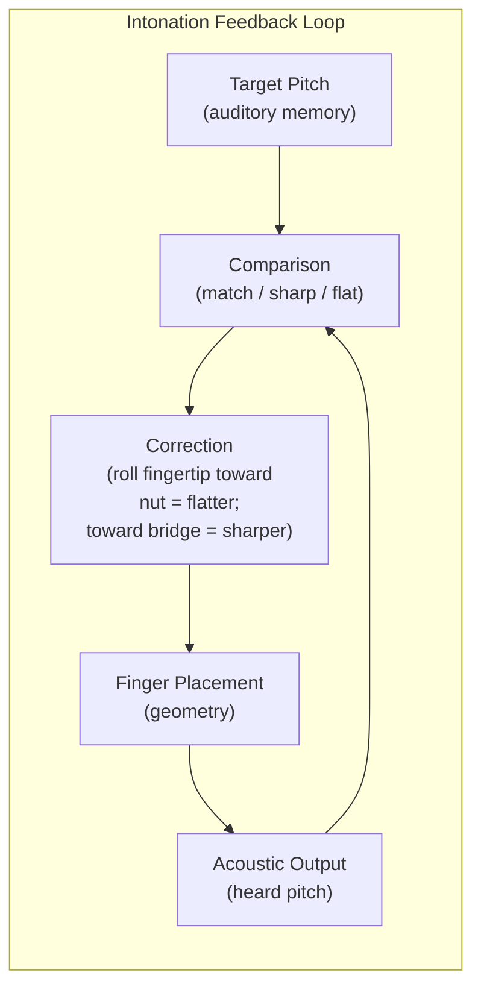
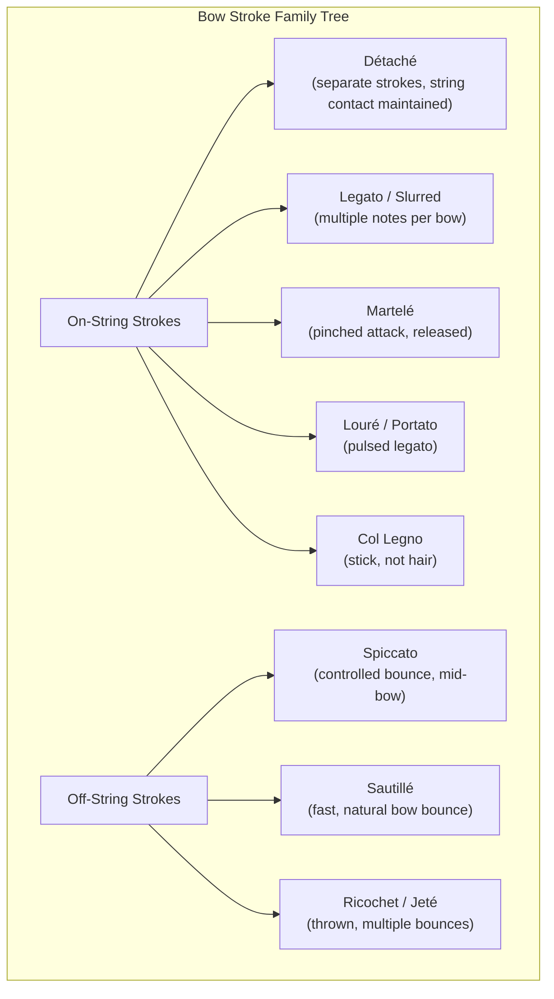
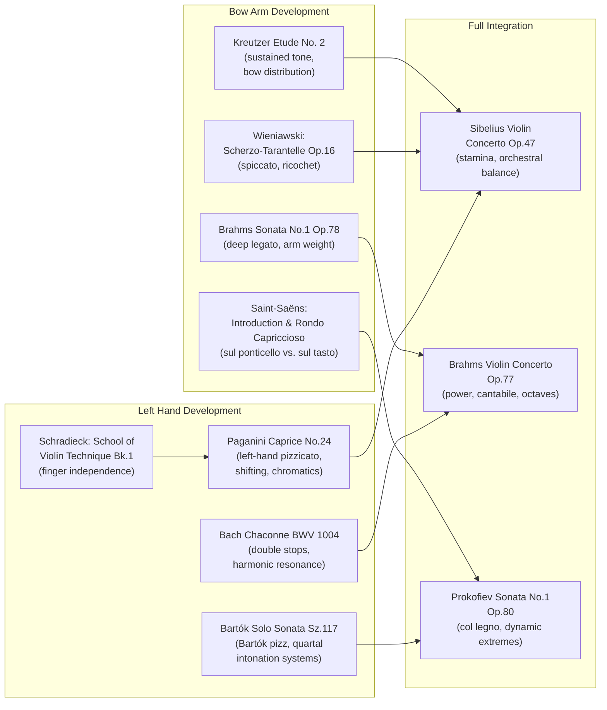
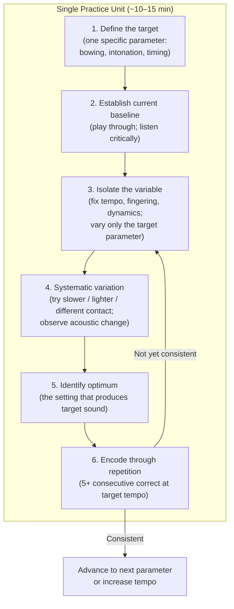
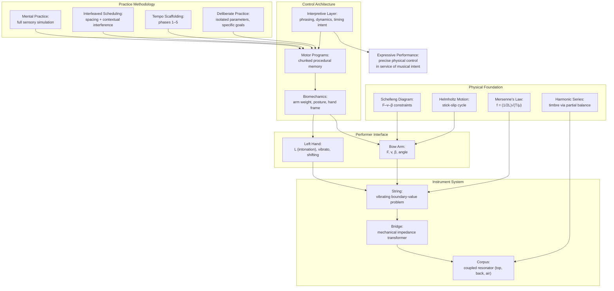

# Strings Masterclass: Performance, Technique, and Practice Architecture

---

## 1. First-Principles Acoustics (The 15% You Must Know)

The vibrating string obeys one governing relationship that every performer should internalize as physical intuition rather than formula. Mersenne's Law states that the fundamental frequency rises when you shorten the string, increase tension, or use a lighter-gauge string — and falls when you do the opposite. In practice: **L is your real-time control variable**. Every intonation problem is a geometry problem. A sharp note means your finger shortened the string too much. Correct it by rolling the fingertip slightly toward the nut, not by "thinking flatter."

The string does not vibrate as a single sine wave — it vibrates as a sum of all its integer harmonics simultaneously. Partial 7 sits 31 cents below the equal-tempered minor seventh. This is why a ringing open string can acoustically pull a chord slightly away from equal temperament, and why chamber players drift toward just intonation on sustained harmonies: the instrument's body actively rewards it with sympathetic resonance.

**Bow mechanics (Helmholtz Motion):** The bow does not saw the string back and forth sinusoidally. It drags the string forward (stick phase), then a traveling kink arrives at the contact point, drops the restoring force below kinetic friction, and the string snaps back (slip phase) — one complete cycle per fundamental period. Scratching means you exceeded the upper force boundary (too much pressure, too slow). Surface/flautando sound means you fell below the lower force boundary (too fast, too light). Both limits rise sharply as you move the contact point toward the bridge. This is the entire practical content of the Schelleng diagram:

```
Bow Force (F) ▲
              │  ░░ SCRATCH / CRUNCH ░░░░░░░░░░░
              │─ ─ ─ ─ ─ ─ upper limit (rises near bridge)
              │
              │      ██ HELMHOLTZ ZONE ██
              │      (clean, sustained tone)
              │
              │─ ─ ─ ─ ─ ─ lower limit (rises near bridge)
              │  ░░ SURFACE SOUND / FLAUTANDO ░░
              └───────────────────────────────► Bow Speed (v)

Sul ponticello: entire diagram shifts UP — demands more force AND more speed.
Sul tasto:      entire diagram shifts DOWN — tolerates lighter, faster bow.
```

---

## 2. Instrument Hold and Body Mechanics

Before touching bow to string, your physical setup determines what is mechanically possible. These are not stylistic preferences — they are biomechanical constraints.

### 2.1 Violin and Viola Hold

**Instrument angle:** The scroll sits slightly higher than the tailpiece — roughly 15–25° above horizontal. This lets gravity assist bow arm weight transfer on the lower strings (G and C) without requiring you to raise the elbow unnaturally.

**Left hand and thumb:**
- Thumb sits opposite the first finger, lightly touching the neck — not gripping. The neck rests in the notch between thumb and first finger, never pressing into the palm.
- The knuckle line (MCP joints) runs roughly parallel to the neck. Collapsing the first knuckle kills finger independence.
- In first position, the wrist sits slightly away from the neck on the bass side. As you ascend into third position and above, the wrist rotates under and the thumb migrates to a lighter, more forward position.

**Bow hold (Franco-Belgian, most common):**
- Thumb bent and contacting the stick at the junction of thumbnail and fingertip, opposite the middle finger.
- Index finger contacts the stick at the middle phalanx (not the fingertip) — this is the primary weight transfer point.
- Pinky sits curved on top of the stick near the tip, acting as a counterweight and pressure relief valve.
- The key test: a fully relaxed bow arm at the frog should feel heavy, not supported. You are transferring arm weight *into* the string, not pressing with the fingers.

**Shoulder rest and chin rest fit:** If you need to grip the instrument between chin and shoulder to free the left hand, your rest setup is wrong. The instrument should be stable without any active muscular holding in either arm.

### 2.2 Cello Hold

**Endpin angle and height:** Set the endpin so the lower bout of the cello rests against your sternum, the upper bout touches the left side of your chest, and the neck is to your left at roughly eye level. The C-peg sits near your left ear. If you have to reach significantly forward to contact the strings, the endpin is too short.

**Knee contact:** The right knee contacts the lower bout, the left knee the upper bout. This provides a stable three-point anchor (endpin + two knees) that allows both arms to move freely.

**Left hand — Simandl position (thumb-side of neck):** In the lower positions (thumb-side playing, roughly below the octave harmonic), the thumb sits behind the second finger on the back of the neck. Use the **1–2–4 fingering system** (Simandl): index (1), middle (2), and ring (4) cover three semitones. Never deploy the third finger independently in lower positions — it creates unnecessary tension. The pinky joins only in upper positions.

**Thumb position (above the octave harmonic and higher):** The thumb crosses over the neck and rests lightly on the string at the harmonic node, acting as a movable nut. All four fingers remain active. Practice thumb position entry separately before combining with passage work.

### 2.3 Double Bass Hold (Orchestral)

Simandl 1–2–4 applies throughout the lower positions with even greater importance due to the instrument's scale length. The standing position: endpin height set so the nut is roughly at forehead level. The instrument leans back toward you at approximately 30° from vertical. Right thumb anchors at the ferrule (frog) of the bow, not gripping — a common tension source in bass players is the right thumb pressing rather than balancing.

---

## 3. Left-Hand Technique: Intonation, Shifting, and Vibrato

### 3.1 Finger Placement Mechanics

The fingertip contacts the string on the **left side of the pad** (toward the scroll), not dead center. This keeps the left-hand knuckles arched and prevents the adjacent finger from touching the neighboring string. The contact point should be just behind the target pitch's fret position on a fretted instrument — on a fretless string instrument, this translates to a precise longitudinal position calibrated entirely by ear and proprioceptive memory.

**The intonation feedback cycle:**



This loop operates consciously at first; expert playing compresses it into a sub-50ms proprioceptive reflex. Slow practice keeps it conscious long enough to encode the correct geometry.

### 3.2 Position Map: Violin First Through Fifth Position

```
String:   G ─────────────────────────────────────────────────
          D ─────────────────────────────────────────────────
          A ─────────────────────────────────────────────────
          E ─────────────────────────────────────────────────

                1st     2nd     3rd     4th     5th
Finger 1:       B/F#    C/G     D/A     Eb/Bb   E/B
Finger 2:       C/G     D/A     E/B     F/C     F#/C#
Finger 3:       D/A     Eb/Bb   F/C     Gb/Db   G/D
Finger 4:       Eb/Bb   E/B     F#/C#   G/D     Ab/Eb
                (shown on G and D strings, natural key)

Half-position: Fingers sit one semitone lower than first position.
Used in Flesch scale system; avoids open-string avoidance in minor keys.
```

### 3.3 Shifting: The Mechanics of Clean Position Changes

Shifting is a whole-arm movement, not a finger slide. The arm guides the hand frame to the new position; the fingers do not drag independently.

**Shift taxonomy:**

| Shift Type | Mechanism | Sound Goal |
|---|---|---|
| **Guide-finger shift** | Connecting finger maintains light contact with string during travel | Smooth legato, nearly inaudible |
| **Portamento shift** | Guide finger maintains audible contact — expressive glide | Intentional expressive slide (Romantic style) |
| **Silent shift** | Finger releases contact before moving; lands silently | Clean, unmarked position change |

**Drill for clean guide-finger shifts (violin, 1st → 3rd position):**

1. Play D on the A string with finger 1 in first position.
2. Shift to finger 1 on E (third position) using a guide-finger connection — hear the lightest possible slide.
3. Land with the full finger weight and confirm intonation.
4. Practice at ♩ = 60 BPM, one shift per beat. Increase to 80 BPM once the landing pitch is reliable within ±10 cents.

**The anticipation principle:** The arm begins moving toward the new position *during the note preceding the shift*, not after. Waiting until the last possible moment creates a scrambled, lurching shift. Early arm movement is invisible to the audience and completely changes the quality of arrival.

### 3.4 Vibrato: Three Sources, One Goal

Vibrato is a frequency modulation — typically 5–7 Hz, ±20–50 cents — applied to a sustained pitch. The three mechanical sources:

**Arm vibrato:** The entire forearm oscillates from the elbow. Produces the slowest, widest vibrato (4–5 Hz, ±40–60 cents). Best for broad, operatic tone on slow, sustained notes. Risk: overshooting in fast passages.

**Wrist vibrato:** The wrist flexes and extends while the arm stays relatively stable. Mid-range speed and amplitude (5–6 Hz, ±25–40 cents). Most versatile; standard for most repertoire.

**Finger vibrato:** The finger rolls and unrolls on its pad while wrist and arm remain still. Fastest, narrowest (6–8 Hz, ±15–25 cents). Useful for intense, focused tone in high positions or fast-moving phrases.

**The perceptual center problem:** The ear hears vibrato pitch as the *upper* excursion, not the mean. If you center your vibrato exactly on the target pitch, the note sounds flat. The fix: begin the oscillation from slightly below the target, so the upper peak lands on pitch. This is trainable with a tuner — activate vibrato while watching the meter and confirm the upper peak hits the target note, not the center.

**Vibrato independence drill (all instruments):**

- Play a long open A drone with the bow.
- Independently, place finger 2 on the D string and practice arm vibrato with no bow.
- After 2 minutes, combine: bow the A string while maintaining vibrato on the silent D-string finger.
- This decouples vibrato production from bow articulation — a common coordination problem in developing players.

---

## 4. Bow Arm Technique: The Four Control Parameters

Every sound produced by a bowed string instrument is the product of four simultaneously controlled variables. Mastering tone production means understanding how these interact.

### 4.1 The Four Parameters and Their Musical Effects

| Parameter | Physical Range | Musical Effect | Common Error |
|---|---|---|---|
| **Bow speed (v)** | Frog to tip, slow to fast | Primary volume control | Stopping at tip without planning the return |
| **Bow force / weight (F)** | Featherlight → full arm weight | Tone density; must scale with v | Pressing with fingers instead of using arm weight |
| **Contact point (β = distance from bridge)** | Sul ponticello → sul tasto | Timbre: glassy/nasal → warm/fluty | Drifting contact point mid-phrase |
| **Bow angle (tilt)** | Full hair → tilted (fewer hairs) | Tone softness; articulation character | Pronating too far, losing bow control |

The critical coupling: **F and v must scale together** to stay in the Helmholtz zone. When you want a louder sound, increase both — not just one. A common beginner error is pushing harder while keeping bow speed constant, which shoots above the Schelleng upper limit and produces scratching.

### 4.2 Bow Distribution Exercises

**Whole-bow long tones (Kreutzer No. 2 framework):**

Tempo: ♩ = 60. Time signature: 4/4. One whole bow per note.

```
Exercise 1 — Even Distribution:
Bar 1: Open G, down bow, frog → tip, 4 beats
Bar 2: Open G, up bow, tip → frog, 4 beats
Listen: Is the volume even from frog to tip?
Most players have a natural crescendo on down bow and decrescendo approaching the tip.
Correction: Consciously lighten arm weight at frog, increase speed at tip.

Exercise 2 — Halves:
Divide the bow at the balance point (roughly 55% from frog).
Practice frog-half only (2 beats down, 2 beats up) for 4 repetitions.
Practice tip-half only for 4 repetitions.
Combine into full bow. The even distribution now has a physical reference.

Exercise 3 — Intentional Gradient:
Practice a deliberate bow crescendo (pp at frog → ff at tip) on a single down bow.
Then a deliberate bow decrescendo (ff at frog → pp at tip).
This trains conscious dynamic shaping within a single stroke — essential for phrasing.
```

### 4.3 Bow Stroke Taxonomy



**Spiccato development drill:**

Spiccato is not taught by trying to bounce the bow — it is found by locating the bow's natural balance point.

1. Hold the bow at the balance point (around 55–60% from frog). Let it hang loosely.
2. Play slow détaché at ♩ = 60 on an open string, mid-bow, with minimal arm movement.
3. Gradually increase tempo to ♩ = 80. The bow will begin to lift naturally between strokes. Do not force it — allow it.
4. At ♩ = 100–120, the natural bounce becomes spiccato. Control the arc height by adjusting finger flexibility, not wrist height.
5. Once found, practice transferring the spiccato to a D major scale, one bow per note.

---

## 5. Double Stops: Intonation and Voice Leading

### 5.1 Why Double Stops Are Acoustically Rewarding (and Demanding)

When two strings vibrate simultaneously, their combined waveform contains **difference tones** — phantom low frequencies at |f₂ − f₁| — and **sum tones** at f₁ + f₂. When the interval is a just-intonation ratio (3:2 for a fifth, 5:4 for a major third, 4:3 for a fourth), the difference tones are low-frequency coincidences with the harmonic series, and the instrument body resonates sympathetically. You hear this as the instrument "opening up" or "ringing." Training double stop intonation means learning to hear and target this resonance, not merely to avoid beats.

**Practical intervals and their just vs. equal temperament offsets:**

| Interval | Just Ratio | ET Offset | Resonance Cue |
|---|---|---|---|
| Perfect Fifth | 3:2 | 0 ¢ | Strongest ring; difference tone is an octave below lower string |
| Perfect Fourth | 4:3 | 0 ¢ | Solid ring; slightly narrower than fifth |
| Major Third | 5:4 | −14 ¢ (just is narrower than ET) | Needs to be tuned noticeably narrow of ET to ring |
| Minor Third | 6:5 | +16 ¢ (just is wider than ET) | Needs to be tuned noticeably wide of ET to ring |
| Major Sixth | 5:3 | −16 ¢ | Tune narrow; companion to major third |
| Minor Sixth | 8:5 | +14 ¢ | Tune wide; companion to minor third |

The practical takeaway: **major thirds and sixths in double stops must be tuned noticeably narrower than your equal-tempered ear expects**. This surprises most students trained on piano.

### 5.2 Double Stop Fingering Patterns (Violin, First Position)

```
Thirds on E and A strings:
   E: ──F──G──A──B──C──D──E──
   A: ──D──E──F──G──A──B──C──
Finger pairs: 1+1 (unison offset) → use 1&2, 1&3, 2&4, 1&4

Standard first-position third fingerings (D major scale in thirds):
   Low note (A str) | High note (E str) | Left hand fingering
   ─────────────────────────────────────────────────────────
   D (open)         | F#                | 0 & 2
   E (1)            | G                 | 1 & 3  ← most common
   F# (2)           | A (open)          | 2 & 0
   G (3)            | B                 | 3 & 1 (extension)
   A (open)         | C#                | 0 & 2
   B (1)            | D (1)             | 1 & 1 (unison offset)

Octaves (most demanding):
   Always finger 1 (lower) and 4 (upper) — never 1&3.
   The hand frame must be calibrated: if the octave is flat, stretch finger 4 back;
   if sharp, bring finger 1 forward. Never move both simultaneously while diagnosing.
```

### 5.3 Bow Management in Double Stops

Playing two strings simultaneously requires the bow to sit in the **channel between the two strings** at a consistent angle. The arm level sets which pair of strings is engaged:

```
String level and approximate elbow height (violin, right arm):

G string:   Elbow highest (~hip level), bow tilted toward scroll
D string:   Elbow mid-high
A string:   Elbow mid
E string:   Elbow lowest

G+D double stop: arm level bisects G and D levels
D+A double stop: arm level bisects D and A levels
A+E double stop: arm level bisects A and E levels
```

A common fault is a fluctuating arm level during double stop passages, causing the bow to favor one string over the other inconsistently. Fix: practice the double stop *without the left hand* (open strings only) and focus entirely on maintaining a stable arm level and straight bow track.

---

## 6. Scale and Arpeggio Systems

### 6.1 The Flesch Scale System (Violin/Viola)

Carl Flesch's *Scale System* covers every major and minor key in three octaves, one octave, and two-octave patterns, plus double stops in thirds, sixths, octaves, and fingered octaves. The logic is exhaustive coverage of every technical sub-problem the left hand encounters.

**Three-octave G major scale fingering (violin):**

```
String: G  ──────────────────────
        D  ──────────────────────
        A  ──────────────────────
        E  ──────────────────────

Position map:
G string:   G(0)  A(1)  B(2)  C(3)  D(4)       [1st position]
D string:   D(0)  E(1)  F#(2) G(3)              [1st position → shift]
A string:   [shift to 2nd] A(0) B(1) C#(2) D(3) [shift to 3rd] E(1) F#(2) G(3)
E string:   [shift to 5th] G(1) A(2) B(3) ─ G(4)[optional high G on E]

Bow: 2 notes per bow at ♩ = 60; 4 per bow at ♩ = 80; 8 per bow (smooth) at ♩ = 100.
```

**The 7-step scale practice sequence (apply to any key):**

1. **Whole bows, one note per bow** — focus entirely on tone production and intonation. Metronome OFF.
2. **Slurred in 2s** — ♩ = 60, 4 beats per bar, 2 notes per slur. Focus: clean bow changes.
3. **Slurred in 4s** — ♩ = 70. Focus: even finger timing across the slur.
4. **Slurred in 8s** — ♩ = 80. Focus: clean string crossings within the slur.
5. **Martelé, separate bows** — ♩ = 76. Focus: clean attack on every note.
6. **Spiccato** — ♩ = 100–120. Focus: even bounce height across string crossings.
7. **Full tempo, musical** — ♩ = 120+. No separate focus; integrated execution.

### 6.2 Cello Scale Fingering Logic (Simandl System)

In lower positions (C–G on the C string through roughly third position), the 1–2–4 framework means each hand position covers three semitones. A three-octave C major scale on cello requires **five position shifts** minimum:

```
C major scale, 3 octaves (C2 → C5), cello:

String  | Notes          | Fingers | Position
─────────────────────────────────────────────
C str   | C–D–E–F        | 0–1–2–4 | 1st pos
G str   | G–A–B–C        | 0–1–2–4 | 1st pos (open G)
D str   | D–E–F          | 1–2–4   | 1st pos
        | G–A–B–C        | ─shift─ | 4th pos: 1–2–4–(thumb)
A str   | D–E–F–G–A–B–C  | thumb pos, all 4 fingers active

Thumb position entry note: When the thumb crosses onto the string
(typically around G on the D string or A on the A string), practice
the thumb placement as a separate drill before integrating into scale.
```

---

## 7. Repertoire as a Technical Curriculum

### 7.1 Mapping Repertoire to Technical Parameters

Repertoire selection is a pedagogical decision. Each major work develops a specific subset of the technical parameter space. The following map shows the primary technical demand of cornerstone works:



### 7.2 Case Study: Bach Chaconne, BWV 1004

The Chaconne from Partita No. 2 in D minor is not a showpiece — it is a systematic exploration of what a solo violin can do acoustically in its home key. D minor is acoustically privileged on the violin: open D and A strings participate as sympathetic resonators in the cadential harmonies, adding a natural reverb that disappears when the work is transposed.

**Four specific technical demands and how to practice them:**

**1. Four-voice polyphony via arpeggiation (mm. 1–8):**

The ear groups rapidly arpeggiated notes into perceived simultaneous voices (auditory stream integration). The performer's task is to ensure the *top voice* receives slightly more bow contact and therefore more apparent sustain. Practice: play the four-note chords *without arpeggiation* (all four strings simultaneously, using full bow hair) to hear the harmonic content. Then re-arpeggiate, now consciously favoring the highest note's bow dwell time.

**2. Harmonic resonance in double stops (D major middle section):**

The D major section's double stops should ring with just-intonation sonority. Practice the third and sixth double stops using the resonance-centering approach from Section 5.1: tune major thirds 14 cents narrow of ET, listen for the difference tone to settle, then memorize the proprioceptive sensation of that narrower interval.

**3. Chordal texture vs. single-line contrast:**

The work alternates between dense chordal writing and single-line melody. The bow arm must switch between a broad, channel-centered grip (double/triple stops) and a focused single-string contact without audible fumbling. Practice the transition bars in isolation: last chord of a section → first note of the melodic line. 20 repetitions, ♩ = 50.

**4. Memory and harmonic architecture:**

The Chaconne's 64-bar ground bass pattern repeats throughout. Memorize the harmonic skeleton (I–VI–III–VII–v–III–iv–V in D minor) first, as pure functional harmony, before memorizing the notes. This harmonic memory provides a redundant recovery pathway under performance stress.

### 7.3 Case Study: Paganini Caprice No. 24 in A Minor

The 24th Caprice systematically maps the left hand's technical parameter space. Each variation isolates a different coordination challenge:

| Variation | Technical Challenge | Practice Strategy |
|---|---|---|
| Theme | Clean articulation, A minor scale fluency | Chromatic scale drill, 1 oct, all bowings |
| Var. 1 | String crossing at speed (8th-note arpeggios) | Isolate string pairs; arm level stability |
| Var. 2 | Left-hand octaves, rapid displacement | Octave scale drill, 1st → 5th position |
| Var. 6 | Left-hand pizzicato while bow sustains melody | Separate hands; then recombine at ♩ = 50 |
| Var. 9 | Chromatic scale at extreme tempo | Finger independence: lift exercise before playing |
| Var. 11 | Rapid shifts, high-position intonation | Isolate each shift; guide-finger drill |

**Left-hand pizzicato isolation drill (Var. 6):**

1. Bow the top note (A) on the E string as a whole note. Sustain continuously.
2. Pluck the A string with the third or fourth finger of the left hand, maintaining firm bow contact on E.
3. The plucked note will be faint at first — increase the snap of the left-hand finger.
4. Add the bow melody one note at a time, stopping after each note to confirm the pizzicato is still happening.
5. Never rush to full tempo. ♩ = 60 clean is worth more than ♩ = 120 approximate.

---

## 8. Advanced Bow Techniques: Physical Mechanics

### 8.1 Martelé

Martelé requires a **pinch-and-release** mechanism, not a press-drag.

1. Place the bow on the string with enough lateral pressure to slightly depress the hair into the string.
2. Release the pressure explosively while moving the bow — the pressure release produces the sharp, clean attack.
3. Stop the bow completely at the end of each stroke before beginning the next pinch.

Metronome targets: Begin at ♩ = 60 (one stroke per beat), advance to ♩ = 100 when each stroke produces a clean, identical attack. If attacks are uneven, the pinch pressure is inconsistent — isolate at ♩ = 50 and consciously equalize.

### 8.2 Sautillé vs. Spiccato

These are often confused but are mechanically distinct:

| Stroke | Bow Location | Control Mechanism | Tempo Range |
|---|---|---|---|
| **Spiccato** | Upper-middle (55–65% from frog) | Controlled drop and lift; arm guides arc height | ♩ = 80–120 |
| **Sautillé** | Balance point (45–55% from frog) | Natural bow elasticity; player controls amplitude only | ♩ = 120–160+ |

Sautillé cannot be learned by trying to bounce — it emerges from fast détaché played at the balance point. If the bow does not bounce naturally at high speed, move the contact point toward the frog until it does.

### 8.3 Ricochet and Jeté

Ricochet: throw the bow onto the string from above with a controlled arm drop. The number of bounces is determined by throw height and landing speed. Practice:

1. At rest, hold the bow 15 cm above the A string at the upper third.
2. Drop the bow (do not throw laterally) — count the number of bounces.
3. Add a down-bow arm movement concurrent with the drop: the lateral motion rides the bounces.
4. Adjust throw height to control bounce count (3, 4, 5, or 6 notes per throw).

---

## 9. Practice Architecture: From Session Design to Motor Encoding

### 9.1 The Practice Session as a Control Experiment

Each productive practice unit follows an experimental structure:



This is Carl Flesch's principle of "practicing faults one at a time" made operationally explicit. The common failure mode is varying two parameters simultaneously (tempo *and* bow technique) and being unable to identify the cause of an improvement or regression.

### 9.2 Tempo Scaffolding Protocol

The standard "practice slowly" advice is correct but incomplete. Slow and fast movements are qualitatively different motor programs. At performance tempo, rapid passages are **ballistic** — pre-planned, executed open-loop without real-time sensory correction. Slow practice builds the **feedback-controlled** version of a movement. Both are required, and they must be explicitly connected.

```
Tempo Scaffolding Protocol (% of target performance tempo):

Phase 1 — Structural Encoding     40–50 %
  Goal: Every note, bow change, and shift is conscious and correct.
  Motor mode: Feedback-controlled (slow enough for proprioceptive loop)
  Advance criterion: 5 consecutive error-free repetitions

Phase 2 — Pattern Consolidation   60–70 %
  Goal: Chunking begins — sub-phrases feel like single units
  Motor mode: Beginning to transition to feedforward
  Advance criterion: 5 consecutive error-free; no conscious note-by-note attention

Phase 3 — Transition Zone         75–85 %
  Goal: Mix of feedback and feedforward; errors appear here — this is productive
  Motor mode: Mixed; this is the most important zone for improvement
  Advance criterion: 5 consecutive error-free

Phase 4 — Performance Encoding    90–100 %
  Goal: Ballistic execution; musical intention drives physical output
  Motor mode: Feedforward (pre-planned)
  Advance criterion: 10 consecutive error-free with musical expression

Phase 5 — Overspeed Training      105–110 %
  Goal: Expand performance margin; performance tempo feels comfortable
  Motor mode: Fully ballistic
  Note: Never overspeed with errors present — only after Phase 4 is clean

Do not skip phases. Phase 3 is where most students stall because
errors feel discouraging. They are the target, not the problem.
```

### 9.3 Interleaved vs. Blocked Practice

**Blocked practice:** Work on Passage A completely, then Passage B completely, then Passage C completely. Feels productive; produces lower long-term retention.

**Interleaved practice:** Work on A, then B, then C, then A again, then C, then B. Feels harder; produces significantly superior retention and transfer (Shea & Morgan, 1979 — a well-replicated finding in motor learning research).

Practical implementation: divide the week's repertoire into 4–6 short target passages. Never work on the same passage in two consecutive blocks within a session. The sense of re-learning a passage on each return visit is exactly the mechanism that drives consolidation.

### 9.4 Weekly Practice Architecture

```mermaid
gantt
    title Weekly Practice Schedule (60 min/day)
    dateFormat HH:mm
    axisFormat %H:%M

    section Day 1 — Acquisition
    Warm-up: scales, long tones     :a1, 00:00, 10m
    New material — Phase 1 and 2    :a2, after a1, 25m
    Repertoire maintenance          :a3, after a2, 20m
    Mental practice                 :a4, after a3, 5m

    section Day 2 — Consolidation
    Warm-up                         :b1, 00:00, 10m
    Previous material — Phase 3     :b2, after b1, 20m
    New material — Phase 2 and 3    :b3, after b2, 20m
    Performance run-throughs        :b4, after b3, 10m

    section Day 3 — Integration
    Warm-up                         :c1, 00:00, 10m
    Targeted technical drill        :c2, after c1, 15m
    Full passage integration        :c3, after c2, 25m
    Expressive detail and dynamics  :c4, after c3, 10m

    section Day 4 — Rest + Mental
    Score study and analysis        :d1, 00:00, 20m
    Mental practice only            :d2, after d1, 20m

    section Day 5 — Acquisition
    Warm-up                         :e1, 00:00, 10m
    New material — Phases 1 to 3    :e2, after e1, 30m
    Interleaved review              :e3, after e2, 20m

    section Day 6 — Performance Prep
    Warm-up                         :f1, 00:00, 10m
    Phases 4 and 5 on ready pieces  :f2, after f1, 25m
    Mock performance run-through    :f3, after f2, 25m

    section Day 7 — Rest
    Full rest                       :g1, 00:00, 60m
```

### 9.5 Mental Practice Protocol

Mental practice activates overlapping motor cortex circuitry to physical execution and produces measurable retention gains when combined with physical practice. For string players, effective mental rehearsal requires:

**Full sensory simulation** — not just hearing the notes, but feeling the bow weight on the string, the resistance of the string under the fingertip, and the kinesthetic trajectory of a shift. If you cannot feel the shift in mental practice, your mental practice is underpowered.

**Score-independent simulation** — rehearse from memory using the same retrieval pathway as performance. If you need to open the score to continue the mental rehearsal, that is a memory gap that physical practice cannot fix until the gap is first identified mentally.

**Error and recovery simulation** — deliberately imagine a memory slip at a known weak point, then mentally execute the recovery. Recovery strategies (structural landmarks to jump to, harmonic re-entry points) must be practiced as motor programs, not improvised under pressure.

**Minimum effective dose:** 10 minutes of genuine full-attention mental practice per day produces measurable improvement. Distracted mental practice (score in hand, music playing in background) does not activate the target circuits.

### 9.6 Sleep and Motor Consolidation

Motor memory consolidation occurs preferentially during slow-wave sleep (SWS) and REM sleep. The practical implication: a passage that feels unreliable at the end of a practice session and then feels more secure the next morning is not coincidence — offline consolidation is happening. This means:

- End each practice session with 5 clean repetitions of target passages, not exhausted ones. The last physical repetition is what the consolidation process works from.
- Prioritize sleep duration in the days before a performance, not only practice time.
- A 60-minute daily session will consolidate better than a 7-hour weekly block even if total hours are equal.

---

## 10. Extended Techniques: Physical Basis and Execution

### 10.1 Natural and Artificial Harmonics

**Natural harmonics** are produced by touching the string lightly at a node — a rational fraction of the string's length — without fully depressing it to the fingerboard. The touch suppresses all partials with an antinode at that location, leaving only the modes with a node there.

| Touch Point | Fraction of L | Resulting Partial | Interval Above Open String |
|---|---|---|---|
| Midpoint | L/2 | 2nd partial | Octave |
| 1/3 from nut | L/3 | 3rd partial | Octave + fifth |
| 1/4 from nut | L/4 | 4th partial | Two octaves |
| 1/5 from nut | L/5 | 5th partial | Two octaves + major third |

**Touch pressure:** A common fault is pressing the harmonic touch point too firmly, which reintroduces the fundamental. The touch must be a feather contact — enough to feel the string, not enough to change its vibrating length.

**Artificial harmonics** use the left hand to establish a new nut position (fully stopped note) while a lightly placed second finger creates the node. Standard artificial harmonic: stop a note with finger 1, touch the string a perfect fourth higher with finger 4 (lightly). This produces a sound two octaves above the stopped note. The sounding pitch is predictable and usable as a melody note.

```
Artificial harmonic interval map (violin):

Stopped note (finger 1) + Touch interval → Sounding pitch

P4 above stopped note (finger 4 lightly) → 2 octaves above stopped note
P5 above stopped note (finger 4 lightly) → 1 octave + P5 above stopped note
Major 3rd above (finger 3 lightly)       → 2 octaves + M3 above stopped note

Most common in repertoire: P4 touch, producing high, glassy harmonics
(Ravel, Bartók, Paganini).
```

### 10.2 Sul Ponticello and Sul Tasto

Both techniques are physically defined by the contact point ratio β = (distance from bridge) / L:

**Sul ponticello** (very close to bridge, β → 0): The string's transverse displacement at the contact point is minimal, requiring much higher bow force to maintain Helmholtz motion. Upper partials dominate the sound. The tone is glassy, nasal, and intense. At the extreme (*molto sul ponticello*), Helmholtz motion breaks down and the tone becomes noisy and inharmonic.

**Sul tasto** (over the fingerboard, β → 0.5): The even-numbered modes have a node at the midpoint and are suppressed. The fundamental and low odd partials dominate. The tone is warm, flute-like, and without edge.

**Transition drill:**

Using an open D string, begin with ordinary contact point (roughly β = 0.12–0.15, about 3–4 cm from bridge). Maintain a constant bow speed and arm weight while slowly translating the contact point toward the fingerboard. Listen to the continuous timbral shift. Identify by ear the positions corresponding to: (1) maximum brightness, (2) balanced orchestral tone, (3) maximum warmth. Mark these positions visually on the bow arm by noting which finger division of the bow hair crosses which visual reference point on the instrument. This proprioceptive map is the foundation of conscious tonal control.

### 10.3 Col Legno

Striking or bowing with the stick (wood side) rather than the hair changes the friction coefficient from the high-friction organic keratin of the bow hair to the low-friction lacquered wood. Helmholtz motion typically cannot be sustained. The result is a percussive attack followed by inharmonic, noisy decay — used orchestrally for effect (Berlioz's *Symphonie Fantastique*, Holst's *The Planets*). Performance note: many soloists use older or secondary bows for col legno passages due to lacquer wear. If using a fine bow, negotiate with the conductor.

### 10.4 Bartók Pizzicato

The string is plucked vertically (upward from the fingerboard) with enough force that it snaps back against the wood, producing a characteristic crack. The index finger hooks under the string and pulls it upward at approximately 90° from the string plane. Contact is made with the pad, not the nail. The snap height determines the volume: a full-force Bartók pizzicato on a cello in a dry acoustic can be heard over an orchestra tutti.

---

## 11. Integrative Framework



String performance is a continuously solved multi-variable control problem. The bow arm maintains Helmholtz motion. The left hand controls intonation and vibrato. The interpretive layer translates musical structure into physical parameter targets at both interfaces. Practice methodologies reduce the cognitive load of this problem by compiling frequently required control sequences into procedural memory, leaving conscious attention free to operate at the interpretive level.

Mastery is not the accumulation of techniques. It is the progressive reduction of the instrument from a system requiring conscious management into a transparent medium for musical thought.

---

## References and Further Study

**Acoustics and Instrument Physics**
- Helmholtz, H. (1863). *On the Sensations of Tone*. Dover reprint, 1954.
- Schelleng, J.C. (1973). "The bowed string and the player." *Journal of the Acoustical Society of America*, 53(1), 26–41.
- Fletcher, N.H. & Rossing, T.D. (1998). *The Physics of Musical Instruments* (2nd ed.). Springer.
- McIntyre, M.E., Schumacher, R.T., & Woodhouse, J. (1983). "On the oscillations of musical instruments." *JASA*, 74(5), 1325–1345.

**Motor Learning and Practice Science**
- Ericsson, K.A. & Pool, R. (2016). *Peak: Secrets from the New Science of Expertise*. Houghton Mifflin Harcourt.
- Schmidt, R.A. & Lee, T.D. (2019). *Motor Learning and Performance* (6th ed.). Human Kinetics.
- Shea, J.B. & Morgan, R.L. (1979). "Contextual interference effects on the acquisition, retention, and transfer of a motor skill." *Journal of Experimental Psychology: Human Learning and Memory*, 5(2), 179–187.
- Walker, M.P. et al. (2002). "Practice with sleep makes perfect." *Neuron*, 35(1), 205–211.

**Pedagogy**
- Flesch, C. (1923). *The Art of Violin Playing* (2 vols.). Carl Fischer.
- Galamian, I. (1962). *Principles of Violin Playing and Teaching*. Prentice-Hall.
- Rolland, P. (1974). *The Teaching of Action in String Playing*. Illinois String Research Associates.
- Simandl, F. (1904). *New Method for the Double Bass*. Carl Fischer.

**Repertoire and Analysis**
- Lester, J. (1999). *Bach's Works for Solo Violin: Style, Structure, Performance*. Oxford University Press.
- Stowell, R. (1990). *Violin Technique and Performance Practice in the Late Eighteenth and Early Nineteenth Centuries*. Cambridge University Press.
