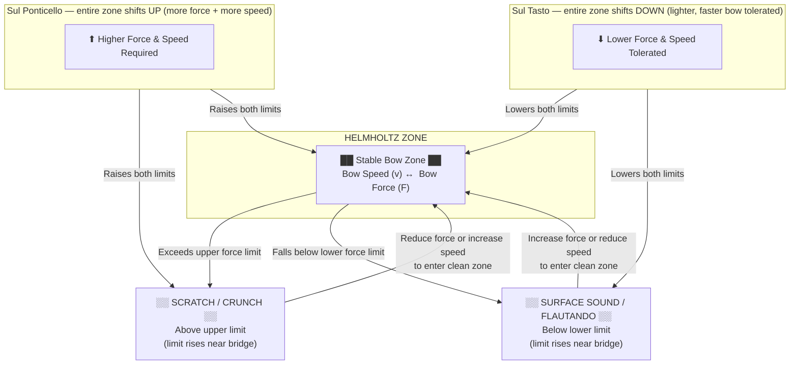
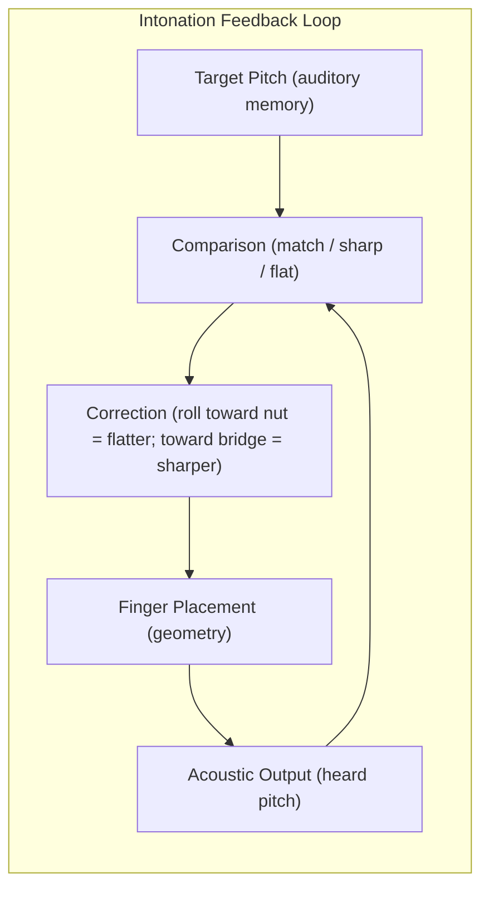
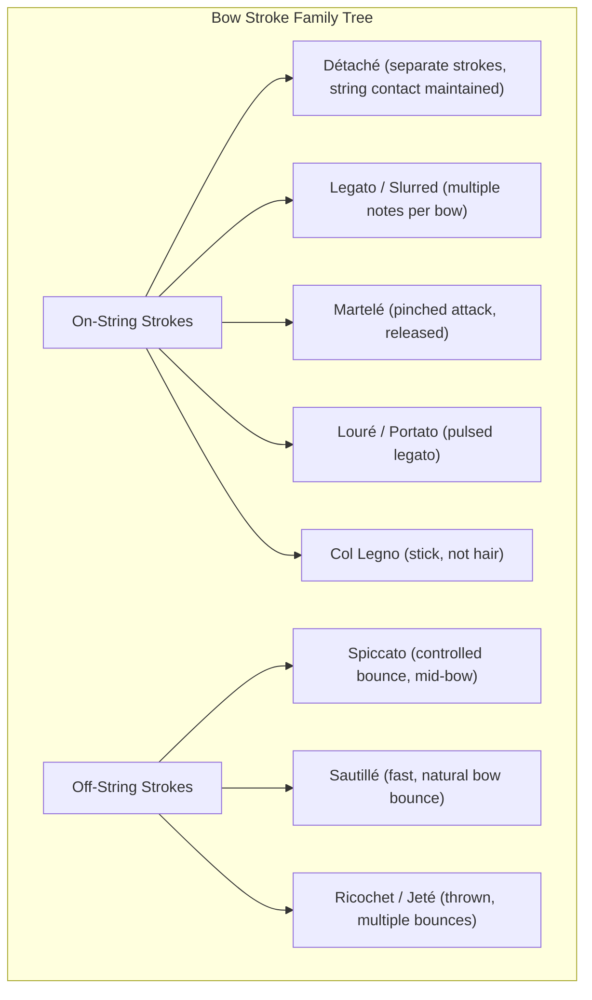
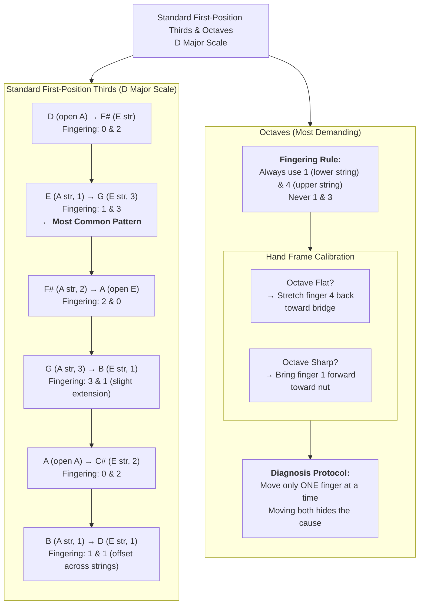
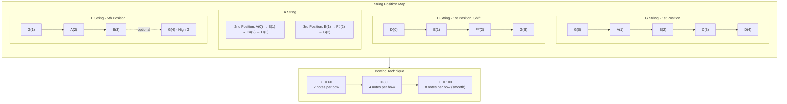
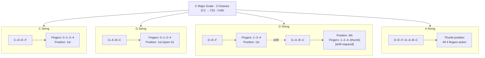
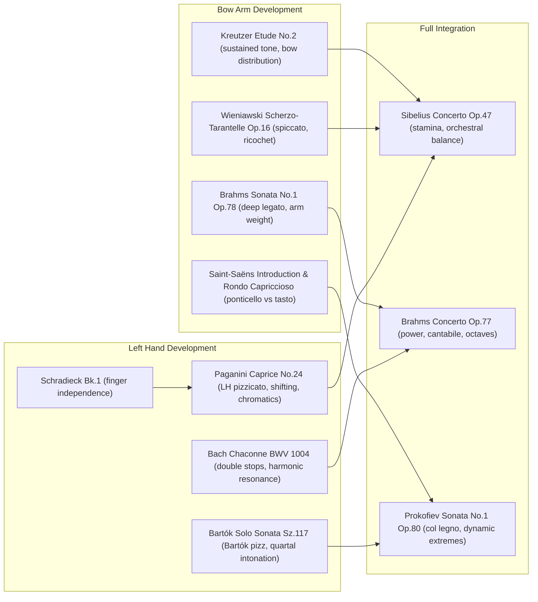
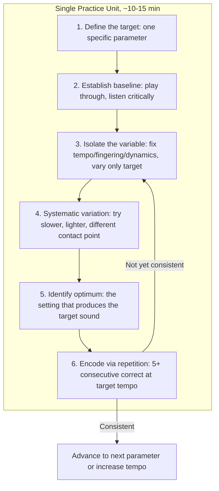
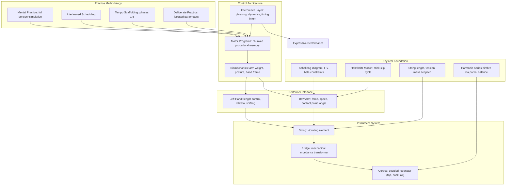

# Strings Masterclass: Performance, Technique, and Practice Architecture

---

## 1. First-Principles Acoustics (The 15% You Must Know)

A vibrating string's pitch depends on three things: length, tension, and mass per unit length. Shorten it, tighten it, or make it lighter, and the pitch rises. In practice, **length is your real-time control variable** — tension and mass are fixed by the instrument and strings you're holding. Every intonation problem is a geometry problem. A sharp note means your finger shortened the string too much; fix it by rolling the fingertip slightly toward the nut, not by "thinking flatter."

The string vibrates as a stack of harmonics, not a single pure tone. Partial 7 in that stack sits about 31 cents below the equal-tempered minor seventh. This is why a ringing open string pulls a chord slightly away from equal temperament, and why ensemble players drift toward just intonation on sustained harmonies — the instrument body rewards it with sympathetic resonance you can physically feel in the chinrest or the top plate.

**Bow mechanics (Helmholtz motion):** The bow doesn't saw the string sinusoidally. It drags the string forward (stick phase) until a kink traveling along the string arrives back at the contact point and the string slips free, snapping back (slip phase) — one full cycle per fundamental period, repeating hundreds of times a second. Scratching means you exceeded the upper force boundary (too much pressure, too slow a bow). Surface/flautando sound means you fell below the lower boundary (too fast, too light). Both limits rise sharply as the contact point moves toward the bridge:



**What this means at the stand:** if a passage scratches when you play loud and fast near the bridge, you're not using *too much* bow — you likely need *more* speed relative to force, or you need to move the contact point slightly away from the bridge to buy headroom.

---

## 2. Instrument Hold and Body Mechanics

Your setup determines what's mechanically possible before the bow ever touches the string. These are biomechanical constraints, not stylistic options.

### 2.1 Violin and Viola Hold

**Instrument angle:** Scroll sits roughly 15–25° above horizontal. This lets gravity assist bow-arm weight transfer on the lower strings (G, C) without forcing the elbow up unnaturally.

**Left hand and thumb:**
- Thumb sits opposite the first finger, lightly touching the neck — not gripping. The neck rests in the notch between thumb and first finger, never pressed into the palm.
- The knuckle line (MCP joints) runs roughly parallel to the neck. Collapsing the first knuckle kills finger independence — check in a mirror that your fingers arch like they're holding a small ball.
- In first position the wrist sits slightly away from the neck on the bass side. Ascending into third position and above, the wrist rotates under and the thumb migrates to a lighter, more forward position near the base of the neck.

**Bow hold (Franco-Belgian, most common):**
- Thumb bent, contacting the stick at the junction of thumbnail and fingertip, opposite the middle finger.
- Index finger contacts the stick at the middle phalanx (not the fingertip) — this is the primary weight-transfer point into the string.
- Pinky curves on top of the stick near the tip, acting as counterweight and pressure relief.
- **Key test:** let the bow arm go fully heavy at the frog. It should feel like dead weight hanging off the string, not something you're actively supporting. You transfer arm weight *into* the string — you don't press with fingers.

**Shoulder rest and chin rest fit:** If you need to clamp the instrument between chin and shoulder to free the left hand, your rest setup is wrong. Test: play a scale, then completely relax your jaw and neck for one note. The violin should not drop.

### 2.2 Cello Hold

**Endpin angle and height:** Set the endpin so the lower bout rests against your sternum, the upper bout touches the left side of your chest, and the neck sits to your left at roughly eye level. The C-peg sits near your left ear. If you're reaching forward to contact the strings, the endpin is too short — lengthen it until your left arm hangs from a relaxed shoulder.

**Knee contact:** Right knee contacts the lower bout, left knee the upper bout. Endpin plus two knees gives a stable three-point anchor so both arms move freely without the instrument shifting.

**Left hand — Simandl position (below the octave harmonic):** Thumb sits behind the second finger, on the back of the neck. Use the **1–2–4 fingering system**: index (1), middle (2), ring (4) cover three semitones. Never deploy the third finger independently here — it creates tension without adding reach. Pinky joins only in upper positions.

**Thumb position (above the octave harmonic):** The thumb crosses over the neck and rests lightly on the string at the harmonic node, acting as a movable nut. All four fingers stay active. Drill thumb placement in isolation — long tones with just the thumb resting and releasing — before combining with passage work.

### 2.3 Double Bass Hold (Orchestral)

Simandl 1–2–4 applies throughout the lower positions, with even greater importance given the scale length. Standing position: set endpin height so the nut sits roughly at forehead level. The instrument leans back toward you at approximately 30° from vertical. Right thumb anchors at the frog, balancing rather than gripping — thumb pressure is the single most common tension source in bass players, and it shows up as a locked, immovable bow arm.

---

## 3. Left-Hand Technique: Intonation, Shifting, and Vibrato

### 3.1 Finger Placement Mechanics

The fingertip contacts the string on the **left side of the pad** (toward the scroll), not dead center. This keeps the knuckles arched and prevents the adjacent finger from brushing the neighboring string. On a fretless instrument, the contact point is a precise longitudinal position calibrated entirely by ear and muscle memory — there is no visual fret to check against, so every note is a small aiming act.

**The intonation feedback cycle:**



This loop runs consciously at first; expert playing compresses it into a sub-50ms proprioceptive reflex. Slow practice keeps it conscious long enough to encode the correct finger geometry — this is why rushing early practice produces permanently approximate intonation.

### 3.2 Position Map: Violin First Through Fifth Position

```
                1st     2nd     3rd     4th     5th
Finger 1:       B/F#    C/G     D/A     Eb/Bb   E/B
Finger 2:       C/G     D/A     E/B     F/C     F#/C#
Finger 3:       D/A     Eb/Bb   F/C     Gb/Db   G/D
Finger 4:       Eb/Bb   E/B     F#/C#   G/D     Ab/Eb
                (shown on G and D strings, natural-finger spacing)

Half-position: fingers sit one semitone lower than first position.
Used in the Flesch scale system; avoids awkward open-string
avoidance patterns in minor keys.
```

**Drill — position recognition without looking:** Close your eyes. Have a partner (or a recording) call out "third position, finger 2, D string." Place the finger, then check pitch with a tuner or drone. 10 random calls per session, tracking hit rate. This builds the geometric map independent of visual confirmation, which is what you need under stage lights or in an orchestra pit.

### 3.3 Shifting: The Mechanics of Clean Position Changes

Shifting is a whole-arm movement, not a finger slide. The upper arm and elbow guide the hand frame to the new position; the fingers ride along, they don't drag independently.

**Shift taxonomy:**

| Shift Type | Mechanism | Sound Goal |
|---|---|---|
| **Guide-finger shift** | Connecting finger keeps light contact with string during travel | Smooth legato, nearly inaudible |
| **Portamento shift** | Guide finger keeps audible contact — expressive glide | Intentional expressive slide (Romantic style) |
| **Silent shift** | Finger releases before moving; lands silently | Clean, unmarked position change |

**Drill for clean guide-finger shifts (violin, 1st → 3rd position):**

1. Play D on the A string with finger 1 in first position.
2. Shift to finger 1 on E (third position) using a guide-finger connection — aim for the lightest audible slide, almost a whisper.
3. Land with full finger weight and check intonation against an open string or tuner.
4. Metronome: ♩ = 60, one shift per beat, 8 reps. Move to ♩ = 80 only once the landing pitch is reliably within ±10 cents — check with a tuner app, not by ear alone, until your ear is trained.

**The anticipation principle:** The arm starts moving toward the new position *during* the note before the shift, not after it ends. Waiting until the last instant produces a scrambled, lurching shift. Early arm movement is invisible to the audience and transforms the quality of the arrival note.

### 3.4 Vibrato: Three Sources, One Goal

Vibrato is a pitch oscillation — typically 5–7 Hz, ±20–50 cents — layered on a sustained note. Three mechanical sources:

**Arm vibrato:** The entire forearm oscillates from the elbow. Slowest, widest (4–5 Hz, ±40–60 cents). Best for broad, operatic tone on slow sustained notes. Risk: overshoot in fast passages.

**Wrist vibrato:** The wrist flexes and extends while the arm stays stable. Mid-speed, mid-width (5–6 Hz, ±25–40 cents). Most versatile — the default for most repertoire.

**Finger vibrato:** The finger rolls and unrolls on its pad while wrist and arm stay still. Fastest, narrowest (6–8 Hz, ±15–25 cents). Useful for intense, focused tone in high positions or fast passages.

**The perceptual center problem:** The ear hears vibrato pitch as its *upper* excursion, not the mean. Center the oscillation exactly on the target pitch and the note reads as flat. Fix: start the oscillation slightly below the target so the upper peak lands on pitch. Train this with a tuner — activate vibrato and confirm the needle's upper swing hits the target note, not the center of its travel.

**Vibrato independence drill (all instruments):**

1. Bow a long open A, letting it ring.
2. Independently, place finger 2 on the D string (not bowed) and practice arm vibrato with no sound produced.
3. After about 2 minutes, combine: bow the A string while maintaining vibrato on the silent D-string finger.
4. This decouples vibrato motion from bow articulation — the most common coordination failure in developing players, who tend to vibrate only when the bow is actively stroking and freeze during sustained notes.

---

## 4. Bow Arm Technique: The Four Control Parameters

Every sound from a bowed instrument is the product of four variables controlled simultaneously.

### 4.1 The Four Parameters and Their Musical Effects

| Parameter | Physical Range | Musical Effect | Common Error |
|---|---|---|---|
| **Bow speed (v)** | Frog to tip, slow to fast | Primary volume control | Stopping at the tip without planning the return stroke |
| **Bow force / weight (F)** | Featherlight → full arm weight | Tone density; must scale with v | Pressing with fingers instead of releasing arm weight |
| **Contact point (β, distance from bridge)** | Sul ponticello → sul tasto | Timbre: glassy/nasal → warm/fluty | Contact point drifting mid-phrase without intent |
| **Bow angle (tilt)** | Full hair → tilted (fewer hairs touching) | Tone softness; articulation character | Over-pronating, losing bow control entirely |

The critical coupling: **F and v must scale together** to stay in the Helmholtz zone. Want louder? Increase both. A classic beginner error is pushing harder while keeping bow speed constant — this shoots above the Schelleng upper limit and produces scratching, not volume.

### 4.2 Bow Distribution Exercises

**Whole-bow long tones (Kreutzer No. 2 framework), ♩ = 60, 4/4, one whole bow per note:**

```
Exercise 1 — Even Distribution:
Bar 1: Open G, down bow, frog → tip, 4 beats
Bar 2: Open G, up bow, tip → frog, 4 beats
Listen: is volume even from frog to tip?
Most players crescendo naturally on the down bow and fade near the tip.
Fix: consciously lighten arm weight at the frog, increase speed near the tip.

Exercise 2 — Halves:
Find the balance point (roughly 55% of bow length from frog).
Practice frog-half only: 2 beats down, 2 beats up, 4 repetitions.
Practice tip-half only: same pattern, 4 repetitions.
Combine into a full bow — the even distribution now has a physical anchor.

Exercise 3 — Intentional Gradient:
Deliberate bow crescendo: pp at frog → ff at tip, single down bow.
Deliberate bow decrescendo: ff at frog → pp at tip, single down bow.
This trains conscious dynamic shaping inside one stroke — the basis of real phrasing.
```

### 4.3 Bow Stroke Taxonomy



**Spiccato development drill:**

Spiccato isn't taught by trying to bounce the bow — you find it at the bow's natural balance point and let the stroke emerge.

1. Hold the bow at the balance point (roughly 55–60% from frog). Let it hang loosely in the hand.
2. Play slow détaché at ♩ = 60 on an open string, mid-bow, minimal arm movement.
3. Raise tempo gradually to ♩ = 80. The bow starts lifting naturally between strokes — don't force it, allow it.
4. At ♩ = 100–120 the natural bounce becomes spiccato. Control arc height with finger flexibility, not wrist height.
5. Once it's found, transfer it to a D major scale, one bow per note, keeping the bounce height consistent across string crossings.

---

## 5. Double Stops: Intonation and Voice Leading

### 5.1 Why Double Stops Are Acoustically Rewarding — and Demanding

Two strings vibrating together generate **difference tones** at |f₂ − f₁| and **sum tones** at f₁ + f₂. When the interval sits on a just-intonation ratio (3:2 for a fifth, 5:4 for a major third, 4:3 for a fourth), the difference tone lands on a low harmonic coincidence and the instrument body resonates sympathetically — you hear and feel the instrument "open up." Training double-stop intonation means learning to chase that resonance, not just avoid beating.

**Practical intervals and their just vs. equal-temperament offsets:**

| Interval | Just Ratio | Offset from ET | Resonance Cue |
|---|---|---|---|
| Perfect Fifth | 3:2 | 0 ¢ | Strongest ring; difference tone an octave below the lower string |
| Perfect Fourth | 4:3 | 0 ¢ | Solid ring, slightly narrower feel than a fifth |
| Major Third | 5:4 | −14 ¢ (narrower than ET) | Must be tuned noticeably narrow to ring |
| Minor Third | 6:5 | +16 ¢ (wider than ET) | Must be tuned noticeably wide to ring |
| Major Sixth | 5:3 | −16 ¢ | Tune narrow; pairs with major third |
| Minor Sixth | 8:5 | +14 ¢ | Tune wide; pairs with minor third |

**Takeaway:** major thirds and sixths in double stops need to sit noticeably narrower than your piano-trained ear expects. This surprises nearly every student the first time they check it against a tuner.

### 5.2 Double Stop Fingering Patterns (Violin, First Position)



**Drill:** play a one-octave D major scale in octaves, whole notes, ♩ = 50. After each note, stop and sing the lower note aloud to check the frame is centered on correct pitch, not just "close enough together."

### 5.3 Bow Management in Double Stops

Two strings sounding together need the bow sitting in the channel between them at a steady angle. Arm height sets which pair is engaged:

```
String level and approximate elbow height (violin, right arm):

G string:   Elbow highest (~hip level), bow tilted toward scroll
D string:   Elbow mid-high
A string:   Elbow mid
E string:   Elbow lowest

G+D double stop: arm level bisects G and D heights
D+A double stop: arm level bisects D and A heights
A+E double stop: arm level bisects A and E heights
```

A common fault is a wandering arm level mid-passage, which makes the bow favor one string over the other inconsistently, so one note of the double stop fades in and out. **Fix:** practice the passage on open strings only (no left hand), focusing entirely on a level arm and a straight bow track parallel to the bridge.

---

## 6. Scale and Arpeggio Systems

### 6.1 The Flesch Scale System (Violin/Viola)

Carl Flesch's *Scale System* covers every major and minor key across one-, two-, and three-octave patterns, plus double stops in thirds, sixths, octaves, and fingered octaves — exhaustive coverage of every left-hand sub-problem.

**Three-octave G major scale fingering (violin):**



**The 7-step scale practice sequence (apply to any key):**

1. **Whole bows, one note per bow** — tone production and intonation. Metronome off.
2. **Slurred in 2s** — ♩ = 60, 2 notes per slur. Focus: clean bow changes.
3. **Slurred in 4s** — ♩ = 70. Focus: even finger timing across the slur.
4. **Slurred in 8s** — ♩ = 80. Focus: clean string crossings within the slur.
5. **Martelé, separate bows** — ♩ = 76. Focus: identical clean attack on every note.
6. **Spiccato** — ♩ = 100–120. Focus: even bounce height across string crossings.
7. **Full tempo, musical** — ♩ = 120+. Integrated execution, no isolated focus.

### 6.2 Cello Scale Fingering Logic (Simandl System)

In lower positions, the 1–2–4 frame covers three semitones per hand position. A three-octave C major scale requires at minimum five position shifts:



**Thumb position entry drill:** when the thumb crosses onto the string (typically around G on the D string or A on the A string), isolate the placement alone — rest the thumb lightly, check pitch, release, repeat 10 times — before integrating it into the running scale.

---

## 7. Repertoire as a Technical Curriculum

### 7.1 Mapping Repertoire to Technical Parameters



### 7.2 Case Study: Bach Chaconne, BWV 1004

The Chaconne from Partita No. 2 in D minor is a systematic exploration of what a solo violin can do acoustically in its home key. D minor is acoustically privileged: the open D and A strings act as sympathetic resonators in the cadential harmonies, adding natural reverb that disappears when the piece is transposed.

**Four technical demands and how to drill them:**

**1. Four-voice polyphony via arpeggiation (mm. 1–8):** The ear groups fast arpeggiated notes into perceived simultaneous voices. Your job is to give the *top voice* slightly more bow dwell time so it sustains above the rest. Practice: play the four-note chords block-style (all strings simultaneously, full bow hair) to hear the harmonic content, then re-arpeggiate while consciously favoring the top note's contact time.

**2. Harmonic resonance in double stops (D major middle section):** These double stops should ring with just-intonation sonority. Tune major thirds 14 cents narrow of ET, listen for the difference tone to settle into the chord, and memorize the proprioceptive feel of that narrower hand frame.

**3. Chordal texture vs. single-line contrast:** The bow arm must switch between a broad, channel-centered grip (multiple strings) and a focused single-string contact without fumbling. Isolate the transition bars: last chord of a section → first melodic note. 20 repetitions at ♩ = 50.

**4. Memory and harmonic architecture:** The 64-bar ground bass repeats throughout. Memorize the harmonic skeleton (i–VI–III–VII–v–III–iv–V in D minor) as pure functional harmony before memorizing the notes. This gives you a redundant recovery pathway if memory slips under performance pressure.

### 7.3 Case Study: Paganini Caprice No. 24 in A Minor

Each variation isolates a distinct left-hand coordination problem:

| Variation | Technical Challenge | Practice Strategy |
|---|---|---|
| Theme | Clean articulation, A minor fluency | Chromatic scale drill, 1 octave, all bowings |
| Var. 1 | String crossing at speed (8th-note arpeggios) | Isolate string pairs; stabilize arm level |
| Var. 2 | Left-hand octaves, rapid displacement | Octave scale drill, 1st → 5th position |
| Var. 6 | LH pizzicato while bow sustains melody | Separate hands, then recombine at ♩ = 50 |
| Var. 9 | Chromatic scale at extreme tempo | Finger-lift independence drill before playing |
| Var. 11 | Rapid shifts, high-position intonation | Isolate each shift; guide-finger drill |

**Left-hand pizzicato isolation drill (Var. 6):**

1. Bow the top note (A) on the E string as a sustained whole note.
2. Pluck the A string with finger 3 or 4 of the left hand while bow contact on E stays firm.
3. The plucked note will be faint at first — increase the snap speed of the LH finger, not the force of the press beforehand.
4. Add the bow melody one note at a time, pausing after each to confirm the pizzicato is still sounding clearly.
5. Never rush. ♩ = 60 clean beats ♩ = 120 approximate every time.

---

## 8. Advanced Bow Techniques: Physical Mechanics

### 8.1 Martelé

A **pinch-and-release** mechanism, not a press-drag.

1. Place the bow on the string with enough lateral pressure to slightly depress the hair.
2. Release that pressure explosively while moving the bow — the release itself produces the sharp, clean attack.
3. Stop the bow completely at the end of each stroke before beginning the next pinch.

Metronome: ♩ = 60 to start (one stroke per beat), advance to ♩ = 100 once every attack is clean and identical. Uneven attacks mean inconsistent pinch pressure — drop back to ♩ = 50 and consciously equalize before speeding up again.

### 8.2 Sautillé vs. Spiccato

Mechanically distinct despite sounding similar on a recording:

| Stroke | Bow Location | Control Mechanism | Tempo Range |
|---|---|---|---|
| **Spiccato** | Upper-middle (55–65% from frog) | Controlled drop and lift; arm guides arc height | ♩ = 80–120 |
| **Sautillé** | Balance point (45–55% from frog) | Natural bow elasticity; player controls amplitude only | ♩ = 120–160+ |

Sautillé can't be learned by trying to bounce — it emerges from fast détaché at the balance point. If the bow won't bounce naturally at high speed, move the contact point toward the frog until it does.

### 8.3 Ricochet and Jeté

Throw the bow onto the string from above, controlled by the arm. Bounce count depends on throw height and landing speed.

1. At rest, hold the bow about 15 cm above the A string at the upper third.
2. Drop it (don't throw laterally) — count the bounces.
3. Add down-bow lateral motion concurrent with the drop; the lateral travel rides the bounces.
4. Adjust throw height to target 3, 4, 5, or 6 notes per throw.

---

## 9. Practice Architecture: From Session Design to Motor Encoding

### 9.1 The Practice Session as a Control Experiment



This operationalizes Flesch's principle of "practicing faults one at a time." The common failure: varying two parameters at once (tempo *and* bowing), which makes it impossible to tell what caused an improvement or a regression.

### 9.2 Tempo Scaffolding Protocol

Slow and fast movement are different motor programs. At performance tempo, fast passages run **ballistic** — pre-planned, no real-time correction. Slow practice builds the **feedback-controlled** version. Both are required, and connecting them explicitly matters.

```
Phase 1 — Structural Encoding     40-50% of target tempo
  Goal: every note, bow change, and shift is conscious and correct
  Advance when: 5 consecutive error-free reps

Phase 2 — Pattern Consolidation   60-70%
  Goal: chunking begins, sub-phrases feel like single units
  Advance when: 5 consecutive error-free, no note-by-note attention

Phase 3 — Transition Zone         75-85%
  Goal: mixed feedback/feedforward; errors here are productive, not failure
  Advance when: 5 consecutive error-free

Phase 4 — Performance Encoding    90-100%
  Goal: ballistic execution, musical intention driving physical output
  Advance when: 10 consecutive error-free with musical expression

Phase 5 — Overspeed Training      105-110%
  Goal: expand margin so performance tempo feels comfortable
  Note: never overspeed with errors present, only after Phase 4 is clean
```

Phase 3 is where most students stall because errors feel discouraging. They're the target, not a problem to avoid.

### 9.3 Interleaved vs. Blocked Practice

**Blocked:** finish Passage A, then B, then C. Feels productive, produces weaker long-term retention.

**Interleaved:** A, B, C, A again, C, B. Feels harder, produces measurably better retention and transfer (Shea & Morgan, 1979).

**Implementation:** split the week's repertoire into 4–6 short target passages. Never work the same passage in two consecutive blocks within a session. The feeling of re-learning a passage on each return is the mechanism driving consolidation.

### 9.4 Weekly Practice Architecture

```mermaid
gantt
    title Weekly Practice Schedule (60 min/day)
    dateFormat HH:mm
    axisFormat %H:%M

    section Day 1 - Acquisition
    Warm-up, scales, long tones     :a1, 00:00, 10m
    New material, Phase 1 and 2     :a2, after a1, 25m
    Repertoire maintenance          :a3, after a2, 20m
    Mental practice                 :a4, after a3, 5m

    section Day 2 - Consolidation
    Warm-up                         :b1, 00:00, 10m
    Previous material, Phase 3      :b2, after b1, 20m
    New material, Phase 2 and 3     :b3, after b2, 20m
    Performance run-throughs        :b4, after b3, 10m

    section Day 3 - Integration
    Warm-up                         :c1, 00:00, 10m
    Targeted technical drill        :c2, after c1, 15m
    Full passage integration        :c3, after c2, 25m
    Expressive detail and dynamics  :c4, after c3, 10m

    section Day 4 - Rest Plus Mental
    Score study and analysis        :d1, 00:00, 20m
    Mental practice only            :d2, after d1, 20m

    section Day 5 - Acquisition
    Warm-up                         :e1, 00:00, 10m
    New material, Phases 1 to 3     :e2, after e1, 30m
    Interleaved review              :e3, after e2, 20m

    section Day 6 - Performance Prep
    Warm-up                         :f1, 00:00, 10m
    Phases 4 and 5 on ready pieces  :f2, after f1, 25m
    Mock performance run-through    :f3, after f2, 25m

    section Day 7 - Rest
    Full rest                       :g1, 00:00, 60m
```



### 9.5 Mental Practice Protocol

Mental practice activates motor cortex circuitry overlapping with physical execution and produces measurable retention gains when combined with physical practice.

**Full sensory simulation:** don't just hear the notes — feel the bow weight on the string, the resistance under the fingertip, the kinesthetic arc of a shift. If you can't feel a shift mentally, your mental practice is underpowered.

**Score-independent simulation:** rehearse from memory using the same retrieval pathway as performance. Needing the score to continue mentally reveals a memory gap — identify it mentally first, then fix it physically.

**Error and recovery simulation:** deliberately imagine a memory slip at a known weak spot, then mentally execute the recovery. Recovery strategies (structural landmarks, harmonic re-entry points) need to be rehearsed as motor programs in advance, not improvised under pressure.

**Minimum effective dose:** 10 minutes of genuine, full-attention mental practice daily produces measurable improvement. Mental practice with score in hand or background music playing doesn't activate the target circuits.

### 9.6 Sleep and Motor Consolidation

Motor memory consolidates preferentially during slow-wave and REM sleep. A passage that feels unreliable at the end of a session and more secure the next morning isn't coincidence — that's offline consolidation.

- End each session with 5 clean reps of target passages while still fresh, not exhausted. The consolidation process works from your last physical repetition.
- Prioritize sleep duration in the days before a performance, not just extra practice hours.
- A 60-minute daily session consolidates better than one 7-hour weekly block, even at equal total hours.

---

## 10. Extended Techniques: Physical Basis and Execution

### 10.1 Natural and Artificial Harmonics

**Natural harmonics** come from touching the string lightly at a node — a rational fraction of its length — without pressing to the fingerboard. The touch suppresses partials with an antinode there, leaving only modes with a node at that point.

| Touch Point | Fraction of Length | Resulting Partial | Interval Above Open String |
|---|---|---|---|
| Midpoint | L/2 | 2nd partial | Octave |
| 1/3 from nut | L/3 | 3rd partial | Octave + fifth |
| 1/4 from nut | L/4 | 4th partial | Two octaves |
| 1/5 from nut | L/5 | 5th partial | Two octaves + major third |

**Touch pressure:** pressing the harmonic touch point too firmly reintroduces the fundamental and kills the harmonic. The touch should be a feather contact — enough to feel the string, not enough to shorten its vibrating length.

**Artificial harmonics** use the left hand to set a new nut position (fully stopped note) while a lightly placed second finger creates the node. Standard pattern: stop a note with finger 1, touch a perfect fourth higher with finger 4 (lightly). This sounds two octaves above the stopped note, with a predictable, usable pitch.

```
Artificial harmonic interval map (violin):

P4 above stopped note (finger 4 lightly) -> 2 octaves above stopped note
P5 above stopped note (finger 4 lightly) -> 1 octave + P5 above stopped note
Major 3rd above (finger 3 lightly)       -> 2 octaves + M3 above stopped note

Most common in repertoire: P4 touch, producing high, glassy harmonics
(Ravel, Bartók, Paganini).
```

### 10.2 Sul Ponticello and Sul Tasto

Both are defined by the contact point ratio β = (distance from bridge) / string length.

**Sul ponticello** (β near 0, close to bridge): minimal transverse displacement at the contact point, requiring much higher bow force to sustain Helmholtz motion. Upper partials dominate — glassy, nasal, intense tone. Pushed further (*molto sul ponticello*), Helmholtz motion breaks down into noisy, inharmonic sound.

**Sul tasto** (β near 0.5, over the fingerboard): even-numbered modes get suppressed near their node; fundamental and low odd partials dominate. Warm, flute-like tone without edge.

**Transition drill:** on an open D string, start at an ordinary contact point (β ≈ 0.12–0.15, about 3–4 cm from the bridge). Hold bow speed and arm weight constant while slowly sliding the contact point toward the fingerboard. Listen for the continuous timbral shift and identify by ear: maximum brightness, balanced orchestral tone, maximum warmth. Note which part of the bow hair aligns with which visual landmark on the instrument at each point — this proprioceptive map is the foundation of conscious tonal control.

### 10.3 Col Legno

Bowing or striking with the wood instead of the hair swaps a high-friction contact for a low-friction one. Helmholtz motion typically can't sustain. Result: percussive attack, inharmonic noisy decay — used for orchestral color (Berlioz's *Symphonie Fantastique*, Holst's *The Planets*). Practical note: many players use an older or secondary bow for col legno passages to protect the lacquer on a primary bow.

### 10.4 Bartók Pizzicato

Pluck the string vertically (upward off the fingerboard) with enough force that it snaps back against the wood, producing a characteristic crack. The index finger hooks under the string and pulls at roughly 90° to the string plane, contacting with the pad, not the nail. Snap height controls volume — a full-force Bartók pizzicato on cello in a dry room can cut through an orchestral tutti.

---

## 11. Integrative Framework



String performance is a continuously solved control problem. The bow arm maintains Helmholtz motion; the left hand controls intonation and vibrato; the interpretive layer translates musical structure into physical targets at both interfaces. Practice compiles frequently needed control sequences into procedural memory, freeing conscious attention for interpretation.

Mastery isn't accumulating techniques. It's the progressive reduction of the instrument from a system demanding conscious management into a transparent medium for musical thought.

---

## References and Further Study

**Acoustics and Instrument Physics**
- Helmholtz, H. (1863). *On the Sensations of Tone*. Dover reprint, 1954.
- Schelleng, J.C. (1973). "The bowed string and the player." *Journal of the Acoustical Society of America*, 53(1), 26–41.
- Fletcher, N.H. & Rossing, T.D. (1998). *The Physics of Musical Instruments* (2nd ed.). Springer.
- McIntyre, M.E., Schumacher, R.T., & Woodhouse, J. (1983). "On the oscillations of musical instruments." *JASA*, 74(5), 1325–1345.

**Motor Learning and Practice Science**
- Ericsson, K.A. & Pool, R. (2016). *Peak: Secrets from the New Science of Expertise*. Houghton Mifflin Harcourt.
- Schmidt, R.A. & Lee, T.D. (2019). *Motor Learning and Performance* (6th ed.). Human Kinetics.
- Shea, J.B. & Morgan, R.L. (1979). "Contextual interference effects on the acquisition, retention, and transfer of a motor skill." *Journal of Experimental Psychology: Human Learning and Memory*, 5(2), 179–187.
- Walker, M.P. et al. (2002). "Practice with sleep makes perfect." *Neuron*, 35(1), 205–211.

**Pedagogy**
- Flesch, C. (1923). *The Art of Violin Playing* (2 vols.). Carl Fischer.
- Galamian, I. (1962). *Principles of Violin Playing and Teaching*. Prentice-Hall.
- Rolland, P. (1974). *The Teaching of Action in String Playing*. Illinois String Research Associates.
- Simandl, F. (1904). *New Method for the Double Bass*. Carl Fischer.

**Repertoire and Analysis**
- Lester, J. (1999). *Bach's Works for Solo Violin: Style, Structure, Performance*. Oxford University Press.
- Stowell, R. (1990). *Violin Technique and Performance Practice in the Late Eighteenth and Early Nineteenth Centuries*. Cambridge University Press.
