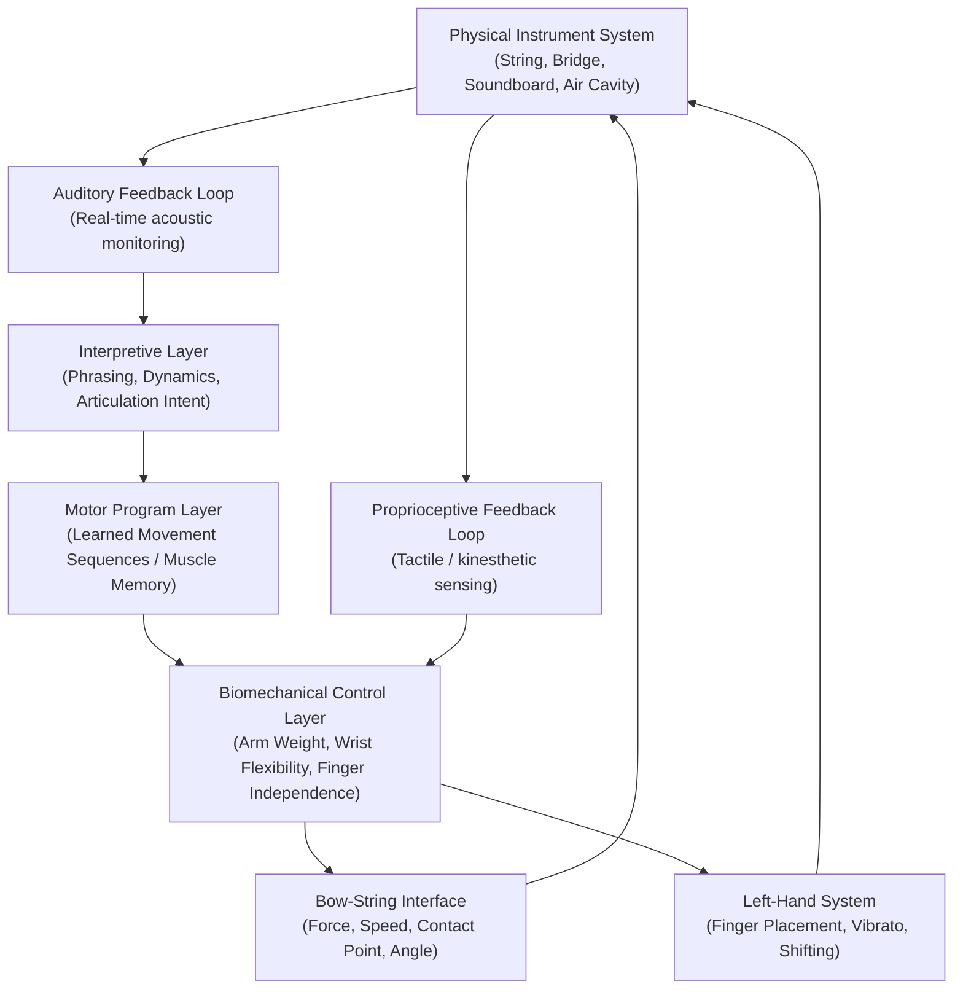
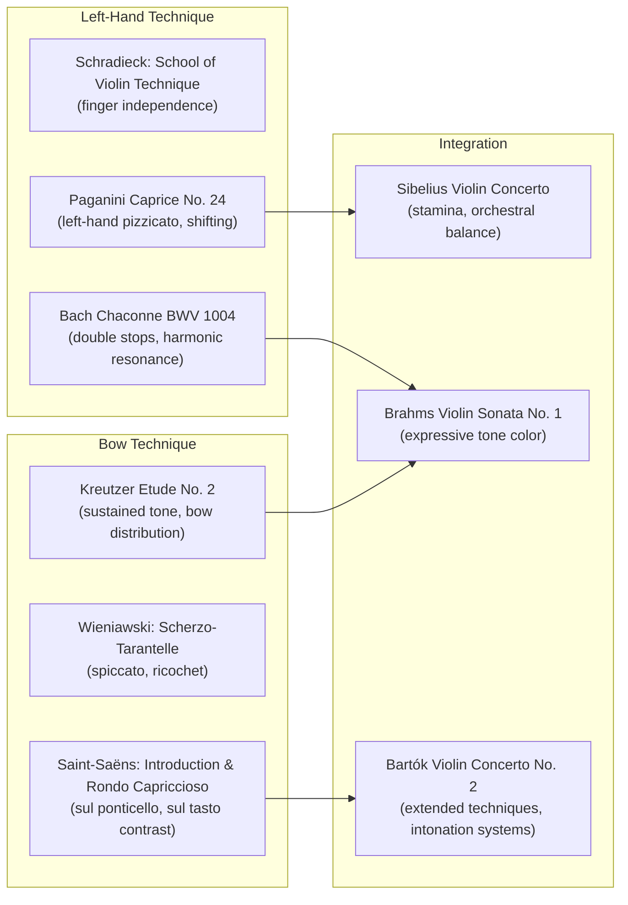
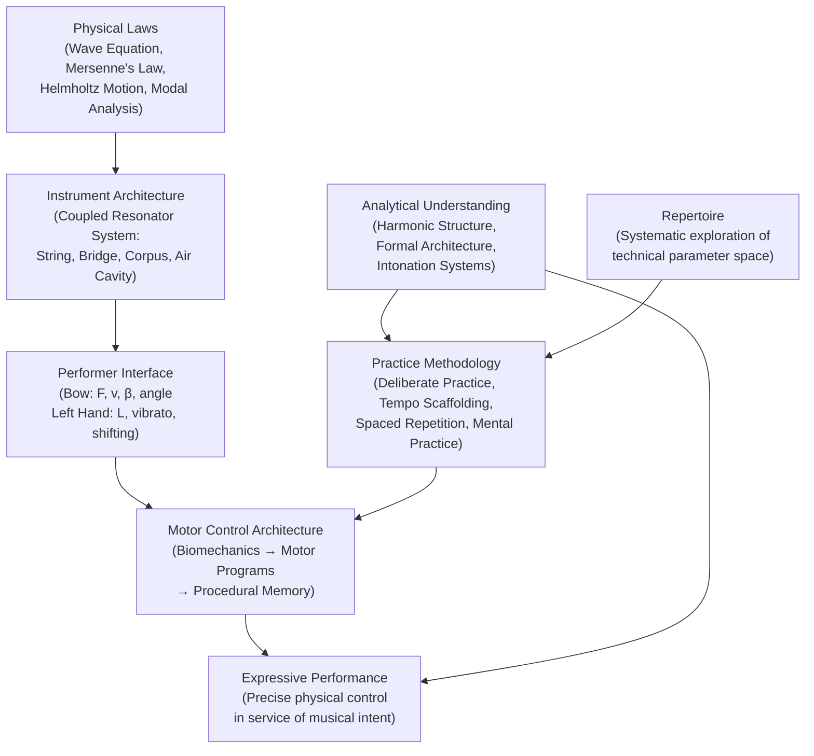

# Lesson 3: Repertoire and Practice Strategies for String Instruments

---

## 1. First-Principles Physics: The Vibrating String as an Acoustic System

### 1.1 The Wave Equation and Its Consequences

The string instrument is, at its physical core, a boundary-value problem in one-dimensional wave mechanics. A string of length *L*, fixed at both ends, supports standing waves whose frequencies are constrained by those boundary conditions. The governing partial differential equation is:

$$\frac{\partial^2 y}{\partial t^2} = \frac{T}{\mu} \frac{\partial^2 y}{\partial x^2}$$

where *y(x, t)* is the transverse displacement of the string, *T* is tension (Newtons), and *μ* is linear mass density (kg/m). The general solution is a superposition of normal modes, each satisfying the boundary conditions y(0, t) = y(L, t) = 0. This constrains the allowed wavelengths to λₙ = 2L/n for positive integers *n*, yielding the modal frequencies:

$$f_n = \frac{n}{2L} \sqrt{\frac{T}{\mu}}$$

The fundamental (n = 1) is:

$$f_1 = \frac{1}{2L} \sqrt{\frac{T}{\mu}}$$

This is Mersenne's Law, empirically established by Marin Mersenne in *Harmonie Universelle* (1636) and later grounded rigorously in Newtonian mechanics. It encodes three independently controllable physical parameters:

- **Tension T** — adjusted by pegs (coarse) and fine tuners (fine), typically in the range 40–80 N for a violin E string.
- **Vibrating length L** — determined by left-hand finger placement; on a violin, the open A string is approximately 328 mm, and stopping at the octave halves this to ~164 mm.
- **Linear density μ** — fixed at manufacture by string gauge and material (gut, synthetic core, steel); a heavier string sounds lower at the same tension and length.

The performer manipulates all three parameters, but *L* is the primary real-time control variable during performance. Understanding this explicitly changes how a student frames intonation problems: a sharp note is not a musical error in isolation — it is a geometric error in finger placement that has shortened L beyond the target value.

### 1.2 The Harmonic Series: Acoustic Physics of Timbre

Because the wave equation is linear, the string's motion is a superposition of all normal modes simultaneously excited. The resulting sound is periodic with period 1/f₁, and its Fourier decomposition reveals the harmonic series: a set of partials at integer multiples of the fundamental.

| Partial (n) | Frequency Ratio | Interval above fundamental | Approximate cents above C₄ (if f₁ = C₄) |
|:-----------:|:---------------:|:--------------------------|:-----------------------------------------:|
| 1 | 1 | Unison | 0 |
| 2 | 2 | Octave | 1200 |
| 3 | 3 | Octave + Perfect Fifth | 1902 |
| 4 | 4 | Two Octaves | 2400 |
| 5 | 5 | Two Octaves + Major Third | 2786 |
| 6 | 6 | Two Octaves + Perfect Fifth | 3102 |
| 7 | 7 | Two Octaves + Minor Seventh | 3369 (≈31 cents flat of equal temperament) |
| 8 | 8 | Three Octaves | 3600 |

The 7th partial is a critical acoustic fact that every advanced string player must internalize: it lies approximately 31 cents below the equal-tempered minor seventh. This is why open-string resonances can subtly destabilize equal-tempered intonation — the instrument's body preferentially reinforces these just-intonation relationships, creating a slight acoustic pull away from the tempered scale. Performers in chamber music routinely adjust toward just intonation on sustained harmonies precisely because the instrument's resonances reward it.

**Natural harmonics** exploit this modal structure directly. By touching the string lightly at a node — a point that is a simple rational fraction of L — the performer suppresses all partials whose mode shapes have an antinode at that point, leaving only the modes that have a node there. Touching at L/2 (the midpoint) produces the 2nd partial (one octave above open). Touching at L/3 produces the 3rd partial (octave + fifth). Touching at L/4 produces the 4th partial (two octaves). These are not approximations; they are exact consequences of the boundary condition mathematics.

**Artificial harmonics** extend this by using the left hand to establish a new effective nut position (the stopped note) while a lightly placed second finger creates the node. The resulting partial depends on the interval between the two contact points. The standard artificial harmonic uses a perfect fourth (the touch at L/4 of the stopped length), producing a pitch two octaves above the stopped note — a technique foundational to the high registers of Romantic violin writing.

### 1.3 Bow-String Interaction: The Helmholtz Motion

The mechanism by which the bow excites the string is non-obvious and was not correctly described until Hermann von Helmholtz's experimental work in the 1860s (*On the Sensations of Tone*, 1863). The string does not vibrate sinusoidally under the bow; it moves in a **Helmholtz motion** — a sawtooth-like waveform consisting of a single kink (a point of maximum slope) traveling back and forth along the string's length.

The physics of this motion can be summarized as follows:

1. The bow hair applies static friction to the string, dragging it in the bow direction (the **stick** phase).
2. The traveling kink arrives at the bow contact point and momentarily reduces the restoring force below the kinetic friction threshold, causing the string to **slip** back against the bow's motion.
3. Static friction re-engages, and the cycle repeats at a rate equal to the fundamental frequency of the string.

The conditions required to maintain stable Helmholtz motion define the **Schelleng diagram** (after John Schelleng's 1973 paper in the Journal of the Acoustical Society of America), which maps regions of bow speed (v) and bow force (F) in which the string produces:

- **Raucous/crunching sound** (excessive force): multiple slips per cycle.
- **Helmholtz motion** (the target regime): one slip per cycle, clean tone.
- **Surface sound / flautando** (insufficient force): the string slips before enough energy is stored to sustain Helmholtz motion.

The boundaries of the Helmholtz region depend on bow-contact distance from the bridge (the **sounding point**, or *sul ponticello* vs. *sul tasto* positions). Closer to the bridge, the string's transverse stiffness at the contact point is greater, requiring higher force to initiate and maintain the slip. This is why *sul ponticello* demands both greater bow pressure and straighter bow tracking — the acoustic tolerance window narrows significantly.

```
Schelleng Diagram (qualitative):

Bow Force (F)
 ▲
 │  Raucous / Crunch (excessive F)
 │─ ─ ─ ─ ─ ─ ─ ─ ─ ─ ─ ─ ─ ─ upper limit
 │
 │       HELMHOLTZ REGION
 │       (clean, sustained tone)
 │
 │─ ─ ─ ─ ─ ─ ─ ─ ─ ─ ─ ─ ─ ─ lower limit
 │  Surface sound / Flautando (insufficient F)
 │
 └───────────────────────────────► Bow Speed (v)

Note: Both limits scale with proximity to the bridge.
Closer to bridge → entire diagram shifts upward in F.
```

### 1.4 Instrument Acoustics: The Coupled Resonator System

The vibrating string transfers energy to the instrument body through the bridge, which acts as a mechanical impedance transformer. The body's acoustic response is not flat — it has a complex transfer function shaped by the resonance modes of the top plate (the **corpus**), back plate, ribs, and internal air cavity.

The air cavity resonance (Helmholtz resonance, determined by the f-hole geometry and internal volume) for a violin body typically lies near A₃ (~220 Hz), reinforcing the lower strings. The main top plate resonance (the **main air mode** or A0, and the **main wood mode** or B1+) typically lies between 450–550 Hz for a well-made instrument. These resonance peaks shape the instrument's voice and explain why instruments of different construction quality and age sound different even when played identically: the transfer function differs.

For the performer, this has a direct practical implication: resonance **wolf notes** arise when a played pitch coincides with a strong body resonance, causing the feedback between string and body to become unstable and produce a stuttering, uncontrolled sound. Wolf notes are most common on cello, where body resonances fall within the normal playing range. Wolf suppressors (a small brass cylinder attached to the tailpiece extension of the string) add a small amount of mass to shift the resonance slightly, moving the wolf out of the most problematic position.

---

## 2. Core Architecture of String Performance

The structure of string performance is best understood as a layered control architecture, in which each layer operates on a different timescale and feeds into the layers above it.



### 2.1 Layer 1 — The Physical Instrument System

As detailed in Section 1, the instrument is a network of coupled resonators. The performer does not directly control acoustic output; they control the mechanical inputs at two interface points — bow on string and finger on string — and the resulting acoustic output emerges from the instrument's transfer function applied to those inputs. This distinction is not pedantic: it explains why the same musical intention can produce different sounds on different instruments, and why adaptation time is required when switching between instruments.

### 2.2 Layer 2 — Bow-String and Left-Hand Interface

The bow interface has four independently controllable parameters:

| Parameter | Physical Effect | Musical Result |
|-----------|----------------|----------------|
| Bow speed (v) | Scales amplitude of Helmholtz motion | Louder / softer sound |
| Bow force (F) | Must scale with v to stay in Helmholtz region | Tone quality, attack character |
| Contact point (β = x/L) | Changes harmonic content and required F threshold | Timbre: *sul tasto* → *sul ponticello* |
| Bow angle (tilt) | Changes effective width of bow hair in contact | Tone color, softness of articulation |

These four parameters are not independent — the Schelleng diagram constrains the (F, v) space for a given β. A common beginner error is to increase only bow force when seeking a louder sound, without proportionally increasing bow speed, pushing the system above the Helmholtz upper limit and producing a scratching sound.

The left-hand interface is primarily concerned with:

- **Intonation**: precise longitudinal positioning of the fingertip along the string to achieve the correct L.
- **Vibrato**: a periodic oscillation of the finger (or arm, or wrist) that modulates L slightly around the target pitch, introducing a frequency modulation in the range 5–7 Hz at ±20–50 cents. Vibrato also produces a characteristic amplitude modulation because the bow's driving force interacts with the varying resonance conditions.
- **Shifting**: lateral translation of the entire left-hand frame along the neck to access higher positions, requiring precise coordination to avoid audible glissando artifacts (unless intentional, as in a *portamento*).

### 2.3 Layer 3 — Biomechanical Control

This layer concerns the organization of the performer's body as a mechanical system. Key principles include:

**Arm weight vs. muscular force in the bow arm.** The bow arm's primary source of contact force should be gravity — the natural weight of the arm transmitted through a relaxed shoulder — rather than active muscular pressure. Active pressing creates muscular tension that propagates through the kinematic chain, reducing fine-motor control. This is why bow arm technique is taught primarily through relaxation exercises, not strength training.

**Kinematic chain efficiency in the left hand.** The left-hand fingers must each act as independent linear actuators along the string, but they share a common platform (the hand frame) anchored by the first finger and thumb. High-position playing collapses the available wrist angle and forearm rotation, requiring the hand to adopt compensatory geometries that must be trained specifically.

**Posture and instrument hold.** The violin/viola hold (shoulder rest, chin rest) and cello hold (endpin angle, knee contact) determine the mechanical advantage available to both arms. Poor posture creates force inefficiencies that manifest as fatigue, tension injury, and inconsistent tone production.

### 2.4 Layer 4 — Motor Programs and Procedural Memory

Skilled string performance relies on procedural memory — the storage of motor programs in the cerebellum and basal ganglia, not in conscious working memory. A motor program is a pre-compiled sequence of motor commands that can be executed with minimal real-time cognitive load, analogous to a compiled subroutine in software. Research in motor neuroscience (Schmidt & Lee, *Motor Learning and Performance*, 6th ed.) identifies two key properties of motor programs relevant to practice design:

**Specificity of practice**: motor programs are encoded at the precise speed, force level, and sensory context in which they are trained. A passage practiced only at half-speed does not automatically transfer to performance speed; the high-speed motor program is a structurally different neural pattern that must be trained separately.

**Contextual interference effect**: interleaved practice of multiple tasks (e.g., practicing multiple passages in random order rather than block repetition of each) produces lower performance during acquisition but significantly superior retention and transfer. This well-replicated finding (Shea & Morgan, 1979) has direct implications for how repertoire practice should be structured.

### 2.5 Layer 5 — Interpretive Layer

The interpretive layer is where musical intention is formulated. It operates on a timescale of phrases and sections (seconds to minutes) and must translate abstract musical concepts — harmonic tension, rhetorical gesture, formal architecture — into specific parameter targets at Layers 2 and 3. This translation is not intuitive; it requires analytical understanding of the score and explicit mapping from expressive intent to physical execution.

For example, the decision to execute a crescendo on a sustained note requires the performer to increase bow speed (and proportionally bow force) while maintaining contact point and preventing the intonation from drifting sharp (a common artifact of increased bow pressure on the string). Each component of that crescendo is a Layer 2 parameter change; the crescendo itself is a Layer 5 concept.

---

## 3. Repertoire as an Acoustic and Technical Curriculum

### 3.1 Principles of Repertoire Selection

Repertoire selection is not an aesthetic choice alone — it is a pedagogical decision about which regions of the instrument's technical parameter space to explore and master. A well-structured curriculum should systematically expand the performer's command of each layer of the architecture described in Section 2.

The standard pedagogical progression — from open strings through first position, then shifting and higher positions, then double stops and advanced bow techniques — reflects an implicit understanding of this parameter space. Each stage adds new degrees of freedom to the control problem. What is often missing from traditional pedagogy is *explicit* connection between the technical demands of repertoire and the underlying physical and biomechanical principles being trained.

### 3.2 Case Study: Bach's Chaconne from Partita No. 2 in D Minor, BWV 1004

The Chaconne (not to be confused with the *Chromatic Fantasia and Fugue* cited in the original material — the latter is a keyboard work and has no idiomatic violin writing) represents the apex of the solo violin repertoire's engagement with the instrument's acoustic architecture. Its demands span every layer of the control hierarchy:

**Polyphony on a monophonic instrument.** The violin cannot sustain all voices of a four-part chord simultaneously; the bow cannot maintain continuous contact with four strings. Bach exploits the ear's tendency to group rapidly arpeggiated notes into perceived simultaneous voices (a phenomenon related to auditory streaming) and the instrument's natural sustain. The performer must manage the arpeggio timing so that the leading melodic voice — usually the highest — receives slightly more bow contact and therefore more sustain, creating the perceptual illusion of harmonic fullness.

**Harmonic resonance exploitation.** The key of D minor on the violin is acoustically privileged: the open D and A strings participate as sympathetic resonators in many of the Chaconne's cadential harmonies, adding natural reverb and tonal richness that is physically absent when the same music is transposed. This is not incidental — it is part of why the work sounds convincingly orchestral on a solo violin in its original key.

**Double stop intonation.** Extended passages in thirds, sixths, and octaves require the performer to manage two simultaneous intonation targets. Because the instrument's body resonates more strongly when the two pitches form a just-intonation interval (3:2 for a fifth, 5:4 for a major third), there is a perceptible acoustic reward for just-intonation double stops: the instrument "rings" with sympathetic resonance. Training double stop intonation therefore involves listening for this resonance signature, not merely for the absence of beats.

### 3.3 Case Study: Paganini's Caprice No. 24 in A Minor

Paganini's 24th Caprice is a systematic exploration of the violin's left-hand technical parameter space. Each of Brahms's, Liszt's, Rachmaninoff's, and Lutosławski's subsequent variations on this theme is in part a tribute to how completely Paganini mapped the instrument's possibilities in a single theme-and-variations structure.

The technical demands include:

- **Left-hand pizzicato**: the left hand plucks strings while the bow sustains a melody on an adjacent string, requiring independent control of two strings by two independent actuators.
- **Rapid octave displacement**: large shifts at high speed, training the kinematic efficiency of the shifting mechanism.
- **Chromatic scales at extreme tempo**: demanding independence of finger depression timing from finger release timing — a motor coordination problem distinct from ordinary scale practice.
- **String crossing at speed**: the bow arm must execute lateral displacements across string levels at a rate that tests the temporal precision of the arm's oscillation.

### 3.4 Repertoire Mapping to Physical Parameters

The following diagram maps representative repertoire to the primary technical/acoustic parameter it develops:



---

## 4. Practice Strategies: A Systems Engineering Approach

### 4.1 The Practice Session as a Control Experiment

Each practice session is most productive when treated as a controlled experiment: one or two specific parameters are isolated, varied systematically, and their effect on acoustic output is observed. This is the antithesis of run-through practice, in which all parameters vary simultaneously and no causal relationship between input and output is ever cleanly isolated.

The experimental structure of a productive practice unit:

1. **Identify the target parameter** (e.g., bow contact point for a specific passage).
2. **Establish the current baseline** by playing the passage and listening critically.
3. **Isolate the variable** by holding all other parameters constant (same tempo, same dynamics, same fingering).
4. **Systematically vary the target parameter** and observe acoustic output changes.
5. **Identify the optimal value** for the target parameter in this musical context.
6. **Encode the optimal value** through repetition at the target tempo.

This approach makes explicit what expert teachers have always done intuitively — the great pedagogue Carl Flesch's principle of "practicing faults one at a time" (from *The Art of Violin Playing*, 1923) is precisely this methodology.

### 4.2 Tempo Scaffolding and Motor Program Encoding

The relationship between practice tempo and motor program encoding is frequently misunderstood. The common advice to "practice slowly" is correct but incomplete; it must be paired with an understanding of *why* slow practice works and *when it stops working*.

Slow practice functions by:
- Expanding the temporal window between events, allowing conscious monitoring of each parameter change.
- Operating the motor system in a regime where proprioceptive feedback (which has a latency of ~30–80 ms) can close the control loop in real time.
- Enabling error detection before errors become encoded into the motor program.

However, below a certain tempo, the movement kinematics change qualitatively. At performance tempo, rapid bow strokes involve ballistic movements — movements that are pre-planned and executed open-loop, without real-time sensory correction. Slow practice trains a feedback-controlled movement; performance requires a feed-forward controlled movement. The transition between these regimes is not gradual; it represents a qualitative change in the motor control strategy.

An effective tempo scaffolding protocol:

```
Tempo Scaffolding Protocol (percentage of target tempo):

Phase 1 — Structural encoding:   40–50%  (conscious, feedback-controlled)
Phase 2 — Pattern consolidation:  60–70%  (begin motor chunking)
Phase 3 — Transition zone:        75–85%  (mix of feedback and feed-forward)
Phase 4 — Performance encoding:   90–100% (ballistic, feed-forward)
Phase 5 — Overspeed training:     105–110% (expand performance margin)

Each phase requires sufficient repetition before advancing.
Criterion: 5 consecutive error-free repetitions at current tempo.
```

### 4.3 Mental Practice and Imagery

Mental practice — covert rehearsal of a physical skill without overt movement — has robust empirical support for motor skill acquisition. Neuroimaging studies (Jeannerod, 2001; Lotze et al., 1999) demonstrate that mental rehearsal activates overlapping neural circuits to those activated during physical execution, including primary motor cortex, premotor cortex, and supplementary motor area. Meta-analyses (Driskell, Copper & Moran, 1994) show that mental practice combined with physical practice produces superior retention compared to physical practice alone.

For the string performer, effective mental practice involves:

- **Full sensory simulation**: imagining not only the sound but the proprioceptive sensation of bow weight on the string, the resistance of the string under the fingertip, and the kinesthetic trajectory of a shift.
- **Score-independent simulation**: rehearsing from memory, without the score as a crutch, to train the same retrieval pathway used in performance.
- **Error simulation and recovery**: deliberately imagining a memory slip and then mentally executing the recovery strategy, encoding the recovery as a motor program.

### 4.4 Spaced Repetition and Forgetting Curves

The optimal temporal distribution of practice sessions is governed by the **spacing effect** — the well-established finding that distributed practice (multiple sessions separated by rest periods) produces superior long-term retention compared to massed practice (a single extended session) even when total practice time is held constant. Ebbinghaus's forgetting curve, while measured originally for verbal material, has been replicated in motor learning contexts.

The practical implication: a 60-minute daily practice session will produce better long-term motor consolidation than a single 7-hour session per week, even if total weekly practice time is identical. Sleep plays a mechanistic role here — motor memory consolidation occurs preferentially during slow-wave sleep and REM sleep (Walker et al., 2002), explaining why a passage that feels unacquired at the end of a practice session sometimes feels more secure the following morning.

A rational practice schedule structure:

```mermaid
gantt
    title Weekly Practice Architecture
    dateFormat  HH:mm
    axisFormat  %H:%M

    section Day 1 (Acquisition)
    Scales & Fundamentals       :a1, 00:00, 15m
    New Material - Slow Work    :a2, after a1, 25m
    Repertoire Maintenance      :a3, after a2, 15m
    Mental Practice             :a4, after a3, 5m

    section Day 2 (Consolidation)
    Scales & Fundamentals       :b1, 00:00, 10m
    Previous Material - Testing :b2, after b1, 20m
    New Material - Tempo Work   :b3, after b2, 20m
    Performance Run-throughs    :b4, after b3, 10m

    section Day 3 (Integration)
    Targeted Technical Work     :c1, 00:00, 15m
    Full Passage Integration    :c2, after c1, 30m
    Expressive Detail           :c3, after c2, 15m
```



### 4.5 Deliberate Practice vs. Naive Repetition

Naive repetition — playing through a passage multiple times without specific evaluative criteria — is the least efficient form of practice. It encodes whatever version of the passage is currently in the motor system, errors included, and relies on statistical fluctuation to occasionally produce a better outcome. Anders Ericsson's deliberate practice framework (*Peak: Secrets from the New Science of Expertise*, 2016) identifies the characteristics that distinguish effective from ineffective practice:

- **Specific, well-defined goals** at the sub-phrase level, not the movement level.
- **Full concentration** without autopilot execution.
- **Immediate feedback** — which on a string instrument means active auditory monitoring rather than passive listening.
- **Operation at the edge of current ability** — practicing material that is slightly beyond the current comfort zone, where errors occur and correction is necessary.

The implication for string practice is that most productive practice sessions are cognitively demanding and somewhat uncomfortable. A practice session that feels easy and pleasant because the performer is playing through familiar repertoire accurately is not generating significant improvement — it is consolidating what already exists.

### 4.6 Structural Analysis as a Practice Tool

Analysis of the musical structure before physical practice is not an optional supplement — it is a prerequisite for efficient encoding. A performer who understands the harmonic architecture of a movement knows which passages share structural material (and therefore which motor programs transfer), which moments are harmonically destabilizing (and therefore require extra intonation vigilance), and what the formal logic of the phrasing implies about dynamics and timing.

For example, in Brahms's Violin Sonata in G Major, Op. 78, the first movement's principal theme is built on a descending thirds motif that recurs in varied harmonic contexts throughout the movement. A performer who has identified this motif analytically can practice the motif as a single transferable unit rather than re-learning its physical execution in each new context — a substantial reduction in total required practice time.

This analytical approach also supports memory security in performance. Harmonic memory (knowing *why* each note follows the previous one, in terms of voice leading and harmonic function) is a redundant memory pathway that provides error recovery when motor memory momentarily fails under performance stress.

---

## 5. Advanced Topics: Extended Techniques and Their Physical Basis

### 5.1 Col Legno, Harmonics, and Prepared Techniques

Extended techniques are not departures from the instrument's physics — they are explorations of underutilized regions of its acoustic parameter space.

**Col legno** (striking or bowing with the stick rather than the hair) changes the bow's frictional properties from high-coefficient organic keratin to low-coefficient lacquered wood. This prevents Helmholtz motion under most conditions, producing instead a percussive attack followed by a noisy, inharmonic decay. It is used orchestrally for effect (Berlioz's *Symphonie Fantastique*, "Dream of a Witches' Sabbath") rather than for sustained melody.

**Sul ponticello** (bowing very close to the bridge) reduces the contact point ratio β = x/L to a small value. Because the string's displacement amplitude near the bridge is small even during Helmholtz motion, the bow must apply higher force to maintain the slip-stick cycle. The acoustic result is an enhancement of upper partials (the high-n modes in the Fourier decomposition), producing the characteristic glassy, nasal tone associated with the technique.

**Sul tasto** (bowing over the fingerboard) increases β toward 0.5. At this contact point, even-numbered modes (which have a node at the midpoint L/2) contribute less energy to the sound, and the fundamental and low odd partials dominate. The result is a flute-like, warm tone quality with reduced upper partial content.

These three tonal extremes — *sul ponticello*, ordinario, and *sul tasto* — represent points on a continuous spectrum of timbral control governed entirely by the physics of β and its effect on the modal excitation profile.

### 5.2 Vibrato: Frequency Modulation and Its Perceptual Effect

Vibrato is not ornament — it is a primary carrier of expressive information in Western string performance. Its physical mechanism is a periodic oscillation of the left hand (or arm or wrist) that produces a frequency modulation of the fundamental. The three vibrato sources — arm vibrato, wrist vibrato, and finger vibrato — differ in the oscillation frequency range they naturally produce and in the size of the pitch deviation:

- **Arm vibrato**: slower (4–5 Hz), larger amplitude deviation (±40–60 cents); favored for broad, singing tone.
- **Wrist vibrato**: mid-range (5–6 Hz), moderate amplitude; the most versatile.
- **Finger vibrato**: faster (6–8 Hz), smaller amplitude deviation; produces a more intense, concentrated sound.

A critical perceptual fact: the ear perceives vibrato pitch as the *upper* pitch of the oscillation, not the mean (Seashore, 1938; reconfirmed in modern psychoacoustic research). This means that a vibrato centered on the target pitch sounds flat. Expert performers subconsciously start vibrato oscillations slightly below the target pitch, so that the upper excursion lands on target. This is a teachable, correctable parameter — and it is why vibrato intonation is a separable skill from non-vibrato intonation.

---

## 6. Summary: Integrative Framework

The following diagram synthesizes the full conceptual architecture of this lesson, from physical invariants through practice methodology to artistic outcome:



String performance is the continuous, real-time solution of a coupled control problem: the performer must simultaneously maintain stable Helmholtz motion (a bow-arm task), precise intonation (a left-hand task), expressive phrasing (an interpretive task), and structural coherence (an analytical task), while operating under the constraints of physical fatigue, performance anxiety, and acoustic feedback from a room with unknown transfer characteristics. The practice strategies described in this lesson are, in essence, methods for reducing the cognitive and physical load of this control problem through the compilation of motor programs, the internalization of acoustic invariants, and the development of analytical frameworks that make the structure of the music — and therefore the structure of the required control actions — legible in real time.

Mastery of a string instrument is not the accumulation of techniques. It is the progressive reduction of the instrument from a physical system to be consciously managed into a transparent medium for musical thought.

---

## References and Further Study

**Acoustics and Physics**
- Helmholtz, H. (1863). *On the Sensations of Tone*. Dover reprint, 1954.
- Schelleng, J.C. (1973). "The bowed string and the player." *Journal of the Acoustical Society of America*, 53(1), 26–41.
- Fletcher, N.H. & Rossing, T.D. (1998). *The Physics of Musical Instruments* (2nd ed.). Springer.
- McIntyre, M.E., Schumacher, R.T., & Woodhouse, J. (1983). "On the oscillations of musical instruments." *Journal of the Acoustical Society of America*, 74(5), 1325–1345.

**Motor Learning and Practice**
- Ericsson, K.A. & Pool, R. (2016). *Peak: Secrets from the New Science of Expertise*. Houghton Mifflin Harcourt.
- Schmidt, R.A. & Lee, T.D. (2019). *Motor Learning and Performance* (6th ed.). Human Kinetics.
- Shea, J.B. & Morgan, R.L. (1979). "Contextual interference effects on the acquisition, retention, and transfer of a motor skill." *Journal of Experimental Psychology: Human Learning and Memory*, 5(2), 179–187.
- Walker, M.P. et al. (2002). "Practice with sleep makes perfect: sleep-dependent motor skill learning." *Neuron*, 35(1), 205–211.

**Pedagogy**
- Flesch, C. (1923). *The Art of Violin Playing* (2 vols.). Carl Fischer.
- Galamian, I. (1962). *Principles of Violin Playing and Teaching*. Prentice-Hall.
- Rolland, P. (1974). *The Teaching of Action in String Playing*. Illinois String Research Associates.

**Repertoire Analysis**
- Lester, J. (1999). *Bach's Works for Solo Violin: Style, Structure, Performance*. Oxford University Press.
- Stowell, R. (1990). *Violin Technique and Performance Practice in the Late Eighteenth and Early Nineteenth Centuries*. Cambridge University Press.
