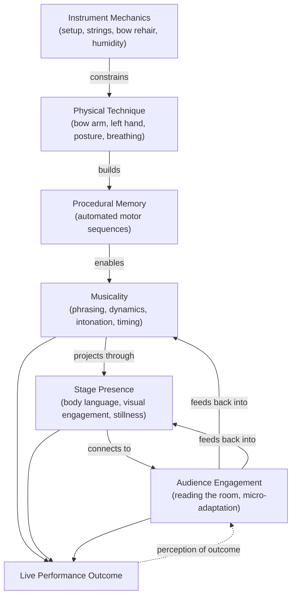
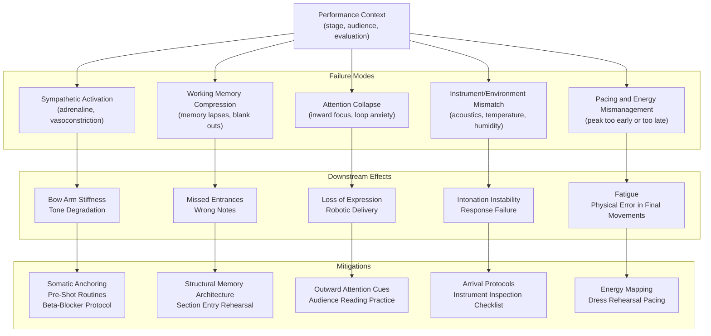

# Lesson 4: Performance Skills — Strings Masterclass

As a masterclass student, you have built a working command of your instrument's mechanics. Stage performance, however, is a separate discipline — one that demands its own rigorous study. This lesson examines the architecture of live string performance: the physiological and psychological substrate, the mechanical systems that govern stage sound, and the specific failure modes that derail even technically accomplished players. The focus is on the violin family and classical guitar as primary examples, with principles that extend broadly across bowed and plucked string instruments.

---

## 1. First-Principles Intuition: What Performance Actually Is

Performance is not an amplified version of practice. It is a distinct act with a distinct neurological profile. Understanding the difference at a mechanistic level is prerequisite to mastering it.

### 1.1 The Autonomic Nervous System and Stage Fear

When you walk onto a stage, the brain's threat-detection circuitry — centered on the amygdala — receives a stimulus package: unfamiliar space, social evaluation, irreversibility of action (you cannot undo a note once played). The hypothalamus triggers the sympathetic branch of the autonomic nervous system, releasing epinephrine (adrenaline) and norepinephrine from the adrenal medulla.

The physiological consequences for a string player are specific and severe:

- **Peripheral vasoconstriction** reduces blood flow to the extremities. Cold, stiff fingers directly impair fine motor coordination in the left hand (fretting/fingering) and reduce tactile sensitivity in the bow arm.
- **Increased muscle tension** elevates the resting tone of skeletal muscles. For bow arm technique, any elevation in baseline tension corrupts the fluid weight-transfer mechanics of a good legato stroke. The shoulder girdle locks, the elbow stiffens, and tone quality degrades.
- **Tremor induction**: Elevated catecholamines lower the threshold for essential tremor, manifesting as bow shake — particularly visible at the tip of the bow where leverage is lowest and control demands are highest.
- **Working memory compression**: Under acute stress, the prefrontal cortex's working memory bandwidth contracts. Performers report losing access to memorized fingerings, harmonic anticipation, and interpretive choices they execute effortlessly in practice.

The clinical literature on performance anxiety (music-specific performance anxiety, or MPA) is substantial. Steptoe & Fidler (1987) established the tripartite model: somatic symptoms, cognitive interference, and behavioral disruption. Kenny (2011, *The Psychology of Music Performance Anxiety*, Oxford University Press) synthesized this into a developmental model showing that MPA is distinct from generalized anxiety disorder and responds to different interventions.

### 1.2 The Flow State: Mechanistic Basis

Csikszentmihalyi's concept of *flow* (1990, *Flow: The Psychology of Optimal Experience*, Harper & Row) is frequently cited but rarely examined mechanistically. For the performing string player, the relevant neuroscience is as follows.

Flow correlates with a specific pattern of neural activity: reduced prefrontal cortex activation (transient hypofrontality, as described by Dietrich, 2004, in *Consciousness and Cognition*) combined with heightened activity in basal ganglia circuits that govern procedurally automatized motor sequences. In this state, well-drilled technical skills execute below the threshold of conscious supervision — the bow arm "knows" a spiccato passage without the performer explicitly deciding each stroke.

The critical invariant is the **skill-challenge balance**. Flow is accessible only when the technical demand of the repertoire is commensurate with the performer's actual skill level. Performing repertoire that is technically beyond current ability produces anxiety; performing repertoire far below ability produces boredom. Neither state is flow. This has a direct implication for program selection: choosing performance repertoire that sits at the edge of but within your reliable technical range maximizes the probability of flow access.

A second invariant is **procedural consolidation**. Motor sequences practiced to the point of automatization are stored primarily in the cerebellum and basal ganglia, structures that are largely insulated from the acute stress response. This is why deeply practiced passages survive performance anxiety better than recently learned ones — they are, neurologically speaking, in a different system.

### 1.3 The Performer-Audience Feedback Loop

The audience is not a passive receptor; it is an active component of the performance system. Research in social psychophysiology demonstrates bidirectional coupling: audience attentiveness and affect feed back to the performer through visual cues (body language, stillness, facial expression) and auditory cues (breath, rustling, the quality of silence). A performer who develops the capacity to read these signals in real time can modulate interpretive choices — dynamics, tempo flexibility, phrase shaping — to maintain engagement.

This feedback loop operates on two timescales: **macro-phrasing** (adjusting the arc of a movement or piece) and **micro-expression** (adjusting the intensity of a single phrase or ornament). Both require the performer to maintain a portion of attentional bandwidth directed outward rather than inward. The technical precondition is exactly the procedural consolidation described above: you cannot attend to your audience if your fingers are still demanding conscious supervision.

---

## 2. Core Architecture: The Mechanics of String Performance

The following diagram maps the dependency architecture of live string performance. Each layer depends on the stability of the layer beneath it, but the arrows are not unidirectional — feedback and interference propagate in both directions.

### 2.1 Instrument Mechanics: The Physical Substrate

A technically sophisticated performance is bounded above by the physical condition of the instrument. These are not peripheral housekeeping details — they are hard constraints on achievable sound quality.

**Setup and regulation** encompasses bridge height and curvature, nut slot depth, soundpost position, and string action. For the violin family, a bridge that is too high increases left-hand effort for stopped notes and raises the threshold of contact required for clean bow strokes. A soundpost that has shifted or fallen alters the asymmetric stiffness coupling between the treble (E-string side) and bass (G-string side) of the top plate, changing the instrument's tonal balance in ways that cannot be corrected at the bow.

**String selection and age** directly affect response and tone color. Gut-core strings (Pirastro Oliv, Eudoxa) offer complex, warm overtone spectra but are humidity-sensitive and have shorter performance windows before intonation instability becomes unacceptable. Synthetic-core strings (Dominant, Evah Pirazzi, Warchal Brilliant) offer greater consistency. Steel-core strings (Jargar, Helicore) provide maximum stability but a thinner overtone structure. For performance, strings should be replaced before showing audible false harmonics or significant decline in pitch stability under bow pressure — not on a fixed calendar schedule but on acoustic monitoring.

**Bow condition and rehair** is non-negotiable. A bow rehaired with Mongolian or Siberian stallion hair provides a different rosin-retention profile and grip coefficient than Siberian mare hair. For performance, a bow should be rehaired sufficiently far in advance that the hair has been played in and rosined to consistency. Fresh rehair on the morning of a performance is a liability.

**Humidity and thermal stabilization**. Wooden instruments are hygroscopic. A violin traveling from a cold car to a warm concert hall requires at minimum 20–30 minutes of thermal stabilization before it will hold pitch reliably. String tension changes with temperature; the instrument's resonant frequencies shift with humidity. Carrying a calibrated hygrometer in the case is not excessive — it is professional practice.

### 2.2 Physical Technique Under Performance Conditions

The transition from practice room to stage exposes technical weaknesses that do not manifest in relaxed private settings. The principal mechanisms are:

**Bow arm mechanics under tension.** The standard model of tone production in the violin family rests on the relationship between bow speed, bow pressure (contact force), and sounding point (contact point between bridge and fingerboard). These three variables exist in a constrained relationship: increasing pressure without adjusting speed or sounding point produces a choked, scratchy tone; too little pressure relative to speed produces a glassy, surfing tone. Under performance stress, elevated muscle tone in the shoulder and forearm typically increases applied pressure involuntarily while reducing bow speed. The result is a congested, effortful tone that is immediately audible to both player and audience.

The mitigation is not "relax" as an instruction (which is cognitively inert under acute stress) but rather a pre-programmed physical anchor: a specific sensation — such as the weight of the arm falling freely through the string at the bow change — that has been drilled in practice to function as a reset cue. This is a form of somatic anchoring, used systematically in sports performance psychology.

**Left-hand intonation under temperature and tension changes.** Intonation on a fretless string instrument is a continuous motor computation, not a lookup table. The left hand is constantly making micro-adjustments based on auditory feedback. Under performance stress, two things degrade this system: (1) attention to auditory feedback narrows (the performer is processing anxiety signals), and (2) muscle tension in the left hand and forearm shifts the proprioceptive reference frame, meaning that "in tune" feels different physically than in practice. The solution is to build intonation practice on auditory, not kinesthetic, reference — the ear must be the primary sensor, so that the kinesthetic shift under stress does not corrupt the reference standard.

**Breathing and phrase architecture.** String players who play chamber music or accompany singers develop an acute awareness of breath as a structural element in phrasing. Even without wind instruments, the string player's own breathing organizes muscular preparation for bow strokes, phrase initiations, and character changes. Breath suppression — a common anxiety response — removes this organizational structure, causing phrase initiations to feel mechanical and phrase releases to feel abrupt. Deliberate pre-performance and mid-performance breathing practice is a specific technical skill, not a relaxation technique.

### 2.3 Stage Presence: The Visual Dimension of Sound

String playing has a large visual component that is inseparable from the audience's sonic perception. Research in multimodal perception (Schutz & Lipscomb, 2007; Davidson, 1993) demonstrates that visual motion information from performers systematically alters listeners' judgments of dynamics, timing, and expressiveness — even when the audio track is held constant.

The body language of the string player communicates interpretive intent before a note is sounded. The preparation gesture (the inhale, the bow lift, the slight lean into the first beat) is a visual anticipation that primes the audience's expectation and creates the sensation of a shared musical downbeat. Players who suppress this preparation — standing rigid and simply beginning to play — produce a disconnection between visual and auditory information that audiences register as "cold" or "mechanical," regardless of the actual note quality.

Specific actionable dimensions of visual presence for string players:

**Body sway and phrase shape.** Natural physical movement that traces phrase contours — a small forward lean into a climax, a release of weight at a cadence — reinforces the audience's understanding of musical structure. It is not performance as theater; it is the visual externalization of the musical architecture that is already present in the interpretation. The discipline is to ensure the movement is phrase-driven rather than arbitrary or habitual.

**Eye contact and gaze direction.** In solo recital, sustained downward gaze into the music stand creates a barrier between performer and audience. Gradual memorization is the long-term solution. In the interim, lifting the gaze during sustained notes, at phrase junctions, and during moments of interpretive climax provides audience connection without compromising the safety of score reference.

**Stillness as a device.** Undifferentiated motion is noise. The performer who is always moving communicates nothing specifically. Practiced stillness at particular structural moments — a held fermata, a pianissimo melody, the last note of a movement — creates contrast that makes the motion elsewhere meaningful.

---

## 3. High-Performance Optimization and Failure Mode Analysis

The following section treats common performance breakdown modes with the specificity of an engineering failure analysis: identifying the root cause, the propagation pathway, and the targeted mitigation.

### 3.1 Memory Architecture for Performance

Memory lapse in performance is the most catastrophic single-point failure mode, and it is the one performers are most reluctant to train systematically. The standard approach — playing through a piece repeatedly in practice — builds a *serial recall* architecture: each passage is a cue for the next. This architecture has a critical vulnerability: if the serial chain is broken at any point (by a missed note, a distraction, or an anxiety-induced blank), the performer has no independent re-entry point and is effectively lost.

The correct architecture is **multi-modal, segment-redundant memory**. This is built by practicing the following specific skills:

**Cold starts at non-opening locations.** Practice starting from the second theme, from the development section, from any structurally defined location, entirely cold. This builds independent memory nodes that do not depend on the preceding serial context.

**Harmonic skeleton memorization.** Independently of the notes, memorize the harmonic progression — tonal center, key changes, significant harmonic events — for each major section. When a lapse occurs, harmonic orientation allows the performer to identify where they are in the structure and select an appropriate re-entry point.

**Physical/kinesthetic cues as independent indices.** Associate specific physical gestures or bow positions with specific structural locations. These are stored in a different memory system (procedural rather than declarative) and can serve as backup access points when declarative memory fails.

**Mental performance rehearsal.** Regularly perform the piece in imagination only, without the instrument, tracking both the music and the physical sensations of playing it. This rehearsal mode exposes gaps in memory that are masked by the physical habit of playing — it is diagnostic as well as constructive.

### 3.2 Acoustic Environment Adaptation

A common failure mode that is rarely trained for systematically is the acoustic environment mismatch. The concert hall, the church, the recital room, and the outdoor stage each impose a different set of acoustic conditions, and a string player calibrated to their practice room will make systematic errors in an unfamiliar acoustic.

**Reverberation time (RT60)** is the primary variable. A hall with long reverberation (RT60 > 2 seconds, common in stone churches) blurs fast passage work and makes legato phrasing feel supported. A dry acoustic (RT60 < 0.5 seconds, common in carpeted recital rooms or outdoors) is unforgiving of technical imprecision but allows clarity in fast passages. The error is to maintain practice-room calibration in the new space. Players who have rehearsed in a dry room and then perform in a reverberant hall tend to slow down bow strokes, increase vibrato depth, and reduce dynamic range — all appropriate adaptations, but only if executed consciously.

**On-stage monitoring conditions.** In chamber and orchestral contexts, the stage acoustic is often dramatically different from what the audience hears. Musicians playing in a highly absorptive stage environment (carpets, curtains, wide-spaced formation) receive little of their own sound back and may overblow or over-bow to compensate, producing actual tone quality problems in the hall. Developing the capacity to perform from proprioceptive and auditory reference simultaneously — not requiring the room return as the primary feedback — is an advanced professional skill.

**Instrument resonance in the hall.** Some halls have strong resonance nodes at specific frequencies. When you play a note that coincides with a room mode, the instrument will feel and respond differently — it may feel more resonant and "easy," or in some cases, strongly resonant room modes produce beats and apparent intonation problems that are room-generated rather than instrument-generated. Sound-checking and rehearsing in the performance space before the concert is not a luxury; it is a critical calibration activity.

### 3.3 Energy and Pacing

A full solo recital typically spans 70–90 minutes of playing. Physical fatigue is a real failure mode, particularly for bow arm endurance in repertoire requiring sustained upper-bow forte playing (the demand profile of late Romantic repertoire) and left-hand endurance in high-position, high-density chord playing.

Program order should be designed with the **energy curve** in mind. The standard professional approach places the most technically and physically demanding work in the first half — when physical resources are highest and audience attention is at its peak. A program that front-loads virtuosity and places lyrical, intimate repertoire in the second half recovers from physical fatigue by shifting to material that rewards precision and expression over force.

Dress rehearsal pacing must include the full program in performance sequence. It is a known phenomenon that performers who rehearse individual pieces in isolation misjudge the cumulative physical demand. Discovering in the second half of a concert that you are significantly more fatigued than anticipated — and that the most technically exposed passage is approaching — is a preventable problem.

### 3.4 Pre-Performance Protocol

The 48 hours before a performance constitute a distinct operational phase with specific requirements. Deviations from established routine in this window are a primary source of avoidable performance problems.

**Practice volume should decrease, not increase.** The practice immediately before a performance is for maintenance and mental orientation, not for solving technical problems. Attempting new fingerings, bowings, or interpretive approaches in the 24 hours before a concert introduces instability into well-consolidated motor programs. Practice in this window should consist of slow, deliberate run-throughs of specific passages at reduced dynamic level, full mental run-throughs without the instrument, and physical warm-up only.

**Sleep is not negotiable.** Motor memory consolidation occurs primarily during slow-wave sleep. A performer who is sleep-deprived on the day of a concert is operating on motor programs that have not been fully consolidated from the previous day's practice. This is well-established in the sports science literature and equally applicable to fine motor performance in music.

**Physical warm-up on the day of performance** should begin with general cardiovascular activity (a moderate walk is sufficient to raise core temperature and peripheral circulation) before instrument warm-up. Beginning cold with the instrument and immediately addressing technically demanding material is a reliable way to produce a suboptimal opening.

---

## 4. Live Performance Techniques: Specific Skills

### 4.1 Managing Technical Problems in Real Time

Errors in live performance are inevitable. The professional skill is not error prevention (which is impossible at the level of individual notes) but **error management**: the ability to maintain the structural and expressive integrity of the performance in the presence of local failures.

The worst-case error response is *error looping* — the performer's attention collapses inward onto the error, they lose forward momentum, the next passage is compromised, and the error propagates into a cascade. The catastrophic outcome of a technically minor mistake comes almost entirely from error looping, not from the original error.

The trained response is **continuity commitment**: the performer's primary obligation in real time is to maintain tempo, phrase shape, and character. A missed note in a fast passage is typically inaudible to the audience as an error; a performer who visibly stops, recovers, and continues has communicated the error more clearly than the note itself would have.

This response must be trained, not merely intended. Practice specifically designed to exercise continuity commitment includes: deliberate error injection in practice (play a passage at performance tempo and physically force a wrong note, then continue without acknowledgment), and sight-reading practice at the boundary of ability (which constantly requires forward momentum over local imprecision).

### 4.2 Chamber Music and Ensemble Coordination

In chamber music, the string player's performance skills extend to include real-time coordination with other performers. The technical demands of this coordination are specific:

**Breath cueing as a shared downbeat.** In well-coordinated string quartets, players develop a shared physical preparation gesture — an inhale, a bow lift, a slight forward motion — that communicates tempo, character, and dynamic level before the first note of a phrase. This gestural vocabulary is established in rehearsal and refined over time. It is the chamber music equivalent of a conductor's upbeat.

**Intonation negotiation in ensemble.** In solo playing, intonation decisions (expressive intonation vs. equal temperament vs. just intonation for specific intervals) are made unilaterally. In ensemble, intonation is a negotiated, real-time parameter. The classic example is the tuning of a held chord: the third of a major chord played in just intonation is 14 cents lower than its equal-tempered position. A string quartet playing with awareness of this will adjust, producing a chord of striking purity. This requires that all players are listening harmonically — tuning to the aggregate sound rather than to their individual parts.

**Leadership and following dynamics.** In any given phrase, one player typically carries the melodic or harmonic leadership and the others align to it. The leadership may shift mid-phrase. Developing the capacity to both lead clearly (with enough gestural and sonic projection to be followable) and follow responsively (releasing your own momentum to align with another player's) is a high-level chamber music skill that is trained, not innate.

### 4.3 Connecting with the Audience Without Manipulating Them

Audience engagement is frequently taught in terms of theatrical technique — gesture, expression, visual dynamism. This is a reductive and ultimately counterproductive framework. Audiences are sophisticated readers of authenticity. Performers who deploy affect-signaling behaviors that are not grounded in genuine musical understanding produce a reaction of discomfort or cynicism in attentive listeners.

The correct model is **musical intention radiating outward**. When the performer has a specific harmonic, structural, or expressive intention — this phrase is in question, the resolution comes at the downbeat of the next bar, this melody is the last appearance of this theme before the development — that intention, if fully inhabited, manifests in the physical performance as audible and visual information that the audience receives without being told. The performer does not need to signal; the performer needs to mean it.

This is what distinguishes technically accomplished players from compelling performers: not the quantity of physical expressiveness, but the quality of musical intention behind every phrase. The technical preparation — harmonic analysis, score study, historical context, awareness of formal architecture — is the prerequisite for this kind of intention. Performance without deep score knowledge is gesture without content.

---

## 5. Summary: The Performance Architecture Revisited

Live string performance is a multi-layered system in which physical, psychological, acoustic, and musical components interact. Weakness at any layer propagates upward and constrains the layers above it. The musician who understands this architecture can diagnose their own performance problems with precision — identifying whether a given breakdown originates in instrument setup, motor program consolidation, acoustic calibration, memory architecture, or attentional management — and apply targeted interventions rather than generic prescription.

The invariants that hold across this entire system are:

1. **Procedural consolidation precedes expressive freedom.** You cannot attend to your audience or inhabit a musical intention while your fingers are still demanding conscious supervision. Automatization of the technical material is not the final goal of practice; it is the precondition for performance.

2. **The ear is the primary instrument.** Intonation, dynamics, tone quality, and ensemble coordination are all auditory feedback systems. Any practice methodology that trains kinesthetic reference over auditory reference builds a system that degrades under the stress conditions of performance, when kinesthetic reference shifts. Train the ear to govern; train the body to respond.

3. **Performance is a skill separate from practice.** It requires its own dedicated training: mock performances, error-continuity drills, cold-start memory exercises, acoustic adaptation, and energy mapping. Players who practice intensively but perform rarely have an undertrained performance system regardless of their technical level.

4. **Intention is the carrier wave of expression.** Physical gestures, dynamic contrasts, and tonal variation are the vocabulary; musical intention — specific, structurally grounded, historically informed — is what gives that vocabulary meaning. No amount of expressive technique substitutes for the depth of understanding that makes expression authentic.

---

## Further Reading and Primary Sources

- Kenny, D. T. (2011). *The Psychology of Music Performance Anxiety*. Oxford University Press.
- Csikszentmihalyi, M. (1990). *Flow: The Psychology of Optimal Experience*. Harper & Row.
- Dietrich, A. (2004). "Neurocognitive mechanisms underlying the experience of flow." *Consciousness and Cognition*, 13(4), 746–761.
- Davidson, J. W. (1993). "Visual perception of performance manner in the movements of solo musicians." *Psychology of Music*, 21(2), 103–113.
- Schutz, M., & Lipscomb, S. (2007). "Hearing gestures, seeing music: Vision influences perceived tone duration." *Perception*, 36(6), 888–897.
- Steptoe, A., & Fidler, H. (1987). "Stage fright in orchestral musicians: A study of cognitive and behavioural strategies in performance anxiety." *British Journal of Psychology*, 78(2), 241–249.
- Hallam, S. (1995). "Professional musicians' approaches to the learning and interpretation of music." *Psychology of Music*, 23(2), 111–128.
- Flesch, C. (1939). *The Art of Violin Playing, Book One*. Carl Fischer. (Canonical technical reference for bow mechanics and left-hand technique.)
- Galamian, I. (1962). *Principles of Violin Playing and Teaching*. Prentice-Hall. (Standard reference for systematic technical development and performance preparation methodology.)
