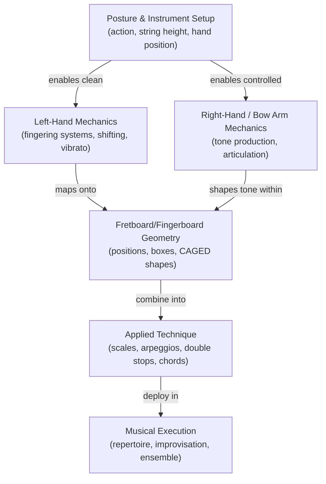

# Lesson 4: Strings Masterclass — Left Hand, Bow Arm, and Fretboard Mastery Across the String Family

This lesson builds the hands-on technical core for string players: violin family fingering and shifting mechanics, bow arm biomechanics, double bass/cello left-hand geometry, classical and steel-string guitar fretboard systems (CAGED, fingerstyle, position playing), and the acoustic physics that explains why each technique works. Every drill below has concrete fingerings, string names, and metronome progressions you can start using in your next practice session.

---

## 1. First-Principles Intuition: How Strings Actually Produce Pitch and Tone (Read Once, Apply Daily)

A vibrating string's pitch is governed by three physical variables: **length** (shortened by fretting or stopping), **tension** (set by tuning), and **mass per unit length** (set by string gauge/material). Halving the vibrating length doubles the frequency — this is why the octave fret/finger position sits exactly halfway between the nut/open string and the bridge, and why a cello's upper positions require the hand to migrate dramatically closer to the bridge compared to a violin.

Tone color comes from **where along the string you excite it** relative to the node pattern of the harmonic series. Bowing or plucking near the bridge (sul ponticello / "bridge pluck") emphasizes high harmonics for a bright, glassy sound. Bowing or plucking near the fingerboard/soundhole (sul tasto) damps the higher harmonics for a darker, rounder sound. This single principle — **contact point controls harmonic content** — underlies sounding-point technique on bowed strings, apoyando/tirando placement on classical guitar, and pickup selection on electric bass and guitar. You don't need the full Fourier math to use this; you need to feel where you are touching the string relative to the bridge and know that moving toward the bridge always brightens, moving away always warms.

Everything else in this lesson — fingerings, shifting, picking mechanics, bowing — is about delivering consistent, controlled energy into the string at a chosen contact point without excess tension in the hands, wrists, or shoulders. Tension is the enemy of both tone and speed: a locked joint cannot transfer weight efficiently and cannot move fast.

---

## 2. Core Architecture: The Technical Skill Stack



Each layer is a prerequisite for the one above. Skipping straight to repertoire without secure fretboard geometry produces the classic plateau: a player who can get through pieces but can't improvise, transpose, or sight-read confidently because they never built the underlying position maps.

---

## 3. Violin Family: Left-Hand Architecture

### 3.1 Hand Frame and Finger Numbering

Fingers are numbered 1 (index) through 4 (pinky); the thumb never stops strings in normal position playing. Establish the **hand frame** in first position before anything else:

- Thumb opposite the 1st or 2nd finger, resting lightly against the neck — not gripping.
- Base knuckles roughly parallel to the fingerboard; fingers arch over the string and drop from above, not from the side.
- Elbow hangs under the instrument (violin/viola) or swings around the neck (cello) so each finger can fall straight down without twisting the wrist.

**Low 2nd finger vs. high 2nd finger** is the first real fingering decision students face. In first position on the A string, playing a G major scale requires a *low* 2nd finger (half step above 1st finger, B♮→... no — concretely: for G major on the A string, 1st finger = B, 2nd finger low = C, this is a half step from B). For D major on the A string, 2nd finger is *high* (whole step from 1st finger: B to C#). Drill both patterns against open strings daily so the hand learns the half-step and whole-step spacing by feel, not by thinking.

**First-Position Finger Pattern Drill:**

```
FIRST-POSITION PATTERN DRILL (Violin, A string)
─────────────────────────────────────────────
Pattern 1 (G major, low 2):
  Open A - 1(B) - 2low(C) - 3(D)
  Half steps: 2-3 is a half step, 1-2 is a
  half step. Listen for the close finger
  spacing between 1 and 2.

Pattern 2 (D major, high 2):
  Open A - 1(B) - 2high(C#) - 3(D)
  Half steps: 2-3 is a half step, 1-2 is a
  WHOLE step. The 2nd finger sits noticeably
  higher up (closer to 3rd finger).

Drill: Alternate Pattern 1 and Pattern 2,
four times each, listening for the shift in
2nd-finger spacing. Use open A as a drone
reference — stop the bow between patterns
and check the 2nd finger against the open
string's overtone (harmonic 3rd/C# should
ring sympathetically if in tune for Pattern 2).

Metronome: 60 BPM, quarter notes.
Progression: Week 1: 60 BPM. Week 2: 80 BPM.
             Week 3: 110 BPM, slurred 2 notes
             per bow.
```

### 3.2 Shifting Mechanics

A shift is a controlled, single smooth motion of the entire hand/arm along the neck — not a series of small finger walks. Three shifting principles govern clean execution:

1. **Guide finger continuity.** Use the same finger that starts the shift to "slide" (lightened pressure, not full stop) to the new position before the target finger drops. Example: shifting from 1st position 1st finger D to 3rd position 1st finger G on the D string — the 1st finger slides D→G, lightly touching, then the target finger (could be 1st finger again, or another finger) commits.
2. **Arm leads, hand follows.** The shift is driven by forearm/upper-arm motion, not by the fingers pulling the hand. A tense, finger-led shift produces audible scooping/sliding (undesirable except as a deliberate portamento).
3. **Release before the shift.** Momentarily lighten left-hand pressure and bow pressure through the shift — called the "release point" — so the string isn't dragged, which causes a scratchy glissando artifact.

**Shifting Drill — 1st to 3rd Position, One String:**

```
SHIFTING DRILL (Violin, D string)
─────────────────────────────────────────────
Goal: Clean, inaudible shifts using guide-
      finger continuity.

Step 1: Play 1st finger E (1st position).
Step 2: Lighten pressure (not fully releasing
         contact), slide 1st finger up the
         string to 3rd position (now sounding
         G if held, but you're passing through).
Step 3: Drop 3rd finger firmly to sound B
         (3rd position).
Step 4: Reverse: release 3rd finger, guide
         with 1st finger sliding back down to
         1st position E.

Bow: One long down-bow through the entire
     up-shift, one long up-bow through the
     down-shift. This forces you to coordinate
     bow speed with arm travel time — rushing
     the bow produces a rushed, audible shift.

Metronome: 60 BPM. Each shift = 2 beats up,
           2 beats down.
Progression:
  Week 1: 60 BPM, exaggerate the slide feeling
          to internalize guide-finger motion.
  Week 2: 72 BPM, reduce slide audibility —
          aim for near-silent transit.
  Week 3: 90 BPM, same drill on G and A
          strings.
  Week 4: Apply to a real shift from your
          repertoire; isolate just that shift
          and loop it 10 times slowly before
          returning to tempo.
```

### 3.3 Vibrato Mechanics (Mechanical, Not Just Expressive)

Vibrato is a controlled oscillation of pitch below (primarily) and slightly above the true pitch, produced by rocking motion at the wrist (wrist vibrato) or forearm (arm vibrato), with the fingertip pivoting on the string as the contact point. Beginning players should isolate the joint before combining:

- **Wrist vibrato drill:** finger planted on a note, forearm still, rock the hand at the wrist so the fingertip rolls slightly forward and back. Produces a faster, narrower oscillation — suited to Baroque/Classical repertoire and fast passages.
- **Arm vibrato drill:** finger planted, wrist relatively fixed relative to forearm, the entire forearm oscillates from the elbow. Produces a wider, slower, more Romantic sound.

```
VIBRATO ISOLATION DRILL
─────────────────────────────────────────────
Setup: 3rd finger, D string, 3rd position (G).
       Thumb maintains light contact with neck
       (do not grip harder to compensate).

Step 1 (wrist only): Rock hand forward/back
  at the wrist joint, 2 oscillations/sec,
  for 8 beats at 60 BPM. Forearm stays still —
  check in a mirror.

Step 2 (arm only): Lock the wrist relative to
  the forearm (use the other hand briefly to
  feel the wrist staying neutral), oscillate
  from the elbow, 1.5 oscillations/sec, for
  8 beats.

Step 3 (combined): Blend both, let the wrist
  initiate and the forearm follow in a single
  fluid rock. This is the mature vibrato motion
  used in performance.

Metronome: 60 BPM throughout.
Progression: Increase oscillation speed weekly
  by roughly 10%, capping around 6-7
  oscillations/sec for fast, intense vibrato.
Daily: 5 minutes, rotate through 1st, 2nd,
       3rd, 4th fingers (4th finger/pinky
       vibrato is weakest — budget extra
       repetitions here).
```

---

## 4. Cello and Double Bass: Extended-Position Left-Hand Geometry

### 4.1 Cello: Half Position Through Thumb Position

Cello fingering uses 1-2-3-4 like the violin in lower positions but with wider finger spacing (lower string tension, longer string length) requiring **hand frame expansion** as you descend to the C and G strings. From roughly 5th position upward on the A string, cellists shift to **thumb position**: the thumb comes off the neck and lies flat across two strings as a movable "capo" finger, with 1-2-3-4 operating above it.

**Thumb Position Entry Drill:**

```
THUMB POSITION ENTRY DRILL (Cello, A string)
─────────────────────────────────────────────
Goal: Establish thumb-as-anchor without
      collapsing hand shape.

Step 1: Place thumb flat across A and D
        strings at the octave harmonic node
        (where the string naturally produces
        a harmonic octave — roughly the
        halfway point of the string length).
        Press enough to stop both strings
        cleanly, not just touch.

Step 2: Drop 1st finger a whole step above the
        thumb on A string. Check pitch against
        open A harmonic.

Step 3: Add 2nd and 3rd fingers in sequence,
        whole step then half step spacing
        (standard thumb-position hand frame).

Step 4: Practice octaves: thumb note on A
        string, 3rd finger simultaneously on D
        string one octave above where the open
        D would ring — builds the octave hand
        frame used constantly in upper-register
        cello repertoire.

Metronome: 50 BPM, half notes (slow — thumb
           position accuracy depends on
           careful proprioceptive calibration,
           not speed).
Daily: 5 minutes before any thumb-position
       repertoire work.
```

### 4.2 Double Bass: Simandl 1-2-4 and the Position System

The double bass's long string length and high tension make a 1-2-3-4 chromatic hand frame physically impractical in the lower positions — the half-step spacing between adjacent frets of effort would overstretch the hand. Franz Simandl's system solves this with **1-2-4 fingering** in half position through 4th position: only fingers 1, 2, and 4 are used (3rd finger rides along for support but doesn't stop independently), with finger 1 covering a half step, finger 2 a whole step from 1, and finger 4 a half step beyond 2 — spanning a whole tone with 1-2 and a half tone with 2-4.

From roughly 5th/6th position and above (thumb position territory on bass, usually starting around the octave harmonic on the G string), switch to **One-Finger-Per-Fret (OFPF)** with 1-2-3-4, because the string length has shortened enough that half-step spacing becomes comfortable again.

**Simandl 1-2-4 Drill:**

```
SIMANDL 1-2-4 DRILL (Double Bass, G string)
─────────────────────────────────────────────
Goal: Internalize the 1-2-4 spacing so lower-
      position passages don't strain the hand.

Half Position:
  Open G - 1(Ab) - 2(A) - 4(Bb)
  Spacing: 1 to 2 = whole step, 2 to 4 = half
  step. Keep 3rd finger relaxed and trailing
  just behind 4th — do not lift it away from
  the hand.

1st Position (shift up a half step):
  1(A) - 2(Bb) - 4(B)

Thumb anchor check: thumb sits opposite
  roughly between fingers 1 and 2, behind the
  neck, applying light counter-pressure only —
  never squeezing.

Metronome: 50 BPM, quarter notes, down-up bow
           or pizzicato alternating i-m fingers.
Progression:
  Week 1: 50 BPM, half position only.
  Week 2: 60 BPM, add 1st position, practice
          the half-position-to-1st-position
          shift using guide-finger continuity
          (same principle as violin family).
  Week 3: 70 BPM, full half-through-4th-
          position scale, two octaves.
  Week 4: Introduce OFPF above 5th position,
          noting the hand-frame contraction.
```

### 4.3 Floating Thumb Mute (Electric Bass Guitar)

On electric bass, resting the plucking-hand thumb across the lower adjacent string (rather than anchoring on the pickup) kills sympathetic ringing from unplayed lower strings while giving the thumb a mobile mute point as you move across strings.

```
FLOATING THUMB MUTE DRILL (4-string bass)
─────────────────────────────────────────────
Setup: Rest thumb on the E string while
       playing a line on the A string. As
       you move to the D string, thumb moves
       to rest on A string. As you move to G
       string, thumb rests on D string.

Exercise: Play a chromatic walking line:
  E string: E-F-F#-G (frets 0-1-2-3)
  A string: A-Bb-B-C (frets 0-1-2-3)
  D string: D-Eb-E-F (frets 0-1-2-3)
  G string: G-Ab-A-Bb (frets 0-1-2-3)

  Move the thumb one string higher each time
  you move your plucking fingers one string
  higher. Check for zero ringing from the
  strings below the one you're playing by
  listening for a clean, dry low end — any
  buzz or hum indicates the thumb isn't
  seated firmly enough.

Left hand: Use 1-2-4 (Simandl logic applies
  to bass guitar too, in frets 1-4) OR OFPF
  from fret 5 upward, matching the double
  bass logic to prevent tendon strain in the
  wide low frets.

Metronome: 70 BPM eighth notes → 90 → 110 BPM
           over 3 weeks.
```

---

## 5. Bass Guitar: Movable Box Patterns and Slap Mechanics

### 5.1 Root-3rd-5th-Octave Box Shapes

Bass lines are built from movable fretboard "boxes" anchored on the root note. Learn these two universal shapes on the E string (movable to any root by sliding the whole shape):

**Major box (root on E string, e.g., root = C at fret 8):**
```
G string: -------10------  (octave)
D string: ---7-----------  (5th)
A string: -5-------------  (major 3rd, fret 5 relative = whole step+half from root... )
E string: 8---------------  (root)
```
Concretely for root C (E string, fret 8): Root = E-string fret 8 (C), Major 3rd = A-string fret 7 (E), 5th = D-string fret 7 (G), Octave = G-string fret 10 (C). Finger with 1 (root), 1 or 2 (3rd — shift back one string, same fret-ish region), 1 (5th), 3 (octave) — adjust to hand size, but **keep the shape constant** so it transposes instantly anywhere on the neck.

**Minor box (same root):** Minor 3rd = A-string fret 6 instead of 7. One-fret difference between major and minor box — drill both back-to-back so your fretting hand learns the half-step distinction kinesthetically, not just theoretically.

```
MOVABLE BOX DRILL (Bass guitar)
─────────────────────────────────────────────
Goal: Play root-3rd-5th-octave in both major
      and minor qualities, movable to any root,
      without looking at the fretboard.

Step 1: Starting root = E string, fret 5 (A).
        Play major box: A - C# - E - A.
        Ascend and descend, quarter notes.
Step 2: Same root, minor box: A - C - E - A.
Step 3: Slide the whole shape up 2 frets
        (root = B), repeat major then minor.
        Continue chromatically up to fret 12,
        then back down.

Fingering: 1-2-1-3 (approx.) for major;
           1-1-1-3 for minor (shift-free since
           minor 3rd and root fall closer) —
           adapt per your hand span, but lock
           in ONE consistent fingering pattern
           and drill it until automatic.

Metronome: 60 BPM quarter notes → 90 BPM →
           120 BPM over 3 weeks.
Application: Once automatic, call out random
             roots and qualities (major/minor)
             and execute the box in under 2
             seconds — this is the speed real
             walking-bass and function-playing
             demands.
```

### 5.2 Walking Bass Chromatic Approach Rule

The chromatic approach note rule: on the beat *before* a target chord's root, play a note a half step above or below that root (whichever is closer to your current position) to create forward pull into the next downbeat.

```
WALKING BASS CHROMATIC APPROACH DRILL
─────────────────────────────────────────────
Progression: C - F - G - C (one bar each,
             4/4, quarter-note walking bass)

Bar 1 (C):   C - E - G - B  (root-3rd-5th-
             chromatic approach to F, i.e. a
             half step below F = E natural...
             use B here since it's a half step
             below C's octave, or target F:
             beat 4 = F# or E, whichever is
             closer from your beat-3 note)
Bar 2 (F):   F - A - C - F#  (F# approaches G
             from below by half step)
Bar 3 (G):   G - B - D - C#  (C# approaches D...
             adjust target: beat 4 approaches
             bar 4's root C, so use B or Db)
Bar 4 (C):   C - E - G - E

Rule of thumb for drilling: on beat 4 of every
bar, insert a note a half step above or below
NEXT bar's root. Practice this rule over any
I-IV-V progression in all 12 keys, one key
per day, ascending chromatically.

Metronome: 70 BPM quarter notes → 100 BPM →
           130 BPM (swing feel) over 4 weeks.
```

### 5.3 Slap and Pop Biomechanics

**Slap (thumb):** The thumb strikes the string with the side of the thumb bone (not the pad), bouncing off the fretwire near the end of the fretboard (typically over the 20th-24th fret area or the pickup edge), using a rotational forearm motion (like a quick hitchhiking-thumb flick) rather than a wrist-only strike. The bounce-off, not a dead strike, is what produces the percussive "thump" — the thumb must rebound immediately to let the string ring.

**Pop (index or middle):** Hook the finger under the string, pull perpendicular to the fretboard (upward), and release sharply so the string snaps back against the frets, producing the "pop" transient.

```
SLAP/POP MECHANICS DRILL
─────────────────────────────────────────────
Step 1 — Thumb bounce isolation:
  Mute all strings with left hand (no pitch,
  pure mechanics). Slap the E string with the
  thumb, focusing ONLY on the bounce-off
  rebound — the thumb should never rest on
  the string after contact.
  Reps: 20 strikes, check for consistent
  rebound height and sound.

Step 2 — Pop isolation:
  Hook index finger under G string, pull up
  1cm, release. Listen for a sharp snap
  against the frets, not a dull pluck.
  Reps: 20 pops.

Step 3 — Combine, open strings:
  Thumb slap on E, pop on G, alternating.
  Pattern: Slap-Pop-Slap-Pop
  Metronome: 70 BPM eighth notes.

Step 4 — Apply to a line (fretted):
  Thumb slap root note, pop the octave or
  5th. Classic pattern:
  Slap(root, fret 3 A string) -
  Pop(octave, fret 5 G string) -
  Slap(root) - Pop(5th)

Progression: 70 BPM → 90 BPM → 110 BPM over
             3 weeks. Do not increase tempo
             until the rebound mechanic stays
             clean — rushing calcifies a dead-
             strike habit that is hard to
             unlearn later.
```

---

## 6. Guitar: CAGED System, Picking Mechanics, and Fingerstyle

### 6.1 CAGED — Five Movable Shapes Across the Neck

CAGED maps the open-position C, A, G, E, and D chord shapes as movable barre/partial-barre forms that tile the entire neck, so any chord has five accessible voicings/positions. For a C major chord, the five CAGED-derived shapes appear (in order up the neck) as: C-shape (open position), A-shape (barre at fret 3), G-shape (barre at fret 5), E-shape (barre at fret 8), D-shape (barre at fret 10) — each shape's root notes connect to the next shape's root notes, forming a continuous lattice.

```
CAGED DRILL — C MAJOR ACROSS THE NECK
─────────────────────────────────────────────
Shape 1 (C-shape, open):
  x-3-2-0-1-0 (low E to high E)

Shape 2 (A-shape, barre fret 3):
  x-3-5-5-5-3  (barre 1st finger across fret 3,
  3rd finger A-shape body)

Shape 3 (G-shape, barre fret 5):
  3-5-5-4-3-3  (modified G shape, barre with
  partial 1st finger)

Shape 4 (E-shape, barre fret 8):
  8-10-10-9-8-8  (full barre 1st finger,
  E-shape body)

Shape 5 (D-shape, barre fret 10):
  x-x-10-12-13-12  (D-shape body, root on
  D string)

Drill: Play each shape as a quarter-note
       strum, 4 beats per shape, moving up
       the neck in order. Then reverse.
       Say the shape name aloud as you play
       it — this cements the CAGED letter
       association.

Metronome: 60 BPM.
Progression: Week 1: shapes in isolation.
  Week 2: connect shape 1→2 with a smooth
  slide of the lowest note, finding the
  shared root. Week 3: all 5 shapes, 2 beats
  each. Week 4: apply to a different key
  (e.g., G major) — the shapes are identical,
  only the fret positions shift.
```

**Why this works:** every CAGED shape contains the same interval structure (root-3rd-5th stacked across strings); only the open strings versus barred strings change which shape name applies. Internalizing this lets you find any chord tone, arpeggio, or scale fragment anywhere on the neck without hunting.

### 6.2 Picking Mechanics: Alternate, Economy, and Pick Slanting

**Alternate picking:** strict down-up-down-up regardless of string changes. The default for most passages; builds even rhythmic subdivision.

**Economy picking:** when a string change in the *same direction* as the next note's required stroke is available, follow the physical path of least resistance rather than forcing strict alternation — e.g., descending across strings, a down-stroke naturally continues downward onto the next (lower) string.

**Pick slant:** tilting the pick so its leading edge angles slightly away from the direction of travel reduces string-catching during fast alternate picking. **Downward pick slant** (edge angled toward the floor) suits outside-string escapes; **upward pick slant** suits inside-string escapes. Most players need both depending on the lick's string-crossing pattern.

```
ECONOMY PICKING DRILL (3-notes-per-string scale)
─────────────────────────────────────────────
G major, 3-notes-per-string ascending from
low E string fret 3:
  E string: 3-5-7 (down-up-down)
  A string: 4-5-7 (up-down-up — note the
            direction continues naturally
            because you're moving to an
            adjacent string after a down-
            stroke, so the next stroke
            economizes as an up... adapt
            per your picking-hand habit,
            the key is consistency)
  D string: 4-5-7 (down-up-down)
  G string: 4-5-7 (up-down-up)

Drill: Ascend 2 octaves, descend 2 octaves.
       Focus on minimal pick travel distance
       at each string change — the pick
       should almost graze the new string on
       its way through, not lift and reset.

Metronome: 60 BPM eighth-note triplets (3
           notes per click) → 90 BPM → 120 BPM
           over 4 weeks.
Hand muting: Palm-mute lightly with picking
             hand edge resting on the bridge
             to control unwanted string noise
             from the 3-note-per-string shifts.
```

### 6.3 Fingerstyle: Travis Picking

Travis picking alternates a bass note pattern (thumb, usually alternating between two bass strings on the beat) with syncopated treble notes (index/middle fingers) filling in off-beats, producing the illusion of two independent parts from one guitar.

```
TRAVIS PICKING DRILL (Key of C, PIMA fingering)
─────────────────────────────────────────────
Chord: C major (x-3-2-0-1-0)

Thumb (p) pattern, steady quarter notes:
  Beat 1: C string (bass, fret 3, A string)
  Beat 2: C string (same, root) — or alternate
          to G string (open) for alternating
          bass
  Beat 3: A string (root) again
  Beat 4: G string (open, alternate bass)

Fingers (i, m) pattern, off-beat eighth notes
  (the "and" of each beat):
  "and" of 1: m plucks B string (open)
  "and" of 2: i plucks G string (open)
  "and" of 3: m plucks B string (open)
  "and" of 4: i plucks G string (open)

Combined: p-i-p-m-p-i-p-m (one full measure),
  thumb always on the downbeats, i/m always
  on the upbeats. This interlocking is the
  core Travis-picking mechanic.

Metronome: 50 BPM (slow is essential — the
           independence between thumb and
           fingers must be solid before
           speed) → 70 BPM → 90 BPM over
           4 weeks.
Progression: once C is automatic, apply the
  identical p-i-p-m pattern to G, D, Em, Am —
  the pattern is movable across chord shapes.
```

### 6.4 Classical Guitar Right-Hand: Apoyando, Tirando, and Nail Shaping

**Apoyando (rest stroke):** finger strikes the string and comes to rest against the adjacent string, producing roughly 30% more volume and a fuller tone — used for single-line melody that needs to project over accompaniment.

**Tirando (free stroke):** finger strikes the string and clears it without resting on the next string, allowing multiple strings to ring simultaneously — used for arpeggios and chords.

Nail shape directly determines tone: the nail edge should follow the natural curve of the fingertip with a smooth ramp, filed so the string first contacts the nail slightly left of center (for right-handed players) and glides off smoothly. A nail with a sharp catch produces click; a nail filed too short produces a thin, fleshy tone with no definition.

```
APOYANDO/TIRANDO ISOLATION DRILL
─────────────────────────────────────────────
Setup: Classical guitar, right hand in
       standard position, thumb anchored on
       a bass string for stability.

Step 1 — Apoyando, index finger:
  Strike G string (3rd string), rest against
  B string (2nd string). 8 repetitions.
  Listen: full, round tone, no click.

Step 2 — Apoyando, middle finger: same string,
  8 reps.

Step 3 — Tirando, index and middle alternating
  (i-m-i-m) on the G string, clearing the
  string each time, no resting.
  8 reps, listen for even volume between
  i and m strokes (middle finger is often
  weaker — isolate and strengthen if uneven).

Step 4 — Scale application: play a one-octave
  C major scale using apoyando throughout
  (melody simulation), then the same scale
  using tirando throughout (arpeggio
  simulation). Compare volume and tone by ear.

Metronome: 60 BPM quarter notes.
Daily: 5 minutes before repertoire, as part
       of standard warm-up.
```

---

## 7. Drum Set Note (Cross-Reference for Ensemble String Players)

String players performing in rhythm sections should understand the Moeller stroke conceptually even if they don't play drums: it's a whipping, rebound-based motion (wrist initiates, forearm follows, then rebounds freely) that produces maximum volume with minimum tension — the same "weight falls through, rebound is free" principle as bow-arm arm-weight transfer and bass slap-thumb bounce-off. If you coach a rhythm section or play electric bass locked to a drummer, recognizing this shared biomechanical principle (controlled drop, free rebound, no muscled follow-through) helps you communicate technique issues across instruments in the same vocabulary.

---

## 8. Practice Schedule Summary

| Category | Drill | Instrument | Frequency | Duration |
|---|---|---|---|---|
| Hand frame | First-Position Pattern Drill | Violin/Viola | Daily | 5 min |
| Shifting | 1st-to-3rd Position Shift Drill | Violin/Viola/Cello | Daily | 8 min |
| Vibrato | Vibrato Isolation Drill | Violin/Viola/Cello | Daily | 5 min |
| Thumb position | Thumb Position Entry Drill | Cello | 4x/week | 5 min |
| Low position | Simandl 1-2-4 Drill | Double Bass | Daily | 8 min |
| Muting | Floating Thumb Mute Drill | Bass Guitar | Daily | 5 min |
| Box patterns | Movable Box Drill | Bass Guitar | Daily | 8 min |
| Walking bass | Chromatic Approach Drill | Bass Guitar | 4x/week | 8 min |
| Slap/pop | Slap/Pop Mechanics Drill | Bass Guitar | 3x/week | 6 min |
| Chord shapes | CAGED Drill | Guitar | Daily | 10 min |
| Picking | Economy Picking Drill | Guitar | Daily | 8 min |
| Fingerstyle | Travis Picking Drill | Guitar | 4x/week | 8 min |
| Classical RH | Apoyando/Tirando Drill | Classical Guitar | Daily | 5 min |

---

## 9. Further Reading and Primary Sources

- Galamian, I. (1962). *Principles of Violin Playing and Teaching*. Prentice-Hall.
- Flesch, C. (1939). *The Art of Violin Playing, Book One*. Carl Fischer.
- Simandl, F. (1874). *New Method for the Double Bass*. Carl Fischer. (Source of the 1-2-4 fingering system.)
- Fischer, S. (2012). *The Violin Lesson*. Oxford University Press.
- Tennant, R. (2011). *Pumping Nylon* (2nd ed.). Alfred Music. (Classical guitar technique.)
- Shearer, A. (1996). *Classic Guitar Technique* (Vols. I–II). Alfred Music.
- Friedland, E. (2001). *Building Walking Bass Lines*. Hal Leonard.
- Wooten, V. (2006). *Bass Day Instructional Materials* — slap/pop mechanics reference.
- Christiansen, M. (various). *CAGED System* instructional series, Hal Leonard.
- Traum, H. *Fingerpicking Guitar Techniques*, Oak Publications. (Travis picking method.)
