# Lesson 4: Strings Masterclass — Left Hand, Bow Arm, and Fretboard Mastery Across the String Family

This lesson builds the hands-on technical core for string players: violin family fingering and shifting mechanics, bow arm biomechanics, double bass/cello left-hand geometry, classical and steel-string guitar fretboard systems (CAGED, fingerstyle, position playing), and the acoustic physics that explains why each technique works. Every drill below has concrete fingerings, string names, and metronome progressions you can start using in your next practice session.

---

## 1. First-Principles Intuition: How Strings Actually Produce Pitch and Tone (Read Once, Apply Daily)

A vibrating string's pitch is governed by three physical variables: **length** (shortened by fretting or stopping), **tension** (set by tuning), and **mass per unit length** (set by string gauge/material). Halving the vibrating length doubles the frequency — this is why the octave fret/finger position sits exactly halfway between the nut/open string and the bridge, and why a cello's upper positions require the hand to migrate dramatically closer to the bridge compared to a violin.

Tone color comes from **where along the string you excite it** relative to the node pattern of the harmonic series. Bowing or plucking near the bridge (sul ponticello / "bridge pluck") emphasizes high harmonics for a bright, glassy sound. Bowing or plucking near the fingerboard/soundhole (sul tasto) damps the higher harmonics for a darker, rounder sound. This single principle — **contact point controls harmonic content** — underlies sounding-point technique on bowed strings, apoyando/tirando placement on classical guitar, and pickup selection on electric bass and guitar. You don't need the full Fourier math to use this; you need to feel where you are touching the string relative to the bridge and know that moving toward the bridge always brightens, moving away always warms.

Everything else in this lesson — fingerings, shifting, picking mechanics, bowing — is about delivering consistent, controlled energy into the string at a chosen contact point without excess tension in the hands, wrists, or shoulders. Tension is the enemy of both tone and speed: a locked joint cannot transfer weight efficiently and cannot move fast.

---

## 2. Core Architecture: The Technical Skill Stack

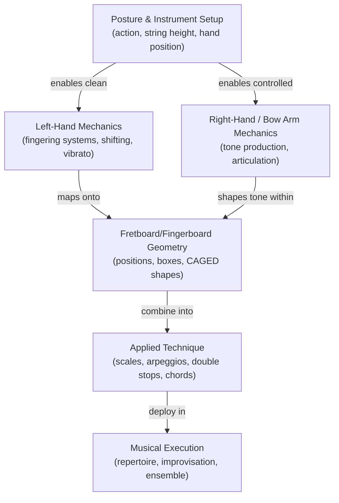

Each layer is a prerequisite for the one above. Skipping straight to repertoire without secure fretboard geometry produces the classic plateau: a player who can get through pieces but can't improvise, transpose, or sight-read confidently because they never built the underlying position maps.

---

## 3. Violin Family: Left-Hand Architecture

### 3.1 Hand Frame and Finger Numbering

Fingers are numbered 1 (index) through 4 (pinky); the thumb never stops strings in normal position playing. Establish the **hand frame** in first position before anything else:

- Thumb opposite the 1st or 2nd finger, resting lightly against the neck — not gripping.
- Base knuckles roughly parallel to the fingerboard; fingers arch over the string and drop from above, not from the side.
- Elbow hangs under the instrument (violin/viola) or swings around the neck (cello) so each finger can fall straight down without twisting the wrist.

**Low 2nd finger vs. high 2nd finger** is the first real fingering decision students face. In first position on the A string, playing a G major scale requires a *low* 2nd finger (half step above 1st finger, B♮→... no — concretely: for G major on the A string, 1st finger = B, 2nd finger low = C, this is a half step from B). For D major on the A string, 2nd finger is *high* (whole step from 1st finger: B to C#). Drill both patterns against open strings daily so the hand learns the half-step and whole-step spacing by feel, not by thinking.

**First-Position Finger Pattern Drill:**

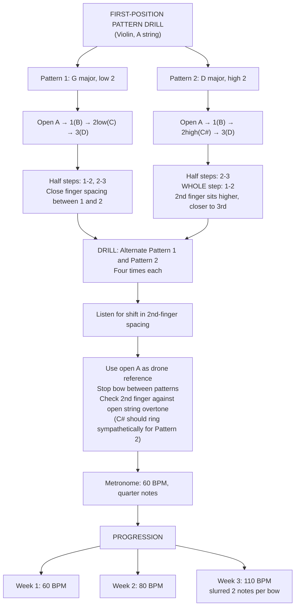

### 3.2 Shifting Mechanics

A shift is a controlled, single smooth motion of the entire hand/arm along the neck — not a series of small finger walks. Three shifting principles govern clean execution:

1. **Guide finger continuity.** Use the same finger that starts the shift to "slide" (lightened pressure, not full stop) to the new position before the target finger drops. Example: shifting from 1st position 1st finger D to 3rd position 1st finger G on the D string — the 1st finger slides D→G, lightly touching, then the target finger (could be 1st finger again, or another finger) commits.
2. **Arm leads, hand follows.** The shift is driven by forearm/upper-arm motion, not by the fingers pulling the hand. A tense, finger-led shift produces audible scooping/sliding (undesirable except as a deliberate portamento).
3. **Release before the shift.** Momentarily lighten left-hand pressure and bow pressure through the shift — called the "release point" — so the string isn't dragged, which causes a scratchy glissando artifact.

**Shifting Drill — 1st to 3rd Position, One String:**

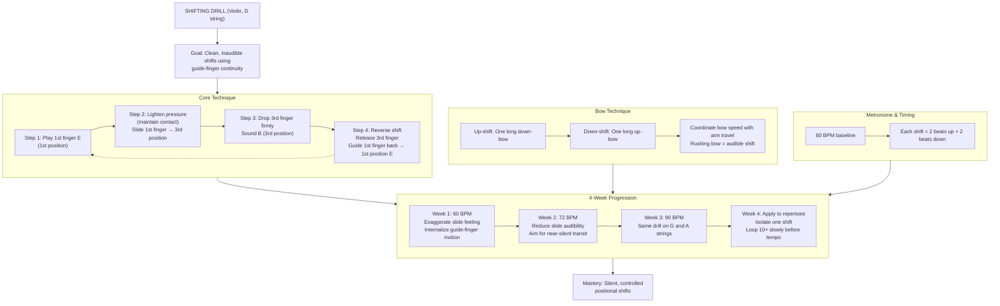

### 3.3 Vibrato Mechanics (Mechanical, Not Just Expressive)

Vibrato is a controlled oscillation of pitch below (primarily) and slightly above the true pitch, produced by rocking motion at the wrist (wrist vibrato) or forearm (arm vibrato), with the fingertip pivoting on the string as the contact point. Beginning players should isolate the joint before combining:

- **Wrist vibrato drill:** finger planted on a note, forearm still, rock the hand at the wrist so the fingertip rolls slightly forward and back. Produces a faster, narrower oscillation — suited to Baroque/Classical repertoire and fast passages.
- **Arm vibrato drill:** finger planted, wrist relatively fixed relative to forearm, the entire forearm oscillates from the elbow. Produces a wider, slower, more Romantic sound.

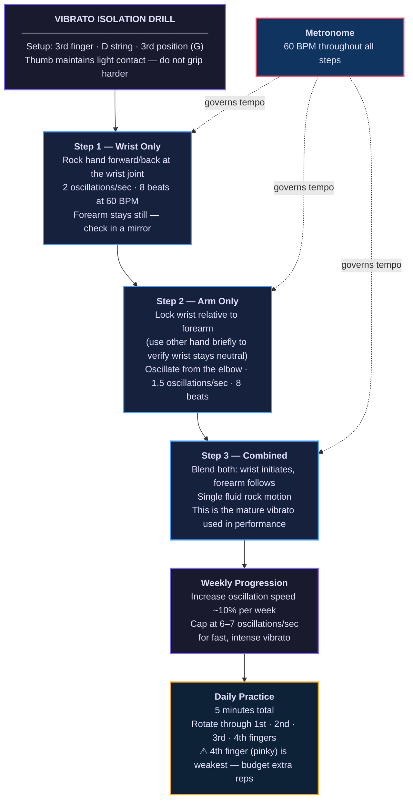

---

## 4. Cello and Double Bass: Extended-Position Left-Hand Geometry

### 4.1 Cello: Half Position Through Thumb Position

Cello fingering uses 1-2-3-4 like the violin in lower positions but with wider finger spacing (lower string tension, longer string length) requiring **hand frame expansion** as you descend to the C and G strings. From roughly 5th position upward on the A string, cellists shift to **thumb position**: the thumb comes off the neck and lies flat across two strings as a movable "capo" finger, with 1-2-3-4 operating above it.

**Thumb Position Entry Drill:**

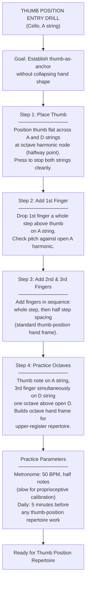

### 4.2 Double Bass: Simandl 1-2-4 and the Position System

The double bass's long string length and high tension make a 1-2-3-4 chromatic hand frame physically impractical in the lower positions — the half-step spacing between adjacent frets of effort would overstretch the hand. Franz Simandl's system solves this with **1-2-4 fingering** in half position through 4th position: only fingers 1, 2, and 4 are used (3rd finger rides along for support but doesn't stop independently), with finger 1 covering a half step, finger 2 a whole step from 1, and finger 4 a half step beyond 2 — spanning a whole tone with 1-2 and a half tone with 2-4.

From roughly 5th/6th position and above (thumb position territory on bass, usually starting around the octave harmonic on the G string), switch to **One-Finger-Per-Fret (OFPF)** with 1-2-3-4, because the string length has shortened enough that half-step spacing becomes comfortable again.

**Simandl 1-2-4 Drill:**

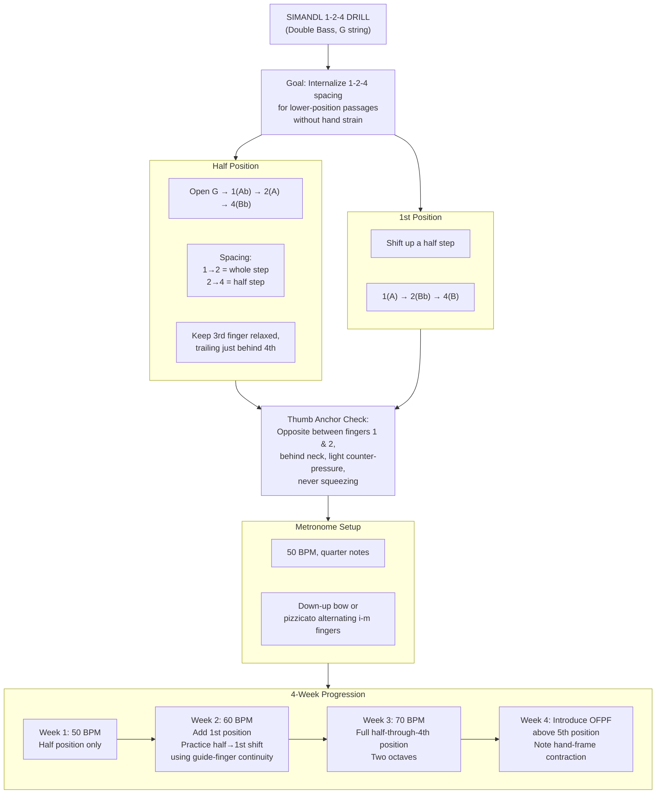

### 4.3 Floating Thumb Mute (Electric Bass Guitar)

On electric bass, resting the plucking-hand thumb across the lower adjacent string (rather than anchoring on the pickup) kills sympathetic ringing from unplayed lower strings while giving the thumb a mobile mute point as you move across strings.

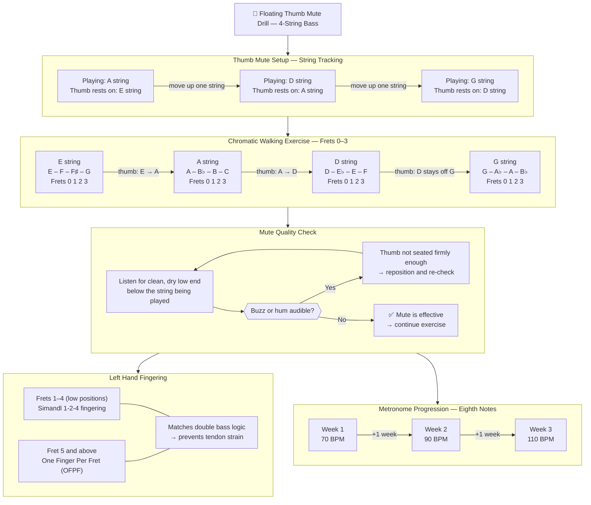

---

## 5. Bass Guitar: Movable Box Patterns and Slap Mechanics

### 5.1 Root-3rd-5th-Octave Box Shapes

Bass lines are built from movable fretboard "boxes" anchored on the root note. Learn these two universal shapes on the E string (movable to any root by sliding the whole shape):

**Major box (root on E string, e.g., root = C at fret 8):**
```text
G string: -------10------  (octave)
D string: ---7-----------  (5th)
A string: -5-------------  (major 3rd, fret 5 relative = whole step+half from root... )
E string: 8---------------  (root)
```
Concretely for root C (E string, fret 8): Root = E-string fret 8 (C), Major 3rd = A-string fret 7 (E), 5th = D-string fret 7 (G), Octave = G-string fret 10 (C). Finger with 1 (root), 1 or 2 (3rd — shift back one string, same fret-ish region), 1 (5th), 3 (octave) — adjust to hand size, but **keep the shape constant** so it transposes instantly anywhere on the neck.

**Minor box (same root):** Minor 3rd = A-string fret 6 instead of 7. One-fret difference between major and minor box — drill both back-to-back so your fretting hand learns the half-step distinction kinesthetically, not just theoretically.

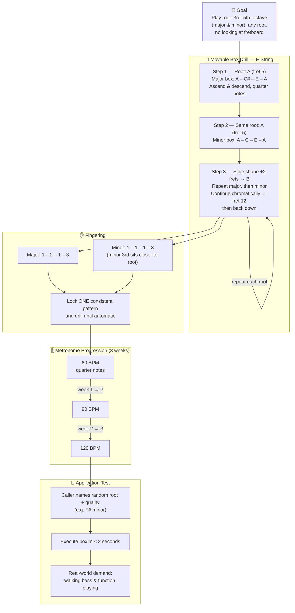

### 5.2 Walking Bass Chromatic Approach Rule

The chromatic approach note rule: on the beat *before* a target chord's root, play a note a half step above or below that root (whichever is closer to your current position) to create forward pull into the next downbeat.

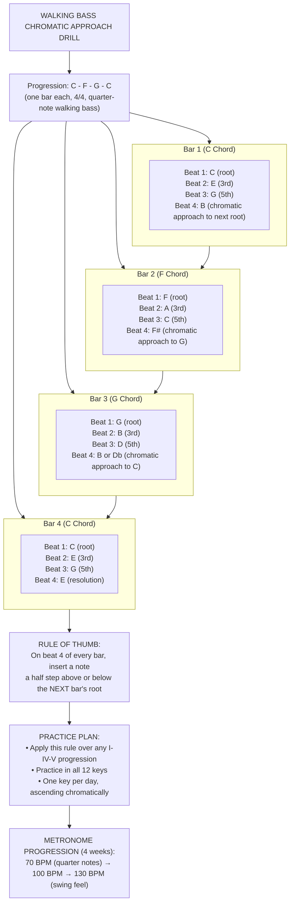

### 5.3 Slap and Pop Biomechanics

**Slap (thumb):** The thumb strikes the string with the side of the thumb bone (not the pad), bouncing off the fretwire near the end of the fretboard (typically over the 20th-24th fret area or the pickup edge), using a rotational forearm motion (like a quick hitchhiking-thumb flick) rather than a wrist-only strike. The bounce-off, not a dead strike, is what produces the percussive "thump" — the thumb must rebound immediately to let the string ring.

**Pop (index or middle):** Hook the finger under the string, pull perpendicular to the fretboard (upward), and release sharply so the string snaps back against the frets, producing the "pop" transient.

```mermaid
flowchart TD
    Start["SLAP/POP MECHANICS DRILL"]
    
    Step1["Step 1 — Thumb Bounce Isolation"]
    Step1Details["Mute all strings with left hand<br/>(no pitch, pure mechanics)<br/>Slap E string with thumb<br/>Focus on bounce-off rebound<br/>Thumb never rests on string<br/><b>Reps: 20 strikes</b><br/>Check for consistent rebound height & sound"]
    
    Step2["Step 2 — Pop Isolation"]
    Step2Details["Hook index finger under G string<br/>Pull up 1cm, release<br/>Listen for sharp snap against frets<br/>(not a dull pluck)<br/><b>Reps: 20 pops</b>"]
    
    Step3["Step 3 — Combine, Open Strings"]
    Step3Details["Thumb slap on E, pop on G, alternating<br/>Pattern: Slap-Pop-Slap-Pop<br/><b>Metronome: 70 BPM eighth notes</b>"]
    
    Step4["Step 4 — Apply to Line (Fretted)"]
    Step4Details["Thumb slap root note, pop octave or 5th<br/>Classic pattern:<br/>Slap (root, fret 3 A string) →<br/>Pop (octave, fret 5 G string) →<br/>Slap (root) → Pop (5th)"]
    
    Progression["Tempo Progression"]
    ProgressionDetails["70 BPM → 90 BPM → 110 BPM<br/>Over 3 weeks<br/><br/><b>⚠ Do NOT increase tempo until<br/>rebound mechanic stays clean</b><br/>Rushing calcifies dead-strike habit<br/>that is hard to unlearn later"]
    
    Start --> Step1
    Step1 --> Step1Details
    Step1Details --> Step2
    Step2 --> Step2Details
    Step2Details --> Step3
    Step3 --> Step3Details
    Step3Details --> Step4
    Step4 --> Step4Details
    Step4Details --> Progression
    Progression --> ProgressionDetails
```

---

## 6. Guitar: CAGED System, Picking Mechanics, and Fingerstyle

### 6.1 CAGED — Five Movable Shapes Across the Neck

CAGED maps the open-position C, A, G, E, and D chord shapes as movable barre/partial-barre forms that tile the entire neck, so any chord has five accessible voicings/positions. For a C major chord, the five CAGED-derived shapes appear (in order up the neck) as: C-shape (open position), A-shape (barre at fret 3), G-shape (barre at fret 5), E-shape (barre at fret 8), D-shape (barre at fret 10) — each shape's root notes connect to the next shape's root notes, forming a continuous lattice.

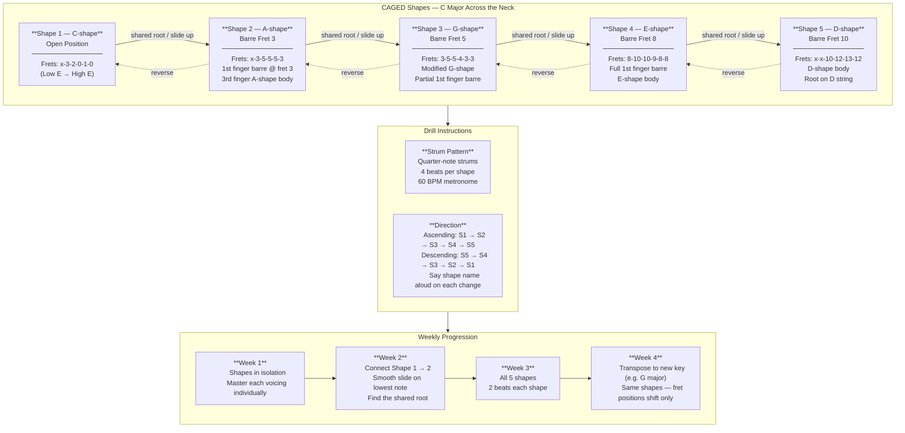

**Why this works:** every CAGED shape contains the same interval structure (root-3rd-5th stacked across strings); only the open strings versus barred strings change which shape name applies. Internalizing this lets you find any chord tone, arpeggio, or scale fragment anywhere on the neck without hunting.

### 6.2 Picking Mechanics: Alternate, Economy, and Pick Slanting

**Alternate picking:** strict down-up-down-up regardless of string changes. The default for most passages; builds even rhythmic subdivision.

**Economy picking:** when a string change in the *same direction* as the next note's required stroke is available, follow the physical path of least resistance rather than forcing strict alternation — e.g., descending across strings, a down-stroke naturally continues downward onto the next (lower) string.

**Pick slant:** tilting the pick so its leading edge angles slightly away from the direction of travel reduces string-catching during fast alternate picking. **Downward pick slant** (edge angled toward the floor) suits outside-string escapes; **upward pick slant** suits inside-string escapes. Most players need both depending on the lick's string-crossing pattern.

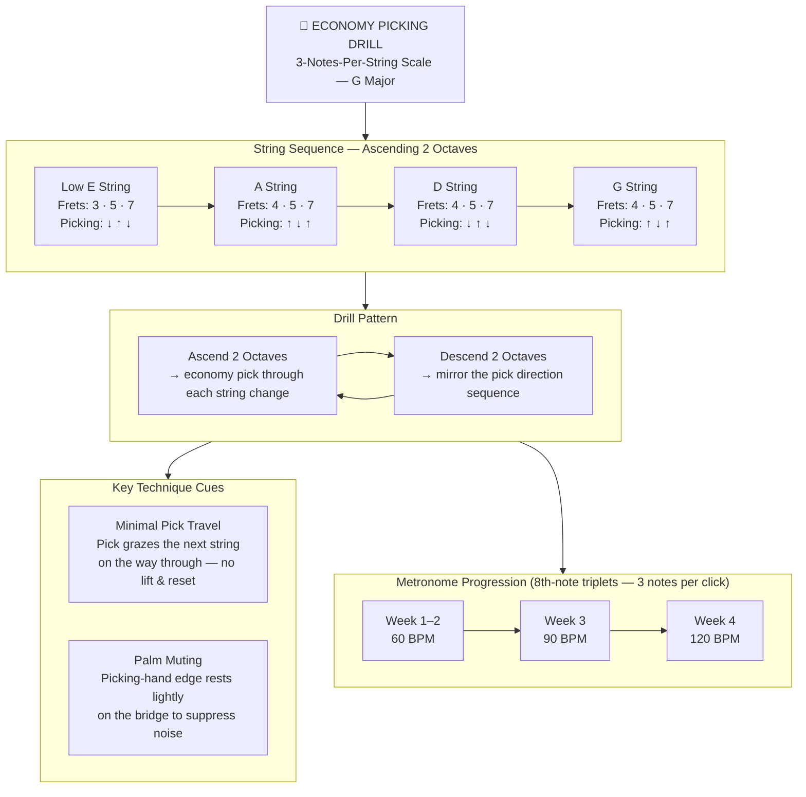

### 6.3 Fingerstyle: Travis Picking

Travis picking alternates a bass note pattern (thumb, usually alternating between two bass strings on the beat) with syncopated treble notes (index/middle fingers) filling in off-beats, producing the illusion of two independent parts from one guitar.

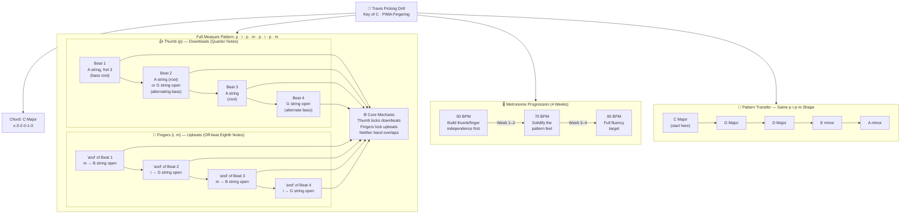

### 6.4 Classical Guitar Right-Hand: Apoyando, Tirando, and Nail Shaping

**Apoyando (rest stroke):** finger strikes the string and comes to rest against the adjacent string, producing roughly 30% more volume and a fuller tone — used for single-line melody that needs to project over accompaniment.

**Tirando (free stroke):** finger strikes the string and clears it without resting on the next string, allowing multiple strings to ring simultaneously — used for arpeggios and chords.

Nail shape directly determines tone: the nail edge should follow the natural curve of the fingertip with a smooth ramp, filed so the string first contacts the nail slightly left of center (for right-handed players) and glides off smoothly. A nail with a sharp catch produces click; a nail filed too short produces a thin, fleshy tone with no definition.

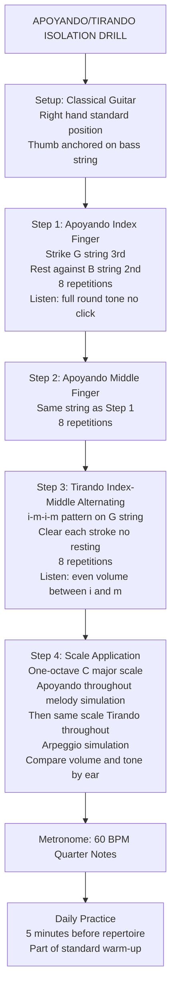

---

## 7. Drum Set Note (Cross-Reference for Ensemble String Players)

String players performing in rhythm sections should understand the Moeller stroke conceptually even if they don't play drums: it's a whipping, rebound-based motion (wrist initiates, forearm follows, then rebounds freely) that produces maximum volume with minimum tension — the same "weight falls through, rebound is free" principle as bow-arm arm-weight transfer and bass slap-thumb bounce-off. If you coach a rhythm section or play electric bass locked to a drummer, recognizing this shared biomechanical principle (controlled drop, free rebound, no muscled follow-through) helps you communicate technique issues across instruments in the same vocabulary.

---

## 8. Practice Schedule Summary

| Category | Drill | Instrument | Frequency | Duration |
|---|---|---|---|---|
| Hand frame | First-Position Pattern Drill | Violin/Viola | Daily | 5 min |
| Shifting | 1st-to-3rd Position Shift Drill | Violin/Viola/Cello | Daily | 8 min |
| Vibrato | Vibrato Isolation Drill | Violin/Viola/Cello | Daily | 5 min |
| Thumb position | Thumb Position Entry Drill | Cello | 4x/week | 5 min |
| Low position | Simandl 1-2-4 Drill | Double Bass | Daily | 8 min |
| Muting | Floating Thumb Mute Drill | Bass Guitar | Daily | 5 min |
| Box patterns | Movable Box Drill | Bass Guitar | Daily | 8 min |
| Walking bass | Chromatic Approach Drill | Bass Guitar | 4x/week | 8 min |
| Slap/pop | Slap/Pop Mechanics Drill | Bass Guitar | 3x/week | 6 min |
| Chord shapes | CAGED Drill | Guitar | Daily | 10 min |
| Picking | Economy Picking Drill | Guitar | Daily | 8 min |
| Fingerstyle | Travis Picking Drill | Guitar | 4x/week | 8 min |
| Classical RH | Apoyando/Tirando Drill | Classical Guitar | Daily | 5 min |

---

## 9. Further Reading and Primary Sources

- Galamian, I. (1962). *Principles of Violin Playing and Teaching*. Prentice-Hall.
- Flesch, C. (1939). *The Art of Violin Playing, Book One*. Carl Fischer.
- Simandl, F. (1874). *New Method for the Double Bass*. Carl Fischer. (Source of the 1-2-4 fingering system.)
- Fischer, S. (2012). *The Violin Lesson*. Oxford University Press.
- Tennant, R. (2011). *Pumping Nylon* (2nd ed.). Alfred Music. (Classical guitar technique.)
- Shearer, A. (1996). *Classic Guitar Technique* (Vols. I–II). Alfred Music.
- Friedland, E. (2001). *Building Walking Bass Lines*. Hal Leonard.
- Wooten, V. (2006). *Bass Day Instructional Materials* — slap/pop mechanics reference.
- Christiansen, M. (various). *CAGED System* instructional series, Hal Leonard.
- Traum, H. *Fingerpicking Guitar Techniques*, Oak Publications. (Travis picking method.)
