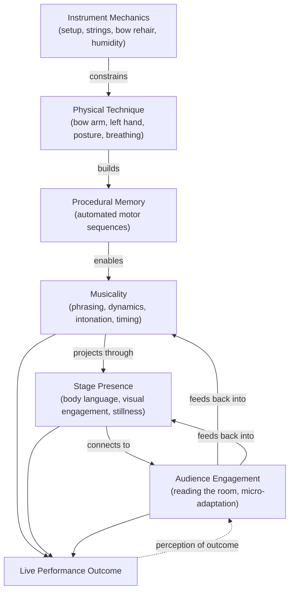
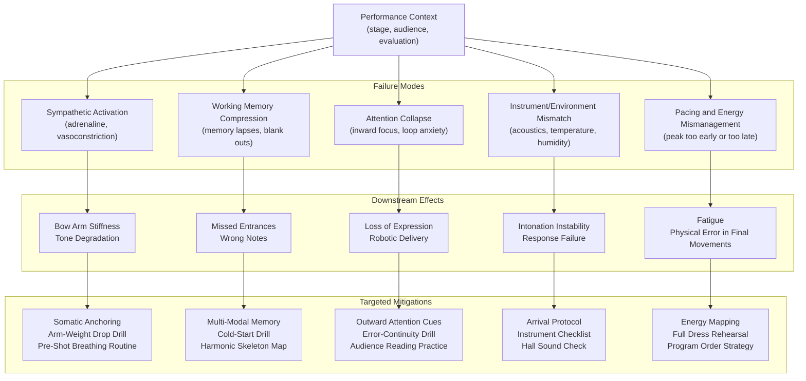

# Lesson 4: Performance Skills — Strings Masterclass

As a masterclass student, you have built a working command of your instrument's mechanics. Stage performance, however, is a separate discipline — one that demands its own rigorous study. This lesson examines the architecture of live string performance: the physiological and psychological substrate, the mechanical systems that govern stage sound, and the specific failure modes that derail even technically accomplished players. The focus is on the violin family and classical guitar as primary examples, with principles that extend broadly across bowed and plucked string instruments.

---

## 1. First-Principles Intuition: What Performance Actually Is

Performance is not an amplified version of practice. It is a distinct act with a distinct neurological profile. Understanding the difference at a mechanistic level is prerequisite to mastering it.

### 1.1 The Autonomic Nervous System and Stage Fear

When you walk onto a stage, the brain's threat-detection circuitry receives a stimulus package: unfamiliar space, social evaluation, irreversibility of action. The sympathetic nervous system releases adrenaline and noradrenaline. The consequences for a string player are specific and severe:

- **Peripheral vasoconstriction** reduces blood flow to the extremities. Cold, stiff fingers directly impair left-hand coordination and reduce tactile sensitivity in the bow arm.
- **Increased muscle tension** elevates resting muscle tone. The shoulder girdle locks, the elbow stiffens, and the fluid weight-transfer mechanics of a good legato stroke degrade.
- **Tremor induction** lowers the threshold for essential tremor, manifesting as bow shake — particularly visible at the tip where leverage is lowest and control demands are highest.
- **Working memory compression** narrows the prefrontal cortex's bandwidth. Performers lose access to memorized fingerings, harmonic anticipation, and interpretive choices they execute effortlessly in practice.

The critical insight is not that adrenaline is the enemy — it is a performance enhancer when channeled. The problem is that untrained performers experience it as pure interference because they have never practiced under conditions that simulate its effects.

### 1.2 The Flow State: Mechanistic Basis

Flow correlates with reduced prefrontal cortex activation combined with heightened activity in basal ganglia circuits governing automatized motor sequences. In this state, well-drilled technical skills execute below the threshold of conscious supervision — the bow arm "knows" a spiccato passage without the performer explicitly deciding each stroke.

The critical invariant is **skill-challenge balance**. Flow is accessible only when the technical demand of the repertoire is commensurate with the performer's actual skill level. Performing repertoire beyond current ability produces anxiety; performing far below ability produces boredom. Neither state is flow.

A second invariant is **procedural consolidation**. Motor sequences practiced to the point of automatization are stored primarily in the cerebellum and basal ganglia, structures largely insulated from the acute stress response. This is why deeply practiced passages survive performance anxiety better than recently learned ones — they are, neurologically speaking, in a different system.

### 1.3 The Performer-Audience Feedback Loop

The audience is not a passive receptor; it is an active component of the performance system. Audience attentiveness and affect feed back to the performer through visual cues (body language, stillness) and auditory cues (breath, rustling, the quality of silence). A performer who develops the capacity to read these signals can modulate interpretive choices in real time.

This feedback loop operates on two timescales: **macro-phrasing** (adjusting the arc of a movement) and **micro-expression** (adjusting the intensity of a single phrase). Both require maintaining a portion of attentional bandwidth directed outward rather than inward. The technical precondition is procedural consolidation: you cannot attend to your audience if your fingers are still demanding conscious supervision.

---

## 2. Core Architecture: The Mechanics of String Performance

The following diagram maps the dependency architecture of live string performance. Each layer depends on the stability of the layer beneath it.



### 2.1 Instrument Mechanics: The Physical Substrate

A technically sophisticated performance is bounded above by the physical condition of the instrument.

**Setup and regulation** encompasses bridge height and curvature, nut slot depth, soundpost position, and string action. For the violin family, a bridge that is too high increases left-hand effort for stopped notes and raises the contact threshold for clean bow strokes. A soundpost that has shifted alters the asymmetric stiffness coupling between the treble and bass sides of the top plate, changing tonal balance in ways that cannot be corrected at the bow.

**Pre-performance instrument checklist (30 minutes before downbeat):**

1. Check all four strings for pitch stability — tune to A-440 (or ensemble pitch), then check after 10 minutes of playing. If a string drifts more than 5 cents, it needs replacement or additional settling time.
2. Inspect bow hair tension — tighten to a gap of approximately 6–8mm between hair and stick at the midpoint. Hair should have a clean, even coat of rosin with no bare patches. If the hair has been used extensively (more than ~40 hours of playing since last rehair) and produces uneven grip, it needs rehairing.
3. Verify that the bridge is standing upright (perpendicular to the top plate, feet flush). A leaning bridge warps under tension and eventually cracks or collapses. Check by sighting from the side — the back of the bridge (facing the tailpiece) should be at a 90-degree angle to the top.
4. Rosin application: 3–5 firm strokes across the full length of the bow hair. Over-rosining produces a harsh, scratchy attack with excessive dust; under-rosining produces skipping and uneven tone, especially in the upper half of the bow.
5. For classical guitar: check string action at the 12th fret (bass E should be approximately 4.0mm, treble E approximately 3.2mm). Inspect for string buzz across all frets. Verify nail shape on the right hand — nails should follow the curvature of the fingertip with a smooth, rounded ramp, filed to a length where the nail-edge contact produces a warm tone with minimal click.

**String selection and age.** Gut-core strings (Pirastro Oliv, Eudoxa) offer complex, warm overtone spectra but are humidity-sensitive. Synthetic-core strings (Dominant, Evah Pirazzi, Warchal Brilliant) offer greater consistency. Steel-core strings (Jargar, Helicore) provide maximum stability but a thinner overtone structure. For performance, replace strings before they show audible false harmonics or pitch instability under bow pressure.

**Bow condition.** A bow rehaired with Mongolian or Siberian stallion hair provides a different rosin-retention profile and grip coefficient than mare hair. For performance, a bow should be rehaired sufficiently in advance that the hair has been played in and rosined to consistency. Fresh rehair on the morning of a performance is a liability.

**Humidity and thermal stabilization.** A violin traveling from a cold car to a warm concert hall requires 20–30 minutes of thermal stabilization before it will hold pitch reliably. Carry a calibrated hygrometer in the case. For classical guitar, a case humidifier (Dampit or two-way humidity control packs like D'Addario Humidipak) is essential in environments below 40% relative humidity to prevent top cracking and fret sprout.

### 2.2 Physical Technique Under Performance Conditions

The transition from practice room to stage exposes technical weaknesses that do not manifest in relaxed settings.

#### 2.2.1 Bow Arm Mechanics Under Tension

Tone production in the violin family rests on the relationship between three variables: **bow speed**, **bow pressure** (contact force), and **sounding point** (contact point between bridge and fingerboard). These exist in a constrained relationship:

- Increasing pressure without adjusting speed or sounding point produces a choked, scratchy tone.
- Too little pressure relative to speed produces a glassy, surfing tone.
- The sounding point must move toward the bridge for louder, more intense playing and toward the fingerboard for softer, lighter playing.

Under performance stress, elevated muscle tone in the shoulder and forearm typically increases applied pressure involuntarily while reducing bow speed — producing a congested, effortful tone.

**Somatic Anchor Drill — The Arm-Weight Drop:**

This drill trains a physical sensation that functions as a reset cue under stress. Practice it daily for two weeks to establish the neural pathway.

```
ARM-WEIGHT DROP DRILL
─────────────────────────────────────────────
Goal: Calibrate the sensation of the arm's weight
      transferring through the string at the bow
      change, rather than muscular pushing.

Setup: Violin/viola in playing position. Bow held
       with normal grip. Right elbow at string
       level.

Step 1: Play a single down-bow on an open string
         (start with D, then repeat on G, A, E).
         Use the full bow length, frog to tip.
         At the frog: initiate with a feeling of
         the arm weight dropping into the string.
         At the tip: allow the hand to follow the
         forearm's natural rotation (pronation)
         rather than pushing.

Step 2: At the bow change (down to up), pause for
         2 seconds. Consciously release any
         shoulder elevation. Feel the weight of
         the arm re-establish through the string
         before starting the up-bow.

Step 3: Repeat up-bow, same sensation in reverse —
         at the tip, the hand is light; at the
         frog, the arm weight settles into the
         string through the index finger contact.

Metronome: 60 BPM, one bow per 4 beats (whole note).
           Play 4 down-ups per string, then move to
           the next string.

Progression:
  Week 1: 60 BPM, whole notes
  Week 2: 60 BPM, half notes (faster bow change)
  Week 3: 72 BPM, quarter notes
  Week 4: 72 BPM, eighth notes — now the anchor
          sensation must execute at speed, which
          is the performance condition.
```

The mitigation under stress is not "relax" — which is cognitively inert under acute adrenaline — but this pre-programmed physical anchor: the sensation of the arm weight falling freely through the string at the bow change.

#### 2.2.2 Left-Hand Intonation Under Temperature and Tension

Intonation on a fretless string instrument is a continuous motor computation, not a lookup table. Under performance stress, two things degrade this system: attention to auditory feedback narrows, and muscle tension shifts the proprioceptive reference frame so that "in tune" feels different physically than in practice.

The solution is to build intonation practice on **auditory**, not kinesthetic, reference.

**Intonation Anchor Drill — Drone-and-Play:**

```
DRONE-AND-PLAY INTONATION DRILL
─────────────────────────────────────────────
Goal: Train the ear to govern intonation by
      establishing consonance as a physical
      sensation of acoustic "locking" that is
      independent of left-hand position feel.

Setup: Play a sustained drone on an open string
       (start with open G for violin, open C for
       cello, open A for viola). Use a bow or
       electronic drone (tonalenergy tuner app
       or similar).

Exercise 1 — Scale Against Drone (G Major):
  Play G-A-B-C-D-E-F#-G against the open G drone.
  For each stopped note, sustain for 2 seconds
  and listen for:
    - Perfect intervals (4th, 5th, octave): adjust
      until beating disappears completely
    - Major 3rd (B): tune 14 cents lower than
      equal temperament (the "pure" major third)
    - Minor 3rd (Bb): adjust until beating
      disappears
    - Major 6th (E): pure M6 is 14 cents lower
    - Leading tone (F#): tune slightly high
      relative to the tonic for melodic pull

  Use slow bow, full length, mezza di voce
  (crescendo-decrescendo) on each note.

Exercise 2 — Arpeggio Against Drone:
  G-B-D-G-B-G-D-B-G against drone.
  Focus: The B (major 3rd) must be low enough
  that the chord "settles." The D (5th) must be
  perfectly beatless. The octave Gs must lock
  with the drone.

Metronome: 60 BPM, one note per 4 beats.
           Sustain and listen on every note.

Daily duration: 10 minutes, one key per day.
Rotate through keys: G, D, A, E, C, F, Bb, Eb.

Critical rule: If you hear beating, stop and
adjust. Do not move to the next note until the
beating is eliminated. The drill is ear-
training, not finger-training. The fingers
learn to serve the ear, not the reverse.
```

For classical guitar, the frets provide pitch reference, but intonation awareness remains critical for:
- Vibrato width (too wide on a sustained note in a chord produces audible pitch wobbling against the other voices)
- Natural harmonics (must be precisely at the 5th, 7th, and 12th fret nodes for clean articulation)
- Pressing force (excessive left-hand pressure on a high fret can sharpen the note by several cents)

#### 2.2.3 Breathing and Phrase Architecture

String players who play chamber music or accompany singers develop acute awareness of breath as a structural element. Even without wind instruments, the string player's own breathing organizes muscular preparation for bow strokes, phrase initiations, and character changes. Breath suppression — a common anxiety response — removes this organizational structure.

**Pre-Performance Breathing Protocol (5 minutes before stage entrance):**

```
BREATHING PROTOCOL
─────────────────────────────────────────────
Phase 1 — Reset (60 seconds):
  Exhale fully through pursed lips for 8 counts.
  Allow the inhale to happen passively (do not
  gasp). Repeat 5 cycles. This down-regulates the
  sympathetic spike without inducing drowsiness.

Phase 2 — Phrase Mapping (120 seconds):
  Silently sing or internally hear the opening
  phrase of the first piece. Mark the phrase
  shape with your breath: inhale during the
  anacrusis/upbeat, exhale at the downbeat.
  Map 2-3 phrases. This connects breath to the
  first musical gestures you will execute on
  stage, so the first notes are not a cold start.

Phase 3 — Activation (60 seconds):
  Three sharp inhales through the nose with
  quick exhales. This raises alertness and core
  temperature slightly. Follow with one long,
  slow exhale. Then pick up the instrument.
```

### 2.3 Stage Presence: The Visual Dimension of Sound

Research in multimodal perception (Schutz & Lipscomb, 2007; Davidson, 1993) demonstrates that visual motion information from performers systematically alters listeners' judgments of dynamics, timing, and expressiveness — even when the audio track is held constant.

The body language of the string player communicates interpretive intent before a note is sounded. The preparation gesture — the inhale, the bow lift, the slight lean into the first beat — is a visual anticipation that primes the audience's expectation.

**Stage Presence Drill — Phrase-Driven Movement:**

```
PHRASE-DRIVEN MOVEMENT DRILL
─────────────────────────────────────────────
Goal: Ensure physical movement traces musical
      phrase contours rather than arbitrary
      habit or anxiety-driven fidgeting.

Setup: Video camera or phone on tripod, filming
       your full upper body while playing.

Exercise:
  1. Play a 2-minute excerpt from your current
     repertoire (choose a passage with clear
     phrase architecture — a sonata exposition
     or a slow movement opening works well).

  2. Play it again, this time with conscious
     movement mapping:
     - Crescendo/phrase climax: slight forward
       weight shift (not lean — the center of
       gravity moves 1-2 inches forward through
       the feet, not the upper body).
     - Phrase release/cadence: return to neutral,
       allow the torso to settle.
     - Sustained pianissimo: reduce all motion
       to the minimum necessary for bowing. The
       stillness IS the expression.
     - Forte passage: the bow arm's natural
       largeness of motion is sufficient. Do not
       add torso movement; let the bow do the
       work.

  3. Watch the video with sound OFF. Score
     yourself:
     - Does the movement match the phrase shape
       you hear in your internal ear?
     - Is there habitual motion (swaying on
       every bar regardless of phrase)? This is
       noise — eliminate it.
     - Are there moments of stillness that
       create contrast?

  4. Play it a third time, incorporating
     corrections. Film again. Compare.

Frequency: Once per week with current repertoire.
```

Specific actionable dimensions of visual presence:

**Body sway and phrase shape.** Natural physical movement that traces phrase contours — a small forward lean into a climax, a release of weight at a cadence — reinforces the audience's understanding of musical structure. The discipline is to ensure the movement is phrase-driven rather than habitual.

**Eye contact and gaze direction.** In solo recital, sustained downward gaze into the music stand creates a barrier. Gradual memorization is the long-term solution. In the interim, lifting the gaze during sustained notes and at phrase junctions provides audience connection.

**Stillness as a device.** Undifferentiated motion is noise. The performer who is always moving communicates nothing specifically. Practiced stillness at structural moments — a held fermata, a pianissimo melody — creates contrast that makes motion elsewhere meaningful.

---

## 3. High-Performance Optimization and Failure Mode Analysis

The following section treats common performance breakdown modes with the specificity of an engineering failure analysis: root cause, propagation pathway, and targeted mitigation.



### 3.1 Memory Architecture for Performance

Memory lapse in performance is the most catastrophic single-point failure mode. The standard approach — playing through a piece repeatedly — builds a **serial recall** architecture: each passage cues the next. This has a critical vulnerability: if the serial chain breaks at any point, the performer has no independent re-entry point.

The correct architecture is **multi-modal, segment-redundant memory**, built through the following specific drills:

**Drill 1 — Cold Starts at Non-Opening Locations:**

```
COLD-START MEMORY DRILL
─────────────────────────────────────────────
Goal: Build independent memory nodes that do not
      depend on preceding serial context.

Method: Identify 8-12 structurally defined
        locations in your piece:
        - Second theme entrance
        - Development section opening
        - Recapitulation transition
        - Coda beginning
        - Each major key change
        - Each tempo change

For each location:
  1. Have a partner call out a random location
     from your list (or use a random number
     generator mapped to rehearsal letters).
  2. Without warming up or playing preceding
     material, start from that exact point.
  3. Play at least 8 bars from that point.

Scoring:
  Green: Started correctly, played securely.
  Yellow: Hesitated but found the passage
          within 2 seconds.
  Red: Could not start — memory gap.

Schedule: 3 cold starts per practice session.
          Rotate locations each session.
          Red locations become next session's
          focus points.

Timeline: Begin this drill 4-6 weeks before
          a performance. By concert day, every
          location on the list should be Green.
```

**Drill 2 — Harmonic Skeleton Memorization:**

Independently of the notes, memorize the harmonic progression for each major section. When a lapse occurs, harmonic orientation allows the performer to identify where they are in the structure and select a re-entry point.

```
HARMONIC SKELETON MAP — TEMPLATE
─────────────────────────────────────────────
For each major section, write out (without the
instrument, without the score):

Section: ___________________
Key: ___________________
Harmonic outline (roman numerals):
  | I  | IV | V  | I  |  ...
Significant harmonic events:
  - Modulation to ___ at bar ___
  - Secondary dominant ___ at bar ___
  - Neapolitan / augmented 6th at bar ___
  - Modal borrowing at bar ___
  - Tonicization of ___ at bar ___

If you lose your place, what key are you likely
in? What chord is likely coming next?
______________________________________________

This map should fit on a single 3x5 index card
per movement. If you cannot reduce it to this,
you have not sufficiently internalized the
harmony.
```

**Drill 3 — Mental Performance Rehearsal:**

Regularly perform the piece in imagination only, without the instrument, tracking both the music and the physical sensations of playing it. This exposes gaps in memory masked by the physical habit of playing.

```
MENTAL REHEARSAL PROTOCOL
─────────────────────────────────────────────
Method:
  1. Sit in a quiet space, instrument in case
     or in another room. Close your eyes.
  2. Hear the piece in real time from the
     beginning, at performance tempo.
  3. Simultaneously feel the physical gestures:
     the bow direction for each note, the left-
     hand position and string, the shifts.
  4. If you reach a point where you cannot hear
     the next note or feel the next gesture,
     STOP. That is a memory gap. Mark it.
     Open the score, study that section, then
     restart the mental rehearsal from 8 bars
     before the gap.

Duration: One full movement per session.
          This takes the same time as playing
          it — do not rush.

Indicator: If you can mentally rehearse a
           movement start-to-finish with no
           gaps, you are performance-ready in
           terms of memory. If you find more
           than 3 gaps, the piece needs more
           consolidation.
```

### 3.2 Acoustic Environment Adaptation

The concert hall, the church, the recital room, and the outdoor stage each impose different acoustic conditions, and a string player calibrated to their practice room will make systematic errors in an unfamiliar acoustic.

**Reverberation time (RT60)** is the primary variable:

| Acoustic Type | RT60 Range | Characteristics | Player Adaptations |
|---|---|---|---|
| Stone church | 2.5–4.5 sec | Blurs fast passages; supports sustained tone | Slow bow strokes, lighter articulation, let the room carry sustain |
| Concert hall | 1.8–2.5 sec | Balanced; supports projection at all dynamics | Normal technique; monitor clarity in fast passages |
| Recital room | 0.8–1.5 sec | Clear; honest | Fuller bow weight for lyrical passages; articulate carefully |
| Dry/outdoor | < 0.5 sec | Unforgiving; no room support | Increase bow speed and pressure for projection; vibrato must be faster and narrower for clarity |

**On-stage adaptation drill:**

```
HALL SOUND CHECK PROTOCOL (20 minutes in venue)
─────────────────────────────────────────────
Phase 1 — Solo Calibration (5 min):
  Play the following in the hall, alone:
  1. Open strings, full bow, fortissimo to
     pianissimo. Listen: Where does the tone
     break up? Where does the room stop
     supporting the sound?
  2. A fast scale passage (e.g., 3-octave G
     major, 16th notes at 120 BPM). Listen:
     Are the notes clear or blurred by reverb?
     If blurred, lighten the articulation and
     move the sounding point slightly toward
     the fingerboard.
  3. A sustained lyrical melody (use a slow
     movement from your program). Listen: Does
     the room support the sustain? Adjust
     vibrato speed/width to the reverb — long
     reverb wants slower, wider vibrato; dry
     rooms want faster, narrower vibrato.
  4. A double-stop or chord passage. Listen:
     Do the chords ring clearly or does the
     reverb create mud? In reverberant spaces,
     arpeggiate chords slightly more than in
     practice to maintain clarity.

Phase 2 — Ensemble Calibration (5 min):
  If performing with others, play a short
  passage together. Focus on:
  - Can you hear the other players clearly?
  - Are you over-bowing to hear yourself?
    (Check by having a colleague walk to row 5
    and report on balance.)
  - Where is the optimal seating position on
    stage for mutual hearing?

Phase 3 — Dynamic Range Mapping (5 min):
  Play the loudest passage in your program.
  Note: Does it sound harsh in the hall? The
  room may have a resonance peak. Move the
  sounding point closer to the fingerboard to
  soften the attack.
  Play the softest passage. Note: Does it
  project? If not, you may need to play at mp
  rather than pp in this hall, or find a
  register/position that the room amplifies.

Phase 4 — Mental Note (5 min):
  Write down 3 specific adaptations you will
  make in this hall:
  1. _________________________________
  2. _________________________________
  3. _________________________________
  Keep this note with your score.
```

**Instrument resonance in the hall.** Some halls have strong resonance nodes at specific frequencies. When you play a note that coincides with a room mode, the instrument will feel and respond differently. Strongly resonant room modes can produce beats and apparent intonation problems that are room-generated rather than instrument-generated. Sound-checking in the performance space is not a luxury; it is critical calibration.

### 3.3 Energy and Pacing

A full solo recital typically spans 70–90 minutes of playing. Physical fatigue is a real failure mode, particularly for bow arm endurance in repertoire requiring sustained upper-bow forte playing and left-hand endurance in high-position, high-density chord playing.

**Energy mapping template:**

```
PROGRAM ENERGY MAP
─────────────────────────────────────────────
For each piece/movement, rate:

Piece: ____________________________
Duration: ___ minutes

Physical Demand:  [1-5 scale]
  - Bow arm endurance: ___
  - Left-hand density: ___
  - High position playing: ___
  - Stamina required: ___

Mental Demand:    [1-5 scale]
  - Memory load: ___
  - Concentration required: ___
  - Error-recovery difficulty: ___

Expressive Demand: [1-5 scale]
  - Dynamic range: ___
  - Character shifts: ___
  - Vulnerability required: ___

Total demand score: ___ / 45

PROGRAM ORDER (with demand scores):
1. _______________ (score: ___)  Opening — establish command
2. _______________ (score: ___)  Contrast or companion piece
3. _______________ (score: ___)  — INTERMISSION —
4. _______________ (score: ___)  Second half opener
5. _______________ (score: ___)  Closing — leave impression

Rule: The most physically demanding piece should
      be in the first half. The second half should
      reward precision and expression over force.

Dress rehearsal must include the FULL program in
sequence with full intermission timing. No skipping.
```

### 3.4 Pre-Performance Protocol

The 48 hours before a performance constitute a distinct operational phase.

**Practice volume should decrease, not increase.** The practice immediately before a performance is for maintenance and mental orientation, not for solving technical problems.

```
48-HOUR PRE-PERFORMANCE PROTOCOL
─────────────────────────────────────────────

T-48 hours:
  - Full practice session at normal volume.
  - Address remaining technical issues. After
    this point, no new fingerings, bowings, or
    interpretive changes.
  - Run through the full program at 80% tempo,
    focusing on musical shape, not speed.
  - Get full night's sleep (7-9 hours). Motor
    memory consolidation occurs during slow-wave
    sleep.

T-24 hours:
  - Practice duration: 50% of normal.
  - Content: slow, deliberate run-throughs of
    specific passages. No speed practice.
  - Play through the program in order at
    performance tempo ONCE. This is a
    simulation, not a practice session.
  - If errors occur, note them but do not drill
    them repeatedly. Over-correcting at T-24
    destabilizes consolidated motor programs.
  - Hydrate well. Avoid alcohol (dehydrating,
    disrupts sleep architecture).
  - Full night's sleep.

T-2 hours (day of performance):
  - Light meal (complex carbs, protein; avoid
    heavy or greasy food).
  - Moderate walk (10-15 min) to raise core
    temperature and peripheral circulation.
  - Arrive at venue 60-90 minutes before downbeat.

T-45 minutes:
  - Instrument out of case. Check tuning, bridge,
    bow hair.
  - Warm-up sequence (see below).

T-20 minutes:
  - Breathing protocol (see section 2.2.3).
  - Mental rehearsal of opening phrase.
  - Harmonic skeleton review of first piece
    (30 seconds — scan your index card).

T-5 minutes:
  - Walk to stage entrance. Physical warm-up
    complete. Breathing complete. You are
    operationally ready.
```

**Performance-Day Warm-Up Sequence:**

```
WARM-UP SEQUENCE (15-20 minutes)
─────────────────────────────────────────────
Goal: Raise core body temperature, activate
      motor pathways, and calibrate tone
      production — without fatigue.

1. OPEN STRINGS — TONE CALIBRATION (3 min)
   Full bow, open strings, slow tempo (60 BPM,
   whole notes).
   D string: 4 down-ups, focus on even tone
   G string: 4 down-ups, focus on depth
   A string: 4 down-ups, focus on clarity
   E string: 4 down-ups, focus on smoothness
   Listen: Is the tone even from frog to tip?
   Adjust sounding point for each string.

2. SLOW SCALE — INTONATION CHECK (4 min)
   3-octave G major scale, quarter notes at
   60 BPM. One bow per note.
   Focus: Intonation against open strings.
   Use the drone-and-play principle — listen
   for beating on each stopped note.
   Repeat in Ab major (half position, tests
   intonation in close position).

3. BOWING PATTERNS — ARTICULATION (4 min)
   On open D, play the following at 72 BPM:
   - 4 notes per bow (legato, even)
   - 2 notes per bow (detaché)
   - 1 note per bow (detaché, full bow)
   - 8 notes per bow (fast legato)
   - 4 notes down, 4 up (string crossing)
   Repeat on A string.
   Focus: Bow changes are seamless. No accent
   at the change unless deliberately placed.

4. LEFT-HAND ACTIVATION (3 min)
   Schradieck #1 (or equivalent finger
   independence exercise), slow tempo (60 BPM,
   eighth notes). One position only (1st
   position).
   Focus: Finger independence, clean lift/release,
   no tension in the thumb.

5. REPERTOIRE EXTRACTION (3-5 min)
   Play the opening 16 bars of the first piece
   on the program. At performance tempo.
   This is the last thing you do before going
   on stage — it primes the specific motor
   program you need first.

DO NOT:
  - Play through entire pieces (fatigue risk)
  - Practice difficult passages at speed
    (activates failure pathways under stress)
  - Try new things
  - Play past 20 minutes of warm-up
```

---

## 4. Live Performance Techniques: Specific Skills

### 4.1 Managing Technical Problems in Real Time

Errors in live performance are inevitable. The professional skill is not error prevention but **error management**: maintaining structural and expressive integrity in the presence of local failures.

The worst-case response is **error looping** — the performer's attention collapses inward onto the error, forward momentum stops, the next passage is compromised, and the error cascades. The catastrophic outcome of a minor mistake comes from error looping, not the original error.

**Error-Continuity Drill:**

```
ERROR-CONTINUITY DRILL
─────────────────────────────────────────────
Goal: Train the reflex to continue through
      errors without breaking tempo, phrase
      shape, or character.

Method:
  1. Choose a passage you can play securely at
     performance tempo.
  2. Play it at performance tempo with a
     metronome running.
  3. Have a partner randomly call "WRONG" at
     unpredictable moments. When you hear
     "WRONG":
     - Deliberately play a wrong note on the
       next beat (wrong string, wrong finger,
       wrong position — your choice).
     - IMMEDIATELY continue as if nothing
       happened. Maintain tempo. Do not stop.
     - Do not correct the wrong note. Let it
       pass.
     - Re-enter the correct sequence on the
       next logical phrase boundary or as
       quickly as you can find your place.

  4. If playing alone: use a random timer app
     set to beep at irregular intervals (every
     15-45 seconds). When the beep sounds,
     play a wrong note and continue.

Scoring:
  - Did you maintain tempo through the error?
  - Did you maintain character/expression
    through the error?
  - Did you re-enter correctly within 2 bars?

Advanced: Do the same drill but the partner
calls "STOP" — meaning freeze for 1 full bar
(simulating a complete memory lapse), then
re-enter from the harmonic skeleton (what key
are we in? what chord is coming? find the
nearest structural re-entry point).

Schedule: 5 minutes per practice session, 3x
          per week. This is a reflex training
          drill, not a technique drill. The goal
          is to make continuity automatic.
```

The trained response is **continuity commitment**: the performer's primary obligation in real time is to maintain tempo, phrase shape, and character. A missed note in a fast passage is typically inaudible to the audience as an error; a performer who visibly stops, recovers, and continues has communicated the error more clearly than the note itself.

### 4.2 Bowing Techniques for Performance Conditions

Under stage stress, specific bowing techniques degrade in predictable ways. Here are the failure modes and targeted countermeasures for the most common strokes:

**Spiccato under stress:**

Spiccato relies on the bow's natural rebound from the string. The stroke is produced by the bow's own springiness, not by active lifting. Under adrenaline, the forearm and wrist typically tense, killing the rebound. The bow stops bouncing, and the performer compensates by actively lifting — which makes the stroke heavier, less controlled, and visually jerky.

```
SPICCATO RECOVERY DRILL
─────────────────────────────────────────────
When spiccato collapses under stress, return to
the fundamental:

Step 1: Place bow on open D string at the
        balance point (approximately 1/3 from
        the frog). Let the bow rest on the
        string with only its own weight.
Step 2: Initiate motion with ONLY the wrist
        and fingers — no forearm, no upper arm.
        The motion is a small, relaxed figure-8
        in the wrist. Let the bow leave the
        string on its own.
Step 3: Target: 4 notes per beat at 60 BPM
        (quarter = 60, play 16th notes).
        The bow should bounce naturally at this
        speed and sounding point.
Step 4: If the bounce stops, you are pressing.
        Stop. Re-place. Start again.

Stress simulation: After the drill is clean,
immediately play a spiccato passage from your
repertoire at the same tempo. The sensation
from the drill should transfer.

Daily: 3 minutes. Before any repertoire work
       involving spiccato.
```

**Sautillé under stress:**

Sautillé is an off-string stroke that is faster than spiccato. The rebound comes from the stick's flexion with active finger and wrist participation. Under stress, the stroke tends to migrate back onto the string (becoming a forced, heavy detaché) or the bow tilts excessively, losing the flat-hair contact needed for clean articulation.

**Legato and bow distribution under stress:**

Under adrenaline, bow speed tends to increase involuntarily (the "rushing" effect), which depletes bow length before the end of the phrase. The result is a compressed final note that sounds squeezed and effortful.

```
BOW DISTRIBUTION DRILL
─────────────────────────────────────────────
Goal: Internalize bow-speed control so that
      phrase-end notes receive full, sustained
      tone regardless of adrenaline.

Setup: Choose a 4-note slur passage from your
       repertoire (or use a scale: G-A-B-C,
       one bow).

Step 1: Play with deliberate bow plan:
        Note 1: 1/4 of bow
        Note 2: 1/4 of bow
        Note 3: 1/4 of bow
        Note 4: 1/4 of bow (NOT the instinctive
        1/3, 1/3, 1/10, squeeze)
        The last note should receive a full,
        resonant 1/4 of the bow.

Step 2: Add a 6-note slur. Plan:
        Notes 1-5: 1/2 of bow (even)
        Note 6: 1/2 of bow (sustained)
        This feels counterintuitive — the last
        note gets the most bow.

Step 3: Apply to your repertoire passage.
        Mark the bow division in your part
        with pencil: |---|---|---|---|
        Practice until the division is automatic.

Metronome: 60 BPM, one note per beat.
           The slowness forces you to manage
           bow speed, not rush through.
```

### 4.3 Vibrato Control Under Performance Conditions

Vibrato is a pitch oscillation around the central note. Under performance stress, vibrato typically changes in three ways: it speeds up (due to elevated muscle tension), it narrows (due to finger pressure increase), or it becomes uneven (the oscillation loses its regular pulse).

The expressive function of vibrato changes with context:

| Context | Vibrato Type | Width | Speed |
|---|---|---|---|
| Baroque repertoire | Narrow, infrequent | 2-3 cents | Slow, selective |
| Classical period | Moderate, continuous | 5-8 cents | Medium |
| Romantic lyric passage | Wide, continuous | 10-15 cents | Medium-slow, singing |
| Fast virtuosic passage | Very narrow or none | 1-2 cents | Fast or absent |
| Climactic forte | Wide, intense | 12-20 cents | Fast, prominent |
| Pianissimo sostenuto | Narrow, slow | 3-5 cents | Very slow, barely perceptible |

**Vibrato Control Drill:**

```
VIBRATO CONTROL DRILL
─────────────────────────────────────────────
Goal: Develop conscious control of vibrato
      width and speed as independent variables.

Setup: Play a sustained note (start with first
       finger, B on A string for violin; B on G
       string for cello).

Exercise 1 — SPEED CONTROL:
  Play the note for 16 beats at 60 BPM.
  Beats 1-4:   No vibrato (straight tone)
  Beats 5-8:   Slow vibrato (2 oscillations
               per beat = 120 oscillations/min)
  Beats 9-12:  Medium vibrato (4 oscillations
               per beat = 240 oscillations/min)
  Beats 13-16: Fast vibrato (6 oscillations
               per beat = 360 oscillations/min)
  Goal: The pitch center must not change as
        speed increases. The width should stay
        constant.

Exercise 2 — WIDTH CONTROL:
  Same note, 16 beats.
  Beats 1-4:   Minimal vibrato (1-2 cents,
               barely perceptible)
  Beats 5-8:   Narrow vibrato (5 cents,
               clearly audible)
  Beats 9-12:  Medium vibrato (10 cents,
               expressive)
  Beats 13-16: Wide vibrato (15+ cents,
               intense)
  Goal: Speed stays constant as width changes.
        The pitch CENTER must stay in tune.
        Wide vibrato that goes only above the
        pitch center is wrong — it should
        oscillate equally above and below.

Exercise 3 — CONTEXT APPLICATION:
  Play a phrase from your repertoire. For each
  note, decide the vibrato type based on the
  table above. Mark your score:
  V = no vibrato, v = narrow, V = medium,
  W = wide.
  Practice until the vibrato choices are
  deliberate, not habitual.

Daily: 5 minutes. Rotate strings and positions.
```

### 4.4 Chamber Music and Ensemble Coordination

In chamber music, the string player's performance skills extend to real-time coordination with other performers.

**Breath cueing as a shared downbeat.** In well-coordinated string quartets, players develop a shared physical preparation gesture — an inhale, a bow lift, a slight forward motion — that communicates tempo, character, and dynamic level before the first note of a phrase.

```
ENSEMBLE CUEING DRILL (for quartet/duo)
─────────────────────────────────────────────
Goal: Develop a shared gestural vocabulary for
      phrase starts, tempo changes, and cutoffs.

Setup: Quartet (or any ensemble of 2+ players)
       in rehearsal.

Exercise 1 — UNCUED STARTS:
  Player A (first violin) initiates a phrase
  with NO verbal count-off. The cue is:
  1. Inhale (audible, 1 beat before the
     downbeat)
  2. Bow lift (the bow rises to the string,
     arriving at the downbeat)
  3. Slight forward weight shift (1 inch,
     through the feet, not the torso)
  All players must enter together based on
  this gesture alone.

  Practice 10 uncued starts of the same
  phrase. Score: Were all players together
  within 10ms (sounds simultaneous)? If not,
  the cue is insufficient or inconsistent.

Exercise 2 — TEMPO CHANGE CUES:
  Player A signals a ritardando by:
  1. Lengthening the last note before the tempo
     change (bow stays on the string slightly
     longer)
  2. Slowing the bow stroke speed
  3. Slight backward weight shift (releasing)
  All players follow the tempo change together.

Exercise 3 — CUTOFF CUES:
  For the end of a sustained chord or note:
  1. Player A releases the bow pressure slightly
     on the last beat
  2. Lifts the bow off the string with a clear
     upward motion
  3. All players release together based on this
     gesture (not based on a verbal cue)

Daily: First 5 minutes of every chamber
       rehearsal.
```

**Intonation negotiation in ensemble.** In solo playing, intonation decisions are made unilaterally. In ensemble, intonation is a real-time negotiated parameter. The classic example is the tuning of a held chord: the third of a major chord played in just intonation is 14 cents lower than its equal-tempered position. A string quartet playing with awareness of this adjusts in real time, producing a chord of striking purity.

```
ENSEMBLE INTONATION DRILL
─────────────────────────────────────────────
Goal: Train the ensemble to tune major and
      minor chords in just intonation in real
      time.

Setup: Quartet. One player holds the root of a
       chord as a drone (open string or sustained
       note). The other three build the chord
       above it.

Exercise 1 — MAJOR TRIAD:
  Root player: sustains G (open G for violin,
  or any held root).
  Third player: plays B (major 3rd). Tune DOWN
  from equal temperament until beating with the
  root disappears. The B should feel "low" to
  the player. Confirm with a tuner: it should
  read approximately -14 cents relative to A-440
  equal temperament.
  Fifth player: plays D. Tune to zero beating
  with the root. The D should read within ±2
  cents of the pure fifth.
  Octave player (optional): plays G. Tune to
  zero beating with the root.
  Sustain the chord for 8 seconds. Listen to
  the quality of the resulting sound — it
  should have a characteristic "ringing"
  purity that equal temperament does not
  produce.

Exercise 2 — MINOR TRIAD:
  Same structure, but the third is Bb (minor
  3rd). The pure minor 3rd is approximately
  12 cents HIGHER than equal temperament.
  The Bb should feel "high" to the player.

Exercise 3 — CHORD PROGRESSION:
  Play: I - IV - V - I (e.g., G - C - D - G)
  In each chord:
  - The root of the new chord tunes to the
    common tone from the previous chord
  - The third adjusts (low for major, high for
    minor)
  - The fifth tunes beatless
  Transition smoothly between chords, holding
  each for 4 seconds.

Critical: The ear governs. Players must listen
to the CHORD (the aggregate sound), not just
their own note. If you hear beating, adjust
your note, not the ensemble's.
```

**Leadership and following dynamics.** In any given phrase, one player typically carries melodic or harmonic leadership and others align. The leadership may shift mid-phrase. Developing the capacity to both lead clearly (with enough gestural and sonic projection to be followable) and follow responsively (releasing your own momentum to align with another player's) is a high-level chamber music skill.

### 4.5 Classical Guitar Performance Specifics

The classical guitar presents unique performance challenges relative to bowed strings: the instrument's lower volume projection, the dependence on nail condition for tone, and the full polyphonic responsibility of a single performer.

**Nail care protocol for performance:**

```
PERFORMANCE NAIL PROTOCOL
─────────────────────────────────────────────
T-3 days: Final nail shaping session.
  - File nails to performance shape using
    400-grit then 800-grit sandpaper.
  - Shape: follow the curve of the fingertip
    with a slight ramp from the left side to
    the right (for right-handed players). The
    nail edge should be smooth with no
    catches when tested against a cotton cloth.
  - Test tone: play apoyando and tirando on
    each string. The tone should be round and
    full with minimal nail click. If the click
    is prominent, the nail is too long. If the
    tone is thin/fleshy, the nail is too short.

T-1 day: Light buffing only.
  - Use 1000-grit or higher micromesh to smooth
    the nail edge. Do not change the shape.
  - Apply a thin coat of nail strengthener if
    used regularly (do not introduce new
    products in the 48-hour window).

Day of performance:
  - Check nails for snags or damage. Light
    buffing only if needed.
  - Wash hands in warm water before playing to
    remove oils that affect string grip.
  - Keep nails at a consistent temperature
    (cold nails become brittle and can crack).
```

**Right-hand preparation for performance:**

```
GUITAR WARM-UP SEQUENCE (12-15 minutes)
─────────────────────────────────────────────
1. RIGHT HAND — STROKE CALIBRATION (3 min)
   Open strings, apoyando (rest stroke):
   - p (thumb): D string, 4 down-ups
   - i (index): G string, 4 strokes
   - m (middle): B string, 4 strokes
   - a (ring): E string, 4 strokes
   Focus: Full follow-through to the adjacent
   string. Consistent tone. No nail click.

2. TREMOLO ACTIVATION (3 min)
   p-i-a-m-i-a-m-i pattern on open strings
   (p on bass, i-a-m on treble).
   Start at 60 BPM, 16th notes.
   Target: even rhythm, consistent volume
   across all four digits.
   Increase to 72, then 84 BPM if secure.

3. RASGUEADO/STRUM CHECK (2 min)
   If repertoire includes rasgueado:
   - e-a-m-i strums on open chords (Am, E)
   - Check: Are the back-strokes even? Is
     the rhythm accurate?

4. LEFT HAND — SMOOTHNESS (3 min)
   Chromatic exercise 1-2-3-4 on each string,
   1st position, eighth notes at 72 BPM.
   Then shift to 5th position, 9th position.
   Focus: Clean finger placement, minimal
   pressure, no buzz.

5. REPERTOIRE EXTRACTION (3-4 min)
   Opening phrase of first piece at
   performance tempo.
   Check: Are slurs clean? Is barre pressure
   sustainable? Are harmonics ringing?
```

**Classical guitar projection in hall:**

The classical guitar's acoustic output is significantly lower than bowed strings. In ensemble or concert settings, amplification may be necessary, but for solo recital, projection depends on technique and hall choice.

- **Sounding point:** The right hand's position between the soundhole and the bridge dramatically affects projection. Closer to the bridge produces a brighter, more projecting tone (ponticello) but sacrifices warmth. The sweet spot for projection is typically 2/3 of the way from the soundhole to the bridge.
- **Apoyando for melody:** Rest stroke (apoyando) produces approximately 30% more volume than free stroke (tirando). Use apoyando for melodic lines that need to project over accompaniment.
- **Vibrato on guitar:** Unlike bowed string vibrato (which oscillates pitch), guitar vibrato is a lateral oscillation of the string that produces a subtle pitch and timbre variation. It is narrower and less sustained than bowed-string vibrato. Use it selectively on long notes, not as continuous embellishment.
- **Rests and silence:** The guitar's lower volume means that silence between phrases is more dramatic. In a good hall, the contrast between a full chord and the subsequent silence can be more powerful than on a louder instrument. Use this.

### 4.6 Connecting with the Audience Without Manipulating Them

Audience engagement is frequently taught in terms of theatrical technique — gesture, expression, visual dynamism. This is a reductive framework. Audiences are sophisticated readers of authenticity. Performers who deploy affect-signaling behaviors not grounded in genuine musical understanding produce discomfort in attentive listeners.

The correct model is **musical intention radiating outward**. When the performer has a specific harmonic, structural, or expressive intention — this phrase is in question, the resolution comes at the downbeat of the next bar, this melody is the last appearance of this theme before the development — that intention, if fully inhabited, manifests in the physical performance as audible and visual information the audience receives without being told.

**Score study protocol for performance intention:**

```
SCORE STUDY FOR PERFORMANCE INTENTION
─────────────────────────────────────────────
Goal: Build specific, structurally grounded
      interpretive intentions for every phrase
      so that performance expression is
      authentic, not theatrical.

For each major section of your piece, answer:

1. HARMONIC INTENTION
   What is the tonal destination of this phrase?
   Is it moving toward tonic (resolution) or
   away (departure/tension)?
   What is the emotional character of this
   harmony? (stable/unstable, bright/dark,
   questioning/answering)

2. STRUCTURAL FUNCTION
   Is this phrase an opening (presentation),
   a continuation (development), or a closing
   (recapitulation/coda)?
   Is this the first, middle, or last time this
   material appears? How does the listener's
   familiarity change the expression?

3. DYNAMIC SHAPE
   Where is the peak intensity? Where is the
   release?
   Is the phrase a single arc, or does it have
   multiple waves?

4. CHARACTER
   One word for the expressive character of
   this phrase: __________
   (e.g., yearning, defiant, tender, austere,
   playful, lamenting)

5. WHAT MUST THE AUDIENCE HEAR?
   If the listener remembers one thing from
   this phrase, what should it be?
   (e.g., "the dissonance resolving at bar 12,"
   "the surprise shift to the minor," "the
   final fading pianissimo")

Write your answers in the score (pencil, in
the margin). These are your performance
intentions. They are specific, grounded in
the music, and they will manifest in your
playing without theatrical addition.

Timeline: Complete this score study BEFORE
          memorizing. The intention must be
          built into the motor program, not
          added on top of it.
```

This is what distinguishes technically accomplished players from compelling performers: not the quantity of physical expressiveness, but the quality of musical intention behind every phrase. The technical preparation — harmonic analysis, score study, historical context, awareness of formal architecture — is the prerequisite. Performance without deep score knowledge is gesture without content.

---

## 5. Summary: The Performance Architecture Revisited

Live string performance is a multi-layered system in which physical, psychological, acoustic, and musical components interact. Weakness at any layer propagates upward and constrains the layers above it. The musician who understands this architecture can diagnose their own performance problems with precision — identifying whether a given breakdown originates in instrument setup, motor program consolidation, acoustic calibration, memory architecture, or attentional management — and apply targeted interventions rather than generic prescription.

The invariants that hold across this entire system are:

1. **Procedural consolidation precedes expressive freedom.** You cannot attend to your audience or inhabit a musical intention while your fingers are still demanding conscious supervision. Automatization of the technical material is not the final goal of practice; it is the precondition for performance.

2. **The ear is the primary instrument.** Intonation, dynamics, tone quality, and ensemble coordination are all auditory feedback systems. Any practice methodology that trains kinesthetic reference over auditory reference builds a system that degrades under stress, when kinesthetic reference shifts. Train the ear to govern; train the body to respond.

3. **Performance is a skill separate from practice.** It requires its own dedicated training: mock performances, error-continuity drills, cold-start memory exercises, acoustic adaptation, and energy mapping. Players who practice intensively but perform rarely have an undertrained performance system regardless of their technical level.

4. **Intention is the carrier wave of expression.** Physical gestures, dynamic contrasts, and tonal variation are the vocabulary; musical intention — specific, structurally grounded, historically informed — is what gives that vocabulary meaning. No amount of expressive technique substitutes for the depth of understanding that makes expression authentic.

---

## Practice Schedule Summary

The following table integrates all drills from this lesson into a weekly practice schedule. Adjust durations to fit your available practice time, but maintain the proportional relationships.

| Category | Drills | Frequency | Duration |
|---|---|---|---|
| Tone production | Arm-Weight Drop | Daily | 5 min |
| Intonation | Drone-and-Play | Daily | 10 min |
| Vibrato control | Vibrato Control Drill | 3x/week | 5 min |
| Bowing technique | Bow Distribution Drill | Daily | 5 min |
| Bowing technique | Spiccato Recovery | 3x/week | 3 min |
| Memory | Cold Starts | 5x/week | 5 min |
| Memory | Mental Rehearsal | 3x/week | 15 min |
| Error management | Error-Continuity | 3x/week | 5 min |
| Stage presence | Phrase-Driven Movement (video) | 1x/week | 15 min |
| Ensemble | Cueing Drill (with partners) | Every rehearsal | 5 min |
| Ensemble | Intonation Drill (with partners) | Every rehearsal | 10 min |
| Score study | Intention Mapping | Per piece, before memorization | 30 min/movement |
| Pre-performance | 48-Hour Protocol | Before every performance | 48 hours |
| Pre-performance | Warm-Up Sequence | Day of performance | 15-20 min |

---

## Further Reading and Primary Sources

- Kenny, D. T. (2011). *The Psychology of Music Performance Anxiety*. Oxford University Press.
- Csikszentmihalyi, M. (1990). *Flow: The Psychology of Optimal Experience*. Harper & Row.
- Dietrich, A. (2004). "Neurocognitive mechanisms underlying the experience of flow." *Consciousness and Cognition*, 13(4), 746–761.
- Davidson, J. W. (1993). "Visual perception of performance manner in the movements of solo musicians." *Psychology of Music*, 21(2), 103–113.
- Schutz, M., & Lipscomb, S. (2007). "Hearing gestures, seeing music: Vision influences perceived tone duration." *Perception*, 36(6), 888–897.
- Steptoe, A., & Fidler, H. (1987). "Stage fright in orchestral musicians: A study of cognitive and behavioural strategies in performance anxiety." *British Journal of Psychology*, 78(2), 241–249.
- Hallam, S. (1995). "Professional musicians' approaches to the learning and interpretation of music." *Psychology of Music*, 23(2), 111–128.
- Flesch, C. (1939). *The Art of Violin Playing, Book One*. Carl Fischer.
- Galamian, I. (1962). *Principles of Violin Playing and Teaching*. Prentice-Hall.
- Fischer, S. (2012). *The Violin Lesson*. Oxford University Press. (Practical technical troubleshooting with diagnostic approach.)
- Gerle, N. (1983). *The Art of Bowing Practice*. Exposition Press. (Systematic bowing exercise methodology.)
- Klickstein, G. (2009). *The Musician's Way: A Guide to Practice, Performance, and Wellness*. Oxford University Press. (Comprehensive practice and performance protocol framework.)
- Tennant, R. (2011). *Pumping Nylon* (2nd ed.). Alfred Music. (Classical guitar technique and performance preparation.)
- Shearer, A. (1996). *Classic Guitar Technique* (Vols. I–II). Alfred Music. (Foundational classical guitar methodology.)
