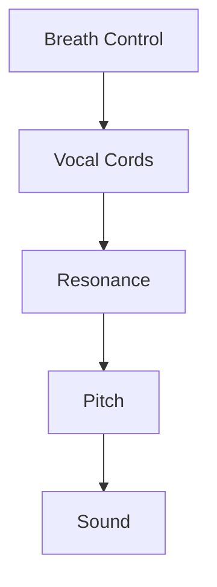

# Beginner Foundation: Vocals
## 1. Everyday Intuition & First Principles
Imagine your voice as a musical instrument, much like a guitar or a piano. Just as these instruments produce sound through the vibration of strings or hammers striking strings, your voice produces sound through the vibration of your vocal cords. When you speak or sing, you're essentially controlling the vibration of these cords to create different pitches and tones. Just like learning to play an instrument, mastering your voice requires understanding how to control these vibrations to produce the sounds you want.

## 2. Foundational Vocabulary & Glossary
- **Vocal Cords:** The two folds of tissue inside your larynx (voice box) that vibrate to produce sound.
- **Pitch:** The highness or lowness of a sound, determined by the frequency of the vibrations of the vocal cords.
- **Resonance:** The amplification of sound by a resonant cavity, such as your mouth, throat, and nasal passages.
- **Breath Control:** The ability to manage the flow of air from your lungs to your vocal cords, which affects the quality and duration of your sound.
- **Warm-Up:** Exercises to prepare your vocal cords for singing, reducing the risk of strain or injury.
- **Phonation:** The process of producing sound by the vibration of the vocal cords.

## 3. Visual System Flow
### ASCII Diagram
```
+-------------------+
|   Breath Control  |
+-------------------+
          |
          v
+-------------------+
|     Vocal Cords   |
+-------------------+
          |
          v
+-------------------+
|      Resonance    |
+-------------------+
          |
          v
+-------------------+
|      Pitch        |
+-------------------+
          |
          v
+-------------------+
|      Sound        |
+-------------------+
```

### Mermaid Flowchart


## 4. Common Beginner Misconceptions & Mental Traps
- **Misconception:** Singing is about shouting. **Truth:** Singing involves controlled breathing and vocal cord vibration, not just loudness.
- **Misconception:** You need a "good" voice to sing. **Truth:** Everyone has a unique voice, and with practice, you can develop your own singing style.
- **Misconception:** Warm-ups are only for professionals. **Truth:** Warm-ups are essential for everyone, regardless of skill level, to prevent strain and injury.
- **Misconception:** You can learn to sing overnight. **Truth:** Like any skill, singing requires consistent practice and patience.

## 5. Socratic Discussion Starters
- What are the benefits of warming up before singing?
- How does your breath control affect the quality of your sound?
- Can you describe the difference between resonance and pitch?
- How do you think your vocal cords work to produce different sounds?
- What are some common mistakes beginners make when trying to sing, and how can they be avoided?
