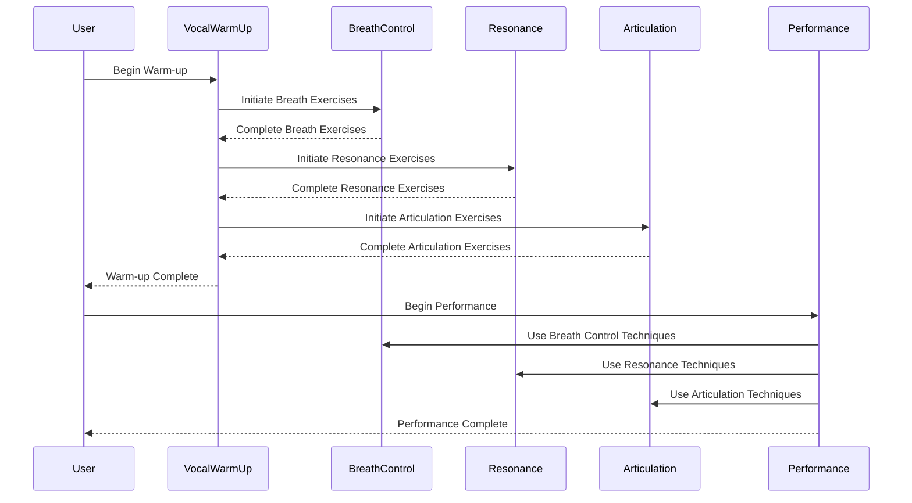

# Intermediate Foundation: Vocals
## 1. Architectural Mental Model
In the realm of vocal performance, the architectural mental model is akin to understanding the structure of a musical composition. Just as a composer arranges different instruments and voices to create a harmonious piece, a vocalist must understand how to structure their voice and performance to convey emotion and meaning effectively. This involves not just the technical aspects of singing, but also the psychological and emotional dimensions.

### Key Components:
- **Voice Production:** The physical process of producing sound through the vocal cords, breath control, and resonance.
- **Phrasing and Articulation:** The way words and phrases are shaped and delivered to convey meaning and emotion.
- **Emotional Expression:** The ability to convey feelings and emotions through the voice.
- **Performance Context:** Understanding the role of the vocalist within the broader context of the performance (e.g., soloist, ensemble member).

### Production Architecture:
- **Vocal Warm-ups:** Essential for preparing the voice for performance, reducing the risk of strain and injury.
- **Breath Support:** The foundation of vocal technique, enabling sustained notes and dynamic control.
- **Resonance and Placement:** Utilizing different resonators (chest, throat, head) to produce a rich, full sound.
- **Phonetics and Diction:** Clear articulation of words to ensure the audience understands the lyrics.

## 2. Systems Taxonomy & Component Protocols
In vocal performance, understanding the taxonomy of vocal techniques and the protocols that govern their application is crucial. This section outlines the standard interfaces, protocols, and data models that form the backbone of vocal performance.

### Vocal Techniques Taxonomy:
- **Breath Control:** Techniques for managing breath to sustain notes and control dynamics.
- **Vocal Registers:** Different ranges of the voice (e.g., chest voice, head voice, mix voice).
- **Resonance:** Techniques for producing sound in different resonators.
- **Articulation:** Techniques for clear and precise pronunciation of words.

### Protocols:
- **Warm-up Protocols:** Standardized routines for preparing the voice.
- **Performance Protocols:** Guidelines for stage presence, interaction with other performers, and audience engagement.
- **Health Protocols:** Practices for maintaining vocal health and preventing strain.

### Data Models:
- **Vocal Health Data:** Metrics for monitoring vocal health (e.g., vocal strain, fatigue).
- **Performance Data:** Metrics for evaluating performance quality (e.g., pitch accuracy, emotional impact).
- **Audience Feedback Data:** Metrics for gauging audience response and engagement.

## 3. Multi-Component Interaction Flow
Understanding how different vocal techniques and components interact is essential for effective performance. This section provides detailed ASCII and Mermaid sequence diagrams to illustrate these interactions.

### ASCII Sequence Diagram:
```
User -> Vocal Warm-up: Begin Warm-up
Vocal Warm-up -> Breath Control: Initiate Breath Exercises
Breath Control -> Vocal Warm-up: Complete Breath Exercises
Vocal Warm-up -> Resonance: Initiate Resonance Exercises
Resonance -> Vocal Warm-up: Complete Resonance Exercises
Vocal Warm-up -> Articulation: Initiate Articulation Exercises
Articulation -> Vocal Warm-up: Complete Articulation Exercises
Vocal Warm-up -> User: Warm-up Complete
User -> Performance: Begin Performance
Performance -> Breath Control: Use Breath Control Techniques
Performance -> Resonance: Use Resonance Techniques
Performance -> Articulation: Use Articulation Techniques
Performance -> User: Performance Complete
```

### Mermaid Sequence Diagram:


## 4. Architectural Trade-offs & Production Pitfalls
Every architectural decision in vocal performance involves trade-offs. Understanding these trade-offs and the potential pitfalls is crucial for making informed decisions.

### Trade-offs:
- **Breath Control vs. Vocal Range:** Techniques that enhance breath control may limit vocal range.
- **Resonance Placement vs. Clarity:** Using different resonators can affect the clarity of the voice.
- **Emotional Expression vs. Technical Precision:** Balancing emotional expression with technical precision can be challenging.

### Production Pitfalls:
- **Overuse of Certain Techniques:** Overusing certain vocal techniques can lead to strain and injury.
- **Neglecting Warm-ups:** Skipping warm-ups can result in poor performance and increased risk of vocal strain.
- **Ignoring Audience Feedback:** Failing to consider audience feedback can lead to disengagement and ineffective communication.

## 5. Socratic Discussion Starters
Socratic discussions are a powerful tool for deepening understanding and fostering critical thinking. The following questions are designed to bridge the gap between architectural concepts and low-level implementation.

### Questions:
- How do different vocal techniques interact to create a cohesive performance?
- What are the trade-offs between breath control and vocal range, and how can they be managed?
- How can a vocalist effectively balance emotional expression with technical precision?
- What are the potential pitfalls of overusing certain vocal techniques, and how can they be avoided?
- How can a vocalist use audience feedback to improve their performance?

By exploring these questions, engineers and practitioners can gain a deeper understanding of the architectural principles underlying vocal performance and apply them to their own work.
