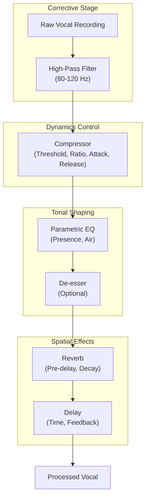
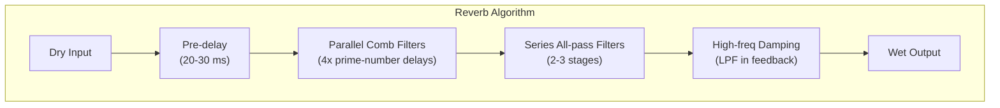
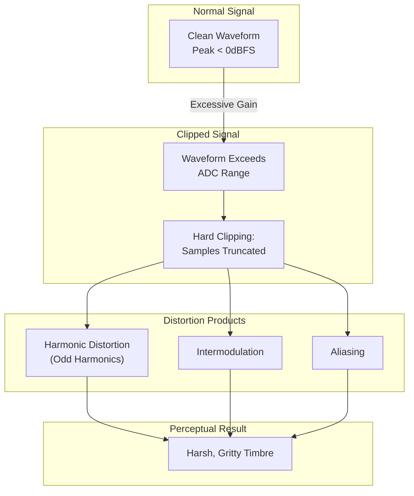
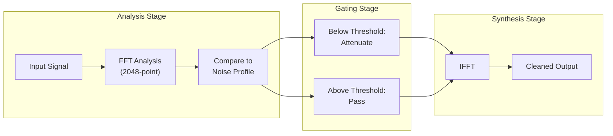
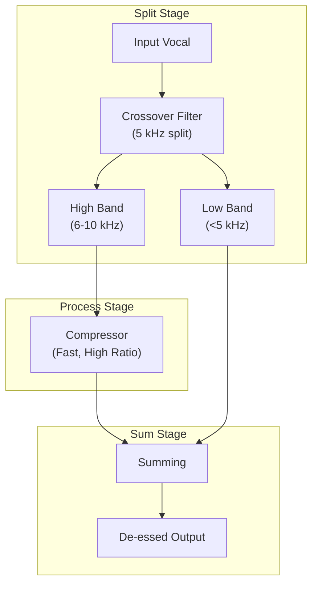
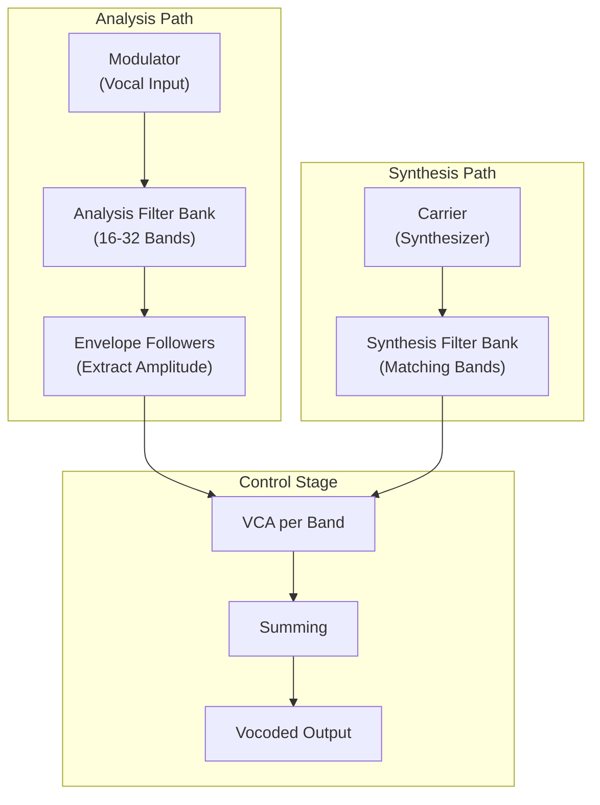

# Operational Verification Labs: Vocals

## Objective & Lab Setup

This laboratory provides systematic, hands-on investigation of vocal production, capture, and processing through controlled experimentation. You will physically set up microphones, adjust preamp gain, record vocal takes, apply signal processing chains, and measure the acoustic and perceptual results. The lab emphasizes direct execution—turning knobs, placing microphones, running plugins—grounded in acoustic physics where it clarifies hands-on decisions.

Vocal production emerges from respiratory pressure driving vocal fold oscillation (the source), shaped by resonant cavities in the pharynx, oral cavity, and nasal cavity (the filter). This source-filter model explains how we produce distinct phonemes and vocal timbres. Understanding this acoustic foundation sharpens your microphone placement decisions and EQ moves, but the core of this lab is physical practice.

### Required Tools and Environment

**Signal Capture:**
- **Large-diaphragm condenser microphone:** Cardioid pattern, 20Hz-20kHz response, max SPL >130dB (e.g., Audio-Technica AT2020, Rode NT1-A). Condenser mics use a capacitor capsule requiring +48V phantom power, providing superior transient response for capturing vocal detail.
- **Preamplifier:** Clean gain 40-60dB, equivalent input noise <-127dBu. Amplifies millivolt-level mic signal to ~1V line level.
- **Audio interface:** 24-bit/96kHz minimum, USB 2.0 or Thunderbolt, input impedance >2kΩ, A-weighted dynamic range >110dB.

**Signal Processing:**
- **DAW:** Ableton Live 11+, FL Studio 20+, Pro Tools 2023+, or Reaper 6+.
- **Audio editor:** Audacity 3.0+ for spectral analysis.
- **Monitoring:** Closed-back headphones or nearfield monitors with flat response (±3dB 50Hz-18kHz).

**Processing Plugins (VST3/AU/AAX):**
- Parametric EQ (minimum 8-band, variable Q)
- Dynamic range compressor
- Algorithmic reverb
- Delay line (multi-tap with feedback)
- Pitch correction/autotune
- Spectrum analyzer (FFT-based, minimum 8192-point)

**Room Treatment:**
Minimize early reflections with acoustic panels or a reflection filter around the microphone. The goal is to capture dry signal—you'll add space artificially with reverb.

### Signal Chain Architecture

```mermaid
graph LR
    subgraph sub_source ["Acoustic Source"]
        A["Vocal Folds<br/>(Vibrating Source)"]
        B["Vocal Tract<br/>(Resonant Filter)"]
    end
    
    subgraph sub_capture ["Signal Capture"]
        C["Microphone<br/>(Transducer)"]
        D["Preamp<br/>(Gain Stage)"]
        E["Audio Interface<br/>(ADC)"]
    end
    
    subgraph sub_digital ["Digital Processing"]
        F["DAW Buffer"]
        G["Plugin Chain"]
    end
    
    subgraph sub_output ["Monitoring"]
        H["Audio Interface<br/>(DAC)"]
        I["Monitors/<br/>Headphones"]
    end
    
    A -->|"Acoustic Pressure"| B
    B -->|"Radiated Sound"| C
    C -->|"mV Electrical"| D
    D -->|"Line Level ~1V"| E
    E -->|"Digital Samples"| F
    F -->|"Processing"| G
    G -->|"Processed Samples"| H
    H -->|"Analog Output"| I
```

### Sample Rate and Bit Depth Considerations

The Nyquist-Shannon theorem requires sample rates above twice the highest frequency. For 20kHz audio, 44.1kHz suffices, but 48kHz or 96kHz provides margin for anti-aliasing filters and processing headroom.

24-bit depth provides 144dB theoretical dynamic range (6.02 × 24 dB), exceeding the 120dB range of human hearing. This headroom accommodates processing without introducing quantization noise. Dithering—adding low-level noise before quantization—decorrelates quantization error, making it perceptually more acceptable.

## Exercise 1: Foundational Practical Implementation

### Recording a Vocal Take

**Microphone Positioning and Proximity Effect:**

Position the large-diaphragm condenser 6-8 inches (15-20cm) from the vocalist's mouth, aimed at the philtrum (groove between nose and upper lip). This distance balances intimacy with proximity effect control. Cardioid mics exhibit low-frequency boost as distance decreases—a 6dB/octave slope below ~200Hz as you approach the capsule. This occurs because the phase difference between the mic's front and rear ports increases for low frequencies at close range.

Mount the mic on a shock mount to decouple mechanical vibrations. Position a pop filter 2-3 inches in front of the capsule to diffuse plosive bursts (p, b, t, d sounds), which create pressure transients exceeding 10dB above sustained phonation.

**Gain Staging and Headroom:**

Set preamp gain to achieve **-18dBFS to -12dBFS peaks** on sustained vowels, leaving 12-18dB headroom. Digital clipping (exceeding 0dBFS) produces harsh discontinuities—unlike analog saturation, it's catastrophic. Vocals typically have 10-15dB RMS-to-peak ratio; designing for -12dBFS peaks ensures transients stay below 0dBFS.

Configure the audio interface:
- Sample rate: 48kHz (or 96kHz for extreme pitch shifting)
- Bit depth: 24-bit
- Buffer size: 128-256 samples (2.7-5.3ms latency at 48kHz)
- Input: Channel 1 (mic preamp)
- Enable phantom power (+48V)

**Recording Protocol:**

1. Create new DAW project, insert mono audio track
2. Arm track for recording (enable input monitoring)
3. Have vocalist sing chromatic scale (C3-C5 male, A3-A5 female) at mezzo-forte
4. Record 3-4 takes

Between takes, check:
- **Clipping indicators:** No samples reaching 0dBFS
- **Noise floor:** Spectral energy below -60dBFS during silence
- **Spectral balance:** FFT analyzer shows fundamental + harmonics captured without aliasing

Save the raw, unprocessed recording. All subsequent processing applies non-destructively.

### Basic Vocal Processing: The Essential Chain

Professional vocal production applies processing in this order: corrective EQ → dynamics → additive EQ → time-based effects. This ensures noise removal before amplification (via compression) and tonal shaping precedes spatial processing.

#### Step 1: High-Pass Filtering

Insert a parametric EQ as first processor:
- **Cutoff frequency:** 80-100 Hz
- **Slope:** 12 dB/octave (2-pole Butterworth) or 18 dB/octave (3-pole)

**Acoustic Rationale:** Adult voice fundamentals range from ~85Hz (bass) to ~255Hz (soprano). A 100Hz HPF removes subsonic rumble, room modes, and handling noise without affecting vocal content. The filter introduces a 90° phase shift per pole at cutoff, but this is inaudible below the fundamental.

**Hands-On Setup:**
1. Open parametric EQ plugin (e.g., FabFilter Pro-Q 3, stock DAW EQ)
2. Enable high-pass filter on lowest band
3. Set cutoff to 100 Hz
4. Set slope to 12 dB/oct (2-pole)
5. Solo the vocal, play back, sweep cutoff 60-120 Hz while listening
6. Stop when low-end rumble disappears but vocal fullness remains

#### Step 2: Dynamic Range Compression

Insert compressor plugin after HPF. Compression reduces the difference between loudest and quietest parts by applying gain reduction when signal exceeds threshold.

**Feed-Forward Compressor Parameters:**
- **Threshold:** -20 dBFS
- **Ratio:** 4:1
- **Attack time:** 15-30 ms
- **Release time:** 150-250 ms
- **Knee:** Soft
- **Makeup gain:** +3 to +6 dB

**Attack Time:** 15-30ms allows initial transient to pass uncompressed, preserving articulation while controlling sustained energy. Faster (<5ms) attenuates consonants, reducing clarity.

**Release Time:** 200ms approximates vocal tract resonance decay (formant bandwidth 50-100Hz, decay times 100-200ms). Too fast (<100ms) causes pumping. Too slow (>500ms) prevents recovery between phrases.

**Hands-On Setup:**
1. Insert compressor plugin (e.g., FabFilter Pro-C 2, stock DAW compressor)
2. Set threshold to -20 dBFS
3. Set ratio to 4:1
4. Set attack to 20 ms
5. Set release to 200 ms
6. Enable soft knee
7. Play back, observe gain reduction meter
8. Adjust makeup gain until output peaks match input peaks (~+3 to +6 dB)
9. Target: 3-6 dB average gain reduction

#### Step 3: Parametric Equalization

Insert second EQ for additive tonal shaping.

**Presence Boost (3-5 kHz):**
- **Frequency:** 3.5 kHz
- **Gain:** +2 to +4 dB
- **Q:** 1.5 (moderate bandwidth, ~2 octaves)
- **Rationale:** Third formant (F3) region—governs voice recognition and intelligibility. Makes vocals cut through dense mixes.

**Air Enhancement (10-12 kHz):**
- **Frequency:** 10 kHz
- **Gain:** +1 to +3 dB
- **Q:** 0.7 (wide, gentle boost)
- **Filter type:** High-shelf
- **Rationale:** Adds breathiness and shimmer by enhancing breath noise and formant transitions.

**Hands-On Setup:**
1. Insert parametric EQ (second instance)
2. Create bell filter at 3.5 kHz, Q 1.5, gain +3 dB
3. Create high-shelf at 10 kHz, Q 0.7, gain +2 dB
4. Play back, compare bypassed vs. processed
5. Adjust gain and frequency to taste—these are starting points

**Formant Context:** Vowels are characterized by formants (resonant frequencies). Adult male neutral vowel [ə]:
- F1: ~500 Hz (jaw opening)
- F2: ~1500 Hz (tongue position)
- F3: ~2500 Hz (voice quality)
- F4: ~3500 Hz (individuality)

EQ adjustments indirectly modify perceived formant balance.

#### Step 4: Reverb Processing

Reverb synthesizes hundreds of delayed, attenuated reflections. Create auxiliary send track (reverb bus) to apply reverb in parallel—preserves dry signal clarity while adding ambience.

**Algorithmic Reverb Parameters:**
- **Algorithm:** Plate or Hall
- **Pre-delay:** 20-30 ms
- **Decay time (RT60):** 1.2-1.8 seconds
- **Early reflections level:** -6 dB relative to late reverb
- **High-frequency damping:** -3 dB at 8 kHz
- **Wet/Dry mix:** 100% wet (on auxiliary send), send level -12dB

**Pre-delay Rationale:** 20-30ms creates separation between direct vocal and reverb onset, maintaining clarity. Approximates sound traveling 7-10 meters (distance to nearest wall in medium room).

**Decay Time:** 1.2-1.8s provides size without overwhelming. Shorter (0.8-1.2s) = intimate. Longer (2-3s) = expansive.

**Hands-On Setup:**
1. Create new auxiliary track (reverb bus)
2. Insert reverb plugin (e.g., Valhalla Room, stock DAW reverb)
3. Set algorithm to Plate or Hall
4. Set pre-delay to 25 ms
5. Set decay time (RT60) to 1.5 seconds
6. Set mix to 100% wet (on aux track)
7. On vocal track, create send to reverb bus
8. Set send level to -12 dB
9. Play back, adjust send level until reverb adds space without washing out vocal

**Schroeder Reverb Structure:**

Comb filters create regularly-spaced notches. All-pass filters provide diffusion (dense reflections) without altering frequency response.

#### Step 5: Delay Processing

Insert delay plugin on another auxiliary send or directly post-reverb.

**Delay Parameters:**
- **Delay time:** 500 ms (quarter-note at 120 BPM)
- **Feedback:** 25-35%
- **High-pass filter:** 200 Hz (on feedback path)
- **Low-pass filter:** 6 kHz (on feedback path)
- **Wet/Dry mix:** 15-25% wet (or 100% wet on aux send, send level -18dB)

**Tempo Synchronization:**
- Dotted eighth: (60000/BPM) × (3/4)
- Quarter note: 60000/BPM
- Eighth note: (60000/BPM) / 2

At 120 BPM, quarter-note = 500ms. Creates rhythmic echo reinforcing vocal line.

**Hands-On Setup:**
1. Create new auxiliary track (delay bus) OR insert delay directly after reverb
2. Insert delay plugin (e.g., Soundtoys EchoBoy, stock DAW delay)
3. Set delay time to 500 ms (or sync to quarter-note at session tempo)
4. Set feedback to 30%
5. Enable high-pass filter at 200 Hz on feedback path
6. Enable low-pass filter at 6 kHz on feedback path
7. If on aux: set mix to 100% wet, send level -18 dB
8. If insert: set mix to 20% wet
9. Play back, adjust until delay adds depth without obscuring vocal

### Quality Verification Checklist

After processing, verify:
1. **No clipping:** Peaks remain below -1dBFS
2. **Spectral balance:** Compare processed vs. raw spectrum—no excessive filtering
3. **Intelligibility:** Every word clear; compression hasn't over-attenuated consonants
4. **Spatial coherence:** Reverb adds space without washing out vocal
5. **Mono compatibility:** Summing to mono doesn't create phase cancellation

## Exercise 2: Parameter Variation & Empirical Analysis

Systematic parameter sweeps reveal how each control affects signal characteristics. Vary one parameter while holding others constant, measure outcome, document observations.

### Experimental Methodology

For each parameter variation:
1. **Export processed audio** at each setting (24-bit WAV, lossless)
2. **Measure objective metrics:**
   - RMS level (dBFS)
   - Peak level (dBFS)
   - Crest factor (Peak/RMS in dB)
   - Spectral centroid (Hz)
   - Dynamic range (loudest - quietest in dB)
3. **Perform spectral analysis:** Capture FFT plots
4. **Conduct listening tests:** Level-matched A/B comparison
5. **Document subjective observations:** Clarity, harshness, depth, presence

### Parameter Sweep 1: High-Pass Filter Cutoff Frequency

**Independent Variable:** HPF cutoff frequency  
**Range:** 60 Hz to 140 Hz  
**Step size:** 10 Hz  
**Control variables:** Slope 12 dB/oct, all other processing disabled

**Hypothesis:** As cutoff increases, low-frequency energy decreases, affecting perceived warmth. Excessive filtering (>120 Hz) may thin male voices whose fundamentals approach this range.

**Procedure:**
1. Disable all processing except HPF
2. Set cutoff to 60 Hz, record 10-second vocal phrase
3. Capture FFT spectrum (0-500 Hz, linear frequency axis)
4. Measure RMS level in 60-150 Hz band using spectrum analyzer
5. Increment cutoff by 10 Hz; repeat steps 2-4
6. Generate overlay plot showing spectral energy vs. cutoff

**Expected Observations:**
- **60-80 Hz:** Minimal change; most vocal energy above this
- **90-100 Hz:** Noticeable reduction in room rumble and proximity effect
- **110-120 Hz:** Slight thinning for bass/baritone (F0 ~100-120 Hz)
- **130-140 Hz:** Audible thinning; male fundamentals attenuated

**Hands-On Execution:**
1. Open DAW project with raw vocal recording
2. Insert parametric EQ, enable HPF
3. Set slope to 12 dB/oct
4. Set cutoff to 60 Hz
5. Export 10-second section as "vocal_HPF_60Hz.wav"
6. Open spectrum analyzer plugin, capture screenshot
7. Note RMS reading in 60-150 Hz band
8. Increment cutoff to 70 Hz
9. Repeat export, screenshot, measurement
10. Continue through 140 Hz
11. Import all exports into new project, create level-matched playlist
12. A/B listen to identify sweet spot where rumble disappears but fullness remains

### Parameter Sweep 2: Compression Threshold

**Independent Variable:** Compression threshold  
**Range:** -30 dBFS to -10 dBFS  
**Step size:** 2 dB  
**Control variables:** Ratio 4:1, attack 20ms, release 200ms, HPF 100Hz

**Hypothesis:** Lower threshold triggers compression more frequently, reducing dynamic range more aggressively. Optimal threshold triggers on sustained vowels but allows brief consonants to pass uncompressed.

**Procedure:**
1. Enable HPF (100 Hz) and compressor only
2. Set threshold to -30 dBFS
3. Record test phrase with loud and soft sections
4. Measure:
   - Gain reduction meter (average GR in dB)
   - Compressed dynamic range: (loudest peak) - (quietest sustained section)
   - Crest factor: Peak/RMS
5. Increment threshold by 2 dB; repeat
6. Plot dynamic range and average GR vs. threshold

**Expected Observations:**
- **-30 dBFS:** Nearly constant compression; dynamic range <3 dB, excessive flattening
- **-24 to -20 dBFS:** Moderate compression; preserves macro-dynamics, controls peaks
- **-18 to -12 dBFS:** Subtle compression; only loudest sections affected
- **-10 dBFS:** Minimal effect; insufficient gain reduction

**Hands-On Execution:**
1. Insert compressor after HPF
2. Set ratio 4:1, attack 20ms, release 200ms, makeup gain 0dB initially
3. Set threshold to -30 dBFS
4. Play back vocal phrase
5. Observe compressor's gain reduction meter
6. Note average GR (e.g., 12 dB constant)
7. Measure loudest peak and quietest sustained section with DAW metering
8. Calculate dynamic range: peak - quiet = X dB
9. Export as "vocal_comp_threshold_-30dB.wav"
10. Increment threshold to -28 dBFS, repeat
11. Continue through -10 dBFS
12. Create spreadsheet: threshold (dBFS), avg GR (dB), dynamic range (dB)
13. Plot threshold vs. dynamic range
14. Listen to identify threshold where vocal feels present without sounding squashed
15. Target: 3-6 dB average GR

### Parameter Sweep 3: Compression Ratio

**Independent Variable:** Compression ratio  
**Range:** 1.5:1 to 10:1  
**Step size:** 0.5:1  
**Control variables:** Threshold -20 dBFS, attack 20ms, release 200ms

**Hypothesis:** Higher ratios produce more aggressive gain reduction. Ratios >8:1 approach limiting, severely restricting dynamic range.

**Procedure:**
1. Set threshold to -20 dBFS, ratio to 1.5:1
2. Record test phrase, measure average GR and dynamic range
3. Increment ratio by 0.5:1; repeat
4. Plot GR vs. ratio to verify mathematical relationship

**Expected Relationship:**
For signal 10 dB above threshold:
- 2:1 ratio: GR = 10 × (1 - 1/2) = 5 dB
- 4:1 ratio: GR = 10 × (1 - 1/4) = 7.5 dB
- 10:1 ratio: GR = 10 × (1 - 1/10) = 9 dB

**Hands-On Execution:**
1. Set compressor threshold to -20 dBFS
2. Set ratio to 1.5:1
3. Play back, note average GR from meter
4. Export as "vocal_comp_ratio_1.5.wav"
5. Increment ratio to 2:1, repeat
6. Continue through 10:1
7. Verify measured GR matches calculated GR
8. Plot ratio vs. GR
9. Listen: 1.5:1-2:1 = transparent, 3:1-5:1 = moderate, 6:1-10:1 = aggressive

### Parameter Sweep 4: Compression Attack Time

**Independent Variable:** Attack time  
**Range:** 1 ms to 100 ms  
**Step size:** Logarithmic (1, 2, 5, 10, 20, 50, 100 ms)  
**Control variables:** Threshold -20 dBFS, ratio 4:1, release 200ms

**Hypothesis:** Faster attack attenuates transients (consonants), reducing clarity. Slower attack preserves transients but may allow excessive peaks.

**Procedure:**
1. Record phrase with sharp consonants (e.g., "Peter Piper picked a peck of pickled peppers")
2. Set attack to 1 ms; measure crest factor and peak levels
3. Increase attack logarithmically; repeat
4. Compare transient preservation vs. peak control tradeoff

**Expected Observations:**
- **1-5 ms:** Flattened transients; plosives attenuated; muffled
- **10-20 ms:** Balanced; transients pass, sustained energy compressed
- **30-50 ms:** Minimal transient attenuation; reduced overall effect
- **100 ms:** Very slow; responds to phrases, not syllables

**Hands-On Execution:**
1. Set compressor threshold -20 dBFS, ratio 4:1, release 200ms
2. Set attack to 1 ms
3. Play consonant-heavy phrase
4. Measure crest factor with DAW metering (peak - RMS)
5. Export as "vocal_comp_attack_1ms.wav"
6. Set attack to 2 ms, repeat
7. Continue: 5, 10, 20, 50, 100 ms
8. Listen: fast = muffled consonants, moderate = clear but controlled, slow = transients uncontrolled
9. Identify sweet spot where consonants remain crisp but sustained vowels compress

### Parameter Sweep 5: Compression Release Time

**Independent Variable:** Release time  
**Range:** 50 ms to 1000 ms  
**Step size:** 50 ms up to 500ms, then 100ms  
**Control variables:** Threshold -20 dBFS, ratio 4:1, attack 20ms

**Hypothesis:** Release controls how compressor "breathes." Too fast causes pumping; too slow causes excessive sustained GR.

**Procedure:**
1. Record phrase with gaps between words (to observe release)
2. Set release to 50 ms; measure GR envelope
3. Listen for pumping (audible gain modulation)
4. Increment release; repeat
5. Identify optimal release where GR recovers naturally between phrases

**Expected Observations:**
- **50-100 ms:** Fast recovery; potential pumping if source is bassy
- **150-250 ms:** Natural; gain recovers smoothly between words
- **300-500 ms:** Slower; maintains more consistent GR across phrase
- **>600 ms:** Overly slow; doesn't fully recover, cumulative GR

**Hands-On Execution:**
1. Set compressor threshold -20 dBFS, ratio 4:1, attack 20ms
2. Set release to 50 ms
3. Play phrase with pauses
4. Watch GR meter during pauses—does it return to 0dB?
5. Listen for pumping (gain swelling/breathing)
6. Export as "vocal_comp_release_50ms.wav"
7. Increment to 100 ms, repeat
8. Continue through 1000 ms
9. Identify release where GR recovers during gaps without pumping
10. Target: 150-250 ms for most vocals

### Parameter Sweep 6: Reverb Decay Time

**Independent Variable:** RT60 (decay time)  
**Range:** 0.5 s to 4.0 s  
**Step size:** 0.25 s  
**Control variables:** Pre-delay 25ms, mix 30%, HF damping -3dB @ 8kHz

**Hypothesis:** Longer decay creates larger perceived spaces but may obscure clarity by overlapping subsequent words.

**Procedure:**
1. Set RT60 to 0.5 s; record phrase with pauses
2. Listen to reverb tail decay during pauses
3. Increment RT60 by 0.25 s; repeat
4. Measure time until reverb tail decays to -40 dBFS
5. Assess clarity: distinguish every word?

**Expected Observations:**
- **0.5-1.0 s:** Small room; intimate; clear
- **1.2-1.8 s:** Medium room/hall; pleasant spaciousness
- **2.0-3.0 s:** Large hall; lush but may smear fast passages
- **>3.5 s:** Cathedral; excessive for pop/rock

**Hands-On Execution:**
1. Set reverb pre-delay 25ms, mix 30%, HF damping -3dB @ 8kHz
2. Set RT60 to 0.5 seconds
3. Play phrase with pauses
4. Listen to reverb tail during silence
5. Note time until tail becomes inaudible
6. Export as "vocal_reverb_RT60_0.5s.wav"
7. Increment to 0.75 s, repeat
8. Continue through 4.0 s
9. Identify RT60 where subsequent words overlap with previous reverb tails
10. Target: 1.2-1.8s for pop/rock; 2.0-3.0s for ballads

**Clarity Threshold Test:**
Recite fast phrase ("The quick brown fox jumps over the lazy dog"). Identify RT60 where words blur together. That's maximum usable decay for that tempo.

### Parameter Sweep 7: Reverb Pre-delay

**Independent Variable:** Pre-delay time  
**Range:** 0 ms to 80 ms  
**Step size:** 5 ms  
**Control variables:** RT60 1.5s, mix 30%

**Hypothesis:** Pre-delay creates separation between dry signal and reverb onset, enhancing clarity. Excessive pre-delay (>50ms) creates distinct slap-back echo.

**Procedure:**
1. Set pre-delay to 0 ms
2. Record phrase; assess separation
3. Increment by 5 ms; repeat
4. Identify where reverb becomes distinct echo (>50ms)

**Expected Observations:**
- **0-10 ms:** Reverb smears into vocal; reduced clarity
- **15-30 ms:** Natural separation; vocal remains clear
- **35-50 ms:** Noticeable pre-echo; adds depth without distraction
- **>50 ms:** Distinct slap-back; sounds artificial

**Hands-On Execution:**
1. Set reverb RT60 1.5s, mix 30%
2. Set pre-delay to 0 ms
3. Play phrase
4. Listen: does reverb blur the vocal?
5. Export as "vocal_reverb_predelay_0ms.wav"
6. Increment to 5 ms, repeat
7. Continue through 80 ms
8. Identify pre-delay where separation emerges without sounding like a discrete echo
9. Target: 20-30 ms for most vocals

**Haas Effect:** Pre-delays <30-40ms fuse perceptually with direct sound, creating illusion of single source in larger space. Beyond 40-50ms, echo is perceived as distinct repetition.

### Parameter Sweep 8: Delay Time and Feedback

**Independent Variable:** Delay time  
**Range:** 200 ms to 1500 ms  
**Step size:** 100 ms (also test tempo-synced)  
**Control variables:** Feedback 30%, mix 20%

**Secondary Variable:** Feedback percentage (20%, 30%, 40%, 50%)

**Hypothesis:** Delay time controls rhythmic interaction. Feedback controls number of audible repeats. Excessive feedback (>50%) can create runaway buildup.

**Procedure:**
1. Set delay to 200 ms, feedback 30%
2. Record rhythmic vocal phrase ("one, two, three, four")
3. Assess whether delay enhances or obscures rhythm
4. Increment delay time; repeat
5. At optimal delay, vary feedback 20%-50%
6. Measure number of audible repeats (above -40 dBFS) at each feedback level

**Expected Observations:**

**Delay Time:**
- **200-300 ms:** Short doubling; creates thickness
- **400-600 ms:** Rhythmic echo; complements phrasing
- **800-1200 ms:** Long echo; works for sparse arrangements
- **>1500 ms:** Very long; special effects only

**Feedback:**
- **20-30%:** 2-3 repeats; clean
- **40%:** 4-5 repeats; rich but controlled
- **50-60%:** 6+ repeats; dense, potential muddiness
- **>70%:** Infinite repeats; runaway feedback

**Hands-On Execution:**
1. Set delay time to 200 ms, feedback 30%, mix 20%
2. Play rhythmic phrase
3. Listen: does delay support or obscure rhythm?
4. Export as "vocal_delay_200ms_fb30.wav"
5. Increment delay to 300 ms, repeat
6. Continue through 1500 ms
7. Identify delay time that complements phrase timing
8. At optimal delay time, test feedback:
   - Set to 20%, export, count audible repeats
   - Set to 30%, export, count repeats
   - Set to 40%, export, count repeats
   - Set to 50%, export, count repeats
9. Listen for runaway feedback or muddiness
10. Target: delay 400-600 ms, feedback 25-35% for most pop/rock

### Data Synthesis and Reporting

After completing all parameter sweeps, compile comprehensive report:

1. **Parameter Response Curves:** Graphs showing objective metrics vs. parameter values
2. **Optimal Parameter Ranges:** Identified ranges achieving desired sonic characteristics
3. **Interaction Effects:** Non-linear interactions (e.g., compression affecting perceived reverb depth)
4. **Perceptual Thresholds:** Just-noticeable differences for each parameter
5. **Practical Recommendations:** Starting points for different vocal styles

**Example Optimal Ranges (Pop/Rock Male Vocals):**
- HPF: 90-110 Hz
- Compression: Threshold -20 to -18 dBFS, Ratio 3:1 to 5:1, Attack 15-25ms, Release 180-220ms
- Presence boost: +2 to +4 dB @ 3-4 kHz
- Reverb: RT60 1.2-1.6s, Pre-delay 20-30ms, Mix 25-30%
- Delay: 500ms (quarter-note @ 120 BPM), Feedback 25-30%, Mix 15-20%

## Exercise 3: Fault Injection & Stress Testing

This exercise deliberately introduces pathological conditions to understand system failure modes, develop troubleshooting skills, and learn remediation. Each fault scenario represents a common recording/mixing error.

### Fault Scenario 1: Digital Clipping

**Fault Induction:**
Position microphone 1-2 inches from mouth. Set preamp gain 12-15dB higher than normal, causing ADC input to exceed 0dBFS during loud passages. Record phrase containing dynamic variations (whisper to shout).

**Signal Characteristics:**
Clipping occurs when signal amplitude exceeds ADC's maximum value. In 24-bit system, this is ±8,388,607. When exceeded, waveform is truncated ("hard clipping"), introducing:
- Harmonic distortion: Odd harmonics (3f₀, 5f₀, 7f₀) at high levels
- Intermodulation distortion: Sum/difference frequencies (f₁ ± f₂)
- Spectral broadening: Energy spreads across spectrum
- Aliasing: High-frequency harmonics fold below Nyquist

**Hands-On Analysis:**
1. Record deliberately clipped vocal
2. Open in DAW, zoom to sample-level waveform view
3. Identify clipped sections: flat-topped waveforms where samples reach maximum value
4. Open spectrum analyzer, perform FFT on clipped section
5. Compare to FFT of clean section
6. Note: clipped spectrum shows strong odd harmonics (600Hz, 1000Hz, 1400Hz for 200Hz fundamental)
7. Measure THD+N: clipped audio typically exhibits THD+N >10% vs. <0.1% clean

**Remediation Attempts:**

**1. Soft-Clipping/Saturation Plugin:**
Apply soft-clipper (e.g., waveshaper with tanh transfer function) to round clipped portions. Converts hard-clipping into soft-clipping, reducing harmonic harshness. However, cannot restore truncated information—only makes distortion more pleasing.

**Hands-On Execution:**
1. Insert waveshaper/saturation plugin on clipped vocal
2. Enable soft-clipping mode (tanh algorithm)
3. Play back, listen for reduction in harshness
4. Compare FFT: odd harmonics smoothed but still present
5. Accept that original information is lost

**2. Spectral Repair Tools:**
Use spectral editing (e.g., iZotope RX's De-clip) to:
- Identify clipped samples statistically
- Estimate original waveform shape using interpolation
- Reconstruct clipped peaks using psychoacoustic models

**Hands-On Execution:**
1. Export clipped audio
2. Open in iZotope RX (or similar spectral editor)
3. Run De-clip algorithm
4. Preview result
5. Accept that severe clipping (>3dB over) is often unrecoverable
6. Re-record with proper gain staging

**Conclusion:**
Clipping is largely irreversible. Only solution: re-record with proper gain staging. Measure peak-to-target margin before recording. For vocal with 15dB crest factor and -12dBFS target, set RMS level to -27dBFS.

### Fault Scenario 2: Background Noise (High Noise Floor)

**Fault Induction:**
Record in untreated room with active HVAC, computer fan noise, or street traffic. Use distant mic positioning (>18 inches) to reduce signal level while keeping gain high, maximizing noise-to-signal ratio.

**Noise Characteristics:**
Typical background noise sources:
- **HVAC:** Broadband rumble 40-150Hz, tonal at motor frequency (~60Hz, 120Hz)
- **Computer fan:** Broadband hiss 500Hz-8kHz
- **Electrical hum:** 60Hz fundamental + harmonics (120Hz, 180Hz, 240Hz)
- **Room reflections:** Colored noise from resonant modes

**Hands-On Analysis:**
1. Record 10 seconds of silence (noise floor capture)
2. Record vocal phrase in same conditions
3. Open spectrum analyzer
4. Generate long-term average spectrum (LTAS) of noise floor
5. Measure SNR: 20 × log₁₀(RMS_signal / RMS_noise)
   - Professional: SNR >60dB
   - Acceptable: SNR >40dB
   - Poor: SNR <30dB
6. Compare noise spectrum to speech spectrum
7. Identify regions where noise masks vocal

**Noise Reduction Techniques:**

**1. Spectral Noise Gate:**
Use multiband expander applying gain reduction frequency-selectively.

**Hands-On Execution:**
1. Insert spectral noise gate plugin (e.g., iZotope RX, Waves NS1, Accusonus ERA-N)
2. Play silence section to capture noise profile
3. Set threshold +6 to +12 dB above noise floor
4. Set reduction -15 to -25 dB
5. Set smoothing 50-100ms
6. Play vocal section
7. Listen for artifacts: "underwater" sound, transient loss
8. Adjust reduction until noise decreases without excessive artifacts
9. Target: 10-15dB max reduction

**2. Corrective EQ:**
Identify noise-dominant frequency bands via LTAS, apply narrow notch filters:

**Hands-On Execution:**
1. Examine LTAS of noise floor
2. Identify peaks: 60Hz (electrical hum), 120Hz (2nd harmonic), 80-150Hz (HVAC rumble)
3. Insert parametric EQ
4. Create notch at 60 Hz: Q=5, gain -12dB
5. Create notch at 120 Hz: Q=5, gain -8dB
6. Create low-shelf at 100 Hz: gain -6dB
7. Play back, verify noise reduction without thinning vocal
8. Accept some residual noise rather than over-processing

**Best Practice:**
Optimize recording conditions to minimize noise rather than relying on post-processing. If noise reduction necessary:
- Apply conservatively (10-15dB max reduction)
- Use multiband approach
- Preserve transients via adaptive attack/release
- Accept some residual noise

### Fault Scenario 3: Proximity Effect Overload

**Fault Induction:**
Position cardioid microphone <2 inches from vocalist's mouth. Record sustained vowels, compare low-frequency content to recording at normal distance (8 inches).

**Physical Mechanism:**
Pressure-gradient mics (cardioid, figure-8) sense pressure difference between front and rear ports. At close distances, phase difference increases for low frequencies, resulting in bass boost. At 2 inches (~5cm), boost ≈ 26dB at low frequencies compared to 1m reference distance.

**Hands-On Analysis:**
1. Record vocal at <2 inches
2. Record same vocal at 8 inches (normal)
3. Open both in DAW
4. Level-match RMS in 1-5 kHz region (to compensate for overall level difference)
5. Open spectrum analyzer
6. Capture spectrum of close-mic recording
7. Capture spectrum of normal-distance recording
8. Calculate difference spectrum: Close(f) - Normal(f)
9. Observe peak boost frequency (typically 100-150Hz)
10. Note: close-mic shows +6 to +12dB boost in 80-200Hz region

**Correction:**
Apply parametric EQ:

**Hands-On Execution:**
1. Insert parametric EQ on close-mic recording
2. Create low-shelf at 200Hz: gain -8dB
3. OR create high-pass filter at 80Hz: slope 12dB/oct
4. Create bell filter at 120Hz: Q 2.0, gain -4dB (compensate peak)
5. Play back, compare to normal-distance recording
6. Adjust until low-end matches normal recording

**Artistic Use:**
Proximity effect isn't always a fault:
- Radio voiceovers: enhances authority, warmth
- Intimate vocal performances: enhances emotional connection
- Hip-hop vocals: emphasizes low-end presence

Key is intentional control, not accidental overload.

### Fault Scenario 4: Excessive Sibilance

**Fault Induction:**
Record spoken phrases with strong sibilants: "She sells seashells by the seashore." Boost 6-8kHz region by +6dB during recording (via mic off-axis or EQ).

**Sibilance Characteristics:**
Sibilant phonemes (/s/, /z/, /sh/, /ch/) produce broadband noise bursts centered 6-10kHz, generated by turbulent airflow across teeth/tongue. Excessive sibilance causes:
- Listener fatigue (high-frequency harshness)
- Distortion in lossy codecs (MP3/AAC struggle with transients)
- Difficulty in mix (competes with cymbals, hi-hats)

**Hands-On Analysis:**
1. Record deliberately sibilant vocal
2. Open in DAW
3. Isolate sibilant phonemes in waveform
4. Measure peak level in 6-10kHz band during sibilance using spectrum analyzer
5. Compare to average level during vowels
6. Sibilance excessive if peak exceeds vowel level by >15dB in this band

**De-essing Techniques:**

**1. Split-Band Compression (De-esser):**

**Hands-On Execution:**
1. Insert de-esser plugin (e.g., FabFilter Pro-DS, Waves Renaissance DeEsser)
2. Set frequency range: 6-9 kHz (adjustable by vocalist)
3. Set threshold: -25 to -20 dBFS
4. Set ratio: 6:1 to 10:1
5. Set attack: 1-5 ms (fast to catch transients)
6. Set release: 50-100 ms
7. Play sibilant phrase
8. Observe gain reduction meter—should trigger on sibilants only
9. Listen: sibilance present but not prominent
10. Target: sibilance peaks 6-10dB above vowel level in 6-10kHz band

**2. Dynamic EQ:**
Parametric EQ where gain reduction is level-dependent.

**Hands-On Execution:**
1. Insert dynamic EQ plugin (e.g., FabFilter Pro-Q 3 with dynamics, TDR Nova)
2. Create bell filter at 7 kHz, Q 2.5
3. Set mode to dynamic (compression)
4. Set threshold -22 dBFS
5. Set max reduction -8 dB
6. Play back, adjust until sibilance controlled
7. Verify: sibilants audible but not harsh

**Over-De-essing Warning:**
Excessive de-essing produces lispy, muffled sound. Target: sibilance present but not prominent.

### Fault Scenario 5: Phase Cancellation (Stereo Recording)

**Fault Induction:**
Record vocal with two microphones in stereo, but position at different distances (one at 6 inches, one at 12 inches). This creates time-of-arrival differences resulting in phase cancellation when summed to mono.

**Physical Mechanism:**
Sound travels at ~343 m/s. A 6-inch (15cm) path difference creates time delay: Δt = 0.15m / 343 m/s = 0.44 ms. This corresponds to phase shift: φ(f) = 360° × f × Δt. At 1 kHz: φ = 158°. At frequencies where phase approaches 180°, destructive interference cancels that frequency.

**Hands-On Analysis:**
1. Record stereo vocal with intentional path difference
2. Create three versions:
   - Left channel only
   - Right channel only
   - Mono sum (L+R)
3. Open spectrum analyzer
4. Compare spectra of L, R, and mono sum
5. Identify cancelled frequency bands (notches in mono sum)
6. Calculate theoretical null frequency: f_null = 343/(2×0.15) = 1143 Hz (first null)
7. Verify measured nulls align with theoretical predictions

**Correction:**

**1. Time Alignment:**

**Hands-On Execution:**
1. Zoom to sample-level view of both channels
2. Identify initial transient (consonant attack)
3. Visually align transients by shifting one channel
4. OR use time alignment plugin
5. Insert delay on closer microphone channel
6. Adjust delay until waveforms align
7. Sum to mono, verify phase cancellation eliminated

**2. Discard One Channel:**
If correction imperfect, use only better-sounding channel rather than fighting phase issues.

**Prevention:**
Use proper stereo miking techniques:
- **Spaced pair:** >3ft separation, creates level differences not time differences
- **Coincident pair (X/Y):** Capsules at same point, no time delay
- **ORTF:** 17cm spacing at 110° angle, mimics human hearing
- **Mid-Side:** One cardioid + one figure-8, decoded without phase issues

For vocal recording, mono often preferable unless creating special effect.

### Fault Scenario 6: Comb Filtering from Early Reflections

**Fault Induction:**
Record vocal in reflective room with hard parallel walls. Position vocalist 3 feet from wall, creating strong early reflection interfering with direct sound.

**Physical Mechanism:**
Sound reflects off wall, traveling extra distance 2d (to wall and back). For d = 3 ft (0.91m): Δt = 2×0.91/343 = 5.3 ms. Direct and reflected signals sum, creating comb filter—series of notches and peaks. First notch: 94 Hz. First peak: 188 Hz. Notch spacing: ~94Hz.

**Hands-On Analysis:**
1. Record vocal near reflective surface (3 feet from wall)
2. Open spectrum analyzer
3. Generate high-resolution FFT (16384-point)
4. Observe regularly-spaced notches
5. Measure notch spacing (Δf)
6. Calculate reflection delay: Δt = 1 / Δf
7. Estimate reflecting surface distance: d = (343 × Δt) / 2
8. Listen: "hollow" or "phasey" sound

**Correction:**

**1. Acoustic Treatment (Best):**
Prevent reflection with absorption panels at first reflection points. 2-inch thick panel with NRC >0.8 eliminates issue at source.

**2. Microphone Pattern:**
Use cardioid/supercardioid aimed away from reflective surface to reject reflection.

**3. Spectral Correction (Imperfect):**

**Hands-On Execution:**
1. Insert parametric EQ
2. Create bell filter at first notch frequency (e.g., 94 Hz)
3. Set Q narrow (3.0-5.0)
4. Boost +3 to +6 dB
5. Create additional filters at subsequent notches (188 Hz, 282 Hz, etc.)
6. Play back, verify improvement
7. Accept that this is tedious and only partially effective
8. Re-record in treated space if possible

**Prevention:**
- Record in acoustically treated space
- Position vocalist >4 feet from reflective surfaces
- Use acoustic panels at first reflection points
- Apply cardioid rejection toward reflective surfaces

### Fault Scenario 7: Latency-Induced Timing Issues

**Fault Induction:**
Set DAW buffer size to 2048 samples (42.7ms at 48kHz). Record vocal track while monitoring through DAW with effects in real-time.

**Perceptual Impact:**
Round-trip latency (ADC + buffer + processing + DAC) of >10-12ms becomes perceptually noticeable, causing:
- Difficulty singing in time
- Sensation of echo/delay between voice and monitoring
- Reduced performance quality

**Hands-On Analysis:**
1. Set buffer size to 2048 samples
2. Enable input monitoring
3. Insert reverb plugin on vocal track
4. Attempt to sing along to backing track
5. Notice: voice in headphones lags behind physical sensation
6. Measure round-trip latency:
   - Output test tone from DAW
   - Loop cable from output back to input
   - Record, measure time delay
7. Calculate buffer contribution: 2048 / 48000 = 42.7 ms
8. Add ADC/DAC conversion: ~1-2ms each
9. Add plugin processing: varies
10. Total latency: ~50-60ms (very noticeable)

**Solutions:**

**1. Direct Monitoring:**

**Hands-On Execution:**
1. Disable input monitoring in DAW
2. Enable direct monitoring on audio interface
3. Adjust direct monitoring level on interface hardware
4. Latency now <3ms (analog path)
5. Note: cannot hear plugin effects during recording

**2. Reduce Buffer Size:**

**Hands-On Execution:**
1. Open DAW preferences → Audio
2. Set buffer size to 64 or 128 samples
3. Latency now 1.3-2.7ms at 48kHz
4. Enable input monitoring in DAW
5. Insert essential plugins only (minimal latency EQ/compressor)
6. Record vocal
7. Note: increased CPU load, potential dropouts if system underpowered

**3. Low-Latency Monitoring Mode:**

**Hands-On Execution:**
1. Enable DAW's low-latency mode during recording
2. This temporarily disables high-latency plugins
3. Record vocal
4. After recording, disable low-latency mode
5. Full plugin chain now active for mixing

**Recommendations:**
- **Recording:** Buffer ≤128 samples
- **Mixing:** Buffer 512-1024 samples (lower CPU load)
- **Mastering:** Buffer 2048+ samples (maximum stability)

## Advanced Topics

### Pitch Correction and Autotune

Modern pitch correction uses phase vocoder or PSOLA (Pitch-Synchronous Overlap-Add) algorithms to modify fundamental frequency without affecting duration.

**Phase Vocoder Approach:**
1. Perform STFT on windowed signal segments
2. Detect fundamental frequency using autocorrelation or HPS
3. Calculate frequency shift required to reach target pitch
4. Apply phase modification to shift spectral bins
5. Perform inverse STFT to reconstruct signal

**PSOLA Approach:**
1. Detect pitch marks (glottal closure instants) via zero-crossing
2. Extract pitch-synchronous frames around each pitch mark
3. Resample frames to alter fundamental period
4. Overlap-add frames to reconstruct continuous signal

**Hands-On Execution:**
1. Insert pitch correction plugin (e.g., Melodyne, Auto-Tune, Waves Tune Real-Time)
2. Set retune speed:
   - Fast (0-20ms): "Autotune effect," robotic (T-Pain/Cher)
   - Moderate (30-50ms): Natural correction
   - Slow (>100ms): Subtle correction, preserves vibrato
3. Set pitch tolerance: ±10-50 cents (deviation allowed before correction)
4. Set target scale (e.g., C major, A minor)
5. Play back, adjust retune speed until correction sounds natural
6. For transparent correction: retune speed 40-50ms, tolerance ±30 cents
7. For effect: retune speed 0-10ms, tolerance ±10 cents

**Artifacts:**
- Formant shifting: Voice sounds higher/lower quality
- Phasiness: Time-varying phase creates modulation
- Loss of vibrato: Fast correction removes natural pitch variation

**Solution:** Enable formant preservation algorithms separating fundamental from formant structure.

### Vocal Doubling and Layering

Creating thickness by layering multiple vocal takes.

**Manual Doubling:**

**Hands-On Execution:**
1. Record main vocal take (center)
2. Record second take (same lyrics, slight variations)
3. Record third take (same lyrics, slight variations)
4. Pan: take 1 = center, take 2 = 30% left, take 3 = 30% right
5. Level-match all takes
6. Slight timing and pitch variations create natural width

**Artificial Doubling:**

**Hands-On Execution:**
1. Duplicate vocal track
2. Insert pitch shifter on duplicate
3. Apply pitch shift: +10 cents
4. Insert delay on duplicate: 20 ms
5. Pan original center, duplicate 40% left
6. Duplicate again, pitch shift -10 cents, delay 25 ms, pan 40% right
7. Mix duplicates -6dB below original
8. Creates pseudo-stereo width (less natural than real doubles)

**Chorus Effect:**

**Hands-On Execution:**
1. Insert chorus plugin on vocal
2. Set voices: 3-4
3. Set rate: 0.5-2 Hz (LFO speed)
4. Set depth: 20-30% (modulation amount)
5. Set mix: 20-30% wet
6. Creates impression of multiple voices

### Vocal Synthesis and Vocoders

Vocoder analyzes spectral envelope of one signal (modulator, typically voice) and applies it to another (carrier, typically synthesizer). Creates robotic/synthesized vocal effects.

**Vocoder Architecture:**

**Hands-On Execution:**
1. Insert vocoder plugin (e.g., TAL-Vocoder, Native Instruments Vocoder)
2. Route vocal to modulator input
3. Route synthesizer (rich harmonic content, sawtooth/square) to carrier input
4. Set band count: 16-32 (more bands = higher intelligibility)
5. Adjust envelope follower speed: faster = more transient definition
6. Mix carrier/modulator balance until speech intelligible but synthesized
7. Common issue: carrier lacks high frequencies → add noise oscillator
8. Play synthesizer chords while speaking/singing
9. Result: vocal melody with synthesized timbre

## Practical Vocal Production Workflows

### Workflow 1: Intimate Singer-Songwriter Vocal

**Recording:**
- Mic position: 8 inches, slightly off-axis (reduces plosives)
- Room: Treated, dry
- Target level: -18dBFS peaks

**Processing Chain:**
1. HPF: 90 Hz, 12 dB/oct
2. Compressor: Threshold -22 dBFS, Ratio 3:1, Attack 25ms, Release 200ms, Makeup +4 dB
3. Additive EQ: +3 dB @ 3 kHz (Q 1.5), +2 dB shelf @ 10 kHz
4. Reverb (aux send): Small Room, RT60 0.8s, Pre-delay 20ms, Mix 20%
5. Delay (aux send): Quarter-note sync, Feedback 25%, Mix 10%

**Characteristics:** Present, clear, intimate, minimal processing transparency.

### Workflow 2: Energetic Pop/Rock Lead Vocal

**Recording:**
- Mic position: 6 inches, on-axis
- Room: Treated
- Target level: -15dBFS peaks (more aggressive performance)

**Processing Chain:**
1. HPF: 100 Hz, 18 dB/oct
2. Compressor 1 (control dynamics): Threshold -20 dBFS, Ratio 5:1, Attack 20ms, Release 180ms, Makeup +6 dB
3. Compressor 2 (parallel compression, 50% blend): Threshold -30 dBFS, Ratio 10:1, Attack 1ms, Release 100ms
4. De-esser: 7 kHz, Threshold -22 dBFS, Ratio 8:1
5. Additive EQ: +4 dB @ 3.5 kHz (Q 2.0), +3 dB shelf @ 12 kHz
6. Exciter/Saturation: Subtle harmonic enhancement
7. Reverb (aux send): Plate, RT60 1.5s, Pre-delay 30ms, Mix 25%
8. Delay (aux send): Dotted-eighth sync, Feedback 30%, Mix 15%

**Characteristics:** Powerful, forward, cuts through dense mix, polished.

### Workflow 3: Ethereal Ambient Vocal

**Recording:**
- Mic position: 10-12 inches (capture room ambience)
- Room: Lightly treated (some natural reverb)
- Target level: -18dBFS peaks

**Processing Chain:**
1. HPF: 80 Hz, 12 dB/oct (preserve warmth)
2. Compressor: Threshold -24 dBFS, Ratio 2.5:1, Attack 40ms, Release 300ms, Makeup +3 dB (gentle)
3. Additive EQ: +2 dB @ 2.5 kHz (Q 1.0), +4 dB shelf @ 8 kHz (airy)
4. Reverb 1 (insert, 60% mix): Large Hall, RT60 3.5s, Pre-delay 50ms
5. Reverb 2 (aux send, 40% mix): Shimmer (octave-up), RT60 5s, Pre-delay 100ms
6. Delay (aux send): Long (1500ms), Feedback 50%, HPF 300Hz, LPF 5kHz, Mix 30%
7. Pitch shift (subtle): +5 cents and -7 cents layered, panned left/right, -12dB

**Characteristics:** Spacious, dreamy, floats in mix, atmospheric.

## Troubleshooting Guide

### Problem: Vocal Sounds Muddy

**Diagnosis:**
- Excessive low-mid energy (200-500 Hz)
- Proximity effect overload
- Room resonances

**Solution:**
1. Check mic distance—move to 8 inches if closer
2. Insert parametric EQ
3. Create bell cut at 250 Hz: Q 2.0, gain -3 dB
4. Create bell cut at 400 Hz: Q 2.5, gain -2 dB
5. Increase HPF cutoff to 100-110 Hz
6. A/B compare until clarity improves

### Problem: Vocal Sounds Harsh/Brittle

**Diagnosis:**
- Excessive high-frequency energy (3-8 kHz)
- Resonant peaks
- Over-compression

**Solution:**
1. Insert spectrum analyzer, identify resonant peaks
2. Create narrow bell cuts (Q 4.0-6.0) at peaks, -3 to -6 dB
3. Reduce presence boost if applied
4. Reduce compression ratio or increase threshold
5. Check for clipping—may need to re-record

### Problem: Vocal Lacks Presence

**Diagnosis:**
- Insufficient 3-5 kHz energy
- Over-compression attenuating transients
- Too much reverb

**Solution:**
1. Insert parametric EQ
2. Create bell boost at 3.5 kHz: Q 1.5, gain +3 dB
3. Verify compressor attack time >15ms (preserve transients)
4. Reduce reverb send level by 3-6 dB
5. Reduce reverb RT60 by 0.3-0.5s

### Problem: Sibilance Excessive

**Diagnosis:**
- Natural voice characteristic
- Mic positioning (directly on-axis)
- High-frequency boost

**Solution:**
1. Check mic positioning—angle slightly off-axis
2. Insert de-esser before EQ
3. Set frequency 6-8 kHz, threshold -22 dBFS, ratio 8:1
4. If still excessive, add dynamic EQ at 7 kHz
5. Verify additive EQ not boosting sibilance region

### Problem: Vocal Sits Behind Mix

**Diagnosis:**
- Insufficient compression
- Competing frequency content
- Lack of high-frequency air

**Solution:**
1. Increase compression ratio to 4:1-6:1
2. Lower threshold to -20 to -18 dBFS
3. Add parallel compression (50% blend, aggressive settings)
4. Boost presence: +3 to +5 dB @ 3-4 kHz
5. Add air: +2 to +3 dB shelf @ 10 kHz
6. Reduce reverb/delay wetness by 20-30%
7. Check arrangement—may need to EQ competing instruments

### Problem: Vocal Sounds Robotic/Over-Processed

**Diagnosis:**
- Excessive compression (ratio too high or threshold too low)
- Pitch correction too fast
- Over-use of time-based effects

**Solution:**
1. Reduce compression ratio to 2:1-3:1
2. Increase threshold to -24 to -20 dBFS
3. Increase pitch correction retune speed to 40-50ms
4. Reduce reverb/delay wetness by 30-40%
5. Disable parallel compression if used
6. Consider re-recording with better performance dynamics

## Conclusion

This laboratory has systematically explored vocal production from acoustic generation through digital processing. By conducting hands-on recording sessions, parameter sweeps, and fault injection experiments, you have developed empirical understanding of:

- Microphone placement techniques and proximity effect management
- Gain staging for optimal signal-to-noise ratio and headroom
- Signal chain architecture from transducer through digital processing
- EQ, compression, reverb, and delay behavior under varied conditions
- Common failure modes (clipping, noise, phase cancellation, comb filtering, latency) and remediation techniques
- The interplay between objective measurements and subjective perception

Mastery of vocal processing requires both technical knowledge (acoustic theory, signal flow, psychoacoustics) and artistic judgment (what sounds good for the song). These exercises provide the foundation for informed decision-making during recording and mixing.

**Next Steps:**
- Record vocals in different acoustic environments, document differences
- Build template processing chains for different vocal styles
- Practice A/B comparison methodology for critical listening development
- Experiment with advanced techniques: parallel compression, multiband dynamics, sidechain filtering
- Study spectral processing: adaptive EQ, resonance suppression, transient shaping
- Explore harmonic enhancement: saturation, exciter plugins, tape emulation
- Master vocal tuning: Melodyne, manual pitch editing, formant correction
- Integrate vocals into full mix context with bus processing

Continue hands-on experimentation with diverse vocal sources to build sonic intuition that informs your production decisions. The only way to truly understand vocal processing is to physically perform these techniques hundreds of times until the relationship between parameter adjustments and sonic results becomes automatic.
