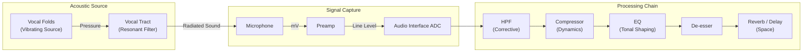

# Vocals: Performance Technique, Recording, and Mix Processing Masterclass

## Why This Lesson Is Structured This Way

Most vocal material splits into two camps that never talk to each other: singing technique taught by vocal coaches, and recording/mixing taught by audio engineers. A singer with bad breath support will defeat even perfect microphone placement; a great take ruined by bad gain staging is unrecoverable no matter how good the engineer's ears are. This lesson treats the voice as an acoustic instrument first (the thing producing the sound) and the signal chain second (the thing capturing and shaping it). You need both hands on the wheel.

The voice is a wind instrument: lungs are the air supply, vocal folds are the vibrating reed (the source), and the throat/mouth/nasal cavities are the resonating tube (the filter) that is constantly reshaped by the tongue, jaw, and soft palate to produce vowels and tone color. Everything from breath support drills to EQ moves traces back to this source-filter relationship.

---

## Part 1: Singing Technique — Building the Instrument

### 1.1 Posture and Breath Mechanics

Before any microphone touches the signal, the physical engine has to be right. Sloppy posture chokes airflow and caps your dynamic range no plugin can fix.

**Standing/sitting posture checklist:**
- Feet shoulder-width apart, weight balanced, knees soft (not locked).
- Spine long, sternum lifted but not thrust out like a soldier at attention — think "tall and easy," not "rigid."
- Shoulders down and back, away from the ears. Tension in the shoulders travels directly into the throat.
- Chin level, not tilted up (which stretches and weakens the larynx position) or jammed down (which compresses it).

**Diaphragmatic breath drill (do this before every practice session):**
1. Lie on your back, place a book on your stomach.
2. Inhale through the nose for 4 counts — the book should rise. If your chest rises instead and the book stays flat, you're breathing high and shallow.
3. Exhale through pursed lips for 8 counts, steady and even, like fogging a mirror in slow motion.
4. Repeat for 5 minutes daily. Once this is automatic lying down, repeat it standing.

**Appoggio (breath support) in practice:** the goal isn't to suck in a huge gulp of air and then collapse — it's to maintain gentle outward pressure from the lower ribs and abdominal wall against the inward pull of the diaphragm as it relaxes. This creates *controlled* release of air pressure rather than a deflating-balloon collapse, which is what causes pitch to sag and tone to go breathy/thin at the end of phrases.

**Drill — sustained hiss with resistance:**
1. Inhale for 4 counts (low, wide, ribs expand sideways).
2. Hiss ("sssss") for as long as possible at a *constant* volume — not loud-to-soft.
3. Time it with a stopwatch. Beginners: 15-20 seconds. Target: 30-40 seconds with no wavering.
4. This trains the slow, controlled abdominal engagement that powers sustained phrases.

### 1.2 Vocal Fold Onset and Resonance Placement

**Onset types** (how the vocal folds come together to start a note):
- **Breathy onset:** folds come together late, air escapes before phonation — airy, unsupported tone. Useful stylistically (intimate, ASMR-adjacent vocals) but fatiguing if constant.
- **Glottal/hard onset:** folds slam together before air pressure builds — percussive "click" before the note (listen for it on words starting with vowels, like "Apple"). Overused, this causes vocal fold strain over a session.
- **Balanced (coordinated) onset:** folds meet exactly as airflow begins — clean, efficient, no click or air-leak. This is the target for sustainable technique.

**Drill — onset control:**
1. Sing a single pitch (comfortable mid-range) on "ah" with deliberately breathy onset. Notice the airy "h" before the tone.
2. Sing the same pitch with deliberately hard/glottal onset. Notice the clicking attack.
3. Sing it a third time aiming for the midpoint — tone begins the instant air begins, no click, no air-leak. This is balanced onset.
4. Repeat across 5 pitches in your comfortable range, metronome at 60 BPM, one note per beat, four beats of rest between to reset breath.

**Resonance placement ("forward" vs "throaty" tone):** Humming on "ng" (as in "sing") and feeling the buzz in the mask of the face (around the nose and cheekbones) trains forward resonance, which carries better acoustically and reduces throat strain. A voice that feels like it's vibrating low in the throat, with a dark, swallowed quality, is typically under-supported by breath and over-reliant on throat muscles to produce volume — a direct path to vocal fatigue and, over time, nodules.

**Drill — hum-to-vowel bridge:**
1. Hum "ng" on a comfortable pitch, feel the facial buzz.
2. Without changing the placement or the buzz sensation, open into "ah," keeping the same forward resonance.
3. Alternate ng → ah → ng → ah, 4 reps per pitch, chromatic walk up 5 semitones and back down, metronome 60 BPM.

### 1.3 Range, Registers, and the Passaggio

Every voice has distinct registers — chest voice (speaking register, thicker fold closure), head voice (lighter, thinner fold closure), and for many voices a noticeable gear-change zone between them called the **passaggio** (break). Cracking or flipping at this transition is the single most common amateur vocal problem, and it's fixable with targeted exercises, not just "practice more."

**Locating your passaggio:** Sing an ascending major scale slowly on "ah." Note where the voice wants to flip, thin out, or strain — for most untrained male voices this sits around D4-F#4, for female voices often around A4-C5 (varies by voice type). This zone needs *mixed registration* — a blend of chest and head resonance — rather than pure chest (pushed, strained, cracks) or pure head (suddenly thin, disconnected "flip").

**Drill — sirening through the break:**
1. On "ng" or "oo" (narrow vowels mask the break best), glide a continuous siren from your lowest comfortable note to your highest, no breaks, no gear changes audible.
2. Keep volume moderate — this is a coordination exercise, not a power exercise.
3. 10 reps, resting breath between each. If you hear a flip, slow down through that specific pitch and lighten (reduce volume/air pressure) right at the break point.

**Drill — "ng" to open vowel through the passaggio (mixed voice training):**
1. Pick a pitch just below your identified break.
2. Sing "ng-ah" slowly, maintaining the forward buzz as you open the vowel.
3. Move up by half steps through the break zone and three semitones above it.
4. Metronome 60 BPM, one pitch per 2 beats, holding each "ah" for the second beat.
5. The moment the tone wants to crack, back off volume by 30% and lighten the vowel slightly (more toward "uh" than fully open "ah") rather than pushing through with more air.

### 1.4 Vowel Modification and Diction for Singing

Spoken vowels and sung vowels aren't the same shape, especially at pitch extremes. **Vowel modification (vocal "covering")** adjusts the mouth/throat shape of a vowel as pitch rises to keep it singable instead of strained — e.g., a bright "ee" naturally wants to modify toward "ih" or even "eh" in the upper register to avoid a pinched, screechy tone.

**Practical modification guide (ascending through passaggio and above):**
- "ee" → modifies toward "ih"
- "ay" → modifies toward "eh"
- "ah" → modifies toward "uh" (slightly rounder, taller space)
- "oo" → stays fairly stable but with more space/taller soft palate

**Drill:** Sing "Flee from me" on an ascending phrase crossing your passaggio. First attempt: keep the vowel pure "ee" throughout — notice the strain near the top. Second attempt: let the "ee" relax toward "ih" as you approach the break. Compare tape of both. The modified version should sound easier, not noticeably "different word" — the modification is subtle, felt more than heard by the listener.

**Consonant clarity for recorded vocals:** Hard consonants (p, b, t, d, k, g) need crisp articulation with the tongue/lips but minimal extra breath force — explosive plosives are what overload microphones and create pops (see Part 2's pop filter section). Practice saying lyrics at a whisper-volume speaking voice first, focusing purely on tongue/lip precision, before adding pitch and volume back in. This isolates diction technique from vocal power so you build precision without excess air pressure.

---

## Part 2: Capturing the Voice — Microphone Technique and Signal Chain

### 2.1 Equipment Baseline

**Signal Capture:**
- **Large-diaphragm condenser microphone:** cardioid pattern, 20Hz–20kHz, max SPL >130dB (AT2020, Rode NT1-A, or similar). Requires +48V phantom power.
- **Preamp:** clean gain 40–60dB, EIN <-127dBu.
- **Audio interface:** 24-bit/96kHz capable, input impedance >2kΩ.

**Processing (any DAW — Ableton, Reaper, Pro Tools, FL Studio):**
- Parametric EQ (8+ bands, variable Q)
- Compressor
- De-esser
- Algorithmic reverb + delay
- Pitch correction
- FFT spectrum analyzer (8192-point minimum)

### 2.2 Microphone Positioning

Position the mic 6–8 inches (15–20cm) from the mouth, aimed at the **philtrum** (the groove between nose and upper lip, not straight into the mouth — this avoids direct plosive blasts while still capturing a full, present tone).

**Proximity effect — the physics you need, in one paragraph:** cardioid mics work by sensing the pressure *difference* between sound arriving at the front and rear of the capsule. At close range, that phase/pressure difference grows disproportionately for low frequencies, producing a bass boost of roughly 6dB per octave below ~200Hz as you move closer. This is why intimate, bassy vocal tones come from close-mic'ing, and why backing away thins out the low end. Use this deliberately — don't just stumble into it.

**Setup checklist:**
1. Mount mic on a shock mount (isolates stand-transmitted vibration/footstep rumble).
2. Place pop filter 2–3 inches in front of the capsule — diffuses plosive air bursts from p/b/t/d sounds, which create pressure spikes 10dB+ above sustained singing and will otherwise produce a "thump" in the recording.
3. Treat the room: absorptive panels or a reflection filter around the mic reduce early reflections. Record dry — add space later with reverb, where you control it.

### 2.3 Gain Staging

**Target: -18dBFS to -12dBFS peaks on sustained passages**, leaving 12-18dB headroom for unexpected dynamic swells. Digital clipping is a hard wall — unlike analog overdrive, which saturates somewhat gracefully, digital clipping truncates the waveform instantly and sounds like static/grit. There is no "a little clipping is fine" in digital recording.

**Session setup:**
- Sample rate: 48kHz (96kHz only if you're doing extreme pitch-shifting later and want more headroom for that specific process)
- Bit depth: 24-bit
- Buffer size: 128–256 samples for recording (low latency)
- Phantom power: ON

**Recording protocol:**
1. New project, mono audio track, arm for recording.
2. Have the vocalist warm up, then sing through the loudest phrase of the song first — set gain against *that*, not against a quiet verse.
3. Record 3-4 full takes minimum. Comping (combining the best phrases from multiple takes) is standard practice, not cheating.
4. Check between takes: no red clip indicators, noise floor below -60dBFS during silence, and a clean FFT with harmonics intact and no weird aliasing artifacts.

Save the raw file untouched. Everything downstream is non-destructive.

---

## Part 3: The Mix Chain — Signal Flow and Why the Order Matters

The order is not arbitrary. Corrective work (removing rumble) happens before compression, because compression amplifies whatever is quiet — including noise and rumble, if you haven't filtered it out first. Dynamics control happens before additive tonal shaping, because compression changes the apparent tonal balance (it brings up sustain, which changes perceived brightness), so you want the dynamics settled before you decide what to boost. Spatial effects (reverb, delay) go last because they operate on the finished dry tone — reverb tails sound different (and worse) if applied before compression evens things out, because the compressor will chase the reverb tail's level too.

### 3.1 High-Pass Filter

**Settings:** cutoff 80–100Hz, slope 12dB/octave.

Adult voice fundamentals run roughly 85Hz (low male) to 255Hz (high female). A 100Hz HPF strips subsonic rumble, mic stand vibration, and room modes without touching the voice itself.

**Setup:**
1. Parametric EQ, enable low-cut on the lowest band.
2. Cutoff 100Hz, slope 12dB/oct.
3. Solo the vocal. Sweep the cutoff from 60Hz to 120Hz while listening.
4. Stop at the point where rumble disappears but the voice still sounds full — usually 90-110Hz for most voices, lower (80Hz) for deep male voices you want to keep warm.

### 3.2 Compression

**Starting point:** threshold -20dBFS, ratio 4:1, attack 20ms, release 200ms, soft knee, makeup +3 to +6dB.

**Why attack 15-30ms:** this lets the initial consonant transient pass through uncompressed, which is what keeps diction intelligible. Drop attack below 5ms and you squash the consonants along with the sustained vowels — the vocal goes soft and mumbly even though it's technically "controlled."

**Why release ~200ms:** this roughly matches how quickly vocal tract resonances naturally decay. Too fast (< 100ms) and you hear the compressor "breathing" — audible pumping, gain visibly riding up and down with each syllable. Too slow (>500ms) and the compressor never fully lets go between phrases, so by the second half of a verse everything's artificially flat.

**Setup:**
1. Insert compressor after the HPF.
2. Threshold -20dBFS, ratio 4:1, attack 20ms, release 200ms, soft knee.
3. Watch the gain reduction meter during playback — target 3-6dB of average reduction. More than that and you're likely over-flattening; less and it's barely doing anything.
4. Adjust makeup gain so the processed peaks roughly match the original peaks.

### 3.3 Additive EQ

**Presence boost:** +2 to +4dB at 3-3.5kHz, Q ~1.5. This sits in the third formant region that governs intelligibility and "cut" — the frequency range your ear uses to pick a voice out of a dense mix.

**Air boost:** +1 to +3dB high-shelf at 10kHz, Q ~0.7 (wide, gentle). Adds breath detail and shimmer without harshness.

**Setup:**
1. Second EQ instance after the compressor.
2. Bell filter, 3.5kHz, Q 1.5, +3dB.
3. High-shelf, 10kHz, Q 0.7, +2dB.
4. A/B bypass vs. processed — these are starting points, adjust by ear per voice.

### 3.4 De-essing

Sibilant consonants (s, z, sh, ch) generate broadband noise bursts centered 6-10kHz from turbulent airflow across the teeth. Left unchecked, they fatigue the listener and fight with cymbals/hi-hats in a mix.

**Setup:**
1. Insert de-esser, frequency range 6-9kHz.
2. Threshold -22 to -20dBFS, ratio 6:1 to 10:1, attack 1-5ms (fast, to catch the transient), release 50-100ms.
3. Play a sibilant-heavy phrase and watch the gain reduction meter — it should trigger specifically on s/sh sounds, not on vowels.
4. Listen for over-de-essing: if "s" sounds start to sound like "th" (lispy), back off the reduction amount.

### 3.5 Reverb and Delay

Route both as **auxiliary sends**, not inserts, so the dry vocal stays intact and you control exactly how much space gets blended in.

**Reverb starting point:** Plate or Hall algorithm, pre-delay 20-30ms, RT60 (decay) 1.2-1.8s, send level -12dB.

Pre-delay creates a gap between the dry voice and the reverb onset, which keeps the vocal intelligible instead of smeared — this is the **Haas effect**: delays under ~30-40ms fuse perceptually with the direct sound (feels like one bigger space), while longer delays start to sound like a distinct, separate echo.

**Delay starting point:** 500ms (quarter note at 120 BPM), feedback 25-35%, with a high-pass at 200Hz and low-pass at 6kHz on the feedback path (so repeats don't build up mud or harshness over multiple bounces), send level -18dB.

**Setup:**
1. Create aux tracks for reverb and delay, 100% wet on each.
2. Insert plugins, dial in starting points above.
3. On the vocal track, create sends to both aux tracks at the levels given.
4. Play back and nudge send levels until the vocal feels like it's "in a space" without losing clarity or getting buried.

---

## Part 4: Parameter Sweep Drills — Train Your Ears on Cause and Effect

The fastest way to internalize what a knob does is to move it to an extreme, then back off gradually while listening — not just read a number and trust it. Run these as actual listening drills, not just conceptual study.

### Drill: HPF Cutoff Sweep
1. Record 10 seconds of vocal, insert HPF only (bypass everything else).
2. Set cutoff to 60Hz. Listen. Note the amount of low rumble present.
3. Move to 100Hz. Listen again — rumble should be noticeably reduced.
4. Move to 140Hz. Listen — male vocal fundamentals should now sound thin, hollowed out at the bottom.
5. Settle between 90-110Hz for most voices; go as low as 80Hz for deep male voices where you want to preserve warmth.

### Drill: Compression Threshold Sweep
1. Ratio fixed 4:1, attack 20ms, release 200ms.
2. Set threshold to -30dBFS. Listen — the vocal should sound flattened, constant-level, "squashed."
3. Set threshold to -10dBFS. Listen — barely any audible effect.
4. Walk the threshold up from -30 toward -10 in 2dB steps, stopping when the vocal "feels present and even" without feeling locked to one volume. Usually lands around -20 to -18dBFS. Watch the gain reduction meter — target 3-6dB average.

### Drill: Compression Attack Sweep
1. Threshold -20dBFS, ratio 4:1, release 200ms fixed.
2. Record/say a consonant-heavy phrase: "Peter Piper picked a peck of pickled peppers."
3. Set attack to 1ms. Listen — the hard consonant attacks (P sounds) should sound dulled, swallowed.
4. Set attack to 50ms. Listen — consonants pop through clearly, but peak levels may spike more.
5. Settle at 15-25ms — the sweet spot where consonants stay crisp but the compressor still grabs sustained vowels.

### Drill: Reverb Decay (RT60) Sweep
1. Pre-delay 25ms, mix 30% fixed.
2. Set RT60 to 0.5s. Say a phrase with pauses — the reverb tail should clear almost instantly in the gaps.
3. Set RT60 to 3.0s. Say the same phrase — tails from previous words should audibly bleed into the next word, smearing diction.
4. Settle at 1.2-1.8s for most pop/rock vocal work; up to 2.5-3s only for slow ballads with lots of space between phrases.

### Drill: Delay Time and Feedback
1. Mix 20% fixed.
2. Set delay to 200ms, feedback 30%. Say "one, two, three, four" rhythmically — notice if the echo supports or clutters the rhythm.
3. Set delay to 500ms (quarter note at 120 BPM) — the echo should land on a musically sensible beat subdivision.
4. Vary feedback 20% → 50% at the chosen delay time — count audible repeats. 20-30% gives 2-3 clean repeats; 50%+ starts building toward dense, washy buildup.
5. Settle at 400-600ms delay, 25-35% feedback for most pop/rock lead vocals.

---

## Part 5: Fault Diagnosis and Repair

### Fault: Clipping

**Symptom:** harsh, gritty, "crunchy" distortion on loud passages. Flat-topped waveforms visible when you zoom into the sample view.

**Cause:** preamp gain too hot, signal exceeds 0dBFS, samples get truncated.

**Fix:** there isn't a good one after the fact. Soft-clip/saturation plugins can round off the harshness slightly but cannot restore the lost waveform information. Spectral repair tools (iZotope RX De-clip) can interpolate mild clipping (< 3dB over) with partial success. The real fix is prevention: before recording, have the vocalist sing their loudest passage first, set gain against that with -12dBFS peak headroom, *then* record the take.

### Fault: High Noise Floor

**Symptom:** audible hiss, hum, or rumble under the vocal, especially noticeable in quiet sections.

**Cause:** HVAC, computer fans, electrical hum (60Hz + harmonics at 120Hz, 180Hz), untreated room, or mic positioned too far from source (forcing excessive gain).

**Diagnosis:** record 10 seconds of silence in the same conditions, run an FFT, identify dominant noise peaks.

**Fix:**
1. First choice — fix it at the source: turn off fans/HVAC, close windows, move closer to the mic to improve signal-to-noise ratio naturally.
2. If stuck with the noise, use a spectral noise reduction tool: capture the noise profile from the silent section, apply 10-15dB max reduction, smoothing 50-100ms. More aggressive settings create an "underwater," artifact-laden sound.
3. For tonal hum specifically (60/120Hz), narrow notch filters (Q 5+) at those exact frequencies are cleaner than broadband noise reduction.

### Fault: Excessive Proximity Bass

**Symptom:** boomy, bass-heavy vocal, especially on sustained low notes, recorded with the mic very close (< 2 inches).

**Fix:** low-shelf cut at 200Hz (-6 to -8dB) or raise the HPF cutoff, plus a narrow bell cut around 120Hz (-3 to -4dB) to tame the specific proximity peak. Or — simpler — just back the mic off to 6-8 inches and re-record if the take allows it.

**Note:** this isn't always a fault. Proximity bass is used deliberately in radio announcing, intimate singer-songwriter vocals, and hip-hop for warmth and authority. Control it on purpose; don't stumble into it by accident.

### Fault: Comb Filtering from Room Reflections

**Symptom:** hollow, "phasey" tone, with regularly-spaced notches visible in the FFT.

**Cause:** direct sound and a reflection off a nearby wall arrive at the mic slightly out of time, canceling specific frequencies. For a reflecting surface 3 feet away, the first notch lands around 94Hz with regular notches above that.

**Fix:** best fix is prevention — move the vocalist 4+ feet from hard, parallel reflective surfaces, or add absorption panels at the first reflection point. After the fact, you can boost narrow bells (Q 3-5) at the notch frequencies, but this is tedious and only partially effective. Re-recording in a better space beats fighting it in the mix.

### Fault: Phase Cancellation (Stereo Vocal Recordings)

**Symptom:** thin, hollow sound when summing a stereo vocal recording to mono; specific frequencies seem to disappear.

**Cause:** two mics at different distances from the source create a time-of-arrival difference, which causes destructive interference at frequencies where that delay corresponds to a 180° phase shift.

**Fix:** zoom into the waveform, find a shared transient (a consonant attack) on both channels, and nudge one channel in time until the transients align. If that doesn't fully resolve it, just use the better-sounding single channel — vocals are usually recorded mono anyway unless you're intentionally going for a stereo-doubled effect using proper techniques (true double performance, not two mics on one performance).

### Fault: Monitoring Latency During Recording

**Symptom:** vocalist reports hearing their voice "behind" what they're singing, making it hard to stay in time, especially when plugins are active during tracking.

**Cause:** large buffer size (e.g., 2048 samples = 42.7ms at 48kHz) plus plugin processing adds up to audible round-trip delay. Above roughly 10-12ms, the lag becomes perceptible and distracting.

**Fix:**
1. For tracking: drop buffer size to 64-128 samples (1.3-2.7ms).
2. Or use the audio interface's direct/zero-latency hardware monitoring instead of monitoring through the DAW (you won't hear plugin effects while tracking, but latency becomes near-zero).
3. Raise the buffer back up to 512-1024 for mixing, where CPU headroom matters more than real-time latency.

---

## Part 6: Vocal Doubling, Layering, and Pitch Correction

### 6.1 Manual Doubling (the real way)

1. Record the lead vocal.
2. Have the vocalist sing the exact same part again, full performance, not punched in — natural human timing/pitch variation is what creates the width.
3. Record a third pass if going for a thicker double.
4. Pan: lead center, double 1 at 30% left, double 2 (if used) at 30% right. Level-match so doubles sit slightly under the lead, not equal to it.

This sounds more natural than artificial doubling because the micro-timing and pitch drift are real human variation, not a processed copy of the same exact waveform.

### 6.2 Artificial Doubling (when a second take isn't available)

1. Duplicate the vocal track.
2. Pitch-shift the duplicate +8 to +12 cents, add ~20ms delay, pan 40% left.
3. Duplicate again: pitch-shift -8 to -12 cents, ~25ms delay, pan 40% right.
4. Mix both duplicates 6dB below the original lead.

This is a usable substitute, but it's audibly more "processed" and symmetrical than a real double — use it when scheduling or performance constraints rule out a second take.

### 6.3 Pitch Correction — Setting It Up to Sound Natural (or Not)

**Retune speed** controls how fast the plugin pulls the pitch to the target note:
- **0-10ms:** the hard "Autotune effect" — audibly robotic, stepped pitch jumps (the T-Pain/Cher effect). Used as an intentional stylistic choice.
- **30-50ms:** natural-sounding correction — pulls pitch into tune without erasing the human vibrato and pitch drift that makes a vocal feel alive.
- **100ms+:** very gentle, mostly leaves natural pitch movement alone, only nudges sustained notes that are genuinely off.

**Setup for transparent correction:**
1. Set target scale (the key of the song).
2. Retune speed 40-50ms.
3. Pitch tolerance ±20-30 cents (how far off-pitch a note has to be before correction kicks in).
4. Enable formant preservation — without it, pitch-shifted notes change the apparent size/gender quality of the voice, which sounds unnatural on anything beyond small corrections.

---

## Workflow Recipes by Style

### Intimate Singer-Songwriter
- Mic: 8 inches, slightly off-axis. Target -18dBFS peaks.
- HPF 90Hz (12dB/oct) → Compressor (threshold -22dBFS, ratio 3:1, attack 25ms, release 200ms) → EQ (+3dB @ 3kHz, +2dB shelf @ 10kHz) → small-room reverb (RT60 0.8s, 20% mix) → light quarter-note delay (10% mix).
- Goal: present and clear, processing should be nearly invisible.

### Energetic Pop/Rock Lead
- Mic: 6 inches, on-axis. Target -15dBFS peaks (more aggressive performance level).
- HPF 100Hz (18dB/oct) → Compressor 1 (threshold -20dBFS, ratio 5:1) → parallel compression blend (threshold -30dBFS, ratio 10:1, 50% blend) → de-esser (7kHz) → EQ (+4dB @ 3.5kHz, +3dB shelf @ 12kHz) → plate reverb (RT60 1.5s, 25% mix) → dotted-eighth delay (15% mix).
- Goal: forward, powerful, cuts through a dense mix.

### Ethereal Ambient Vocal
- Mic: 10-12 inches (capture some natural room tone). Target -18dBFS peaks.
- HPF 80Hz (preserve warmth) → gentle compressor (threshold -24dBFS, ratio 2.5:1, attack 40ms, release 300ms) → EQ (+2dB @ 2.5kHz, +4dB shelf @ 8kHz) → large hall reverb (RT60 3.5s) layered with a shimmer/octave-up reverb send → long delay (1500ms, 50% feedback, filtered) → subtle layered pitch shift (±5-7 cents, panned).
- Goal: spacious, atmospheric, vocal as texture rather than focal point.

---

## Quick Troubleshooting Reference

| Symptom | Likely Cause | First Fix to Try |
|---|---|---|
| Muddy | Excess 200-500Hz, proximity overload | Raise HPF to 100-110Hz, cut -3dB bell at 250Hz |
| Harsh/brittle | Resonant peak 3-8kHz, over-compression | Narrow cut (Q 4-6) at the peak; reduce ratio |
| Lacks presence | Weak 3-5kHz, over-compressed transients | Boost +3dB @ 3.5kHz; check attack >15ms |
| Excessive sibilance | On-axis mic, bright EQ | De-esser 6-8kHz, threshold -22dBFS, ratio 8:1 |
| Sits behind the mix | Under-compressed, no air | Ratio 4-6:1, add presence + air boost, reduce reverb wetness |
| Robotic/over-processed | Over-compression, fast pitch correction | Reduce ratio to 2-3:1, retune speed to 40-50ms |

---

## Practice Progression

1. **Weeks 1-2:** Daily breath drills (diaphragmatic breathing, sustained hiss), onset control drills, basic mic setup and gain staging on simple recordings.
2. **Weeks 3-4:** Passaggio work (siren drills, ng-to-vowel bridges, vowel modification), full processing chain on recorded takes, run the parameter sweep drills to build EQ/compression ear training.
3. **Weeks 5-6:** Fault injection drills — deliberately clip, over-de-ess, and mis-position the mic, then practice diagnosing and fixing by ear alone before checking the FFT.
4. **Ongoing:** Record in different rooms and document how each one changes the capture. Build and refine your own template processing chains per vocal style. Track progress with recorded A/B comparisons monthly, not just by feel.
