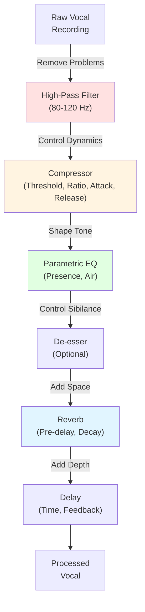
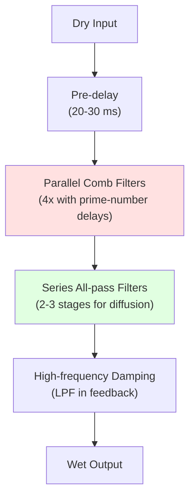
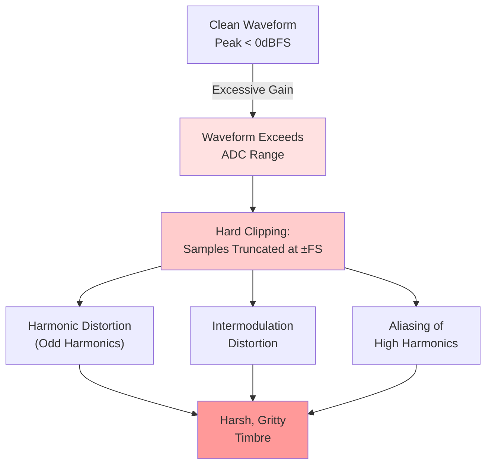
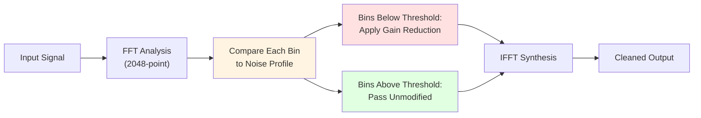
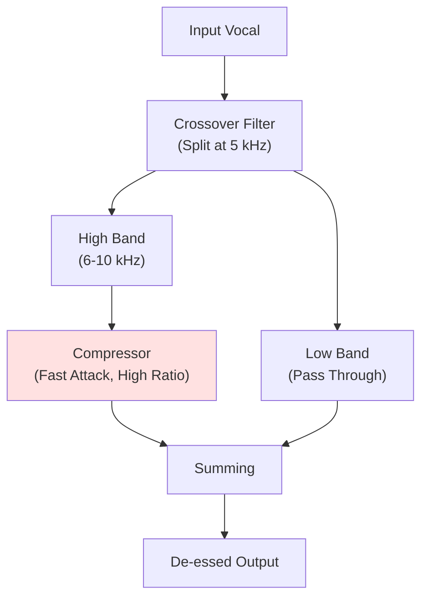
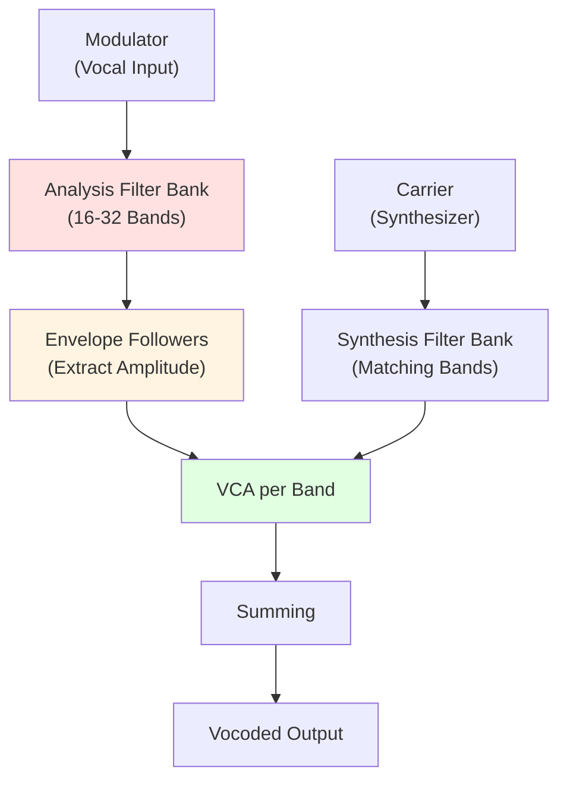

# Operational Verification Labs: Vocals

## Objective & Lab Setup

This laboratory provides systematic, hands-on investigation of vocal production, capture, and processing through controlled experimentation. Participants will examine the signal chain from acoustic generation through digital processing, exploring how transduction, analog-to-digital conversion, and time-variant filtering affect vocal timbre and intelligibility. The lab emphasizes quantitative measurement, parameter sweep methodology, and fault analysis to build intuition about audio systems from first principles.

Vocal production represents a complex interaction between respiratory pressure, vocal fold oscillation, and vocal tract filtering. The human voice generates a harmonic spectrum through quasi-periodic vocal fold vibration (the source), which is then shaped by resonant cavities in the pharynx, oral cavity, and nasal cavity (the filter). This source-filter model, first formalized by Gunnar Fant, explains how we produce distinct phonemes and vocal timbres. Understanding this acoustic foundation is essential before applying signal processing.

### Required Tools and Environment

The lab requires precise instrumentation and software:

**Signal Capture:**
- **Large-diaphragm condenser microphone:** Cardioid pattern, 20Hz-20kHz response, max SPL >130dB (e.g., Audio-Technica AT2020, Rode NT1-A). Condenser microphones use a capacitor capsule where sound pressure variations modulate capacitance, requiring phantom power (+48V) but providing superior transient response compared to dynamic microphones.
- **Preamplifier:** Clean gain 40-60dB, equivalent input noise <-127dBu, low THD+N (<0.001% @ 1kHz). The preamp amplifies the microphone's millivolt-level signal to line level (~1V) while adding minimal noise.
- **Audio interface:** 24-bit/96kHz minimum, USB 2.0 or Thunderbolt, input impedance >2kΩ, A-weighted dynamic range >110dB. The interface performs analog-to-digital conversion using successive approximation or delta-sigma converters.

**Signal Processing:**
- **Digital Audio Workstation (DAW):** Ableton Live 11+, FL Studio 20+, Pro Tools 2023+, or Reaper 6+. DAWs provide non-destructive editing, plugin hosting (VST/AU/AAX), and sample-accurate timing.
- **Audio editor:** Audacity 3.0+ for spectral analysis and simple processing.
- **Monitoring:** Closed-back headphones (>10Hz-30kHz response) or nearfield monitors with flat frequency response (±3dB 50Hz-18kHz).

**Processing Plugins (VST3/AU/AAX):**
- Parametric EQ (minimum 8-band, variable Q)
- Dynamic range compressor (feed-forward or feedback topology)
- Algorithmic reverb (Freeverb, Schroeder, or convolution-based)
- Delay line (multi-tap with feedback control)
- Pitch correction/autotune (phase vocoder or time-domain PSOLA)
- Spectrum analyzer (FFT-based, minimum 8192-point transform)

**Room Treatment:**
Minimize early reflections and standing waves using acoustic panels or a reflection filter around the microphone. The critical distance (where direct sound equals reverberant sound) should exceed the microphone position to ensure dry signal capture.

### Signal Chain Architecture


### Sample Rate and Bit Depth Considerations

The Nyquist-Shannon sampling theorem states that to perfectly reconstruct a bandlimited signal, the sample rate must exceed twice the highest frequency component. For audio with 20kHz upper limit, 44.1kHz is theoretically sufficient, but 48kHz or 96kHz provides margin for anti-aliasing filter design and processing headroom.

Bit depth determines quantization resolution. A 24-bit system provides 144dB theoretical dynamic range (6.02 × 24 dB), far exceeding the 120dB range of human hearing. This headroom accommodates processing without introducing quantization noise. Dithering—adding low-level noise before quantization—decorrelates quantization error, making it perceptually more acceptable.

## Exercise 1: Foundational Practical Implementation

### Recording a Vocal Take

**Microphone Positioning and Proximity Effect:**

Position the large-diaphragm condenser microphone 6-8 inches (15-20cm) from the vocalist's mouth, aimed at the philtrum (the groove between nose and upper lip). This distance balances intimacy with proximity effect control. The proximity effect occurs in pressure-gradient microphones (cardioid, figure-8) where low-frequency response increases as distance decreases, due to phase differences between front and rear ports. The bass boost follows a 6dB/octave slope below ~200Hz as source distance approaches zero.

Mount the microphone on a shock mount to decouple mechanical vibrations from the stand. Position a pop filter 2-3 inches in front of the capsule to diffuse plosive bursts (p, b, t, d sounds), which create brief pressure transients exceeding 10dB above sustained phonation.

**Gain Staging and Headroom:**

Set preamp gain to achieve -18dBFS to -12dBFS peaks on sustained vowels, leaving 12-18dB headroom for transients. Digital clipping (exceeding 0dBFS) is catastrophic—unlike analog saturation, it produces harsh discontinuities. The RMS-to-peak ratio for vocals typically ranges 10-15dB; designing for -12dBFS peaks ensures transients remain below 0dBFS even during loud passages.

Configure the audio interface:
- Sample rate: 48kHz (or 96kHz if performing extreme pitch shifting)
- Bit depth: 24-bit
- Buffer size: 128-256 samples (2.7-5.3ms latency at 48kHz) for monitoring without distracting delay
- Input: Channel 1 (microphone preamp)
- Enable phantom power (+48V) for condenser microphone

**Recording Protocol:**

Create a new DAW project and insert a mono audio track. Arm the track for recording (enable input monitoring). Have the vocalist sing a chromatic scale (C3-C5 for male voices, A3-A5 for female voices) at mezzo-forte dynamic level. This exercise reveals:
- Frequency response across the vocal range
- Formant structure variations
- Breath noise characteristics
- Sibilance energy (6-10kHz)

Record 3-4 takes to capture performance variations. Between takes, check for:
- **Clipping indicators:** Any samples reaching 0dBFS
- **Noise floor:** During silence, spectral energy should remain below -60dBFS
- **Spectral balance:** Use FFT analyzer to verify fundamental frequency and harmonics are captured without aliasing

Save the raw, unprocessed recording as a reference. All subsequent processing will be applied non-destructively through plugin chains.

### Basic Vocal Processing: The Essential Chain

Professional vocal production typically applies processing in this order: corrective EQ → dynamics → additive EQ → time-based effects. This sequence ensures noise is removed before amplification (via compression) and tonal shaping precedes spatial processing.



#### Step 1: High-Pass Filtering

Insert a parametric EQ plugin as the first processor in the chain. Enable a high-pass filter (HPF) with these parameters:
- **Cutoff frequency:** 80-100 Hz
- **Slope:** 12 dB/octave (2-pole Butterworth) or 18 dB/octave (3-pole)
- **Filter type:** Butterworth (maximally flat passband) or Linkwitz-Riley (no phase distortion at crossover)

**Acoustic Rationale:** Fundamental frequencies for adult voices range from approximately 85Hz (bass) to 255Hz (soprano). A 100Hz HPF removes subsonic rumble, room modes, and handling noise without affecting vocal content. The filter's phase response introduces a 90° shift per pole at the cutoff frequency, but this is inaudible for frequencies below the fundamental.

The transfer function for a second-order high-pass filter:

```
H(s) = s² / (s² + (ωc/Q)s + ωc²)
```

Where ωc is the cutoff frequency in rad/s and Q is the quality factor (0.707 for Butterworth).

#### Step 2: Dynamic Range Compression

Insert a compressor plugin after the HPF. Compression reduces the difference between the loudest and quietest parts of a signal by applying gain reduction when the signal exceeds a threshold. This "rides the fader" automatically, making whispered phrases audible without loud sections becoming overwhelming.

**Feed-Forward Compressor Parameters:**
- **Threshold:** -20 dBFS (gain reduction begins when signal exceeds this level)
- **Ratio:** 4:1 (for every 4dB above threshold, output increases 1dB)
- **Attack time:** 15-30 ms (how quickly gain reduction responds to threshold crossing)
- **Release time:** 150-250 ms (how quickly gain reduction returns to 0dB after signal falls below threshold)
- **Knee:** Soft (gradual transition into compression reduces audibility)
- **Makeup gain:** +3 to +6 dB (compensates for gain reduction)

**Attack Time Considerations:** Extremely fast attack (<5ms) attenuates transients (consonants, plosives), reducing clarity. Moderate attack (15-30ms) allows initial transient to pass uncompressed, preserving articulation while controlling sustained energy. The attack time should be shorter than the period of the lowest frequency you want to compress (e.g., for 100Hz, period = 10ms, so attack < 10ms would compress individual cycles rather than the envelope).

**Release Time Considerations:** Release sets how the compressor "breathes" with the music. Too fast (<100ms) causes pumping artifacts as gain modulates audibly. Too slow (>500ms) prevents the compressor from recovering between phrases, resulting in over-compression. A 200ms release approximates the decay time of vocal resonances in the vocal tract (formant bandwidth typically 50-100Hz, corresponding to decay times of 100-200ms).

The gain reduction GR in dB:

```
GR(dB) = {
    0,                                  if Input < Threshold
    (Input - Threshold) × (1 - 1/R),   if Input ≥ Threshold
}
```

Where R is the compression ratio.

#### Step 3: Parametric Equalization

Insert a second EQ plugin for additive tonal shaping. Unlike corrective EQ (which removes problems), additive EQ enhances desired characteristics:

**Presence Boost (3-5 kHz):**
- **Frequency:** 3.5 kHz
- **Gain:** +2 to +4 dB
- **Q:** 1.5 (moderate bandwidth, ~2 octaves)
- **Rationale:** This frequency range corresponds to the third formant (F3) in vowels, which governs voice recognition and intelligibility. Boosting here makes vocals cut through dense mixes.

**Air Enhancement (10-12 kHz):**
- **Frequency:** 10 kHz
- **Gain:** +1 to +3 dB
- **Q:** 0.7 (wide, gentle boost)
- **Filter type:** High-shelf
- **Rationale:** Adds breathiness and shimmer by enhancing vocal tract radiation characteristics and breath noise. This frequency range contains formant transitions and sibilant energy.

**Formant Structure:** Vowels are characterized by formants—resonant frequencies of the vocal tract. For an adult male neutral vowel [ə], typical formants are:
- F1: ~500 Hz (jaw opening)
- F2: ~1500 Hz (tongue position)
- F3: ~2500 Hz (voice quality)
- F4: ~3500 Hz (individuality)

EQ adjustments indirectly modify perceived formant balance, though they cannot recreate the source-filter interaction.

#### Step 4: Reverb Processing

Reverb simulates acoustic space by synthesizing hundreds of delayed, attenuated reflections. Create an auxiliary send track (reverb bus) to apply reverb in parallel rather than in series—this preserves the dry signal's clarity while adding ambience.

**Algorithmic Reverb Parameters:**
- **Algorithm:** Plate or Hall (Schroeder topology with all-pass diffusers)
- **Pre-delay:** 20-30 ms (delay between direct sound and first reflection)
- **Decay time (RT60):** 1.2-1.8 seconds (time for reverb to decay 60dB)
- **Early reflections level:** -6 dB relative to late reverb
- **High-frequency damping:** -3 dB at 8 kHz (simulates air absorption)
- **Wet/Dry mix:** 25-35% wet (on auxiliary send, or 100% wet with send level at -12dB)

**Pre-delay Rationale:** A 20-30ms pre-delay creates separation between the direct vocal and reverb onset, maintaining clarity. This delay approximates the time for sound to travel 7-10 meters (the distance to the nearest wall in a medium-sized room), making the reverb feel natural rather than smeared.

**Decay Time Selection:** Shorter decay times (0.8-1.2s) create intimate spaces (vocal booth, small room). Longer decay times (2-3s) create expansive spaces (concert hall, cathedral). For pop/rock vocals, 1.2-1.8s provides size without overwhelming the mix.

Reverb decay follows an exponential curve:

```
A(t) = A₀ × e^(-3ln(10)t/RT60)
```

Where A(t) is amplitude at time t, A₀ is initial amplitude, and RT60 is decay time to -60dB.

**Schroeder Reverb Structure:**



Comb filters create regularly-spaced notches in the frequency domain, producing metallic resonance if used alone. All-pass filters provide diffusion (dense, random-sounding reflections) without altering frequency response, smoothing the comb filter artifacts.

#### Step 5: Delay Processing

Insert a delay plugin on another auxiliary send or directly in the vocal track's insert chain (post-reverb).

**Delay Parameters:**
- **Delay time:** 500-600 ms (eighth-note at 120 BPM: 60000/(120×2) = 250ms; quarter-note: 500ms)
- **Feedback:** 25-35% (each repeat attenuated to 25-35% of previous amplitude)
- **High-pass filter:** 200 Hz (on feedback path to prevent low-frequency buildup)
- **Low-pass filter:** 6 kHz (on feedback path to simulate natural absorption)
- **Wet/Dry mix:** 15-25% wet

**Tempo Synchronization:** For musical coherence, delay time should align with tempo. Common values:
- Dotted eighth: (60000/BPM) × (3/4)
- Quarter note: 60000/BPM
- Eighth note: (60000/BPM) / 2

At 120 BPM, quarter-note delay = 500ms. This creates a rhythmic echo that reinforces rather than obscures the vocal line.

**Feedback Network:** Each delayed repetition passes through high-pass and low-pass filters, creating progressively darker, thinner echoes. This mimics acoustic absorption where high and low frequencies attenuate faster than midrange content. After n repetitions with feedback gain g and combined filter attenuation α:

```
Amplitude(n) = A₀ × (g × α)^n
```

Feedback should be set so that echoes become inaudible (<-60dB) after 3-5 repetitions to avoid buildup.

### Quality Verification Checklist

After processing, verify:
1. **No clipping:** Processed peaks remain below -1dBFS
2. **Spectral balance:** Compare processed vs. raw spectrum; verify no excessive filtering
3. **Intelligibility:** Every word remains clear; compression hasn't over-attenuated consonants
4. **Spatial coherence:** Reverb adds space without washing out the vocal
5. **Mono compatibility:** Summing to mono doesn't create phase cancellation (if using stereo effects)

## Exercise 2: Parameter Variation & Empirical Analysis

Systematic parameter sweeps reveal how each control affects signal characteristics. This exercise applies the scientific method: vary one parameter while holding others constant, measure the outcome, and document observations.

### Experimental Methodology

For each parameter variation:
1. **Export the processed audio** at each setting (24-bit WAV or FLAC, lossless)
2. **Measure objective metrics:**
   - RMS level (dBFS)
   - Peak level (dBFS)
   - Crest factor (Peak/RMS in dB)
   - Spectral centroid (Hz)
   - Dynamic range (loudest - quietest section in dB)
3. **Perform spectral analysis:** Capture FFT plots showing frequency domain changes
4. **Conduct listening tests:** Use level-matched A/B comparison (critical—loudness bias distorts perception)
5. **Document subjective observations:** Clarity, harshness, depth, presence, etc.

### Parameter Sweep 1: High-Pass Filter Cutoff Frequency

**Independent Variable:** HPF cutoff frequency  
**Range:** 60 Hz to 140 Hz  
**Step size:** 10 Hz  
**Control variables:** Slope (12 dB/oct), all other processing disabled

**Hypothesis:** As cutoff frequency increases, low-frequency energy decreases, potentially affecting perceived warmth and fullness. Excessive filtering (>120 Hz) may thin out male voices whose fundamentals approach this range.

**Procedure:**
1. Disable all processing except the HPF
2. Set cutoff to 60 Hz, record 10-second vocal phrase
3. Capture FFT spectrum (0-500 Hz, linear frequency axis)
4. Measure RMS level in 60-150 Hz band
5. Increment cutoff by 10 Hz; repeat steps 2-4
6. Generate overlay plot showing spectral energy vs. cutoff frequency

**Expected Observations:**
- **60-80 Hz:** Minimal change; most vocal energy above this range
- **90-100 Hz:** Noticeable reduction in room rumble and proximity effect
- **110-120 Hz:** Slight thinning for bass/baritone voices (F0 ~100-120 Hz)
- **130-140 Hz:** Audible thinning; male voice fundamentals attenuated

**Quantitative Analysis:**
Measure the spectral centroid shift:

```
Spectral Centroid (Hz) = Σ[f × M(f)] / Σ[M(f)]
```

Where f is frequency bin, M(f) is magnitude at that frequency. As HPF cutoff increases, centroid shifts upward, indicating a brighter, thinner timbre.

### Parameter Sweep 2: Compression Threshold

**Independent Variable:** Compression threshold  
**Range:** -30 dBFS to -10 dBFS  
**Step size:** 2 dB  
**Control variables:** Ratio 4:1, attack 20ms, release 200ms, HPF 100Hz, all other processing disabled

**Hypothesis:** Lower threshold triggers compression more frequently, reducing dynamic range more aggressively. Optimal threshold should trigger on sustained vowels but allow brief consonants to pass uncompressed.

**Procedure:**
1. Enable HPF (100 Hz) and compressor only
2. Set threshold to -30 dBFS
3. Record test phrase containing loud and soft sections
4. Measure:
   - Gain reduction meter (average GR in dB)
   - Compressed dynamic range: (loudest peak) - (quietest sustained section)
   - Crest factor: Peak/RMS
5. Increment threshold by 2 dB; repeat steps 3-4
6. Plot dynamic range and average GR vs. threshold

**Expected Observations:**
- **-30 dBFS:** Nearly constant compression; dynamic range <3 dB, excessive flattening
- **-24 to -20 dBFS:** Moderate compression; preserves macro-dynamics, controls peaks
- **-18 to -12 dBFS:** Subtle compression; only loudest sections affected
- **-10 dBFS:** Minimal effect; insufficient gain reduction

**Critical Listening:**
Listen for:
- **Pumping:** Audible gain modulation artifacts (indicates attack/release times need adjustment)
- **Over-compression:** Loss of expression, lifeless quality
- **Under-compression:** Insufficient leveling; soft phrases still inaudible

The optimal threshold makes the vocal sound consistently present without sounding squashed. For most sources, average GR of 3-6 dB indicates appropriate compression depth.

### Parameter Sweep 3: Compression Ratio

**Independent Variable:** Compression ratio  
**Range:** 1.5:1 to 10:1  
**Step size:** 0.5:1 (1.5:1, 2:1, 2.5:1, ..., 10:1)  
**Control variables:** Threshold -20 dBFS, attack 20ms, release 200ms

**Hypothesis:** Higher ratios produce more aggressive gain reduction. Ratios above 8:1 approach limiting (essentially infinite ratio), severely restricting dynamic range.

**Procedure:**
1. Set threshold to -20 dBFS, ratio to 1.5:1
2. Record test phrase, measure average GR and dynamic range
3. Increment ratio by 0.5:1; repeat measurement
4. Plot GR vs. ratio to verify the mathematical relationship

**Expected Relationship:**
For a signal 10 dB above threshold:
- 2:1 ratio: GR = 10 × (1 - 1/2) = 5 dB
- 4:1 ratio: GR = 10 × (1 - 1/4) = 7.5 dB
- 10:1 ratio: GR = 10 × (1 - 1/10) = 9 dB

Verify measured GR matches calculated GR. Discrepancies indicate soft-knee compression (gradual onset) rather than hard-knee.

**Listening Analysis:**
- **1.5:1 to 2:1:** Transparent; minimal audible compression
- **3:1 to 5:1:** Moderate; noticeable but natural
- **6:1 to 10:1:** Aggressive; heavily controlled, potentially artificial

### Parameter Sweep 4: Compression Attack Time

**Independent Variable:** Attack time  
**Range:** 1 ms to 100 ms  
**Step size:** Logarithmic steps (1, 2, 5, 10, 20, 50, 100 ms)  
**Control variables:** Threshold -20 dBFS, ratio 4:1, release 200ms

**Hypothesis:** Faster attack times attenuate transients (consonants), reducing clarity. Slower attack times preserve transients but may allow excessive peaks.

**Procedure:**
1. Record phrase with sharp consonants (e.g., "Peter Piper picked a peck of pickled peppers")
2. Set attack to 1 ms; measure crest factor and peak levels
3. Increase attack time logarithmically; repeat measurements
4. Compare transient preservation vs. peak control tradeoff

**Expected Observations:**
- **1-5 ms:** Flattened transients; plosives attenuated; muffled sound
- **10-20 ms:** Balanced; transients pass, sustained energy compressed
- **30-50 ms:** Minimal transient attenuation; reduced overall compression effect
- **100 ms:** Very slow; compressor responds to phrases rather than syllables

**Spectral Analysis:**
Examine 2-8 kHz region (consonant energy). Fast attack reduces high-frequency bursts, lowering spectral centroid during consonants.

### Parameter Sweep 5: Compression Release Time

**Independent Variable:** Release time  
**Range:** 50 ms to 1000 ms  
**Step size:** 50 ms increments up to 500ms, then 100ms increments  
**Control variables:** Threshold -20 dBFS, ratio 4:1, attack 20ms

**Hypothesis:** Release time controls how the compressor "breathes." Too fast causes pumping; too slow causes excessive sustained gain reduction.

**Procedure:**
1. Record phrase with gaps between words (to observe release behavior)
2. Set release to 50 ms; measure gain reduction envelope
3. Listen for pumping artifacts (audible gain modulation)
4. Increment release time; repeat
5. Identify optimal release where GR recovers naturally between phrases

**Expected Observations:**
- **50-100 ms:** Fast recovery; potential pumping if source is bassy
- **150-250 ms:** Natural; gain recovers smoothly between words
- **300-500 ms:** Slower; maintains more consistent GR across phrase
- **>600 ms:** Overly slow; compressor doesn't fully recover, cumulative gain reduction

**Optimal Release:** Should be faster than the time between vocal phrases (typically 500-1000ms) but slower than individual syllable durations (100-300ms).

### Parameter Sweep 6: Reverb Decay Time

**Independent Variable:** RT60 (decay time)  
**Range:** 0.5 s to 4.0 s  
**Step size:** 0.25 s  
**Control variables:** Pre-delay 25ms, mix 30%, high-frequency damping -3dB @ 8kHz

**Hypothesis:** Longer decay times create larger perceived spaces but may obscure clarity by overlapping subsequent words.

**Procedure:**
1. Set RT60 to 0.5 s; record phrase with pauses
2. Listen to reverb tail decay during pauses
3. Increment RT60 by 0.25 s; repeat
4. Measure time until reverb tail decays to -40 dBFS (perceptual silence threshold)
5. Assess clarity: can you distinguish every word clearly?

**Expected Observations:**
- **0.5-1.0 s:** Small room; intimate; clear
- **1.2-1.8 s:** Medium room/hall; pleasant spaciousness
- **2.0-3.0 s:** Large hall; lush but may smear fast passages
- **>3.5 s:** Cathedral; excessive for most pop/rock vocals

**Clarity Threshold Test:**
Recite fast phrases (e.g., "The quick brown fox jumps over the lazy dog"). Identify the RT60 where subsequent words begin overlapping with previous words' reverb tails. This is the maximum usable decay time for that tempo.

### Parameter Sweep 7: Reverb Pre-delay

**Independent Variable:** Pre-delay time  
**Range:** 0 ms to 80 ms  
**Step size:** 5 ms  
**Control variables:** RT60 1.5s, mix 30%

**Hypothesis:** Pre-delay creates separation between dry signal and reverb onset, enhancing clarity. Excessive pre-delay creates a distinct slap-back echo.

**Procedure:**
1. Set pre-delay to 0 ms (reverb starts immediately)
2. Record phrase; assess separation between vocal and reverb
3. Increment pre-delay by 5 ms; repeat
4. Identify pre-delay where reverb becomes a distinct echo (>50ms)

**Expected Observations:**
- **0-10 ms:** Reverb smears into vocal; reduced clarity
- **15-30 ms:** Natural separation; vocal remains clear
- **35-50 ms:** Noticeable pre-echo; adds depth without being distracting
- **>50 ms:** Distinct slap-back echo; sounds artificial

**Haas Effect:** Pre-delays under ~30-40ms fuse perceptually with the direct sound, creating the illusion of a single source in a larger space. Beyond 40-50ms, the echo is perceived as a distinct repetition.

### Parameter Sweep 8: Delay Time and Feedback

**Independent Variable:** Delay time  
**Range:** 200 ms to 1500 ms  
**Step size:** 100 ms (also test tempo-synced values)  
**Control variables:** Feedback 30%, mix 20%

**Secondary Variable:** Feedback percentage (20%, 30%, 40%, 50%)

**Hypothesis:** Delay time controls rhythmic interaction with the vocal. Feedback controls how many repeats are audible. Excessive feedback (>50%) can create runaway buildup.

**Procedure:**
1. Set delay to 200 ms, feedback to 30%
2. Record rhythmic vocal phrase (e.g., "one, two, three, four")
3. Assess whether delay enhances or obscures rhythm
4. Increment delay time; repeat
5. At optimal delay time, vary feedback from 20% to 50%
6. Measure number of audible repeats (above -40 dBFS) at each feedback level

**Expected Observations:**

**Delay Time:**
- **200-300 ms:** Short doubling effect; creates thickness
- **400-600 ms:** Rhythmic echo; complements phrasing
- **800-1200 ms:** Long echo; works for sparse arrangements
- **>1500 ms:** Very long; only useful for special effects

**Feedback:**
- **20-30%:** 2-3 audible repeats; clean
- **40%:** 4-5 repeats; rich but controlled
- **50-60%:** 6+ repeats; dense, potential for muddiness
- **>70%:** Infinite repeats; runaway feedback (system instability)

**Mathematical Analysis:**
Number of repeats above threshold T (in dB):

```
n = ⌊-T / (20 × log₁₀(g))⌋
```

Where g is feedback gain (0-1). For g=0.3 and T=-40dB:
n = ⌊40 / (20 × 0.523)⌋ = ⌊3.82⌋ = 3 repeats

### Data Synthesis and Reporting

After completing all parameter sweeps, create a comprehensive report containing:

1. **Parameter Response Curves:** Graphs showing objective metrics vs. parameter values
2. **Optimal Parameter Ranges:** Identified ranges for each parameter that achieve desired sonic characteristics
3. **Interaction Effects:** Document any non-linear interactions (e.g., how compression affects perceived reverb depth)
4. **Perceptual Thresholds:** Just-noticeable differences (JND) for each parameter
5. **Practical Recommendations:** Proposed starting points for different vocal styles (intimate, energetic, ethereal, aggressive)

Example optimal ranges (for pop/rock male vocals):
- HPF: 90-110 Hz
- Compression: Threshold -20 to -18 dBFS, Ratio 3:1 to 5:1, Attack 15-25ms, Release 180-220ms
- Presence boost: +2 to +4 dB @ 3-4 kHz
- Reverb: RT60 1.2-1.6s, Pre-delay 20-30ms, Mix 25-30%
- Delay: 500ms (quarter-note at 120 BPM), Feedback 25-30%, Mix 15-20%

## Exercise 3: Fault Injection & Stress Testing

This exercise deliberately introduces pathological conditions to understand system failure modes, develop troubleshooting skills, and learn remediation techniques. Each fault scenario represents a common recording/mixing error.

### Fault Scenario 1: Digital Clipping

**Fault Induction:**
Position the microphone 1-2 inches from the mouth. Set preamp gain 12-15dB higher than normal, causing the ADC input to exceed 0dBFS during loud passages. Record a phrase containing dynamic variations (whisper to shout).

**Signal Characteristics:**
Clipping occurs when the signal amplitude exceeds the ADC's maximum representable value. In a 24-bit system, this is ±8,388,607 (full scale). When exceeded, the waveform is truncated ("hard clipping"), introducing:
- **Harmonic distortion:** Odd harmonics (3f₀, 5f₀, 7f₀...) at high levels
- **Intermodulation distortion:** Sum and difference frequencies (f₁ ± f₂)
- **Spectral broadening:** Energy spreads across the frequency spectrum
- **Aliasing:** High-frequency harmonics fold back below Nyquist frequency



**Analysis Procedure:**
1. Open the clipped recording in your DAW
2. Enable sample-level waveform view (zoom to show individual samples)
3. Identify clipped sections: flat-topped waveforms where samples reach maximum value
4. Perform FFT analysis on clipped section vs. clean section
5. Measure Total Harmonic Distortion + Noise (THD+N):

```
THD+N (%) = 100 × √(Σ harmonic power + noise power) / fundamental power
```

Clipped audio typically exhibits THD+N >10%, compared to <0.1% for clean recordings.

**Spectral Evidence:**
Generate FFT plot (4096-point, Hann window) of:
- Clean vowel "ah" at 200Hz fundamental
- Same vowel clipped

The clipped spectrum will show:
- Strong odd harmonics: 600Hz (3rd), 1000Hz (5th), 1400Hz (7th)
- Elevated noise floor across all frequencies
- Possible aliased harmonics below Nyquist

**Remediation Attempts:**

**1. Soft-Clipping/Saturation Plugin:**
Apply a soft-clipper (e.g., waveshaper with tanh transfer function) to round off the clipped portions. This converts hard-clipping into soft-clipping, reducing harmonic harshness.

Transfer function:
```
y = tanh(x) = (e^x - e^-x) / (e^x + e^-x)
```

Soft-clipping produces smoother harmonic series, similar to analog saturation. However, this cannot restore truncated information—it only makes the distortion more pleasing.

**2. Spectral Repair Tools:**
Use spectral editing (e.g., iZotope RX's De-clip module) to:
- Identify clipped samples statistically
- Estimate the original waveform shape using interpolation from surrounding samples
- Reconstruct clipped peaks using psychoacoustic models

These tools are imperfect—they estimate based on probability, not ground truth. Severe clipping (>3dB over) is often unrecoverable.

**3. Harmonic EQ:**
Apply steep notch filters to attenuate the most offensive odd harmonics. This reduces harshness but further degrades fidelity.

**Conclusion:**
Clipping is largely irreversible. The only true solution is re-recording with proper gain staging. Measure peak-to-target margin before recording: for vocal with 15dB crest factor and -12dBFS target, set RMS level to -27dBFS.

### Fault Scenario 2: Background Noise (High Noise Floor)

**Fault Induction:**
Record in an untreated room with active HVAC, computer fan noise, or street traffic. Use distant microphone positioning (>18 inches) to reduce signal level while keeping gain high, maximizing the noise-to-signal ratio.

**Noise Characteristics:**
Typical background noise sources:
- **HVAC:** Broadband rumble 40-150Hz, tonal components at motor frequency (~60Hz, 120Hz in US)
- **Computer fan:** Broadband hiss 500Hz-8kHz
- **Electrical hum:** 60Hz fundamental + harmonics (120Hz, 180Hz, 240Hz...)
- **Room reflections:** Colored noise from resonant modes

**Analysis Procedure:**
1. Record 10 seconds of silence (noise floor capture)
2. Record vocal phrase in same conditions
3. Measure SNR (Signal-to-Noise Ratio):

```
SNR (dB) = 20 × log₁₀(RMS_signal / RMS_noise)
```

Professional standards: SNR >60dB. Acceptable: SNR >40dB. Poor: SNR <30dB.

4. Generate long-term average spectrum (LTAS) of noise floor
5. Compare noise spectrum to speech spectrum; identify regions of masking

**Noise Reduction Techniques:**

**1. Spectral Noise Gate (Expander):**
Rather than a simple amplitude gate, use a multiband expander that applies gain reduction frequency-selectively.



Algorithm:
1. Capture noise profile during silence
2. For each frequency bin in the FFT:
   - If magnitude < (noise_profile[bin] + threshold): apply attenuation
   - If magnitude > (noise_profile[bin] + threshold): pass through
3. Reconstruct time-domain signal via IFFT

**Parameters:**
- Threshold: +6 to +12 dB above noise floor
- Reduction: -15 to -25 dB (how much to attenuate noise)
- Smoothing: 50-100ms (prevents abrupt on/off artifacts)

**2. Adaptive Noise Reduction (Wiener Filtering):**
More sophisticated approach using Wiener filtering:

```
G(f) = max(0, 1 - [N(f) / S(f)]²)
```

Where G(f) is gain at frequency f, N(f) is noise magnitude, S(f) is signal magnitude. This adaptively attenuates frequencies dominated by noise while preserving signal-dominated frequencies.

**3. Corrective EQ:**
Identify noise-dominant frequency bands via LTAS and apply narrow notch filters:
- 60Hz notch: Q=5, -12dB (electrical hum)
- 120Hz notch: Q=5, -8dB (second harmonic)
- 80-150Hz shelf: -6dB (HVAC rumble)

**Side Effects and Artifacts:**
All noise reduction introduces artifacts:
- **Spectral smearing:** Transients lose definition
- **"Underwater" sound:** Over-processing produces watery artifacts
- **Modulation noise:** Noise floor pumps with signal level
- **Reduced spatial width:** Stereo recordings may collapse to mono

**Best Practice:**
Optimize recording conditions to minimize noise rather than relying on post-processing. If noise reduction is necessary:
- Apply conservatively (10-15dB max reduction)
- Use multiband approach for frequency-selective processing
- Preserve transients via adaptive attack/release
- Accept some residual noise rather than over-processing

### Fault Scenario 3: Proximity Effect Overload

**Fault Induction:**
Position cardioid microphone <2 inches from vocalist's mouth. Record sustained vowels and compare low-frequency content to a recording at normal distance (8 inches).

**Physical Mechanism:**
Pressure-gradient microphones (cardioid, figure-8) sense pressure difference between front and rear ports. At close distances, phase difference between ports increases for low frequencies, resulting in bass boost. The effect follows approximately:

```
Boost (dB) ≈ 20 × log₁₀(d₀ / d)   for f < fc
```

Where d is source distance, d₀ is reference distance (~1m), fc is frequency below which proximity effect dominates (~200Hz for typical large-diaphragm condenser).

At 2 inches (~5cm): Boost ≈ 20 × log₁₀(100/5) = 26dB at low frequencies!

**Analysis:**
1. Capture spectrum of close-mic recording
2. Capture spectrum of normal-distance recording
3. Calculate difference spectrum: Close(f) - Normal(f)
4. Observe peak boost frequency (typically 100-150Hz)

**Correction:**
Apply parametric EQ:
- Low-shelf at 200Hz: -6 to -12dB
- Or high-pass filter at 80Hz: 12dB/oct
- Reduce 100-150Hz region by 3-6dB to compensate for remaining excess

**Artistic Use:**
Proximity effect isn't always a fault—it's often deliberately used for:
- Radio voiceovers (enhances authority, warmth)
- Intimate vocal performances (enhances emotional connection)
- Hip-hop vocals (emphasizes low-end presence)

The key is intentional control rather than accidental overload.

### Fault Scenario 4: Excessive Sibilance

**Fault Induction:**
Record spoken phrases with strong sibilant consonants: "She sells seashells by the seashore." Boost 6-8kHz region by +6dB during recording (either via mic placement off-axis or EQ).

**Sibilance Characteristics:**
Sibilant phonemes (/s/, /z/, /sh/, /ch/) produce broadband noise bursts centered 6-10kHz, generated by turbulent airflow across the teeth and tongue. Excessive sibilance causes:
- Listener fatigue (high-frequency energy is perceptually harsh)
- Distortion in lossy codecs (MP3/AAC struggle with transient high-frequency bursts)
- Difficulty sitting in a mix (sibilance competes with cymbals, hi-hats)

**Analysis:**
1. Isolate sibilant phonemes in the waveform
2. Measure peak level in 6-10kHz band during sibilance
3. Compare to average level during vowels
4. Sibilance is excessive if peak exceeds vowel level by >15dB in this band

**De-essing Techniques:**

**1. Split-Band Compression:**
A de-esser is a frequency-selective compressor targeting the sibilance band.



**Parameters:**
- Frequency range: 6-9 kHz (adjustable based on vocalist)
- Threshold: -25 to -20 dBFS
- Ratio: 6:1 to 10:1
- Attack: 1-5 ms (fast to catch transients)
- Release: 50-100 ms

**2. Dynamic EQ:**
Similar to split-band compression but uses a parametric EQ where gain reduction is level-dependent:
- Center frequency: 7 kHz
- Q: 2.5 (targeting sibilance without affecting adjacent frequencies)
- Threshold: -22 dBFS
- Max reduction: -6 to -10 dB

**3. Spectral Shaping:**
Use a multiband expander in reverse: expand the sibilance band only when it's NOT present, raising everything else relative to sibilance.

**Perceptual Validation:**
After de-essing, sibilance should be present but not prominent. Over-de-essing produces a lispy, muffled sound. Target: sibilance peaks 6-10dB above vowel level in the 6-10kHz band.

### Fault Scenario 5: Phase Cancellation (Stereo Recording)

**Fault Induction:**
Record a vocal with two microphones in stereo configuration, but position them at different distances from the vocalist (e.g., one at 6 inches, one at 12 inches). This creates time-of-arrival differences resulting in phase cancellation when summed to mono.

**Physical Mechanism:**
Sound travels at approximately 343 m/s (at 20°C). A 6-inch (15cm) path length difference creates a time delay:

```
Δt = Δd / c = 0.15m / 343 m/s = 0.44 ms
```

This corresponds to a phase shift:

```
φ(f) = 360° × f × Δt
```

At 1 kHz: φ = 360° × 1000 × 0.00044 = 158°  
At 2 kHz: φ = 316°  
At 4 kHz: φ = 632° = 272° (wraps around)

When phase shift approaches 180°, destructive interference cancels that frequency.

**Analysis:**
1. Record stereo vocal with intentional path length difference
2. Create three versions:
   - Left channel only
   - Right channel only
   - Mono sum (L+R)
3. Compare spectra; identify cancelled frequency bands
4. Calculate theoretical null frequency:

```
f_null = c / (2 × Δd) × (2n - 1)   for n = 1, 2, 3...
```

For Δd = 15cm: f_null = 343/(2×0.15) × 1 = 1143 Hz (first null)

**Correction:**

**1. Time Alignment:**
Measure the time delay between channels:
- Use cross-correlation to find peak alignment
- Or manually align by visual inspection of waveform
- Apply delay to the closer microphone to compensate

**2. Phase Rotation:**
Apply all-pass filter to rotate phase by 180° at problem frequencies. However, this is frequency-dependent and difficult to perfect.

**3. Discard One Channel:**
If correction is imperfect, use only the better-sounding channel rather than fighting phase issues.

**Prevention:**
Use proper stereo miking techniques:
- **Spaced pair:** >3ft separation, creates level differences not time differences
- **Coincident pair (X/Y):** Capsules at same point, no time delay
- **ORTF:** 17cm spacing at 110° angle, mimics human hearing
- **Mid-Side:** One cardioid + one figure-8, decoded to stereo without phase issues

For vocal recording, mono is often preferable unless creating a special effect.

### Fault Scenario 6: Comb Filtering from Early Reflections

**Fault Induction:**
Record vocal in a reflective room with hard parallel walls. Position the vocalist 3 feet from a wall, creating a strong early reflection that interferes with the direct sound.

**Physical Mechanism:**
Sound reflects off the wall, traveling an extra distance 2d (to wall and back). This creates a delayed copy of the signal:

```
Δt = 2d / c
```

For d = 3 ft (0.91m): Δt = 2×0.91/343 = 5.3 ms

The direct and reflected signals sum, creating a comb filter—a series of notches and peaks:

```
Notch frequencies: f_n = (2n + 1) × c / (4d)   for n = 0, 1, 2...
Peak frequencies: f_p = n × c / (2d)            for n = 1, 2, 3...
```

For d = 0.91m:
- First notch: 94 Hz
- First peak: 188 Hz
- Second notch: 282 Hz
- Second peak: 376 Hz
- etc.

**Spectral Signature:**
FFT reveals regularly-spaced notches (~94Hz apart), creating a "hollow" or "phasey" sound.

**Analysis:**
1. Record vocal near reflective surface
2. Generate high-resolution FFT (16384-point)
3. Measure notch spacing
4. Calculate reflection delay from notch spacing:

```
Δt = 1 / Δf
```

Where Δf is the spacing between notches.

5. Estimate reflecting surface distance: d = c × Δt / 2

**Correction:**

**1. Acoustic Treatment:**
Best solution: prevent the reflection with absorption panels at first reflection points (side walls, ceiling). A 2-inch thick panel with NRC >0.8 eliminates the issue at the source.

**2. Microphone Pattern:**
Use a cardioid or supercardioid pattern aimed away from the reflective surface to reject the reflection.

**3. Spectral Correction (imperfect):**
Use a graphic or parametric EQ to manually boost the notched frequencies. This is tedious and only partially effective—the comb filter frequency response varies with head position.

**Prevention:**
- Record in acoustically treated space
- Position vocalist away from reflective surfaces (>4 feet)
- Use acoustic panels or bass traps at first reflection points
- Apply cardioid rejection pattern toward reflective surfaces

### Fault Scenario 7: Latency-Induced Timing Issues

**Fault Induction:**
Set DAW buffer size to 2048 samples (42.7ms at 48kHz). Record a vocal track while monitoring through the DAW with effects in real-time.

**Perceptual Impact:**
Round-trip latency (ADC delay + buffer + processing + DAC delay) of >10-12ms becomes perceptually noticeable, causing:
- Difficulty singing in time
- Sensation of echo/delay between voice and monitoring
- Reduced performance quality

The Haas effect threshold (~20-30ms) determines when latency becomes a distinct echo rather than fusion.

**Latency Components:**

```
Total Latency = ADC_delay + (Buffer_size / Sample_rate) + Processing + DAC_delay
```

Typical values:
- ADC/DAC conversion: 1-2ms each
- Buffer (256 samples @ 48kHz): 5.3ms
- Plugin processing: 0-50ms (look-ahead limiters can add significant latency)
- Total: ~10-60ms

**Analysis:**
1. Measure round-trip latency using loopback test:
   - Output test tone from DAW
   - Loop physically back to input
   - Record and measure time delay
2. Calculate buffer contribution
3. Identify high-latency plugins (reverb with pre-delay, linear-phase EQ)

**Solutions:**

**1. Direct Monitoring:**
Use audio interface's direct monitoring feature to route input directly to output, bypassing the DAW. This reduces latency to <3ms (analog monitoring path).

**2. Reduce Buffer Size:**
Lower buffer to 64-128 samples (1.3-2.7ms at 48kHz). This increases CPU load but is acceptable during recording.

**3. Low-Latency Monitoring Mode:**
Many DAWs offer a "low-latency monitoring" mode that temporarily disables high-latency plugins during recording.

**4. Use Zero-Latency Plugins:**
Avoid linear-phase EQ and look-ahead processors during tracking. Minimum-phase IIR filters have negligible latency.

**Recommendations:**
- Recording: Buffer ≤128 samples
- Mixing: Buffer 512-1024 samples (lower CPU load, latency irrelevant)
- Mastering: Buffer 2048+ samples (maximum stability)

## Advanced Topics

### Pitch Correction and Autotune

Modern pitch correction uses phase vocoder or PSOLA (Pitch-Synchronous Overlap-Add) algorithms to modify fundamental frequency without affecting duration.

**Phase Vocoder Approach:**
1. Perform STFT (Short-Time Fourier Transform) on windowed signal segments
2. Detect fundamental frequency in each window using autocorrelation or HPS (Harmonic Product Spectrum)
3. Calculate frequency shift required to reach target pitch
4. Apply phase modification to shift spectral bins
5. Perform inverse STFT to reconstruct time-domain signal

**PSOLA Approach:**
1. Detect pitch marks (glottal closure instants) via zero-crossing analysis
2. Extract pitch-synchronous frames around each pitch mark
3. Resample frames to alter fundamental period
4. Overlap-add frames to reconstruct continuous signal

**Parameters:**
- **Retune speed:** 0-100ms (how quickly pitch correction responds)
  - Fast (0-20ms): "Autotune effect," robotic
  - Moderate (30-50ms): Natural correction
  - Slow (>100ms): Subtle correction, preserves vibrato
- **Pitch tolerance:** ±10-50 cents (how much deviation is allowed)

**Artifacts:**
- Formant shifting: Voice sounds higher/lower quality
- Phasiness: Time-varying phase relationships create modulation
- Loss of vibrato: Fast correction removes natural pitch variation

**Solution:** Use formant preservation algorithms that separate fundamental from formant structure.

### Vocal Doubling and Layering

Creating thickness by layering multiple vocal takes:

**Manual Doubling:**
Record 2-4 takes of the same vocal line. Pan to different positions (e.g., take 1: center, take 2: 30L, take 3: 30R). Slight timing and pitch variations create natural width.

**Artificial Doubling:**
Use micro-pitch shifting and delay:
- Duplicate vocal track
- Apply pitch shift: +8 to +15 cents
- Add short delay: 15-30ms
- Pan original center, doubled left/right

This creates pseudo-stereo width, though less natural than real doubles.

**Chorus Effect:**
Modulated delay creates the impression of multiple voices:
- 3-6 delay lines with slightly different delay times (20-40ms)
- Modulate delay time with LFO at 0.3-3Hz
- Mix depth: 20-30%

### Vocal Synthesis and Vocoders

A vocoder analyzes the spectral envelope of one signal (modulator, typically voice) and applies it to another signal (carrier, typically synthesizer). This creates robotic or synthesized vocal effects.

**Vocoder Architecture:**



Each band's amplitude from the modulator controls the amplitude of the corresponding carrier band, transferring the vocal's formant structure to the synthesized sound.

## Conclusion

This laboratory has systematically explored vocal production from acoustic generation through digital processing. By conducting parameter sweeps and fault injection experiments, you have developed empirical understanding of:

- Signal chain components and their acoustic/electronic characteristics
- EQ, compression, reverb, and delay behavior under varied conditions
- Common failure modes and remediation techniques
- The interplay between objective measurements and subjective perception

Mastery of vocal processing requires both technical knowledge (transfer functions, acoustic theory, psychoacoustics) and artistic judgment (what sounds good). These exercises provide the foundation for informed decision-making during recording and mixing.

**Further Study:**
- Advanced compression techniques: parallel compression, multiband dynamics, sidechain filtering
- Convolution reverb and impulse response capture
- Spectral processing: adaptive EQ, resonance suppression, transient shaping
- Harmonic enhancement: saturation, exciter plugins, tape emulation
- Vocal tuning: melodyne, manual pitch editing, formant correction
- Mix bus processing: glue compression, mastering chain integration

Continue experimenting with these techniques on diverse vocal sources to build a library of sonic intuition that informs your production decisions.
