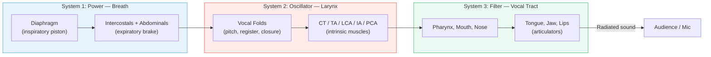
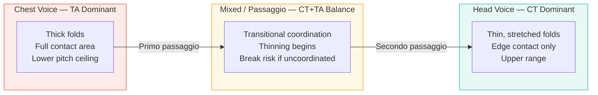
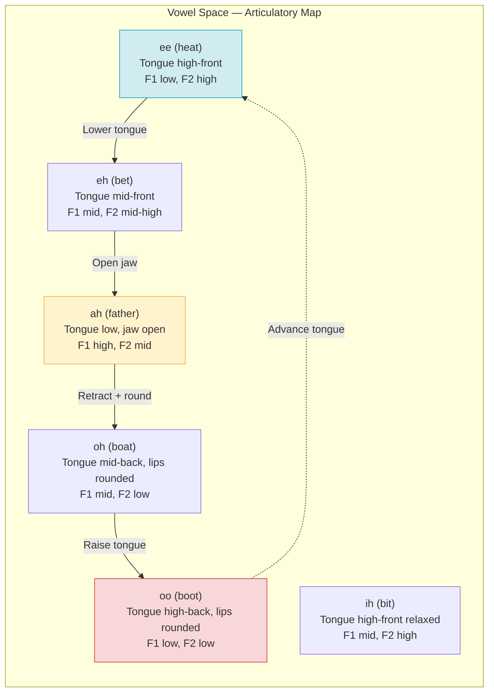
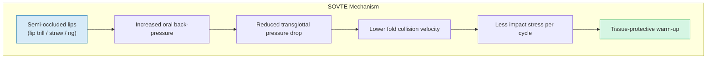
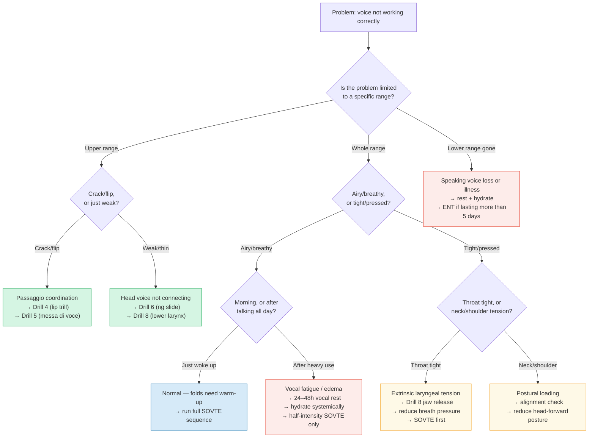

# Lesson 1: Vocal Anatomy & Technique — Engineering the Human Voice for Performance

## Overview

Your voice is a biological signal chain: **power → oscillator → filter**. Every technical flaw traces back to a breakdown in one of those three systems, or in the handoff between two of them. This lesson gives you the physical model in the minimum detail needed to make smart decisions, then spends the rest of the time on drills you run today with a metronome, a mirror, and (for one drill) a cocktail straw.

**What you'll walk away with:**
- A working map of breath, larynx, and vocal tract that changes what you *do*, not just what you know
- Daily drills with explicit tempo, rep, and duration progressions
- A self-diagnostic flowchart for the three most common technique failures
- A warm-up sequence and recovery protocol you can run before/after every rehearsal or gig

---

## 1. The Three-System Architecture

**Why this matters on the practice room floor:** a "tight" or "thin" tone is almost always a System 1 (breath) or System 3 (tract shape) problem, not a throat problem. A cracking register break is a System 2 coordination issue. Diagnose which system is failing before you drill anything — singers waste months fixing resonance when the real problem is a collapsed breath support, or fixing breath when the real problem is jaw tension choking the filter.

---

## 2. System 1: Breath — Your Power Source

### 2.1 The Mechanics, in Practice Terms

On inhale, the diaphragm contracts and flattens downward, the ribs flare outward and upward (think "umbrella opening"), and the belly releases forward — not because you're pushing it out, but because the descending diaphragm displaces the abdominal contents.

On exhale, you are **not pushing air out**. The diaphragm wants to spring back up immediately; your job is to use the intercostal muscles and abdominal wall to *brake* that return, so the ascent is slow and controlled instead of a collapse. That controlled brake is **appoggio** ("to lean") — the support mechanism underneath every trained vocal style, classical or contemporary.

> **Core principle:** good breath support is active resistance against collapse, not propulsion. If you feel like you're "pushing from the gut," you're doing the opposite of what works.

Rough subglottal pressure by context — you'll never measure this, but it explains what you feel:
- Conversational speech: 5–8 cm H₂O
- Musical theatre / legit singing: 10–18 cm H₂O
- Classical operatic forte: 20–30 cm H₂O

The difference between "floating on the breath" for a long phrase and gasping by bar 4 is entirely this braking mechanism, not lung capacity.

### 2.2 Breath Diagnosis: The Clavicular Test

Run this before drilling anything:

1. One hand on the chest (clavicle level), one hand on the belly, just below the navel.
2. Inhale deeply, as if about to sing a long phrase.
3. Watch which hand moves first and furthest.

- **Chest/shoulders rise first (clavicular breathing):** wrong muscles doing the work. The upper chest has poor leverage for sustained pressure — you'll run out of air fast and recruit neck muscles to compensate, which loads tension straight onto the larynx.
- **Belly and lower ribs expand first, chest stays quiet (abdominal-costal):** correct. The diaphragm is doing its job.

If you're clavicular, do Drill 1 lying on your back for the first week — gravity removes the chest's ability to cheat.

### 2.3 Breath Foundation Drills

#### Drill 1 — Hissing Resistance

**Purpose:** feel the appoggio balance — ribs resisting collapse while the abdomen slowly engages.

1. Inhale low and wide, 3–4 seconds, no shoulder lift.
2. Exhale on a steady **sss**, aiming for one constant volume of hiss from start to finish — not loud-to-soft decay.
3. Keep the rib cage expanded as long as possible; the squeeze comes from the abdominal wall, not from the ribs collapsing.
4. No sudden drop-off at the end — taper, don't crash.

| Week | Duration Target | Rest Between Reps | Reps |
|------|-----------------|--------------------|------|
| 1 | 10 sec | 15 sec | 5 |
| 2 | 15 sec | 15 sec | 5 |
| 3 | 20 sec | 10 sec | 6 |
| 4 | 25 sec | 10 sec | 6 |

**Self-check:** record yourself on your phone. If the hiss amplitude wobbles or fades unevenly, your support will wobble in performance exactly the same way — this drill is diagnostic as much as conditioning.

#### Drill 2 — Pulsed Breath (8-Count Pattern)

**Purpose:** rapid breath replenishment for fast passagework and rhythmic articulation.

1. Inhale 4 counts, low and wide, shoulders still.
2. Exhale in 8 even pulses on **sh**: *sh-sh-sh-sh-sh-sh-sh-sh*, one pulse per count, identical pressure on every pulse.
3. Immediately re-inhale for 4 counts and repeat.

Metronome progression: **♩ = 60** week 1 → **♩ = 80** week 3. Don't move the tempo up until every pulse is audibly equal in intensity at the current tempo — speeding up uneven pulses just bakes in the error.

**Common errors:** shoulders creeping up on the inhale (fix: do this in front of a mirror); pulses front-loaded loud then fading (fix: slow back down two clicks and re-even them before progressing).

#### Drill 3 — Candle/Tissue Airflow Check

Hold a tissue strip (or your own fingertip) about 30 cm from your mouth. Sustain **sss** without disturbing it heavily. A tissue that flutters violently means you're over-pressuring the air relative to how well the folds are adducting — you're wasting air instead of converting it to sound. This is a fast gut-check before a gig: if your hiss is wasteful, your singing will run out of air early.

---

## 3. System 2: The Laryngeal Oscillator

### 3.1 How the Folds Actually Vibrate

The vocal folds aren't flaps that bang open and shut — they ripple in a traveling wave (the **mucosal wave**), where the lower lip of the fold opens first and the upper lip follows a beat behind, then closes in the same order. That wave only propagates cleanly through a pliable, hydrated cover layer. Dehydration, swelling, or nodules stiffen that layer and kill the wave — which is *why* hydration and warm-up change your tone quality before you'd ever notice an actual injury.

Two muscle pairs set pitch by opposing each other:

| Muscle | Action | Register Effect |
|--------|--------|------------------|
| **Cricothyroid (CT)** | Tilts thyroid cartilage, stretches/thins the folds | Head voice, higher pitch |
| **Thyroarytenoid (TA)** | Shortens/thickens the folds | Chest voice, lower pitch |

**Mixed voice** is CT and TA sharing the load simultaneously rather than handing off abruptly. That coordination — not some separate "third register" — is what removes the audible break. It's a trainable motor skill, not a vocal type you either have or don't.

### 3.2 The Passaggio — Where Registers Meet

Approximate transition zones by voice type (these shift ±1 step person to person — use them as a starting map, not a diagnosis):

| Voice Type | First Passaggio | Second Passaggio |
|------------|------------------|---------------------|
| Bass | C3–E3 | F3–A3 |
| Baritone | D3–F3 | G3–B♭3 |
| Tenor | E3–G3 | A3–C4 |
| Mezzo | G3–A3 | C4–D4 |
| Soprano | A3–B3 | D4–E4 |

### 3.3 Register Bridging Drills

#### Drill 4 — Lip Trill Glide (Primary Passaggio Tool)

Why it works: the semi-occluded lips create back-pressure in the mouth that reduces the pressure drop across the folds, so the CT-TA handoff happens with less collision force and less chance of an audible "flip." It also externalizes airflow feedback — if your lips stop fluttering, you know immediately that something upstream broke.

**Execution:**
1. Blow a steady stream through loose, relaxed lips until they flutter (not clamped in the teeth).
2. Add voice underneath the flutter, keeping the lip vibration even.
3. Glide up a 5th (do → sol), then back down. Flutter must stay even in both directions.

| Stage | Shape | Metronome | Goal |
|-------|-------|-----------|------|
| 1 | 5th glide up/down | No click | Just notice the passaggio, don't try to fix it yet |
| 2 | Octave glide | ♩ = 60 | Let the register shift happen, flutter stays even |
| 3 | 1.5-octave scale | ♩ = 72 | Smooth the transition by easing breath pressure mid-glide |
| 4 | 2-octave glide | ♩ = 80 | Full range, one continuous tone, uniform lip vibration |

**Troubleshooting:**
- Lips stall mid-glide → too much subglottal pressure; back off the air drive, don't push harder through it.
- Audible "crack" at the passaggio → TA is releasing too abruptly. Deliberately hold the chest-voice quality a half-step *above* where it wants to break, then ease off gradually rather than letting go all at once.
- Falls straight into disconnected falsetto above the passaggio → TA isn't engaging in the mix at all. Slow the tempo down and consciously "carry" some chest resonance upward before trying it at speed.

#### Drill 5 — Messa di Voce (Crescendo–Decrescendo)

**Purpose:** the gold-standard drill for CT-TA coordination and fold adduction control — because it forces you to maintain pitch and closure while breath pressure changes underneath you.

1. Sustain one pitch in your mid-range (roughly C4 for mezzos, B3 for baritones).
2. Start pianissimo — folds barely touching, almost no air.
3. Crescendo smoothly to forte over 8 counts.
4. Decrescendo back to pianissimo over 8 counts, staying exactly on pitch with no air leak at the quiet end.

| Week | Each Phase | Focus |
|------|------------|-------|
| 1 | 4 counts | Even crescendo curve, no sudden jumps |
| 2 | 6 counts | Pianissimo audible but genuinely tiny |
| 3 | 8 counts | No "steps" in the volume arc |
| 4 | 10 counts | Try it on a pitch that crosses the passaggio |

The decrescendo is the hard part — reducing air while keeping the folds adducted trains exactly the coordination that collapses into breathiness under fatigue.

#### Drill 6 — "Ng" Slide for Head Voice Connection

1. Rest a finger lightly on the larynx (Adam's apple).
2. Say "singing," feeling the larynx stay low and stable on the "ng."
3. Sustain the "ng," slide up a 5th. Resist any urge to let the larynx ride upward.
4. At the top, open "ng" into "ah" without the resonance dropping into the throat.
5. Run on a full 5-note scale: 1-2-3-4-5-4-3-2-1.

Metronome: **♩ = 60 → ♩ = 76** as the connection becomes reliable.

---

## 4. System 3: The Vocal Tract Filter

### 4.1 Resonance in Performance Terms

The vocal tract — roughly 14–17 cm from glottis to lips — is a shaped tube with natural resonant peaks called **formants**. When a harmonic from the folds lands near a formant frequency, it gets amplified for free, no extra muscular effort required. This single fact underlies vowel identity, projection, and "placement."

The two formants that matter most day-to-day:
- **F1** — set mainly by jaw height / mouth opening. Open jaw raises F1.
- **F2** — set mainly by tongue front/back position. Tongue forward raises F2.

> **Practical rule:** on notes above the passaggio, open the jaw more than feels natural. This raises F1 to meet the rising fundamental, which is *why* "open up on high notes" works — you're tuning a formant to the pitch, not just making a bigger shape for show.

### 4.2 The Vowel Space

**On-the-fly fixes:**

| Problem | Adjustment | Why It Works |
|---------|-----------|----------------|
| Vowels darken/muddy on high notes | Open jaw slightly, tongue marginally forward | Raises F1 to track the rising fundamental |
| "ee" goes spread and thin above the passaggio | Borrow lip rounding from "oo" while shaping "ee" | Lowers F2, reduces spread, keeps the vowel recognizable |
| "ah" sounds pressed/white on forte | Drop jaw further, widen the pharynx | Separates F1 and F2, fuller resonance at the same effort |
| Consonants break the legato line | Minimize jaw movement on consonants; keep the vowel resonance shape | Preserves formant continuity through the word |

### 4.3 The Singer's Formant

A cluster of F3–F5 around 2.8–3.2 kHz (male voices, slightly higher for female) produces the "ring" that cuts through an orchestra or band without extra volume. To access it:

1. Lower the larynx slightly — the first half-inch of a yawn, nothing more.
2. Narrow the space just above the folds (aryepiglottic area) — imagine a slight "pinching" sensation at the very top of the throat, not in the jaw or tongue.
3. The resulting brightness is a cutting "ping," not a louder voice — it's a different frequency balance, same effort level.

**Sensory cue:** imagine the sound radiating from behind your upper front teeth, or a light buzz at the bridge of the nose. That's forward-resonance feedback, not literal nasal placement — don't actually push the sound into the nose.

### 4.4 Resonance Placement Drills

#### Drill 7 — "Vv" / "Mmm" Buzz Placement

1. Sustain **vvvvv**, feeling the vibration in lips and face.
2. Transition to "mmm," letting the buzz migrate to lips and nose bridge.
3. Open "mmm" into "mmm-ah," keeping the same forward buzz as the vowel opens.
4. Run ascending on a 5-note scale: *mm-ah · mm-ah · mm-ah · mm-ah · mm-ah*.

Metronome: **♩ = 66 → ♩ = 84** over three weeks.

#### Drill 8 — Pharyngeal Space ("Inner Smile")

1. Start from a silent, relaxed yawn posture — feel the back of the throat lift and widen.
2. Hold that openness and sing a 5-tone scale on "ah" (1-2-3-4-5-4-3-2-1).
3. Keep the lifted-soft-palate sensation throughout — subtle lift, not a cartoonish gape.
4. Listen for warmth and depth increasing, nasality decreasing, and tone color staying consistent across the scale.

Metronome: **♩ = 60 → ♩ = 76**.

---

## 5. SOVTE — The Daily Semi-Occluded Warm-Up Protocol

Semi-occluded vocal tract exercises (lip trill, tongue trill, straw phonation, "ng" humming) partially block the lips, which raises oral back-pressure and lowers the pressure drop across the folds — meaning less collision force per cycle while you still get full-range motion.

### 5.1 The 15-Minute SOVTE Sequence

Run this before any rehearsal, lesson, performance, or recording session.

| Time | Exercise | Instruction |
|------|----------|-------------|
| 0:00–2:00 | Breath alignment | Drill 1, 5 reps × 10 sec |
| 2:00–4:30 | Lip trill 5th glides | Easy low-to-mid range, no pushing, ♩ = 60 |
| 4:30–6:30 | Straw phonation | Hum-glide through mid-range, 1-octave slides |
| 6:30–8:30 | "Ng" hum, 5-tone scales | Through the passaggio, larynx stable, ♩ = 66 |
| 8:30–10:30 | "Vvv-ah" transitions | Drill 7, ♩ = 66 → 72 |
| 10:30–12:30 | Lip trill octave slides | Through both passaggi, ♩ = 60 → 72 |
| 12:30–15:00 | Open vowel scales | "ah," "oh," "ay," pharynx open (Drill 8), ♩ = 72 |

**Straw setup:** a standard cocktail straw (~5 mm diameter, 15 cm long), held loosely between the lips, not clamped by the teeth. Hum into it with voiced tone — the resistance it creates is the sweet spot for tissue-protective warm-up.

---

## 6. Self-Diagnostic Flowchart

---

## 7. Failure Modes — What They Feel and Sound Like

### 7.1 Phonotrauma Warning Signs

| Sign | Likely Cause | Immediate Action |
|------|--------------|-------------------|
| Tone stays rough after 30+ minutes of warm-up | Edema (swelling) in Reinke's space | Reduce load, increase hydration |
| Sudden mid-phrase "hole" in the range | Early nodule forming at the max-collision point | Full 48h vocal rest, get it checked |
| Pitch drops after heavy use | Fluid mass added to the folds | Rest + hydrate; ENT if it persists beyond 3 days |
| "Two voices" audible on one pitch | Polyp or cyst causing asymmetric vibration | ENT evaluation — don't sing through this |
| Morning voice that never clears | Acid reflux irritating laryngeal tissue | ENT/GI evaluation; stop eating 3h before bed |

### 7.2 The Three Most Common Technique-Caused Problems

**Register break at the passaggio ("the crack")**
TA is releasing too abruptly as CT takes over, so the folds jump from full-contact chest vibration straight to edge-only falsetto with no transition.
*Fix:* lip trill through the passaggio daily (Drill 4). Exaggerate the break on purpose (the "yodel"), then gradually smooth it. Ease breath pressure 2–3 semitones before the transition instead of pushing through it.

**Pressed/strained high notes**
Subglottal pressure is being pushed up instead of the resonance being adjusted — the folds are forced shut by air pressure instead of closing efficiently.
*Fix:* on any note that feels pressed, back off the air and open the jaw further. The F1 adjustment gives you more perceived power for less effort. Work the pressed range with Drill 5.

**Breathy/airy mid-range**
Incomplete fold closure during the vibration cycle, usually from under-supporting (not enough subglottal pressure), not from a fold defect.
*Fix:* firmer, more even breath support via Drill 2. "Vvv-ah" (Drill 7) to feel engagement at the fold level. If breathiness persists despite solid support, get the folds examined — a small lesion can physically prevent closure no matter how good your technique is.

---

## 8. Vocal Health Maintenance

### 8.1 Hydration and Mucosal Health

The outer, pliable layer of the fold must stay moist for the mucosal wave to travel properly. Dehydration stiffens it, and small increases in stiffness demand disproportionately more muscular effort to vibrate normally — this is why a dry voice feels like "more work" for the same note.

**Daily targets:**
- Systemic hydration: 2–2.5 L water minimum; urine should be pale straw by midday.
- Each caffeinated drink → one extra glass of water.
- Steam inhalation: 10 minutes, 40–50°C, face over a bowl with a towel tent, before heavy vocal use.
- Room humidity: 40–50% RH; cool-mist humidifier at night in dry seasons.

**Avoid:**
- Throat clearing — each clear is a hard fold collision; swallow or sip water instead.
- Whispering when fatigued — whisper often uses more laryngeal tension than normal phonation.
- Alcohol and antihistamines before singing — both dehydrate laryngeal tissue.
- Smoking — mucosal thickening and edema from smoking are progressive and don't reverse with continued exposure.

### 8.2 Vocal Dose

At A4 (440 Hz) the folds are colliding 440 times per second. A two-hour rehearsal of continuous singing adds up to millions of cycles — volume, pitch height, and voice type all change the impact stress per cycle.

**Guidelines:**
- Heavy use day (rehearsal + show): cap total phonation at 4–6 hours.
- After an intensive performance: 24 hours reduced load, SOVTE-only the next morning.
- Overuse warning signs: reduced range, increased roughness, warm-up taking longer than 15 minutes to clear.
- If range is down more than a 3rd and doesn't recover with 15 minutes of SOVTE, take the day off entirely.

### 8.3 Recovery Protocol

| Timing | Protocol |
|--------|----------|
| Immediately post-show | Water (not ice-cold); no talking for 15–20 min if possible |
| 1–2 hours post | Light straw phonation or lip trills, 5 minutes only, no scales or pushed notes |
| Morning after | Full 15-minute SOVTE sequence; assess range before committing to rehearsal |
| Day 2 if still rough | Relative vocal rest — speak only when necessary, hydrate, steam |
| Day 3+ if still rough | ENT evaluation — pushing through converts acute swelling into chronic damage |

---

## 9. Acoustic Measures You'll Hear in a Clinic or Studio

| Measure | Reflects | Normal | Alert |
|---------|----------|--------|-------|
| **Jitter** | Cycle-to-cycle frequency variation | < 1.0% | > 2% = instability |
| **Shimmer** | Cycle-to-cycle amplitude variation | < 3.0% | > 5% = adduction/symmetry issue |
| **HNR** | How periodic (clean) the signal is | > 20 dB | < 15 dB = incomplete closure or asymmetry |
| **MPT** (Maximum Phonation Time) | Seconds sustained on one breath | > 15 sec | < 10 sec = support/efficiency problem |

**Home MPT test:** full breath, sustain "ah" at a comfortable pitch and volume, time it. Under 12 seconds for a trained singer is worth investigating further.

---

## 10. Why Source-Filter Independence Is a Practical Shortcut

**Source = vocal folds** (pitch, register, voice quality). **Filter = vocal tract shape** (vowels, resonance, projection). These two are independent — you can change your resonance without touching pitch, and change pitch without touching resonance.

That independence is the entire reason technique training is efficient: a resonance problem (muddy vowels, lack of ring) gets fixed in the tract without touching the larynx, and an adduction problem (breathiness, pressed tone) gets fixed at the fold level without reshaping the mouth. When you diagnose a problem, always ask "is this a source problem or a filter problem?" before picking a drill — it tells you which half of the lesson to open.

---

## Lesson Summary

Three systems: **breath (power) → folds (oscillator) → vocal tract (filter)**. Almost every technique failure lives in one system or in the handoff between two.

**Practice priorities from this lesson:**
1. Breath foundation daily — Drills 1 and 2 until appoggio is automatic, not something you think about mid-phrase.
2. Passaggio navigation — lip trill glides (Drill 4) and messa di voce (Drill 5) are your primary tools.
3. Resonance development — Drills 7 and 8 for forward placement and pharyngeal space.
4. SOVTE warm-up every session — the 15-minute sequence protects tissue and surfaces problems before they become injuries.
5. Hydrate and monitor — daily water intake, weekly MPT self-test, rest aggressively at the first sign of roughness beyond normal warm-up.

Next lesson builds on this architecture for registration in depth: mixed voice across a full two-octave range, contemporary belting mechanics, and resonance adjustments across genres.
