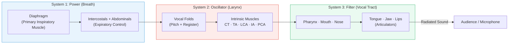
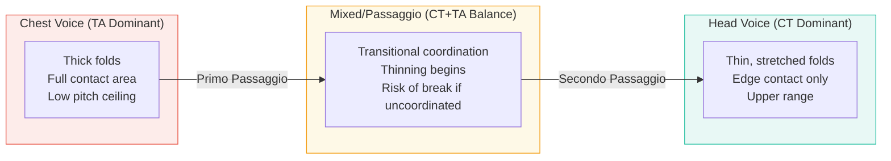
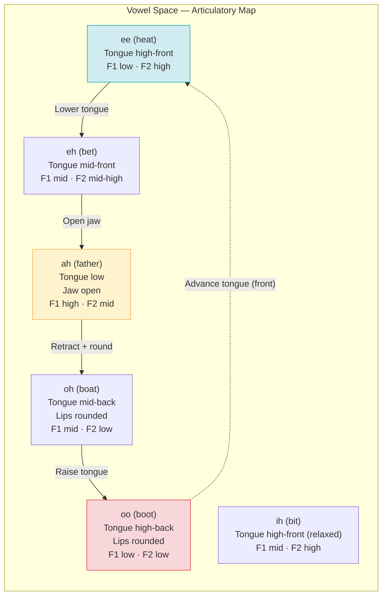
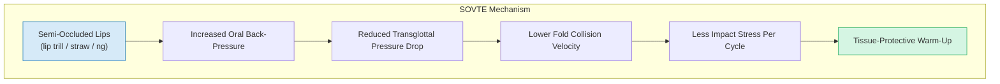
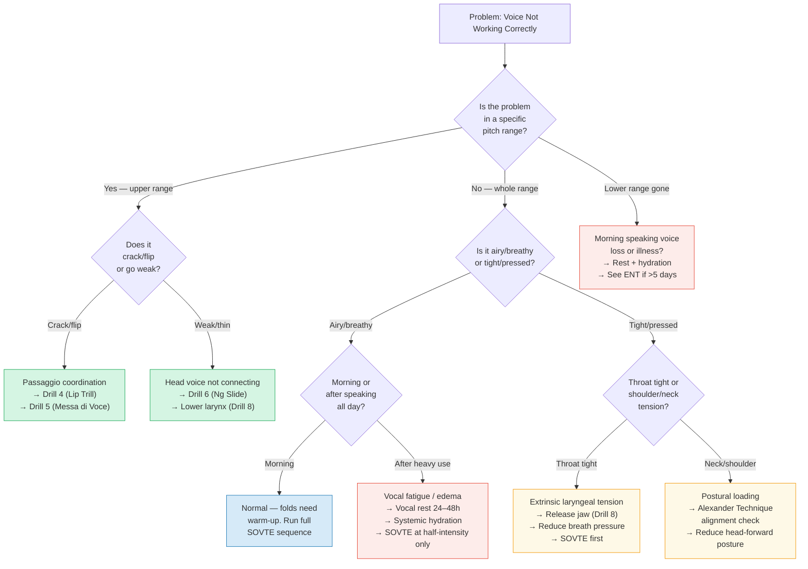

# Lesson 1: Vocal Anatomy & Technique — Engineering the Human Voice for Performance

## Overview

This lesson bridges the gap between anatomy and actionable technique. You will learn *why* the voice behaves the way it does — and immediately apply that understanding through physical exercises, targeted drills, and self-diagnostic tools. The original material was anatomically rigorous but performer-inaccessible. This rewrite keeps the physics where it matters and replaces the rest with exercises you can run in the practice room today.

**What you'll walk away with:**
- A mental map of your respiratory, phonatory, and articulatory systems — in terms that change *how you sing*
- Concrete warm-up and conditioning drills with tempo, duration, and progression targets
- A self-diagnostic checklist for the most common technique failures
- Recovery and maintenance protocols used by professional voice users

---

## 1. The Three-System Architecture — Why It Matters for Technique

Your voice is a **biological signal chain**: power → oscillator → filter. Every technical flaw traces back to a breakdown in one of these three systems, or in the connection between them.

**Why this matters practically:** A "tight" tone is almost always a System 1 or System 3 problem, not a throat problem. A cracking register break is a System 2 coordination issue. Solving the right system first saves weeks of misdirected practice.

---

## 2. System 1: Breath — Your Power Source

### 2.1 The Mechanics in Plain Terms

The diaphragm (a dome-shaped muscle beneath the lungs) contracts downward on inhale, increasing lung volume and dropping internal air pressure so air rushes in. On exhale, the diaphragm releases while the abdominal wall and intercostal muscles provide a controlled *brake* — slowing the ascent of the diaphragm to maintain steady subglottal pressure under the vocal folds.

This controlled braking is the physiological basis of **appoggio** (Italian: "to lean") — the breath support technique central to classical and contemporary trained singing alike.

> **Core principle:** You are not *pushing* air out. You are *managing the rate* at which the diaphragm returns to its resting position. Good breath support is active resistance, not propulsion.

Subglottal pressure targets by context:
- Conversational speech: 5–8 cm H₂O
- Legit/musical theatre singing: 10–18 cm H₂O
- Classical operatic forte: 20–30 cm H₂O

You will never measure this in practice — but you will *feel* it as the difference between floating on a column of air and running out in the first four bars.

### 2.2 Breath Diagnosis: The Clavicular Test

Before drilling, identify your current breathing pattern:

1. Place one hand on your chest (clavicle level), one hand on your belly.
2. Take a deep breath as if you're about to sing a long phrase.
3. Observe: which hand moves first and furthest?

**Clavicular breathing** (chest/shoulders rise first): Your power source is the wrong muscles. The upper chest has poor mechanical advantage for sustained pressure — you'll run out of air quickly and recruit neck muscles to compensate, loading the larynx.

**Abdominal-costal breathing** (belly and ribs expand first, chest follows naturally): Correct engagement. The diaphragm is doing its job.

### 2.3 Breath Foundation Drills

#### Drill 1 — The Hissing Resistance Exercise

**Purpose:** Train the appoggio balance — feel the diaphragm resisting the abdominal pull.

1. Inhale low and wide (ribs expand like an umbrella, belly releases forward).
2. Exhale on a steady **sss** hiss, targeting a uniform sound intensity for the full duration.
3. Keep the ribs expanded as long as possible — feel the tension between expanding ribs and contracting abdomen.
4. No collapse until the last moment.

| Week | Duration Target | Rest Between |
|------|----------------|--------------|
| 1    | 10 seconds      | 15 seconds   |
| 2    | 15 seconds      | 15 seconds   |
| 3    | 20 seconds      | 10 seconds   |
| 4    | 25 seconds      | 10 seconds   |

**What you're building:** The intercostal + abdominal antagonism that creates steady subglottal pressure. If your hiss wobbles, your breath support will wobble in performance.

#### Drill 2 — Pulsed Breath (8-Count Pattern)

**Purpose:** Develop rapid breath replenishment for fast-moving vocal lines.

1. Inhale for 4 counts (low and wide).
2. Exhale in 8 short pulses on **sh** — one pulse per count. Each pulse equal pressure.
3. Counts: **sh - sh - sh - sh - sh - sh - sh - sh** then immediately back to 4-count inhale.
4. Use a metronome: start at **♩= 60**, progress to **♩= 80** over two weeks.

**Common errors:**
- Shoulders rising on inhale → consciously keep them still
- Pulsed hisses uneven → slow down and even them out before speeding up

#### Drill 3 — The Candle/Tissue Test

Hold a tissue (or imagine a candle flame) 30 cm in front of your mouth. Exhale *without* moving it on a sustained **sss**. This builds awareness of the air stream — you want efficient, not wasteful, airflow. If the tissue flutters heavily, you are over-pressuring or under-adducting at the fold level.

---

## 3. System 2: The Laryngeal Oscillator — Pitch, Register, and Fold Mechanics

### 3.1 How Your Vocal Folds Actually Work

The vocal folds are not simple flaps. They are layered tissue structures that vibrate in a wave-like motion — the **mucosal wave** — where the lower margin opens before the upper margin, and closes after it. This wave requires the outer cover (epithelium + superficial lamina propria) to be pliable and hydrated. Dehydration, inflammation, or vocal nodules disrupt this wave, reducing voice quality before you lose it entirely.

Vibration frequency (pitch) is controlled by two opposing muscle groups:

| Muscle Pair | Action | Register Effect |
|-------------|--------|----------------|
| **Cricothyroid (CT)** | Stretches and thins folds | Head voice / falsetto — higher pitches |
| **Thyroarytenoid (TA)** | Shortens and thickens folds | Chest voice / modal — lower pitches |

**Mixed voice / passaggio navigation** is the CT-TA co-contraction zone — both muscles share the load. This is the technique goal of most intermediate-to-advanced singers: coordinating both muscles across the entire range so there is no register break, only a smooth blend.

### 3.2 The Passaggio — Where Registers Meet

Every voice has natural register transitions. These are not defects; they are acoustic reality. The goal is not to eliminate them but to navigate them without collision.

Approximate passaggio locations by voice type:

| Voice Type | First Passaggio (Primo) | Second Passaggio (Secondo) |
|------------|------------------------|---------------------------|
| Bass | C3–E3 (C2=65Hz) | F3–A3 |
| Baritone | D3–F3 | G3–B♭3 |
| Tenor | E3–G3 | A3–C4 |
| Mezzo | G3–A3 | C4–D4 |
| Soprano | A3–B3 | D4–E4 |

### 3.3 Register Bridging Drills

#### Drill 4 — The Lip Trill Glide (Primary Passaggio Navigation Tool)

The lip trill (motorboat lips with phonation) is the single most effective exercise for passaggio coordination because:
- The semi-occluded tract reduces impact stress on the folds
- The back-pressure from occluded lips levels out CT-TA transition abruptness
- It externalizes the air flow so you get immediate feedback

**Execution:**
1. Blow a steady air stream through relaxed, loosely closed lips — they flutter.
2. Add voice beneath the flutter. Maintain even lip vibration throughout.
3. Slide up a **5th** (do-to-sol) on the lip trill.
4. Slide back down. Keep the fluttering lips even on both directions.

**Progression:**

| Stage | Shape | Metronome | Description |
|-------|-------|-----------|-------------|
| 1 | 5th glide up-down | No click needed | Feel the passaggio — don't fix it yet, just notice it |
| 2 | Octave glide | ♩= 60 | Let the register shift happen, keep lips fluttering |
| 3 | 1.5-octave scale | ♩= 72 | Smooth out any breaks by reducing pressure mid-transition |
| 4 | 2-octave glide | ♩= 80 | Full range, continuous tone, uniform lip vibration |

**Troubleshooting:**
- Lips stop fluttering mid-glide → too much subglottal pressure, reduce breath drive
- Large audible "crack" at passaggio → TA letting go too abruptly; sustain the chest resonance a half-step higher than feels comfortable, then release gradually
- Voice goes completely to falsetto above passaggio → TA not engaging in mix; practice at a slower tempo and consciously "hold on" to the chest quality while ascending

#### Drill 5 — Messa di Voce (Crescendo-Decrescendo)

**Purpose:** The gold standard exercise for CT-TA coordination and fold adduction control.

1. Sustain a single pitch in your mid-range (around C4 for mezzos, B3 for baritones).
2. Begin pianissimo (almost no volume) — folds barely touching.
3. Slowly crescendo over 8 counts to forte.
4. Decrescendo back to pianissimo over 8 counts. The tone must stay perfectly on pitch throughout.
5. No wobble, no register flip, no air leakage on soft end.

| Week | Duration of Each Phase | Notes |
|------|----------------------|-------|
| 1 | 4 counts each | Focus on even crescendo curve |
| 2 | 6 counts each | Pianissimo should be audible but tiny |
| 3 | 8 counts each | Smooth — no "steps" in the volume arc |
| 4 | 10 counts each | Test on a pitch that crosses your passaggio |

**Why it works:** The pianissimo requires precise CT-TA balance with minimal air. The crescendo adds breath pressure. The decrescendo is the hardest part — it requires you to reduce breath support without losing fold adduction. This trains the entire coordination range in one exercise.

#### Drill 6 — The "Ng" Slide for Head Voice Connection

For singers who either lose voice at the top or flip into a disconnected falsetto:

1. Place finger lightly on larynx (Adam's apple).
2. Say "singing" — feel the larynx stay low and stable on the "ng" resonance.
3. Sustain the "ng" and slide up a 5th. Keep the larynx low; resist the urge to squeeze up.
4. At the top of the slide, open to a vowel (try "ng → ah"). The resonance should stay in the head, not drop to throat.
5. Run this on a 5-note scale (1-2-3-4-5-4-3-2-1).

**Metronome:** ♩= 60 → ♩= 76 as the connection solidifies.

---

## 4. System 3: The Vocal Tract Filter — Resonance and Vowel Shaping

### 4.1 How Resonance Actually Works in Performance Terms

Your vocal tract is a shaped tube from glottis to lips — roughly 14–17 cm long. It has natural resonant peaks called **formants** (F1, F2, F3...). When a harmonic in your voice's output lands near a formant frequency, that frequency gets amplified — essentially for free, with no extra muscular effort. This is the basis of:

- **Vowel identity** (which formant combination your brain recognizes as "ah" vs. "ee" vs. "oo")
- **Ring/projection** (the singer's formant at ~2.8–3.2 kHz in male voices, ~3.2–3.8 kHz in females)
- **Resonance placement** ("chest resonance" vs. "head resonance" as sensory feedback of which formants are most active)

The two most important formants for singers:
- **F1** — controlled primarily by jaw height and mouth opening. Open jaw → F1 rises. Closed jaw → F1 falls.
- **F2** — controlled primarily by tongue position (front/back). Tongue forward → F2 rises. Tongue back → F2 falls.

> **Practical rule:** On high notes (above passaggio), open the jaw more than feels natural. This raises F1 to meet the fundamental frequency, dramatically increasing resonant power. This is why "open up on the high notes" is universally correct pedagogy — it's formant tuning, not just aesthetics.

### 4.2 The Vowel Space — What to Adjust and When

**Performance applications:**

| Situation | Adjustment | Why |
|-----------|-----------|-----|
| Vowels darkening/clouding on high notes | Open jaw slightly; bring tongue marginally forward | Raises F1 to track the rising fundamental |
| "ee" sounds spread and thin above passaggio | Maintain lip rounding from "oo" on "ee" vowel (Umlaut technique) | Lowers F2 slightly, reduces spread |
| "ah" sounds pressed or white on forte | Drop jaw more, widen pharynx | Separates F1 and F2 for fuller resonance |
| Consonants killing legato line | Minimize jaw movement; keep vowel resonance through consonants | Maintains formant continuity |

### 4.3 The Singer's Formant — Creating Natural Projection

The **singer's formant** is a cluster of F3, F4, and F5 around 2.8–3.2 kHz (male voices) produced by narrowing the laryngopharynx (the tube above the larynx). The practical way to access it:

1. **Lower the larynx slightly** — imagine beginning a yawn. Feel the spaciousness in the throat.
2. **Narrow the aryepiglottic sphincter** — the tube just above the vocal folds narrows, raising that region's resonant frequency to match F3–F5 clustering.
3. The result is a "ring" or "ping" in the tone — audible as brightness that cuts through accompaniment without raising volume.

**Sensory cue:** Imagine the sound coming from behind your upper teeth, or feeling a buzzing in the bridge of your nose. These are forward resonance tracking sensations — they indicate the singer's formant is active.

### 4.4 Resonance Placement Drills

#### Drill 7 — The "Vv" / "Zz" Buzz Placement Exercise

**Purpose:** Find forward mask resonance without throat tension.

1. Sustain a **vvvvv** (voiced labiodental fricative) — feel the vibration in your lips and face.
2. Transition to a "mmm" hum — feel the resonance move to lips and nose bridge.
3. Open "mmm" to "mmm-ah." The goal: retain the mask resonance feeling as the vowel opens.
4. Run this on a 5-note ascending scale: **mm-ah · mm-ah · mm-ah · mm-ah · mm-ah**.
5. Metronome: **♩= 66 → ♩= 84** over three weeks.

#### Drill 8 — Pharyngeal Space Exercise ("The Inner Smile")

**Purpose:** Create the spacious pharynx needed for singer's formant and consistent vowel quality.

1. Begin with a silent, relaxed yawn posture — feel the back of the throat lift and open.
2. Hold that openness and sing a 5-tone scale on "ah" (1-2-3-4-5-4-3-2-1).
3. Keep the sensation of the lifted soft palate and open pharynx throughout. The yawn feeling should not make you sound like you're actually yawning — it's a subtle lifting, not a grotesque openness.
4. Listen for: increased warmth and depth, less nasality, more consistent tone color across the scale.
5. Metronome: **♩= 60 → ♩= 76**.

---

## 5. Semi-Occluded Vocal Tract Exercises (SOVTE) — The Daily Warm-Up Protocol

SOVTEs are exercises that partially obstruct the lips (lip trill, tongue trill, straw phonation, humming on "ng"). The partial obstruction creates back-pressure that:

1. Reduces the air pressure differential across the folds → less collision impact per cycle
2. Promotes deeper, more complete fold vibration without excessive muscular force
3. Allows you to sing through your full range at low effort — perfect for warm-up and cool-down

### 5.1 The Complete 15-Minute SOVTE Warm-Up Sequence

Use this sequence before any vocal session — rehearsal, lesson, performance, or recording.

| Time | Exercise | Instruction |
|------|----------|-------------|
| 0:00–2:00 | **Breath alignment** | Hissing resistance drill (Drill 1). 5 reps, 10 sec each |
| 2:00–4:30 | **Lip trill 5th glides** | Slide up and down a 5th, covering easy low-to-mid range. No pushing. ♩= 60 |
| 4:30–6:30 | **Straw phonation** | Use a standard cocktail straw. Hum-glide through mid range, 1-octave slides |
| 6:30–8:30 | **Ng hum — 5-tone scales** | "Ng" through the passaggio region. Feel larynx stable. ♩= 66 |
| 8:30–10:30 | **Vvv-ah transitions** | Drill 7. Build forward resonance. ♩= 66 → ♩= 72 |
| 10:30–12:30 | **Lip trill octave slides** | Full-range slides through both passaggi. ♩= 60 → ♩= 72 |
| 12:30–15:00 | **Open vowel scales** | 5-tone scales on "ah," "oh," "ay." Pharynx open (Drill 8). ♩= 72 |

**Straw phonation setup:** Use a standard cocktail straw (~5 mm diameter, 15 cm long). Place it loosely between the lips — not clamped in the teeth — and hum into it with tone. The straw resistance creates the optimal back-pressure for tissue-protective phonation.

---

## 6. Self-Diagnostic Chart — Identifying What's Actually Wrong

Before calling a vocal coach, run through this diagnostic. Most acute problems trace to one clear cause.

---

## 7. Vocal Failure Modes — What They Feel and Sound Like

Understanding pathology in performance terms (not clinical terms) helps you catch problems early.

### 7.1 Phonotrauma Warning Signs

| Sign | What It Means | Immediate Action |
|------|--------------|-----------------|
| Voice "warms up" but stays slightly rough after 30+ minutes | Edema (swelling) in Reinke's space | Reduce vocal load, increase hydration |
| Sudden mid-phrase loss of a note (a "hole" in the range) | Possible early nodule at max-collision point | Full vocal rest 48h, ENT evaluation |
| Voice drops in pitch after heavy use | Tissue edema adding mass to folds | Rest and hydration; if persistent >3 days, see ENT |
| "Two voices" on the same pitch | Polyp or cyst causing asymmetric vibration | ENT evaluation — do not push through this |
| Morning voice that never clears | GERD (acid reflux) burning laryngeal tissue | ENT/GI evaluation; avoid eating 3h before sleep |

### 7.2 The Three Most Common Technique-Caused Problems

**Problem 1: Register Break at Passaggio (the "Crack")**
Cause: TA releasing too abruptly as CT takes over. The folds go from full-contact chest vibration to edge-only falsetto instantly.
Fix: Lip trill through the passaggio daily (Drill 4). Practice the "yodel" intentionally — exaggerate the break, then gradually smooth it. Reduce breath pressure 2–3 semitones before the transition.

**Problem 2: Pressed/Strained High Notes**
Cause: Pushing subglottal pressure up instead of adjusting resonance. The folds are being forced closed by excess air pressure rather than optimal adduction.
Fix: On any note feeling pressed, reduce breath pressure and open the jaw further. The resonance adjustment (F1 tuning) will give you more power with less effort. Drill 5 (Messa di Voce) in the pressed range.

**Problem 3: Breathy/Airy Mid-Range**
Cause: Inadequate adduction — folds not closing fully during the closed phase of vibration. Often caused by under-supporting (insufficient subglottal pressure) rather than a fold problem.
Fix: Firmer breath support with pulsed exercises (Drill 2). "Vvv-ah" exercise to feel fold engagement (Drill 7). If breathy tone persists despite good support, have folds examined — a small lesion can prevent full closure.

---

## 8. Vocal Health Maintenance Protocol

### 8.1 Daily Hydration and Mucosal Health

The superficial lamina propria (the outer pliable layer of the fold) must stay viscous for the mucosal wave to propagate. Dehydration stiffens it — small increases in tissue stiffness require disproportionately more muscular effort to maintain normal vibration.

**Daily targets:**
- **Systemic hydration:** 2–2.5 L water minimum. Test: urine should be pale straw-colored by midday.
- **Caffeine offset:** Each coffee or caffeinated tea → add one additional glass of water.
- **Steam inhalation:** 10 minutes of steam (40–50°C, face over a bowl with towel tent) before heavy vocal use — temporarily reduces fold viscosity.
- **Room humidity:** 40–50% ambient RH. Use a cool-mist humidifier at night during dry seasons.

**Avoid:**
- Throat clearing (each throat clear = an aggressive fold collision; substitute with a wet swallow or sip of water)
- Whispering when vocally fatigued — whisper requires equal or greater laryngeal tension than normal phonation
- Alcohol and antihistamines before singing — both dehydrate the laryngeal mucosa
- Smoking — no negotiation here; the mucosal thickening and edema are progressive and irreversible with continued exposure

### 8.2 Vocal Dose — Know Your Limits

Your vocal folds are on a collision cycle at the rate of your fundamental frequency. At A4 (440 Hz), that's 440 impacts per second. During a 2-hour rehearsal of continuous singing, that's millions of cycles. Volume, pitch height, and voice type all affect impact stress per cycle.

**Practical guidelines:**
- Heavy vocal use (rehearsal + performance): no more than 4–6 hours total phonation
- After an intensive performance: 24 hours reduced load, SOVTE-only the next morning
- Warning sign of overuse: reduced range, increased roughness, delayed "warm-up" time (voice not clearing within 15 minutes of warming up)
- If range is reduced by more than a 3rd and doesn't improve with 15 minutes of SOVTE, rest that day entirely

### 8.3 Recovery Protocol — Post-Performance / Post-Heavy Use

| Timing | Protocol |
|--------|---------|
| Immediately post-performance | Water (not ice cold), no talking for 15–20 minutes if possible |
| 1–2 hours post | Light straw phonation or lip trills — 5 minutes only. No scales, no pushed notes |
| Morning after | SOVTE warm-up (full 15-minute sequence). Assess range before committing to any rehearsal |
| If voice is rough Day 2 | Relative vocal rest (speaking only when necessary, no singing). Hydration + steam |
| If rough Day 3+ | ENT evaluation. Do not attempt to push through — you risk converting acute edema into chronic lesions |

---

## 9. Acoustic Objective Measures — How Clinicians Assess Your Voice

You will encounter these terms in medical or studio contexts. Here's what they mean practically:

| Measure | What It Reflects | Normal Range | Performance Alert |
|---------|-----------------|--------------|------------------|
| **Jitter** | Cycle-to-cycle frequency variation | < 1.0% | > 2% → significant instability |
| **Shimmer** | Cycle-to-cycle amplitude variation | < 3.0% | > 5% → adduction or fold symmetry issue |
| **HNR** (Harmonics-to-Noise Ratio) | How cleanly periodic the voice is | > 20 dB | < 15 dB → noise in the signal (incomplete closure or asymmetry) |
| **MPT** (Maximum Phonation Time) | Seconds sustained on one breath | > 15 sec | < 10 sec → efficiency or respiratory support issue |

A simple home MPT test: Sustain "ah" on a comfortable pitch at comfortable volume after a full breath. Time it. Below 12 seconds for a singer is a flag worth investigating.

---

## 10. Theory Reference: Source-Filter and Why It's Practical

The **source-filter model** (Fant, 1960s) is not abstract — it has a direct consequence for every technique decision:

**Source = vocal folds** (pitch, voice quality, register)
**Filter = vocal tract shape** (vowels, resonance, formants)

These two are *independent* — you can change resonance without changing pitch, and change pitch without changing resonance. This independence is what makes technique training efficient: you can fix a resonance problem without touching the larynx, and fix an adduction problem without changing your mouth shape.

The **mucosal wave** at the fold surface is not theoretical — it's visible on laryngoscopy and directly correlates with voice quality. When a clinician says "your mucosal wave is reduced on the right fold," they mean that side's cover layer is too stiff (edema, scar, or dehydration) to generate its portion of the wave. That manifests as asymmetric vibration — the acoustic signature is elevated shimmer and reduced HNR.

For the purposes of technique training: think of the source as your *engine* and the filter as your *acoustic space*. Keep the engine (folds) healthy, hydrated, and efficiently adducted. Shape the space (tract) for resonance, projection, and vowel clarity.

---

## Lesson Summary

The voice is a three-system instrument: **breath (power) → folds (oscillator) → vocal tract (filter)**. Technique failures are almost always locatable to one of these systems or the transition between two of them.

Your practice priorities from this lesson:

1. **Establish breath foundation** — Drills 1 and 2 daily until appoggio balance is automatic
2. **Navigate the passaggio** — Lip trill glides (Drill 4) and Messa di Voce (Drill 5) are your primary register tools
3. **Develop resonance** — Drills 7 and 8 for forward placement and pharyngeal space
4. **Warm up with SOVTEs every session** — the 15-minute sequence protects tissue and reveals problems before they become injuries
5. **Hydrate and monitor** — daily water intake, MPT self-test weekly, rest aggressively at the first sign of roughness beyond normal warm-up

The next lesson builds on this architecture to address **registration in depth** — including mixed voice across a 2-octave range, contemporary belting mechanics, and stylistic resonance adjustment for different genres.
