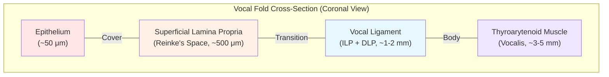
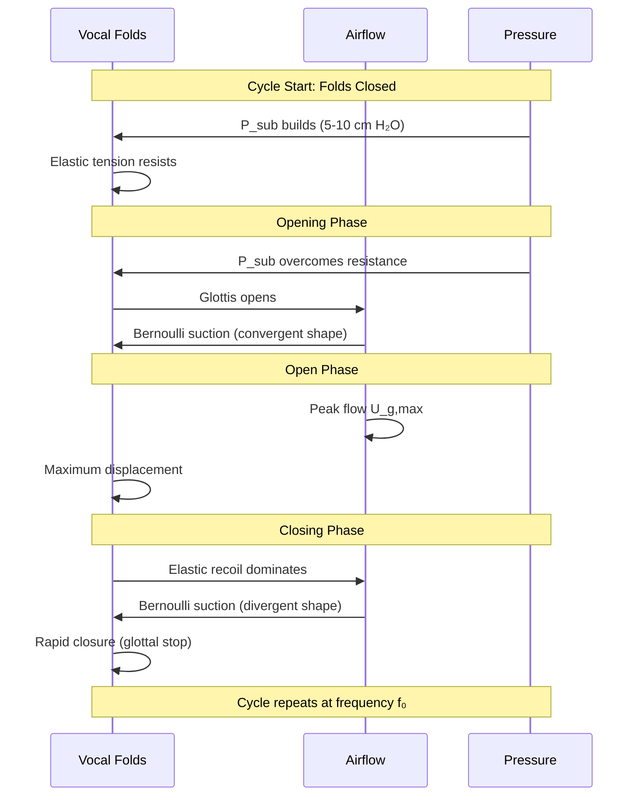
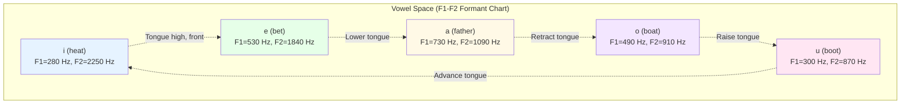
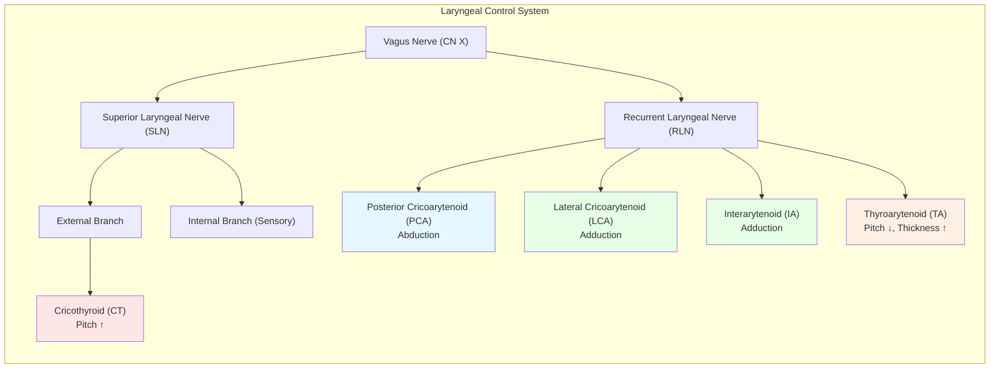
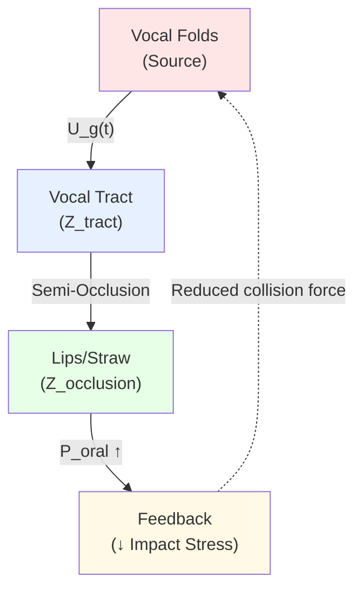

# Lesson 1: Vocal Anatomy—A First-Principles Engineering Analysis of the Human Voice

## 1. First-Principles Intuition & Invariants

The human voice is a biological acoustic transducer—a system that converts pneumatic energy (subglottal air pressure) into acoustic energy (sound waves) through controlled oscillation and resonant amplification. This transformation occurs through three coupled subsystems operating in series: the respiratory system (power source), the phonatory system (oscillator), and the articulatory system (filter/resonator). Understanding vocal production requires decomposing these components and analyzing their physical constraints, transfer functions, and failure modes.

### 1.1 The Fundamental Source-Filter Model

Vocal production adheres to the **source-filter theory**, formalized by Gunnar Fant in the 1960s. This model separates sound generation into two independent stages:

1. **Source**: The vocal folds generate a quasi-periodic acoustic source signal through self-sustained oscillation, producing a glottal waveform rich in harmonic content.
2. **Filter**: The vocal tract (a time-varying acoustic tube approximately 17 cm long in adult males, 14 cm in adult females) selectively amplifies frequencies corresponding to its resonant modes (formants), shaping the source spectrum into recognizable speech sounds or sung tones.

The independence of source and filter is a **critical invariant**: changes in vocal fold vibration (pitch, loudness) can occur without altering vocal tract shape, and vice versa. This separability enables the vast combinatorial space of human speech and singing.

### 1.2 Physical Constraints and Degrees of Freedom

The human vocal system operates under strict physical constraints:

- **Subglottal pressure range**: 3-40 cm H₂O (conversational speech requires ~5-8 cm H₂O; operatic singing may exceed 30 cm H₂O)
- **Fundamental frequency (f₀) range**: 80-250 Hz (adult males), 150-350 Hz (adult females), with trained singers extending to 65 Hz (bass) or 1400+ Hz (coloratura soprano)
- **Vocal fold vibration frequency**: Governed by the myoelastic-aerodynamic theory, where f₀ ∝ √(T/μ), with T = longitudinal tension and μ = mass per unit length
- **Formant frequencies**: Determined by vocal tract length and shape, with F₁ inversely proportional to mouth opening and F₂ correlated with tongue position

The **degrees of freedom** enabling this parameter space include:

- Cricothyroid (CT) muscle contraction → increases vocal fold tension → raises pitch
- Thyroarytenoid (TA) muscle contraction → shortens/thickens vocal folds → lowers pitch, increases mass
- Lateral cricoarytenoid (LCA) and interarytenoid (IA) muscles → adduct vocal folds for phonation
- Posterior cricoarytenoid (PCA) muscle → abducts vocal folds for breathing
- Articulatory muscles (tongue, lips, jaw, velum, pharyngeal constrictors) → shape vocal tract resonances

### 1.3 Energy Cascade and Efficiency

Vocal production exhibits a cascaded energy transfer with inherent losses at each stage:

The **acoustic efficiency** of the human voice is extraordinarily low—typically 0.001% to 0.1%—yet trained singers can produce sound pressure levels exceeding 100 dB at 1 meter, corresponding to ~100 μW of acoustic power. This efficiency paradox is resolved by understanding that vocal training optimizes:

1. **Glottal closure efficiency**: Complete vocal fold adduction during the closed phase maximizes transglottal pressure buildup
2. **Impedance matching**: Alignment of formant frequencies with harmonic partials (the "singer's formant" at ~2.8-3.2 kHz)
3. **Radiation efficiency**: Lip rounding and mouth opening area optimize acoustic impedance matching to free space

## 2. Core Architecture & Mechanics

### 2.1 The Laryngeal Oscillator: Vocal Fold Biomechanics

The larynx is a cartilaginous framework comprising nine cartilages—three unpaired (thyroid, cricoid, epiglottis) and three paired (arytenoid, corniculate, cuneiform). The vocal folds themselves are stratified structures, not simple flaps, consisting of five histological layers:

1. **Epithelium**: Stratified squamous epithelium (~0.05 mm thick), providing a smooth gliding surface
2. **Superficial lamina propria (SLP)**: Gelatinous layer (~0.5 mm), often called Reinke's space, allowing for mucosal wave propagation
3. **Intermediate lamina propria (ILP)**: Elastic fibers providing recoil force
4. **Deep lamina propria (DLP)**: Collagenous fibers providing structural integrity
5. **Thyroarytenoid muscle (vocalis)**: The body of the vocal fold, providing active tension control

Layers 2-4 comprise the **vocal ligament**, while the combination of epithelium and SLP forms the **vocal fold cover**. This layered structure enables the **mucosal wave**—a traveling wave of tissue displacement that propagates along the vocal fold surface during phonation.

### 2.2 Myoelastic-Aerodynamic Phonation Cycle

Vocal fold vibration is a **self-sustained oscillation** governed by the interplay of tissue elasticity and aerodynamic forces—the myoelastic-aerodynamic theory proposed by van den Berg (1958). The phonation cycle consists of distinct phases:

**Phase 1: Closed Phase (t₀ to t₁)**
- Vocal folds are fully adducted, sealing the glottis
- Subglottal pressure (P_sub) builds beneath the closed folds
- No airflow: U_g(t) = 0

**Phase 2: Opening Phase (t₁ to t₂)**
- When P_sub exceeds the tissue's resistance threshold (~3-5 cm H₂O), the folds begin to separate
- Air flows through the expanding glottal aperture
- Bernoulli effect: high-velocity airflow creates negative pressure in the glottis, pulling folds medially (convergent glottal shape enhances this)

**Phase 3: Open Phase (t₂ to t₃)**
- Maximum glottal opening achieved
- Peak glottal airflow: U_g,max typically 100-500 mL/s
- Elastic recoil forces begin to dominate as tissue is maximally stretched

**Phase 4: Closing Phase (t₃ to t₄)**
- Elastic recoil and Bernoulli forces snap the folds closed
- Divergent glottal shape (lower margin closes before upper margin) creates asymmetric flow patterns
- Rapid closure generates acoustic pulse—the **glottal stop** or excitation pulse

The **open quotient** (OQ = (t₃ - t₁) / T₀, where T₀ = 1/f₀) is a critical parameter: normal phonation exhibits OQ ≈ 0.4-0.6, while breathy voice shows OQ > 0.7 (incomplete closure) and pressed voice shows OQ < 0.4 (excessive closure).

### 2.3 Vocal Tract Acoustics: Resonance and Formant Generation

The vocal tract functions as a **time-varying acoustic resonator**—essentially a tube closed at one end (glottis) and open at the other (lips). For a uniform tube of length L, the resonant frequencies (formants) are given by:

**F_n = (2n - 1) × c / (4L)**

where:
- n = 1, 2, 3, ... (mode number)
- c ≈ 35,000 cm/s (speed of sound in warm, humid air)
- L ≈ 17 cm (male), 14 cm (female)

For a 17 cm vocal tract, this yields theoretical formants at F₁ ≈ 515 Hz, F₂ ≈ 1545 Hz, F₃ ≈ 2575 Hz, etc. However, real vocal tracts are **non-uniform tubes** with complex cross-sectional area functions A(x), where x is the distance from the glottis. This non-uniformity perturbs formant frequencies according to the **perturbation theory**:

**ΔF_n ∝ ∫[U²_n(x) × ΔA(x)] dx**

where U_n(x) is the acoustic particle velocity distribution for mode n.

Critical articulatory maneuvers exploit this relationship:

- **Tongue advancement** (reduces pharyngeal area, expands oral cavity): raises F₂, lowers F₁ → produces front vowels /i/, /e/
- **Tongue retraction** (expands pharynx, reduces oral cavity): lowers F₂, raises F₁ → produces back vowels /u/, /o/
- **Jaw lowering** (increases mouth opening): uniformly raises all formants, increases F₁ most dramatically
- **Lip rounding** (adds ~2-3 cm of tube length): lowers all formants by ~10-15%

### 2.4 The Singer's Formant and Acoustic Power

Trained classical singers exhibit a prominent spectral peak centered at 2.8-3.2 kHz (males) or 3.2-3.8 kHz (females), known as the **singer's formant** or **ring**. This phenomenon arises from **formant clustering**—F₃, F₄, and F₅ converge through precise pharyngeal narrowing (achieved via laryngeal lowering and pharyngeal expansion), creating a resonance peak that:

1. Coincides with the most sensitive region of human hearing (2-4 kHz)
2. Occupies a spectral gap in orchestral masking (brass and strings have reduced energy here)
3. Increases radiated acoustic power by 15-30 dB relative to untrained voice

The acoustic power radiated by the voice is approximately:

**W_acoustic ≈ (ρ × c × A_mouth / 2) × ∫|P(ω)|² dω**

where:
- ρ ≈ 1.2 kg/m³ (air density)
- c ≈ 343 m/s (sound speed)
- A_mouth ≈ 3-6 cm² (mouth opening area)
- P(ω) = frequency-domain sound pressure

The singer's formant effectively concentrates acoustic energy into the frequency region where (1) radiation efficiency is high due to favorable mouth impedance matching, and (2) perceptual sensitivity is maximal due to the equal-loudness contours (ISO 226:2003 standard). This represents an **evolutionary optimization** of the vocal instrument for long-range communication in pre-amplification environments.

### 2.5 Intrinsic Laryngeal Muscles: Control System Architecture

The larynx contains five paired intrinsic muscles that control vocal fold position, tension, and mass:

| Muscle | Origin | Insertion | Primary Action | Effect on Voice |
|--------|--------|-----------|----------------|-----------------|
| **Cricothyroid (CT)** | Cricoid cartilage (anterior/lateral) | Thyroid cartilage (inferior horn) | Tilts thyroid forward/down, stretching vocal folds | ↑ Tension → ↑ Pitch (primary pitch elevator) |
| **Thyroarytenoid (TA)** | Inner thyroid cartilage | Arytenoid (vocal process) | Shortens/thickens vocal folds | ↓ Tension, ↑ Mass → ↓ Pitch, chest register |
| **Lateral Cricoarytenoid (LCA)** | Cricoid (lateral) | Arytenoid (muscular process) | Rotates arytenoid medially | Adducts vocal folds (closes glottis) |
| **Interarytenoid (IA)** | Arytenoid | Contralateral arytenoid | Approximates arytenoids | Adducts posterior glottis |
| **Posterior Cricoarytenoid (PCA)** | Cricoid (posterior) | Arytenoid (muscular process) | Rotates arytenoid laterally | Abducts vocal folds (opens glottis for breathing) |

The **CT-TA antagonism** is fundamental to register transitions and pitch control:

- **Chest voice (modal register)**: TA-dominant, thick vocal folds, low tension, complete closure, low OQ
- **Head voice (falsetto/loft register)**: CT-dominant, thin elongated folds, high tension, incomplete closure, high OQ
- **Mixed voice**: Balanced CT-TA co-contraction, optimizing both thickness and tension

This two-muscle pitch control system creates a **nonlinear control surface** where small changes in muscle activation produce large pitch changes, particularly at register boundaries. Skilled singers learn to navigate this control space smoothly, avoiding abrupt register breaks ("flips" or "cracks").

## 3. High-Performance Optimization & Failure Modes

### 3.1 Biomechanical Optimization Strategies

Professional voice users (singers, actors, teachers) develop systematic optimization strategies to maximize acoustic output while minimizing tissue stress:

#### 3.1.1 Breath Support and Subglottal Pressure Regulation

The **appoggio technique** (Italian: "to lean") in classical singing involves:

1. **Diaphragmatic-costal breathing**: Low, lateral rib expansion maximizes lung volume (vital capacity ~4-6 L in adults)
2. **Antagonistic balance**: Diaphragm maintains inspiratory posture while abdominal/intercostal muscles provide controlled expiratory force
3. **Steady-state P_sub**: Maintaining constant subglottal pressure (±0.5 cm H₂O) across phrases prevents amplitude and pitch fluctuations

The power delivered to the vocal folds is:

**P_pneumatic = P_sub × U_g,mean**

where U_g,mean is the mean glottal flow rate. Optimizing breath support means maximizing P_pneumatic while minimizing U_g,mean (air waste), achieved through:

- **Complete glottal closure**: Open quotient OQ ≈ 0.4-0.5 minimizes air leakage
- **Optimal glottal resistance**: R_g ≈ 20-40 cm H₂O/(L/s) balances airflow efficiency with vocal fold collision stress

#### 3.1.2 Resonance Tuning and Formant Alignment

**Formant tuning** involves adjusting articulatory posture to align formant frequencies with harmonic partials of the fundamental:

- **First formant tuning**: For f₀ > 350 Hz (typical in soprano range), F₁ is systematically tuned to match f₀ or 2f₀, increasing radiated power by up to 20 dB
- **Singer's formant reinforcement**: Pharyngeal narrowing (via larynx lowering to ~2-3 vertebrae below rest position) clusters F₃-F₅ at 2.8-3.2 kHz

The **formant-harmonic coupling gain** can be estimated as:

**G_coupling ≈ 20 log₁₀[1 + Q / (2π × |f_formant - f_harmonic| × τ)]**

where:
- Q ≈ 10-20 (vocal tract quality factor)
- τ ≈ 0.1-0.2 s (formant bandwidth reciprocal)

This gain is maximized when |f_formant - f_harmonic| < 50 Hz, motivating precise articulatory adjustments in trained singers.

#### 3.1.3 Vocal Fold Conditioning and Tissue Hydration

The superficial lamina propria (Reinke's space) requires adequate hydration for mucosal wave propagation. Vocal fold viscosity η is highly sensitive to systemic and topical hydration:

- **Systemic hydration**: Daily water intake >2 L maintains plasma osmolarity, ensuring adequate tissue perfusion
- **Topical humidification**: Inhaling steam (10-15 minutes, 40-50°C) temporarily reduces vocal fold viscosity by ~15-25%
- **Avoiding dehydrating agents**: Caffeine, alcohol, antihistamines, and diuretics increase vocal fold stiffness

The **complex shear modulus** of vocal fold tissue is:

**G* = G' + iG''**

where G' (storage modulus) represents elasticity and G'' (loss modulus) represents viscosity. Dehydration increases G'' disproportionately, damping mucosal wave amplitude and reducing phonation efficiency.

### 3.2 Common Failure Modes and Pathologies

#### 3.2.1 Phonotrauma: Collision Stress and Vocal Fold Lesions

The **impact stress** during vocal fold collision scales as:

**σ_impact ≈ ρ_tissue × v_closure² / 2**

where:
- ρ_tissue ≈ 1030 kg/m³ (vocal fold tissue density)
- v_closure ≈ 0.5-2 m/s (velocity of vocal fold closure)

Chronic phonotrauma (repeated excessive impact stress) leads to progressive tissue remodeling:

1. **Vocal fold edema** (acute, hours-days): Increased capillary permeability → fluid accumulation in Reinke's space → increased mass, reduced f₀, hoarseness
2. **Vocal fold nodules** (chronic, weeks-months): Bilateral, symmetric callus-like lesions at the midpoint (maximum collision force location) → incomplete closure, air leak, breathy voice
3. **Vocal fold polyps** (chronic, months): Unilateral, fluid-filled or fibrotic masses → asymmetric vibration, diplophonia (dual pitch perception)
4. **Reinke's edema** (chronic, years): Diffuse polypoid degeneration → severely lowered pitch, rough voice quality

The **dose-response relationship** for phonotrauma is complex, involving:

**D_phonotrauma = ∫[σ_impact(t) × N_cycles(t)] dt**

where N_cycles = f₀ × duration. A typical conversational talker produces ~7,000 cycles/minute; a professional singer may exceed 15,000 cycles/minute during rehearsal and performance.

#### 3.2.2 Laryngeal Tension and Muscle Dysphonia

Excessive activation of extrinsic laryngeal muscles (suprahyoid and infrahyoid muscle groups) during phonation—**extrinsic laryngeal hyperfunction**—causes:

- **Elevated laryngeal position**: Shortens vocal tract → raises formants → perceived as "thin" or "squeezed" tone
- **Anteroposterior compression**: Squeezes larynx front-to-back → restricts laryngeal freedom → vocal fatigue
- **Lateral compression**: Approximates false vocal folds → restricted glottal airflow → strained voice

The phenomenon is often compensatory: when intrinsic muscles cannot achieve adequate glottal closure (due to paresis, atrophy, or scar), extrinsic muscles are recruited to force adduction, creating a maladaptive motor pattern.

#### 3.2.3 Neurological Control Failures

The larynx receives innervation from the vagus nerve (CN X) via two branches:

1. **Superior laryngeal nerve (SLN)**: External branch innervates cricothyroid; damage → inability to tense vocal folds → pitch ceiling limitation
2. **Recurrent laryngeal nerve (RLN)**: Innervates all other intrinsic muscles; unilateral damage → ipsilateral vocal fold paralysis in paramedian position → breathy dysphonia, aspiration risk; bilateral damage → respiratory compromise, potential airway emergency

**Spasmodic dysphonia** (laryngeal dystonia) involves involuntary spasms of laryngeal muscles:

- **Adductor type**: Inappropriate LCA/IA spasms → intermittent voice breaks, strained-strangled quality
- **Abductor type**: Inappropriate PCA spasms → intermittent breathiness, whispered segments

Treatment often involves botulinum toxin injection to weaken overactive muscles, demonstrating the criticality of precise neuromuscular control for normal phonation.

#### 3.2.4 Acoustic Consequences of Pathology

Vocal pathologies produce characteristic acoustic signatures:

| Pathology | Jitter (%) | Shimmer (%) | HNR (dB) | MPT (s) | Description |
|-----------|------------|-------------|----------|---------|-------------|
| **Normal** | <1.0 | <3.0 | >20 | >15 | Stable, periodic vibration |
| **Vocal nodules** | 2-5 | 5-10 | 10-15 | 8-12 | Increased cycle-to-cycle perturbation, noise |
| **Polyp** | 3-8 | 6-15 | 8-12 | 6-10 | Asymmetric vibration, reduced HNR |
| **Paralysis (unilateral)** | 5-10 | 10-20 | 5-10 | 3-6 | Severe noise, short phonation time |
| **Reinke's edema** | 2-4 | 4-8 | 12-16 | 10-15 | Lowered pitch, roughness |

Where:
- **Jitter**: Cycle-to-cycle frequency perturbation, reflects irregularity in f₀
- **Shimmer**: Cycle-to-cycle amplitude perturbation, reflects irregularity in intensity
- **HNR (Harmonics-to-Noise Ratio)**: Signal-to-noise ratio of the voice, reflects glottal closure quality
- **MPT (Maximum Phonation Time)**: Duration of sustained phonation on one breath, reflects glottal efficiency and respiratory support

These metrics form the basis of objective voice assessment in clinical and research settings.

### 3.3 Recovery Protocols and Preventive Maintenance

#### 3.3.1 Vocal Rest and Tissue Repair Kinetics

Following phonotrauma, vocal fold tissue undergoes inflammatory resolution and remodeling:

- **Acute phase (0-48 hours)**: Edema peaks, capillary leak continues, prostaglandins and cytokines elevated
- **Proliferative phase (2-7 days)**: Fibroblast migration, collagen deposition begins
- **Remodeling phase (1-6 weeks)**: Collagen cross-linking, scar formation in severe cases

**Absolute vocal rest** (no phonation, no whispering) for 48-72 hours following acute injury allows edema resolution without secondary trauma. Whispering is contraindicated because it often involves greater glottal tension and irregular closure patterns.

#### 3.3.2 Vocal Hygiene and Prophylactic Strategies

Evidence-based vocal hygiene protocols:

1. **Hydration**: 8-10 glasses (2-2.5 L) water daily; urine should be pale yellow
2. **Humidification**: Ambient humidity 40-50%; use cool-mist humidifier at night during dry seasons
3. **Vocal warm-up**: 10-15 minutes of semi-occluded vocal tract exercises (SOVTE) before heavy use
4. **Avoid phonotraumatic behaviors**: Yelling, throat clearing (substitute with dry swallow or sip of water), coughing with excessive force
5. **Respiratory health**: Treat GERD (gastroesophageal reflux), allergies, sinusitis—conditions that cause chronic throat irritation and coughing
6. **Limit ototoxic/laryngeal irritants**: Tobacco smoke (↑ cancer risk 5-25×), marijuana (↑ edema, ↓ coordination), environmental pollutants

#### 3.3.3 Semi-Occluded Vocal Tract Exercises (SOVTE)

SOVTE techniques—lip trills, tongue trills, straw phonation, humming—create **inertive reactance** in the vocal tract that:

1. **Increases oral pressure**: Back-pressure partially opposes transglottal pressure drop, reducing collision forces
2. **Enhances supraglottic impedance**: Improves impedance matching between vocal folds and vocal tract
3. **Facilitates resonance tuning**: Semi-occlusion lowers formant frequencies, making them more perceptible for tuning

The acoustic effects can be modeled as adding a **series impedance** Z_occlusion at the lips:

**Z_total = Z_vocal_tract + Z_occlusion**

For straw phonation with a 10 cm long, 5 mm diameter straw:

**Z_straw ≈ ρc/(π × r²) + i(ω × ρ × L)/(π × r²)**

The resistive component (first term) is ~1.8 × 10⁶ Pa·s/m³, increasing oral pressure by ~2-5 cm H₂O for typical flow rates. This reduces vocal fold collision velocity v_closure by ~20-40%, proportionally reducing impact stress σ_impact.

### 3.4 Performance Limits and Safety Margins

Professional voice users operate near the biomechanical limits of the laryngeal system. Quantifying these limits informs safe training protocols:

| Parameter | Conversational Speech | Professional Singing | Maximum Capacity | Failure Threshold |
|-----------|----------------------|---------------------|------------------|------------------|
| **P_sub (cm H₂O)** | 5-8 | 15-30 | 40-50 | >50 (barotrauma) |
| **f₀ (Hz)** | 100-200 | 80-1400+ | ~65-1600 | N/A (genetic limit) |
| **SPL at 1m (dB)** | 60-70 | 90-110 | 115-120 | >120 (listener damage) |
| **Phonation time/day (hours)** | 1-2 | 4-6 | 8-10 | >10 (fatigue accumulation) |
| **Vocal dose (cycles/day)** | 400k-800k | 900k-1.5M | 2M | >2M (injury risk) |

The **safety margin** for professional voice users is narrow: operatic singers regularly exceed 100 dB SPL and 1 million phonation cycles per day. Maintaining vocal health requires systematic attention to recovery, hydration, and technique refinement to avoid cumulating microdamage that precipitates overt pathology.

---

## Summary: From Anatomy to Artistry

The human voice is an exquisitely optimized biological acoustic system, operating at the intersection of fluid dynamics, materials science, and control theory. Its architecture—the respiratory power source, laryngeal oscillator, and vocal tract filter—embodies fundamental trade-offs between efficiency, dynamic range, and controllability. Mastery of vocal production requires understanding not only the anatomy and acoustics, but also the biomechanical constraints, failure modes, and optimization strategies that distinguish exceptional performance from pathological breakdown. This lesson has established the physical and physiological foundations; subsequent lessons will build on this framework to explore pedagogical methods, artistic expression, and the integration of vocal technique with musical interpretation.
