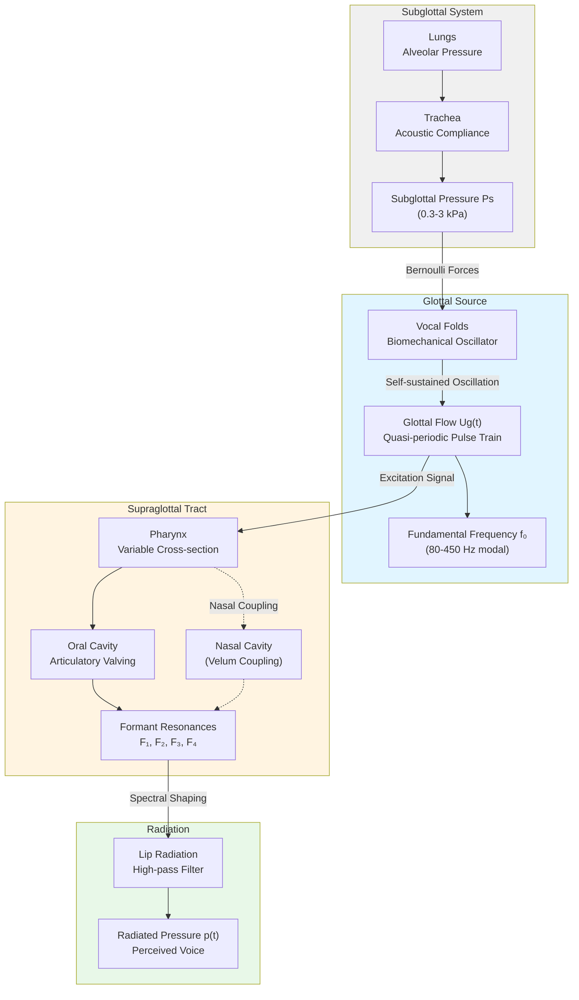
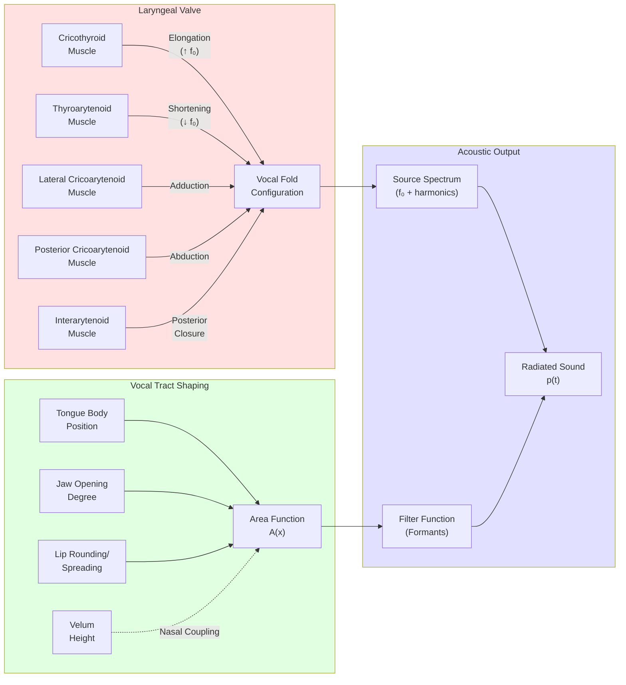
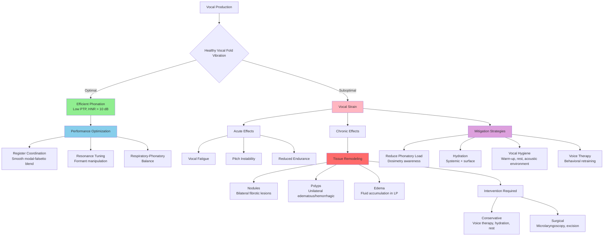

# Lesson 2: Vocal Technique

## 1. First-Principles Intuition & Invariants

The human voice is a self-excited aeroacoustic oscillator—a biological instrument whose fundamental operating principle is the conversion of steady airflow into periodic acoustic energy through fluid-structure interaction. Unlike external reed instruments where the vibrating element is passive, the vocal folds are actively controlled through intrinsic laryngeal musculature, enabling parametric modulation of fundamental frequency, amplitude, and spectral content in real time.

### The Laryngeal Source-Filter Model

Vocal production obeys a source-filter decomposition that has remained the canonical framework since Gunnar Fant's acoustic theory of speech production (1960). The glottal source generates a quasi-periodic excitation signal, while the supraglottal vocal tract acts as a time-varying resonant filter. This separation is mathematically justified because the acoustic impedance mismatch between the subglottal system and the supraglottal tract is sufficiently large that feedback effects, while present, are secondary to first-order behavior.

The glottal flow waveform $u_g(t)$ during phonation approximates a repeated pulse with a sharp closure phase. The spectrum of this periodic signal consists of a fundamental frequency $f_0$ (determined by vocal fold biomechanics) and a harmonic series at integer multiples $nf_0$. The spectral envelope typically exhibits a $-12$ dB/octave rolloff due to the derivative relationship between glottal flow and the radiated pressure wave. The vocal tract transfer function $H(f)$ superimposes formant peaks (resonances) onto this declining spectral envelope, creating the vowel-specific acoustic signatures that distinguish /i/ from /a/ from /u/.

### Biomechanical Oscillator Dynamics

The vocal folds are multi-layered viscoelastic structures: a superficial epithelium overlies the lamina propria (comprising superficial, intermediate, and deep layers with increasing collagen density), which in turn covers the thyroarytenoid muscle. This layered architecture is critical—the body-cover model (Hirano, 1974) recognizes that during phonation, the epithelium and superficial lamina propria (the "cover") undergo mucosal wave propagation while the deeper layers and muscle (the "body") provide mechanical restoring forces.

Vocal fold vibration is not a simple harmonic motion but a complex spatiotemporal pattern. High-speed videokymography reveals that the vocal folds exhibit:

- **Vertical phase delay**: The inferior margin of the vocal fold begins opening before the superior margin, creating a converging-diverging glottal geometry during each cycle.
- **Medial-lateral phase asymmetry**: The medial surface leads the lateral surface in the opening phase, producing a "wave" that travels from inferior-medial to superior-lateral.
- **Nonlinear stiffness**: The effective stiffness increases with displacement, leading to amplitude-dependent frequency shifts (the voice naturally rises in pitch with increased loudness unless compensated).

The governing dynamics can be approximated by a two-mass model (Ishizaka & Flanagan, 1972), where each vocal fold is represented by two masses connected by springs and dampers:

$$m_1 \ddot{x}_1 + r_1 \dot{x}_1 + k_1 x_1 + k_c(x_1 - x_2) = F_1(P_s, x_1, x_2)$$
$$m_2 \ddot{x}_2 + r_2 \dot{x}_2 + k_2 x_2 + k_c(x_2 - x_1) = F_2(P_s, x_1, x_2)$$

where $m_i$ are effective masses, $r_i$ damping coefficients, $k_i$ spring constants, $k_c$ coupling stiffness, $x_i$ lateral displacements, and $F_i$ are aerodynamic forces derived from Bernoulli pressure distributions based on subglottal pressure $P_s$ and instantaneous glottal geometry.

The phonation threshold pressure—the minimum subglottal pressure required to initiate and sustain oscillation—depends on tissue viscosity, vocal fold tension, and prephonatory glottal geometry. Clinically, elevated phonation threshold pressure indicates pathology such as nodules, edema, or muscle tension dysphonia.

### Acoustic Invariants and Constraints

Several physical constraints define the operational envelope of the human voice:

1. **Fundamental frequency range**: Adult male modal register spans approximately 80–250 Hz, adult female 150–450 Hz. These ranges are determined by vocal fold length (males: 17–25 mm, females: 12–17 mm), mass, and maximum achievable tension. Falsetto extends the upper range by reducing effective vibrating mass.

2. **Harmonic-to-noise ratio**: Healthy phonation exhibits HNR > 10 dB, indicating that periodic energy dominates turbulent noise. Breathy phonation (incomplete glottal closure) reduces HNR; pressed phonation (hyperadduction) may increase HNR at the cost of elevated vocal effort.

3. **Formant frequency bounds**: Formants are vocal tract resonances independent of $f_0$. For an average adult male vocal tract length of 17.5 cm, neutral vowel formants occur near $F_1 \approx 500$ Hz, $F_2 \approx 1500$ Hz, $F_3 \approx 2500$ Hz, spaced approximately $1000$ Hz apart. Formants scale inversely with vocal tract length; children and females exhibit higher formant frequencies.

4. **Source-tract interaction**: At very high pitches, when $f_0$ approaches or exceeds $F_1$, nonlinear source-tract coupling becomes significant. Singers exploit this in the "singer's formant" (a formant cluster near 3 kHz) to achieve acoustic power and projection in operatic singing.

## 2. Core Architecture & Mechanics

### Laryngeal Anatomy and Control Mechanisms

The larynx is a cartilaginous framework suspended in the anterior neck, comprising three unpaired cartilages (thyroid, cricoid, epiglottis) and three paired cartilages (arytenoid, corniculate, cuneiform). The vocal folds span anteroposteriorly from the thyroid cartilage (at the anterior commissure) to the arytenoid cartilages posteriorly.

Intrinsic laryngeal muscles provide parametric control over vocal fold configuration:

- **Cricothyroid (CT)**: Tilts the thyroid cartilage forward relative to the cricoid, elongating and tensing the vocal folds. Primary mechanism for increasing $f_0$. Innervated by the external branch of the superior laryngeal nerve.

- **Thyroarytenoid (TA)**: Comprises the body of the vocal fold. Contraction shortens and thickens the fold, lowering $f_0$ and transitioning from falsetto to modal register. Innervated by the recurrent laryngeal nerve.

- **Lateral cricoarytenoid (LCA)**: Adducts the vocal folds by rotating the arytenoids medially, closing the glottis for phonation.

- **Posterior cricoarytenoid (PCA)**: The sole abductor; rotates arytenoids laterally to open the glottis for respiration. PCA paralysis results in life-threatening airway obstruction.

- **Interarytenoid (IA)**: Adducts the posterior glottis, ensuring complete closure during phonation.

This neuromuscular control system operates under closed-loop feedback incorporating proprioceptive, auditory, and somatosensory signals. Laryngeal mechanoreceptors provide tension and position feedback; auditory feedback enables pitch and timbre monitoring. Transient elimination of auditory feedback (delayed auditory feedback paradigms) causes immediate pitch and amplitude instability, demonstrating the voice's reliance on real-time sensory integration.

### Multi-Register Phonation Modes

The voice exhibits distinct registers—qualitatively different vibrational patterns with characteristic acoustic properties:

**Modal (Chest) Register**: Full vocal fold vibration with complete glottal closure. Characterized by high vocal fold contact quotient (>50%), rich harmonic content, and lowest phonation threshold pressure. The primary conversational and singing register.

**Falsetto (Loft) Register**: Elongated, thin vocal folds vibrate with minimal or absent contact. The mucosa oscillates while deeper layers remain relatively passive. Acoustic signature includes elevated $f_0$, reduced amplitude, and attenuated higher harmonics. Lower vocal efficiency necessitates increased airflow.

**Vocal Fry (Pulse) Register**: Extremely low frequency phonation (20–80 Hz) where vocal folds vibrate as a relaxed, thick mass with irregular periodicity. Perceived as a "creaky" quality. Distinct acoustic signature includes subharmonics and period-doubling bifurcations.

**Whistle Register**: Achievable by some sopranos, involves phonation through a small posterior chink while the anterior folds remain approximated. Produces pure-tone-like pitches exceeding 1000 Hz with minimal harmonic content—essentially a biological Helmholtz resonator.

Register transitions involve complex biomechanical adjustments. The modal-to-falsetto transition (passaggio in classical singing) requires reducing TA activity while increasing CT activity, shifting from full-body to cover-dominant oscillation. Skilled singers learn to smooth this transition through precise laryngeal coordination and acoustic tuning strategies.

### Vocal Tract Acoustics and Articulatory Phonetics

The vocal tract is a non-uniform acoustic tube approximately 17.5 cm long (adult male average), terminated by the glottis at one end and the lips at the other. For a uniform tube closed at one end, resonant frequencies occur at:

$$f_n = \frac{(2n-1)c}{4L}$$

where $c \approx 35000$ cm/s is the speed of sound in warm, humid air, $L$ is vocal tract length, and $n = 1, 2, 3, ...$. This predicts resonances at 500, 1500, 2500 Hz for $L = 17.5$ cm, corresponding approximately to neutral vowel formants.

Articulatory constrictions modify this uniform-tube model. The tongue body, jaw, lips, and velum alter cross-sectional area functions $A(x)$, where $x$ is distance from the glottis. Vowel production involves specific area function configurations:

- **/i/ (as in "beet")**: High front tongue constriction creates a small front cavity (high $F_2$) and large back cavity (low $F_1$).
- **/a/ (as in "bot")**: Low, back tongue creates large pharyngeal cavity (low $F_1$, low $F_2$).
- **/u/ (as in "boot")**: High back tongue with lip rounding creates long, narrow front cavity (low $F_1$, low $F_2$, but distinct from /a/).

Consonants involve ballistic articulatory gestures creating complete or partial vocal tract occlusions:

- **Stops** (/p/, /t/, /k/): Complete closure followed by release burst.
- **Fricatives** (/f/, /s/, /ʃ/): Narrow constriction generating turbulent airflow.
- **Nasals** (/m/, /n/, /ŋ/): Velum lowering couples nasal cavity, introducing anti-resonances (zeros) in the transfer function.

The dynamics of articulation are governed by the Task Dynamics framework, which models articulatory gestures as damped mass-spring systems converging toward phoneme-specific target configurations. Co-articulation—the overlap and blending of adjacent gestures—arises naturally from the continuous dynamics of these coupled oscillators.

### Respiratory-Phonatory Coordination

Efficient vocal production requires precise coordination between respiratory drive and laryngeal configuration. During sustained phonation, the respiratory system must maintain relatively constant subglottal pressure despite decreasing lung volume (and thus elastic recoil pressure).

The relaxation pressure curve describes passive recoil pressure as a function of lung volume. At high lung volumes, elastic recoil provides substantial positive pressure; at low volumes, negative pressure predominates. Trained singers learn to balance inspiratory muscle activity (opposing elastic recoil at high volumes) and expiratory muscle activity (supplementing diminished recoil at low volumes) to maintain steady subglottal pressure throughout the phrase.

Optimal phonation occurs at lung volumes between 35–60% of vital capacity, where moderate expiratory effort achieves efficient pressure control. Initiating phonation at excessively high lung volumes wastes air and requires active suppression of recoil pressure; phonating at very low volumes demands forceful expiratory effort and risks laryngeal hyperfunction.

The lung-larynx system exhibits impedance matching considerations. The acoustic impedance looking into the trachea from the glottis is substantially higher than the impedance looking into the supraglottal tract. This asymmetry ensures that most acoustic energy radiates orally rather than being dissipated subglottally—a critical efficiency feature of the vocal instrument.

## 3. High-Performance Optimization & Failure Modes

### Parametric Optimization Strategies

Elite vocal performance emerges from optimizing multiple coupled parameters simultaneously:

**Pitch Control**: Precise $f_0$ modulation requires coordinated CT and TA activity. Increasing pitch via CT elongation reduces phonation threshold pressure and facilitates smooth register transitions, while TA-dominant pitch control (shortening against increased tension) results in "pressed" phonation with elevated vocal effort. Vibrato—periodic modulation of $f_0$ (±5–7 Hz) at 5–7 Hz rate—arises from oscillatory interactions between respiratory and laryngeal systems, adding warmth and projection to sustained tones.

**Dynamic Range**: Intensity modulation involves balancing subglottal pressure and glottal resistance. Simply increasing $P_s$ without laryngeal adjustment produces strained, inefficient phonation. Optimal intensity increase involves coordinated increases in both $P_s$ and medial compression (adductory force), maintaining the ratio of driving pressure to glottal resistance. The "support" concept in pedagogy refers to this coordinated adjustment rather than isolated respiratory effort.

**Resonance Tuning**: Formant manipulation enables timbre modification and acoustic amplification. The "singer's formant" in operatic voices results from clustering $F_3$, $F_4$, and $F_5$ near 3 kHz through pharyngeal and laryngeal tube adjustments (lowered larynx, widened pharynx). This formant cluster coincides with a spectral valley in orchestral sound, enabling vocal projection over instrumental accompaniment without electronic amplification.

**Registration Strategies**: Skilled singers manipulate the modal-falsetto blend (mixed voice) throughout the pitch range, avoiding abrupt register breaks. This involves maintaining partial TA engagement in head voice and preventing excessive thinning of vocal fold contact. Belt technique in contemporary commercial music extends modal register to high pitches through maintenance of TA activity and elevated laryngeal position, producing a bright, powerful sound quality distinct from classical head voice.

### Vocal Loading and Dosimetry

The voice is subject to cumulative mechanical loading effects. Phonotrauma models describe how chronic exposure to high-amplitude, high-impact collisional forces leads to tissue remodeling and pathology. The vocal fold collision stress can be estimated from:

$$\sigma = \frac{1}{2} \rho v^2$$

where $\rho$ is tissue density and $v$ is the peak velocity of vocal fold collision. High-intensity phonation with incomplete glottal closure (producing turbulent flow and increased viscous dissipation) generates significantly elevated collision stresses.

Vocal dose measures attempt to quantify cumulative vocal loading. Accumulated vibration dose (total vocal fold oscillation cycles), phonation time percentage (duty cycle), and amplitude-weighted accumulated dose all correlate with voice disorder risk in professional voice users. Teachers, call center workers, and singers face occupational voice demands often exceeding sustainable physiological limits.

Time-pattern analysis of vocal use reveals that voice rest is not merely absence of phonation but active physiological recovery. Vocal fold tissue exhibits viscoelastic creep under sustained loading; biomechanical properties degrade during extended phonation. Strategic rest intervals allow tissue recovery and metabolic restoration, critical for maintaining performance across multiple singing sessions or performance days.

### Failure Modes and Pathophysiology

Vocal pathology arises from biomechanical, inflammatory, or neurological insults:

**Nodules and Polyps**: Benign mid-membranous lesions resulting from chronic mechanical trauma. Nodules are bilateral, fibrotic thickenings; polyps are typically unilateral, edematous or hemorrhagic masses. Both disrupt glottal closure and vocal fold vibration, producing dysphonia characterized by breathiness, reduced pitch range, and vocal fatigue. Management requires voice therapy (reducing phonotraumatic behaviors) and, in refractory cases, microsurgical excision.

**Muscle Tension Dysphonia (MTD)**: Excessive, maladaptive laryngeal and extralaryngeal muscle activity during phonation. Primary MTD occurs without structural pathology; secondary MTD develops as compensation for organic lesions. Presents as vocal strain, effortful phonation, and reduced vocal endurance. Laryngoscopy reveals supraglottic hyperfunction (false vocal fold compression, anteroposterior laryngeal squeeze). Treatment involves behavioral voice therapy targeting muscle release and respiratory-phonatory recoordination.

**Vocal Fold Paresis/Paralysis**: Disruption of recurrent laryngeal nerve innervation results in vocal fold immobility. Unilateral paralysis produces breathy, weak voice due to glottal incompetence; bilateral paralysis may cause airway obstruction. Causes include surgical trauma (thyroidectomy), viral neuritis, and idiopathic factors. Management ranges from observation (some cases spontaneously recover) to injection medialization or framework surgery (thyroplasty) to improve glottal closure.

**Laryngopharyngeal Reflux (LPR)**: Retrograde flow of gastric contents into the laryngopharynx causes chemical irritation of laryngeal mucosa. Unlike gastroesophageal reflux disease (GERD), LPR often lacks heartburn symptoms. Presents as chronic throat clearing, globus sensation, and dysphonia. Laryngoscopy reveals posterior glottic erythema and edema. Treatment includes dietary modification, proton pump inhibitors, and behavioral changes.

**Presbyphonia**: Age-related voice changes resulting from vocal fold atrophy, calcification of laryngeal cartilages, and altered pulmonary function. The senescent voice exhibits reduced intensity, increased breathiness, and pitch instability. Histologic changes include atrophy of thyroarytenoid muscle and thinning of lamina propria layers. Management involves voice therapy focusing on respiratory support and laryngeal effort optimization; injection augmentation may improve glottal closure in severe cases.

### Preventive Strategies and Vocal Hygiene

Maintaining vocal health requires systematic attention to multiple factors:

**Hydration**: Vocal fold viscosity directly affects phonation threshold pressure and tissue vulnerability. Systemic hydration (adequate oral fluid intake) maintains lamina propria hydration, while surface hydration (via inhaled steam or nebulization) temporarily reduces superficial viscosity. Mucosal dehydration from antihistamines, diuretics, or environmental factors increases phonatory effort and injury risk.

**Vocal Warm-up and Cool-down**: Progressive engagement of the vocal mechanism before intensive use and gradual disengagement afterward facilitate neuromuscular preparation and recovery. Warm-ups typically involve gentle, low-intensity vocalizations progressing to more demanding tasks. Cool-downs reverse this progression. These practices reduce acute vocal fatigue and may mitigate long-term injury risk, analogous to athletic warm-up protocols.

**Acoustic Environment Management**: Background noise induces the Lombard effect—involuntary increase in vocal intensity and pitch to maintain auditory feedback salience. Chronic exposure to high ambient noise levels (classrooms, restaurants, industrial settings) drives compensatory hyperphonation, increasing vocal loading. Acoustic optimization of speaking environments reduces this involuntary vocal strain.

**Laryngeal Tension Management**: Chronic neck and shoulder tension, jaw clenching, and postural deviations alter laryngeal suspension and muscle activation patterns. Somatic practices (Alexander Technique, Feldenkrais, yoga) that address whole-body alignment and tension patterns may indirectly improve vocal function by normalizing laryngeal posture and reducing extrinsic laryngeal muscle hyperactivity.

### Advanced Diagnostic Techniques

Modern voice assessment integrates perceptual, aerodynamic, acoustic, and imaging modalities:

**Laryngeal Videostroboscopy**: Synchronized strobe illumination at near-fundamental frequency creates slow-motion visualization of vocal fold vibration. Enables assessment of mucosal wave propagation, glottal closure pattern, amplitude and symmetry of vibration, and presence of structural lesions. The gold standard for clinical laryngeal evaluation.

**High-Speed Digital Imaging (HSDI)**: True real-time imaging at 2000–8000 frames per second captures complete vibratory dynamics without stroboscopic sampling. Reveals aperiodic and chaotic vibratory patterns invisible to stroboscopy. Quantitative analysis yields amplitude, frequency, and phase asymmetry measures.

**Aerodynamic Assessment**: Measurement of airflow, subglottal pressure (estimated via intraoral pressure during /p/ occlusion), and derived parameters (glottal resistance, laryngeal efficiency, phonation quotient). Provides objective quantification of respiratory-phonatory function.

**Acoustic Analysis**: Extraction of perturbation measures (jitter, shimmer), harmonic-to-noise ratio, cepstral peak prominence, and spectral parameters from recorded voice samples. Offers non-invasive, quantitative assessment of voice quality. Machine learning classifiers trained on acoustic features show promise for automated pathology detection.

**Electromyography (EMG)**: Direct measurement of laryngeal muscle electrical activity via hooked-wire or needle electrodes. Used diagnostically to assess neural innervation status (paralysis vs. paresis) and therapeutically in biofeedback protocols for reducing muscle tension dysphonia.

### Future Directions and Emerging Technologies

Vocal science and clinical voice care are advancing through interdisciplinary integration:

**Computational Biomechanics**: Finite element models of vocal fold tissue, incorporating multi-layered structure, nonlinear viscoelasticity, and fluid-structure interaction, enable simulation of normal and pathological phonation. These models predict surgical outcomes, optimize treatment planning, and test hypotheses about phonatory mechanisms not accessible through direct experimentation.

**Machine Learning for Voice Pathology Detection**: Deep neural networks trained on large voice databases show accuracy approaching or exceeding human experts for detecting dysphonia, distinguishing pathology types, and tracking treatment response. Deployment in mobile health applications could enable widespread, low-cost voice screening.

**Personalized Vocal Pedagogy**: Integration of real-time biofeedback (acoustic analysis, electroglottography, aerodynamics) with pedagogical practice enables objective monitoring of technique acquisition and individualized training protocols. Virtual reality environments may accelerate skill development through enhanced sensory feedback and deliberate practice structures.

**Regenerative Medicine**: Tissue engineering approaches aim to restore vocal fold pliability and viscoelastic properties after scarring injury. Hydrogel injection augmentation, stem cell therapy, and growth factor delivery represent potential therapeutic avenues for currently intractable scarring and atrophy.

**Neuromodulation**: Emerging evidence suggests that vocal motor control involves complex cortical-subcortical networks amenable to neuromodulatory intervention. Transcranial magnetic stimulation and brain-computer interfaces may enable novel rehabilitation strategies for voice disorders with neurological etiologies.

The human voice remains a frontier of scientific inquiry, where biomechanics, acoustics, neuroscience, and artistic practice converge. Mastery of vocal technique requires not merely physical training but deep understanding of the principles governing this remarkable biological instrument.
