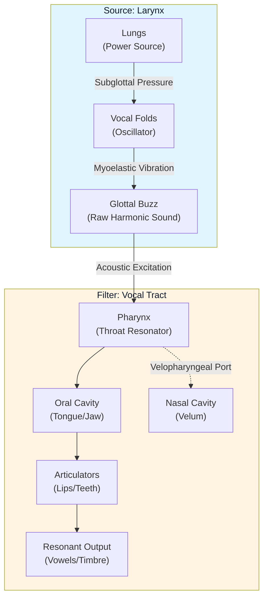
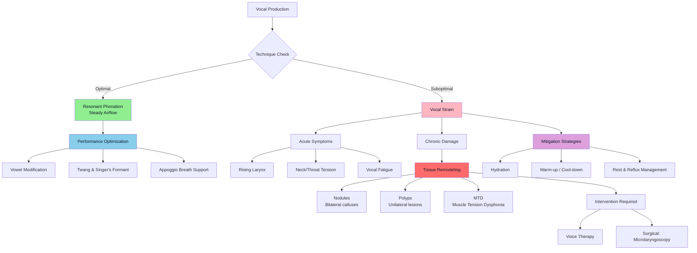

# Lesson 2: Vocal Technique & Performance Mastery

## 1. First-Principles Intuition: Source-Filter in 90 Seconds

The voice is a two-stage system. The **source** is the larynx: subglottal air pressure blows your vocal folds open, and elastic recoil plus the Bernoulli effect (fast airflow through a narrow gap drops local pressure, sucking the folds back shut) slams them closed again. Hundreds of these open-close cycles per second produce a buzzy raw tone rich in harmonics — this is the Aerodynamic Myoelastic cycle, and it's the entire engine of phonation. The **filter** is your vocal tract — throat, mouth, nose — which acts like an acoustic EQ, boosting certain harmonic bands (formants) and cancelling others to turn buzz into vowels and timbre.

You control pitch and volume with exactly two levers:
1. **Subglottal pressure** (breath support) → volume/intensity of fold collision.
2. **Vocal fold tension**, set by the cricothyroid (stretches folds thin → higher pitch) vs. thyroarytenoid (thickens folds → lower pitch, more weight/power).

Everything in this lesson is you learning to operate those two levers independently, and then learning to reshape the filter on top of them.

---

## 2. Breath Management: Building the Air Engine

Untrained singers breathe by raising the chest and shoulders. This locks the rib cage, drags the larynx upward, and leaves you with a shallow, fast-depleting air supply — you end up squeezing the throat to regulate airflow instead of using your body. The fix is low, expansive, diaphragmatic-costal breathing paired with *resistance* to collapse on the exhale.

### Drill 1 — The Book Breath (foundational capacity)
1. Lie flat on your back, knees bent. Place a heavy book on your stomach, just below the navel.
2. Inhale through the nose. The book rises. Chest and shoulders stay motionless — if they rise, the breath is too high.
3. Exhale on a thin "sss" hiss for a count of 8, book lowering slowly and evenly, no stutter.
4. Progress the count: 8 → 12 → 16 → 20 over several sessions.
5. **Target:** 15 seconds of a perfectly smooth hiss at 60 BPM (one count per click). A wavering or sputtering hiss means your airflow is being leaked or dammed inconsistently — usually jaw or throat tension. Reset and retry at a slower count.

### Drill 2 — Appoggio, "The Lean" (pressurized, sustained support)
Appoggio is maintaining the *inhale* posture (expanded ribs, lowered diaphragm) while you exhale, instead of letting everything collapse immediately. This gives you a steady column of pressurized air so the throat never has to clamp down to control volume.
1. Hands on your lower/floating ribs, thumbs toward your back.
2. Inhale deeply — feel the ribs press outward into your palms.
3. Hiss out on "sss." Actively resist the ribs caving in; keep pushing outward into your hands as the air leaves.
4. **Target:** Hold outward rib expansion for 10 seconds at 60 BPM while exhaling steadily. Then apply the same feeling singing a sustained note on /a/ at a comfortable pitch — the sensation of "holding the lean" should not change between hissing and singing.

**Why it works:** Appoggio keeps subglottal pressure constant and predictable. Inconsistent pressure is the #1 cause of pitch instability (going flat as you run out of support) and of forcing the throat to compensate.

---

## 3. Registers, the Passaggio, and Mix

Your folds reconfigure thickness and tension to produce different registers:

| Register | Active Muscle | Fold Shape | Character |
|---|---|---|---|
| Chest (Modal) | Thyroarytenoid (TA) | Thick, short, full closure | Rich in harmonics, speaking voice |
| Head / Falsetto (Loft) | Cricothyroid (CT) | Thin, stretched, minimal closure | Lighter, airy at the edges |
| Mix / Belt | TA + CT blended | Thick fold vibration retained at high pitch | Powerful, connected, contemporary |

The **passaggio** (bridge) is the pitch zone where TA dominance must hand off to CT without a crack, a flip into breathy falsetto, or a forced yell. For most untrained male voices this sits roughly around D4–F#4; for most female voices around A4–C5 — exact location is voice-specific, so find yours by ear rather than assuming the number.

### Drill 3 — Lip Trill Siren (passaggio smoothing)
1. Lip trill (motorboat/horse lips). Substitute a rolled "rr" or a buzzed "v" if trills won't engage.
2. Siren from your lowest comfortable chest note to your highest falsetto note and back, with zero break in the trill.
3. Metronome 60 BPM: 4 clicks sliding up, 4 clicks sliding down. Repeat, nudging the top note slightly higher each pass.
4. **Why it works:** The trill creates oral back-pressure that keeps the folds gently approximated through the whole range, so the larynx doesn't have to fight to stay engaged through the passaggio. If the trill sputters out at a certain pitch, that's your passaggio — slow down and cross it at half speed before returning to tempo.

---

## 4. Vocal Tract Shaping: Vowels, Formants, and Projection

### Formant tuning (vowel modification)
Vowel identity comes from formants — resonant peaks the vocal tract reinforces. As pitch rises, your harmonics spread further apart, and a held "pure" vowel shape can land you between formants, producing a thin, shrill, or strained tone. The fix is to modify the vowel toward a more neutral shape as you ascend:

- **Low range (C4–G4):** Sing pure vowels — /a/ ("father"), /e/ ("bed").
- **Mid range (A4–D5):** Begin narrowing — /a/ drifts toward /ɔ/ ("aw") or /ʌ/ ("uh").
- **High range (E5+):** Modify aggressively — /a/ → /ʌ/ or /ɔ/; /e/ → /ɪ/ ("ih"); /i/ → /ɪ/.

Practice this directly: sing an ascending major scale on "father's" /a/ and consciously let the jaw/tongue drift the vowel toward "uh" above the staff. The audience still perceives the word; your throat gets genuine relief.

### Twang and the singer's formant (projection without force)
- **Twang:** Narrow the aryepiglottic sphincter (space just above the vocal folds). Say "Nyaa" like a cartoon witch or a bratty kid imitating someone. This adds roughly 5–10 dB of perceived loudness with no extra muscular effort on the folds — it's an acoustic trick, not a power trick.
- **Singer's formant:** Lower the larynx slightly and widen the pharynx (feel a quiet, "dopey" internal yawn) to cluster formants 3–5 near 3 kHz, the frequency band the ear is most sensitive to and where orchestras/bands have the least energy. Combine low larynx + twang to cut through a full mix without shouting.

---

## 5. Advanced Performance Technique

### Drill 4 — "Nay-Nay" Belt Builder
1. Say "Nay" with a bratty, nasal, cackling edge — this locks in twang and keeps TA engaged (thick folds).
2. Sing a 1-3-5-8-5-3-1 arpeggio (e.g., C4-E4-G4-C5-G4-E4-C4) entirely on "Nay."
3. Metronome 60 BPM, one note per click. Ascend by half steps, one key per repetition.
4. **Target:** Keep the tone bright and "obnoxious" at every key. The moment it flips into breathy falsetto, you've lost TA engagement — back down a half step, rebuild the twang, and re-approach that pitch.
5. **Why it works:** Twang supplies acoustic loudness so you don't need to add raw muscular squeezing to get volume at the top — the actual mechanism behind a clean, non-damaging belt.

### Drill 5 — Messa di Voce (dynamic control under pitch)
Loud is easy. Soft with core stability is hard, and it's what separates a trained voice from a shouter.
1. Sustain a comfortable mid-range pitch on /o/ ("oh") — try G4 (tenor/alto) or C4 (bass/baritone).
2. Start at a near-whisper. Over 4 beats at 60 BPM, swell smoothly to full volume.
3. Over the next 4 beats, decrescendo back to a whisper.
4. **Target:** Pitch must not sharpen as volume increases, nor flatten as it decreases. Use a tuner app on first attempts to catch drift. This directly trains the balance between breath pressure and fold adduction (closure) — the two levers from Section 1 — moving independently of volume.

---

## 6. Failure Modes, Pathology, and Vocal Hygiene

### Diagnostic signs of strain (stop and recalibrate if you notice)
- Larynx visibly rises on high notes (should stay roughly level, maybe a slight natural rise, not a jump).
- Neck veins bulge or the jaw juts forward to "help" reach pitch.
- Immediate urge to clear your throat or a tickling cough after singing.
- Noticeable voice loss or hoarseness after a 30-minute set.

### Common pathologies and their mechanical cause

- **Nodules:** Bilateral calluses from repeated hard fold collisions without adequate breath support — typically from yelling or belting on too little air pressure, forcing the folds to slam together. Voice sounds hoarse, breathy, loses top range.
- **Polyps:** Usually a single blister-like lesion from one acute vocal "blowout" (a scream, a hard cough) or from chronic acid reflux irritating the folds.
- **Muscle Tension Dysphonia (MTD):** Extrinsic neck strap muscles (not the intrinsic laryngeal muscles) grip and hoist the larynx to "help" hit pitch, choking resonance and raising effective pitch involuntarily. Common in singers who never learned appoggio and compensate with the neck.

### Hygiene protocol
- **Hydration:** Water throughout the day, not a last-minute gulp before a gig — mucosal hydration of the fold cover is systemic and takes hours to take effect.
- **Warm-up:** Lip trills and mid-range humming first, always. Never open a session on high belted notes cold.
- **Cool-down:** Descending "woo" slides from a comfortable pitch down to the bottom of your range, returning the larynx to resting height and releasing residual tension.
- **Lombard effect:** In loud rooms you unconsciously push harder to hear yourself, which is how most live-gig strain happens. Use in-ear monitors (IEMs) so you can hear your true output level against the mix instead of oversinging.

---

## 7. Putting It Together: A 15-Minute Daily Session

| Time | Drill | Metronome | Goal |
|---|---|---|---|
| 0–3 min | Book Breath / Appoggio | 60 BPM | Reset low, pressurized breath |
| 3–6 min | Lip Trill Siren | 60 BPM (4 up / 4 down) | Smooth passaggio, no breaks |
| 6–9 min | Nay-Nay Arpeggios | 60 BPM | Build twang-supported belt, ascend by half steps |
| 9–12 min | Messa di Voce on /o/ | 60 BPM (4 up / 4 down) | Decouple pitch from volume |
| 12–15 min | Descending "woo" cool-down | 60 BPM | Release larynx, end session relaxed |

Run this before any rehearsal or performance, and treat any drill that triggers strain symptoms (Section 6) as your cue to slow the tempo and rebuild the motion correctly before pushing range or volume again.
