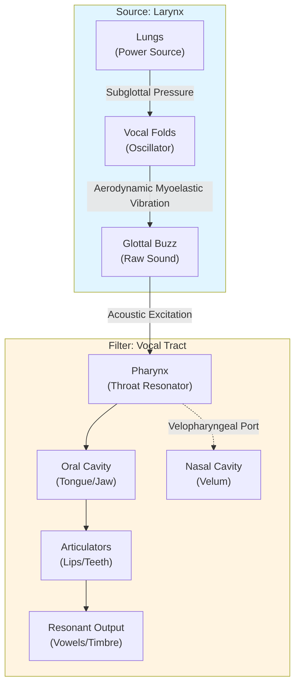

# Lesson 2: Vocal Technique & Performance Mastery

## 1. First-Principles Intuition & Invariants

The human voice operates on a source-filter principle. The "source" is the larynx, where aerodynamic forces and muscular tension collide to create a buzzing sound. The "filter" is the vocal tract—your throat, mouth, and nasal cavities—which shapes that buzz into recognizable vowels, timbres, and resonant frequencies.

### Aerodynamic Myoelastic Theory
You do not need to memorize biomechanical differential equations to sing, but you must understand how your vocal folds vibrate. When you exhale, subglottal pressure builds beneath the closed vocal folds. When pressure exceeds the muscular resistance of the folds, they blow open. Elasticity and the Bernoulli effect (negative pressure from airflow) pull them shut again. This cycle repeats hundreds of times per second. 

To control this oscillator, you manipulate two parameters:
1. **Subglottal pressure** (breath support): Controls volume and drives the intensity of the vocal fold collision.
2. **Vocal fold tension** (via the cricothyroid and thyroarytenoid muscles): Controls pitch. Stretching the folds makes them vibrate faster (higher pitch); thickening them makes them vibrate slower (lower pitch).



## 2. Core Mechanics & The Vocal Instrument

### Breath Management & Appoggio
The engine of the voice is air. Untrained singers breathe high in the chest, locking the shoulders and throat, which forces the larynx up and chokes off resonance. The goal is diaphragmatic-costal breathing.

**Drill: The Book Breath**
1. Lie flat on your back. Place a heavy book on your stomach.
2. Breathe in through your nose. The book should rise; your chest and shoulders must remain still.
3. Exhale through a tiny straw or pursed lips (or a "sss" hiss) for a count of 8. The book should lower slowly and steadily.
4. Progress to 12, 16, and 20 counts. 
5. Target: 15 seconds of unwavering hiss at 60 BPM. If the hiss wavers or sputters, your airflow is inconsistent.

**Appoggio (The "Lean")**
Appoggio is the classical technique of maintaining inspiratory muscle tension while exhaling. You expand the ribs and lower the diaphragm on the inhale, and you aggressively resist their collapse on the exhale. 

1. Place your hands on your lower ribs (floating ribs).
2. Inhale deeply; feel the ribs push outward into your hands.
3. Hiss out a steady "sss". Keep your hands pushed outward. Do not let the ribs collapse immediately.
4. Target: Sustain the outward rib pressure for 10 seconds at 60 BPM while exhaling. This creates a pressurized, steady airflow that prevents the throat from constricting to regulate air.

### Phonation Modes & Register Coordination
Your vocal folds change thickness and tension to produce different registers. Mastering the voice means mastering the transition (passaggio) between them.

- **Chest Voice (Modal):** Thyroarytenoid (TA) muscle is active. Folds are thick and short with full glottal closure. Rich harmonics. Your speaking voice.
- **Head Voice / Falsetto (Loft):** Cricothyroid (CT) muscle is active. Folds are stretched thin with minimal closure. Lighter sound.
- **Mix / Belt:** Blending TA and CT to maintain thick-fold vibration at high pitches. Essential for contemporary music.

**Drill: The Lip Trill Siren**
1. Lip trill (blow air through closed lips like a horse or a motorboat). If you can't, use a rolled "rr" or a "v" sound.
2. Slide from your lowest chest note up to your highest falsetto note and back, without breaking.
3. Metronome: 60 BPM. Slide up over 4 clicks, slide down over 4 clicks. 
4. The lip trill provides back-pressure, keeping the vocal folds gently approximated so you can ease through the passaggio (bridge) without shouting or cracking. The goal is a seamless, unbroken siren.

### Vocal Tract Shaping & Resonance Tuning
The vocal tract shapes the raw glottal buzz into timbre and vowel. The key variables are tongue position, jaw opening, lip rounding, and larynx height.

**Vowel Modification (Formant Tuning)**
As you sing higher, the distance between your harmonic frequencies and your vowel formants changes. If you keep a pure /a/ (ah) vowel up high, it will sound shrill, strained, and flat. You must modify vowels toward neutral (schwa /ə/) to maintain resonance and relieve tension.

- **Low Range (C4-G4):** Pure vowels. /a/ as in "father", /e/ as in "bed".
- **Mid Range (A4-D5):** Slightly modify. /a/ moves toward /ɔ/ (aw) or /ʌ/ (uh).
- **High Range (E5+):** Extreme modification. /a/ becomes /ʌ/ (uh) or /ɔ/ (aw). /e/ becomes /ɪ/ (ih). /i/ becomes /ɪ/ (ih).

**Twang and the Singer's Formant**
To cut through a mix or an orchestra, you need acoustic power, not muscular force.
1. **Twang:** Narrowing the aryepiglottic sphincter (the space above the larynx). Say "Nyaa" like a witch's cackle or a bratty child. This bright, piercing tone adds 5-10 dB of acoustic energy without straining the vocal folds.
2. **The Singer's Formant:** Lowering the larynx and widening the pharynx clusters formants 3, 4, and 5 around 3kHz. Practice a "dopey" yawn (like a sigh) to feel the larynx drop. Combine a low larynx with twang for a massive, projected sound.

## 3. High-Performance Optimization & Failure Modes

### Advanced Performance Techniques

**Belting Mechanics**
Belt technique in contemporary commercial music extends chest register to high pitches through maintenance of TA activity and a relatively high laryngeal position, producing a bright, powerful sound. 

**Drill: The "Nay-Nay" Exercise**
1. Say "Nay" (like a bratty child or a witch's cackle). This engages the aryepiglottic sphincter (twang) and keeps the folds thick.
2. Sing an arpeggio: 1-3-5-8-5-3-1 (e.g., C-E-G-C-G-E-C) on the "Nay" syllable.
3. Metronome: 60 BPM. Ascend by half steps.
4. Target: Keep the sound bright and obnoxious. Do not let it turn into a breathy falsetto. The twang provides the acoustic energy so you do not have to push muscular tension to be loud.

**Dynamic Control: Messa di Voce**
Singing loud is easy; singing soft with intensity is hard.
1. Sustain a comfortable mid-range pitch (e.g., G4 for tenors, C4 for baritones).
2. Start at a whisper. Over 4 beats (60 BPM), swell to full volume.
3. Over the next 4 beats, decrescendo back to a whisper.
4. Do this on /o/ (oh) to keep the larynx stable and the throat open. 
5. Target: The pitch must not go sharp when loud, nor flat when soft. This trains the breath pressure and adduction (closure) balance.

### Failure Modes & Preventive Strategies

Vocal pathology usually stems from repeated mechanical stress, poor hydration, or forcing high notes with pure TA muscle tension. 

**Diagnostic Signs of Strain**
If you experience any of these, stop and recalibrate your technique:
- Your larynx (Adam's apple) shoots up when you sing high.
- Your neck veins bulge or your jaw juts forward.
- You feel a tickle or need to clear your throat immediately after singing.
- You lose your voice after a 30-minute set.

**Common Pathologies**
- **Nodules:** Bilateral calluses from continuous slamming of the folds. Sounds hoarse and breathy. Caused by over-compression (yelling/screaming without breath support).
- **Polyps:** Unilateral blister-like lesions, often from a single vocal blowout or chronic acid reflux.
- **Muscle Tension Dysphonia (MTD):** Extrinsic neck muscles squeeze the larynx, raising pitch and choking resonance.

**Mitigation & Vocal Hygiene**
- **Hydration:** Drink water throughout the day. Vocal folds need systemic hydration to maintain mucosal wave viscosity. You cannot just chug water right before a gig; it must be hours in advance.
- **Warm-ups:** Always start with lip trills and humming on mid-range scales. Never start with high, belted notes.
- **Cool-downs:** Descending slides on "woo" to bring the larynx back to a resting state after performance.
- **Lombard Effect:** In loud rooms, you instinctively push harder. Use in-ear monitors (IEMs) to protect your hearing and manage your vocal output level against the band mix.

```mermaid
flowchart TD
    A[Vocal Production] --> B{Technique Check}
    B -->|Optimal| C["Resonant Phonation<br/>Steady Airflow"]
    B -->|Suboptimal| D[Vocal Strain]
    
    D --> E[Acute Symptoms]
    D --> F[Chronic Damage]
    
    E --> E1[Rising Larynx]
    E --> E2[Neck/Throat Tension]
    E --> E3[Vocal Fatigue]
    
    F --> F1[Tissue Remodeling]
    
    F1 --> F1a["Nodules<br/>Bilateral calluses"]
    F1 --> F1b["Polyps<br/>Unilateral lesions"]
    F1 --> F1c["MTD<br/>Muscle Tension Dysphonia"]
    
    C --> G[Performance Optimization]
    
    G --> G1["Vowel Modification<br/>Formant Tuning"]
    G --> G2["Twang & Resonance<br/>Acoustic Power"]
    G --> G3["Appoggio<br/>Breath Support"]
    
    D --> H[Mitigation Strategies]
    
    H --> H1["Hydration<br/>Systemic + Steam"]
    H --> H2["Warm-up/Cool-down<br/>Lip Trills"]
    H --> H3["Rest & Reflux Management<br/>Voice Hygiene"]
    
    F1 --> I[Intervention Required]
    
    I --> I1["Voice Therapy<br/>Behavioral Retraining"]
    I --> I2["Surgical<br/>Microlaryngoscopy"]
    
    style C fill:#90EE90
    style D fill:#FFB6C1
    style F1 fill:#FF6B6B
    style G fill:#87CEEB
    style H fill:#DDA0DD
