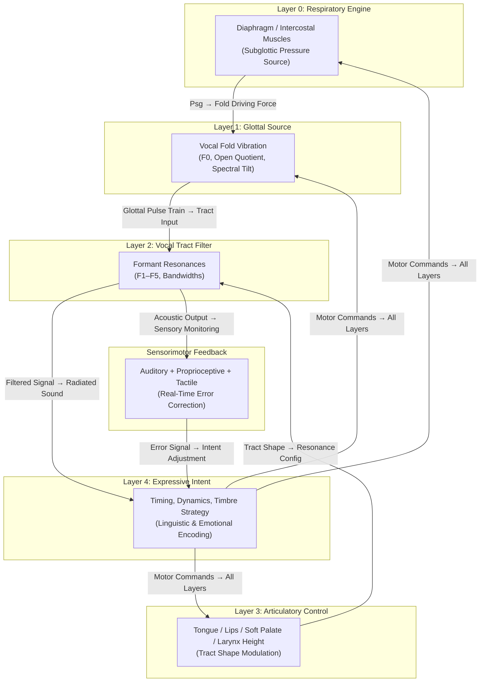

# Lesson 3: Vocal Interpretation — Architecture, Mechanics, and Expressive Craft

---

## 1. First-Principles Intuition & Invariants

The human voice is a biological instrument governed by aerodynamic, biomechanical, and acoustic principles that have no meaningful analogs in electronic signal processing — yet understanding the voice through that lens is precisely what reveals its depth. At its most fundamental, vocal production is a **source-filter system**: the larynx generates a broadband, harmonically rich excitation signal (the *glottal source*), and the vocal tract shapes that signal through resonance, functioning as a time-varying acoustic filter. The mouth, lips, and articulatory surfaces then radiate the filtered output into the room. This framework, formalized by Gunnar Fant in his landmark 1960 *Acoustic Theory of Speech Production*, is not a metaphor — it is the actual physical mechanism.

The **fundamental frequency (F0)** — perceived as pitch — is determined by the rate at which the vocal folds open and close per second. That rate is a function of two competing forces: the **Bernoulli effect**, which draws the folds together as subglottic air rushes between them, and **fold tension**, which is controlled by the cricothyroid and thyroarytenoid muscles. Higher tension → higher F0. Greater subglottic pressure → louder output but also upward pressure on F0, which is why singers must actively resist pitch flattening under pianissimo dynamics. These are not stylistic observations — they are mechanical invariants derived from the physics of oscillating membranes under tension.

The **breath** is not merely fuel; it is the primary acoustic energy source and the primary expressive control variable. The diaphragm contracts downward during inhalation, reducing intrathoracic pressure and drawing air into the lungs. During phonation, the diaphragm and abdominal wall coordinate to maintain a **subglottic pressure** (Psg) calibrated to the desired intensity and register. Casual speech requires roughly 7–10 cm H₂O of Psg; a dramatic fortissimo operatic passage may demand 25–35 cm H₂O. The performer's ability to maintain a consistent pressure gradient across a phrase — without audible collapse at phrase ends — is a direct measure of respiratory conditioning.

The **vocal tract** behaves as a non-uniform acoustic tube, approximately 17 cm in length in an adult male (shorter in women and children). Its resonant frequencies — the **formants** (F1, F2, F3, ...) — are determined by the tube's cross-sectional area function, which the articulators continuously reshape. The first formant (F1) is primarily controlled by jaw opening and tongue height; the second formant (F2) by tongue advancement; the third formant (F3) by lip shape and tongue tip position. Crucially, formants do not merely classify vowels — they carry enormous emotional information. A performer who raises F1 through wider jaw opening produces a brighter, more open quality associated with urgency or grief; a lowered larynx that extends the tube lowers all formants uniformly, producing the characteristic "dark" or "covered" tone associated with operatic singing and dramatic gravitas.

The **singer's formant** — a clustering of F3, F4, and F5 around 2.5–3.5 kHz observed in trained classical singers — is not mystical. It is the acoustic consequence of a widened pharynx and a narrowed laryngeal ventricle, which together create a resonance peak that projects above the orchestral frequency band (~500 Hz peak energy) without requiring amplification. This is why a soprano can be heard over a 90-piece orchestra: not because she is louder in absolute terms, but because her energy is concentrated in a frequency band where the orchestra is relatively quiet.

The invariants of vocal interpretation are therefore:

1. **Source-filter independence**: glottal source characteristics (F0, open quotient, spectral tilt) can be modulated independently of vocal tract resonance configuration. This independence is what allows a singer to maintain a consistent vowel (formant structure) while varying pitch across a large range.
2. **Respiratory-laryngeal coupling**: changes in subglottic pressure alter both loudness and pitch; skilled performers decouple these through compensatory laryngeal adjustment.
3. **Articulatory-resonance mapping**: every articulatory gesture has a predictable, measurable consequence on the formant structure, and therefore on perceived vowel quality and emotional color.
4. **Closed-loop sensorimotor control**: the performer's motor commands are continuously updated based on auditory, tactile, and proprioceptive feedback. Remove that feedback (as in sudden hearing loss) and performance degrades immediately and severely.

---

## 2. Core Architecture & Mechanics

### 2.1 Layered Production Model

Vocal production can be decomposed into four functionally distinct but tightly coupled layers. Each layer has its own control variables, time constants, and failure modes.

**Layer 0 — Respiratory Engine:** The lungs provide the pressure reservoir. The key variable is not lung volume per se but the *rate of pressure release*, managed by the respiratory muscles working against elastic recoil. A skilled performer maintains an approximately constant Psg across a long phrase by progressively releasing abdominal muscular support as lung volume decreases — this is the mechanical basis
