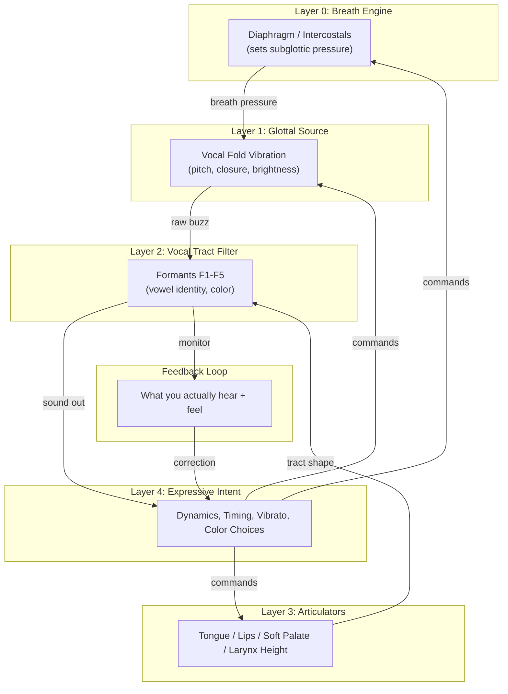

# Lesson 3: Vocal Interpretation — Architecture, Mechanics, and Expressive Craft

---

## 1. First-Principles Intuition (Read Once, Then Go Sing)

The voice is a source-filter system. The larynx (source) buzzes out a harmonically rich raw tone; the vocal tract (filter) shapes that buzz into vowels and color by changing its length and cross-section. Pitch (F0) is set mostly by vocal fold tension via the cricothyroid muscle; loudness is set mostly by subglottic pressure (breath force) via the abdominal/intercostal muscles. The catch: pushing more air to get louder also tends to push pitch sharp, because higher pressure stretches the folds. Every drill in this lesson exists to decouple these two controls so you can get loud without going sharp, and go high without running out of air.

Practical pressure targets: comfortable speech sits around 7–10 cm H₂O of subglottic pressure; an operatic fortissimo demands 25–35 cm H₂O. You don't need a manometer — you need the Hiss Exercise (Drill 3.2) to feel what steady pressure delivery is.

The **singer's formant** is the practical reason a classically trained voice carries over a full orchestra with no microphone: widening the throat space above the larynx and narrowing the space just above the vocal folds clusters three resonances (F3–F5) around 2.5–3.5 kHz, a frequency band where orchestral instruments are comparatively quiet. This is a trainable configuration, not a gift — Drill 3.8 builds it directly.

Four things to internalize before you sing a note:

1. You can hold a vowel steady while changing pitch — tract shape and fold vibration are independently controllable.
2. Breath pressure and pitch are coupled by default; skilled singing actively fights that coupling.
3. Every tongue/jaw/lip movement changes your formants, which changes your vowel and your emotional color — nothing is "just placement," it's acoustics you can engineer.
4. You sing by ear and feel in real time. Record yourself often — your inner sensation and your actual sound diverge more than you think.

---

## 2. Core Architecture & Mechanics

### 2.1 The Four Layers You're Actually Controlling

**Layer 0 — Breath:** The controllable variable is not how much air you take in, it's how slowly and evenly you let it out. "Support" means the abdominal wall stays engaged and yields gradually across a phrase instead of collapsing — you're resisting the exhale, not pushing it.

**Layer 1 — Glottal source:** Three knobs, adjustable independently: pitch (fold tension), closure/open quotient (how much of each cycle the folds stay shut — more closure = less breathy, more efficient), and spectral tilt (how fast harmonics fall off — steeper = darker/covered, shallower = brighter).

**Layer 2 — Vocal tract filter:** Jaw opening moves F1. Tongue front/back position moves F2. Lip rounding and larynx height drag everything lower. This is your vowel-shaping toolkit.

**Layer 3 — Articulators:** Tongue, lips, soft palate, larynx height execute Layer 2's shapes. Soft palate position is specifically your nasality control — closed velum = no nasal resonance (classical default), open velum = nasal color (a tool in CCM).

**Layer 4 — Expressive intent:** Dynamics, rubato, vibrato, breath placement, consonant attack. This is interpretation, and it drives everything below it in real time.

### 2.2 Breath Setup and Posture

Stand feet shoulder-width apart, knees soft (not locked), spine long (crown of head lifting, not chin), shoulders down and back, chin level — not tilted up.

**Drill 3.1 — Diaphragmatic Engagement Check**
1. One hand on sternum, one hand on lower belly below the navel.
2. Inhale through the nose, 4 counts. Belly hand moves out/down; sternum hand barely moves. If the sternum rises, you're breathing high in the chest — redirect lower.
3. Exhale through pursed lips, 8 counts. Belly draws in slowly; sternum stays up, doesn't cave.
4. 5 cycles. Inhale = passive drop of the diaphragm. Exhale = active, controlled abdominal engagement.
5. Progress over sessions: inhale 2 counts, exhale 12, then 16. Target: zero wavering in airflow speed across the whole exhale.

**Drill 3.2 — Hiss Exercise (Pressure Calibration)**
The single most useful drill in this lesson. It builds the ear and the muscle memory for steady breath pressure.
1. Inhale low and wide, 4 counts.
2. Exhale on a sustained "sss." The hiss gives you instant audio feedback — any wobble in loudness means your pressure is unstable.
3. Progressive targets at 60 BPM (quarter note = 1 count):

| Week | Hiss Length | Rest | Reps |
|---|---|---|---|
| 1 | 8 counts | 4 | 8 |
| 2 | 12 counts | 4 | 6 |
| 3 | 16 counts | 4 | 4 |
| 4 | 20 counts | 4 | 4 |
| 6 | 30 counts | 4 | 3 |

4. Hand on lower belly: feel gradual inward movement, never a sudden cave. The belly is a piston regulating pressure, not a vise.
5. Once steady: hiss piano for 4 counts, crescendo to forte over 4, decrescendo to piano over 4. Trains volume control without changing release rate.

**Drill 3.3 — Pulsed Hiss (Appoggio Foundation)**
Builds the rhythmic abdominal "lean" (*appoggio*, Italian for "to lean") used in classical breath management.
1. Inhale low and wide, 4 counts.
2. Exhale on "sss," pulsing forte-piano in eighth notes at 60 BPM. Each pulse is a quick belly flex-release — not a throat action.
3. 8 pulses, then sustain a steady piano hiss for 4 more counts.
4. Rest, repeat 6 times.
5. Feel: lower abdominal muscles lean outward against the inward collapse of exhale. That oppositional tension is appoggio — resistance, not a push.

### 2.3 Onset Control

Onset is how phonation begins. Command all three deliberately.

- **Balanced onset:** breath and fold closure arrive together. No air leak before the tone, no percussive attack. Default for classical and most contemporary singing.
- **Aspirated onset:** breath flows slightly before closure, leaving a small "h" before the vowel. Used for intimacy/vulnerability. Overuse signals weak closure and wastes breath.
- **Glottal onset:** folds close before breath engages, producing a percussive attack. Common in pop phrasing for emphasis. Habitual use under high pressure causes fold trauma — use it as a choice, not a default.

**Drill 3.4 — Onset Calibration**
1. Metronome 60 BPM. Inhale 4 counts, suspend breath 2 counts (no tension, just a paused diaphragm).
2. On the downbeat, initiate a sustained "ah" at a comfortable pitch (C4 tenor/baritone, C5 soprano/mezzo, G3 bass) with balanced onset — breath and vowel arriving together, like gears meshing.
3. Sustain 4 counts, release cleanly (no pitch sag, no volume drop pre-release).
4. Rest 4 counts, repeat on the same pitch 4x, then move up a semitone. Cover one octave.
5. Once balanced onset is reliable: do 4 reps of deliberate aspirated onset, then 4 reps balanced. Then 4 reps deliberate glottal onset, then 4 reps balanced. Goal: conscious choice, not unconscious default.

### 2.4 Register Mechanics and Passaggio

**Chest (M1, modal):** thick, short folds, full contact, high harmonic content. Feels like speaking voice, resonant in chest/lower neck. Covers roughly the bottom two-thirds of most ranges.

**Head (M2, falsetto in males):** thin, elongated folds, edge vibration, fewer harmonics. Feels lighter, resonant in upper face/head. Covers the top third.

**Passaggio** is the transition zone. *Primo passaggio* is where chest starts to feel strained if carried up unchanged; *secondo passaggio* is where head voice must fully engage.

| Voice Type | Primo Passaggio | Secondo Passaggio |
|---|---|---|
| Bass | A2–B2 | E3–F3 |
| Baritone | B2–C3 | F3–G3 |
| Tenor | D3–E3 | G3–A3 |
| Alto | E3–F3 | A3–B3 |
| Mezzo | F3–G3 | C4–D4 |
| Soprano | G3–A3 | D4–E4 |

The mechanism you control here is **vowel modification**: as F0 rises, formants must shift to keep the vowel recognizable and the tone unstrained. A bright "ah" [a] at C4 may need to drift toward "oh" [ɔ] or "uh" [ə] by A4 — this isn't stylistic, it's acoustic necessity imposed by the physics of a rising fundamental colliding with fixed formant targets.

**Drill 3.5 — Register Balance and Passaggio Navigation**
1. Metronome 70 BPM, starting pitch mid-chest (C3 male, C4 female).
2. Sing 1-3-5-3-1 on "ah," hold the top note 2 counts. Pressed and shouty = you're carrying chest too high.
3. Repeat, but modify the top note toward "oh" [ɔ]. Jaw relaxes slightly down, larynx settles. Tone rounds out.
4. Sing 1-3-5-8-5-3-1. On the octave, modify toward "uh" [ə] (male) or a slightly raised-jaw "ah" (female). The tone should "turn over" into head-dominant resonance, not push harder in chest.
5. Transpose up by semitone through all 12 keys. Start 70 BPM, target 90 BPM by week 3.
6. **Diagnostic:** a sudden breathy "flip" means fold tension is dropping too fast through the transition. Slow the tempo, drop to mezzo-piano, keep breath energy steady — don't let it surge through the break.

**Drill 3.6 — Messa di Voce (Dynamic Control)**
The definitive respiratory-laryngeal decoupling exercise: crescendo/decrescendo on one sustained pitch with zero pitch drift.
1. Pick an upper-middle pitch: E4 tenor, E5 soprano, A3 baritone, G3 alto.
2. Metronome 60 BPM, 4 counts per dynamic level: pp → mf → f → mf → pp. Total 16 counts, one pitch.
3. Mechanism: crescendo = more abdominal engagement (pressure) + more fold closure (to prevent sharping). Decrescendo = less pressure while maintaining adduction (to avoid going breathy).
4. 3 reps per pitch, then move up a semitone through 5 semitones.
5. **Common failure:** sharp on crescendo, flat on decrescendo — laryngeal tension is following breath pressure instead of staying independent. Fix: mentally anchor the pitch as fixed, let breath handle volume around it.
6. Progress over weeks: 6 counts per level (24 total), then 8 counts per level (32 total).

### 2.5 Vowel Modification Map

| Original | IPA | At Passaggio | IPA | Upper Register | IPA |
|---|---|---|---|---|---|
| ah | [a] | oh | [ɔ] | uh | [ə]/[o] |
| eh | [e] | ih | [ɪ] | uh | [ə] |
| ee | [i] | ih | [ɪ] | narrow oo | [u] |
| oh | [o] | oo | [ʊ] | oo | [u] |
| oo | [u] | oo (hold) | [u] | oo (hold) | [u] |

Front vowels ([i],[e]) darken and centralize as pitch rises. Open vowels ([a]) round and close. Back vowels ([o],[u]) stay relatively stable, narrowing slightly further. Feel this as a slight pharyngeal widening and jaw release, not a conscious vowel swap the audience should notice.

**Drill 3.7 — Vowel Migration Arpeggios**
1. Metronome 80 BPM.
2. 1-3-5-8-5-3-1 on "ah" starting mid-chest. On the octave, shift subtly toward "oh." Return to "ah" on descent.
3. Repeat on "eh" → "ih" at the top → back to "eh."
4. Repeat on "ee" → "ih," then "oo" if very high → back through "ih" to "ee."
5. Repeat on "oh" → "oo" at the top → back to "oh."
6. Repeat on "oo," holding throughout — already maximally modified.
7. Transpose by semitone through 8 keys.
8. **Diagnostic:** "hooty"/over-covered = over-modified. "Spread"/shouty = under-modified. Correct modification keeps the vowel recognizable while removing strain.

### 2.6 Resonance Strategies

**Forward placement (CCM, belting, musical theater):** tune F1 to track the first or second harmonic in the upper range for a bright, cutting tone felt in the "mask" (behind the cheekbones/nose). Slightly higher larynx, forward tongue, wider mouth opening. Cuts through a mix without relying on the singer's formant.

**Chiaroscuro balance (classical):** low-ish larynx (adds darkness, lowers formants) combined with forward tongue and a widened pharynx (maintains the singer's formant cluster for brightness/projection). Result: round and focused simultaneously.

**Drill 3.8 — Resonance Exploration**
1. Hum "mmm" mid-range. Feel the buzz in lips/front of face — mask resonance.
2. Open to "mah" keeping that buzz "floating" on top, not replaced.
3. Hum "mmm" again, this time consciously lower the larynx (slight yawn, back of throat opens). Hum feels lower, warmer; buzz may shift back slightly.
4. Open to "mah" in this lower, wider space — darker, rounder, buzz still present.
5. Alternate forward vs. low configuration 4 times on the same pitch.
6. Target: larynx comfortably low, pharynx wide, buzz still forward — classical chiaroscuro.
7. CCM singers: push the forward configuration further — higher larynx, spread lips, forward tongue. This is belt/mix resonance. Limit sustained high-larynx practice to 15 minutes/session to avoid strain.

### 2.7 Vibrato

Vibrato is a pitch oscillation around 5–7 Hz, emergent from efficient, balanced phonation — not a muscle you consciously wiggle. Healthy depth: roughly ±0.5 to ±1.0 semitone.

- **Above 7 Hz = tremolo:** excess laryngeal tension.
- **Below 4.5 Hz = wobble:** insufficient breath energy or laryngeal tone.
- **Straight tone:** achieved by actively suppressing oscillation via increased tension. Appropriate in early music, some CCM, choral work — use deliberately, not by default.

**Drill 3.9 — Vibrato Calibration**
1. Sustain a mid-range note at mf, straight tone initially.
2. Slowly relax laryngeal tension while keeping breath support steady. Oscillation should emerge within 2–3 seconds. If not, try a gentle quarter-tone pitch "sigh" and gradually narrow it into an oscillation.
3. Assess: steady rate? Consistent depth? Pitch center stable (centered on target, not sitting below it)?
4. Practice: 8 counts vibrato at 60 BPM, then 4 counts straight → 4 vibrato → 4 straight. Trains conscious switching.
5. Target: 5.5–6.5 Hz, ±0.5 semitone. Can't judge by ear? Record 5 seconds and count oscillations — target 28–35.

---

## 3. Expressive Craft — Building Interpretation

### 3.1 Interpretation Workflow

### 3.2 Dynamic Planning

Score markings are a floor, not a ceiling. Without a deliberate plan, singers default to mezzo-forte throughout — the vocal equivalent of a monotone.

**Example dynamic architecture for a strophic art song (e.g., Schubert "Gretchen am Spinnrad"):**

| Stanza | Dynamic | Register | Breath Plan | Color |
|---|---|---|---|---|
| 1 (intro) | mp–p | Mid-chest | Every 2 bars | Warm, controlled |
| 2 (narrative) | mf | Mid-chest to passaggio | Every 2 bars | Slightly brighter |
| 3 (emotional turn) | f | Passaggio to head | Every bar, staggered | Forward, urgent |
| 4 (climax) | ff | Upper register | Quick catch-breaths | Bright, cutting |
| 5 (post-climax) | p–pp | Upper to mid | Long phrases | Hollow, distant |

**Drill 3.10 — Dynamic Architecture Exercise**
1. Pick 8–16 bars (a lied excerpt, folk arrangement, or standard ballad).
2. Mark your target dynamic per phrase in a colored pen above the staff — your interpretive additions, not just the composer's.
3. Mark breath points at grammatically correct spots; plan staggered catch-breaths where a mid-phrase breath is unavoidable.
4. Sing at 50% tempo with exaggerated contrasts — genuinely soft piano, genuinely powerful forte.
5. Record, then listen without the score. Did the shape read? Was the climax actually the loudest point?
6. Move to 80%, then 100% tempo, holding the plan.

### 3.3 Breath as Grammar

Where you breathe tells the listener how to parse the text.

- **Primary breath points:** at punctuation (periods, commas, semicolons) — aligns musical and grammatical phrasing.
- **Secondary breath points:** at musical cadences even where the text continues.
- **Expressive breaths:** a deliberate breath before a key word or dramatic pause — a choice, used sparingly.
- **Staggered breaths (ensemble):** never breathe at the same point as your section unless the music demands it, to keep the ensemble sound continuous.

**Drill 3.11 — Breath Mapping**
1. Speak the text as monologue. Notice natural (grammatical) breath points.
2. Sing the melody on "ah," no text. Notice where the music demands a breath (musical breath points).
3. Overlay the two sets. Where do they agree? Where do they conflict?
4. At conflicts: sing through the musical boundary for grammatical clarity, or breathe mid-phrase for musical shape — decide deliberately.
5. Write the final plan in a second color.
6. Sing through holding the plan strictly. Needing an unplanned breath means your support is failing — return to Drill 3.2.

### 3.4 Consonant Articulation

Vowels carry sustained tone; consonants carry meaning and drive the text forward.

- **Consonants land before the beat; vowels land on the beat.** A late consonant delays the vowel and drags the rhythm.
- **Fricatives (s, f, v, z, sh, th)** can be stretched for rhythmic fill while keeping phonation energy up.
- **Plosives (p, t, k, b, d, g)** must be quick to close and crisp on release — audible but not disruptive to the legato line.
- **Doubled consonants** (Italian "ll," "tt") get held longer than singles — "bello" vs. "belo" is a real, audible distinction.

**Drill 3.12 — Consonant Timing**
1. Metronome 60 BPM.
2. Speak the text in rhythm, exaggerating every consonant — crisp plosives, doubled-length fricatives.
3. Sing the melody with that same exaggerated consonant crispness; vowels should land exactly on the beat.
4. Dial back the exaggeration while keeping the rhythmic precision — consonants still "fire" just before the beat.
5. Record: are consonants audible? Does the text parse? Is the rhythm steady?
6. Progress tempo: 60 → 80 → 100 BPM → performance tempo.

### 3.5 Register as an Expressive Choice

- **Chest-dominant:** intimate, grounded, declarative. Narrative, anger, resolve.
- **Mix:** flexible "speaking-singing" register. Most CCM, musical theater, conversational classical.
- **Head-dominant:** ethereal, distant, vulnerable. Dreams, memory, prayer.
- **Falsetto (male):** deliberately breathy and fragile. Emotional vulnerability, pop/R&B effect.

**Drill 3.13 — Register Color Exercise**
1. Pick a 4–8 note phrase from your piece.
2. Sing it full chest — note the grounded, direct quality.
3. Sing it in head/falsetto — note the floating, distant quality.
4. Sing it in a balanced mix — note the flexible, neutral quality.
5. Sing the phrase three times back to back, one register each time. Same notes, same text, different meaning.
6. Pick the register that serves the text; apply it to the full piece.
7. Practice moving registers within a single phrase — chest into head through the passaggio on a rise, back through on the descent — with no audible break.

### 3.6 Legato and Line

Legato means no audible gap between notes. The breath never actually stops, even when a consonant briefly closes the vocal tract.

**Mechanism:** subglottic pressure stays constant through the whole phrase. When a consonant closes the tract ("t," "d," "k"), pressure keeps building behind the closure, so the vowel resumes at full intensity the instant the tract reopens — like water flowing under a bridge.

**Drill 3.14 — Legato Line Construction**
1. Pick an 8–12 note stepwise or gently arpeggiated phrase.
2. Sing it on "ah" with no consonants. Connect every pitch to the next with zero gap.
3. Add the text. Consonants should feel like they happen *inside* the breath stream. The vowel after each should resume at the prior intensity.
4. Practice at 50% tempo, then 75%, then 100%.
5. **Diagnostic:** a volume "hiccup" after a consonant means your breath is stopping during the closure. Fix: lean slightly more breath energy into the consonant so the pressure behind the closure exceeds the pressure during the vowel.
6. Record. The line should sound like one unbroken ribbon with text laid on top.

---

## 4. Troubleshooting Matrix

| Symptom | Likely Cause | Diagnostic | Fix |
|---|---|---|---|
| Pitch flat on high notes | Weak breath support; larynx rising | Hand on larynx during ascent — does it jump? | More abdominal engagement; Drill 3.6 |
| Pitch sharp on crescendo | Pressure rising faster than fold tension compensates | Sustain + crescendo — does pitch climb? | Increase fold closure as you increase pressure |
| Breathy/weak tone | Incomplete fold closure | Sing "ah," pinch nose — tone changes? | Balanced onset drills (3.4); glottal closure work on "ee" |
| Pressed/strained tone | Over-closure, under-support | Throat hurts after 10 min? | Reduce closure; more breath support; practice at piano |
| Break/flip in passaggio | No vowel modification | Compare break location to passaggio chart | Drill 3.5; slow tempo, drop volume |
| Jaw tension | Stress, clenching, high larynx | Massage masseter — hard? | Relaxed jaw gap; yawn-sigh |
| Tongue tension | Tongue retracting into throat | Mirror check — does it pull back? | Rest tip on lower front teeth; "ah" with tongue forward |
| Running out of breath | Shallow breathing, poor planning | Hiss count (Drill 3.2) under 12? | Daily hiss drills; plan breath points |
| Tremolo (too-fast vibrato) | Excess laryngeal tension | Count oscillations/sec | Reduce tension; slow sighs; neck massage |
| Wobble (too-slow vibrato) | Weak fold closure, excess breath | Tone unsteady? | Increase closure; match breath to closure; straight-into-vibrato drill |
| Nasal tone | Open velum | Pinch nose — tone changes drastically? | Raise soft palate (yawn feel); "ng"-to-"ah" transitions |
| Dark/muffled tone | Larynx too low, no forward resonance | Tone sounds swallowed? | Raise larynx slightly; forward tongue; Drill 3.8 |
| Cuts through ensemble | Singer's formant working | — | Maintain, don't change |
| Can't hear self in ensemble | Resonance untuned | Louder but not cutting? | Widen pharynx, narrow laryngeal ventricle; or more forward placement for CCM |

### 4.1 Vocal Health — Non-Negotiables

- **Hydration:** 2–3 liters water daily, not just pre-session. Dry folds → friction → edema → nodules.
- **Warm-up:** never sing full intensity cold. 10 minutes: lip trills (2), hummed scales (2), vowel arpeggios (3), legato phrases at mf (3).
- **Session length:** 45–60 minutes intense singing with a 15-minute break; cap total daily phonation at 2–3 hours.
- **Cool-down:** 3 minutes gentle descending hums/lip trills after intense singing.
- **Silent rest:** 30 minutes of no talking/singing after a 2-hour session.
- **Pain is a stop signal.** Fatigue is normal; pain and rawness are not. Pain lasting over 2 weeks → see a laryngologist.

---

## 5. Daily Practice Routine

### 5.1 Warm-Up (10 min)

| Exercise | Time | Purpose | Tempo |
|---|---|---|---|
| Lip trills, 1-3-5-3-1, low–mid | 2 min | Fold engagement, airflow coordination | 70 BPM |
| Hummed descending 5-note scales, varied vowels | 2 min | Mask resonance, pharyngeal warmth | 70 BPM |
| Vowel arpeggios 1-3-5-8-5-3-1 through passaggio | 3 min | Register transition + vowel mod | 80 BPM |
| Legato phrase on "ah," 8–12 notes | 3 min | Breath management, line | 60 BPM |

### 5.2 Technical Core (25 min)

| Exercise | Time | Purpose | Tempo |
|---|---|---|---|
| Hiss (3.2) | 5 min | Breath calibration | 60 BPM |
| Messa di voce (3.6) | 5 min | Dynamic decoupling | 60 BPM |
| Vowel migration (3.7) | 5 min | Passaggio navigation | 80 BPM |
| Onset calibration (3.4) | 5 min | Clean phonation starts | 60 BPM |
| Vibrato calibration (3.9) | 5 min | Rate/depth control | 60 BPM |

### 5.3 Repertoire (30 min)

| Activity | Time | Purpose |
|---|---|---|
| Score analysis | 5 min | Interpretive planning |
| Dynamic/breath plan (3.10, 3.11) | 5 min | Expressive architecture |
| 50% tempo, full expression | 10 min | Integration |
| Performance tempo + recording | 10 min | Real-time execution |

### 5.4 Cool-Down (5 min)

| Exercise | Time | Purpose |
|---|---|---|
| Descending hums, piano | 2 min | Laryngeal relaxation |
| Lip trills, mid to low | 2 min | Fold decompression |
| Silent diaphragmatic breathing | 1 min | Nervous system reset |

---

## 6. CCM vs. Classical — What Actually Changes

| Parameter | Classical | CCM |
|---|---|---|
| Larynx height | Low | Moderate–high |
| Vibrato | Continuous, 5.5–6.5 Hz | Selective; straight tone common |
| Vowel modification | Gradual, acoustically mandatory | Minimal; spoken-quality held higher |
| Resonance | Chiaroscuro + singer's formant | Forward/mask, F1-H2 tuning |
| Breath | Appoggio, long phrases, hidden breath | Variable, audible breath as expression |
| Dynamics | pp–ff, messa di voce central | mf–ff, belt + straight-tone control |
| Onset | Balanced, smooth | Aspirated/glottal used expressively |
| Articulation | Legato-dominant | Mixed: staccato, marcato, legato |
| Register use | Head/mix dominant up top | Belt/mix dominant, chest carried higher |
| Mic | None (projection via formant) | Close mic, intimacy at low volume |

**Belting** is not yelling on pitch. It's a thick-fold, chest-dominant vibration carried into the upper range with F1 tuned to track the second harmonic — bright, powerful, speech-like vowel with minimal modification. It requires substantial breath support; belting without it causes damage.

**Drill 3.15 — Belt Introduction (CCM singers only)**
1. Speech-quality "ah" on C4 (female) / C3 (male) at speaking volume. No strain, no pushing.
2. Move up by semitone keeping that speech quality. At the passaggio (roughly F4 female / F3 male), do not modify the vowel — increase abdominal support instead while holding fold thickness.
3. Should feel like shouting across a room, not singing high.
4. Cap at G4 (female) / G3 (male) in month one. Build gradually.
5. After belting, immediately do a descending hummed scale in head voice to rebalance.
6. **Safety limit:** 10 minutes max per session, with rests between reps. Any tickle, rawness, or pain = stop.
7. **Mixed belt:** once pure belt is comfortable to E4/F4, practice crossing from belt into head voice on a sustained pitch — smooth transition, not a flip. This is the "mix" most contemporary singers use up top.

---

## 7. Lab — Integrative Performance Drill

### 7.1 Piece Selection

- **Classical:** Schubert "Die Forelle" (verse 1) or Mozart "Voi che sapete" (opening section)
- **CCM:** a standard ballad in your range ("Summertime," "Hallelujah," or equivalent)

### 7.2 Procedure

1. **Text analysis (10 min):** read aloud three times as monologue. Mark the most important word per sentence; find the overall emotional climax.
2. **Harmonic analysis (10 min):** key, Roman numerals per chord, secondary dominants/modulations/chromaticism. Note where harmony drives emotional shifts.
3. **Breath/dynamic plan (10 min):** mark breath points and dynamics in two colors. Identify the climax note. Plan one rubato moment (a pull-back before the climax).
4. **Technical check (10 min):** highest note and its vowel — what modification applies? Longest phrase — does your hiss count support it?
5. **Slow practice (15 min):** 50% tempo, full expression, recorded. Check: dynamic plan audible? consonants crisp? legato unbroken? passaggio easy? climax the most intense moment?
6. **Performance tempo (10 min):** full tempo, recorded. Compare to the slow take — what changed that shouldn't have?
7. **Adjustment (10 min):** pick one fix, apply it, sing once more.
8. **Cool-down (5 min):** descending hums, lip trills.

### 7.3 Assessment Criteria

| Criterion | What to Listen For | Score (1–5) |
|---|---|---|
| Pitch accuracy | Centered notes, no sliding in | |
| Breath support | No collapse at phrase ends | |
| Register transitions | No audible break in passaggio | |
| Vowel modification | Clear vowels through upper range, no shouting | |
| Dynamic contrast | Genuinely different p and f | |
| Consonant clarity | Intelligible text at tempo | |
| Legato line | No gaps or bumps | |
| Expressive arc | Clear climax, communicated emotion | |
| Overall integration | Technique in service of expression | |

---

## 8. Daily Practice Checklist

- [ ] Hydrate before/during/after
- [ ] Warm-up: trills, hums, arpeggios, legato (10 min)
- [ ] Hiss at target count (5 min)
- [ ] Messa di voce (5 min)
- [ ] Vowel migration through passaggio (5 min)
- [ ] Repertoire slow, full expression (10 min)
- [ ] Repertoire at tempo, recorded (10 min)
- [ ] Listen back, pick one fix (5 min)
- [ ] Re-sing with the fix (5 min)
- [ ] Cool-down: descending hums, lip trills (5 min)
- [ ] 15 min silent rest

**Weekly check:** record the same piece Monday and Friday. Friday should show measurable improvement on at least one criterion from Section 7.3. If not, pull the bottleneck from the troubleshooting matrix (Section 4) and target it the following week.
