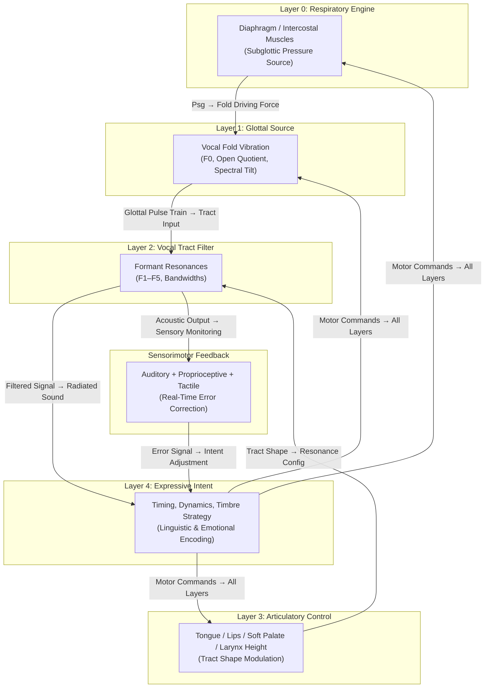

# Lesson 3: Vocal Interpretation — Architecture, Mechanics, and Expressive Craft

---

## 1. First-Principles Intuition & Invariants

The human voice is a biological source-filter system: the larynx generates a harmonically rich glottal excitation, and the vocal tract shapes that signal through continuous resonance adjustment. The vocal folds oscillate via the interplay of subglottic air pressure and muscular tension — the Bernoulli effect draws the folds together as air rushes between them, then elastic recoil forces them open again. The fundamental frequency (F0) is the rate of that open-close cycle. Higher cricothyroid tension raises F0; higher subglottic pressure increases loudness but also pushes F0 upward, which is why singers must actively decouple pitch from dynamic through compensatory laryngeal adjustment.

Breath is the primary energy source and the primary expressive control variable. Casual speech requires roughly 7–10 cm H₂O of subglottic pressure; a dramatic operatic fortissimo may demand 25–35 cm H₂O. The performer's ability to maintain a consistent pressure gradient across a phrase — without audible collapse at phrase ends — is the mechanical basis of breath support. The vocal tract (approximately 17 cm in adult males, shorter in females) behaves as a non-uniform acoustic tube whose resonant frequencies (formants F1, F2, F3...) are continuously reshaped by the articulators. F1 is primarily controlled by jaw opening and tongue height; F2 by tongue advancement; F3 by lip shape and tongue tip position.

The **singer's formant** — a clustering of F3, F4, and F5 around 2.5–3.5 kHz in trained classical singers — is the acoustic consequence of a widened pharynx and narrowed laryngeal ventricle. This resonance peak sits above the orchestral frequency band (~500 Hz peak energy), which is why a soprano can be heard over a full orchestra without amplification: her energy is concentrated where the orchestra is relatively quiet. This is technique, not anatomy — it can be trained.

The invariants of vocal production:

1. **Source-filter independence**: glottal source characteristics (F0, open quotient, spectral tilt) can be modulated independently of vocal tract resonance. This allows a singer to maintain a consistent vowel while varying pitch across a large range.
2. **Respiratory-laryngeal coupling**: changes in subglottic pressure alter both loudness and pitch; skilled performers decouple these through compensatory laryngeal adjustment.
3. **Articulatory-resonance mapping**: every articulatory gesture has a predictable consequence on formant structure, and therefore on perceived vowel quality and emotional color.
4. **Closed-loop sensorimotor control**: motor commands are continuously updated based on auditory, tactile, and proprioceptive feedback. Remove that feedback and performance degrades immediately.

---

## 2. Core Architecture & Mechanics

### 2.1 Layered Production Model

Vocal production decomposes into four functionally distinct but tightly coupled layers, each with its own control variables, time constants, and failure modes.

**Layer 0 — Respiratory Engine:** The lungs provide the pressure reservoir. The key variable is not lung volume per se but the rate of pressure release. A skilled performer maintains approximately constant Psg across a long phrase by progressively releasing abdominal muscular support as lung volume decreases — this is the mechanical basis of "support." The sensation is not of pushing air out but of resisting its escape: the abdominal wall remains engaged, slowly yielding, while intercostal muscles prevent rib collapse. This is the difference between breathing *for life* and breathing *for phrase*.

**Layer 1 — Glottal Source:** The vocal folds produce the excitation signal. The key control variables are F0 (pitch), open quotient (the fraction of each cycle the folds are open — higher open quotient means louder but also breathier), and spectral tilt (the rate at which harmonic energy falls off with frequency — steeper tilt sounds darker/more covered, shallower tilt sounds brighter). Skilled singers adjust all three independently: for example, raising pitch while maintaining a consistent tonal color requires increasing fold tension while keeping open quotient and spectral tilt stable.

**Layer 2 — Vocal Tract Filter:** The tract shapes the glottal source into recognizable vowels and timbral colors. The primary control surfaces are jaw opening (raises/lowers F1), tongue body advancement (raises/lowers F2), lip rounding (lowers all formants, especially F2), and larynx height (lowers all formants by extending the tract). The singer's job is to map intended vowels and tone colors onto specific articulatory configurations that remain stable across changing pitch — a challenge because rising F0 naturally pushes formant ratios out of alignment with vowel identity, requiring active compensation.

**Layer 3 — Articulatory Control:** The tongue, lips, soft palate, and larynx position execute the tract-shaping commands. Consonants are rapid tract perturbations; vowels are steady-state tract configurations. The soft palate (velum) controls nasality: a closed velum routes all airflow through the mouth; an open velum vents into the nasal cavity, adding nasal resonances. In contemporary commercial music (CCM), strategic nasality is a timbral tool; in classical singing, velopharyngeal closure is the default.

**Layer 4 — Expressive Intent:** This is where technical execution becomes interpretation. Dynamics, rubato, vibrato rate/depth, register choice, vowel modification, breath placement, and articulatory aggression are the expressive parameters. The performer's task is to map emotional and linguistic intent onto these acoustic variables in real time, adjusting based on feedback.

### 2.2 Breath Support Mechanics — Physical Setup

Before any phonation, the body must be correctly configured. The following drill sequence establishes the physical foundation. Stand with feet shoulder-width apart, knees unlocked, spine elongated (imagine a string pulling the crown of the head upward), shoulders relaxed and slightly back, chin level.

**Drill 3.1 — Diaphragmatic Engagement Check**

1. Place one hand on your sternum and the other on your lower abdomen, just below the navel.
2. Inhale slowly through the nose over 4 counts. The hand on your abdomen should expand outward and downward; the hand on your sternum should remain nearly still. If the sternum rises, you are breathing clavicularly — redirect the breath lower.
3. Exhale slowly through pursed lips over 8 counts. Feel the abdominal wall slowly draw inward. The sternum should not collapse.
4. Repeat 5 cycles. The sensation to internalize is that inhalation is a passive expansion (the diaphragm drops, creating vacuum) and exhalation is an active, controlled engagement of the abdominal and intercostal muscles.
5. Progress: reduce inhale to 2 counts, extend exhale to 12 counts, then 16 counts. The goal is a sustained, steady exhale with no wavering in airflow speed.

**Drill 3.2 — The Hiss Exercise (Psg Calibration)**

This is the single most important breath exercise for singers. It builds the respiratory-laryngeal coupling that decouples loudness from pitch.

1. Inhale low and wide (4 counts, diaphragmatic).
2. Exhale on a sustained sibilant "sss" (like a snake hiss). The "sss" provides acoustic feedback: you can hear the steadiness of the airflow. If the hiss wavers in volume, your Psg is unstable.
3. Targets, all at quarter note = 60 BPM:
   - **Week 1:** Hiss for 8 counts. Rest 4 counts. Repeat 8 times.
   - **Week 2:** Hiss for 12 counts. Rest 4 counts. Repeat 6 times.
   - **Week 3:** Hiss for 16 counts. Rest 4 counts. Repeat 4 times.
   - **Week 4:** Hiss for 20 counts. Rest 4 counts. Repeat 4 times.
   - **Week 6:** Hiss for 30 counts. Rest 4 counts. Repeat 3 times.
4. Place a hand on your lower abdomen. You should feel gradual, controlled inward movement — never a sudden collapse. The abdominal wall is a piston regulating the pressure, not a vise crushing the air out.
5. Once steady hiss is achieved, add dynamic variation: hiss at piano for 4 counts, crescendo to forte over 4 counts, decrescendo to piano over 4 counts. This trains the muscles to modulate Psg without changing the fundamental rate of release.

**Drill 3.3 — The Pulsed Hiss (Appoggio Foundation)**

This introduces the rhythmic abdominal engagement that underlies appoggio (Italian: "to lean"), the breath management technique used in classical singing.

1. Inhale low and wide (4 counts).
2. Exhale on "sss" but pulse the volume: forte-momentarily then back to piano, in eighth notes at 60 BPM. Each pulse is a quick abdominal flex-and-release, not a throat action.
3. Pattern: 8 pulses (forte-piano alternation per beat), then sustain steady piano hiss for 4 more counts.
4. Rest. Repeat 6 times.
5. The physical sensation: the lower abdominal muscles "lean" outward against the inward pressure of exhalation. This oppositional tension is appoggio. The lean is not a push — it is a resistance to the natural collapse of the ribcage.

### 2.3 Onset and Glottal Coordination

The onset is the moment phonation begins. A clean onset is the foundation of every sung phrase. Three onset types exist, and the singer must command all three deliberately.

**Balanced onset** — the breath and fold closure arrive simultaneously. The tone emerges cleanly with no audible leak of air before phonation and no glottal attack (a hard, percussive closure). This is the default for classical and most contemporary singing.

**Aspirated onset** — breath flows before fold closure, producing a brief "h" sound before the vowel. Used expressively for intimacy or vulnerability. Excessive use indicates weak glottal closure and reduces vocal efficiency.

**Glottal onset** — folds close fully before breath engages, producing a percussive "glottal plosive." Used in CCM for emphasis and rhythmic attack (think of the opening of "Abbey Road" vocals or aggressive pop phrasing). Habitual glottal onset under high subglottic pressure causes vocal fold trauma.

**Drill 3.4 — Onset Calibration**

1. Set metronome to 60 BPM.
2. Inhale low (4 counts). Suspend the breath for 2 counts — no tension, just a paused diaphragm.
3. On the next downbeat, initiate a sustained "ah" vowel on a comfortable pitch (C4 for tenors/baritones, C5 for sopranos/mezzos, G3 for basses). Aim for balanced onset: imagine the breath and the vowel arriving together like two gears meshing.
4. Sustain for 4 counts. Release cleanly — do not let the pitch slide down or the volume drop before release.
5. Rest 4 counts. Repeat on the same pitch 4 times.
6. Then move up by semitone and repeat. Continue for one octave.
7. Once clean balanced onsets are reliable, practice aspirated onset deliberately: let a tiny "h" precede the vowel on 4 repetitions, then return to balanced for 4 more. The contrast makes the balanced onset feel cleaner.
8. Then practice glottal onset deliberately on 4 repetitions, then return to balanced for 4. The goal is conscious control of all three, not unconscious defaulting to one.

### 2.4 Register Mechanics and Transitions

Vocal registers are distinct modes of vocal fold vibration producing perceptibly different tonal qualities. For practical purposes, singers work with two primary registers and the transition zone between them.

**Chest register (M1, modal):** The vocal folds are thick and short, vibrating with full cross-sectional contact. The waveform has a high amplitude and rich harmonic content. The sensation is "speaking voice" — resonant in the chest and lower neck. This register covers the bottom two-thirds of most singers' ranges.

**Head register (M2, falsetto in males):** The vocal folds are thin and elongated, vibrating primarily at the edges with less surface contact. The waveform has lower amplitude and fewer harmonics. The sensation is "lighter" — resonant in the upper face and head. This register covers the upper third of the range.

**The transition zone (passaggio):** The area where the singer must blend the two registers. The *primo passaggio* (first transition) is where chest voice begins to feel strained if carried upward unchanged. The *secondo passaggio* (second transition) is where head voice must engage fully. These points are voice-type dependent:

| Voice Type | Primo Passaggio | Secondo Passaggio |
|---|---|---|
| Bass | ~A2–B2 | ~E3–F3 |
| Baritone | ~B2–C3 | ~F3–G3 |
| Tenor | ~D3–E3 | ~G3–A3 |
| Alto | ~E3–F3 | ~A3–B3 |
| Mezzo | ~F3–G3 | ~C4–D4 |
| Soprano | ~G3–A3 | ~D4–E4 |

The key mechanical action in the passaggio is **vowel modification** (vowel migration, *chiaroscuro* adjustment): as F0 rises, the formants must shift to maintain vowel identity and tonal balance. A bright "ah" vowel ([a]) that works at C4 may need to drift toward "oh" ([ɔ]) or "uh" ([ə]) at A4 to avoid the sound becoming shouty or spread. This is not a stylistic choice — it is acoustic necessity.

**Drill 3.5 — Register Balance and Passaggio Navigation**

1. Set metronome to 70 BPM. Use a comfortable starting pitch in mid-chest voice (C3 for male voices, C4 for female voices).
2. Sing a 1-3-5-3-1 arpeggio on "ah" ([a]). Sustain the top note for 2 counts. Listen: is it pressed and shouty? If so, you are carrying chest too high.
3. Repeat the same arpeggio, but on the top note, modify the vowel slightly toward "oh" ([ɔ]). Feel the jaw relax slightly downward and the larynx settle. The tone should become rounder and less strained.
4. Now sing 1-3-5-8-5-3-1. On the octave (8), modify toward "uh" ([ə]) if male, or "ah" ([a]) with a slightly higher jaw position if female. The sensation should be that the tone "turns over" into a more head-dominant resonance rather than pushing harder in chest.
5. Practice this exercise in all 12 keys, moving up by semitone. Start at 70 BPM, target 90 BPM by Week 3.
6. **Diagnostic:** If you feel a sudden "flip" or "break" into a breathy, disconnected sound, your fold tension is dropping too quickly. Slow the tempo, reduce volume to mezzo-piano, and focus on maintaining a consistent breath energy through the transition. The breath should not surge — it should remain steady.

**Drill 3.6 — The Messa di Voce (Dynamic Control)**

This is the definitive exercise for respiratory-laryngeal decoupling. It trains the singer to crescendo and decrescendo on a single sustained pitch without the pitch drifting.

1. Choose a pitch in the upper-middle range (E4 for tenors, E5 for sopranos, A3 for baritones, G3 for altos).
2. Set metronome to 60 BPM. Each dynamic level lasts 4 counts.
3. Begin at pianissimo. Over 4 counts, crescendo to mezzoforte. Over 4 counts, crescendo to forte. Over 4 counts, decrescendo to mezzoforte. Over 4 counts, decrescendo to pianissimo. Total: 16 counts on one pitch.
4. The physical action: to crescendo, slightly increase subglottic pressure via increased abdominal engagement, but simultaneously increase fold closure (thyroarytenoid engagement) to prevent the pitch from rising. To decrescendo, reduce abdominal pressure gradually while maintaining fold adduction so the tone does not become breathy.
5. Repeat on the same pitch 3 times, then move up a semitone. Continue for 5 semitones.
6. **Common failure:** pitch goes sharp on the crescendo and flat on the decrescendo. This means the laryngeal tension is following the breath pressure. The fix is to mentally "anchor" the pitch as a fixed target and let the breath do the work of volume change around it.
7. Progress: extend each dynamic segment to 6 counts (24 counts total), then 8 counts (32 counts total) over several weeks.

### 2.5 Vowel Modification Map

As pitch ascends, vowels must migrate to maintain acoustic clarity. Below is a practical modification chart for the five primary Latin vowels used in classical singing and most CCM styles. The target vowel is what the singer aims for acoustically; the modification happens gradually, not as a sudden switch.

| Original Vowel | IPA | Modify to (at passaggio) | IPA | Modify to (upper register) | IPA |
|---|---|---|---|---|---|
| ah | [a] | oh | [ɔ] | uh | [ə] or [o] |
| eh | [e] | ih | [ɪ] | uh | [ə] |
| ee | [i] | ih | [ɪ] | oo (narrow) | [u] |
| oh | [o] | oo | [ʊ] | oo | [u] |
| oo | [u] | oo (maintained) | [u] | oo (maintained) | [u] |

**General principle:** Front vowels ([i], [e]) darken and centralize as pitch rises. Open vowels ([a]) round and close. Back vowels ([o], [u]) stay relatively stable but may narrow further. The singer should feel the modification as a slight widening of the pharynx and relaxation of the jaw, not as a conscious vowel change that the listener detects.

**Drill 3.7 — Vowel Migration Arpeggios**

1. Set metronome to 80 BPM.
2. Sing a 1-3-5-8-5-3-1 arpeggio on "ah" starting in mid-chest voice. On the octave (8), subtly shift toward "oh." On the descent, return to "ah."
3. Repeat on "eh." On the octave, shift toward "ih." On the descent, return to "eh."
4. Repeat on "ee." On the octave, shift toward "ih," then toward "oo" if the pitch is very high. On the descent, return through "ih" to "ee."
5. Repeat on "oh." On the octave, shift toward "oo." On the descent, return to "oh."
6. Repeat on "oo." Maintain throughout — "oo" is already the most modified vowel.
7. Move up by semitone. Practice through 8 keys.
8. **Diagnostic:** If the tone sounds "hooty" or "covered" to the point of losing vowel identity, you have over-modified. If it sounds "spread" or "shouty," you have under-modified. The correct modification preserves vowel recognizability while removing strain.

### 2.6 Resonance Strategies — Forward Placement and the Singer's Formant

Resonance is not created by the singer — it is shaped. The vocal tract's natural resonances are always present; the singer's job is to configure the tract to emphasize the desired resonance frequencies. Two primary resonance strategies dominate Western singing:

**Forward placement (CCM, musical theater, belting):** The singer tunes F1 to track H1 (the first harmonic) or H2 in the upper range, producing a bright, penetrating tone. The physical sensation is resonance in the "mask" — the area behind the cheekbones and the nose. This is achieved through a slightly higher larynx, more forward tongue position, and a wider, more spread mouth opening. The tone is "in your face" and cuts through a mix without the singer's formant.

**Chiaroscuro balance (classical):** The singer maintains a balance between "chiaro" (bright) and "scuro" (dark) by keeping the larynx relatively low (which lowers all formants, adding darkness) while maintaining forward tongue placement and a widened pharynx (which maintains the singer's formant cluster for brightness and projection). The tone is "round" and "focused" simultaneously — large but not muddy, bright but not shrill.

**Drill 3.8 — Resonance Exploration**

1. Hum on "mmm" at a comfortable mid-range pitch. Feel the buzz in the lips and the front of the face. This is mask resonance.
2. Open to "mah" while maintaining the buzz sensation. The vowel should feel like it is "floating" on the buzz, not replacing it.
3. Now hum on "mmm" and consciously lower your larynx (yawn slightly, feel the back of the throat open). The hum should feel lower, warmer, and the buzz may move slightly toward the back of the mouth.
4. Open to "mah" while maintaining this lower, wider space. The tone should be darker, rounder, but the buzz should still be present.
5. Alternate between the two configurations 4 times on the same pitch:
   - **Forward:** higher larynx, brighter, buzz-forward
   - **Low:** lower larynx, darker, buzz-back
6. The goal is to find the midpoint: larynx comfortably low, pharynx wide, buzz still forward. This is the classical chiaroscuro balance.
7. For CCM singers: explore the forward configuration more aggressively. Sing "mah" with a slightly higher larynx, more spread lips, and forward tongue. This is the basis of belt/mix resonance. Be careful: sustained high-larynx singing at high volume without proper fold closure causes strain. Limit belt practice to 15 minutes per session.

### 2.7 Vibrato — Mechanics and Control

Vibrato is an oscillation of pitch (and to a lesser extent amplitude) at roughly 5–7 Hz. It is not a conscious muscular movement of the larynx — it is an emergent property of balanced phonation when the respiratory and laryngeal systems are in efficient equilibrium. A healthy vibrato has a depth of approximately ±0.5 to ±1.0 semitones and a rate of 5–7 oscillations per second.

Vibrato that is too fast (above 7 Hz) is called "tremolo" and indicates excessive laryngeal tension. Vibrato that is too slow (below 4.5 Hz) sounds like a wobble and indicates insufficient breath energy or loss of laryngeal muscle tone. A straight tone (no vibrato) is achieved by actively suppressing the oscillation through increased laryngeal tension — this is appropriate in early music, some CCM styles, and choral singing, but should be used deliberately, not as a default.

**Drill 3.9 — Vibrato Calibration**

1. Sing a sustained note in mid-range at mezzo-forte. Allow the tone to be straight initially.
2. Slowly relax the laryngeal tension while maintaining steady breath support. A natural oscillation should emerge within 2–3 seconds. If it does not, try a gentle "sigh" on the note — a slight pitch slide of a quarter tone up and down — and gradually narrow the slide until it becomes an oscillation.
3. Once vibrato is present, assess: Is the rate steady? Is the depth consistent? Does the pitch center stay stable (the oscillation should be centered on the target pitch, not below it)?
4. Practice sustaining notes with vibrato for 8 counts at 60 BPM. Then practice straight tone for 4 counts, transitioning to vibrato for 4 counts, back to straight for 4. This trains conscious control.
5. Target: vibrato at 5.5–6.5 Hz (5–6 wobbles per second) with ±0.5 semitone depth. If you cannot assess rate by ear, record yourself and count oscillations in a 5-second window — you should count 28–35 oscillations.

---

## 3. Expressive Craft — Building Interpretation

### 3.1 The Interpretation Workflow

Interpretation is not a final layer applied after technique; it is integrated into every technical decision from the first rehearsal. The following workflow structures the process from score analysis to performance.

### 3.2 Dynamic Planning

Most scores provide dynamic markings, but these are a floor, not a ceiling. The performer must build a dynamic architecture for the entire piece — a contour of intensity that gives the performance shape. Without a plan, singers default to mezzo-forte throughout, which is the vocal equivalent of speaking in a monotone.

**Practical dynamic plan for a strophic art song (e.g., Schubert "Gretchen am Spinnrad"):**

| Stanza | Dynamic Range | Register | Breath Plan | Color |
|---|---|---|---|---|
| 1 (introduction) | mp–p | Mid-chest | Breath every 2 bars | Warm, controlled |
| 2 (narrative) | mf | Mid-chest to passaggio | Breath every 2 bars | Slightly brighter |
| 3 (emotional turn) | f | Passaggio to head | Breath every 1 bar, staggered | Forward, urgent |
| 4 (climax) | ff | Upper register | Quick breaths at commas | Bright, cutting |
| 5 (post-climax) | p–pp | Upper to mid | Long phrases, minimal breaths | Hollow, distant |

**Drill 3.10 — Dynamic Architecture Exercise**

1. Choose a short art song or aria (8–16 bars of a Schubert lied, a folk song arrangement, or a standard ballad).
2. Before singing, mark the dynamic plan in the score: write the target dynamic for each phrase in a colored pen above the staff. Not just the composer's markings — your interpretive additions.
3. Mark breath points with a breath mark (') at the grammatically correct location (after a comma, at a punctuation boundary). If a breath must fall mid-phrase, plan a staggered breath (quick catch-breath that does not disrupt the musical line).
4. Sing through at 50% tempo with full dynamic range. Exaggerate the contrasts — piano should be genuinely soft, forte should be genuinely powerful. The goal is to feel the dynamic extremes physically.
5. Record. Listen back without looking at the score. Did the dynamic shape come through? Was the climax the loudest point? Did the final phrase retreat as planned?
6. Sing at 80% tempo, then 100% tempo, maintaining the dynamic plan.

### 3.3 Breath Planning — The Grammar of Phrasing

Breath is not just physiological necessity; it is an expressive tool. Where you breathe tells the audience how to parse the text. A breath at a grammatically wrong point (mid-word, mid-clause) disrupts meaning. A breath at a dramatic point (before a revelation, after a question) heightens expression.

**Rules for breath placement:**

- **Primary breath points:** at punctuation marks (periods, commas, semicolons). These align musical and grammatical phrasing.
- **Secondary breath points:** at phrase boundaries where the music cadences, even if the text continues. The musical phrase may require a breath where the grammar does not.
- **Expressive breaths:** a deliberate breath before a key word or at a dramatic pause. This is a choice, not a necessity, and should be used sparingly.
- **Staggered breaths:** when singing in an ensemble, never breathe at the same point as your section mates unless the music requires it. Plan staggered breath points so the ensemble sound is continuous.

**Drill 3.11 — Breath Mapping**

1. Take the text of your chosen piece. Speak it aloud as monologue, not as song. Notice where you naturally breathe — these are grammatical breath points.
2. Now sing the melody on "ah" (no text) and notice where the music demands a breath — these are musical breath points.
3. Overlay the two: where do grammatical and musical breath points coincide? Where do they conflict?
4. At conflict points, decide: will you sacrifice a musical breath for grammatical clarity (sing through the musical phrase boundary), or sacrifice grammatical clarity for musical shape (breathe mid-phrase)?
5. Write your final breath plan in the score. Use a different color from the dynamic plan.
6. Sing through the piece adhering strictly to the plan. If you find yourself needing an unplanned breath, your breath support is failing — return to Drill 3.2 (Hiss Exercise) and build capacity.

### 3.4 Consonant Articulation — The Engine of Text Delivery

Vowels carry the sustained tone; consonants carry the meaning. Inexperienced singers spend all their attention on vowels and treat consonants as interruptions. Experienced singers treat consonants as rhythmic and expressive events that drive the text forward.

**Key principles:**

- **Consonants happen before the beat, vowels land on the beat.** The consonant cluster preceding a syllable should be executed quickly so the vowel arrives precisely on the rhythmic pulse. A late consonant delays the vowel and makes the rhythm drag.
- **Sustained consonants (fricatives: s, f, v, z, sh, th) can be elongated for rhythmic fill.** Use a sustained "s" or "f" to fill time between syllables while maintaining phonation energy.
- **Plosives (p, t, k, b, d, g) must be crisp and brief.** The plosive closure should be quick; the release should be explosive enough to be audible but not so aggressive that it disrupts the legato line.
- **Double consonants (Italian "ll," "tt," French doubled consonants) should be sustained longer than single consonants.** The duration is the expressive point — "bello" vs. "belo" is a real distinction.

**Drill 3.12 — Consonant Timing**

1. Set metronome to 60 BPM.
2. Speak the text of your piece in rhythm, exaggerating all consonants. Make every "s," "t," "k," "p" crisp and percussive. Make every fricative last twice as long as normal.
3. Now sing the melody on the actual text, maintaining the exaggerated consonant crispness. The vowels should feel like they arrive exactly on each beat, with consonants arriving just before.
4. Reduce the exaggeration: sing with natural consonant energy, but keep the rhythmic precision. The consonants should still feel like they are "firing" before the beat, not on it.
5. Record and listen: are the consonants audible? Does the text parse grammatically when heard? Is the rhythm steady?
6. Target tempo: start at 60 BPM, increase to 80 BPM, then 100 BPM, then performance tempo.

### 3.5 Register Strategy for Expression

Register choice is an expressive decision. The same pitch can be sung in chest, mix, or head register, and each choice communicates differently:

- **Chest-dominant:** intimate, grounded, conversational, powerful. Used for narrative, declaration, anger, resolve.
- **Mix (chest-head blend):** flexible, expressive, the "speaking-singing" register. Used for most CCM, musical theater, and conversational classical singing.
- **Head-dominant:** ethereal, floating, distant, vulnerable. Used for dreams, memory, prayer, distance.
- **Falsetto (male):** deliberately breathy, intimate, fragile. Used for emotional vulnerability, stylistic effect in pop/R&B.

**Drill 3.13 — Register Color Exercise**

1. Choose a single phrase (4–8 notes) from your piece.
2. Sing it in full chest voice. Note the emotional quality: grounded, direct, present.
3. Sing it in head voice (or falsetto for males). Note the quality: lighter, floating, more distant.
4. Sing it in a balanced mix. Note the quality: flexible, neither aggressive nor withdrawn.
5. Now sing the phrase three times in sequence, each time in a different register. The same melody, the same text, but the emotional meaning shifts entirely based on register choice.
6. Decide which register serves the text. Apply it to the full piece.
7. Practice transitioning between registers within a single phrase: start in chest, move through the passaggio into head on a rising line, then return through the passaggio on the descent. The transitions should be seamless — no audible "flip" or "break."

### 3.6 Legato and Line — The Sustained Musical Sentence

Legato (Italian: "bound together") is the technique of connecting notes so smoothly that there is no audible gap or discontinuity between them. In classical singing, legato is the default articulation; in CCM, legato is one of several articulation options. The mechanical basis of legato is sustained breath energy through consonant closures and pitch changes — the breath never stops, even when phonation is briefly interrupted by a consonant.

**The physical mechanism:** The subglottic pressure remains constant across the entire legato phrase. When a consonant briefly closes the vocal tract (as in "t," "d," "k"), the breath pressure continues behind the closure, so when the tract opens again, the vowel resumes with no drop in intensity. The singer feels this as a continuous "push" of breath energy that carries through the consonant like water flowing under a bridge.

**Drill 3.14 — Legato Line Construction**

1. Choose a legato phrase (8–12 notes, ideally a stepwise or gently arpeggiated line).
2. Sing the phrase on a single vowel ("ah") with no consonants. Focus on connecting each pitch to the next with no gap. Imagine the breath as a continuous stream and the pitch changes as ripples on the surface.
3. Add the text. The consonants should feel like they happen "inside" the breath stream, not as interruptions. The vowel after each consonant should resume at the same intensity as before.
4. Practice at 50% tempo. Feel the breath sustaining through each consonant closure. Then 75%, then 100%.
5. **Diagnostic:** If you hear a "hiccup" or volume drop after a consonant, your breath is stopping during the consonant closure. The fix: increase breath energy slightly going into the consonant, as if you are "leaning into" it, so the pressure behind the closure is higher than the pressure during the vowel. When the consonant releases, the vowel emerges at full intensity.
6. Record. Listen for gaps, drops, or bumps in the line. The legato should sound like one unbroken ribbon of sound with text laid on top.

---

## 4. Troubleshooting Guide — Diagnosing and Fixing Common Vocal Problems

### 4.1 Problem-Symptom-Fix Matrix

| Symptom | Likely Cause | Diagnostic Check | Fix |
|---|---|---|---|
| Pitch goes flat on high notes | Insufficient breath support; larynx rising | Place hand on larynx during ascent — does it jump up? | Increase abdominal engagement; practice Drill 3.6 (Messa di Voce) |
| Pitch goes sharp on crescendo | Subglottic pressure rising faster than fold tension compensates | Sustain a note and crescendo — does pitch climb? | Practice decoupling: increase fold closure as you increase breath pressure |
| Tone is breathy/weak | Incomplete vocal fold closure | Sing "ah" and pinch nose — does tone change? If yes, air is leaking through nose | Practice balanced onset drills (3.4); add glottal closure exercises on "ee" |
| Tone is pressed/strained | Excessive fold closure; insufficient breath | Does throat hurt after 10 minutes of singing? | Reduce fold closure; increase breath support; sing at piano dynamic |
| Break/flip in passaggio | Sudden register change; no vowel modification | Where does the break occur? Compare to passaggio chart | Practice Drill 3.5 with vowel modification; slow the tempo; reduce volume |
| Jaw tension | Stress; jaw clenching; high larynx | Massage the masseter muscle — is it hard? | Practice with a relaxed jaw (slightly apart, teeth not touching); yawn-sigh |
| Tongue tension | Tongue pulling back into throat | Sing in front of a mirror — does the tongue retract? | Rest tongue tip on lower front teeth; practice "ah" with tongue forward |
| Running out of breath | Shallow breathing; poor breath management | Time your hiss (Drill 3.2) — under 12 counts? | Build respiratory capacity with daily hiss exercises; plan breath points |
| Vibrato too fast (tremolo) | Excessive laryngeal tension | Record and count oscillations per second | Reduce overall tension; practice slow sighs; massage neck |
| Vibrato too slow (wobble) | Weak laryngeal muscle tone; excessive breath | Does the tone waver unsteadily? | Increase fold closure; reduce breath to match closure; practice straight tone into vibrato |
| Nasal tone | Excessive velopharyngeal opening | Pinch nose while singing — does tone change dramatically? | Raise soft palate (yawn sensation); practice "ng" to "ah" transitions |
| Dark/muffled tone | Larynx too low; insufficient forward resonance | Does the tone sound swallowed? | Raise larynx slightly; increase forward tongue position; practice mask resonance (Drill 3.8) |
| Tone cuts through ensemble | (Good) Singer's formant or forward placement working | — | Maintain; do not change |
| Cannot hear self in ensemble | (Problem) Insufficient resonance tuning | Are you singing louder but not cutting through? | Practice singer's formant: widen pharynx, narrow laryngeal ventricle; or increase forward placement for CCM |

### 4.2 Vocal Health and Injury Prevention

Singing is athletic. The vocal folds are delicate lamina propria structures that tolerate significant stress but not abuse. The following are non-negotiable practice principles:

- **Hydration:** Vocal folds must be hydrated to vibrate efficiently. Drink water throughout the day, not just before singing. Target 2–3 liters daily. Dry folds produce friction, which produces edema, which produces nodules.
- **Warm-up:** Never sing at full intensity cold. A 10-minute warm-up sequence: lip trills (2 minutes), hummed scales (2 minutes), single-vowel arpeggios (3 minutes), legato phrases at mezzo-forte (3 minutes). If warming up for a high-intensity session, add the messa di voce drill.
- **Practice duration:** Limit intense singing to 45–60 minutes per session with a 15-minute break. Total daily singing should not exceed 2–3 hours of active phonation. If the voice feels tired, stop.
- **Cool-down:** After intense singing, do 3 minutes of gentle humming and lip trills descending from mid-range to low range. This reduces laryngeal swelling.
- **Silent rest:** The voice needs silent recovery time. After a 2-hour practice session, rest the voice (no talking, no singing) for at least 30 minutes.
- **Pain is a stop signal:** Any sensation of pain, sharp tickle, or rawness in the throat means stop immediately. Fatigue is normal; pain is pathological. If pain persists for more than 2 weeks, see a laryngologist.

---

## 5. Complete Practice Protocol — Daily Training Routine

The following is a structured daily practice routine designed for a singer working toward performance. Adjust durations based on level: beginners should halve the times; advanced singers may extend.

### 5.1 Warm-Up (10 Minutes)

| Exercise | Duration | Purpose | Metronome |
|---|---|---|---|
| Lip trills, 1-3-5-3-1 pattern, low to mid range | 2 min | Gentle fold engagement; breath-airflow coordination | 70 BPM |
| Hummed 5-note descending scales, all vowels alternated | 2 min | Mask resonance activation; pharyngeal warmth | 70 BPM |
| Single-vowel arpeggios 1-3-5-8-5-3-1, "ah" through passaggio | 3 min | Register transition practice with vowel modification | 80 BPM |
| Legato phrase on "ah," 8–12 notes, mid-range | 3 min | Breath management; line continuity | 60 BPM |

### 5.2 Technical Core (25 Minutes)

| Exercise | Duration | Purpose | Metronome |
|---|---|---|---|
| Hiss exercise (Drill 3.2) | 5 min | Breath support calibration | 60 BPM |
| Messa di voce (Drill 3.6) | 5 min | Dynamic control; respiratory-laryngeal decoupling | 60 BPM |
| Vowel migration arpeggios (Drill 3.7) | 5 min | Passaggio navigation; vowel modification | 80 BPM |
| Onset calibration (Drill 3.4) | 5 min | Clean phonation initiation | 60 BPM |
| Vibrato calibration (Drill 3.9) | 5 min | Vibrato rate and depth control | 60 BPM |

### 5.3 Repertoire Work (30 Minutes)

| Activity | Duration | Purpose |
|---|---|---|
| Score analysis (text, harmony, phrase structure) | 5 min | Interpretive planning |
| Dynamic and breath planning (Drill 3.10, 3.11) | 5 min | Expressive architecture |
| Slow-tempo singing (50% speed) with full expression | 10 min | Integration of technique and interpretation |
| Performance-tempo singing with recording | 10 min | Real-time execution and feedback |

### 5.4 Cool-Down (5 Minutes)

| Exercise | Duration | Purpose |
|---|---|---|
| Descending hummed scales, piano | 2 min | Laryngeal relaxation |
| Lip trills descending from mid to low range | 2 min | Fold decompression |
| Silent breathing, diaphragmatic only | 1 min | Nervous system reset |

---

## 6. CCM vs. Classical — Style-Specific Adjustments

The core technique described above applies to all styles. The differences lie in the configuration of the four layers:

| Parameter | Classical | CCM (Pop, Rock, R&B, Musical Theater) |
|---|---|---|
| Larynx height | Low (widened pharynx, darker tone) | Moderate to high (narrower pharynx, brighter tone) |
| Vibrato | Continuous, 5.5–6.5 Hz, ±0.5 semitone | Selective; straight tone common; vibrato at phrase ends |
| Vowel modification | Gradual, acoustic necessity in passaggio | Minimal; spoken-quality vowels maintained higher |
| Resonance strategy | Chiaroscuro + singer's formant | Forward placement, mask resonance, F1-H2 tuning |
| Breath management | Appoggio; long phrases; minimal audible breath | Variable; audible breath is expressive; shorter phrases |
| Dynamic range | pp to ff; messa di voce essential | mf to ff; straight-tone control essential; belt technique |
| Onset | Balanced, smooth | Aspirated and glottal onsets used expressively |
| Articulation | Legato dominant; consonants brief | Varied; staccato, marcato, legato all common; consonants more percussive |
| Register use | Head and mix dominant in upper range | Belt and mix dominant; chest carried higher |
| Microphone | No (singer's formant projects) | Yes; close-mic technique; intimacy at low volume |

**Belt technique (CCM-specific):** Belting is not "yelling on pitch." It is a specific resonance configuration where the singer maintains a thick-fold (chest-dominant) vibration pattern into the upper range while tuning F1 to track H2 (the second harmonic). This produces a very bright, powerful tone that carries emotional intensity. The larynx is moderate to high; the vowel is maintained in a speech-like quality (less modification than classical). The breath support must be substantial — belting without adequate support causes vocal damage.

**Drill 3.15 — Belt Introduction (CCM Singers Only)**

1. Start with a speech-quality "ah" on C4 (females) or C3 (males) at speaking volume. This is your baseline — no strain, no pushing.
2. Move up by semitone, maintaining the same speech quality. When you reach your passaggio (around F4 for females, F3 for males), do not modify the vowel. Instead, increase breath support (abdominal engagement) while maintaining the same fold thickness.
3. The sensation should be more like "shouting across a room" than "singing high." The tone is bright, direct, and speech-like.
4. Do not exceed G4 (females) or G3 (males) in belt in the first month of practice. Build slowly.
5. After belting, immediately do a descending hummed scale in head voice to rebalance the laryngeal muscles.
6. **Safety limit:** belt practice for 10 minutes maximum per session, with rest between exercises. If you feel any tickle, rawness, or pain, stop immediately.
7. **Mixed belt:** once pure belt is comfortable to E4/F4 (females), practice blending: start a note in belt, then cross to head voice on the same sustained pitch. The transition should be smooth, not a flip. This is the "mix" that most contemporary singers use for the upper range.

---

## 7. Lab — Integrative Performance Drill

### 7.1 Piece Selection

Choose one of the following for this lab:
- **Classical:** Schubert "Die Forelle" (verse 1) or Mozart "Voi che sapete" (first section)
- **CCM:** a standard ballad in your range (e.g., "Summertime" Gershwin, "Hallelujah" Cohen, or equivalent)

### 7.2 Lab Procedure

1. **Text analysis (10 min):** Read the text aloud three times as spoken monologue. Mark the emotional arc on a copy: which word is the most important in each sentence? Which phrase is the emotional climax of the entire piece?

2. **Harmonic analysis (10 min):** Identify the key, mark Roman numerals for each chord, identify any secondary dominants, modulations, or chromatic harmonies. Note where the harmony creates emotional shifts.

3. **Breath and dynamic plan (10 min):** Mark breath points in one color, dynamic levels in another. Identify the climax note. Plan one moment of rubato (a slight pull-back before the climax).

4. **Technical check (10 min):** Identify the highest note in the piece. What vowel is on that note? What modification will you apply? Identify the longest phrase. Is your breath capacity sufficient (reference your hiss count)?

5. **Slow practice (15 min):** Sing at 50% tempo with full expression. Record. Listen for:
   - Is the dynamic plan audible?
   - Are consonants crisp and rhythmic?
   - Is the legato unbroken?
   - Does the passaggio transition feel easy?
   - Is the climax the most intense moment?

6. **Performance tempo (10 min):** Sing at full tempo with recording. Listen back and compare to the slow recording. Did anything change at tempo that should not have?

7. **Adjustment (10 min):** Identify one thing to improve. Make that one change and sing the piece once more.

8. **Cool-down (5 min):** Descending hummed scales and lip trills.

### 7.3 Assessment Criteria

| Criterion | What to Listen For | Score (1–5) |
|---|---|---|
| Pitch accuracy | All notes centered; no sliding into notes | |
| Breath support | No audible collapse at phrase ends; consistent tone | |
| Register transitions | No audible break in passaggio; smooth blend | |
| Vowel modification | Vowels remain clear through upper range; no shouting | |
| Dynamic contrast | Piano and forte are genuinely different; shape is audible | |
| Consonant clarity | Text is intelligible at performance tempo; consonants rhythmic | |
| Legato line | No gaps or bumps; sustained energy through consonants | |
| Expressive arc | Climax is clear; emotional shape is communicated | |
| Overall integration | Technique serves expression, not the reverse | |

---

## 8. Quick Reference — Daily Practice Checklist

- [ ] Hydrate (water before, during, and after practice)
- [ ] Warm-up: lip trills, hums, arpeggios, legato (10 min)
- [ ] Hiss exercise at target count (5 min)
- [ ] Messa di voce on one pitch (5 min)
- [ ] Vowel migration arpeggios through passaggio (5 min)
- [ ] Repertoire: slow tempo with full expression (10 min)
- [ ] Repertoire: performance tempo with recording (10 min)
- [ ] Listen to recording; identify one improvement (5 min)
- [ ] Re-sing with the one improvement (5 min)
- [ ] Cool-down: descending hums and lip trills (5 min)
- [ ] Silent rest: 15 min no talking or singing

**Weekly assessment:** Record the same piece on Monday and Friday of the same week. Compare. The Friday recording should show measurable improvement in at least one assessment criterion from Section 7.3. If it does not, identify the bottleneck from the troubleshooting matrix (Section 4.1) and target that issue in the following week's technical core.
