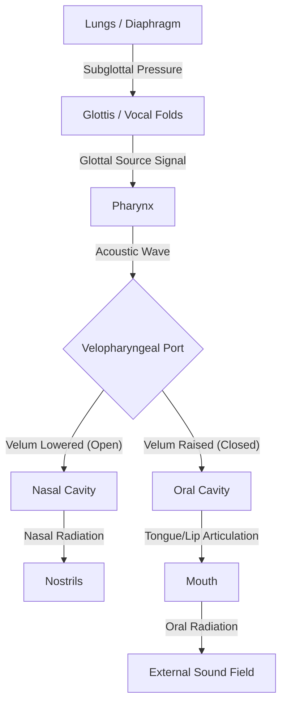

# Lesson 4: Repertoire and Style

## 1. First-Principles Intuition & Invariants

Vocal repertoire and stylistic choices are not merely artistic expressions; they are the result of precise acoustic configurations and physiological mechanics. Understanding vocal performance requires modeling the voice as a **source-filter system**. The lungs provide pneumatic power, the larynx acts as an oscillator generating a complex harmonic spectrum (the source), and the vocal tract acts as a variable resonator that spectrally shapes the sound (the filter). The fundamental frequency ($F_0$) determines pitch, while the resonant frequencies of the vocal tract (formants, $F_1, F_2, F_3$) dictate vowel intelligibility and timbre.

A fundamental invariant in vocal performance is the relationship between $F_0$ and the first formant ($F_1$). A vocalist modifies $F_1$ by altering jaw height and tongue position. When $F_0$ approaches or surpasses $F_1$—common in soprano repertoire at high pitches—acoustic impedance occurs, reducing vocal efficiency. To maintain acoustic power, the singer must "tune" $F_1$ to track $F_0$, often by opening the jaw wider, which alters the perceived vowel. This acoustic necessity is the architectural basis of vowel modification in classical repertoire.

Another critical invariant is vocal timbre, governed by the length and shape of the vocal tract. The vocal tract is essentially a quarter-wave resonator. Its length (approximately 17 cm in adults) determines the baseline spacing of formants. Vowel intelligibility relies on the relationship between $F_1$ (correlated with tongue height) and $F_2$ (correlated with tongue advancement). Stylistic timbres—from the "dark" quality of classical singing to the "bright" edge of contemporary belt—are achieved by modifying the tract's geometry to shift these formant frequencies, altering the spectral envelope of the radiated sound.

## 2. Core Architecture & Mechanics

The vocal mechanism operates through the **myoelastic-aerodynamic theory** of phonation. The vocal folds are brought into approximation (adduction) by the action of the laryngeal muscles. As subglottal pressure ($P_s$) builds below the closed glottis, it eventually overcomes the resistance of the folds, blowing them apart. The elastic recoil of the tissues, combined with the Bernoulli effect (a drop in pressure as air velocity increases), draws the folds back together, initiating a new cycle. This oscillation converts steady pulmonary airflow into an acoustic pulse train.

The articulatory system then filters this pulse train. The sound wave propagates through the pharynx, where the velopharyngeal port dictates whether the wave enters the nasal cavity, the oral cavity, or both. Constrictions at specific points along the vocal tract alter its acoustic impedance, shifting formant frequencies. For example, narrowing the aryepiglottic sphincter (twang) raises $F_2$, creating a brighter, more piercing sound that requires less $P_s$ to achieve high acoustic output. Conversely, lowering the larynx elongates the vocal tract, lowering all formants and producing a darker, "rounder" timbre typical of classical repertoire.



The distinction between classical and contemporary styles is largely architectural. Classical singers utilize a lowered larynx and a widened pharynx to create a distinct acoustic cluster known as the **singer's formant** (around 2.5–3.5 kHz). This cluster boosts acoustic energy in a frequency range where orchestral instruments are less active, allowing the voice to cut through a symphony without amplification. Contemporary styles, optimized for microphones, often employ a higher larynx and speech-like vowel modifications, prioritizing text intelligibility and emotional proximity over raw acoustic projection.

## 3. High-Performance Optimization & Failure Modes

The vocal system is susceptible to specific failure modes when acoustic efficiency is low. **Vocal strain (hyperfunction)** occurs when excessive tension in the extrinsic laryngeal muscles raises the larynx, shortening the vocal tract and raising formants. To compensate for the loss of acoustic efficiency, the singer instinctively increases $P_s$, which forces the vocal folds to collide with greater velocity. Over time, this high-impact collision causes tissue trauma, leading to edema or vocal nodules. Optimization requires maintaining a stable, neutral laryngeal posture to maximize vocal tract volume and leverage acoustic impedance efficiently.

**Breath support failure** is characterized by unregulated $P_s$. Without dynamic breath management (e.g., *appoggio*, a technique balancing inspiratory and expiratory muscles), the lungs deflate too rapidly, causing a burst of high pressure at the onset of phonation followed by a decay. This aerodynamic instability forces the vocal folds to compensate via increased muscular tension, leading to rapid vocal fatigue and pitch instability.

**Timbre degradation** often results from formant mismatch. In contemporary belting, singers often tune $F_1$ to track the second harmonic ($H_2$) of the $F_0$. If the singer maintains a speech-like tract configuration on ascending pitches, $F_1$ drops below $H_2$, causing a sudden loss of acoustic power and a "flip" into a breathier falsetto. Optimization requires the singer to continuously alter the tract shape (e.g., widening the jaw, narrowing the aryepiglottic sphincter) to maintain the $F_1/H_2$ acoustic coupling.

## 4. Computational Synthesis and Analysis

To rigorously understand vocal timbre, the voice can be modeled computationally using Linear Predictive Coding (LPC) or all-pole filtering. The following Python example synthesizes a vocal sound by generating a glottal pulse train (the source) and passing it through a cascade of resonant filters representing the vocal tract (the filter) for a specific vowel.

```python
import numpy as np
from scipy.signal import lfilter, freqz
import matplotlib.pyplot as plt

def formant_resonator_coeffs(freq: float, bw: float, fs: float) -> np.ndarray:
    """
    Calculates the denominator coefficients for a 2nd-order resonator (formant).
    """
    # Radius of the pole in the z-plane
    r = np.exp(-np.pi * bw / fs)
    # Angle of the pole
    theta = 2 * np.pi * freq / fs
    # Denominator polynomial: 1 - 2r*cos(theta)z^-1 + r^2z^-2
    a1 = -2 * r * np.cos(theta)
    a2 = r**2
    return np.array([1.0, a1, a2])

def synthesize_vowel(f0: float, formants: list[dict], fs: float, duration: float) -> np.ndarray:
    """
    Synthesizes a vowel sound using a source-filter model.
    """
    t = np.arange(int(fs * duration)) / fs
    # 1. Generate Source: Glottal Impulse Train
    source = np.zeros_like(t)
    pulse_interval = int(fs / f0)
    source[::pulse_interval] = 1.0
    
    # 2. Define Filter: Cascade resonators by multiplying polynomials
    a_total = np.array([1.0])
    for f in formants:
        a_current = formant_resonator_coeffs(f["freq"], f["bw"], fs)
        a_total = np.polymul(a_total, a_current)
    
    # 3. Apply the source-filter model
    output = lfilter([1.0], a_total, source)
    return output, a_total

if __name__ == "__main__":
    fs = 16000  # Sampling rate (Hz)
    f0 = 120    # Fundamental frequency (Hz) - Baritone pitch
    
    # Formants for vowel /a/ (ah) typical for an adult male
    vowel_formants = [
        {"freq": 730, "bw": 50},   # F1
        {"freq": 1090, "bw": 100}, # F2
        {"freq": 2440, "bw": 150}, # F3
    ]
    
    output, filter_coeffs = synthesize_vowel(f0, vowel_formants, fs, duration=1.0)
    
    # Analyze the frequency response of the vocal tract filter
    w, h = freqz([1.0], filter_coeffs, worN=2000, fs=fs)
    
    plt.figure(figsize=(10, 4))
    plt.plot(w / (2 * np.pi), 20 * np.log10(abs(h)))
    plt.title("Vocal Tract Frequency Response (Vowel /a/)")
    plt.xlabel("Frequency (Hz)")
    plt.ylabel("Gain (dB)")
    plt.ylim(-40, 10)
    plt.grid(True)
    plt.tight_layout()
    plt.show()
```

By manipulating the formant frequencies in the `vowel_formants` list, one can observe the precise acoustic changes that define different vowels and timbres. Increasing the frequencies of $F_1$ and $F_2$ while narrowing the bandwidths simulates the acoustic edge required for contemporary belt styles, while lowering the formants and widening the tract length simulates the classical *chiaroscuro* (light-dark) balance.
