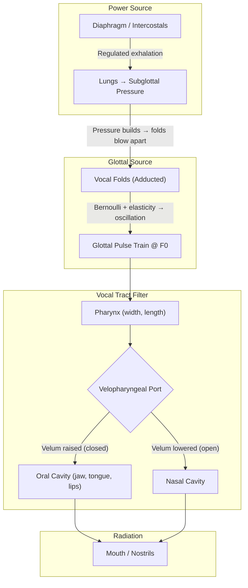
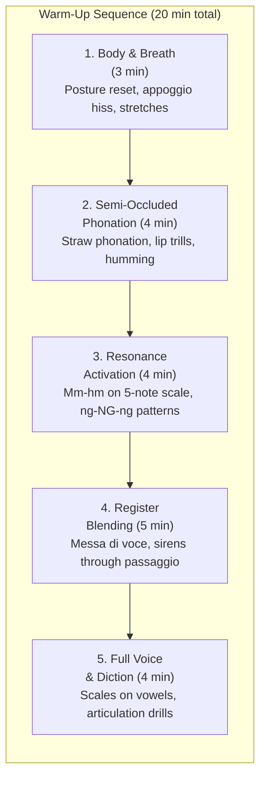

# Lesson 4: Vocal Repertoire, Style, and High-Performance Technique

## 1. First-Principles Intuition (The 15%)

Your voice is a **source-filter system**. The diaphragm and lungs provide pressurized airflow (the power source), the vocal folds at the larynx chop that airflow into a buzzing harmonic pulse train (the source signal), and the vocal tract — from the larynx up through the pharynx, oral cavity, and sometimes nasal cavity — acts as a continuously reshapeable resonator (the filter).

The key acoustic insight every singer needs: **you don't amplify your voice by pushing harder from below — you amplify it by shaping the resonator above**. The vocal tract has natural resonant peaks called **formants** (F1, F2, F3…). When a harmonic partial from the vocal fold buzz aligns with a formant peak, that frequency gets a free acoustic boost. When it doesn't align, it gets attenuated. Your job as a singer is to continuously sculpt your tract shape so the right harmonics land on the right formant peaks.

Three invariants that govern every style:

- **F1 tracks jaw/tongue height.** Open jaw → raised F1. Closed jaw → lowered F1.
- **F2 tracks tongue advancement.** Front vowels (ee, eh) → high F2. Back vowels (oo, oh) → low F2.
- **Larynx height shifts all formants simultaneously.** Raised larynx → shorter tract → all formants rise → brighter, edgier tone. Lowered larynx → longer tract → all formants drop → darker, rounder tone.

That's the entire acoustic architecture of vocal style in three bullets. Everything below is application.

---

## 2. The Vocal Mechanism: Architecture and Physical Mechanics

### 2.1 The Myoelastic-Aerodynamic Engine

The vocal folds adduct (close). Subglottal pressure builds beneath them. When pressure overcomes fold resistance, they blow apart. The Bernoulli effect — lower pressure at higher velocity — combined with tissue elasticity snaps them back together. This cycle repeats at your fundamental frequency (F0): ~100–150 Hz for bass voices, ~200–300 Hz for sopranos at middle pitches, up to 1000+ Hz in head voice extremes.



### 2.2 Vocal Registration: Chest, Head, Mix, and Falsetto

Registers are not mystical zones — they are distinct **vibratory patterns** of the vocal folds produced by different muscular configurations.

| Register | Dominant Muscle | Fold Contact | Sensation | Approx. Range (Tenor) |
|---|---|---|---|---|
| Chest / Modal | Thyroarytenoid (TA) | Full-length, thick closure | Chest vibration | C2–E4 |
| Mix / Middle | TA + CT balanced | Partial contact, thinning | Mask, nasal bridge | D4–G4 |
| Head Voice | Cricothyroid (CT) | Thin edge contact | Top of head, behind eyes | F4–C5+ |
| Falsetto | CT dominant | Incomplete closure, airy | Lightweight, breathy | Eb4–G5+ |

**The passaggio (break) is a biomechanical event.** As pitch rises, the CT muscle stretches the folds thinner. If the TA doesn't progressively release its hold, tension accumulates until the folds snap into a lighter vibratory pattern — the "crack." Training the mix register means teaching the TA and CT to negotiate a smooth, coordinated transition.

---

## 3. Physical Technique: Body Mechanics and Posture

Before you open your mouth, your body is already the instrument.

### 3.1 Alignment Check (Pre-Singing Setup)

Do this every practice session:

1. **Stand**: Feet shoulder-width apart. Knees soft (not locked). Weight balanced over the balls of your feet, not heels.
2. **Spine**: Imagine a thread pulling the crown of your head straight up. Elongate the neck. The chin is level — not jutting forward, not tucked down.
3. **Shoulders**: Roll them back and down. Tension here transmits directly into the larynx via extrinsic muscles and raises the larynx.
4. **Rib cage**: Take a low, slow breath and notice the lower ribs expanding outward. Hold that expansion as you sing. This is the beginning of *appoggio*.
5. **Jaw**: Unhinge it. The masseter muscles (cheek hinges) should be soft. Tension in the jaw squeezes the pharynx and kills resonance.

### 3.2 Appoggio: The Breath Management System

*Appoggio* (Italian: "to lean on") is the central breath technique of classical singing, and its principles apply equally to contemporary styles. The goal is **regulated subglottal pressure through controlled suspension**.

The mechanics:

- **Inspiratory hold**: After inhaling, the inspiratory muscles (diaphragm, external intercostals) remain actively engaged against the natural recoil of the lungs. This creates a buoyant upward support of the air column rather than a passive collapse.
- **Slow, metered release**: The breath depletes at a controlled rate. You should be able to sustain a pianissimo note on a single breath far longer than you'd expect.
- **Never squeeze from above**: Increased loudness comes from increased subglottal pressure from below, not from constriction in the throat.

**Drill — The Appoggio Hiss:**
1. Inhale low and wide (ribs expand, belly out, no shoulder lift).
2. Release on a sustained "SSSS" hiss.
3. Target: 20 seconds minimum, aiming for 30–40 seconds at a steady dynamic.
4. Feel: the lower abdominal wall and lower ribs remain expanded for the first 10 seconds before they gradually release. If your belly collapses immediately, you're not engaging *appoggio*.

---

## 4. The Four Core Vocal Styles: Mechanics and Technique

### 4.1 Classical Legato (Bel Canto)

**Acoustic goal**: Maximum resonance, voice projects over orchestra without amplification.

The classical instrument is built by:
- **Lowered larynx**: Elongates the tract, lowers all formants, produces the characteristic "dark" quality.
- **Widened pharynx**: Swallowing the yawn feeling. Not an actual yawn — just the beginning of one. This opens the oropharynx.
- **Singer's Formant cluster**: Around 2,500–3,500 Hz, the classical tract configuration creates a dense cluster of F3, F4, and F5 energy. Orchestras don't produce much energy here, so the voice cuts through acoustically without amplification.
- **Vowel modification on high pitches**: As F0 rises, singers open the jaw to raise F1 so it stays above F0 (keeping acoustic coupling). The vowel "ah" becomes "aw," "ee" becomes "eh" — these are not mistakes, they are acoustic necessity.

**Practice Drill — Messa di Voce (Dynamic Swell):**

Sing a sustained note at a comfortable middle pitch (around E4 for tenor, A3 for baritone). Start pianissimo, crescendo to fortissimo, decrescendo back to pianissimo, all on a single breath and single pitch.

```
Pitch:  [E4 sustained — 8 counts]
Dynamic: pp → mp → mf → f → ff → f → mf → mp → pp
Tempo:   MM = 60, one beat per dynamic level
```

This is the master diagnostic for breath control and fold coordination. If you crack going up, your TA/CT ratio is off. If you can't return to pianissimo, you're oversupporting from the throat.

### 4.2 Contemporary Belt

**Acoustic goal**: Speech-like power, forward projection, emotional immediacy through a microphone.

Belt is not shouting. It is a specifically trained application of chest-dominant registration extended above the natural passaggio with an elevated larynx and high F1 tuning.

The mechanics:
- **High larynx position**: Unlike classical, the larynx rises with pitch in belt. This shortens the tract and raises all formants, creating the characteristic "bright edge."
- **F1/H2 coupling**: The key acoustic event in belt. The singer tunes F1 to lock onto the second harmonic (H2 = 2 × F0) of the fundamental. This requires widening the jaw significantly on ascending pitches.
  - On A4 (440 Hz), H2 = 880 Hz. F1 must be tuned to ~880 Hz. This requires a wide-open jaw, nearly as if biting an apple.
- **AES narrowing (twang)**: Narrowing the aryepiglottic sphincter creates a bright, nasal edge. Practice by making a "nay-nay" or "quack" sound like a cartoon duck — that's the AES narrowing. Apply it to your belt vowels.
- **Firm TA engagement**: Chest register dominates. The folds remain thicker and in fuller contact than head voice.

**Warning signs that belt has become strain:**
- Throat tightness after 10 minutes of practice.
- Pitch going sharp on the approach to high notes.
- Recovery time (voice feels tired for more than 24 hours).

**Drill — The Belt Staircase:**

```
Pattern: Root → 3rd → 5th → Octave (C4–E4–G4–C5)
Vowel: "NAY" (AES narrowing engaged)
Tempo: MM = 72
Transposition: Move up by half-steps, C → C# → D → Eb → E → F
Stop the drill if: jaw tension, throat squeeze, or pitch sharpens involuntarily
```

### 4.3 Pop/R&B Style: Runs, Melisma, and Vocal Agility

Melisma is **not improvisation at speed** — it is precisely memorized fast-motion pitch articulation. Every professional R&B run is a rehearsed pattern, executed with the same muscle memory as a guitar scale.

**The anatomy of a vocal run:**

```
Pentatonic turn pattern (root position, A minor pentatonic):
A4 → G4 → E4 → D4 → A3  (descending, 5 notes)
Sung on a single syllable: "oh" or "yeah"
Tempo: MM = 60 (quarter = one note), then MM = 100, then MM = 140
```

**Drill — Pentatonic Agility Builder:**

Start at MM = 60. Each note is a full beat. Use a clear, light head-mix register. No scooping between pitches — target each pitch cleanly from directly below (slight aspiration onset, then immediate pitch lock).

```
Week 1: MM = 60 → 80, all notes deliberate, clean onset
Week 2: MM = 80 → 100, begin connecting notes with legato
Week 3: MM = 100 → 130, transition feels like one flowing gesture
Week 4: MM = 130 → 160+, the run becomes a single articulate gesture
```

**Common error**: Singing runs in pure chest voice at speed. The fold mass is too heavy to oscillate rapidly without strain. Runs live in a light, coordinated mix or head-adjacent registration.

### 4.4 Musical Theatre: Diction, Projection, and Style Hybridization

Musical theatre demands every discipline simultaneously: classical breath support, belt power, pop tone, and crystal-clear consonant diction to carry narrative text to a 1,500-seat house.

**The D-V-C Priority Stack:**

```
Diction → Vowels → Consonants
```

1. **Vowels carry tone.** Every note is sustained on its vowel. Consonants are lightning-fast interruptions, not sustained events.
2. **Consonants communicate text.** Exaggerate them 150% beyond conversational speech. The back row reads lips.
3. **Final consonants land ON the beat.** "Love" — the "v" closes on the beat, not after it.

**Diction Drill — The Consonant Isolation Exercise:**

Speak the lyric as an aggressive, overly articulated monologue first. Then sing it, maintaining that same consonant energy. Record both and compare.

---

## 5. Vocal Health, Warm-Up Architecture, and Practice Structure

### 5.1 The Warm-Up Sequence

A warm-up is not a performance — it is systematic tissue preparation. Work from low to high, soft to loud, easy coordination to complex.



**Why semi-occluded phonation first?** Straw phonation (blowing through a narrow straw while phonating) increases intraoral pressure, which creates a back-pressure on the vocal folds that reduces collision force. It warms the folds gently, with minimal impact stress.

### 5.2 High-Risk Failure Modes and Their Fixes

| Failure Mode | Symptom | Root Cause | Fix |
|---|---|---|---|
| Hyperfunction / Strain | Throat tightness, voice fatigues in 20 min | Extrinsic laryngeal tension, elevated larynx, over-pressurized subglottis | Yawn-sigh onset, lip trills, reduce dynamic level 25%, check posture |
| Passaggio Crack | Voice flips or cracks at a specific pitch | TA/CT coordination failure — abrupt register shift | Daily messa di voce; slow, sustained straw phonation through the break pitch |
| Pressed / Squeezed Tone | Strained, hard, airless sound | Vocal folds over-adducted; too much TA tension | Breathy onsets, then gradually firm; "huh" exercise; reduce breath pressure |
| Breathy / Weak Tone | Airy, lacks carrying power | Incomplete glottal closure; folds not adducting fully | "ng" onset exercises, staccato scales on "heh," sirens with intentional brightness |
| Pitch Instability / Wobble | Wide, uncontrolled vibrato or wavering pitch | Laryngeal instability + inconsistent breath pressure | Straight-tone exercises at MM = 60; strengthen appoggio with hiss sustains |
| Belt Blowout | Voice suddenly weakens mid-performance | F1/H2 decoupling; tract collapses on ascending line | Wider jaw on high notes; AES narrowing (twang); reduce intensity and rebuild |

### 5.3 Daily Practice Schedule Template

```
Monday / Wednesday / Friday — Technique Day (45 min)
  0:00–0:05  Alignment, breath reset, appoggio hiss
  0:05–0:12  Semi-occluded: straw phonation, lip trills (C3–C5 sirens)
  0:12–0:20  Legato scales on "mah, meh, mee, moh, moo" — focus on laryngeal stability
  0:20–0:32  Passaggio work: messa di voce, slow scales through break range
  0:32–0:45  Style drills: rotate through Classical / Belt / Mix exercises weekly

Tuesday / Thursday — Repertoire Day (45 min)
  0:00–0:10  Warm-up sequence (abbreviated)
  0:10–0:40  Song work: 2 pieces max, phrase-by-phrase technical drilling
  0:40–0:45  Cool-down: humming descending scales, slow deep breathing

Saturday — Integration Day (60 min)
  Full warm-up + run full repertoire pieces at performance energy
  Record one complete take for self-analysis

Sunday — Rest or Light Recovery
  Optional: gentle humming, breathing exercises only. No belting. No high notes.
```

---

## 6. Style Comparison and Repertoire Selection

### 6.1 Style vs. Vocal Mechanism Matrix


### 6.2 Repertoire Selection Criteria by Voice Type

Choosing repertoire that fits your current technical level protects your voice and builds it progressively. The rule of thumb: **75% of your repertoire should be comfortable and achievable today; 25% should be just above your current ceiling.**

**Baritone / Mezzo:**
- Entry level: Songs with top notes no higher than E4/F4 (baritone), G4/Ab4 (mezzo). Range of an octave + a fifth from the bottom.
- Development level: Push to G4/A4, requiring passaggio work.
- Performance level: Sustained phrases on Bb4/B4 with controlled dynamics.

**Tenor / Soprano:**
- Entry level: Top notes G4/A4 (tenor), G5/A5 (soprano). Range within the break zone is minimal.
- Development level: Sustained passages through the passaggio requiring mix/head transition.
- Performance level: High C (C5 tenor / C6 soprano) with consistent, clean head voice or operatic squillo.

**Red flags when selecting repertoire:**
- The highest note in the song requires maximum effort every single time you sing it. If you can't hit it at a soft dynamic, it's too high for current repertoire.
- The tessitura (average pitch density) sits consistently above your passaggio for more than 4–8 bars at a time without rest.
- The tempo requires agility (runs, ornaments) faster than your current technical ceiling.

---

## 7. Ear Training and Self-Analysis for Singers

### 7.1 Recording Your Practice: The Mandatory Feedback Loop

**Record every session.** The acoustic experience from inside your skull (bone conduction adds warmth and bass) is fundamentally different from what an audience hears. Your brain normalizes toward what you're used to, making self-correction impossible without external reference.

**What to listen for in playback:**

1. **Pitch**: Are you consistently flat approaching the passaggio? This indicates breath pressure dropping. Are you sharp on high belt notes? This indicates excess subglottal pressure and laryngeal elevation beyond F1/H2 coupling range.
2. **Consistency**: Does the tone quality shift noticeably between registers? The goal is a seamless gradient, not step-function changes.
3. **Diction**: Can you understand every word without prior knowledge of the lyric?
4. **Vibrato rate and width**: Normal vibrato is 5–7 oscillations per second (Hz), with a pitch excursion of roughly a semitone. Faster with smaller width indicates tension. Slower with wider width indicates breath support problems.

### 7.2 Interval and Melodic Ear Training Drills

Vocal ear training is inseparable from pitch accuracy. A singer who can't hear a minor third internally will never reliably land one in performance.

**Daily solfège drill — the ascending interval ladder:**

```
Day 1:  Perfect unisons and octaves — "do–do"
Day 2:  Perfect 5ths — "do–sol"
Day 3:  Perfect 4ths — "do–fa"
Day 4:  Major 3rds — "do–mi"
Day 5:  Minor 3rds — "do–me" (flat 3)
Day 6:  Major 2nds — "do–re"
Day 7:  Minor 2nds (half steps) — "do–ra" (flat 2)

Each day: Sing the interval ascending, then descending.
Sing it piano, then forte.
Sing it in three different octave positions.
```

---

## 8. Advanced Concepts: Vibrato, Ornamentation, and Extended Technique

### 8.1 Vibrato Mechanics

Vibrato is **not a stylistic decoration added on top of a note** — it is the natural result of a free, balanced phonation mechanism. When breath support is consistent, the larynx is free from extrinsic tension, and the resonance system is efficient, vibrato emerges automatically.

**Inducing vibrato (for singers who sing straight-tone):**

1. Place one hand flat on your sternum.
2. Sustain a comfortable middle pitch on "ah" for 8 seconds, straight tone.
3. At second 4, gently pulse the hand against the sternum 5–6 times per second, like a soft knock.
4. Notice the acoustic pulsation this creates in the voice.
5. Gradually internalize that pulsation into the breath support system without the hand assist.
6. Over weeks, the respiratory system learns to supply the oscillating pressure variation autonomously.

**Controlling vibrato width for style:**

- **Classical**: Wide vibrato (nearly a semitone) is standard and expected.
- **Early music / Baroque**: Narrow vibrato or ornamental vibrato (trillo) is stylistically appropriate.
- **Pop / contemporary**: Straight tone with vibrato only on sustained final notes ("vibrato blossoming") is the dominant aesthetic.
- **Musical theatre**: Hybrid — vibrato on legato lines, straight tone on belted phrases.

### 8.2 Classical Ornaments

**Trill**: Rapid alternation between two adjacent pitches (a half or whole step). Requires complete independence of the CT muscle to oscillate at 6–8 Hz while maintaining breath support.

**Trill drill:**
```
Start on D4 (comfortable mid-range for most voices).
Sing D4 → E4 as a slow shake (MM = 60, one pitch per beat).
Gradually accelerate: MM = 80 → 100 → 130 → until the motion blurs into a continuous oscillation.
```

**Appoggiatura**: A grace note approached from one step above or below, landing on the main note on the beat. It borrows time from the following note, not the note it embellishes.

**Portamento**: A deliberate glide between two pitches. Not an accident or a failure to hit the note cleanly — it is a controlled smear used for expression. Control it by sliding the larynx smoothly while maintaining resonance, not by wavering pitch aimlessly.

---

## 9. Computational Vocal Analysis (The 15% DSP Section)

Understanding what's happening acoustically in your voice can be tremendously useful — not to replace practice, but to verify what you're hearing and confirm technique adjustments are producing real acoustic changes. The tool of choice is a **spectrogram**.

### 9.1 Real-Time Spectrogram Analysis

Install Praat (free, cross-platform: https://www.praat.org) — the standard tool in vocal acoustics and speech pathology.

**How to use Praat for formant analysis:**

1. Open Praat → New → Record mono Sound → record yourself singing a sustained vowel.
2. Click View & Edit on the recorded sound.
3. In the editor: Spectrum menu → Show Spectrogram.
4. Formant menu → Show Formants → you will see red dots tracking F1 and F2 in real time.
5. Sing "ah" and watch F1 rise as you open your jaw wider. Sing "ee" and watch F2 rise as your tongue advances.

This is the closed-loop feedback system for formant tuning work. No amount of verbal description of "open your vowel space" beats watching your own F1 move in real time.

### 9.2 Source-Filter Model: What the Python Code Is Actually Showing

The original lesson's Python synthesis model is acoustically valid — but it belongs in a vocal acoustics graduate seminar, not in a singer's practice room. Here is what it means for your actual singing:

The model demonstrates that **changing formant frequencies (by reshaping your tract) has a larger effect on your perceived vowel and tone quality than changing how hard you push air**. The filter dominates the output spectrum. Practically:

- Raise F1 by 200 Hz (open your jaw more) → the vowel sounds more open, brighter, louder acoustically.
- Raise F2 by 300 Hz (advance your tongue) → the vowel shifts from "ah" toward "ae" (as in "cat").
- Lower all formants (drop the larynx, widen the pharynx) → the entire spectral envelope shifts down → darker, rounder, classical quality.

**You can achieve the same understanding experientially** by holding a hand mirror close to your mouth and singing "ah" vs. "ee" — watch the jaw open and close, watch the lip shape change. Those physical changes are the mechanical dial that moves the formant filter.

---

## Quick Reference: At-a-Glance Technique Summary

| Goal | Mechanical Action | Physical Sensation |
|---|---|---|
| More resonance / volume | Tune F1 to nearest harmonic partial; widen pharynx | Space behind the soft palate; "inside the head" |
| Darker, rounder tone | Lower larynx; widen pharynx; drop jaw | Beginning of a yawn; tongue root slightly forward |
| Brighter, edgier tone | Narrow AES (twang); raise larynx slightly | "Nay" quality; nasal buzz in mask |
| Access high notes cleanly | Thin the folds (increase CT / reduce TA); open jaw wider | Lightness; sensation moves higher in head |
| Increase power without strain | Increase subglottal pressure from below (appoggio) | Lower abs engage; ribs stay wide |
| Smooth the passaggio break | Coordinate TA/CT release; maintain breath flow | Messa di voce; keep the air moving through the break |
| Fix a wobbly vibrato | Stabilize laryngeal posture; regulate breath rate | Ground the support; less is more |
| Fix a pressed, squeezed tone | Release jaw; take a breath and restart with a breathy onset | Sigh into the note; let it be easy first |
