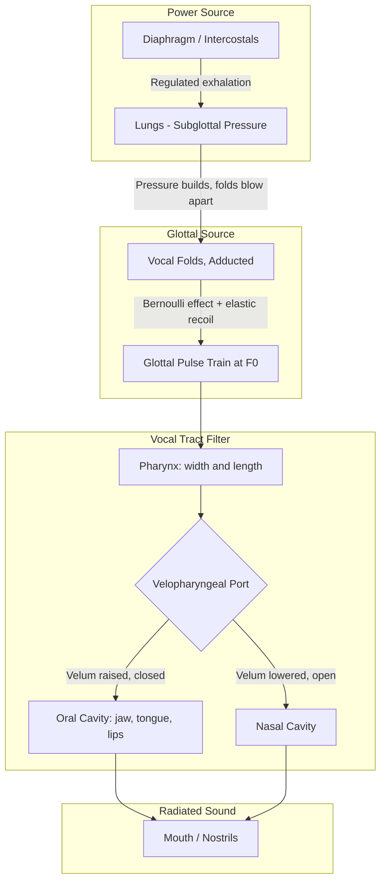
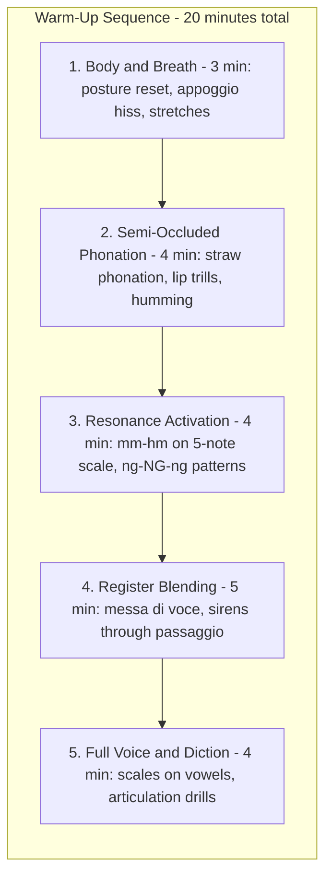

# Lesson 4: Vocal Repertoire, Style, and High-Performance Technique

## 1. First-Principles Intuition (Read Once, Apply Forever)

Your voice is a **source-filter system**. The diaphragm and rib muscles pressurize air (the power source). The vocal folds chop that airflow into a buzzing pulse train at your fundamental frequency, F0 (the source). The vocal tract — throat, mouth, and sometimes nose — reshapes that buzz acoustically (the filter).

The one insight that explains almost every technique in this lesson: **you don't get a bigger sound by blowing harder. You get it by reshaping the tract so the buzz resonates more efficiently.** The tract has natural resonant peaks called formants (F1, F2, F3...). When a harmonic of your pitch lines up with a formant, that frequency gets boosted for free. Singing well is continuously aiming your tract shape so the right harmonics land on the right formants.

Three rules cover 90% of style decisions:

- **F1 tracks jaw/tongue height.** Drop the jaw → F1 rises. Close the mouth → F1 falls.
- **F2 tracks tongue position front-to-back.** Front vowels ("ee," "eh") → high F2. Back vowels ("oo," "oh") → low F2.
- **Larynx height moves all formants together.** Raise the larynx → shorter tract → all formants rise → brighter, edgier tone. Lower the larynx → longer tract → all formants drop → darker, rounder tone.

Everything from here is how to put that into your throat, your breath, and your practice schedule.

---

## 2. The Vocal Mechanism: What's Actually Moving

### 2.1 How a Buzz Becomes a Pitch

Your vocal folds close. Air pressure builds underneath them (subglottal pressure). When pressure overcomes the folds' resistance, they blow apart; the Bernoulli effect (faster airflow = lower local pressure) combined with tissue elasticity snaps them shut again. Repeat, hundreds of times a second, and you get a tone. Typical speaking/singing F0 ranges: ~100–150 Hz for low bass, ~200–300 Hz for a soprano's middle voice, over 1000 Hz at the top of head voice extremes.



### 2.2 Registers: What They Actually Are

A "register" is not a mystical zone — it's a distinct vibratory pattern of the folds, driven by two muscles fighting for control: the **thyroarytenoid (TA)**, which shortens and thickens the folds for chest voice, and the **cricothyroid (CT)**, which stretches and thins them for head voice.

| Register | Dominant Muscle | Fold Contact | Where You Feel It | Approx. Range (Tenor) |
|---|---|---|---|---|
| Chest / Modal | TA | Full-length, thick closure | Chest, sternum buzz | C2–E4 |
| Mix / Middle | TA + CT balanced | Partial contact, thinning | Mask, nasal bridge | D4–G4 |
| Head Voice | CT | Thin edge contact | Top of head, behind eyes | F4–C5+ |
| Falsetto | CT dominant, incomplete closure | Airy, breathy | Light, floaty | Eb4–G5+ |

**The passaggio ("break") is TA and CT fighting over the same note.** As pitch climbs, CT stretches the folds thinner. If TA doesn't release its grip progressively, tension builds until the folds suddenly flip into a lighter pattern — the crack. Training your mix means training TA and CT to hand off control smoothly instead of fighting until one side loses.

---

## 3. Body Mechanics: The Instrument You Stand Inside

Before a single note comes out, your posture has already decided how good it's going to sound.

### 3.1 Alignment Check — Do This Every Session, No Exceptions

1. **Feet**: Shoulder-width, knees soft, weight on the balls of the feet, not the heels.
2. **Spine**: Imagine a string pulling the crown of your head straight up. Chin level — not jutting, not tucked.
3. **Shoulders**: Roll back and down. Shoulder tension transmits directly into the larynx through the strap muscles and raises it involuntarily. This is the #1 hidden cause of a tight, pinched tone.
4. **Ribs**: Inhale low and slow. Feel the lower ribs swing outward like bucket handles. Hold that width as you sing — this is the start of *appoggio*.
5. **Jaw**: Let it hang. Fingers on your masseter (the muscle bulge at the back of the jaw when you clench) should feel soft, not braced.

### 3.2 Appoggio: Breath Support Without Squeezing

*Appoggio* ("to lean on") means managing subglottal pressure by **suspending** the inhale, not by holding your breath or pushing from the belly.

The mechanics:
- **Inspiratory hold**: After inhaling, keep the inhale muscles (diaphragm, external intercostals) gently engaged against the lungs' natural urge to collapse. This gives the air column buoyant support from below instead of letting it fall and dump out.
- **Metered release**: Air leaves at a controlled, slow rate. A well-supported pianissimo should last far longer than feels "normal."
- **Loudness comes from below, not from the throat.** More volume = more subglottal pressure from the breath system, never a tighter throat.

**Drill — Appoggio Hiss**
1. Inhale low and wide: ribs expand, belly releases out, shoulders stay down.
2. Release on a steady "SSSS" hiss.
3. Target: 20 seconds minimum, working toward 30–40 seconds at a steady, unwavering hiss volume.
4. Checkpoint: your lower ribs and belly should stay expanded for the first 8–10 seconds before gradually, not suddenly, releasing. If your belly collapses the instant you start hissing, you're leaking air instead of suspending it — reset and try with less initial air pressure.

Metronome progression for breath capacity: start at MM = 60 (count the hiss in beats), aim to add 2 beats of sustain per week for a month.

---

## 4. The Four Core Vocal Styles

### 4.1 Classical Legato (Bel Canto)

**Goal**: Maximum resonance so the voice projects over an orchestra with zero amplification.

Built from:
- **Lowered larynx**: lengthens the tract, drops all formants, gives the dark, rounded "classical" color.
- **Widened pharynx**: the beginning of a yawn, not a full yawn. Opens the space behind the tongue.
- **Singer's formant** (2.5–3.5 kHz): this tract shape clusters F3, F4, F5 energy in a band orchestras barely produce, so the voice cuts through without a microphone.
- **Vowel modification on high notes**: as pitch rises, you open the jaw to raise F1 so it stays above F0. "Ah" drifts toward "aw," "ee" drifts toward "eh." This isn't sloppy diction — it's acoustically necessary to keep the formant above the pitch.

**Drill — Messa di Voce (Dynamic Swell)**

Sustain one comfortable middle pitch (E4 for tenor, A3 for baritone, A4 for soprano/mezzo). Crescendo from pianissimo to fortissimo and back, on one breath, one pitch.

```
Pitch:    [sustained — 8 counts]
Dynamic:  pp -> mp -> mf -> f -> ff -> f -> mf -> mp -> pp
Tempo:    MM = 60, one beat per dynamic step
```

Diagnostic reading: cracking on the crescendo = TA/CT imbalance, too much chest weight pushed too high. Can't get back down to pp without the tone dying = you're supporting from the throat, not the breath.

### 4.2 Contemporary Belt

**Goal**: Speech-like power and forward edge that reads as intense and personal through a mic.

Belt is not shouting — it's chest-dominant registration deliberately extended above the passaggio, with the larynx allowed to rise and F1 tuned up to meet it.

The mechanics:
- **Elevated larynx**: unlike classical, belt lets the larynx ride up with pitch. Shorter tract, higher formants, brighter edge.
- **F1/H2 coupling**: the signature move of belt. You tune F1 (by opening the jaw wide) to land on the second harmonic, H2 = 2 × F0. On A4 (440 Hz), H2 = 880 Hz, so F1 needs to open up to roughly 880 Hz — which takes a genuinely wide jaw, almost like biting a big apple.
- **AES narrowing (twang)**: narrowing the aryepiglottic sphincter (the ring of tissue above the vocal folds) adds brightness and carrying power without extra loudness. Practice it by making a cartoon duck "nyah" or nasal "nay" — that pinched, bright buzz is AES narrowing. Carry that setting into belted vowels.
- **Firm TA engagement**: chest register still dominates; folds stay thicker and more fully closed than in head voice.

**Warning signs it's become strain, not belt:**
- Throat tightness after 10 minutes.
- Pitch creeping sharp approaching a high note (sign of excess laryngeal elevation beyond what F1/H2 coupling needs).
- Voice still feels tired 24+ hours later.

**Drill — The Belt Staircase**
```
Pattern:        Root -> 3rd -> 5th -> Octave  (C4 - E4 - G4 - C5)
Vowel:          "NAY" (AES narrowing engaged)
Tempo:          MM = 72
Transposition:  move up by half-steps: C -> C# -> D -> Eb -> E -> F
Stop if:        jaw clenches, throat squeezes, or pitch sharpens involuntarily
```
Cap each session at 3–4 transpositions until the pattern feels free at every step. Adding range before the pattern is free just trains strain.

### 4.3 Pop/R&B Runs and Melisma

A professional vocal run is not improvised at speed — it's a memorized pattern executed with the same muscle memory as a scale on an instrument.

**Anatomy of a run (A minor pentatonic, descending):**
```
A4 -> G4 -> E4 -> D4 -> A3
Sung on one syllable: "oh" or "yeah"
```

**Drill — Pentatonic Agility Builder**

Light head-mix register, no scooping — attack each pitch cleanly from directly below with a slight aspirate onset, then lock the pitch immediately.

```
Week 1:  MM = 60 -> 80   every note deliberate, clean separate onset
Week 2:  MM = 80 -> 100  begin connecting notes legato
Week 3:  MM = 100 -> 130 the run starts to feel like one gesture
Week 4:  MM = 130 -> 160+ run executes as a single fluid motion
```

**Common error**: trying to run in full chest voice. The fold mass is too heavy to oscillate that fast without strain. Runs live in a light, coordinated mix or head-adjacent setting — lighten the registration before trying to speed it up.

### 4.4 Musical Theatre: Diction, Projection, Hybrid Style

Musical theatre stacks every other discipline — classical breath support, belt power, pop tone colors — onto crystal-clear text delivery for an unamplified or lightly-amplified 1,500-seat room.

**Priority stack: Diction → Vowels → Consonants**

1. **Vowels carry the tone.** Every sustained note lives on its vowel.
2. **Consonants carry the text.** Exaggerate them roughly 150% beyond normal speech — the back row reads lips as much as they hear you.
3. **Final consonants land ON the beat**, not after it. "Love" — the "v" closes exactly on the beat.

**Drill — Consonant Isolation**

Speak the lyric as an exaggerated, over-articulated monologue first. Then sing it while keeping that exact consonant energy. Record both and compare — most singers lose 80% of their consonant clarity the moment pitch gets involved, and this drill rebuilds it.

---

## 5. Warm-Up Architecture and Practice Structure

### 5.1 The Warm-Up Sequence

A warm-up is tissue preparation, not a performance. Work low to high, soft to loud, simple to complex.



**Why semi-occluded phonation first?** Blowing through a narrow straw while phonating (straw phonation) raises the air pressure inside your mouth, which pushes back gently on the vocal folds and reduces how hard they collide on each cycle. It's the lowest-impact way to get the folds moving at the start of a session.

### 5.2 Troubleshooting Table

| Failure Mode | Symptom | Root Cause | Fix |
|---|---|---|---|
| Hyperfunction / Strain | Throat tight, voice fatigues in 20 min | Extrinsic neck tension, raised larynx, over-pressurized subglottis | Yawn-sigh onsets, lip trills, drop dynamic 25%, recheck shoulder/posture |
| Passaggio crack | Voice flips or cracks at one specific pitch | TA/CT handoff failure, abrupt register shift | Daily messa di voce; slow straw phonation sustained through the break pitch |
| Pressed / squeezed tone | Hard, strained, airless sound | Folds over-adducted, excess TA tension | Breathy onset gradually firming; "huh" exercise; back off breath pressure |
| Breathy / weak tone | Airy, no carrying power | Incomplete glottal closure | "ng" onset exercises, staccato scales on "heh," brighter sirens |
| Pitch wobble | Wide or uncontrolled pitch wavering | Laryngeal instability + inconsistent breath pressure | Straight-tone sustains at MM = 60; strengthen appoggio with hiss sustains |
| Belt blowout | Voice suddenly weakens mid-phrase | F1/H2 decoupling, tract collapses on the ascent | Open the jaw wider on high notes, add AES twang, drop intensity and rebuild |

### 5.3 Weekly Practice Schedule

```
Mon / Wed / Fri — Technique Day (45 min)
  0:00-0:05  Alignment, breath reset, appoggio hiss
  0:05-0:12  Semi-occluded: straw phonation, lip trills (C3-C5 sirens)
  0:12-0:20  Legato scales on "mah, meh, mee, moh, moo" — laryngeal stability focus
  0:20-0:32  Passaggio work: messa di voce, slow scales through the break
  0:32-0:45  Style drills: rotate Classical / Belt / Mix weekly

Tue / Thu — Repertoire Day (45 min)
  0:00-0:10  Abbreviated warm-up
  0:10-0:40  Song work: max 2 pieces, phrase-by-phrase technical drilling
  0:40-0:45  Cool-down: descending humming scales, slow breathing

Sat — Integration Day (60 min)
  Full warm-up, then full repertoire pieces at performance energy.
  Record one complete take for self-analysis.

Sun — Rest or Light Recovery
  Optional gentle humming and breathing only. No belting, no high notes.
```

---

## 6. Style Comparison and Repertoire Selection

### 6.1 Style vs. Mechanism Map


### 6.2 Choosing Repertoire That Builds the Voice Instead of Wrecking It

Rule of thumb: **75% of your repertoire should be comfortably achievable today; 25% should sit just above your current ceiling.**

**Baritone / Mezzo**
- Entry level: top notes no higher than E4/F4 (baritone) or G4/Ab4 (mezzo); range of about an octave and a fifth.
- Development level: push to G4/A4, which means real passaggio work.
- Performance level: sustained phrases on Bb4/B4 with controlled dynamics, not just a loud top note.

**Tenor / Soprano**
- Entry level: top notes G4/A4 (tenor) or G5/A5 (soprano), minimal time spent in the break zone.
- Development level: sustained passages that cross the passaggio and require a real mix/head transition.
- Performance level: high C (C5 tenor, C6 soprano) sung with consistent clean head voice or squillo, not a one-shot shout.

**Red flags a song is wrong for you right now:**
- The highest note requires maximum effort every single time — if you can't sing it at a soft dynamic, it's too high for current repertoire.
- The tessitura (where most notes cluster) sits above your passaggio for more than 4–8 bars without a rest.
- The runs or ornaments are faster than your current agility ceiling (see §4.3's metronome progression).

---

## 7. Ear Training and Self-Analysis

### 7.1 Record Every Session — No Exceptions

What you hear inside your own skull (bone conduction adds warmth and bass you're not actually producing) is not what the audience hears. Your brain also normalizes to whatever you habitually do, which makes real-time self-correction nearly impossible. Recording is the only honest feedback loop.

**What to listen for in playback:**
1. **Pitch drift**: Flat approaching the passaggio usually means breath pressure dropping off. Sharp on belt high notes usually means excess laryngeal elevation beyond what F1/H2 coupling calls for.
2. **Register consistency**: tone quality should shift as a gradient across the range, not in visible steps.
3. **Diction**: can a stranger understand every word with no lyric sheet?
4. **Vibrato**: healthy vibrato runs 5–7 oscillations per second with roughly a semitone of pitch excursion. Faster and narrower reads as tense; slower and wider reads as under-supported.

### 7.2 Interval Ear Training — Daily Solfège Ladder

A singer who can't hear a minor third internally will never land one reliably on stage. Five minutes a day, every day.

```
Day 1:  Perfect unison and octave  — "do-do"
Day 2:  Perfect 5th                — "do-sol"
Day 3:  Perfect 4th                — "do-fa"
Day 4:  Major 3rd                  — "do-mi"
Day 5:  Minor 3rd                  — "do-me" (flat 3)
Day 6:  Major 2nd                  — "do-re"
Day 7:  Minor 2nd / half step      — "do-ra" (flat 2)

Each day: sing ascending, then descending.
Sing it piano, then forte.
Sing it starting from three different octave positions.
```

---

## 8. Vibrato, Ornaments, and Extended Technique

### 8.1 Vibrato Is a Byproduct, Not a Decoration

Vibrato isn't added on top of a note — it's what naturally happens when breath support is steady, the larynx is free of extrinsic tension, and the resonance system is efficient. If you're straight-toning everything by default, that's usually a tension story, not a stylistic choice.

**Drill — Inducing vibrato manually**
1. Place one hand flat on your sternum.
2. Sustain a comfortable middle pitch on "ah," straight tone, for 8 seconds.
3. At second 4, gently pulse your hand against the sternum 5–6 times per second, like a soft knock.
4. Feel the pulsation ripple into the tone.
5. Over several weeks, let the breath system take over that pulsation without the hand.

**Vibrato width by style:**
- **Classical**: wide vibrato (near a semitone) is standard and expected.
- **Early music / Baroque**: narrow or ornamental vibrato (trillo) is period-appropriate.
- **Pop / contemporary**: mostly straight tone, with vibrato "blossoming" only on held final notes.
- **Musical theatre**: hybrid — vibrato on legato lines, straight tone on belted phrases.

### 8.2 Classical Ornaments

**Trill**: rapid alternation between two adjacent pitches, a half or whole step apart. Requires the CT muscle to oscillate cleanly at 6–8 Hz while breath support stays rock steady underneath.

**Trill drill:**
```
Start on D4 (comfortable mid-range for most voices).
Sing D4 -> E4 as a slow shake: MM = 60, one pitch per beat.
Accelerate gradually: MM = 80 -> 100 -> 130, until the motion blurs into a continuous oscillation.
```

**Appoggiatura**: a grace note a step above or below the main note, landing on the beat and borrowing time from the note that follows, not the note it decorates.

**Portamento**: a deliberate glide between two pitches, controlled by sliding the larynx smoothly while keeping resonance consistent — not an uncontrolled slide or a missed pitch target.

---

## 9. Verifying Technique with a Spectrogram (Optional, 15% Theory Budget)

A spectrogram doesn't replace practice — it confirms that a technique change actually produced the acoustic change you intended, instead of just feeling different.

### 9.1 Using Praat for Formant Feedback

Praat is free, cross-platform, and the standard tool in vocal acoustics and speech pathology: https://www.praat.org

1. Open Praat → New → Record mono Sound → record yourself singing a sustained vowel.
2. Click **View & Edit** on the recording.
3. In the editor: **Spectrum menu → Show Spectrogram**.
4. **Formant menu → Show Formants** — red dots will track F1 and F2 live on the spectrogram.
5. Sing "ah" and watch F1 rise as you drop your jaw. Sing "ee" and watch F2 rise as your tongue advances. Sing "ah" with a lowered larynx and watch both formants drop together.

This turns "open your vowel space" from a vague verbal cue into something you can literally watch happen on screen.

### 9.2 What Formant Movement Means for Your Singing

The practical takeaway from the source-filter model: **reshaping your tract changes your tone and perceived loudness more than pushing more air does.** The filter dominates what you actually sound like.

- Raise F1 (open the jaw more) → the vowel sounds more open and acoustically louder, with no extra breath pressure.
- Raise F2 (advance the tongue) → the vowel color shifts from "ah" toward "ae," as in "cat."
- Lower all formants together (drop the larynx, widen the pharynx) → the whole tone darkens and rounds out — the classical sound.

You can feel this without any software: hold a hand mirror close to your mouth and sing "ah" then "ee." Watch the jaw drop and the lips spread. Those physical shapes are the dial that's actually moving your formants.

---

## Quick Reference: Technique-to-Sensation Map

| Goal | Mechanical Action | What It Should Feel Like |
|---|---|---|
| More resonance / volume | Tune F1 to the nearest strong harmonic; widen the pharynx | Open space behind the soft palate; "inside the head" |
| Darker, rounder tone | Lower the larynx; widen pharynx; drop the jaw | Beginning of a yawn |
| Brighter, edgier tone | Narrow the AES (twang); raise larynx slightly | "Nay" quality, buzz in the mask |
| Clean access to high notes | Thin the folds (more CT, less TA); open the jaw wider | Lightness, sensation rises higher in the head |
| More power without strain | Increase subglottal pressure via appoggio | Lower abs engaged, ribs stay wide, throat stays out of it |
| Smoother passaggio | Coordinate TA/CT handoff; keep breath flowing | Messa di voce feel — keep air moving through the break |
| Fix a wobbly vibrato | Stabilize laryngeal posture; regulate breath rate | Grounded support, less effort, not more |
| Fix a pressed, squeezed tone | Release the jaw; restart with a breathy onset | Sigh into the note, let it start easy |
