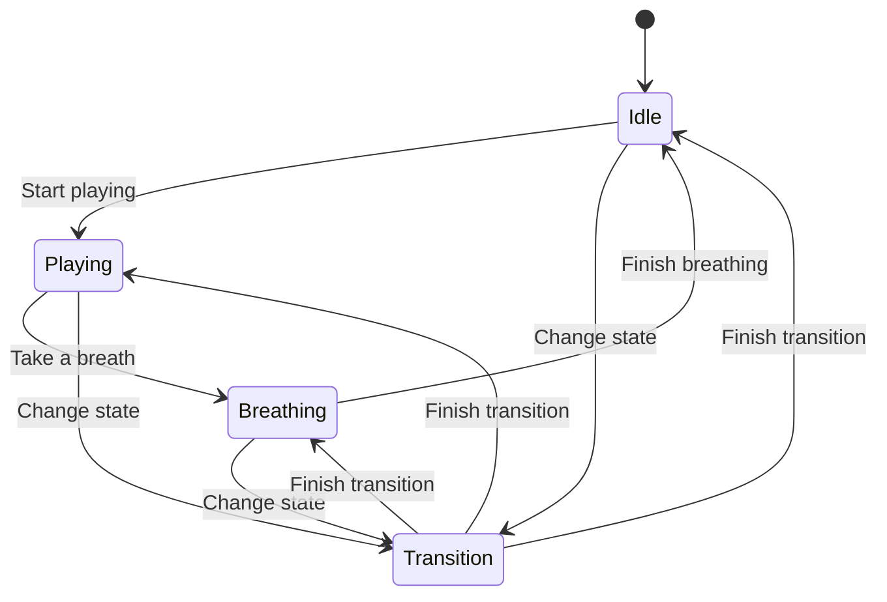

# Advanced Foundation: Woodwinds
## 1. Theoretical Invariants & Formal Frameworks
### Formal Proofs in Woodwind Acoustics
Formal proofs in woodwind acoustics involve rigorous mathematical analysis to establish the invariance of certain physical properties under various conditions. For instance, the relationship between the length of a reed and its fundamental frequency can be expressed as:
\[ f_0 = \frac{v}{2L} \]
where \( f_0 \) is the fundamental frequency, \( v \) is the speed of sound in air, and \( L \) is the effective length of the reed. This equation holds true regardless of the material properties of the reed, provided that the reed behaves as an idealized one-dimensional waveguide.

### Kernel or Physical Invariants
Physical invariants in woodwinds include the conservation of energy and momentum. For example, the total energy input into a woodwind instrument (blowing pressure and breath control) must equal the energy output (sound waves). This principle can be formalized using the conservation of energy equation:
\[ \Delta E_{\text{in}} = \Delta E_{\text{out}} \]
where \( \Delta E_{\text{in}} \) is the change in input energy and \( \Delta E_{\text{out}} \) is the change in output energy.

## 2. Low-Level Invariant Taxonomy
### Deep Registers
Deep registers in woodwinds are characterized by low frequencies and require precise control over embouchure and breath pressure. The low register of a clarinet, for example, is defined by the range from Bb2 to E3. The invariance in this context is the consistent production of these low frequencies across different playing techniques and embouchure settings.

### Memory Models
In the context of woodwinds, memory models can be analogized to the player's muscle memory and technique retention. A formal memory model for a woodwind player might include the following components:
- **State Representation:** The current state of the player's technique, including embouchure position, breath control, and finger placement.
- **Transition Function:** The rules governing how the player's technique changes in response to different playing conditions and exercises.
- **Output Function:** The sound produced by the instrument as a result of the player's technique.

### Hardware Constraints
Hardware constraints in woodwinds include the physical limitations of the instrument itself, such as the bore diameter, reed stiffness, and key mechanism. These constraints can be formalized using physical models, such as the wave equation for sound propagation in a cylindrical bore:
\[ \frac{\partial^2 p}{\partial t^2} = c^2 \nabla^2 p \]
where \( p \) is the acoustic pressure, \( t \) is time, and \( c \) is the speed of sound.

### Axiomatic Definitions
Axiomatic definitions in woodwinds include the fundamental principles that govern the behavior of the instrument and the player. For example, the principle of resonance can be defined as the tendency of a system to oscillate at a specific frequency when subjected to an external force. This principle is axiomatic in woodwind acoustics and forms the basis for understanding the behavior of the instrument.

## 3. Micro-Architecture & Concurrency Dynamics
### Mermaid and ASCII State Machines
State machines can be used to model the behavior of a woodwind player in response to different playing conditions. For example, a state machine for a clarinet player might include the following states:
- **Idle:** The player is not playing.
- **Playing:** The player is producing sound.
- **Breathing:** The player is taking a breath.
- **Transition:** The player is changing from one state to another.

The transitions between these states can be modeled using Mermaid or ASCII diagrams, as shown below:

### Cache and Race Condition Diagrams
Cache and race condition diagrams can be used to model the behavior of a woodwind player in response to different playing techniques and exercises. For example, a cache diagram for a clarinet player might include the following components:
- **Cache:** The player's muscle memory and technique retention.
- **Memory Access:** The player's ability to retrieve and apply stored techniques.
- **Cache Miss:** The player's inability to retrieve a stored technique and the need to relearn it.

Race condition diagrams can be used to model the behavior of a woodwind player in response to different playing conditions and exercises. For example, a race condition diagram for a clarinet player might include the following components:
- **Race Condition:** The player's ability to produce sound in response to different playing conditions and exercises.
- **Critical Section:** The player's ability to produce sound without interference from other playing conditions and exercises.
- **Mutex:** The player's ability to control access to the critical section.

## 4. Subtle Failure Modes & Boundary Conditions
### Subtle Failure Modes
Subtle failure modes in woodwinds include the production of unintended sounds or the failure to produce sound at all. For example, a clarinet player might produce a squeak or a buzz due to improper embouchure or breath control. These failure modes can be analyzed using formal models, such as the wave equation for sound propagation in a cylindrical bore:
\[ \frac{\partial^2 p}{\partial t^2} = c^2 \nabla^2 p \]
where \( p \) is the acoustic pressure, \( t \) is time, and \( c \) is the speed of sound.

### Boundary Conditions
Boundary conditions in woodwinds include the physical limitations of the instrument itself, such as the bore diameter, reed stiffness, and key mechanism. These boundary conditions can be formalized using physical models, such as the wave equation for sound propagation in a cylindrical bore:
\[ \frac{\partial^2 p}{\partial t^2} = c^2 \nabla^2 p \]
where \( p \) is the acoustic pressure, \( t \) is time, and \( c \) is the speed of sound.

## 5. Master Socratic Inquiries
### Research-Grade Discussion Questions
1. How can formal proofs be used to establish the invariance of certain physical properties in woodwind acoustics?
2. How can memory models be used to model the behavior of a woodwind player in response to different playing conditions and exercises?
3. How can state machines be used to model the behavior of a woodwind player in response to different playing conditions?
4. How can cache and race condition diagrams be used to model the behavior of a woodwind player in response to different playing techniques and exercises?
5. How can subtle failure modes and boundary conditions be analyzed using formal models and physical models?
