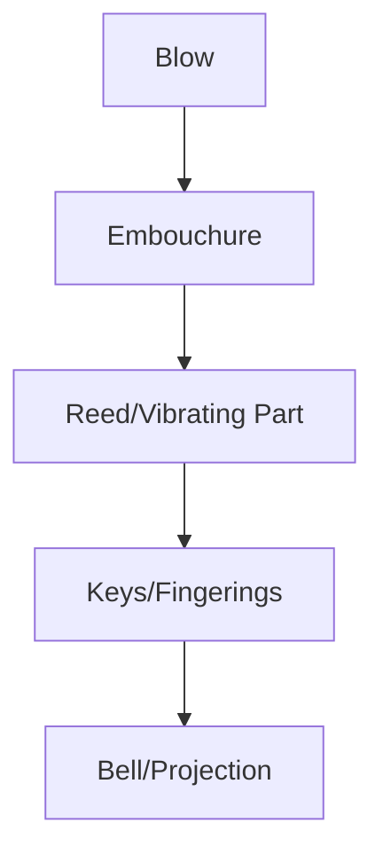

# Beginner Foundation: Woodwinds

## 1. Everyday Intuition & First Principles
Imagine woodwinds as a family of musical instruments that make sound by directing a stream of air through a tube. Just like how blowing through a straw can create a whistle, woodwinds use this principle to produce a wide range of melodies and harmonies. The air is controlled by the player's breath and fingers, much like how you control the flow of water when you squeeze a garden hose.

## 2. Foundational Vocabulary & Glossary
- **Reed:** A thin strip of material (usually cane or plastic) that vibrates when air passes through it, producing sound. Think of it as the voice of the instrument.
- **Embouchure:** The way the player's mouth is positioned and shaped to blow into the instrument. It's like the instrument's mouth.
- **Key:** A small, movable part on the instrument that opens or closes holes to change the pitch. Think of keys as the instrument's fingers.
- **Fingerings:** The specific combination of keys pressed to produce a particular note. It's like a secret code for each note.
- **Lip Plate:** A flat surface on the instrument that the player's lips rest on. It's like the instrument's cheek rest.
- **Bell:** The flared end of the instrument that projects the sound outward. Think of it as the instrument's speaker.

## 3. Visual System Flow
### ASCII Diagram
```
[Blow] --> [Embouchure] --> [Reed/Vibrating Part] --> [Keys/Fingerings] --> [Bell/Projection]
```

### Mermaid Flowchart


## 4. Common Beginner Misconceptions & Mental Traps
- **Misconception:** Woodwinds are difficult to play because they require a lot of breath control.
  - **Reality:** While breath control is important, it can be developed with practice. Start with simple breathing exercises and gradually increase complexity.
- **Misconception:** You need to have perfect finger dexterity to play woodwinds.
  - **Reality:** Finger dexterity can be improved over time. Focus on consistent practice and proper technique.
- **Misconception:** Woodwinds are only for advanced musicians.
  - **Reality:** Woodwinds are accessible to beginners. Start with simple songs and gradually progress to more complex pieces.

## 5. Socratic Discussion Starters
- What is the primary difference between a reed and a key on a woodwind instrument?
- How does the embouchure affect the sound produced by a woodwind?
- Can you describe the role of the bell in a woodwind instrument?
- What are some common breathing exercises for woodwind players?
- How do fingerings change the pitch of a note on a woodwind instrument?
