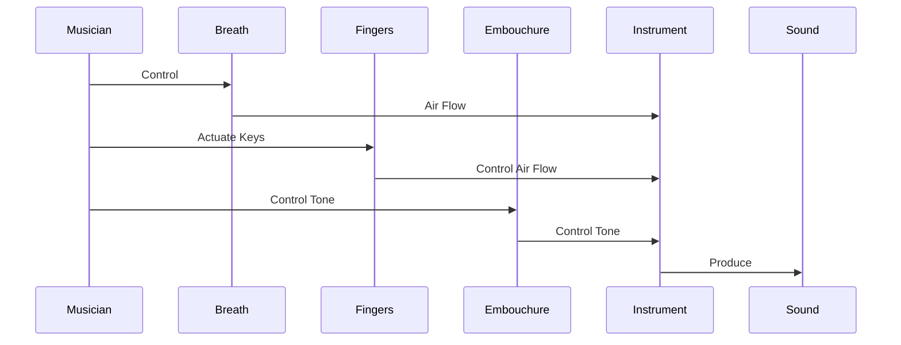

# Intermediate Foundation: Woodwinds
## 1. Architectural Mental Model
In the realm of woodwinds, the architectural mental model is akin to understanding the interplay between the instrument's design, the musician's technique, and the acoustics of the performance space. This model encompasses the physical structure of the instrument, the breath control, finger technique, and embouchure (the way the lips and facial muscles are positioned around the reed or mouthpiece).

### Key Components:
- **Instrument Design:** The design of a woodwind instrument determines its range, tone, and response. For example, the clarinet has a single reed and a cylindrical bore, which gives it a distinctive sound and requires specific fingerings and breath control techniques.
- **Breath Control:** Efficient breath control is crucial for producing consistent tone and dynamics. Techniques such as diaphragmatic breathing and breath support are essential for advanced playing.
- **Finger Technique:** Mastery of fingerings and finger movements is necessary for playing complex passages and techniques such as trills, glissandos, and multiphonics.
- **Embouchure:** The embouchure is the interface between the musician and the instrument. Proper embouchure technique ensures a consistent and controllable sound.

## 2. Systems Taxonomy & Component Protocols
The systems taxonomy for woodwinds includes a variety of instruments, each with its own set of protocols and data models. Here, we explore the standard interfaces and protocols that govern woodwind performance.

### Standard Interfaces:
- **Reed Interfaces:** Different woodwinds use different types of reeds (single, double, etc.). The reed is a critical component that interfaces with the breath and the instrument's body.
- **Key Mechanisms:** The keys on woodwinds are actuated by the fingers and control the flow of air through the instrument. Standard protocols for key mechanisms ensure consistent performance across different instruments.
- **Lip Interfaces:** The embouchure is the primary interface between the musician and the instrument. Standard protocols for embouchure technique ensure consistent tone and control.

### Data Models:
- **Fingering Charts:** Fingering charts are data models that map finger positions to specific notes and techniques. These charts are essential for learning and performing complex passages.
- **Breath Control Models:** Models that describe the relationship between breath control and sound production. These models help musicians understand how to produce consistent tone and dynamics.
- **Acoustic Models:** Models that describe the acoustics of the instrument and the performance space. These models help musicians understand how to produce the desired sound and how to adapt to different performance environments.

## 3. Multi-Component Interaction Flow
The interaction flow in woodwind performance involves the coordinated action of the musician's breath, fingers, and embouchure. Here, we explore the detailed interaction flow using ASCII and Mermaid sequence diagrams.

### ASCII Sequence Diagram:
```
Musician -> Breath: Control
Breath -> Instrument: Air Flow
Musician -> Fingers: Actuate Keys
Fingers -> Instrument: Control Air Flow
Musician -> Embouchure: Control Tone
Embouchure -> Instrument: Control Tone
Instrument -> Sound: Produce
```

### Mermaid Sequence Diagram:


## 4. Architectural Trade-offs & Production Pitfalls
In woodwind performance, there are several architectural trade-offs and production pitfalls that musicians must be aware of. Here, we explore some of the key trade-offs and pitfalls.

### Trade-offs:
- **Tone vs. Dynamics:** Producing a consistent tone and controlling dynamics can be a trade-off. Musicians must balance the need for a consistent tone with the need to produce dynamic variations.
- **Range vs. Tone:** The range of a woodwind instrument can affect its tone. Musicians must be aware of how the range of the instrument affects its tone and adjust their technique accordingly.
- **Breath Control vs. Finger Technique:** Efficient breath control and finger technique are both essential for advanced playing. Musicians must balance the need for efficient breath control with the need for precise finger technique.

### Pitfalls:
- **Poor Embouchure Technique:** Poor embouchure technique can lead to inconsistent tone and control. Musicians must be aware of the importance of proper embouchure technique and practice it regularly.
- **Inconsistent Breath Control:** Inconsistent breath control can lead to inconsistent tone and dynamics. Musicians must be aware of the importance of efficient breath control and practice it regularly.
- **Improper Fingering:** Improper fingering can lead to inconsistent tone and control. Musicians must be aware of the importance of proper fingering and practice it regularly.

## 5. Socratic Discussion Starters
Here are some questions that bridge the architecture of woodwind performance to low-level implementation:

- **How does the design of a woodwind instrument affect its sound and performance?**
- **What are the key components of efficient breath control, and how do they interact with the instrument?**
- **How does the embouchure interface between the musician and the instrument, and what are the key techniques for producing consistent tone and control?**
- **What are the trade-offs between tone and dynamics in woodwind performance, and how can musicians balance these trade-offs?**
- **How does the range of a woodwind instrument affect its tone, and what techniques can musicians use to adapt to different ranges?**
- **What are the key components of finger technique, and how do they interact with the instrument and the breath?**
- **What are the potential pitfalls of poor embouchure technique, inconsistent breath control, and improper fingering, and how can musicians avoid these pitfalls?**

By exploring these questions, musicians can deepen their understanding of the architecture of woodwind performance and improve their technical skills.
