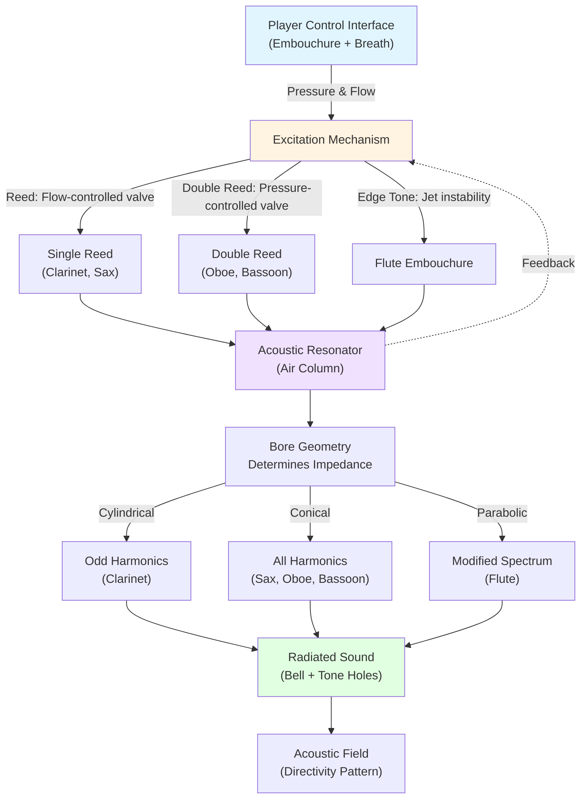
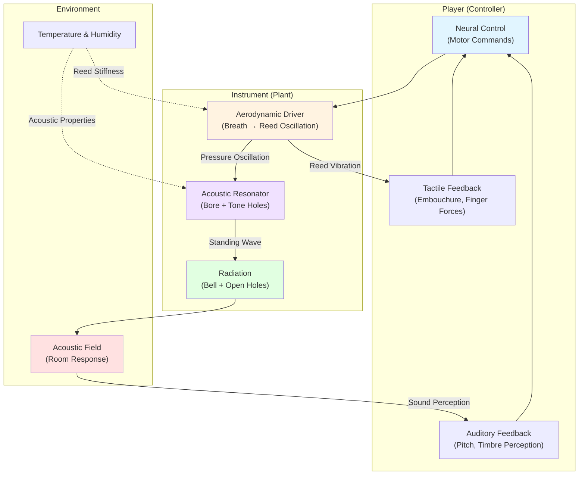

# Operational Verification Labs: Woodwind Aeroacoustics and Performance Systems

## Objective & Laboratory Configuration

This laboratory provides systematic operational verification of woodwind instrument systems through acoustical measurement, aerodynamic characterization, and psychoacoustic analysis. The curriculum integrates physical measurement techniques with computational modeling to establish quantitative relationships between player control parameters, aeroacoustic phenomena, and timbral outcomes. Students will develop empirical methodologies for assessing instrument response across the operational envelope, correlating subjective performance characteristics with objective physical measurements.

The woodwind family operates through coupled fluid-structure interactions: an airstream interacts with either a reed (single: clarinet, saxophone; double: oboe, bassoon) or an edge tone mechanism (flute family) to generate periodic pressure oscillations. These acoustic drivers couple with resonant air columns exhibiting frequency-dependent impedance characteristics determined by bore geometry and tone hole configurations. Understanding this system requires integrating aerodynamic fluid mechanics, structural vibration analysis, and acoustic wave propagation theory.

### Required Instrumentation, Software, and Laboratory Equipment

#### Physical Measurement Systems

- **Woodwind Instruments:** Professional-grade instruments representing each major family: Böhm-system flute (C foot), Boehm-system clarinet (Bb, cylindrical bore), Alto saxophone (Eb, conical bore), conservatory-system oboe (C, conical bore with narrow reed), Heckel-system bassoon (C, conical bore with wide reed)
- **Acoustic Measurement Equipment:**
  - Calibrated measurement microphone (flat frequency response 20 Hz–20 kHz, <1% THD): Earthworks M30 or equivalent
  - Professional audio interface with 24-bit/96 kHz minimum specification: RME Fireface UCX II or Focusrite Clarett 8PreX
  - Acoustic measurement software: REW (Room EQ Wizard), ARTA (Audio Response and Transmission Analysis)
  - SPL meter calibrated to IEC 61672-1 Class 1 standard
- **Aerodynamic Measurement:**
  - Differential pressure transducer (0–2 kPa range, <0.5% accuracy): Omega PX409 series
  - Hot-wire anemometer or mass airflow sensor for breath flow quantification
  - Oral cavity pressure measurement system (medical-grade transducer)
- **Mechanical Characterization:**
  - Reed vibration measurement: High-speed camera (>1000 fps) or laser Doppler vibrometer
  - Force measurement: Digital force gauge for keywork and pad sealing verification
  - Dimensional metrology: Digital calipers (0.01 mm resolution) for reed and mouthpiece geometry

#### Computational Analysis Environment

- **Digital Audio Workstation (DAW):** Reaper (professional license, extensible with ReaScript/Python), Ableton Live Suite (Max for Live integration), or Logic Pro X
- **Spectral Analysis Software:** 
  - PRAAT (phonetic sciences platform, formant extraction, spectral analysis)
  - Sonic Visualiser with Vamp plugin architecture
  - Custom Python analysis pipeline (librosa, scipy.signal, numpy/matplotlib)
- **Physical Modeling Simulators:**
  - Modartt Pianoteq (physical modeling engine adaptable for wind instruments)
  - IRCAM AudioSculpt (spectral domain analysis and resynthesis)
  - Open-source computational acoustic toolkits: Python Acoustics, PyTTa
- **Finite Element / Computational Fluid Dynamics (advanced):**
  - COMSOL Multiphysics (acoustics and CFD modules)
  - OpenFOAM (open-source CFD, fluid-structure interaction)

#### Calibration Standards and Reference Materials

- **Reference Tones:** Precision audio oscillator or software tone generator (THD <0.001%)
- **Acoustic Calibrator:** 94 dB / 114 dB dual-level calibrator (1 kHz reference tone)
- **Reed Quality Standards:** Standardized synthetic reeds (Légère, Forestone) for eliminating cane variability in controlled experiments
- **Environmental Monitoring:** Temperature (±0.1°C), relative humidity (±1%), barometric pressure sensors for compensating acoustic measurements

## Exercise 1: Aeroacoustic Fundamentals and Control Parameter Mapping

### Exercise 1a: Excitation Mechanisms and Impedance-Controlled Oscillation

**Theoretical Foundation:**

Woodwind sound generation relies on self-sustained oscillations arising from flow instabilities coupled to acoustic resonators. For reed instruments, the Bernoulli effect creates a negative pressure region as air accelerates through the constriction between reed and mouthpiece, closing the reed against the lay. This forms a relaxation oscillator: pressure builds in the oral cavity until it overcomes reed stiffness, allowing flow, which then reduces pressure through the Bernoulli effect, causing the reed to snap shut. The oscillation frequency is not determined by reed resonance but by the acoustic impedance of the air column, which selectively amplifies frequencies corresponding to standing wave modes.

The acoustic impedance Z(ω) for a cylindrical tube closed at one end (clarinet approximation) exhibits peaks at odd harmonics:

```
f_n = (2n - 1) * c / (4L)    where n = 1, 2, 3, ...
c = speed of sound ≈ 343 m/s at 20°C
L = effective acoustic length including end corrections
```

For conical bores (saxophone, oboe, bassoon), the impedance exhibits peaks at all harmonics similar to a stopped cylindrical pipe with effective length L/2:

```
f_n = n * c / (2L)    where n = 1, 2, 3, ...
```

The flute operates via edge tone mechanism: a planar jet from the embouchure hole impinges on the labium (sharp edge), creating alternating vortices that modulate flow into and out of the tube. This aerodynamic oscillation couples with acoustic modes through jet deflection feedback.

**Experimental Procedure:**

1. **Embouchure Formation and Characterization**

   Begin with a professional single-reed setup (Bb clarinet, Vandoren B45 mouthpiece, strength 3 reed). Position the reed on the table with 1–2 mm of mouthpiece tip visible beyond the reed tip. The facing curve should allow the reed to vibrate freely while maintaining sufficient damping to prevent squeaks.

   Establish oral cavity pressure measurement: Insert a thin catheter (medical-grade silicone tubing, 2 mm ID) through the corner of the embouchure, connected to the differential pressure transducer. Zero the transducer at atmospheric pressure. Form the embouchure with lower lip rolled over the bottom teeth, covering approximately 1/3 of the reed surface. Upper teeth rest directly on the mouthpiece top. Jaw position: slightly recessed to create approximately 5–10° angle of attack between reed and mouthpiece.

   Measure baseline parameters while playing a stable middle register note (written G/sounding F, concert pitch 349.23 Hz):
   - Oral cavity pressure: typical range 1–3 kPa for piano dynamic
   - Reed opening area: estimated from high-speed video or acoustic flow modeling
   - Attack transient characteristics: measure time from breath onset to stable oscillation

2. **Mapping Embouchure Parameters to Spectral Characteristics**

   Systematically vary embouchure parameters while maintaining constant fingering (written G):

   **Parameter Space:**
   
   | Parameter | Range | Measurement |
   |-----------|-------|-------------|
   | Lip pressure (lower lip force) | Light (1 N) → Heavy (5 N) | Force gauge calibration, then tactile reproduction |
   | Jaw position (vertical aperture) | Recessed (closed) → Forward (open) | ±3 mm displacement measured with video analysis |
   | Oral cavity volume | Small (tongue forward) → Large (tongue retracted) | Indirect measurement via impedance change |
   | Embouchure seal tightness | Loose (air leakage) → Tight | Measure air leakage with pressure decay test |

   For each parameter combination (minimum 5 levels per parameter, full factorial design yields 625 test conditions—select critical subset using Latin hypercube sampling), record:
   
   - 5-second steady-state tone at mezzo-forte dynamic
   - Position calibrated measurement microphone at 50 cm on-axis from bell
   - Simultaneously record oral pressure and acoustic output
   - Environmental compensation: record temperature, humidity, barometric pressure

3. **Spectral Analysis Protocol**

   Process recordings using the following Python analysis pipeline:

   ```python
   import numpy as np
   import librosa
   import scipy.signal as signal
   import matplotlib.pyplot as plt
   from scipy.interpolate import interp1d
   
   def analyze_woodwind_spectrum(audio_file, sr=96000):
       """
       Comprehensive spectral analysis for woodwind tones.
       
       Returns:
           dict: Spectral features including fundamental, harmonics, 
                 spectral centroid, inharmonicity, formant structure
       """
       # Load audio with high sample rate
       y, sr = librosa.load(audio_file, sr=sr)
       
       # Extract steady-state portion (middle 3 seconds, excluding attack/release)
       steady_start = int(1.0 * sr)
       steady_end = int(4.0 * sr)
       y_steady = y[steady_start:steady_end]
       
       # Fundamental frequency estimation using YIN algorithm
       f0 = librosa.yin(y_steady, fmin=80, fmax=800, sr=sr)
       f0_median = np.median(f0[f0 > 0])  # Exclude unvoiced frames
       f0_std = np.std(f0[f0 > 0])
       
       # FFT-based spectral analysis
       n_fft = 8192
       hop_length = n_fft // 4
       
       # Compute STFT
       D = librosa.stft(y_steady, n_fft=n_fft, hop_length=hop_length)
       S_db = librosa.amplitude_to_db(np.abs(D), ref=np.max)
       
       # Average spectrum across time
       S_avg = np.mean(np.abs(D), axis=1)
       freqs = librosa.fft_frequencies(sr=sr, n_fft=n_fft)
       
       # Harmonic analysis: extract peak amplitudes at expected harmonics
       harmonics = []
       harmonic_freqs = []
       n_harmonics = 10
       
       for h in range(1, n_harmonics + 1):
           target_freq = f0_median * h
           # Find peak within ±5% of expected harmonic frequency
           freq_range = target_freq * 0.05
           idx_range = np.where((freqs >= target_freq - freq_range) & 
                                (freqs <= target_freq + freq_range))[0]
           
           if len(idx_range) > 0:
               peak_idx = idx_range[np.argmax(S_avg[idx_range])]
               harmonics.append(S_avg[peak_idx])
               harmonic_freqs.append(freqs[peak_idx])
           else:
               harmonics.append(0)
               harmonic_freqs.append(target_freq)
       
       # Compute inharmonicity coefficient
       # Measure deviation of partials from ideal harmonic series
       inharmonicity = np.std([harmonic_freqs[i] / ((i+1) * f0_median) 
                               for i in range(len(harmonic_freqs))]) if len(harmonic_freqs) > 0 else 0
       
       # Spectral centroid (brightness)
       spectral_centroid = np.sum(freqs * S_avg) / np.sum(S_avg)
       
       # Spectral rolloff (frequency below which 85% of energy is contained)
       cumulative_energy = np.cumsum(S_avg**2)
       total_energy = cumulative_energy[-1]
       rolloff_idx = np.where(cumulative_energy >= 0.85 * total_energy)[0][0]
       spectral_rolloff = freqs[rolloff_idx]
       
       # Harmonic-to-noise ratio (HNR)
       # Compare energy in harmonic peaks vs. total energy
       harmonic_energy = np.sum([S_avg[int(freq / (sr/n_fft))]**2 
                                  for freq in harmonic_freqs if freq < sr/2])
       total_energy_linear = np.sum(S_avg**2)
       hnr = 10 * np.log10(harmonic_energy / (total_energy_linear - harmonic_energy + 1e-10))
       
       return {
           'f0_median': f0_median,
           'f0_std': f0_std,
           'harmonics': harmonics,
           'harmonic_freqs': harmonic_freqs,
           'inharmonicity': inharmonicity,
           'spectral_centroid': spectral_centroid,
           'spectral_rolloff': spectral_rolloff,
           'hnr': hnr,
           'spectrum': S_avg,
           'frequencies': freqs
       }
   
   def plot_spectral_comparison(results_dict, parameter_name):
       """
       Visualize how spectral characteristics change with parameter variation.
       
       Args:
           results_dict: {parameter_value: analysis_result}
           parameter_name: string describing the varied parameter
       """
       fig, axes = plt.subplots(2, 2, figsize=(14, 10))
       
       # Plot 1: Fundamental frequency stability
       param_values = sorted(results_dict.keys())
       f0_values = [results_dict[p]['f0_median'] for p in param_values]
       f0_stds = [results_dict[p]['f0_std'] for p in param_values]
       
       axes[0, 0].errorbar(param_values, f0_values, yerr=f0_stds, 
                           marker='o', capsize=5)
       axes[0, 0].set_xlabel(parameter_name)
       axes[0, 0].set_ylabel('Fundamental Frequency (Hz)')
       axes[0, 0].set_title('Pitch Stability vs. ' + parameter_name)
       axes[0, 0].grid(True, alpha=0.3)
       
       # Plot 2: Spectral centroid (brightness)
       centroids = [results_dict[p]['spectral_centroid'] for p in param_values]
       axes[0, 1].plot(param_values, centroids, marker='s', linewidth=2)
       axes[0, 1].set_xlabel(parameter_name)
       axes[0, 1].set_ylabel('Spectral Centroid (Hz)')
       axes[0, 1].set_title('Timbral Brightness vs. ' + parameter_name)
       axes[0, 1].grid(True, alpha=0.3)
       
       # Plot 3: Harmonic spectrum envelope
       for p in param_values:
           harmonic_levels_db = 20 * np.log10(
               np.array(results_dict[p]['harmonics'][:8]) / 
               results_dict[p]['harmonics'][0] + 1e-10
           )
           axes[1, 0].plot(range(1, 9), harmonic_levels_db, 
                          marker='o', label=f'{parameter_name}={p}')
       
       axes[1, 0].set_xlabel('Harmonic Number')
       axes[1, 0].set_ylabel('Relative Amplitude (dB)')
       axes[1, 0].set_title('Harmonic Structure')
       axes[1, 0].legend(fontsize=8)
       axes[1, 0].grid(True, alpha=0.3)
       
       # Plot 4: Harmonic-to-noise ratio
       hnr_values = [results_dict[p]['hnr'] for p in param_values]
       axes[1, 1].plot(param_values, hnr_values, marker='^', 
                      linewidth=2, color='darkred')
       axes[1, 1].set_xlabel(parameter_name)
       axes[1, 1].set_ylabel('HNR (dB)')
       axes[1, 1].set_title('Tone Purity vs. ' + parameter_name)
       axes[1, 1].grid(True, alpha=0.3)
       
       plt.tight_layout()
       plt.savefig(f'spectral_analysis_{parameter_name}.png', dpi=300)
       plt.show()
   ```

4. **Acoustic Impedance Visualization**

   The relationship between bore geometry and acoustic response can be visualized using a Mermaid diagram:



5. **Data Collection and Statistical Analysis**

   For each embouchure configuration, collect minimum 3 repetitions to assess measurement repeatability. Calculate:
   
   - Coefficient of variation (CV) for fundamental frequency: CV = (σ / μ) × 100%
   - Effect size (Cohen's d) for spectral centroid changes between conditions
   - Correlation coefficients between oral pressure and spectral parameters
   
   Expected results: Increased lip pressure typically raises spectral centroid (brighter tone) and improves pitch stability (lower f0_std). Excessive pressure degrades tone quality (reduced HNR) due to reed damping.

### Exercise 1b: Fingering Systems and Acoustic Length Modulation

**Theoretical Foundation:**

Woodwind pitch control operates by modulating the effective acoustic length of the resonator through opening tone holes or extending tubing sections. A simplified model treats each open tone hole as creating a pressure node (velocity antinode), causing the acoustic wave to radiate from that point rather than continuing to the bell. The effective length L_eff is approximately the distance from reed/embouchure to the first open tone hole, corrected for end effects.

The end correction δ for an open tone hole depends on hole geometry:

```
δ ≈ 0.6 * r    for an isolated hole
δ ≈ 0.85 * r   for holes with nearby closed holes (lattice correction)

where r = hole radius
```

For a cylindrical bore with radius R and tone hole radius r_h at distance L from the closed end:

```
L_eff = L + δ_hole + δ_bell

f = c / (4 * L_eff)    for clarinet (odd harmonics)
f = c / (2 * L_eff)    for conical instruments (all harmonics)
```

Tone hole cutoff frequency f_c determines efficiency of radiation:

```
f_c = c / (2π) * sqrt(S_h / (t_eff * V_hole))

where:
S_h = tone hole area
t_eff = effective thickness (wall + chimney + end correction)
V_hole = volume between tone hole and next closed hole
```

Below f_c, the hole behaves as a high-impedance shunt (poor radiator); above f_c, it acts as an effective open end.

**Experimental Procedure:**

1. **Dimensional Characterization of Fingering System**

   Document the physical dimensions of the instrument's bore and tone hole configuration:
   
   Using digital calipers (0.01 mm resolution):
   - Measure bore diameter at 10 cm intervals from mouthpiece to bell
   - Record tone hole diameters and locations (distance from mouthpiece)
   - Measure chimney heights for raised tone holes
   - Document pad sealing surfaces and key mechanisms
   
   Construct a bore profile visualization:

   ```python
   import numpy as np
   import matplotlib.pyplot as plt
   from scipy.interpolate import UnivariateSpline
   
   def plot_bore_profile(distances_cm, diameters_mm, instrument_name):
       """
       Visualize bore geometry and tone hole positions.
       
       Args:
           distances_cm: array of measurement positions from mouthpiece
           diameters_mm: bore diameter at each position
           instrument_name: string identifier
       """
       fig, ax = plt.subplots(figsize=(14, 6))
       
       # Interpolate bore profile
       spline = UnivariateSpline(distances_cm, diameters_mm, s=0.5)
       x_fine = np.linspace(0, max(distances_cm), 500)
       y_fine = spline(x_fine)
       
       # Plot bore profile (top and bottom)
       ax.fill_between(x_fine, -y_fine/2, y_fine/2, alpha=0.3, color='lightblue')
       ax.plot(x_fine, y_fine/2, 'b-', linewidth=2, label='Bore Profile')
       ax.plot(x_fine, -y_fine/2, 'b-', linewidth=2)
       
       # Add tone hole markers
       tone_hole_positions = [10.2, 15.7, 21.3, 26.8, 32.4, 37.9, 43.5, 49.0]
       tone_hole_diameters = [11.5, 11.8, 12.0, 12.2, 12.5, 12.8, 13.0, 13.5]
       
       for pos, diam in zip(tone_hole_positions, tone_hole_diameters):
           bore_diam_at_hole = spline(pos)
           ax.plot([pos, pos], [bore_diam_at_hole/2, bore_diam_at_hole/2 + 5], 
                  'r-', linewidth=3)
           ax.plot(pos, bore_diam_at_hole/2 + 5, 'ro', markersize=diam*0.8)
       
       ax.set_xlabel('Distance from Mouthpiece (cm)', fontsize=12)
       ax.set_ylabel('Bore Diameter (mm)', fontsize=12)
       ax.set_title(f'Bore Profile: {instrument_name}', fontsize=14, fontweight='bold')
       ax.grid(True, alpha=0.3)
       ax.legend()
       ax.set_aspect('equal')
       
       plt.tight_layout()
       plt.savefig(f'bore_profile_{instrument_name}.png', dpi=300)
       plt.show()
   
   # Example: Bb Clarinet measurements
   clarinet_distances = np.array([0, 10, 20, 30, 40, 50, 60])
   clarinet_diameters = np.array([15.0, 15.0, 15.0, 15.2, 24.0, 35.0, 52.0])
   plot_bore_profile(clarinet_distances, clarinet_diameters, 'Bb Clarinet')
   ```

2. **Systematic Fingering Validation**

   Test all standard fingerings across the instrument's range:
   
   **Protocol:**
   - Play each written note in chromatic sequence from lowest to highest
   - Hold each note for 5 seconds at mezzo-forte dynamic with constant embouchure
   - Record with calibrated microphone at 50 cm on-axis
   - Use digital tuner to verify pitch accuracy: record cents deviation from equal temperament
   
   **Data Structure:**

   | Written Note | Concert Pitch (Hz) | Measured f0 (Hz) | Deviation (cents) | Open Holes | Closed Holes | Register Key |
   |--------------|-------------------|------------------|-------------------|------------|--------------|--------------|
   | E3 (chalumeau) | 155.56 | 155.72 | +1.8 | 0-7 | All | Off |
   | F3 | 174.61 | 174.58 | -0.3 | 6-7 | 0-5 | Off |
   | F#3 | 185.00 | 185.11 | +1.0 | 5-7 | 0-4 | Off |
   | ... | ... | ... | ... | ... | ... | ... |
   
   Calculate:
   - Mean absolute deviation across all fingerings
   - Standard deviation of pitch accuracy (should be <10 cents for professional instruments)
   - Identify problematic fingerings requiring embouchure compensation

3. **Cross-Fingering and Alternate Fingering Analysis**

   Woodwind instruments employ cross-fingerings (closing lower holes while leaving upper holes open) to access chromatic notes not available in the diatonic fingering sequence. These create complex impedance conditions that modify pitch and timbre.
   
   **Procedure:**
   
   Select a single written pitch that has multiple fingering options (e.g., Bb4 on clarinet has 3+ fingerings). Record using:
   - Standard fingering
   - 1st alternate fingering
   - 2nd alternate fingering
   - Trill fingering (if applicable)
   
   For each fingering, measure:
   - Pitch accuracy (cents deviation)
   - Spectral centroid (timbral brightness)
   - Attack transient duration (time from breath onset to 90% of steady amplitude)
   - Dynamic range (softest and loudest sustainable tone)
   
   **Expected Observations:**
   
   Standard fingerings typically offer best intonation and timbral balance. Alternate fingerings may exhibit:
   - Sharp or flat tendency (±10–30 cents)
   - Altered harmonic balance (fork fingerings often emphasize odd harmonics)
   - Reduced dynamic range
   - Slower attack transients
   
   These compromises are accepted for technical advantages (trill speed, awkward interval facilitation).

4. **Acoustic Length Calculation and Validation**

   Use measured pitch data to back-calculate effective acoustic length and compare with physical measurements:

   ```python
   import numpy as np
   import pandas as pd
   
   def calculate_effective_length(f_measured, register='fundamental', bore_type='cylindrical'):
       """
       Calculate effective acoustic length from measured frequency.
       
       Args:
           f_measured: measured fundamental frequency (Hz)
           register: 'fundamental', 'second', or 'third' register
           bore_type: 'cylindrical' (clarinet) or 'conical' (others)
       
       Returns:
           float: effective acoustic length in meters
       """
       c = 343  # speed of sound in m/s at 20°C
       
       if bore_type == 'cylindrical':
           if register == 'fundamental':
               L_eff = c / (4 * f_measured)
           elif register == 'second':  # twelfth (3rd harmonic)
               L_eff = 3 * c / (4 * f_measured)
           elif register == 'third':  # 5th harmonic
               L_eff = 5 * c / (4 * f_measured)
       else:  # conical
           if register == 'fundamental':
               L_eff = c / (2 * f_measured)
           elif register == 'second':  # octave (2nd harmonic)
               L_eff = 2 * c / (2 * f_measured)
           elif register == 'third':  # 3rd harmonic
               L_eff = 3 * c / (2 * f_measured)
       
       return L_eff
   
   def analyze_fingering_system(fingering_data_csv):
       """
       Comprehensive analysis of fingering system accuracy and consistency.
       
       Args:
           fingering_data_csv: path to CSV with columns:
               note, concert_pitch_hz, measured_hz, physical_length_cm
       
       Returns:
           DataFrame with analysis results
       """
       df = pd.read_csv(fingering_data_csv)
       
       # Calculate effective acoustic length from measured pitch
       df['L_eff_m'] = df.apply(
           lambda row: calculate_effective_length(
               row['measured_hz'], 
               bore_type='cylindrical'  # adjust based on instrument
           ),
           axis=1
       )
       
       # Convert physical length to meters and calculate end correction
       df['L_physical_m'] = df['physical_length_cm'] / 100
       df['end_correction_cm'] = (df['L_eff_m'] - df['L_physical_m']) * 100
       
       # Calculate pitch deviation in cents
       df['cents_deviation'] = 1200 * np.log2(
           df['measured_hz'] / df['concert_pitch_hz']
       )
       
       # Statistical summary
       print("Fingering System Analysis Summary:")
       print(f"Mean absolute pitch error: {df['cents_deviation'].abs().mean():.2f} cents")
       print(f"Pitch error std dev: {df['cents_deviation'].std():.2f} cents")
       print(f"Mean end correction: {df['end_correction_cm'].mean():.2f} cm")
       print(f"End correction range: {df['end_correction_cm'].min():.2f} to {df['end_correction_cm'].max():.2f} cm")
       
       # Identify outliers (>15 cents deviation)
       outliers = df[df['cents_deviation'].abs() > 15]
       if len(outliers) > 0:
           print(f"\nProblematic fingerings (>15 cents deviation):")
           print(outliers[['note', 'cents_deviation']])
       
       return df
   ```

5. **Register Key and Overblowing Mechanism**

   Woodwind instruments access upper registers by opening a register key (speaker key, octave key) that creates a pressure node at a strategic location, favoring excitation of higher harmonics.
   
   **Clarinet register key (speaker key):**
   - Opens small hole at approximately 1/3 of tube length from mouthpiece
   - Creates pressure node favoring 3rd harmonic (clarinet overblows at twelfth: 3:1 frequency ratio)
   - Suppresses fundamental by disrupting standing wave pattern
   
   **Saxophone/oboe octave key:**
   - Opens hole at 1/2 tube length (or one of multiple keys at different positions)
   - Creates pressure node favoring 2nd harmonic (octave: 2:1 frequency ratio)
   
   **Procedure:**
   
   Select a fundamental register note (e.g., written G/concert F on Bb clarinet, 349.23 Hz). 
   
   Play and record:
   - Fundamental register (no register key): expect strong f0 at 349 Hz
   - Clarion register (register key depressed, same fingering): expect fundamental at 1047 Hz (3× original)
   
   Analyze spectral content:
   - Verify frequency ratio: should be very close to 3.000 for clarinet
   - Examine suppression of lower harmonic: fundamental register tone should have minimal 1047 Hz component
   - Compare timbral characteristics: clarion register typically has stronger higher harmonics due to bore cutoff effects
   
   Repeat for multiple fingerings across the range to verify consistent register key operation.

## Exercise 2: Aerodynamic Control Parameters and Psychoacoustic Correlates

### Exercise 2a: Dynamic Range and Breath Pressure Mapping

**Theoretical Foundation:**

Acoustic power output P_acoustic scales approximately with the square of driving pressure P_mouth for reed instruments:

```
P_acoustic ∝ P_mouth²

Sound Pressure Level (SPL):
SPL = 20 * log₁₀(P_rms / P_ref)    where P_ref = 20 μPa

Dynamic range (DR):
DR = SPL_max - SPL_min    (in dB)
```

Professional woodwind instruments typically exhibit dynamic ranges of 40–50 dB (pp to ff). The lower threshold is limited by oscillation startup conditions (minimum pressure to overcome reed damping and establish self-sustained oscillation). The upper threshold is constrained by nonlinear effects (reed closure, flow separation, embouchure strain).

The relationship between oral pressure and dynamic level is not linear perceptually. The decibel scale is logarithmic, matching human loudness perception (Fletcher-Munson curves). A 10 dB increase corresponds to approximately doubling perceived loudness.

**Experimental Procedure:**

1. **Breath Pressure Measurement System Calibration**

   Configure the differential pressure transducer:
   - Reference port: ambient atmospheric pressure
   - Measurement port: oral cavity via catheter (medical-grade silicone, 2 mm ID, 10 cm length)
   - Zero offset calibration: with catheter open to atmosphere, adjust to read 0 Pa
   - Span calibration: apply known pressure via calibration device (±1 kPa range)
   
   Establish measurement protocol:
   - Catheter insertion through corner of mouth, minimal obstruction of embouchure
   - Transducer mounted on stable surface, analog output connected to audio interface auxiliary input
   - Synchronize pressure recording with acoustic recording (common time base)

2. **Systematic Dynamic Level Mapping**

   Select a standard test note (written G / concert F on Bb clarinet, 349.23 Hz).
   
   **Procedure for each dynamic level:**
   
   - Establish embouchure and steady breath support
   - Target specific dynamic marking: ppp, pp, p, mp, mf, f, ff, fff
   - Record 5-second sustained tone
   - Simultaneously capture:
     - Acoustic signal (calibrated microphone at 1 m on-axis)
     - Oral cavity pressure (transducer analog output)
     - Reference tone (1 kHz, 94 dB SPL from calibrator for absolute level verification)
   
   Measure for each recording:
   - Mean oral pressure (Pa or kPa)
   - RMS sound pressure level at 1 m distance (dBA and dBC weighted)
   - Crest factor (peak/RMS ratio, indicates waveform clipping)
   - Spectral centroid and harmonic distribution
   
   **Analysis:**

   ```python
   import numpy as np
   import matplotlib.pyplot as plt
   from scipy import signal
   import soundfile as sf
   
   def calculate_spl(audio, sr, reference_spl=94.0, calibration_tone_rms=None):
       """
       Calculate absolute SPL from calibrated recording.
       
       Args:
           audio: audio signal array
           sr: sample rate
           reference_spl: SPL of calibration tone (dB)
           calibration_tone_rms: RMS amplitude of calibration tone in recording
       
       Returns:
           float: SPL in dB re 20 μPa
       """
       # Calculate RMS of audio signal
       audio_rms = np.sqrt(np.mean(audio**2))
       
       if calibration_tone_rms is not None:
           # Calculate relative level to calibration tone
           level_re_cal = 20 * np.log10(audio_rms / calibration_tone_rms)
           absolute_spl = reference_spl + level_re_cal
       else:
           # Assume full-scale digital corresponds to known SPL
           # (requires prior calibration of recording chain)
           absolute_spl = reference_spl + 20 * np.log10(audio_rms)
       
       return absolute_spl
   
   def analyze_dynamic_range(recordings_dict, pressure_dict):
       """
       Correlate breath pressure with acoustic output level.
       
       Args:
           recordings_dict: {dynamic_marking: audio_array}
           pressure_dict: {dynamic_marking: pressure_array_Pa}
       
       Returns:
           tuple: (pressure_values, spl_values, correlation_coefficient)
       """
       dynamics_order = ['ppp', 'pp', 'p', 'mp', 'mf', 'f', 'ff', 'fff']
       
       pressures = []
       spls = []
       
       for dyn in dynamics_order:
           if dyn in recordings_dict and dyn in pressure_dict:
               audio = recordings_dict[dyn]
               pressure = pressure_dict[dyn]
               
               # Calculate mean pressure (steady-state portion)
               p_mean = np.mean(pressure[int(len(pressure)*0.3):int(len(pressure)*0.7)])
               pressures.append(p_mean)
               
               # Calculate SPL (simplified, assumes pre-calibration)
               audio_steady = audio[int(len(audio)*0.3):int(len(audio)*0.7)]
               spl = 94 + 20 * np.log10(np.sqrt(np.mean(audio_steady**2)) / 0.1)  # example calibration
               spls.append(spl)
       
       # Fit power law relationship: SPL = a + b * log(P)
       pressures = np.array(pressures)
       spls = np.array(spls)
       
       log_p = np.log10(pressures + 1e-6)  # avoid log(0)
       coeffs = np.polyfit(log_p, spls, 1)
       
       # Calculate correlation
       correlation = np.corrcoef(log_p, spls)[0, 1]
       
       # Visualization
       fig, axes = plt.subplots(1, 2, figsize=(14, 5))
       
       # Plot 1: SPL vs. Pressure (log scale)
       axes[0].scatter(pressures, spls, s=100, alpha=0.7, color='darkblue')
       axes[0].set_xscale('log')
       axes[0].set_xlabel('Oral Cavity Pressure (Pa)', fontsize=12)
       axes[0].set_ylabel('SPL at 1 m (dB)', fontsize=12)
       axes[0].set_title('Dynamic Range: Pressure vs. Acoustic Output', fontsize=13, fontweight='bold')
       axes[0].grid(True, alpha=0.3, which='both')
       
       # Add fit line
       p_fit = np.logspace(np.log10(min(pressures)), np.log10(max(pressures)), 100)
       spl_fit = coeffs[0] * np.log10(p_fit) + coeffs[1]
       axes[0].plot(p_fit, spl_fit, 'r--', linewidth=2, 
                   label=f'Fit: SPL = {coeffs[0]:.1f}·log(P) + {coeffs[1]:.1f}')
       axes[0].legend()
       
       # Plot 2: Dynamic level labels
       for i, dyn in enumerate(dynamics_order[:len(pressures)]):
           axes[1].barh(i, spls[i], color='steelblue', alpha=0.7)
           axes[1].text(spls[i] + 1, i, f'{spls[i]:.1f} dB', va='center', fontsize=10)
       
       axes[1].set_yticks(range(len(dynamics_order[:len(pressures)])))
       axes[1].set_yticklabels(dynamics_order[:len(pressures)])
       axes[1].set_xlabel('SPL (dB)', fontsize=12)
       axes[1].set_title('Dynamic Range by Marking', fontsize=13, fontweight='bold')
       axes[1].grid(True, alpha=0.3, axis='x')
       
       plt.tight_layout()
       plt.savefig('dynamic_range_analysis.png', dpi=300)
       plt.show()
       
       print(f"Dynamic Range: {max(spls) - min(spls):.1f} dB")
       print(f"Pressure Range: {min(pressures):.0f} to {max(pressures):.0f} Pa")
       print(f"Correlation (log P vs SPL): r = {correlation:.3f}")
       
       return pressures, spls, correlation
   ```

3. **Spectral Evolution Across Dynamic Range**

   As dynamic level increases, spectral characteristics change due to nonlinear effects:
   
   - **Low dynamics (pp–p):** Fundamental dominant, fewer upper harmonics, often described as "pure" or "warm" tone
   - **Mid dynamics (mp–f):** Balanced harmonic spectrum, optimal timbre for most musical contexts
   - **High dynamics (ff–fff):** Enhanced upper harmonics due to reed nonlinearity and flow turbulence, described as "bright" or "intense"
   
   Quantify this relationship:

   ```python
   def analyze_spectral_evolution_by_dynamic(recordings_dict, sr=96000):
       """
       Track how harmonic content changes with dynamic level.
       """
       dynamics_order = ['ppp', 'pp', 'p', 'mp', 'mf', 'f', 'ff', 'fff']
       
       results = {
           'dynamic': [],
           'h1_h2_ratio_db': [],
           'spectral_centroid_hz': [],
           'even_odd_ratio_db': []
       }
       
       for dyn in dynamics_order:
           if dyn not in recordings_dict:
               continue
           
           audio = recordings_dict[dyn]
           audio_steady = audio[int(len(audio)*0.3):int(len(audio)*0.7)]
           
           # FFT analysis
           n_fft = 8192
           spectrum = np.abs(np.fft.rfft(audio_steady, n=n_fft))
           freqs = np.fft.rfftfreq(n_fft, 1/sr)
           
           # Estimate fundamental
           f0 = 349.23  # known test frequency
           bin_f0 = int(f0 * n_fft / sr)
           
           # Extract harmonic amplitudes
           h1 = spectrum[bin_f0]
           h2 = spectrum[bin_f0 * 2]
           h3 = spectrum[bin_f0 * 3]
           h4 = spectrum[bin_f0 * 4]
           
           # Calculate metrics
           h1_h2_ratio = 20 * np.log10(h1 / (h2 + 1e-10))
           
           # Even vs. odd harmonics (clarinet characteristic)
           odd_harmonics = h1 + h3  # + h5, h7, etc.
           even_harmonics = h2 + h4  # + h6, h8, etc.
           even_odd_ratio = 20 * np.log10(even_harmonics / (odd_harmonics + 1e-10))
           
           # Spectral centroid
           centroid = np.sum(freqs[:len(spectrum)] * spectrum) / (np.sum(spectrum) + 1e-10)
           
           results['dynamic'].append(dyn)
           results['h1_h2_ratio_db'].append(h1_h2_ratio)
           results['spectral_centroid_hz'].append(centroid)
           results['even_odd_ratio_db'].append(even_odd_ratio)
       
       # Visualization
       fig, axes = plt.subplots(1, 3, figsize=(16, 5))
       
       x_pos = range(len(results['dynamic']))
       
       axes[0].plot(x_pos, results['h1_h2_ratio_db'], marker='o', linewidth=2, markersize=8)
       axes[0].set_xticks(x_pos)
       axes[0].set_xticklabels(results['dynamic'])
       axes[0].set_ylabel('H1/H2 Ratio (dB)', fontsize=11)
       axes[0].set_title('Fundamental Dominance', fontsize=12, fontweight='bold')
       axes[0].grid(True, alpha=0.3)
       
       axes[1].plot(x_pos, results['spectral_centroid_hz'], marker='s', 
                   linewidth=2, markersize=8, color='darkgreen')
       axes[1].set_xticks(x_pos)
       axes[1].set_xticklabels(results['dynamic'])
       axes[1].set_ylabel('Spectral Centroid (Hz)', fontsize=11)
       axes[1].set_title('Timbral Brightness', fontsize=12, fontweight='bold')
       axes[1].grid(True, alpha=0.3)
       
       axes[2].plot(x_pos, results['even_odd_ratio_db'], marker='^', 
                   linewidth=2, markersize=8, color='darkred')
       axes[2].set_xticks(x_pos)
       axes[2].set_xticklabels(results['dynamic'])
       axes[2].set_ylabel('Even/Odd Harmonics (dB)', fontsize=11)
       axes[2].set_title('Spectral Balance', fontsize=12, fontweight='bold')
       axes[2].grid(True, alpha=0.3)
       
       plt.tight_layout()
       plt.savefig('spectral_evolution_dynamics.png', dpi=300)
       plt.show()
       
       return results
   ```

### Exercise 2b: Articulation Transients and Attack Characteristics

**Theoretical Foundation:**

Articulation refers to the manner of note initiation and termination. In woodwinds, the tongue acts as a valve controlling airflow to the reed or embouchure, creating attack transients that are critical for rhythmic definition and musical expression.

Attack transient characteristics:
- **Attack time (T_attack):** Duration from note onset to 90% of steady-state amplitude
- **Rise slope:** Rate of amplitude increase (dB/ms)
- **Spectral flux:** Rate of spectral change during attack
- **Centroid trajectory:** Evolution of spectral centroid from attack through steady state

Different articulation types produce distinct transient signatures:
- **Legato (slurred):** No tongue interruption, smooth amplitude and spectral transitions
- **Tenuto (sustained tongue):** Tongue releases reed gently, medium attack time (~50–100 ms)
- **Staccato (detached):** Tongue releases abruptly and quickly returns, short attack time (~20–50 ms), distinct release transient
- **Marcato (accented):** Strong tongue release with increased breath pressure, very fast attack (~10–30 ms), often with pressure "spike" preceding steady tone
- **Double/Triple Tonguing:** Alternating tongue positions (tu-ku or tu-ku-tu), enables rapid articulation beyond single-tongue speed limit

**Experimental Procedure:**

1. **Transient Capture and Characterization**

   Configure high-resolution recording:
   - Sample rate: 96 kHz minimum (48 kHz Nyquist allows capturing up to 24 kHz components in attack transients)
   - Bit depth: 24-bit (maintains dynamic range for capturing both quiet attacks and loud steady tones)
   - Buffer size: Minimal latency for synchronization with visual cues
   
   Record the following articulation sequence on a test note (written G / concert F):
   
   ```
   Pattern: G (whole note) with each articulation type:
   1. Legato slur from previous note
   2. Tenuto (standard attack)
   3. Staccato (short)
   4. Marcato (accented)
   5. Sforzando (loud accent then diminuendo)
   ```
   
   Repeat sequence 5 times to assess consistency.

2. **Attack Transient Extraction and Analysis**

   ```python
   import numpy as np
   import matplotlib.pyplot as plt
   from scipy import signal
   import librosa
   
   def extract_attack_transient(audio, sr, threshold_db=-40):
       """
       Isolate and characterize attack transient.
       
       Args:
           audio: full audio signal containing note attack
           sr: sample rate
           threshold_db: detection threshold relative to peak
       
       Returns:
           dict: attack characteristics
       """
       # Convert to dB scale
       envelope = np.abs(signal.hilbert(audio))
       envelope_db = 20 * np.log10(envelope / np.max(envelope) + 1e-10)
       
       # Detect attack onset (first point above threshold)
       onset_idx = np.where(envelope_db > threshold_db)[0][0]
       
       # Find 90% of steady-state amplitude
       steady_state_amp = np.median(envelope[int(len(envelope)*0.5):int(len(envelope)*0.9)])
       target_amp = 0.9 * steady_state_amp
       
       # Find when amplitude first exceeds 90% of steady state
       attack_end_idx = onset_idx + np.where(envelope[onset_idx:] > target_amp)[0][0]
       
       # Calculate attack time
       attack_time_ms = (attack_end_idx - onset_idx) / sr * 1000
       
       # Calculate rise slope
       attack_db_range = 20 * np.log10(target_amp / (envelope[onset_idx] + 1e-10))
       rise_slope_db_per_ms = attack_db_range / attack_time_ms
       
       # Extract attack segment for spectral analysis
       attack_segment = audio[onset_idx:attack_end_idx]
       
       # STFT of attack transient
       f, t, Zxx = signal.stft(attack_segment, fs=sr, nperseg=512, noverlap=256)
       
       # Calculate spectral centroid trajectory during attack
       magnitude = np.abs(Zxx)
       centroid_trajectory = np.sum(f[:, np.newaxis] * magnitude, axis=0) / (np.sum(magnitude, axis=0) + 1e-10)
       
       # Spectral flux (rate of spectral change)
       spectral_flux = np.sqrt(np.sum(np.diff(magnitude, axis=1)**2, axis=0))
       
       return {
           'attack_time_ms': attack_time_ms,
           'rise_slope_db_ms': rise_slope_db_per_ms,
           'onset_idx': onset_idx,
           'attack_end_idx': attack_end_idx,
           'envelope': envelope[onset_idx:attack_end_idx],
           'centroid_trajectory': centroid_trajectory,
           'spectral_flux': spectral_flux,
           'stft_freqs': f,
           'stft_times': t,
           'stft_magnitude': magnitude
       }
   
   def compare_articulations(recordings_dict, sr=96000):
       """
       Compare attack characteristics across articulation types.
       """
       articulation_types = ['legato', 'tenuto', 'staccato', 'marcato', 'sforzando']
       
       results = {}
       
       for artic in articulation_types:
           if artic in recordings_dict:
               audio = recordings_dict[artic]
               results[artic] = extract_attack_transient(audio, sr)
       
       # Visualization
       fig = plt.figure(figsize=(16, 10))
       gs = fig.add_gridspec(3, 2, hspace=0.3, wspace=0.3)
       
       # Plot 1: Attack envelopes comparison
       ax1 = fig.add_subplot(gs[0, :])
       for artic in articulation_types:
           if artic in results:
               envelope = results[artic]['envelope']
               time_ms = np.arange(len(envelope)) / sr * 1000
               ax1.plot(time_ms, 20 * np.log10(envelope / np.max(envelope) + 1e-10), 
                       label=artic.capitalize(), linewidth=2)
       
       ax1.set_xlabel('Time (ms)', fontsize=11)
       ax1.set_ylabel('Amplitude (dB re peak)', fontsize=11)
       ax1.set_title('Attack Envelope Comparison', fontsize=13, fontweight='bold')
       ax1.legend(fontsize=10)
       ax1.grid(True, alpha=0.3)
       ax1.set_xlim(0, 200)
       
       # Plot 2: Attack time comparison
       ax2 = fig.add_subplot(gs[1, 0])
       attack_times = [results[artic]['attack_time_ms'] for artic in articulation_types if artic in results]
       labels = [artic.capitalize() for artic in articulation_types if artic in results]
       ax2.barh(labels, attack_times, color='steelblue', alpha=0.7)
       ax2.set_xlabel('Attack Time (ms)', fontsize=11)
       ax2.set_title('Attack Duration', fontsize=12, fontweight='bold')
       ax2.grid(True, alpha=0.3, axis='x')
       
       # Plot 3: Rise slope comparison
       ax3 = fig.add_subplot(gs[1, 1])
       rise_slopes = [results[artic]['rise_slope_db_ms'] for artic in articulation_types if artic in results]
       ax3.barh(labels, rise_slopes, color='darkgreen', alpha=0.7)
       ax3.set_xlabel('Rise Slope (dB/ms)', fontsize=11)
       ax3.set_title('Attack Intensity', fontsize=12, fontweight='bold')
       ax3.grid(True, alpha=0.3, axis='x')
       
       # Plot 4: Spectral centroid trajectory (example: marcato)
       if 'marcato' in results:
           ax4 = fig.add_subplot(gs[2, 0])
           centroid = results['marcato']['centroid_trajectory']
           time_ms = np.arange(len(centroid)) / sr * 1000 * (512/4)  # adjust for STFT hop
           ax4.plot(time_ms, centroid, linewidth=2, color='darkred')
           ax4.set_xlabel('Time (ms)', fontsize=11)
           ax4.set_ylabel('Spectral Centroid (Hz)', fontsize=11)
           ax4.set_title('Spectral Evolution: Marcato Attack', fontsize=12, fontweight='bold')
           ax4.grid(True, alpha=0.3)
       
       # Plot 5: Spectrogram (example: staccato)
       if 'staccato' in results:
           ax5 = fig.add_subplot(gs[2, 1])
           stft_mag = results['staccato']['stft_magnitude']
           stft_freqs = results['staccato']['stft_freqs']
           stft_times = results['staccato']['stft_times']
           
           stft_db = 20 * np.log10(stft_mag / np.max(stft_mag) + 1e-10)
           im = ax5.pcolormesh(stft_times * 1000, stft_freqs, stft_db, 
                              shading='gouraud', cmap='magma', vmin=-60, vmax=0)
           ax5.set_xlabel('Time (ms)', fontsize=11)
           ax5.set_ylabel('Frequency (Hz)', fontsize=11)
           ax5.set_title('Attack Spectrogram: Staccato', fontsize=12, fontweight='bold')
           ax5.set_ylim(0, 5000)
           plt.colorbar(im, ax=ax5, label='Magnitude (dB)')
       
       plt.savefig('articulation_analysis.png', dpi=300)
       plt.show()
       
       return results
   ```

3. **Rapid Articulation and Tonguing Technique**

   Single-tonguing speed is physiologically limited to approximately 8–10 notes per second for most players. Double and triple tonguing techniques overcome this limit by alternating tongue positions.
   
   **Procedure:**
   
   Perform and record the following exercise on a single note (written G):
   
   ```
   Single tongue: T T T T T T T T (repeat 16 times)
   Tempo: Start at ♩=60, increase by 20 BPM increments to failure point
   
   Double tongue: TK TK TK TK (repeat 16 times) 
   Tempo: Start at ♩=60, increase by 20 BPM increments
   
   Triple tongue: TKT TKT TKT (repeat 12 times)
   Tempo: Start at ♩=60, increase by 20 BPM increments
   ```
   
   For each recording:
   - Extract individual note attacks using onset detection
   - Measure inter-onset interval (IOI) distribution
   - Calculate coefficient of variation: CV = σ(IOI) / μ(IOI)
   - Identify maximum tempo where CV < 15% (consistent articulation threshold)
   
   Expected results:
   - Single tongue maximum: ~180–240 BPM (3–4 Hz articulation rate)
   - Double tongue maximum: ~240–360 BPM (4–6 Hz effective rate)
   - Triple tongue: Similar to double tongue, useful for rhythmic patterns divisible by 3

## Exercise 3: Operational Envelope Testing and Failure Mode Analysis

### Exercise 3a: Component Integrity and Systematic Fault Injection

**Theoretical Foundation:**

Woodwind instrument performance depends on precision mechanical systems and consumable components. Systematic testing of degraded components reveals:
- Sensitivity to reed characteristics (stiffness, density, geometry)
- Effects of pad leakage on intonation and response
- Mouthpiece geometry effects on timbre and playability
- Environmental sensitivity (temperature, humidity effects on wood and reed)

Reed strength classification (e.g., Vandoren 2.5, 3.0, 3.5) relates to flexural stiffness:

```
EI = Young's modulus × Second moment of area

For a rectangular reed of width w and thickness t:
I = w * t³ / 12

Resonant frequency of cantilevered beam:
f_reed ≈ (1.875² / 2π) * sqrt(EI / (ρ A L⁴))

where:
ρ = density
A = cross-sectional area
L = vibrating length
```

Higher strength reeds have greater thickness t, increasing stiffness but requiring more pressure to oscillate. The interaction between reed resonance and air column resonance determines playability and tone color.

**Experimental Procedure:**

1. **Reed Characterization and Strength Testing**

   Obtain reeds spanning the strength range: 2.0, 2.5, 3.0, 3.5, 4.0 (or synthetic equivalents).
   
   For each reed, measure:
   - **Physical dimensions:** Thickness at tip (0.08–0.12 mm), heart (1.5–2.5 mm), and heel (3–4 mm) using micrometer
   - **Mass:** Digital balance (0.001 g resolution)
   - **Flexural stiffness:** Custom fixture or commercial reed testing device measuring deflection under known force
   
   **Static mechanical test:**
   
   Mount reed on mouthpiece and apply known forces at tip using calibrated force gauge:
   
   ```
   Force applied: 0.5 N, 1.0 N, 1.5 N, 2.0 N
   Measure deflection: Use laser displacement sensor or dial indicator
   Calculate stiffness: k = F / δ (N/mm)
   ```
   
   **Dynamic playing test:**
   
   Install each reed and play standardized test sequence:
   - Lowest note (chalumeau E): measure attack response, dynamic range
   - Middle register G: measure pitch stability, tone quality
   - Altissimo (third register, beyond written C6): measure ease of production, stability
   
   Record metrics:
   - Minimum pressure required for stable oscillation (P_threshold)
   - Dynamic range (dB)
   - Pitch accuracy across range (cents deviation)
   - Subjective response rating (1–10 scale: sluggish to responsive)

2. **Acoustic Analysis of Reed Strength Effects**

   ```python
   def analyze_reed_strength_effects(recordings_by_strength, sr=96000):
       """
       Compare spectral and temporal characteristics across reed strengths.
       
       Args:
           recordings_by_strength: {strength: {'low': audio, 'mid': audio, 'high': audio}}
       """
       strengths = sorted(recordings_by_strength.keys())
       registers = ['low', 'mid', 'high']
       
       results = {strength: {reg: {} for reg in registers} for strength in strengths}
       
       for strength in strengths:
           for register in registers:
               if register in recordings_by_strength[strength]:
                   audio = recordings_by_strength[strength][register]
                   
                   # Extract steady-state segment
                   audio_steady = audio[int(len(audio)*0.3):int(len(audio)*0.7)]
                   
                   # Fundamental frequency
                   f0 = librosa.yin(audio_steady, fmin=80, fmax=1500, sr=sr)
                   results[strength][register]['f0_mean'] = np.median(f0[f0 > 0])
                   results[strength][register]['f0_std'] = np.std(f0[f0 > 0])
                   
                   # Spectral centroid
                   centroid = librosa.feature.spectral_centroid(y=audio_steady, sr=sr)[0]
                   results[strength][register]['centroid_mean'] = np.mean(centroid)
                   
                   # HNR estimate
                   spectrum = np.abs(np.fft.rfft(audio_steady))
                   f0_bin = int(results[strength][register]['f0_mean'] * len(spectrum) * 2 / sr)
                   harmonic_energy = sum([spectrum[f0_bin * h]**2 for h in range(1, 8) if f0_bin * h < len(spectrum)])
                   total_energy = np.sum(spectrum**2)
                   results[strength][register]['hnr'] = 10 * np.log10(harmonic_energy / (total_energy - harmonic_energy + 1e-10))
       
       # Visualization
       fig, axes = plt.subplots(2, 3, figsize=(16, 10))
       
       for reg_idx, register in enumerate(registers):
           # Pitch stability
           f0_stds = [results[s][register]['f0_std'] for s in strengths if 'f0_std' in results[s][register]]
           axes[0, reg_idx].bar(range(len(f0_stds)), f0_stds, color='steelblue', alpha=0.7)
           axes[0, reg_idx].set_xticks(range(len(strengths)))
           axes[0, reg_idx].set_xticklabels([f'{s}' for s in strengths])
           axes[0, reg_idx].set_ylabel('F0 Std Dev (Hz)', fontsize=10)
           axes[0, reg_idx].set_title(f'{register.capitalize()} Register: Pitch Stability', fontsize=11, fontweight='bold')
           axes[0, reg_idx].grid(True, alpha=0.3, axis='y')
           
           # Tone quality (HNR)
           hnr_vals = [results[s][register]['hnr'] for s in strengths if 'hnr' in results[s][register]]
           axes[1, reg_idx].bar(range(len(hnr_vals)), hnr_vals, color='darkgreen', alpha=0.7)
           axes[1, reg_idx].set_xticks(range(len(strengths)))
           axes[1, reg_idx].set_xticklabels([f'{s}' for s in strengths])
           axes[1, reg_idx].set_xlabel('Reed Strength', fontsize=10)
           axes[1, reg_idx].set_ylabel('HNR (dB)', fontsize=10)
           axes[1, reg_idx].set_title(f'{register.capitalize()} Register: Tone Purity', fontsize=11, fontweight='bold')
           axes[1, reg_idx].grid(True, alpha=0.3, axis='y')
       
       plt.tight_layout()
       plt.savefig('reed_strength_analysis.png', dpi=300)
       plt.show()
       
       return results
   ```

3. **Mouthpiece Facing Curve and Chamber Volume Effects**

   Mouthpiece design parameters critically affect playability:
   - **Facing length:** Distance from tip to where reed contacts table (16–22 mm typical)
   - **Tip opening:** Gap between reed tip and mouthpiece tip (0.9–1.4 mm for clarinet)
   - **Chamber volume and shape:** Internal volume affects timbre and resistance
   
   **Procedure:**
   
   If multiple mouthpieces are available (different facings and chambers), perform comparative testing:
   
   | Mouthpiece | Facing Length | Tip Opening | Chamber | Subjective Character |
   |------------|---------------|-------------|---------|---------------------|
   | Vandoren B45 | 21.00 mm | 1.19 mm | Small | Focused, dark tone |
   | Vandoren M30 | 19.70 mm | 1.14 mm | Medium | Versatile, balanced |
   | Vandoren 5RV Lyre | 20.50 mm | 1.12 mm | Medium | Centered pitch, flexible |
   
   Record standardized test sequence with each mouthpiece (same reed strength):
   - Full range chromatic scale
   - Dynamic range test (ppp to fff)
   - Articulation test (legato, staccato, marcato)
   
   Measure:
   - Intonation consistency across range
   - Dynamic range capability
   - Attack transient characteristics
   - Spectral balance (centroid, harmonic distribution)

4. **Pad Leakage Simulation**

   Tone hole pads seal against the instrument body to isolate acoustic sections. Leakage degrades performance:
   - Sharp pitch tendency (leak shortens effective acoustic length)
   - Reduced dynamic range (acoustic energy escapes through leak)
   - Unstable oscillation (altered impedance affects reed coupling)
   
   **Controlled leak introduction:**
   
   - Select a key in the middle register (e.g., left hand index finger key)
   - Insert thin shim material (0.05 mm feeler gauge) under one edge of pad to create controlled leak
   - Progressive testing: 0.05 mm, 0.10 mm, 0.15 mm leak gaps
   
   For each leak condition, record:
   - Notes using that key (and all keys below)
   - Measure pitch deviation, dynamic range, attack response
   
   **Expected observations:**
   
   - Leak size below ~0.02 mm: Minimal effect (within manufacturing tolerances)
   - 0.05–0.10 mm: Noticeable pitch sharpness (+10–30 cents), reduced dynamic range
   - >0.15 mm: Severe degradation, notes may not speak or squeak

### Exercise 3b: Environmental Stress Testing and Performance Envelope Mapping

**Theoretical Foundation:**

Woodwind acoustics exhibit temperature and humidity sensitivity through multiple mechanisms:

**Speed of sound temperature dependence:**

```
c(T) = 331.3 + 0.606 * T    (m/s, T in °C)

Frequency scaling:
f(T) ∝ c(T)

ΔF/F ≈ Δc/c ≈ 0.001 * ΔT    (fractional change per °C)
```

For a note at 440 Hz:
- +10°C → +4.4 Hz (+18 cents)
- -10°C → -4.4 Hz (-18 cents)

**Humidity effects:**
- Reed stiffness: Cane reeds absorb moisture, reducing stiffness and lowering pitch
- Pad sealing: Excessive humidity causes pads to swell, potentially improving sealing but slowing key action
- Condensation: Water accumulation in tone holes and bore creates turbulence and pitch instability

**Procedure:**

1. **Temperature Sensitivity Mapping**

   Establish controlled temperature conditions:
   - Cold: 10–15°C (cold rehearsal space, outdoor performance)
   - Room temperature: 20–22°C (standard conditions)
   - Warm: 28–32°C (warm hall, extended playing warms instrument)
   
   **Measurement protocol:**
   
   Allow instrument to stabilize at test temperature for minimum 20 minutes. Use non-contact infrared thermometer to verify bore temperature.
   
   Record chromatic scale from lowest to highest note. Use digital tuner to measure pitch deviation from equal temperament at A440 reference.
   
   ```python
   def analyze_temperature_effects(recordings_by_temp, target_pitches_hz, sr=96000):
       """
       Quantify pitch drift with temperature change.
       
       Args:
           recordings_by_temp: {temperature_C: audio_chromatic_scale}
           target_pitches_hz: array of expected frequencies
       """
       temps = sorted(recordings_by_temp.keys())
       
       results = {temp: [] for temp in temps}
       
       for temp in temps:
           audio = recordings_by_temp[temp]
           
           # Segment audio into individual notes (assume 2-second notes)
           note_duration = 2.0
           n_notes = int(len(audio) / (note_duration * sr))
           
           for i in range(n_notes):
               start_idx = int((i + 0.3) * note_duration * sr)  # Skip attack
               end_idx = int((i + 0.8) * note_duration * sr)
               note_segment = audio[start_idx:end_idx]
               
               # Estimate F0
               f0 = librosa.yin(note_segment, fmin=80, fmax=1500, sr=sr)
               f0_median = np.median(f0[f0 > 0])
               
               # Calculate cents deviation
               if i < len(target_pitches_hz):
                   cents_dev = 1200 * np.log2(f0_median / target_pitches_hz[i])
                   results[temp].append(cents_dev)
       
       # Visualization
       fig, axes = plt.subplots(1, 2, figsize=(14, 5))
       
       # Plot 1: Pitch deviation by note and temperature
       for temp in temps:
           axes[0].plot(results[temp], marker='o', label=f'{temp}°C', alpha=0.7)
       
       axes[0].axhline(y=0, color='black', linestyle='--', linewidth=1)
       axes[0].set_xlabel('Note Number (Chromatic Scale)', fontsize=11)
       axes[0].set_ylabel('Pitch Deviation (cents)', fontsize=11)
       axes[0].set_title('Temperature Effect on Intonation', fontsize=13, fontweight='bold')
       axes[0].legend()
       axes[0].grid(True, alpha=0.3)
       
       # Plot 2: Mean deviation vs. temperature
       mean_devs = [np.mean(results[temp]) for temp in temps]
       axes[1].plot(temps, mean_devs, marker='s', linewidth=2, markersize=10, color='darkred')
       axes[1].set_xlabel('Temperature (°C)', fontsize=11)
       axes[1].set_ylabel('Mean Pitch Deviation (cents)', fontsize=11)
       axes[1].set_title('Overall Pitch Shift with Temperature', fontsize=13, fontweight='bold')
       axes[1].grid(True, alpha=0.3)
       
       # Linear fit
       coeffs = np.polyfit(temps, mean_devs, 1)
       temp_fit = np.linspace(min(temps), max(temps), 100)
       dev_fit = coeffs[0] * temp_fit + coeffs[1]
       axes[1].plot(temp_fit, dev_fit, 'b--', linewidth=1.5, 
                   label=f'Slope: {coeffs[0]:.2f} cents/°C')
       axes[1].legend()
       
       plt.tight_layout()
       plt.savefig('temperature_sensitivity.png', dpi=300)
       plt.show()
       
       print(f"Pitch sensitivity: {coeffs[0]:.2f} cents per °C")
       print(f"Expected from theory: ~1.7 cents per °C")
       
       return results
   ```

2. **Extended Performance Endurance Testing**

   Long performance sessions create physiological and mechanical stress:
   - Embouchure fatigue: Reduced precision, pitch instability
   - Reed saturation: Moisture absorption changes reed response
   - Condensation buildup: Water in tone holes affects acoustics
   
   **Procedure:**
   
   Perform continuous playing for 30 minutes:
   - Alternate between melodic passages (moderate dynamics) and technical exercises (varying articulation)
   - Record standardized test sequence every 5 minutes:
     - Middle register G (written), 10-second sustained tone
     - Chromatic scale, one octave
     - Rapid articulation exercise
   
   Measure temporal evolution of:
   - Pitch stability (F0 standard deviation)
   - Tone quality (HNR)
   - Attack response time
   - Embouchure pressure (if instrumented)
   
   Expected observations:
   - First 10 minutes: "Warm-up" phase, improving stability
   - 10–20 minutes: Optimal performance
   - Beyond 20 minutes: Gradual degradation (embouchure fatigue, reed saturation)

3. **Extreme Range Testing: Altissimo Register**

   The altissimo register (above written C6 for clarinet) requires advanced technique:
   - Increased oral pressure
   - Precise voicing (oral cavity shaping)
   - Specialized fingerings combining register key with partial venting
   
   **Procedure:**
   
   Attempt to produce and sustain notes in the altissimo range:
   - Written C#6 (concert Bb5, 932 Hz)
   - Written D6 (concert C6, 1047 Hz)
   - Written Eb6, E6, F6, etc., to maximum achievable pitch
   
   For each successfully produced note:
   - Measure fundamental frequency and verify harmonic structure
   - Record oral cavity pressure
   - Assess stability: Can the note be sustained for 5 seconds?
   - Measure dynamic range: Can the note be played softly?
   
   Document "failure modes":
   - Pitch instability (wavering)
   - Squeak (sudden jump to unintended pitch)
   - Inability to initiate oscillation
   - Uncontrolled dynamic (only loud production possible)

4. **Multi-Register Intonation Mapping**

   Create comprehensive intonation map across all registers:

   ```python
   def create_intonation_map(instrument_name, fingering_data_csv):
       """
       Generate visual intonation map showing pitch deviations across range.
       
       Args:
           instrument_name: string identifier
           fingering_data_csv: CSV with columns: note, register, measured_hz, target_hz
       """
       import pandas as pd
       
       df = pd.read_csv(fingering_data_csv)
       
       # Calculate cents deviation
       df['cents'] = 1200 * np.log2(df['measured_hz'] / df['target_hz'])
       
       # Group by register
       registers = df['register'].unique()
       
       fig, ax = plt.subplots(figsize=(16, 6))
       
       colors = {'chalumeau': 'blue', 'clarion': 'green', 'altissimo': 'red'}
       
       for register in registers:
           reg_data = df[df['register'] == register]
           ax.scatter(reg_data.index, reg_data['cents'], 
                     label=register.capitalize(), 
                     color=colors.get(register, 'gray'),
                     s=100, alpha=0.7, edgecolors='black', linewidth=0.5)
       
       # Add reference lines
       ax.axhline(y=0, color='black', linestyle='-', linewidth=1.5, label='Perfect Tune')
       ax.axhline(y=10, color='orange', linestyle='--', linewidth=1, alpha=0.5)
       ax.axhline(y=-10, color='orange', linestyle='--', linewidth=1, alpha=0.5)
       ax.fill_between(range(len(df)), -10, 10, color='green', alpha=0.1, label='Acceptable Range (±10¢)')
       
       ax.set_xlabel('Note (Chromatic Sequence)', fontsize=12)
       ax.set_ylabel('Pitch Deviation (cents)', fontsize=12)
       ax.set_title(f'Intonation Map: {instrument_name}', fontsize=14, fontweight='bold')
       ax.set_ylim(-50, 50)
       ax.legend(fontsize=10, loc='upper left')
       ax.grid(True, alpha=0.3, axis='y')
       
       # Annotate problem notes (>20 cents deviation)
       problem_notes = df[df['cents'].abs() > 20]
       for idx, row in problem_notes.iterrows():
           ax.annotate(row['note'], 
                      xy=(idx, row['cents']),
                      xytext=(idx, row['cents'] + 5),
                      fontsize=8, color='red',
                      ha='center')
       
       plt.tight_layout()
       plt.savefig(f'intonation_map_{instrument_name}.png', dpi=300)
       plt.show()
       
       # Statistical summary
       print(f"\nIntonation Statistics for {instrument_name}:")
       print(f"Mean absolute deviation: {df['cents'].abs().mean():.2f} cents")
       print(f"Std deviation: {df['cents'].std():.2f} cents")
       print(f"Range: {df['cents'].min():.2f} to {df['cents'].max():.2f} cents")
       print(f"Notes within ±10 cents: {len(df[df['cents'].abs() <= 10])}/{len(df)} ({100*len(df[df['cents'].abs() <= 10])/len(df):.1f}%)")
       print(f"Problem notes (>20 cents): {len(problem_notes)}")
       
       return df
   ```

## Practical Reference: Measurement Protocols and Verification Standards

### Essential Formulas and Relationships

| Physical Quantity | Formula | Units | Typical Range |
|-------------------|---------|-------|---------------|
| **Acoustic** |
| Fundamental frequency (cylindrical bore) | f = c / (4L_eff) | Hz | 150–1500 Hz |
| Fundamental frequency (conical bore) | f = c / (2L_eff) | Hz | 150–1500 Hz |
| Speed of sound (air) | c = 331.3 + 0.606T | m/s | 340–345 m/s (15–25°C) |
| Wavelength | λ = c / f | m | 0.2–2.3 m |
| Sound pressure level | SPL = 20 log₁₀(P_rms / P_ref) | dB | 60–110 dB |
| **Aerodynamic** |
| Oral cavity pressure | P_mouth | Pa or kPa | 1000–5000 Pa (1–5 kPa) |
| Mass flow rate | ṁ = ρ A v | kg/s | 0.001–0.01 kg/s |
| Bernoulli pressure | ΔP = ½ρv² | Pa | Function of flow velocity |
| **Mechanical** |
| Reed stiffness | k = F / δ | N/m | 100–500 N/m |
| Flexural rigidity | EI = E w t³ / 12 | N·m² | Function of reed geometry |
| Resonant frequency (reed) | f_r ≈ 1.875² / (2π) √(EI / ρAL⁴) | Hz | 2000–4000 Hz (clarinet) |
| **Acoustic Impedance** |
| Characteristic impedance | Z_0 = ρc / S | Pa·s/m³ | Function of bore area |
| End correction (open hole) | δ ≈ 0.6r | m | 3–8 mm (typical holes) |

### Measurement Uncertainty and Calibration Standards

All measurements must be accompanied by uncertainty estimates. Propagate uncertainties through derived quantities using standard methods.

**Frequency measurement:**
- Accuracy: ±0.1% with digital tuner or spectral analysis
- Resolution: 0.1 Hz minimum for fundamental identification
- Uncertainty in cents: ±1.7 cents (corresponds to ±0.1% frequency)

**Sound pressure level:**
- Calibration: Use 94 dB or 114 dB calibrator before each measurement session
- Accuracy: ±1 dB with Class 1 microphone and calibration
- Environmental correction: Compensate for atmospheric pressure and temperature

**Pressure measurement:**
- Zero offset: <0.5% of full scale
- Linearity: <1% across measurement range
- Frequency response: DC to >1 kHz for capturing transients

### Verification Checklist

Before concluding laboratory work, verify:

- [ ] All spectral measurements show clear fundamental and harmonics (HNR > 20 dB for sustained tones)
- [ ] Pitch accuracy measurements fall within ±15 cents for standard fingerings (professional standard: ±10 cents)
- [ ] Dynamic range spans minimum 40 dB (pianissimo to fortissimo)
- [ ] Attack transients show consistent characteristics across repetitions (CV < 20%)
- [ ] Temperature compensation: Pitch shift of ~1.7 cents/°C verified
- [ ] Reed strength effects documented: Stiffness inversely correlates with low-register response
- [ ] Pad leakage threshold identified: <0.02 mm acceptable, >0.05 mm problematic
- [ ] Environmental data recorded: Temperature ±0.5°C, relative humidity ±5%, barometric pressure ±1 hPa
- [ ] Calibration traces documented: Microphone, pressure transducer, tuner reference

### System-Level Performance Model

The complete woodwind system can be represented as a feedback control system:



The player acts as a closed-loop controller, continuously adjusting control parameters (embouchure tension, breath pressure, tongue position, finger coordination) based on auditory and tactile feedback to achieve desired musical output. Understanding this system requires both component-level characterization (reed mechanics, bore acoustics) and system-level integration (feedback stability, transient response).

### Advanced Analysis: Computational Modeling

For students proceeding to computational analysis, consider implementing physical models:

**Simplified clarinet model (time-domain simulation):**

```python
import numpy as np
import matplotlib.pyplot as plt

def simulate_clarinet_simplified(duration=0.5, sr=48000, pressure_pa=3000, reed_stiffness=200):
    """
    Time-domain simulation of clarinet using simplified lumped-element model.
    
    Based on McIntyre-Schumacher-Woodhouse model.
    
    Args:
        duration: simulation time (seconds)
        sr: sample rate (Hz)
        pressure_pa: mouth pressure (Pa)
        reed_stiffness: reed stiffness parameter (N/m)
    
    Returns:
        tuple: (time_array, pressure_waveform, flow_waveform)
    """
    dt = 1.0 / sr
    n_samples = int(duration * sr)
    
    # Physical parameters
    c = 343  # speed of sound (m/s)
    L = 0.60  # effective length (m) for written G
    rho = 1.2  # air density (kg/m³)
    S = np.pi * (0.0075)**2  # bore cross-section (m²)
    
    # Delay line for waveguide (represents bore)
    delay_samples = int(2 * L / c * sr)  # round-trip delay
    delay_line = np.zeros(delay_samples)
    
    # Reed model parameters
    reed_mass = 0.0001  # kg (effective mass)
    reed_damping = 10  # damping coefficient
    reed_opening_rest = 0.0005  # m (rest opening)
    
    # State variables
    reed_displacement = 0
    reed_velocity = 0
    
    # Output arrays
    pressure_out = np.zeros(n_samples)
    flow_out = np.zeros(n_samples)
    
    for i in range(n_samples):
        # Get reflected pressure from bore
        p_bore = delay_line[0]
        
        # Reed dynamics (simple spring-mass-damper)
        # Pressure difference across reed
        delta_p = pressure_pa - p_bore
        
        # Bernoulli effect: pressure drop proportional to flow²
        # Flow through reed opening
        reed_opening = reed_opening_rest - reed_displacement
        reed_opening = max(reed_opening, 0)  # Can't be negative
        
        # Simplified flow calculation
        if delta_p > 0 and reed_opening > 0:
            flow = reed_opening * np.sqrt(2 * delta_p / rho)
        else:
            flow = 0
        
        # Pressure in mouthpiece (simplified)
        p_mouth = pressure_pa - flow * 100  # Flow resistance
        
        # Reed equation of motion
        reed_acceleration = (delta_p - reed_stiffness * reed_displacement - 
                           reed_damping * reed_velocity) / reed_mass
        
        # Update reed state (Euler integration)
        reed_velocity += reed_acceleration * dt
        reed_displacement += reed_velocity * dt
        
        # Update delay line (simple waveguide)
        delay_line[1:] = delay_line[:-1]
        delay_line[-1] = p_mouth
        
        # Store outputs
        pressure_out[i] = p_mouth
        flow_out[i] = flow
    
    time = np.arange(n_samples) / sr
    
    return time, pressure_out, flow_out

# Run simulation
time, pressure, flow = simulate_clarinet_simplified(duration=0.1, pressure_pa=3000)

# Visualize
fig, axes = plt.subplots(3, 1, figsize=(12, 8))

axes[0].plot(time * 1000, pressure)
axes[0].set_ylabel('Pressure (Pa)', fontsize=11)
axes[0].set_title('Clarinet Simulation: Mouthpiece Pressure', fontsize=12, fontweight='bold')
axes[0].grid(True, alpha=0.3)

axes[1].plot(time * 1000, flow * 1000)  # Convert to L/s
axes[1].set_ylabel('Flow (L/s)', fontsize=11)
axes[1].set_title('Airflow Through Reed', fontsize=12, fontweight='bold')
axes[1].grid(True, alpha=0.3)

# Spectrum
spectrum = np.abs(np.fft.rfft(pressure))
freqs = np.fft.rfftfreq(len(pressure), 1/48000)
axes[2].plot(freqs[:2000], 20*np.log10(spectrum[:2000] / np.max(spectrum)))
axes[2].set_xlabel('Frequency (Hz)', fontsize=11)
axes[2].set_ylabel('Magnitude (dB)', fontsize=11)
axes[2].set_title('Spectrum', fontsize=12, fontweight='bold')
axes[2].grid(True, alpha=0.3)

plt.tight_layout()
plt.savefig('clarinet_simulation.png', dpi=300)
plt.show()
```

This simplified model captures the essence of reed-air column coupling: reed motion modulates flow, which injects pressure oscillations into the bore, which reflect back to influence reed motion, establishing self-sustained oscillation at the air column resonance frequency.

Professional-grade models extend this framework with:
- Nonlinear reed contact dynamics (collision with mouthpiece table)
- Frequency-dependent bore losses and dispersion
- Tone hole lattice modeling (scattering matrix formulation)
- Radiation impedance at bell and open holes
- Visco-thermal boundary layer losses

### Reporting Standards and Data Presentation

All laboratory findings must be documented according to scientific standards:

**Required elements:**
1. **Objective:** Clear statement of investigation goals
2. **Methods:** Detailed description of instrumentation, calibration, and procedures enabling replication
3. **Results:** Quantitative data with uncertainties, presented in tables and figures
4. **Analysis:** Statistical treatment, uncertainty propagation, comparison with theoretical predictions
5. **Discussion:** Interpretation of results, identification of systematic errors, limitations
6. **Conclusions:** Summary of key findings and their implications

**Figure standards:**
- High resolution (300 dpi minimum for publication)
- Clear axis labels with units
- Legends identifying all data series
- Error bars or uncertainty regions where applicable
- Captions providing complete standalone context

**Data archival:**
- Raw measurement data stored in open formats (CSV, WAV)
- Metadata documenting experimental conditions
- Analysis scripts version-controlled (Git repository)
- Calibration certificates and instrument specifications attached

This comprehensive laboratory curriculum provides rigorous, measurement-based understanding of woodwind instrument acoustics, aerodynamics, and performance characteristics. Students completing these exercises will possess both theoretical knowledge and empirical skills necessary for advanced work in musical acoustics, instrument design, or professional performance.
