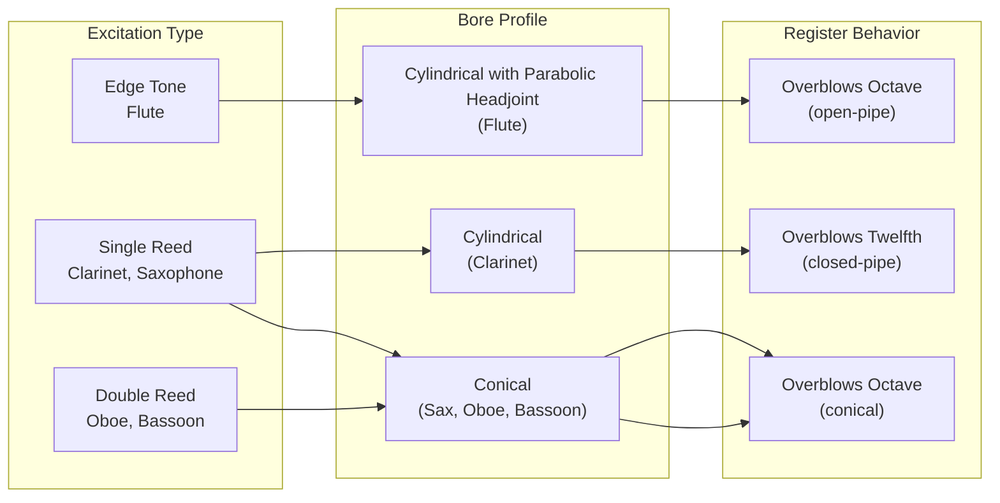
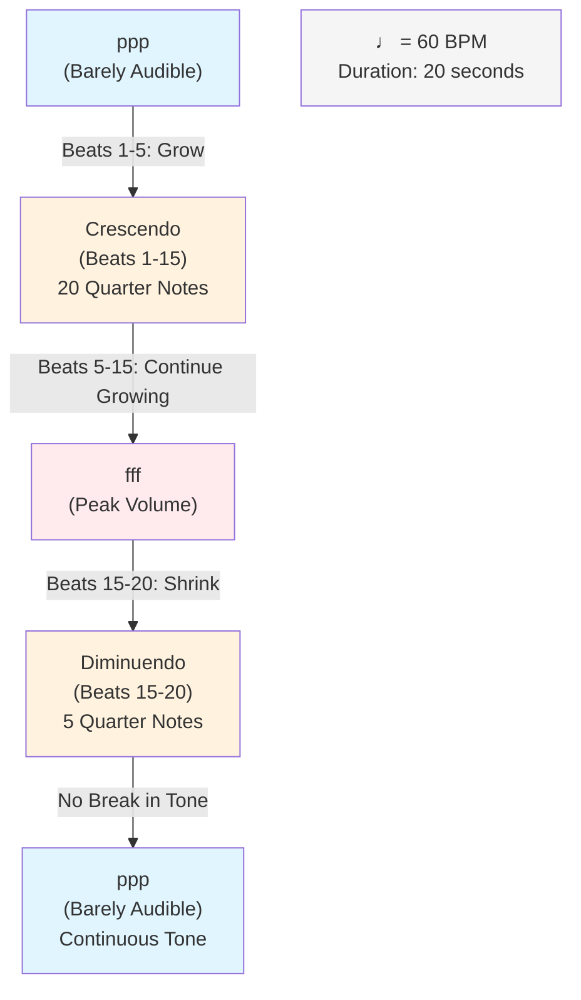
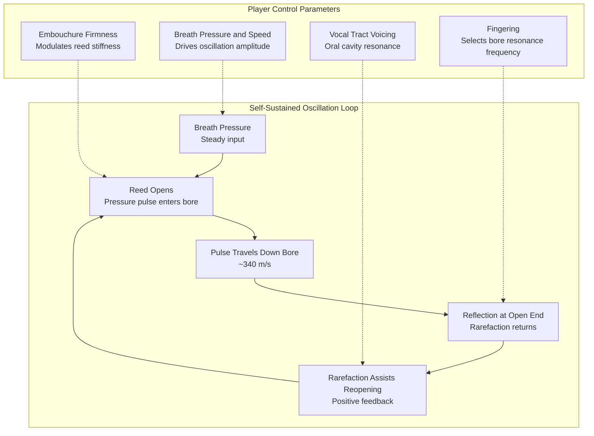
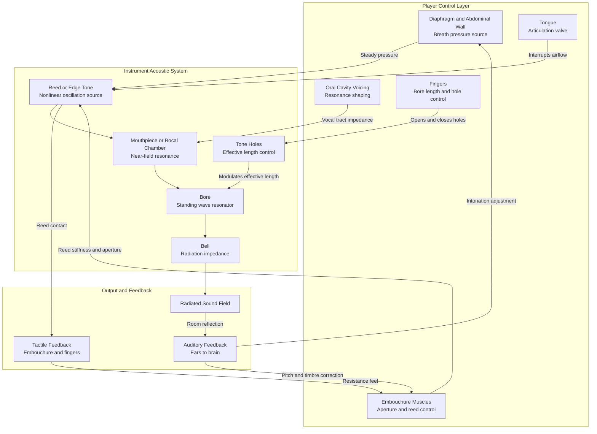

# Woodwind Mastery: Performance Technique, Sound Production & Instrument Systems

## Overview

This masterclass covers the woodwind family from the ground up: embouchure mechanics, breath support, fingering systems, articulation, and tone development. The curriculum is ordered by playing priority — what you feel and do first, backed by just enough acoustic理论 to explain why the technique works. Labs build from single sustained tones to full-range technical exercises.

**Instruments covered:** Flute (Böhm system, C), Bb Clarinet (cylindrical bore), Alto Saxophone (Eb, conical), Oboe (conservatory system), Bassoon (Heckel system).



---

## Part 1: Breath Support — The Foundation of Everything

Before touching a fingering chart, internalize diaphragmatic breath support. The instrument is a resonator; you are the engine driving it.

### 1.1 Diaphragmatic Breathing Mechanics

The diaphragm is a dome-shaped muscle under your lungs. When it contracts and flattens, it drops the pressure in your chest cavity and air rushes in. Exhaling for playing is not passive deflation — you actively meter the release with your abdominal wall, the same muscles you'd use to blow out a candle for a very long time without running out of air.

**The hose model:** your airstream behaves like water forced through a hose nozzle. High pressure at the source (compressed abdomen), a small controlled aperture at the end (embouchure or reed opening), and fast, smooth flow. Turbulent, unsupported air is the enemy of a clean attack and centered pitch.

**Drill 1 — Breath Control Without the Instrument (5 minutes daily)**

1. Place one hand on your sternum, one on your navel.
2. Inhale for 4 counts: only the navel hand should move outward. If your sternum rises, reset — that's clavicular breathing, and it starves your air supply.
3. Exhale on a sustained "shhh" for 8 counts. Feel your abdominal wall gently compress inward, not collapse suddenly.
4. Add resistance: exhale on a thin, fast "ss" for 16 counts. This is the pressure and speed profile you need for a loud high note.

**Metronome targets:**
- Week 1: 4-count inhale / 8-count exhale at ♩ = 60
- Week 2: 4-count inhale / 12-count exhale
- Week 3: 2-count inhale / 16-count exhale

### 1.2 Breath Pressure vs. Breath Volume — Know the Difference

| Register | Flute | Clarinet | Saxophone | Oboe | Bassoon |
|---|---|---|---|---|---|
| Low | Low pressure, high volume | Low–medium pressure | Low pressure, full volume | High pressure, narrow aperture | Medium pressure |
| Middle | Medium pressure | Medium pressure | Medium pressure | Medium–high pressure | Medium pressure |
| High | High pressure, reduced volume, faster air | High pressure, faster air | High pressure, faster air | Very high pressure | High pressure |

**Key rule:** going higher in register needs faster, more compressed air — not more volume. Over-blowing low notes and under-supporting high notes are the two most common beginner errors, and they're the same mistake pointed in opposite directions.

---

## Part 2: Embouchure Mechanics by Instrument

### 2.1 Flute Embouchure

The flute produces sound through an edge tone: you aim a focused, flat ribbon of air across the embouchure hole so it splits on the far edge. Part of the air column drops into the tube and excites the standing wave; the rest escapes over the top. The split ratio controls both pitch and dynamic.

**Setup checklist:**
1. Roll the headjoint so the embouchure hole center lines up with the keys of the body joint.
2. Rest the edge of the embouchure plate on your lower lip, not your chin. The hole center sits at or just below the lip line.
3. Form a relaxed "puh" shape. The aperture in your lips should be an oval roughly 10–12 mm wide by 4–5 mm tall for middle register.
4. Aim the air downward about 25–35° below horizontal for low register, flattening toward horizontal as you ascend.
5. Keep the upper lip relaxed, not pulled back. No smiling — a spread embouchure kills tone focus.

**Common fault — chin tension:** a thin, airy tone means the aperture is too large. A tight, pinched tone means the chin muscle (mentalis) is clenched. Aim for a flat "apple chin," not a bunched one.

**Drill 2 — Tone without the headjoint**

Hold just the headjoint. Seal the open end with your palm. Produce a steady tone on the resulting pitch (around written B4 on most headjoints). Sustain 10 seconds. This isolates embouchure formation from fingering.

Target: clear, centered tone with no breathiness within 2 weeks of daily 10-minute sessions.

### 2.2 Clarinet Embouchure

The clarinet uses a single reed clamped against the mouthpiece by the ligature. Breath pressure sets the reed vibrating against the mouthpiece table like a spring-loaded valve.

**Setup — lower lip over teeth:**
1. Roll your lower lip over your bottom teeth so the lip cushions the reed. About a third of the red part of your lower lip contacts the reed.
2. Upper teeth rest directly on top of the mouthpiece, no rolling, no biting. This is your anchor.
3. Corners of the mouth grip the mouthpiece sides gently — no air escapes at the corners.
4. Keep the chin flat and firm, pulled slightly downward, to keep the reed channel open.
5. Drop the jaw slightly, as if holding a small cork between your back molars.

**Mouthpiece angle:** roughly 35–45° down from horizontal. Beginners often take too little mouthpiece (5–8 mm). You need 10–14 mm inside the mouth to let enough reed length vibrate freely.

**Common fault — the bite:** squeezing the reed with the lower lip against the upper teeth. Symptoms: sharp intonation in the middle register, thin tone, lip fatigue after 10 minutes. Fix: drop the jaw and relax the lower lip contact pressure, not the lip's coverage.

**Drill 3 — Mouthpiece-only long tones**

Play the mouthpiece alone (no barrel). You should produce a pitch near concert A (written B), about 440 Hz. Too sharp means too much jaw pressure. Too flat means not enough lip firmness or insufficient mouthpiece depth.

Sustain 8 counts, rest 4, repeat 10 times. Target: pitch within ±25 cents of 440 Hz with a consistent tone. Do this daily before assembling the full instrument.

### 2.3 Saxophone Embouchure

Saxophone embouchure resembles clarinet's but differs because of the conical bore, larger reed, and steeper mouthpiece angle.

**Setup:**
1. Lower lip curves over the bottom teeth as on clarinet, but with slightly firmer contact given the larger reed surface.
2. Upper teeth rest on the mouthpiece. Because sax mouthpieces often have higher baffles, you typically take slightly less depth than clarinet — about 10–12 mm for alto.
3. Mouthpiece angle is steeper than clarinet: 50–65° from horizontal.
4. Corners seal in a firm "ooh" shape, not spread and not pursed.

**Alto vs. tenor/baritone:** larger horns need more mouthpiece depth and a wider aperture. Lip contact area scales up with the instrument.

**Key difference from clarinet:** saxophone's conical bore overblows at the octave, not the twelfth, so the embouchure adjustment between registers is smaller — a slight compression and faster air, not a structural change. Clarinet doublers often over-tighten going into the upper register out of habit; resist that reflex on sax.

### 2.4 Oboe Embouchure

The oboe uses a double reed: two cane blades bound to a metal staple with wire and thread. The two blades beat against each other, forming an extremely efficient, high-pressure oscillator.

**Double reed characteristics:**
- Reed opening at rest: 1.0–1.5 mm, much smaller than a single-reed aperture.
- Playing pressure is very high, roughly 5–15 kPa versus 1–5 kPa for clarinet — this is why oboists feel breathless faster despite using less air volume.
- The reed sits entirely inside the mouth; your lips contact the cane blades directly, not a mouthpiece table.

**Setup:**
1. Take the reed in to about the second wire binding, roughly 10–12 mm inside the mouth.
2. Form a relaxed "oh" shape. Both lips roll over the teeth, cushioning the blades softly.
3. The lip contact point sits at the first wire — not directly on the vibrating tip of the blades.
4. The corners hold a consistent oval shape. If lips collapse inward, the reed clamps shut and chokes; if they spread, the reed opens too wide and the pitch drops.
5. Keep the jaw slightly dropped and relaxed — a clenched jaw is the single biggest intonation wrecker on oboe.

**The crow check:** before playing, blow through the reed alone with no embouchure shaping. You should hear an unfocused, raspy buzz near low C or B. Add gentle lip pressure and the sound should focus up into a bright double "crow," roughly C5–D5. If the crow is flat, the reed may need adjustment by a reed maker; if sharp, try soaking it longer before playing.

### 2.5 Bassoon Embouchure

Bassoon uses a wide double reed mounted on a metal bocal. The reed is substantially larger than oboe's, so lip coverage differs.

**Setup:**
1. Take the reed to roughly the first wire, about 15–18 mm into the mouth.
2. Both lips roll over the teeth as on oboe, but with wider contact to match the larger reed.
3. The upper lip does more of the sealing work, folding more pronouncedly over the top blade.
4. Keep the chin flat and firm, as on clarinet — avoid bunching.
5. The bocal enters the mouth at roughly 30–40° from horizontal.

**Low register bassoon:** needs a relaxed, open embouchure with slightly more reed in the mouth and lighter lip tension. Beginners who clamp too hard flatten the low Bb–D range and choke the reed. Think "open throat, hissing like a snake," not "squeeze."

---

## Part 3: Fingering Systems — Tablature-Style Reference

### 3.1 Böhm Clarinet Fingering — Chalumeau Register

Notation: ● = covered, ○ = open. L1–L4 = left hand index to pinky, R1–R4 = right hand index to pinky, L.T = left thumb (open tube hole + register key mechanism combined at this position).

**Chalumeau register (written E3–C5):**

```
Note    L.T  L1  L2  L3  L4   R1  R2  R3  R4   Notes
E3      ●    ●   ●   ●   ●    ●   ●   ●   ●    All holes covered
F3      ●    ●   ●   ●   ●    ●   ●   ●   ○    RH pinky lifts
F#3     ●    ●   ●   ●   ●    ●   ●   ○   ○    RH ring lifts too
G3      ●    ●   ●   ●   ○    ●   ●   ●   ○    LH pinky side key added
G#3     ●    ●   ●   ●   ●    ○   ●   ●   ●    G# key engaged
A3      ●    ●   ●   ●   ●    ○   ●   ●   ○
Bb3     ●    ●   ●   ●   ●    ○   ○   ●   ○    1st-position Bb
B3      ●    ●   ●   ●   ○    ○   ●   ●   ○
C4      ●    ●   ●   ○   ○    ○   ●   ●   ○
C#4     ●    ●   ○   ●   ○    ○   ●   ●   ○
D4      ●    ●   ○   ○   ○    ○   ○   ○   ○
Eb4     ●    ●   ○   ○   ○    ○   ○   ●   ○    Eb/D# key
E4      ●    ○   ○   ○   ○    ○   ○   ○   ○
F4      ○    ●   ●   ●   ○    ○   ●   ●   ○
F#4     ○    ○   ●   ●   ○    ●   ●   ●   ○
G4      ○    ○   ○   ●   ○    ●   ●   ●   ○
Ab4     ○    ○   ○   ○   ○    ○   ●   ●   ●
A4      ○    ○   ○   ○   ○    ○   ○   ●   ○
Bb4     ○    ○   ○   ○   ○    ○   ●   ○   ●    Bis Bb — the workhorse fingering
B4      ○    ○   ○   ○   ○    ●   ○   ○   ○
C5      ○    ○   ○   ○   ○    ○   ○   ○   ○    All holes open
```

**Clarion register (written D5–C6):** add the register key (left thumb back) to the matching chalumeau fingering — D5 is D4's fingering plus register key, E5 is E4's fingering plus register key, and so on.

**Critical note:** moving from B4 (chalumeau) to C5 opens every hole on the horn — the most acoustically open note on the instrument, and it runs flat by nature. Compensate with slightly firmer lip contact and faster air the instant you land on it.

### 3.2 Alto Saxophone Fingering — Core Range

Notation: T = octave key (left thumb), L1–L3 = left hand index–middle–ring, R1–R3 = right hand index–middle–ring, ★ = palm keys.

```
Note     Oct  L1  L2  L3   R1  R2  R3   Notes
Bb2      ○    ●   ●   ●    ●   ●   ●    + front Bb key (LH side)
B2       ○    ●   ●   ●    ●   ●   ●    + LH pinky low-B key
C3       ○    ●   ●   ●    ●   ●   ●
C#3      ○    ●   ●   ●    ●   ●   ○    + G#/C# key
D3       ○    ●   ●   ●    ●   ●   ○
Eb3      ○    ●   ●   ●    ●   ○   ●
E3       ○    ●   ●   ●    ○   ○   ○
F3       ○    ●   ●   ○    ○   ○   ○
F#3      ○    ●   ○   ●    ○   ○   ○
G3       ○    ○   ○   ○    ○   ○   ○    All holes open
G#3      ○    ○   ○   ○    ○   ○   ○    + G# key (LH pinky)
A3       ●    ●   ○   ○    ○   ○   ○    Octave key engages
Bb3      ●    ●   ●   ●    ●   ●   ●    + bis or side Bb
B3       ●    ●   ●   ●    ●   ●   ○
C4       ●    ●   ●   ●    ●   ○   ○
```

**Upper register:** depress the thumb octave key; fingering patterns stay identical to the low octave. Because the saxophone is conical and overblows at the octave, your embouchure barely moves between registers — slightly firmer corners, fractionally faster air, nothing dramatic.

**Palm key entries (written D5–F#5):** D5 = palm 1; E5 = palm 1 + palm 2; F5 = palm 1 + palm 2 + palm 3; F#5 = all three palms + side F key.

### 3.3 Flute Fingering — Key Register Transitions

Notation: T = thumb Bb lever, 1–6 = the six main tone holes (left hand 1–3, right hand 4–6), Foot = foot joint keys.

```
Note     T    1    2    3    4    5    6    Foot   Notes
C4       ●    ●    ●    ●    ●    ●    ●    ●      B-foot needed for low C
D4       ○    ●    ●    ●    ●    ●    ●    ●
E4       ○    ●    ●    ●    ●    ●    ○    ○
F4       ○    ●    ●    ●    ●    ○    ○    ○
F#4      ○    ●    ●    ●    ○    ○    ○    ○
G4       ○    ●    ●    ○    ○    ○    ○    ○
A4       ○    ●    ○    ○    ○    ○    ○    ○
Bb4      ○    ●    ●    ●    ●    ●    ●    ●      Bb lever — most common fingering
B4       ○    ●    ○    ○    ○    ○    ○    ●      B-foot engaged
```

**Register transition:** flute has no register key. Moving from second octave into the third (C6 and above) is entirely embouchure and air-speed driven:
- Increase abdominal compression for faster air.
- Narrow the aperture very slightly.
- Flatten the embouchure plate angle toward horizontal.

The classic error is rolling the flute inward to "help" reach high notes — this darkens and flattens the pitch further. Roll out slightly instead, to brighten and center it.

---

## Part 4: Tone Production Drills

### 4.1 Long Tones — The Daily Non-Negotiable

**Drill 4 — Single-note long tone with dynamic shape**

Pick a middle-register note (written G4 clarinet/sax, A4 flute, A3 oboe).



**What to listen for:**
- Pitch drift: most players go sharp on crescendo and flat on diminuendo. Counter it:
  - Crescendo: relax the embouchure fractionally and drop the jaw a hair to stop the pitch climbing.
  - Diminuendo: firm the embouchure fractionally to stop the pitch sagging.
- Tone consistency: a crescendo that turns bright and "squeezed" at the peak, then goes cloudy at pp, signals uneven breath support rather than an embouchure problem.

**Weekly progression:**

| Week | Note | Dynamic shape | Duration |
|---|---|---|---|
| 1 | G4 (cl) / A4 (fl) | mp → f → mp | 12 sec |
| 2 | G4 & D4 | p → ff → p | 16 sec |
| 3 | Chromatic scale, one note per breath | pp → mf → pp | 16 sec |
| 4 | Major scale, one octave | pp → ff → pp | 20 sec |
| 5+ | Full range, every semitone | ppp → fff → ppp | 20 sec |

### 4.2 Interval Tuning Drill — Training Intonation with a Drone

**Setup:** run a drone app or synth tone at your instrument's written tonic. For clarinet, drone concert Bb (fingered as written C).

**Drill 5 — Major scale over drone**

1. Set the drone to concert Bb.
2. Play the written C major scale on Bb clarinet, one note at a time, 4 beats each at ♩ = 60.
3. Listen for beating against the drone on scale degrees 1, 4, 5, and 8 — these should sound beatless.
4. Degrees 3, 6, and 7 will beat slightly against an equal-tempered drone; that's expected, not an error. Learn to recognize the beat rate so you can choose to widen or narrow it intentionally in ensemble playing.

**Reading the beats:**
- Fast beats (4+/sec): significantly out of tune.
- Slow beats (1–2/sec): close, needs a small embouchure adjustment.
- No beats: locked in. Memorize the embouchure and air feeling at that instant.

**Tempo progression:** ♩ = 60 → 80, drill at 80 until automatic, then remove the drone and self-test.

### 4.3 Vibrato — Flute, Oboe, Saxophone

Vibrato is a periodic pitch modulation, produced by a different muscle group on each instrument.

**Flute vibrato — diaphragm-driven, never jaw:**
1. Sustain a steady A4.
2. Add "ha-ha-ha-ha" diaphragm pulses at ♩ = 60, 4 pulses per beat.
3. Speed up to 6, then 8 pulses per beat at the same tempo.
4. Smooth the pulses into a continuous wave rather than discrete jabs.

Target rate for orchestral playing: 5–6 oscillations per second at a moderate tempo.

**Oboe vibrato — lip-based, subtle:** a slight rhythmic firm-and-release of lip contact. Throat vibrato destabilizes the high-pressure reed system and should be avoided. Practice very slowly; the motion is small.

**Saxophone vibrato — jaw-driven:** the jaw drops and rises slightly, modulating reed opening. Practice "ya-ya-ya-ya" jaw motion away from the horn first, then apply it to sustained tones. Wide and relaxed for ballads; narrow, nearly straight, for classical repertoire.

**Clarinet and bassoon:** vibrato is used sparingly or not at all in classical playing, standard in jazz clarinet. When used, diaphragm-based motion is preferred over jaw.

---

## Part 5: Articulation

### 5.1 Tongue Contact Point by Instrument

| Instrument | Contact point | Syllable | Feel |
|---|---|---|---|
| Flute | Tip of tongue to lower lip/behind upper teeth, interrupting the air stream | "Tuh"/"Duh" | Lightest touch; you're tonguing the air, not a reed |
| Clarinet | Tongue tip to the very tip of the reed | "Tuh"/"Du" | Dab, don't stab; feel the reed on the tongue tip |
| Saxophone | Reed tip, same principle as clarinet | "Tuh"/"Du" | Firmer contact than clarinet, larger reed surface |
| Oboe | Reed tip, both blades, from below | "Tuh"/"Du" | Very light; excess force clamps the reed shut |
| Bassoon | Reed tip, from below | "Tuh"/"Du" | Relaxed; the large reed is sensitive to force |

**What the tongue never does:** stop the breath. The air column keeps moving through tongued passages; the tongue only interrupts the reed or airstream momentarily. Students who "hold their breath between notes" lose both tone and speed.

### 5.2 Articulation Drill Progression

**Drill 6 — Single tongue on one pitch**

Use a comfortable middle-register note (written G4 clarinet/sax, A4 flute, A3 oboe).

```
Exercise A — Even 8th notes:
♩ = 60, 72, 84, 100, 116: G G G G G G G G, single-tongued each note
Typical clean ceiling for beginners: 120-132 BPM

Exercise B — Staccato:
♩ = 60: short G, rest, short G, rest (staccato 8ths)
Focus: identical attack, length, and tone on every note

Exercise C — Accents:
♩ = 72: accent every 4th note, then every 2nd note
Focus: accent comes from more breath support, not a harder tongue hit
```

### 5.3 Double and Triple Tonguing

Once single-tongue speed plateaus around 132–144 BPM 16ths, double tonguing unlocks faster passages.

**Syllables:** T-K-T-K (or D-G-D-G). The K stroke comes from the back of the tongue hitting the soft palate. The K must match the T in tone quality and volume — this is the whole battle.

**Triple tongue:** T-K-T / T-K-T, or T-T-K / T-T-K for triplet figures.

**Drill 7 — Double tongue builder**

```
Step 1: T only, 4 notes at ♩ = 80 — establish reference tone quality
Step 2: K only, 4 notes at ♩ = 80 — K must sound as clear as T
Step 3: T-K pairs, 2 notes at ♩ = 60 — slow and deliberate, listen for evenness
Step 4: T-K-T-K on one pitch — ♩ = 80, 100, 120, 144
Step 5: T-K-T-K across a scale — raise tempo only once pitch changes are clean

Red flag: T sounds clear but K sounds muddy → the K contact is too far back.
Fix: bring the K contact point forward, closer to mid-palate.
```

**Expected progression:** weeks 1–2, TK even at ♩ = 80 (16ths); weeks 3–4, ♩ = 100; by month 2, ♩ = 120+ across scale passages.

### 5.4 Legato — Connecting Without the Tongue

Legato means no re-articulation between notes; the only disturbance should be the fingering change itself.

**The problem:** as fingers move between notes, there's a brief window where old and new holes/pads are both partly open, creating an unintended glitch pitch. The fix is simultaneous finger movement — every finger lands at the same instant. Fingers that move early or late create accidental grace notes.

**Drill 8 — Slow legato scale for finger coordination**

```
♩ = 40: play a one-octave major scale, 2 beats per note, no tongue
Focus entirely on simultaneous finger placement
Raise tempo by 4 BPM every two passes
Target: ♩ = 72 with zero pitch glitches between notes
Then play the same scale tongued and compare — the glitch should disappear either way
```

---

## Part 6: Register Traversal — The Break

### 6.1 The Clarinet Break

The break separates the chalumeau register (up to written G#4/Ab4) from the clarion register. Crossing it cleanly requires:
1. Coordinated addition of the register key (left thumb, back of instrument).
2. A slight increase in air speed with a minimal embouchure firming — not a big jaw shift.
3. Precise, simultaneous finger movement — the break fails most often from poorly synchronized fingers, not from embouchure.

**Drill 9 — Clarinet break ladder (♩ = 60 → 100)**

```
Level 1: Long tone crossing — G4 (chalumeau) to G5 (clarion), slurred, 4 beats each
Level 2: G4 <-> G5 alternating every beat
Level 3: Scale crossing — E4 F4 F#4 G4 | G4 A4 B4 C5 slurred, break at the bar line
Level 4: Thirds across the break — G4-B4, A4-C5, Bb4-D5
Level 5: Full scale across the break at ♩ = 92 with no glitches
```

**What goes wrong:** an extra note "pops" during the register key transition. The register key must arrive before or exactly with the new fingering, never a fraction after. Exaggerate the coordination at very slow tempo to fix it.

### 6.2 Flute Second-to-Third Octave Transition

No register key exists on flute. The third octave is purely embouchure and air speed.

- Increase abdominal compression for faster air.
- Narrow the aperture very slightly, corners firming.
- Bring the jaw forward 1–2 mm, angling air slightly upward toward the far wall of the embouchure hole.
- Do not roll the flute in toward the lips — that's the classic overcompensation that makes things worse.

**Drill 10 — Flute octave slurs**

```
♩ = 60: D4 (open) -slur-> D5 -slur-> D6, 4 beats each
Focus on the jaw-forward adjustment, not embouchure squeezing.
Common fault: D6 goes flat, player rolls in to "help," it goes even flatter.
Fix: hold the roll-out position steady, increase air speed instead.
```

---

## Part 7: Intonation Tendencies — Problem Notes and Solutions

### 7.1 Clarinet Intonation Map

```
SHARP by nature (open or relax to compensate):
- G#4/Ab4: use the alternate fingering (register key + G) when the passage allows
- Bb5 (clarion): often very sharp — drop jaw 1-2mm
- Throat tones G4-Bb4: naturally bright; voice "oh" internally to settle them

FLAT by nature (firm up to compensate):
- C5/D5 (top of chalumeau): often quite flat — firmer embouchure, faster air
- High E6/F6 (altissimo): often flat — support with high-velocity air
- Low E3/F3: flat on a cold instrument — warm up 5 minutes before tuning
```

**Voicing trick:** think the vowel "oh" or "oo" internally on the throat tones (G4, Ab4, A4, Bb4). This reshapes the oral cavity and nudges the resonance frequency up slightly, centering the pitch without over-biting.

### 7.2 Flute Intonation Map

```
SHARP by nature:
- Middle Bb4: most flutes run sharp here; use the thumb Bb lever, not the bis key
- High D6/E6: relax the aperture slightly, keep air speed high

FLAT by nature:
- Low C4/C#4/D4: very flat, especially cold — push the headjoint in slightly before cold performances
- C6 (all keys up): often flat — firmer embouchure, jaw forward
- Low Bb (B-foot): flattens fast if under-supported — full breath, don't "blow through" it passively
```

**Headjoint tuning:** pulling the headjoint out lowers pitch (lengthens the tube); pushing in raises it. Starting reference: roughly 12–14 mm gap from the embouchure hole center to the headjoint end cap. Fine-tune by ear against a drone at playing temperature, not cold.

### 7.3 Saxophone Intonation Map

```
SHARP by nature:
- Palm keys D5/E5/F5: sharp on nearly every horn — drop jaw, relax corners
- G#5/A5: sharp — try the alternate long-C-key fingering for A5

FLAT by nature:
- Low Bb2/B2: very flat, long cold tube — full breath support
- Mid Eb3: flat on many horns — use the side Eb key alternate
- Mid C#3: flat — firm embouchure and check the neck cork fit
```

---

## Part 8: Reed Care, Mouthpiece Selection, and Maintenance

### 8.1 Reed Selection and Break-In

**Synthetic reeds (Légère, Forestone, D'Addario Venn):** playable straight out of the box, consistent reed to reed, reliable across humidity swings. They typically play about half a strength higher than the label — a synthetic 3.0 often feels like a cane 2.5.

**Cane reeds (Vandoren, Rico, Alexander):** need a break-in and reed rotation.

**New cane reed break-in protocol:**
1. Wet the reed in your mouth for 30 seconds.
2. Play no more than 5 minutes on day one.
3. Rest 24 hours.
4. Play 10 minutes on day two.
5. Rest again.
6. By day 5–7 the reed should be fully broken in and stable.

Rotate through 3–5 reeds in a cycle. Don't play the same reed two days running during the first two weeks of its life.

**Reed selection test:**
1. Wet the reed, assemble the instrument.
2. Play a low middle-register note at mp. Should speak without excessive pressure.
3. Play the full range — cracking easily, or refusing above the break, means the reed is too soft.
4. Needing to push hard, or low notes not speaking, means the reed is too hard.
5. The target balance: comfortable low register, slight extra effort in the high register that still speaks cleanly.

**Reed strength guide:**

| Instrument | Beginner | Intermediate | Advanced |
|---|---|---|---|
| Clarinet | 2.0–2.5 | 2.5–3.0 | 3.0–3.5 |
| Alto sax | 2.0–2.5 | 2.5–3.0 | 3.0–3.5 |
| Tenor sax | 2.0–2.5 | 2.5–3.0 | 3.0–3.5 |
| Soprano sax | 2.0–2.5 | 2.5–3.0 | 3.0–3.5 |

Oboe and bassoon reeds are mostly hand-made; "strength" is replaced by opening height and scrape characteristics, usually discussed directly with a reed maker.

### 8.2 Mouthpiece Selection — Clarinet and Saxophone

| Parameter | Affects | Smaller | Larger |
|---|---|---|---|
| Tip opening | Resistance, flexibility | More resistant, easier to control | More flexible, harder to control |
| Facing length | Vibrating reed length | Less vibration, brighter | More vibration, darker |
| Chamber volume | Tone color | Brighter, more projection | Darker, warmer |
| Baffle height | Brightness, edge | Darker | Brighter, more edge |

**Clarinet starting points:**
- Classical: Vandoren B45 or 5RV Lyre, medium tip opening (1.14–1.19 mm), small-medium chamber.
- Jazz/klezmer: Vandoren M13 or Zinner options, larger opening (1.25–1.35 mm).

**Alto sax starting points:**
- Classical: Vandoren Optimum AL3 or Selmer C*, medium opening (~1.6–1.7 mm).
- Jazz: Meyer 5M or Otto Link 6*, medium-large opening (1.8–2.0 mm).

**The ligature:** clamps the reed to the mouthpiece table. Leather/fabric ligatures (BG, Rovner) let the reed vibrate more freely for a warmer, flexible tone. Metal ligatures (Vandoren Optimum, Bonade) add resistance and presence. Any correctly fitted ligature works fine for beginners — don't let gear choices substitute for embouchure practice.

### 8.3 Pad Leakage Diagnosis — Feeler Gauge Method

A leaking pad causes sharp intonation, weak tone, or notes that won't speak.

**Diagnosis:**
1. Remove the reed, close all keys, blow firmly into the instrument.
2. Escaping air means a pad is leaking.
3. Slide a cigarette paper or feeler strip under each pad in turn.
4. Close the key, then pull the paper slowly. If it slides out with no resistance anywhere around the pad circumference, the pad isn't sealing.
5. Normal result: even, consistent drag all the way around.

**Common leak sources:** lower joint low E/F/F# keys on clarinet, the octave key mechanism on saxophone, and any keywork left untouched for long periods (pads can dry-stick or warp away from the tone hole).

**Emergency fix:** a small dab of Valentino pad cement on the edge of a leaking pad buys you temporary sealing. Permanent repair needs a technician.

**Preventive maintenance schedule:**

| Frequency | Task |
|---|---|
| After every session | Swab the bore with silk, oil the reed, store flat |
| Weekly | Check loose screws, test pad sealing with feeler paper |
| Every 6 months | Professional pad check, tenon cork greasing |
| Yearly | Full service: regulation, pad replacement as needed, mechanism adjustment |

---

## Part 9: Acoustic Fundamentals — Why These Techniques Work

### 9.1 Why the Clarinet Overblows at the Twelfth

The clarinet behaves acoustically as a closed cylindrical pipe: closed at the reed end, open at the bell. Closed pipes only support odd-numbered harmonics — fundamental, then the 3rd harmonic (a twelfth above), then the 5th, and so on. That's why:
- Clarion register sits a twelfth above chalumeau, not an octave.
- The low (chalumeau) register has a dark, hollow, "woody" character — the even harmonics that would brighten it are suppressed by the closed-pipe geometry.

Conical bores (sax, oboe, bassoon) support the full harmonic series including even harmonics, so they overblow at the octave and sound fuller and brighter from the bottom of the range.

### 9.2 The Excitation Mechanism — What the Reed or Edge Tone Actually Does

Every woodwind sound source is a self-sustained feedback oscillator:

1. You apply steady breath pressure.
2. The reed (or air jet, for flute) lets a pulse of air into the bore.
3. That pulse travels down the bore and reflects at the open end or first open tone hole, returning as a pressure dip.
4. The returning dip helps pull the reed back open for the next pulse.
5. This feedback loop locks the reed's vibration to the bore's resonant frequency, not to whatever frequency the reed would vibrate at on its own.

This is the mechanical reason fingering changes pitch: changing which holes are open changes which resonance the bore reinforces, and the reed locks onto that frequency rather than its own natural stiffness-driven rate.



### 9.3 Bore Geometry and Tone Color

| Bore type | Instrument | Harmonic content | Timbre |
|---|---|---|---|
| Cylindrical | Clarinet | Odd harmonics dominate | Dark, hollow, woody |
| Conical | Sax, oboe, bassoon | Full harmonic series | Bright, complex, rich |
| Cylindrical body, tapered headjoint | Flute | Full harmonics, shaped by open ends | Clear, projecting |

The practical takeaway: a cylindrical-bore instrument needs a bigger embouchure adjustment crossing registers because it jumps from the 1st to the 3rd harmonic (a twelfth). A conical-bore instrument jumps only from the 1st to the 2nd harmonic (an octave), which is a smaller adjustment — explaining why clarinet's break feels more dramatic than sax's.

### 9.4 Temperature and Intonation

Sound speed rises about 0.6 m/s per °C. For practical tuning purposes: every 6°C drop in temperature drops your pitch roughly 10 cents, and every 6°C rise raises it roughly the same amount.

**Practical implications:**
- Walking from a 20°C warm-up room into a 10°C cold church drops you about 17 cents flat. Push the headjoint or mouthpiece in slightly before you start.
- After 10–15 minutes of playing, the instrument warms from the inside and the pitch rises — retune mid-rehearsal if needed.
- Oboe and bassoon cane reeds also shift stiffness with humidity, adding a second variable on top of temperature. Break reeds in gradually so you learn their behavior across conditions.

---

## Part 10: Scales, Arpeggios, and Technical Development

### 10.1 Daily Technical Routine — Bb Clarinet Scale System

The interval logic transfers directly to flute, sax, oboe, and bassoon — adapt the fingerings, keep the tempo targets.

**Foundation scale drill (all 12 major scales, one octave):**

```
♩ = 60:  quarter notes              Week 1-2
♩ = 80:  eighth notes               Week 3-4
♩ = 100: eighth notes               Month 2
♩ = 120: 16th notes                 Month 3-4
♩ = 144: 16th notes                 Months 5-6
```

**Scale order by difficulty (clarinet, Böhm system):**

1. G major (1 sharp): mostly open holes plus the F# key.
2. F major (1 flat): adds the Bb fingering.
3. D major (2 sharps): builds on G, adds C#.
4. Bb major (2 flats): forces cross-break practice.
5. A major (3 sharps): G# key coordination.
6. Eb major (3 flats): multiple Eb fingering choices.
7. E major (4 sharps): a thorough cross-register workout.
8. Ab major (4 flats): three flat-key fingers coordinated together.
9. B major (5 sharps): near-full chromatic workout.
10. Db major (5 flats): enharmonic of C#, same fingerings.
11. F# major (6 sharps): register key plus cross-fingerings throughout.
12. Gb major (6 flats): enharmonic of F#.

### 10.2 Arpeggio Patterns

Arpeggios expose finger synchronization problems that scales hide, because the intervals are wider and the break gets crossed abruptly.

**G major arpeggio (Bb clarinet, written):**
```
G4 - B4 - D5 - G5 - D5 - B4 - G4
Fingering: standard G, cross the break to B clarion, D clarion, G clarion
```

**Common break problem:** G4 (all-fingers-up chalumeau) to B4 (clarion) needs the register key to land exactly as the left-hand fingers lift. Isolate this one interval and drill it at ♩ = 40 until it's clean every time, then fold it back into the full arpeggio.

### 10.3 Chromatic Scale — Full Range

**Clarinet chromatic fingering decisions:**

```
Bb4: Bis key (index side key) for speed in fast passages;
     side Bb key is flatter and better for sustained notes
F#4: side Bb/F# spatula for cleaner descending passages
G#4/Ab4: left pinky G# key as the default; right-hand spatula alternate
          when the passage leads directly into Bb
```

**Practice format:**

```
♩ = 60, two beats per note -> ♩ = 80, one beat per note -> ♩ = 100, 16th notes
Full range: low E3 up to written C6 or higher
```

---

## Part 11: Practical Performance Considerations

### 11.1 Warm-Up Sequence — 15 Minutes Before Any Performance

```
Minutes 0-3:   Long tones, middle register only, mf, no vibrato
               Settles the embouchure, saturates and warms the reed
Minutes 3-6:   Scales, one octave, ♩ = 60
               Checks finger coordination and intonation against room acoustics
Minutes 6-9:   Dynamic long tones, pp -> ff -> pp
               Confirms full dynamic range and tests the reed at extremes
Minutes 9-12:  Single tongue, light staccato, ♩ = 80 8ths
               Resets tongue tip placement and consistency
Minutes 12-15: Repertoire passage work, difficult bars only, slow
               Builds confidence in specific trouble spots before the hall goes quiet
```

### 11.2 Reed Emergency Protocols

**Reed cracks mid-performance:** keep 2–3 pre-soaked backup reeds in the case. A reed soaked for 30 seconds and seated correctly can be playable within seconds.

**Reed too hard (sluggish, won't speak easily):** press the table side of the reed briefly against your lower lip and rub lightly with a saliva-moistened thumb. The added moisture temporarily softens it.

**Reed too soft (squeaks easily, lacks projection):** let it sit unplayed for 5–10 minutes. A slightly drier reed stiffens up and projects better.

**Condensation bubbling in keys:** slide cigarette paper under the affected pad, close the key, release, and repeat 2–3 times to blot the water out. On flute this shows up most often around the G key.

### 11.3 Ear Training in Ensembles

Technique gets you in the room; listening keeps you in tune once you're there.

**The two-voice rule:** identify which instrument or section is harmonically most important to the note you're playing, and lock onto that, not onto yourself. A fifth above the cello means your ears belong on the cello.

**Intonation reference points:**
- Unison: match beat patterns, then eliminate them entirely.
- Octave: should feel beatless and resonant when locked in.
- Perfect 5th: should settle into a stable acoustic lock, reinforced by the 3rd partial of the lower note.
- Major 3rd in a held chord: tune it about 14 cents narrower than equal temperament for a pure, resonant just-intonation sound.

**Practical ensemble exercise:**

1. Tune to the oboist's A440, the standard orchestral reference.
2. Hold concert A against the drone or section.
3. Build a Bb major chord from the bottom up: bassoon/bass clarinet on Bb, then add F, then D on top.
4. Each added voice adjusts until the chord locks in and the room resonance becomes physically audible — a "ringing" quality you can feel as much as hear.

---

## Appendix A: Quick-Reference Fingering Charts

### Clarinet Problem Note Solutions

| Written note | Standard fingering | Alternate / situation |
|---|---|---|
| Bb4 | Bis key (index side) | Side Bb key: flatter, better for sustained notes |
| Bb4 | Side Bb | Preferred when a passage ends on Bb |
| F#4 | Standard R1 side key | 1½ fingering (L1 half-hole) for smoother transitions |
| G#4 | LH pinky | RH spatula when ascending straight from the low register |
| Eb4 | Standard | Side Eb when descending from above |
| A5 (clarion) | Standard | 1st alternate: easier just above the clarion break |

### Saxophone Altissimo Entry Fingerings (Alto, written)

```
D5 (palm):  L1 + palm 1
E5:         L1 + palm 1 + palm 2
F5:         L1 + palm 1 + palm 2 + palm 3
F#5:        L1 + palm 1 + palm 2 + palm 3 + side F
G5:         L1 + palm 1 + palm 2 + palm 3 + side F + R1
```

For notes above G5 (true altissimo, written G#5 and up), oral cavity voicing becomes the primary control mechanism rather than fingering alone. Once the core overtone-matching technique is solid, study the Joe Allard and Sigurd Rascher overtone series approaches to extend range reliably.

---

## Appendix B: Acoustic System Signal Flow



---

## Appendix C: Practice Log Template

Track these metrics weekly:

| Metric | Week 1 | Week 2 | Week 4 | Week 8 |
|---|---|---|---|---|
| Long tone max duration (sec) | | | | |
| Scale tempo, 8th notes (BPM) | | | | |
| Chromatic scale, 16th notes (BPM) | | | | |
| Single tongue max clean tempo | | | | |
| Double tongue clean tempo | | | | |
| Break crossing, no glitches (Y/N) | | | | |
| Dynamic range, pp to ff consistent | | | | |
| Drone intonation test, worst note (cents) | | | | |

Review the log every two weeks. If a metric hasn't moved in four weeks, make it the top priority of the next practice cycle. Thirty to forty-five minutes of daily practice beats sporadic two-hour sessions every time — the muscle memory in embouchure and fingers needs daily reinforcement, not occasional cramming.
