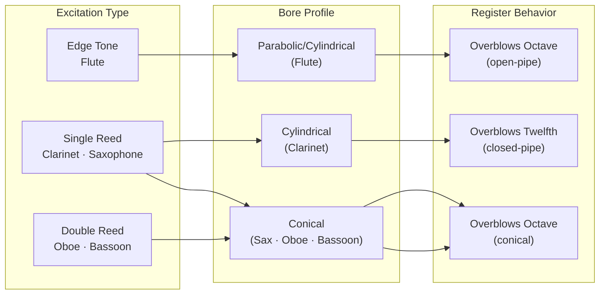
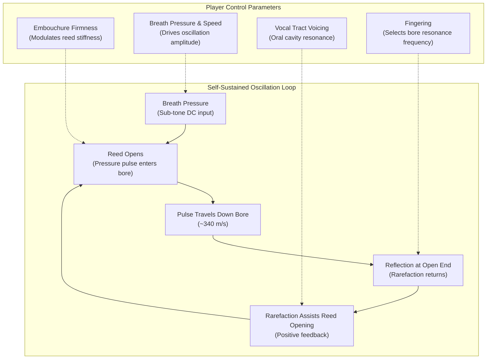
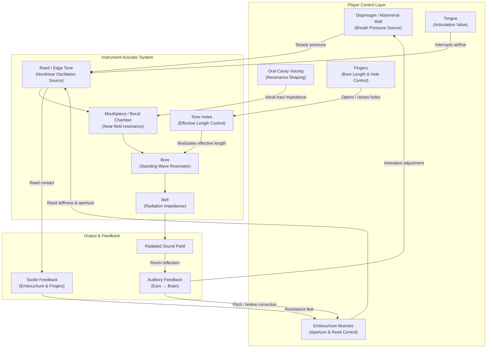

# Woodwind Mastery: Performance Technique, Sound Production & Instrument Systems

## Overview

This masterclass covers the woodwind family from the ground up — embouchure mechanics, breath support, fingering systems, articulation, and tone development. The curriculum is organized by playing priority: what you feel and do first, grounded in just enough acoustic understanding to explain *why* the technique works. Labs build from single sustained tones to full-range technical exercises.

**Instruments covered:** Flute (Böhm system, C), Bb Clarinet (cylindrical bore), Alto Saxophone (Eb, conical), Oboe (conservatory system), Bassoon (Heckel system).



---

## Part 1: Breath Support — The Foundation of Everything

Before touching a fingering chart, every woodwind player must internalize diaphragmatic breath support. The instrument is just a resonator; *you* are the engine.

### 1.1 Diaphragmatic Breathing Mechanics

The diaphragm is a dome-shaped muscle beneath your lungs. When it contracts (flattens), it creates negative pressure that draws air in. When it releases, the lungs deflate passively — but for playing, you actively control the release with your abdominal wall.

**The column model:** Think of your airstream as a column of water in a hose. High pressure at the source (compressed abdomen), small aperture at the end (embouchure), fast laminar flow. Turbulence is your enemy.

**Drill 1 — Breath Control Without the Instrument (5 minutes daily)**

1. Place one hand on your sternum, one on your navel.
2. Inhale for 4 counts: only the navel hand should move outward. If your sternum rises, reset.
3. Exhale on a sustained "shhh" for 8 counts. Feel your abdominal wall gently compress inward.
4. Add resistance: exhale on a thin, fast "ss" for 16 counts. This is the pressure and speed needed for a fortissimo high note.

**Metronome targets:**
- Week 1: 4-count inhale / 8-count exhale at ♩ = 60
- Week 2: 4-count inhale / 12-count exhale
- Week 3: 2-count inhale / 16-count exhale

### 1.2 Breath Pressure vs. Breath Volume — Know the Difference

| Register | Flute | Clarinet | Saxophone | Oboe | Bassoon |
|---|---|---|---|---|---|
| **Low** | Low pressure, high volume | Low-medium pressure | Low pressure, full volume | High pressure, narrow aperture | Medium pressure |
| **Middle** | Medium pressure | Medium pressure | Medium pressure | Medium-high pressure | Medium pressure |
| **High** | High pressure, reduced volume, faster air | High pressure, faster air | High pressure, faster air | Very high pressure | High pressure |

**Key rule:** Going higher in register requires *faster, more compressed* air — not more volume. This is the single most common mistake beginners make (over-blowing low notes, under-supporting high notes).

---

## Part 2: Embouchure Mechanics by Instrument

### 2.1 Flute Embouchure

The flute produces sound via an **edge tone**: you direct a focused airstream across the embouchure hole, splitting it on the far edge. Half the air goes into the tube; half escapes. The ratio you direct inward determines pitch and dynamics.

**Setup checklist:**
1. Roll the headjoint so the embouchure hole center aligns with the keys of the body joint.
2. Rest the edge of the embouchure plate on your lower lip, *not* the chin. The hole center sits at or just below the lip line.
3. Form a relaxed "puh" with your lips. The aperture (embouchure hole in your lips) is an oval, roughly 10–12 mm wide × 4–5 mm tall for middle register.
4. Direct the air *downward* at approximately 25–35° below horizontal for low register; flatten toward horizontal as you ascend.
5. Upper lip: relaxed, not pulled back. No smiling — a spread embouchure kills the tone.

**Common fault — Chin tension:** If your tone is thin and airy, your aperture is too large. If your tone is tight and pinched, your chin muscle is tense. The chin should be flat, like a flattened ball — the "apple chin" position.

**Drill 2 — Tone without the headjoint**

Hold just the headjoint. Cover the open end with your palm. Produce a steady, resonant tone on the note B4 (open end sealed). Sustain 10 seconds. This isolates embouchure formation from fingering entirely.

Target: Clear, centered tone with no breathiness within 2 weeks of daily 10-minute sessions.

### 2.2 Clarinet Embouchure

The clarinet uses a **single reed** (cane or synthetic) clamped against the mouthpiece by the ligature. The reed vibrates against the mouthpiece table, acting as a pressure-controlled valve.

**Setup — lower lip over teeth:**
1. Roll your lower lip *over* your bottom teeth so the lip cushions the reed. About 1/3 of the red part of your lower lip is in contact with the reed.
2. Upper teeth rest *directly on top of the mouthpiece* — no rolling, no biting down. This is your anchor point.
3. Lip seal: corners of your mouth grip the mouthpiece sides gently. No air escapes.
4. Chin: flat and firm, pulled slightly downward. This keeps the reed channel open.
5. Jaw position: slightly dropped — imagine you have a small cork between your back molars.

**Mouthpiece angle:** Approximately 35–45° down from horizontal. Beginners often take too little mouthpiece (only 5–8 mm). You need 10–14 mm of mouthpiece inside the mouth to get enough reed vibrating length.

**Common fault — The Bite:** Squeezing the reed with the lower lip against the upper teeth. Symptoms: sharp intonation on middle register, thin tone, fatigue after 10 minutes. Solution: drop the jaw, relax the lower lip contact.

**Drill 3 — Mouthpiece only long tones**

Play the mouthpiece alone (no barrel). You should produce a concert A (written B) around 440 Hz. Too sharp = too much jaw pressure. Too flat = not enough lip firmness or insufficient mouthpiece in the mouth.

Sustain for 8 counts, rest 4 counts. Repeat 10×. Target: pitch within ±25 cents of 440 Hz with consistent tone. Practice daily before assembling the instrument.

### 2.3 Saxophone Embouchure

Saxophone embouchure is closely related to clarinet but with important differences: conical bore, larger reed, and a wider mouthpiece angle.

**Setup:**
1. Lower lip curves *over* bottom teeth — same as clarinet, but with a slightly *firmer* lip contact given the larger reed surface.
2. Upper teeth on mouthpiece. Because saxophone mouthpieces have higher baffle chambers, you typically take slightly *less* mouthpiece depth (10–12 mm for alto).
3. The mouthpiece angle is *more downward* than clarinet: 50–65° from horizontal.
4. Corner seal: firm "ooh" shape — not spread, not pursed like a kiss.

**Alto vs. tenor/baritone:** Larger instruments require more mouthpiece and a wider aperture. For tenor, lip contact increases proportionally.

**Key difference from clarinet:** The saxophone is a conical bore and overblows at the octave (not the twelfth). This means your embouchure adjustment moving between registers is *smaller* — just a slight compression and faster air. Many clarinet players who double on sax over-tighten the embouchure going to high notes.

### 2.4 Oboe Embouchure

The oboe uses a **double reed** — two pieces of cane bound together with a wire and thread staple. The two blades vibrate against each other, creating an extremely efficient pressure-controlled oscillator.

**Double reed characteristics:**
- Reed opening at rest: 1.0–1.5 mm (much smaller than clarinet)
- Very high playing pressure required: 5–15 kPa (vs. 1–5 kPa clarinet)
- The reed is entirely inside the mouth; lips contact the reed blades, not a mouthpiece

**Setup:**
1. Take the reed to approximately the second wire binding — usually 10–12 mm inside the mouth.
2. Lips: form a relaxed "oh" shape. Both lips roll *over* the teeth, surrounding the reed blades with a soft cushion.
3. The lip contact point is at the first wire binding — not on the blades themselves.
4. Embouchure firmness: the corners hold the reed in a consistent oval shape. If the lips collapse inward, the reed clamps shut. If they spread, the reed opens too wide and pitch drops.
5. Jaw: slightly dropped, relaxed. This is *critical* — a clenched jaw ruins intonation on oboe.

**The crow:** Before playing, hold the reed alone and blow through it without embouchure. You should hear an unfocused, raspy buzz on a low C or B. Now add gentle lip pressure — the pitch should focus up to a bright Bb–C (sounding pitched around C5–D5 on the reed alone). This is your "crow" check. If the reed crows too flat, it may need adjustment; too sharp, consider wetting it longer.

### 2.5 Bassoon Embouchure

The bassoon uses a wide double reed on a metal bocal (crook). The reed is significantly larger than oboe, requiring different lip coverage.

**Setup:**
1. The reed goes into the mouth to roughly the first wire — approximately 15–18 mm.
2. Both lips roll over teeth similarly to oboe, but the contact is *wider* given the larger reed.
3. The upper lip does more sealing work on bassoon; it folds more pronouncedly over the top blade.
4. Chin: flat and firm, same as clarinet. Avoid chin bunching.
5. Bocal angle enters the mouth at roughly 30–40° from horizontal.

**Low register bassoon:** Requires relaxed, open embouchure with *more* reed in the mouth and slightly relaxed lip tension. Many beginners clamp too hard, flattening the low Bb–D range. Think "open throat, hissing like a snake."

---

## Part 3: Fingering Systems — Fretboard-Style Reference

### 3.1 Böhm Clarinet Fingering System — Chalumeau Register

The Böhm clarinet has 17 keys and 6 main tone holes. We use the following notation:

```
Left Hand (L):         Right Hand (R):
1 = Index              1 = Index
2 = Middle             2 = Middle
3 = Ring               3 = Ring
4 = Pinky              4 = Pinky
T = Left Thumb         Register key = Left Thumb back
```

**Standard tone hole notation:** ● = covered, ○ = open, × = register key

**Chalumeau Register (Low E3–C5, written):**

```
Note    L.T  L1  L2  L3  L4   R1  R2  R3  R4  Notes
E3      ●    ●   ●   ●   ●    ●   ●   ●   ●   All holes covered
F3      ●    ●   ●   ●   ●    ●   ●   ●   ○   RH pinky up
F#3     ●    ●   ●   ●   ●    ●   ●   ○   ○   
G3      ●    ●   ●   ●   ○    ●   ●   ●   ○   LH pinky side key
G#3     ●    ●   ●   ●   ●    ○   ●   ●   ●   G# key (LH or RH)
A3      ●    ●   ●   ●   ●    ○   ●   ●   ○   
Bb3     ●    ●   ●   ●   ●    ○   ○   ●   ○   (1st position)
B3      ●    ●   ●   ●   ○    ○   ●   ●   ○   
C4      ●    ●   ●   ○   ○    ○   ●   ●   ○   
C#4     ●    ●   ○   ●   ○    ○   ●   ●   ○   
D4      ●    ●   ○   ○   ○    ○   ○   ○   ○   
Eb4     ●    ●   ○   ○   ○    ○   ○   ●   ○   (Eb/D# key)
E4      ●    ○   ○   ○   ○    ○   ○   ○   ○   
F4      ○    ●   ●   ●   ○    ○   ●   ●   ○   
F#4     ○    ○   ●   ●   ○    ●   ●   ●   ○   
G4      ○    ○   ○   ●   ○    ●   ●   ●   ○   
Ab4     ○    ○   ○   ○   ○    ○   ●   ●   ●   
A4      ○    ○   ○   ○   ○    ○   ○   ●   ○   
Bb4     ○    ○   ○   ○   ○    ○   ●   ○   ●   (Bis Bb — most used)
B4      ○    ○   ○   ○   ○    ●   ○   ○   ○   
C5      ○    ○   ○   ○   ○    ○   ○   ○   ○   All holes open
```

**Clarion Register (D5–C6, written):** Add register key (left thumb back key) to the chalumeau fingering. The clarinet overblows at the **twelfth** (interval of 12 half steps = octave + perfect fifth) because of its cylindrical bore and closed-end behavior.

```
D5  = Register key + D4 fingering
E5  = Register key + E4 fingering
F5  = Register key + F4 fingering
(etc., all the same as chalumeau fingering + register key)
```

**Critical note:** Moving from B4 (chalumeau) to C5 opens *all* holes — this is the most acoustically open note on the instrument and tends to be flat. Embouchure must compensate with slightly firmer lip contact and faster air.

### 3.2 Alto Saxophone Fingering — Full Range Reference

Saxophone notation: T = thumb octave key, 1-2-3 = index-middle-ring (each hand), ★ = palm keys, side keys designated by finger.

**Low Bb2 to G4 (written, one octave chart):**

```
Note     Oct  L1  L2  L3   R1  R2  R3  Notes
Bb2      ○    ●   ●   ●    ●   ●   ●   + front Bb key (LH side)
B2       ○    ●   ●   ●    ●   ●   ●   + LH pinky key
C3       ○    ●   ●   ●    ●   ●   ●   
C#3      ○    ●   ●   ●    ●   ●   ○   + G#/C# key
D3       ○    ●   ●   ●    ●   ●   ○   
Eb3      ○    ●   ●   ●    ●   ○   ●   
E3       ○    ●   ●   ●    ○   ○   ○   
F3       ○    ●   ●   ○    ○   ○   ○   
F#3      ○    ●   ○   ●    ○   ○   ○   
G3       ○    ○   ○   ○    ○   ○   ○   All holes open
Ab3/G#3  ○    ○   ○   ○    ○   ○   ○   + G# key (LH pinky)
A3       ○    ●   ○   ○    ○   ○   ○   (octave vent for A, automatic)
Bb3      ○    ●   ●   ●    ●   ●   ●   + Bis Bb or side Bb
B3       ○    ●   ●   ●    ●   ●   ○   
C4       ○    ●   ●   ●    ●   ○   ○   
...
```

**Upper register (Octave key depressed = ●):** Depress thumb octave key; fingering patterns remain identical to low register. The saxophone overblows at the octave — your embouchure adjustment is minimal (slightly firmer corners, fractionally faster air).

**High register palm keys (D5–F#5 written):** Use left palm to depress 1–3 palm keys. D5 = 1 palm key; E5 = 2 palm keys; F5 = 3 palm keys; F#5 = 3 palm keys + side F key.

### 3.3 Flute Fingering — Key Register Transitions

```
Note     T    1    2    3    4    5    6    Foot  Notes
C4       ●    ●    ●    ●    ●    ●    ●    ●     (B foot clarifies low C)
D4       ○    ●    ●    ●    ●    ●    ●    ●
E4       ○    ●    ●    ●    ●    ●    ○    ○
F4       ○    ●    ●    ●    ●    ○    ○    ○
F#4      ○    ●    ●    ●    ○    ○    ○    ○
G4       ○    ●    ●    ○    ○    ○    ○    ○
Ab4      ○    ●    ●    ○    ●    ○    ○    ○     (trill key variant)
A4       ○    ●    ○    ○    ○    ○    ○    ○
Bb4      ○    ●    ●    ●    ●    ●    ●    ●     (using Bb lever — most common)
B4       ○    ●    ○    ○    ○    ○    ○    ●     (B foot)
```

**Register transition — the break from second to third octave:** Unlike clarinet, flute register transitions are achieved purely by embouchure and air speed. No register key exists. To move from B4 to C5:
- Increase air speed (compress your abdomen more firmly)
- Flatten the embouchure plate angle slightly toward the lips
- Narrow the aperture slightly

A common error is "rolling in" too much to reach the third octave — this darkens and flattens the pitch. Roll *out* slightly to brighten and center.

---

## Part 4: Tone Production Drills — Progressive Exercises

### 4.1 Long Tone Practice — The Daily Foundation

Long tones are the most high-ROI practice you can do. No shortcuts.

**Drill 4 — Single-Note Long Tones with Dynamic Shape**

Play a single note in the middle register of your instrument (written G4 on clarinet/sax, A4 on flute, A3 on oboe).

```
Shape: ppp ──crescendo──> fff ──diminuendo──> ppp
Duration: 20 seconds total
Metronome: Counts in quarter notes at ♩ = 60
Beats 1-5: Gradually crescendo from barely audible
Beats 5-15: Continue growing
Beats 15-20: Diminuendo back to ppp without stopping tone
```

**What to listen for:**
- Does the pitch stay *exactly* centered throughout the dynamic shape? Most players go sharp as they crescendo and flat as they diminuendo. Focus on the following compensation:
  - Crescendo: slightly drop the jaw / relax embouchure to keep pitch from rising
  - Diminuendo: slightly firm the embouchure to keep pitch from falling
- Is the tone quality consistent? A crescendo that gets "squeezed" and bright at the top, then "cloudy" at pp, indicates uneven breath support.

**Weekly progression:**

| Week | Note | Dynamic Shape | Duration |
|---|---|---|---|
| 1 | G4 (cl) / A4 (fl) | mp → f → mp | 12 sec |
| 2 | G4 & D4 | p → ff → p | 16 sec |
| 3 | Chromatic scale, one note per breath | pp → mf → pp | 16 sec |
| 4 | Major scale, octave | pp → ff → pp | 20 sec |
| 5+ | Full range, every semitone | ppp → fff → ppp | 20 sec |

### 4.2 Interval Tuning Drill — Training Intonation with Drones

This drill develops the most critical skill in ensemble playing: hearing and adjusting your pitch relative to a reference.

**Setup:** Use a drone app (GarageBand, PitchDrone, or a synthesizer) set to your instrument's tonic (Bb concert for clarinet players = written C; F concert for flute = written F).

**Drill 5 — Major Scale over Drone**

1. Set drone to concert Bb (for clarinet players: drone sounds Bb, you finger middle C = concert Bb).
2. Play the entire Bb major scale (written C major on Bb clarinet), one note at a time, holding each note for 4 beats at ♩ = 60.
3. Listen for beating between your tone and the drone on scale degrees 1, 4, 5, and 8 (tonic, subdominant, dominant, upper tonic). These should be *beatless*.
4. Scale degrees 3, 6, and 7 will beat slightly — this is normal for equal temperament vs. just intonation. Learn to recognize and control the beat rate.

**What "beating" tells you:**
- Fast beats (more than 4 per second): significantly out of tune
- Slow beats (1–2 per second): slightly out of tune — adjust embouchure
- No beats: in tune
- As a beat slows and disappears: you are approaching unison. Lock onto that position and remember the embouchure/air feeling.

**Tempo progression:** ♩ = 60 → 80 → practice at 80 until automatic, then remove the drone and test.

### 4.3 Vibrato — Flute, Oboe, and Saxophone

Vibrato is a *periodic modulation* of pitch (and to a lesser extent, amplitude) produced differently on each instrument.

**Flute vibrato:** Generated by diaphragm pulses, *not* jaw movement. Practice by:
1. Sustain a steady A4.
2. Add "ha-ha-ha-ha" pulses with your diaphragm at ♩ = 60 (4 pulses per beat).
3. Gradually speed up to 60 bpm × 6 pulses, then × 8.
4. Smooth the pulses into a continuous undulation.

Target vibrato rate for orchestral playing: 5–6 oscillations per second (Hz) at moderate tempo.

**Oboe vibrato:** Lip-based ("throat vibrato" is an error on oboe — it destabilizes the high-pressure system). Slight rhythmic firmness-and-release of lip contact. Practice extremely slowly — this is subtle on oboe.

**Saxophone vibrato:** Jaw vibrato is standard (unlike flute). Jaw drops and rises slightly, modulating reed opening. Practice "ya-ya-ya-ya" jaw motion without the instrument first, then apply to sustained tones. Aim for a relaxed, wide-wave vibrato similar to a string player for ballad playing; narrow it to nearly straight for classical playing.

**Clarinet and bassoon:** Vibrato is used sparingly or not at all in classical playing; standard in jazz clarinet. When used, diaphragm-based is preferred.

---

## Part 5: Articulation — The Language of the Tongue

Articulation is how you shape individual notes and define musical character. The tongue is the gatekeeper between the breath column and the vibrating source.

### 5.1 Single Tongue — Foundation Mechanics by Instrument

The tongue tip touches a *specific point* on each instrument. Getting this wrong is the most common root cause of slow articulation and poor tone attacks.

| Instrument | Tongue Contact Point | Syllable | Feel |
|---|---|---|---|
| Flute | Lower lip or just inside lower teeth — the air stream, not the embouchure hole | "Tuh" or "Duh" | Lightest touch; the tongue interrupts the airstream, not the reed |
| Clarinet | Tip of tongue to the tip of the reed — the very end of the bottom blade | "Tuh" or "Du" | Feel the reed on the tongue tip; don't stab, dab |
| Saxophone | Tip of reed (same as clarinet principle, larger reed surface) | "Tuh" or "Du" | Firmer than clarinet due to larger reed |
| Oboe | Reed tip (both blades); tongue approaches from below | "Tuh" or "Du" | Very light — excessive force clamps the reed |
| Bassoon | Reed tip, tongue from below | "Tuh" or "Du" | Relaxed; the large reed is sensitive |

**What the tongue does *not* do:** Stop the airflow. The breath column keeps moving — the tongue only momentarily interrupts the reed/airstream. Many students stop breathing between tongued notes, which kills tone and speed.

### 5.2 Articulation Drill Progression — All Woodwinds

**Drill 6 — Single Tongue on One Pitch**

Choose a comfortable middle register note (written G4 clarinet/sax, A4 flute, A3 oboe).

```
Exercise A — Even 8th notes:
♩ = 60: G G G G G G G G (8 notes, single tongue each)
♩ = 72: same
♩ = 84: same
♩ = 100: same
♩ = 116: same
Maximum clean tempo: typically 120–132 BPM for beginners

Exercise B — Staccato (notes very short, silence between):
♩ = 60: short G, rest, short G, rest... (staccato 8ths)
Focus: each note sounds identical — same attack, same length, same tone

Exercise C — Accented notes:
♩ = 72: > G G G G (accent every 4th note, then every 2nd)
Focus: accent = more breath, same tongue speed
```

### 5.3 Double and Triple Tonguing

When single-tongue speed plateaus (~132–144 BPM 16th notes), double tonguing unlocks faster passages.

**Double tongue syllables:** T-K-T-K or D-G-D-G

The "K/G" is produced by the back of the tongue hitting the soft palate (velum). Important: the K stroke must be *equal* to the T stroke in force and tone quality — this requires dedicated practice.

**Triple tongue:** T-K-T / T-K-T or T-T-K / T-T-K (for triplet-based figures)

**Drill 7 — Double Tongue Builder**

```
Step 1: T only — 4 notes at ♩ = 80 (establish single tongue tone quality reference)
Step 2: K only — 4 notes at ♩ = 80 (K strokes sound as clear as T)
Step 3: TK pairs — 2 notes at ♩ = 60 (slow, deliberate, listen for evenness)
Step 4: TKTK on one pitch — ♩ = 80, 100, 120, 144
Step 5: TKTK on scale — once pitch-change is clean, raise tempo

Red flag: If T sounds clear and K sounds "muddy," your K is too far back.
Fix: Move K tongue contact point forward; "K" should feel almost like it's in the middle of your mouth.
```

**Expected progression:**
- Week 1-2: TK even at ♩ = 80 (16th notes)
- Week 3-4: ♩ = 100
- Month 2: ♩ = 120+ with scale passages

### 5.4 Legato — Connecting Notes Without the Tongue

Legato means the tongue does *not* re-attack between notes. The only interruption is the fingering change itself.

**The legato problem on woodwinds:** When fingers move between notes, there is a brief period where both the old and new holes/pads are partially open — creating a glitch pitch. The solution is *simultaneous* finger movement: all fingers must land at exactly the same moment. Early or late fingers create "grace notes" you didn't intend.

**Drill 8 — Slow Legato Scale for Finger Coordination**

```
♩ = 40: Play G major scale, 2 beats per note, NO tongue
Focus entirely on simultaneous finger placement
Increase by 4 BPM every two passes
Target: ♩ = 72 with zero pitch glitches between notes
Then use tongued reference: play same scale tongued, compare pitch glitch presence
```

---

## Part 6: Register Traversal — The Break

Every woodwind has a "break" — the register transition where the instrument physically shifts its mode of vibration. This is where beginners struggle most.

### 6.1 The Clarinet Break (E4/F4 → F4/G4 written)

The clarinet break separates the chalumeau register (up to written G#4/Ab4) from the clarion register. Crossing it requires:
1. Coordinated addition of the register key (left thumb, back of instrument)
2. Slight increase in air speed and minimal embouchure firmness increase
3. Precise finger placement — the break fails when fingers are poorly synchronized

**The notorious A4–Bb4 clarion voice leading:** After mastering the break in scale passages, the hardest interval is any note in chalumeau jumping to the same note + register key in clarion.

**Drill 9 — The Clarinet Break Ladder (♩ = 60 → 100)**

```
Level 1: Long tone crossing — G4 (chalumeau) → G5 (clarion), slurred, 4 beats each
Level 2: G4 ↔ G5, alternating each beat
Level 3: Scale crossing — play E4-F4-F#4-G4|G4-A4-B4-C5 slurred (bar line = register key added)
Level 4: Thirds across the break — G4-B4, A4-C5, Bb4-D5, etc.
Level 5: Full scale over the break at ♩ = 92 without any glitches
```

**What goes wrong:** The tongue fires an extra note during the register key transition. Cure: exaggerate the finger coordination in slow practice. The register key must arrive *before or simultaneously* with the new note fingering, never after.

### 6.2 The Flute Second-to-Third Octave Transition

Flute has no register key. The third octave (C6+) is entirely achieved by embouchure and air speed.

**Transition mechanics:**
- Increase abdominal compression → faster airstream
- Narrow the lip aperture very slightly (corners firm up)
- Bring the lower jaw forward 1–2 mm — this angles the air direction slightly upward, favoring the higher resonance mode
- Do NOT roll the flute in toward the lips (a common overcompensation)

**Drill 10 — Flute Octave Slurs**

```
♩ = 60: 
D4 (open) → slur → D5 → slur → D6
Hold each note 4 beats. Focus on jaw position change, not embouchure squeezing.
Common fault: D6 sounds → goes flat → player rolls in → goes even flatter.
Correction: Keep the same roll-out position and increase air speed instead.
```

---

## Part 7: Intonation Tendencies by Instrument — Problem Notes and Solutions

Every woodwind has notes that are inherently sharp or flat due to bore geometry, tone hole placement, and acoustic physics. Knowing these in advance means you can compensate automatically rather than hunting during performance.

### 7.1 Clarinet Intonation Map

```
SHARP by nature (need to open/relax embouchure):
- Written G#4 / Ab4: Use alternate fingering (register key + standard G) when possible
- Written Bb5 (clarion): Very sharp on most instruments; drop jaw 1–2 mm
- Throat tones (G4–Bb4 written): Naturally bright/sharp; use voicing (say "oh" internally)

FLAT by nature (need to firm up / add jaw pressure):
- Written C5 / D5 (chalumeau top): Very flat — firm embouchure, faster air
- Written high E6, F6 (altissimo): Often flat; support with high-velocity air
- Low E3, F3 (clarinet bottom): Can be flat on cold instruments; warm up for 5 min first
```

**Voicing trick for throat tones:** Think the vowel "oh" or "oo" internally while playing the throat tones (G4, Ab4, A4, Bb4). This shapes the oral cavity, raising the resonance frequency slightly to center the pitch.

### 7.2 Flute Intonation Map

```
SHARP by nature:
- Middle Bb4: Most flutes sharp; use thumb Bb key (lever), not Bis key, to lower pitch
- High D6, E6: Sharp; relax aperture slightly, keep air speed high

FLAT by nature:
- Low C4, C#4, D4: Very flat (all woodwinds tend flat in low register when cold)
  Fix: Push headjoint in slightly for cold performance conditions
- C6 (all-fingers-up note): Often flat; firm embouchure, forward jaw
- Low Bb (B-foot): Rolls flat quickly; full breath support, do not "blow through" this note
```

**Flute headjoint tuning:** Pulling the headjoint out lowers pitch (lengthens the tube). Pushing in raises pitch. Standard starting position: gap of approximately 12–14 mm from the embouchure hole center to the headjoint end. Adjust by ear against a drone reference at playing temperature.

### 7.3 Saxophone Intonation Map

```
SHARP by nature:
- Palm key notes (D5, E5, F5): Sharp on virtually all saxophones; drop jaw, relax corners
- High G#5 / A5: Sharp; use long-side C key alternate for A5

FLAT by nature:
- Low Bb2, B2: Very flat (long tube, cold); support with full breath
- Mid Eb3: Flat on many instruments; use side Eb key alternate
- Mid C#3: Flat; firm embouchure, check neck cork fit
```

---

## Part 8: Reed Care, Mouthpiece Selection, and Instrument Maintenance

Sound production quality starts before you pick up the instrument. A bad reed or leaking pad wastes practice time.

### 8.1 Reed Selection and Break-In Protocol

**Synthetic reeds (Légère, Forestone, D'Addario Venn):** Ready to play out of the box. Consistent from reed to reed. Excellent for practice, gigging in variable humidity. Synthetic reeds run approximately half a strength higher than labeled cane — a Légère 3.0 often plays like a cane 2.5.

**Cane reeds (Vandoren, Rico, Alexander):** Require break-in and rotation.

**New cane reed break-in protocol:**
1. Wet the reed by holding it in your mouth (saliva) for 30 seconds.
2. Play for no more than 5 minutes the first day.
3. Rest 24 hours.
4. Play 10 minutes second day.
5. Rest again.
6. By day 5–7: fully broken in, optimal performance.

Rotate between 3–5 reeds in a cycle. Never play the same reed two days in a row for the first two weeks.

**Reed selection test:**
1. Wet the reed, assemble the instrument.
2. Play a low middle-register note (written G clarinet) at mp. If it starts immediately without excessive pressure: good candidate.
3. Play the full range. If notes crack easily or refuse above the break: reed is too soft.
4. If you have to push very hard or the low notes won't speak: reed is too hard.
5. Optimal: comfortable in low register, the high register requires slight effort but speaks cleanly.

**Reed strength guide by instrument:**

| Instrument | Beginner | Intermediate | Advanced |
|---|---|---|---|
| Clarinet | 2.0–2.5 | 2.5–3.0 | 3.0–3.5 |
| Alto Sax | 2.0–2.5 | 2.5–3.0 | 3.0–3.5 |
| Tenor Sax | 2.0–2.5 | 2.5–3.0 | 3.0–3.5 |
| Soprano Sax | 2.0–2.5 | 2.5–3.0 | 3.0–3.5 |

Oboe and bassoon reeds are typically hand-made or purchased from specialized makers; "strength" is replaced by "opening" and "scrape" characteristics.

### 8.2 Mouthpiece Selection Guide — Clarinet and Saxophone

| Parameter | What It Affects | Smaller | Larger |
|---|---|---|---|
| Tip opening (mm) | Resistance, flexibility | More resistant, easier to control | More flexible, harder to control |
| Facing length | Vibrating reed length | Less vibration, brighter | More vibration, darker |
| Chamber volume | Tone color | Brighter, more projection | Darker, warmer |
| Baffle height | Brightness, edge | Darker | Brighter, more "edge" |

**Clarinet starting recommendations:**
- Classical: Vandoren B45 or 5RV Lyre (medium tip opening 1.14–1.19 mm, small-medium chamber)
- Jazz/klezmer: Vandoren M13 or Zinner mouthpieces (larger tip opening 1.25–1.35 mm)

**Alto sax starting recommendations:**
- Classical: Vandoren Optimum AL3 or Selmer C* (medium opening ~1.6–1.7 mm)
- Jazz: Meyer 5M or Otto Link 6* (medium-large opening 1.8–2.0 mm)

**The ligature:** The ligature clamps the reed to the mouthpiece. Leather and fabric ligatures (BG, Rovner) allow the reed to vibrate more freely, producing a warmer, more flexible tone. Metal ligatures (Vandoren Optimum, Bonade) provide more resistance and presence. For beginners, any correctly-fitted ligature works fine. The reed vibrates; the ligature just holds it in place — don't overthink it until you've developed a consistent embouchure.

### 8.3 Pad Leakage Diagnosis — The Feeler Gauge Method

A leaking pad causes sharp intonation, weak tone, or notes that refuse to speak.

**Diagnosis:**
1. Remove the reed and blow firmly into the instrument with all keys closed.
2. If air escapes: a pad is leaking.
3. Insert a cigarette paper (or feeler gauge strip) under each pad systematically.
4. Close the pad. Pull the paper slowly. If it slides out freely with no resistance: the pad is not sealing.
5. Normal: you should feel consistent drag across the full pad circumference.

**Common leak sources:**
- Lower joint on clarinet: low E, F, F# keys
- Saxophone octave key mechanism
- Any keywork that hasn't been played for extended periods (pads dry-seal to the tone holes)

**Emergency fix:** A small amount of Valentino pad cement on the edge of a leaking pad can restore seal temporarily. Proper repair requires a technician.

**Preventive maintenance schedule:**

| Frequency | Task |
|---|---|
| After every session | Swab out bore with silk swab, oil the reed, store reed in flat case |
| Weekly | Check for loose screws, test pad sealing with feeler paper |
| 6 months | Professional pad check, cork grease application to tenon corks |
| Yearly | Full service: regulation, pad replacement if needed, mechanism adjustment |

---

## Part 9: Acoustic Fundamentals — Why These Techniques Work

This section provides just enough physics to explain the techniques above. We cover it *after* the technique so the physics serves the playing, not the reverse.

### 9.1 Why the Clarinet Overblows at the Twelfth

The clarinet is essentially a **closed cylindrical pipe** (closed at the mouthpiece end, open at the bell). Closed-pipe resonators only support *odd-numbered harmonics*: the fundamental (n=1), then 3rd harmonic (n=3, the twelfth), then 5th, 7th, etc. This is why:
- The clarion register is a twelfth above chalumeau (not an octave)
- The clarinet has a characteristic "hollow" timbre in the low register (even harmonics are suppressed)
- The chalumeau register has a distinctively dark, woody quality absent from the flute or sax

Conical bores (sax, oboe, bassoon) support all harmonics including even ones, so they overblow at the octave and have a fuller, brighter harmonic spectrum.

### 9.2 The Excitation Mechanisms — What the Reed and Edge Tone Do

All woodwind excitation is a **self-sustained feedback oscillation**:

1. The player applies sub-tone pressure (breath) to the input.
2. The reed (or air jet) allows a pulse of air into the bore.
3. That pulse travels down the bore, reflects at the open end (or first open tone hole), and returns as a rarefaction wave.
4. The returning rarefaction *assists* in opening the reed again.
5. This synchronizes the reed vibration to the bore's resonance frequency — not the reed's own natural frequency.

This is why changing fingering changes pitch: you're changing which resonance mode the bore favors, and the reed locks onto that frequency.



### 9.3 Bore Geometry and Its Effect on Tone

| Bore Type | Instrument | Harmonic Content | Timbre Character |
|---|---|---|---|
| Cylindrical | Clarinet | Odd harmonics dominate | Dark, hollow, woody |
| Conical | Sax, Oboe, Bassoon | Full harmonic series | Bright, complex, rich |
| Parabolic/Cylindrical hybrid | Flute | Full harmonics, modified by open ends | Clear, flute-like, projecting |

The key insight for players: a **cylindrical bore instrument needs more embouchure adjustment** crossing registers because it's jumping between odd harmonics (1st → 3rd harmonic = twelfth). A **conical bore instrument** jumps from 1st to 2nd harmonic (octave), requiring a smaller adjustment.

### 9.4 Temperature and Intonation — The Practical Rule

The speed of sound increases approximately 0.6 m/s per °C. For playing purposes:

**Rule of thumb:** Every 6°C drop in temperature drops your pitch approximately 10 cents (1/10 of a semitone). Every 6°C rise raises it 10 cents.

**Practical implications:**
- Playing in a cold church (10°C vs. 20°C warmer practice room): you will be ~17 cents flat. Push headjoint/mouthpiece in before playing.
- After 10–15 minutes of playing, your instrument warms up significantly — retune.
- Oboe and bassoon reeds also change stiffness with humidity, adding another variable. Break reeds in gradually.

---

## Part 10: Scales, Arpeggios, and Technical Development

### 10.1 Daily Technical Routine — Bb Clarinet Scale System

Adapt these fingering patterns and targets to any woodwind — the interval logic is the same.

**Foundation Scale Drill (all 12 major scales, one octave):**

```
Target tempos:
♩ = 60:  q q q q (quarter notes)   — Week 1-2
♩ = 80:  eighth notes              — Week 3-4
♩ = 100: eighth notes              — Month 2
♩ = 120: 16th notes (triplet feel) — Month 3-4
♩ = 144: 16th notes               — Months 5-6
```

**Scale order by difficulty (clarinet, Böhm system):**

1. G major (1 sharp): only uses white keys + F# key
2. F major (1 flat): adds Bb fingering
3. D major (2 sharps): builds on G, adds C#
4. Bb major (2 flats): cross-break practice, Bb fingerings
5. A major (3 sharps): G# key work
6. Eb major (3 flats): multiple Eb fingerings
7. E major (4 sharps): Good cross-register workout
8. Ab major (4 flats): Difficult, three flat keys coordinated
9. B major (5 sharps): Full chromatic workout
10. Db major (5 flats): Enharmonic of C#
11. F# major (6 sharps): Uses both register key and cross-fingerings
12. Gb major (6 flats): Enharmonic of F#

### 10.2 Arpeggio Patterns — Major, Minor, Dominant 7th

Arpeggios expose finger synchronization problems more than scales because the intervals are wider.

**G major arpeggio (Bb clarinet, written):**
```
G4 – B4 – D5 – G5 – D5 – B4 – G4
Fingering: standard G, then cross break to B clarion, D clarion, G clarion
```

**Common break problem on the G major arpeggio:** G4 (chalumeau, all-fingers-up) to B4 (clarion) requires the register key to appear simultaneously with the removal of left hand fingers. Isolate this single interval and practice it at ♩ = 40 until perfect.

### 10.3 Chromatic Scale — Full Range

The chromatic scale tests all 12 pitch classes in sequence and is the best tool for even finger movement and consistent tone across the instrument.

**Clarinet chromatic scale fingering decisions:**

```
Bb4: Use Bis Bb key (index finger side key, right next to the first tone hole)
     — faster than side key Bb in rapid passages
     — but side key Bb is flatter, better for sustained notes

F#4: Use side Bb key / F# spatula — cleaner in descending passages

G#4/Ab4: Left pinky G# key — the main one
          Alternate: Right hand spatula key — for passages leading to Bb
```

**Practice format:**

```
♩ = 60, two beats per note → ♩ = 80, one beat per note → ♩ = 100, 16th notes
Full range: low E3 to written C6 (or higher)
```

---

## Part 11: Practical Performance Considerations

### 11.1 Warm-Up Sequence — 15 Minutes Before Any Performance

```
Minutes 0-3:   Long tones, middle register only (mf, no vibrato)
               Focus: embouchure settles, reed warms and saturates
Minutes 3-6:   Scales, one octave, slow (♩ = 60)
               Focus: finger coordination, intonation against room acoustics
Minutes 6-9:   Dynamic long tones (pp → ff → pp)
               Focus: full dynamic range available, test reed at extremes
Minutes 9-12:  Articulation — single tongue, light staccato (♩ = 80 8ths)
               Focus: tongue tip placement, consistency
Minutes 12-15: Passage work from repertoire — difficult spots only, slow
               Focus: build confidence in specific problem bars
```

### 11.2 Reed Emergency Protocols — Live Performance

**Scenario 1 — Reed cracks mid-performance:**
Have 2–3 pre-soaked backup reeds in your case. A reed soaked for 30 seconds and placed correctly can be functional within seconds.

**Scenario 2 — Reed too hard (sluggish, won't speak easily):**
Briefly press the flat side (table side) of the reed against your lower lip and rub lightly with a saliva-moistened thumb. This slightly increases moisture content and temporarily softens the reed.

**Scenario 3 — Reed too soft (easy to squeak, lacks projection):**
Let the reed dry slightly (5–10 minutes without playing). A marginally drier reed has more stiffness and projects better.

**Scenario 4 — Condensation bubbling in keys:**
Slide cigarette paper under the affected pad, close the key, and release. The paper absorbs the water. Repeat 2–3 times. For flute, this happens most often in the G key area.

### 11.3 Ear Training Integration — Matching Pitch in Ensembles

The most important performance skill has nothing to do with technique: it's listening.

**The two-voice rule:** At all times in ensemble playing, identify the instrument or section *most harmonically important* to your note. If you're playing a fifth above a cello, listen to the cello constantly, not to yourself.

**Active intonation listening positions:**
- Unison with another instrument: match beat patterns, then eliminate them
- Octave: should be beatless and resonant when in tune
- Perfect 5th: should lock into a stable acoustic resonance (the 3rd partial of the lower note)
- Major 3rd: needs to be played 14 cents *lower* than equal temperament for pure just intonation in a held chord

**Practical exercise for ensemble intonation:**

Tune A440 from the oboist (standard orchestral procedure). Then:
1. Hold concert A, compare to drone
2. Build a Bb major chord from bottom: bassoon/bass clarinet Bb, then add F, then add D on top
3. Each upper voice adjusts until the chord sounds resonant and "locked in" — you will feel the acoustic resonance physically

---

## Appendix A: Quick-Reference Fingering Charts

### Clarinet Chromatic Fingering — Problem Note Solutions

| Written Note | Standard Fingering | Alternate / Situation |
|---|---|---|
| Bb4 | Bis key (index side) | Side Bb key: flatter, better in slow passages |
| Bb4 | Side Bb | Easier for passages ending on Bb |
| F#4 | Standard (R1 side) | 1½ fingering (L1 half-hole) for smooth transitions |
| G#4 | LH pinky | RH spatula G#: when ascending from low register |
| Eb4 | Standard | Side Eb: when descending from above |
| A5 (clarion) | Standard | 1st alt: easier above the clarion break |

### Saxophone Altissimo Entry Fingerings (Alto, written)

```
D5 (palm): L1 (palm 1)
E5:        L1 + palm 2
F5:        L1 + palm 2 + palm 3
F#5:       L1 + palm 2 + palm 3 + side F
G5:        L1 + palm 2 + palm 3 + side F + R1
```

For notes above G5 (altissimo proper, written G#5+), voicing becomes the primary control mechanism. Research Joe Allard and Sigurd Rascher overtone approaches once the core technique is solid.

---

## Appendix B: Acoustic System Signal Flow



---

## Appendix C: Practice Log Template

Track these metrics weekly:

| Metric | Week 1 | Week 2 | Week 4 | Week 8 |
|---|---|---|---|---|
| Long tone max duration (sec) | | | | |
| Scale tempo — 8th notes (BPM) | | | | |
| Chromatic scale — 16th notes (BPM) | | | | |
| Single tongue max clean tempo | | | | |
| Double tongue clean tempo | | | | |
| Break crossing — no glitches (Y/N) | | | | |
| Dynamic range (pp to ff consistent) | | | | |
| Intonation drone test (worst note, cents) | | | | |

Review this log every two weeks. If a metric hasn't improved in four weeks, that's your practice priority for the next cycle. Consistent daily practice of 30–45 minutes outperforms sporadic 2-hour sessions every time.
