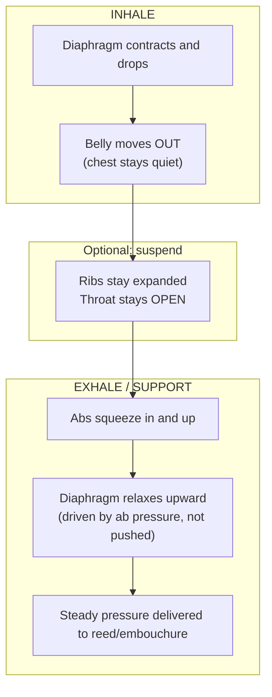

# Lesson 1: Breathing Techniques for Woodwind Performance

## 1. Why Breath Comes Before Everything Else

Every woodwind sound starts as moving air that gets converted into vibration — a reed flapping, an edge tone shearing at the flute's embouchure hole. The embouchure and fingers shape that vibration into pitch and tone, but breath supplies the energy. If the air column feeding the reed or edge is shaky, no amount of fingering precision or embouchure finesse will produce a stable sound. Get the breath right first; everything else becomes easier.

**The one-paragraph physics you need:** air pressure in your mouth (measured in cm H₂O, same units a doctor uses for blood pressure) drives flow through the horn. Flow rate depends on how much resistance the instrument presents — a tiny oboe reed aperture resists a lot, so you need high pressure but little volume of air; an open flute embouchure resists almost nothing, so you need high volume of air at very low pressure. That's the entire reason a flutist runs out of air in 8 bars while an oboist gets light-headed from holding too much *in*. Everything else in this lesson is about managing that pressure/flow trade-off with your body.

| Instrument | Mouth pressure needed | Air flow rate | What this means in practice |
|---|---|---|---|
| Flute | 2–8 cm H₂O | 20–40 L/min (high) | You run out of air fast — plan short phrases, frequent quick breaths |
| Clarinet | 10–25 cm H₂O | 15–25 L/min | Moderate on both — most forgiving for beginners |
| Oboe | 20–40 cm H₂O | 5–12 L/min (low) | You barely use any air — risk is holding stale air too long, not running out |
| Bassoon | 15–30 cm H₂O | 12–20 L/min | Similar issue to oboe, less extreme |
| Saxophone | 8–20 cm H₂O | 18–30 L/min | Closer to clarinet/flute — flow-hungry at low pressure |

If you remember nothing else: **oboe and bassoon players should worry about carbon dioxide buildup, not running out of air. Flute and sax players should worry about running out of air, not CO₂.** The practice priorities for each instrument diverge from this one fact.

## 2. The Three-Muscle System You're Actually Controlling

Forget lung anatomy diagrams — here's what you need to feel and control:

1. **The diaphragm** (inhalation). A dome of muscle under your lungs. When it contracts, it flattens and drops, which pulls air in and pushes your belly out. You don't consciously "push" with it on exhale — it just relaxes and floats back up.
2. **The abdominal wall** (exhalation / support). Your obliques and lower abs squeeze inward and upward, which is what actually drives sustained, controlled airflow out. This is "breath support" — not a chest push, not a throat squeeze, an ab squeeze.
3. **The throat/glottis** (the valve you must get out of the way). This should stay open and relaxed, like the start of a yawn or a sigh. Any tightening here chokes your flow and is the #1 cause of airy, unfocused tone and unnecessary fatigue.

### The test for "am I breathing correctly"

Put one hand on your chest, one on your belly, and inhale. **If the hand on your chest moves more than the hand on your belly, you are chest breathing** — the single most common fault in young woodwind players. Chest breathing uses only the upper 40–60% of your lung capacity, raises your shoulders, tightens your neck, and runs out fast. Fix: breathe like you're smelling something good and lazy — belly moves, shoulders don't.

## 3. Foundation Drills (Do These Before You Touch the Horn)

### Drill 1 — Supine Belly Breathing (establishes the feeling)

1. Lie on your back, knees bent, feet flat.
2. Hands: one on chest, one on belly below the ribs.
3. Inhale through the nose, 4 counts — belly hand rises, chest hand barely moves.
4. Exhale through pursed lips, 6 counts — belly hand falls.
5. 10 cycles, 2 sets.

**Progression (one week per stage):** 4-in/6-out → 4-in/8-out → 4-in/10-out → 4-in/12-out.

*Why lying down*: gravity does the work of relaxing your belly on the inhale, so you feel the diaphragmatic motion without your posture muscles interfering. Once it feels automatic lying down, the same motion has to transfer to standing/sitting at the stand — that's the next drill.

### Drill 2 — Standing Suspension + Controlled Release

1. Stand, feet shoulder-width, shoulders down and loose.
2. Inhale to about 80% full over 4 counts.
3. **Suspend** 4 counts — ribs stay open, throat stays open (test: try to silently sip a tiny bit more air in without moving anything else; if you can, your throat isn't locked).
4. Exhale through pursed lips over 12–16 counts, dead steady, gradually squeezing the abs more as the lungs empty (you have to work *harder*, not easier, near the end — that's the part everyone skips).
5. 8 cycles.

**Metronome targets:** start at exhale = 12 counts at 60 BPM (12 seconds). Add 2 counts per week until you reach 24 counts steady, which comfortably covers almost any orchestral phrase.

### Drill 3 — Pressure-Targeted Exhale (the one that actually calibrates your instrument)

You don't need a lab manometer — a $10 U-tube water manometer or a cheap digital sphygmomanometer-style gauge with mouth tubing works fine. This single piece of feedback eliminates guesswork faster than anything else in this lesson.

**Setup:** 6–10 mm tubing, 10–15 cm long, into the manometer's intake.

**Protocol:**
1. Inhale to ~80% capacity.
2. Blow into the tube, watching the gauge, and hold your instrument's target pressure ±2 cm H₂O for 20 seconds.
3. 5 reps, 1 minute rest between.

**Targets by instrument and dynamic:**

| Instrument | Piano | Mezzo-forte | Forte/Fortissimo |
|---|---|---|---|
| Flute | 3–5 cm H₂O | 5–6 cm H₂O | 6–8 cm H₂O |
| Clarinet | 8–10 cm H₂O | 12–15 cm H₂O | 20–25 cm H₂O |
| Oboe | 18–22 cm H₂O | 25–30 cm H₂O | 35–40 cm H₂O |
| Bassoon | 14–18 cm H₂O | 18–22 cm H₂O | 28–32 cm H₂O |
| Saxophone | 7–9 cm H₂O | 10–12 cm H₂O | 16–20 cm H₂O |

**Advanced variation — dynamic swells:** ramp 5 → 15 → 5 cm H₂O smoothly over 20 seconds (practices crescendo/diminuendo without touching the horn). **Stepped dynamics:** hold 8 cm H₂O for 5 seconds, jump cleanly to 16 for 5 seconds, drop back to 8 — this trains the sudden ab engagement needed for subito forte.

## 4. Diagnosing Your Own Breathing Faults

Run this checklist on yourself or a student before assuming the problem is embouchure or reeds — most "tone problems" are breath problems in disguise.

| What you see/hear | What's actually happening | Fix |
|---|---|---|
| Shoulders rise on inhale | Clavicular (chest) breathing — using only upper lungs | Drill 1 daily until belly motion is automatic |
| Belly pulls IN on inhale | Reverse breathing — actively fighting the diaphragm | Retrain supine with hand feedback; very common in anxious players, address separately if persistent |
| Audible "h" hiss before the note starts | Glottal constriction — throat narrowed | Practice a silent sigh/yawn onset; say "hoo" on the exhale and feel the throat open |
| Tone sags flat near end of phrase | Breath pressure declining, abs not compensating | Practice long tones with a *crescendo* in the last 3 seconds — forces late-phrase ab engagement |
| Squeaks / multiphonics | Pressure unstable relative to reed strength | Manometer stability drill; also check reed isn't too hard for current air support |
| Dizzy/lightheaded (oboe, bassoon especially) | CO₂ buildup from under-exhaling stale air | See the "air dump" protocol below — this is a safety issue, not just a tone issue |
| Thin, pinched tone, fast lip fatigue | Embouchure compensating for weak breath support | Fix breath support first; the embouchure should relax once air pressure is adequate |

### The embouchure/breath interaction test

Play a comfortable middle-register note at mf. Keeping your embouchure *completely still*, gradually increase breath pressure.

- **Pitch jumps sharp fast (>20 cents):** your embouchure is too loose/open for this air speed — firm the corners slightly.
- **Pitch holds, tone just gets brighter/louder:** correct balance — this is what you're aiming for.
- **Tone distorts or chokes:** embouchure too tight — relax jaw and lips.
- **Nothing happens, tone just goes airy:** air isn't actually reaching the reed — almost always a throat constriction, not an embouchure problem.

## 5. Instrument-Specific Breath Management

### Flute: you will run out of air — manage it

- **Narrow the aperture, don't blow harder.** A focused, smaller air stream is 15–25% more efficient than an open, "huffing" stream at the same volume. Most beginner flute fatigue is from using 2x the air actually needed.
- **Angle matters more than force.** Rotate the headjoint slightly in/out to find where the air stream catches the far edge of the embouchure hole cleanly — a cleanly caught edge tone needs far less air than a "fuzzy" one.
- **Practice silent, fast breaths.** 0.5–0.8 second nose-or-mouth inhales so breath marks don't interrupt musical flow.
- **Drill — Flow Efficiency Test:** play C4 at mf, time how long you sustain it on one comfortable breath. Adjust aperture size by roughly 10% larger and smaller and retest. The smallest aperture that still gives a clear, centered tone (not a thin whistle) is your efficient setting. Repeat on G3 (low register — needs *less* flow than players assume) and C6 (high register — needs faster, not necessarily more, air).

### Clarinet: map pressure by register

Register jumps on clarinet (chalumeau → clarion → altissimo) each want a different baseline pressure. Treat it as a map, not a single number:

| Register | Example note | Target pressure |
|---|---|---|
| Chalumeau | G3 | 12–15 cm H₂O |
| Clarion | G4 | 15–18 cm H₂O |
| Altissimo | G5 | 18–22 cm H₂O |

**Drill:** with manometer and mouthpiece adapter, hold G3 at 14 cm H₂O for 15 sec, jump to G4 at 16 for 15 sec, jump to G5 at 20 for 15 sec. Then slur G3→G4→G5 with one continuous breath, adjusting pressure smoothly through the break — this is the drill that actually fixes "the break sounds different" complaints.

### Oboe and bassoon: your enemy is stale air, not empty lungs

Because flow is so low, you can go many bars without needing a real breath — but the air sitting in your lungs becomes CO₂-rich, and *that's* what causes dizziness, not lack of oxygen.

**Mandatory habit — the air dump:** at the end of every phrase, actively blow out the leftover air (don't just stop) before taking your next breath in. This single habit prevents the lightheadedness that makes oboists/bassoonists think they have a "breathing problem" when they actually have a "not exhaling enough" problem.

**Drill — CO₂ management:** play an 8-bar phrase at moderate tempo. At the end, forcibly exhale remaining air completely, then take a normal recovery breath (2 sec in, 2 sec out), then continue. If you ever feel dizzy or tingly: **stop, sit down, breathe normally for 2–3 minutes before resuming.** This is a real physiological limit, not a toughness contest.

### Saxophone: voicing changes your resistance for free

- **Tongue arch controls perceived resistance** without touching your embouchure. High arch (say "ee" internally) brightens and tightens; low arch (say "ah") darkens and opens, and reduces how much pressure you need.
- **Subtone** (jazz ballad sound) uses deliberately reduced pressure, 8–10 cm H₂O, with a looser embouchure — don't confuse this with poor support; it's a controlled technique.
- **Drill:** play D4 at mf. Cycle through high/mid/low tongue arch while holding embouchure and pressure constant. Note which arch gives you the longest comfortable sustain and the tone color you want — that becomes your default voicing.

## 6. Circular Breathing — A Real 6-Week Build, Not a Party Trick

Circular breathing lets you refill your lungs through the nose while your cheeks push stored air through the horn, so the sound never stops. It is learnable by most players with daily short practice; don't skip phases.

### Phase 1 (Weeks 1–2): Isolate the cheek squeeze, away from the horn

**Drill A:** Puff your cheeks full of air. Close your throat (like holding your breath underwater). Squeeze your cheeks and push the tongue forward to expel the air slowly over 5–10 seconds. 10 reps, 2x/day.

**Drill B:** Repeat Drill A, but while squeezing your cheeks, simultaneously sip a quick breath through the nose (aim for 0.5–1 sec). The hard part is keeping cheek pressure steady *while* inhaling through the nose — that simultaneity is the entire skill.

### Phase 2 (Weeks 2–3): Straw-in-water test (best feedback tool there is)

1. Straw in a glass of water, blow a steady stream of bubbles using normal chest air.
2. While still blowing, puff your cheeks and build oral pressure.
3. At the transition, close the throat and keep the bubble stream going using *only* cheek pressure.
4. Quick nasal inhale.
5. Resume chest air, blending back in.

**You've succeeded when:** the bubble stream never pauses or surges, there's no audible gulp, and the nasal inhale takes under a second. Practice 5 minutes, 2x/day — this is the single best diagnostic because the bubbles show you instantly if the pressure drops.

### Phase 3 (Weeks 3–6): Onto the instrument

Pick a stable middle-register note (clarinet throat Bb, flute middle A, sax middle D, oboe/bassoon middle G).

1. Play it on normal chest air.
2. Puff cheeks slightly, building oral reserve while still playing.
3. Close throat, sustain the note on cheek pressure alone (0.5–1 sec).
4. Quick nasal inhale.
5. Resume chest air, blending.

10 transitions/session, 2 sessions/day.

| Problem | Cause | Fix |
|---|---|---|
| Note cuts out mid-transition | Not enough air stored in cheeks | Build cheek squeeze strength with Phase 1 Drill A before trying again |
| Pitch sags during the switch | Embouchure loosens when air source changes | Consciously hold jaw/lip tension fixed — only the air source behind it changes |
| Audible pop or gulp | Throat closes abruptly | Practice closing the throat gradually, not like a stop valve |
| Can't inhale fast enough | Nasal passages congested, or sip is too slow | Clear sinuses first; isolate rapid nasal sniffs with no instrument |
| Tone color shifts during the puff | Cheek puffing is distorting your oral cavity shape | Keep tongue arch and internal mouth shape fixed — only cheeks move |

### Phase 4 (Weeks 4–6+): Musical application

Apply to a slow scale at quarter note = 60 BPM, placing the breath at a specific scale degree each time. Move the tempo 60 → 80 → 100 BPM once transitions are reliable, then onto real repertoire (long Romantic clarinet lines, Bach transcriptions, slow jazz ballads are ideal first targets). Mark your part with "CB" at planned circular-breath points, and never use it where a natural breath mark would work just as well — it's a tool for preserving phrase continuity, not a default habit.

## 7. A Practical Weekly Breath Practice Plan

15–20 minutes before your regular practice session, structured across the week so you're not drilling the same thing every day:

| Day | Focus | Content |
|---|---|---|
| Mon | Mechanics | Drill 1 (10 cycles) + Drill 2 (8 cycles) |
| Tue | Pressure precision | Drill 3 with manometer, all dynamic levels |
| Wed | Endurance | Long tones, 30–40 sec sustains, 2 min rest between |
| Thu | Circular breathing (if applicable) | Straw drill 10 min + single-note transitions 10 min |
| Fri | Register pressure mapping | Instrument-specific register drill (see Section 5) |
| Sat | Integration | Run repertoire with planned breath marks, full tempo |
| Sun | Rest / light maintenance | 10 min Drill 1 only, or skip entirely |

### Realistic progress benchmarks

| Stage | Sustained note | Pressure stability | Notes per breath |
|---|---|---|---|
| Beginner (0–6 mo) | 15–20 sec | ±5 cm H₂O | 8–12 |
| Intermediate (6–18 mo) | 25–35 sec | ±3 cm H₂O | 12–20 |
| Advanced (18–36 mo) | 35–50 sec | ±2 cm H₂O | 20–30+ |
| Professional (36+ mo) | 50–60+ sec | ±1 cm H₂O | limited by phrasing, not lungs |

If you're well outside these ranges for your experience level in either direction — much shorter sustain, or needing far more effort than the benchmark suggests — go back to Section 4's diagnostic table before adding more repertoire hours. More practice time doesn't fix a chest-breathing habit; targeted drill time does.

## 8. Applying This to Real Repertoire

**Mozart Clarinet Concerto, 2nd movement, opening phrase (bars 1–4):** roughly 30–35 seconds of material at quarter = 50–56 BPM with almost no natural breath gap, sitting around 10–15 cm H₂O. Take a near-full breath (85–90%) before the entrance, use the end of bar 2 as your real breath point, and keep middle of bar 4 as a backup if needed. Build it in stages over a few weeks: isolate bars 1–2 at 15-second sustain, then add bars 3–4, then attempt the full phrase unbroken before adding musical breath shaping back in.

**Debussy "Syrinx," bars 21–24 (rapid ascending run):** needs very high flow (30–40 L/min) at low pressure (6–8 cm H₂O) while your fingers are moving fast — the temptation is to add pressure as pitch rises, which pushes you sharp. Practice at half tempo first, with a metronome capping your inhale at 1.5 seconds, and check intonation against a tuner as you bring tempo up from 60 to 120 eighth-notes per minute. Keep pressure flat through the passage; let fingers and air speed (not pressure) carry the ascent.

## 9. Performance Anxiety and Breath

Nerves hijack breathing before anything else: respiratory rate climbs, breathing moves back up into the chest, and the throat tightens — all the faults from Section 4, triggered at once, right when you need the opposite.

**5-minute backstage reset:**
1. **4-7-8 breathing** (calms the nervous system): inhale through nose 4 counts, hold 7, exhale through mouth 8 counts. 4 cycles.
2. **Diaphragmatic reset:** 5 cycles of Drill 1, seated if lying down isn't practical.
3. **Play the opening phrase of your first piece** at performance tempo, paying attention only to the breath, not the notes.
4. If you have access to a manometer backstage, a quick pressure check against your known target can be reassuring, but it's optional — the goal is calm, not precision at this point.

**During the performance:** use any rests, other players' solos, or applause between movements as deliberate recovery-breath opportunities — 2–3 slow belly breaths, not shallow top-offs.

## Summary

Breath is the power supply; the embouchure and fingers are the modulator. A perfect embouchure on a shaky air column still produces an unstable tone — this is why breath work pays off faster than almost any other practice time you can spend. Work the belly-breathing feel on the floor, calibrate real pressure numbers with a cheap manometer instead of guessing, map pressure by register on your specific instrument, and build circular breathing in the four phases above if your repertoire calls for it. Track your sustained-note duration and pressure stability over months — those two numbers don't lie, and they're the most honest measure of whether your practice time is actually working.
