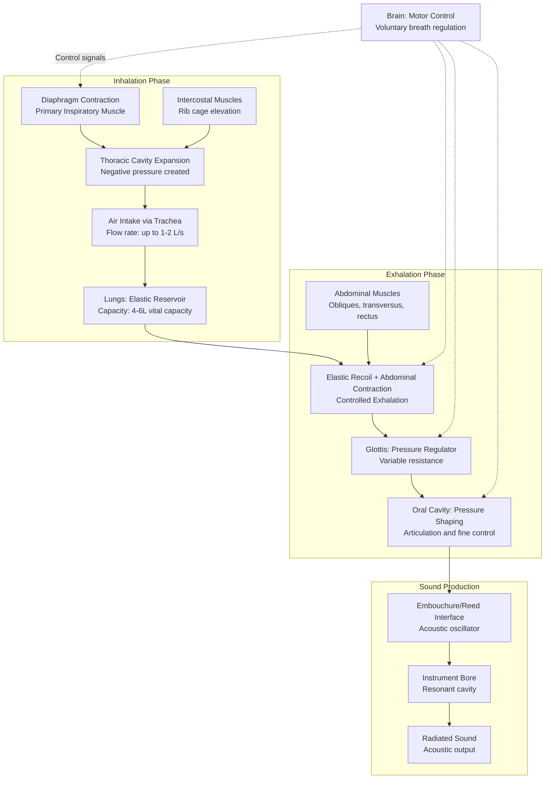

# Lesson 1: Breathing Techniques for Woodwind Performance

## 1. First-Principles Intuition & Invariants

The production of sound on woodwind instruments—flute, clarinet, oboe, bassoon, and saxophone—depends fundamentally on the controlled conversion of steady airflow into periodic acoustic oscillations. Breathing technique is not merely a performance enhancement but the primary energy source for the entire sound production system. Understanding the biomechanics and fluid dynamics of respiration provides the foundation for developing consistent tone, extended dynamic range, and endurance across all woodwind instruments.

### The Respiratory System as a Pneumatic Power Supply

The human respiratory system functions as a variable-pressure air reservoir coupled with a muscular pump. Air production for woodwind playing differs fundamentally from involuntary breathing: where resting respiration operates at approximately 12–20 cycles per minute with tidal volumes of 500 mL, musical breathing requires controlled exhalation lasting 10–30 seconds or longer, drawing on vital capacity (typically 4–6 liters in adults) and managing pressure differentials of 5–40 cm H₂O depending on the instrument and dynamic level.

The lungs themselves are passive elastic structures; all active work is performed by skeletal muscles. The diaphragm—a dome-shaped sheet of muscle and tendon attaching to the lower ribs, sternum, and lumbar vertebrae—generates approximately 70% of the inspiratory force during quiet breathing. During maximal inhalation for performance, the external intercostal muscles (which elevate the rib cage), scalenes, and sternocleidomastoid muscles contribute additional thoracic expansion, while during controlled exhalation, the internal intercostal muscles, abdominal muscles (rectus abdominis, external and internal obliques, transversus abdominis), and the elastic recoil of the lungs and thoracic wall work in coordinated opposition.

### Pressure, Flow, and Acoustic Impedance

The relationship between breath pressure, airflow velocity, and acoustic output follows principles from fluid dynamics and acoustics. For a woodwind instrument, sound production begins when airflow creates oscillations in a driving mechanism: the edge tone at a flute's embouchure, reed vibrations in single-reed (clarinet, saxophone) and double-reed (oboe, bassoon) instruments.

The required mouth pressure **P** varies by instrument:

- **Flute**: 2–8 cm H₂O (relatively low pressure, high flow rate ~20–40 L/min)
- **Clarinet**: 10–25 cm H₂O (moderate pressure, moderate flow ~15–25 L/min)
- **Oboe**: 20–40 cm H₂O (high pressure, low flow ~5–12 L/min)
- **Bassoon**: 15–30 cm H₂O (moderate-high pressure, moderate flow ~12–20 L/min)
- **Saxophone**: 8–20 cm H₂O (moderate pressure, moderate-high flow ~18–30 L/min)

The airflow rate **Q** through the instrument is governed by **Q = P / R**, where **R** represents the acoustic resistance of the embouchure-reed-bore system. The power delivered to the acoustic system scales approximately with **P × Q**, meaning that efficient breath support maximizes usable acoustic output while minimizing muscular effort and air consumption. This relationship explains why oboe requires the highest pressure but lowest flow—the small reed aperture and narrow bore create high acoustic resistance. Flute, with its open embouchure and no reed resistance, demands high flow but low pressure.

### Harmonic Content and Breath Quality

The stability and harmonic richness of woodwind tone depend critically on the steadiness of breath pressure. Fluctuations in subglottal pressure translate directly to amplitude and pitch variations. While fingering determines the effective length of the air column, breath pressure modulates the effective stiffness of the reed and the acoustic impedance of the system, causing subtle but perceptible pitch variations—a phenomenon every woodwind player must learn to control.

The harmonic spectrum of the resulting tone is shaped by the nonlinear dynamics of the reed or edge tone generator. Stable, supported breath pressure encourages regular oscillation with a rich, stable harmonic series. Insufficient or irregular pressure leads to unstable oscillation modes, resulting in airy, unfocused tone, pitch instability, or squeaks (multiphonic tones arising from competing resonance modes).

### Circular Breathing: Continuity Through Reservoir Management

Advanced techniques such as circular breathing exploit the oral cavity as a secondary air reservoir. By storing compressed air in the cheeks and pharynx while simultaneously inhaling through the nose, the player maintains continuous pressure to the instrument. This technique decouples the exhalation and inhalation cycles, allowing indefinite sustain of notes and phrases. The mechanics involve:

1. Building oral pressure by closing the throat and compressing the buccal cavity
2. Maintaining instrument pressure using cheek and tongue muscles
3. Rapidly inhaling through the nose
4. Resuming diaphragmatic exhalation while blending the reservoir and lung air sources

Mastery requires precise coordination of the soft palate (to separate oral and nasal passages during the nasal inhalation phase) and rapid switching between pressure sources without audible discontinuity.

## 2. Core Architecture & Mechanics

### Anatomical System Model

The respiratory system for woodwind performance can be modeled as a multi-stage pressure regulation and flow control system:

This diagram represents the complete breath-to-sound pathway, emphasizing the active muscular control at each stage and the feedback loop through which the player monitors and adjusts pressure and flow.

### Diaphragmatic Mechanics: The Primary Pump

The diaphragm is a musculotendinous dome separating the thoracic and abdominal cavities. At rest, it forms a convex upward dome. During contraction:

1. **Mechanical action**: The muscle fibers shorten, pulling the central tendon downward and outward against the abdominal contents
2. **Thoracic expansion**: Vertical expansion of the thoracic cavity increases by 1–2 cm; combined with rib cage elevation, total volume increase is approximately 2–3 liters during deep inhalation
3. **Pressure gradient**: Intrapleural pressure drops from approximately -5 cm H₂O at rest to -8 to -10 cm H₂O during inspiration, creating a pressure gradient that draws air into the alveoli

The downward movement of the diaphragm compresses the abdominal viscera, causing the anterior abdominal wall to protrude—the hallmark of diaphragmatic breathing observable as abdominal expansion during inhalation.

### Exhalation: Active Control and Elastic Recoil

Exhalation in performance is not passive. While elastic recoil of the lungs provides initial driving pressure, sustained controlled exhalation requires active muscular engagement:

**Phase 1: Elastic Recoil Phase** (first 1–2 seconds)
- Relaxation of the diaphragm and inspiratory muscles
- Passive lung deflation provides ~5–10 cm H₂O pressure
- Suitable for soft dynamics (piano, pianissimo)

**Phase 2: Active Abdominal Support** (remaining duration)
- Contraction of abdominal muscles increases intra-abdominal pressure
- Diaphragm is pushed upward, maintaining intrathoracic pressure
- Internal intercostals depress the rib cage
- Pressure can be sustained at 20–40 cm H₂O for forte passages on high-resistance instruments (oboe, bassoon)

The coordination between relaxing the diaphragm (allowing upward movement) while engaging the abdominals is the essence of "breath support." The diaphragm does not actively push air out; rather, the abdominals compress the abdominal cavity, which mechanically drives the diaphragm upward.

### Pressure Regulation and the Role of the Glottis

The glottis—the space between the vocal folds in the larynx—serves as a variable resistance valve. In speech and singing, the vocal folds oscillate to produce voiced sound. In woodwind playing, the folds remain abducted (open), but their degree of opening and tension can subtly modulate airflow.

Tension in the glottis or throat is generally counterproductive, increasing resistance and reducing control. An open, relaxed throat allows:

- Higher maximum flow rates
- Finer gradations of pressure control through abdominal engagement alone
- Reduced muscular fatigue

Some pedagogical approaches describe sensations such as "opening the throat" or "breathing as if sighing"—these cues promote glottal relaxation.

### Pressure Measurement and Biofeedback

Quantitative understanding of breath pressure can be achieved using a simple manometer (U-tube or digital pressure gauge) connected to a tube held in the mouth. Musicians can practice achieving and maintaining target pressures:

- **Flute**: Sustain 3–5 cm H₂O for soft passages, 6–8 cm H₂O for forte
- **Clarinet**: 12–15 cm H₂O for mezzo-forte, 20–25 cm H₂O for forte
- **Oboe**: 25–30 cm H₂O for mezzo-forte, 35–40 cm H₂O for forte
- **Bassoon**: 18–22 cm H₂O for mezzo-forte, 28–32 cm H₂O for forte
- **Saxophone**: 10–12 cm H₂O for mezzo-forte, 16–20 cm H₂O for forte

Consistent pressure over a 20–30 second exhalation is the benchmark of mature breath control.

## 3. High-Performance Optimization & Training Protocols

### Diagnostic Criteria: Identifying Inefficient Breathing Patterns

Common failure modes in woodwind breathing include:

**Clavicular (Chest) Breathing**
- Observable shoulder elevation during inhalation
- Minimal abdominal expansion
- Utilizes primarily apical (upper) lung lobes
- Reduced vital capacity engagement (~40–60% of potential)
- Increased tension in neck and shoulder musculature
- Results in shorter phrases, less stable tone, early fatigue

**Reverse Breathing**
- Abdominal contraction during inhalation, expansion during exhalation
- Mechanical opposition to diaphragmatic descent
- Severely reduced inspiratory capacity
- Common in individuals with postural dysfunction or anxiety-related breathing patterns

**Glottal Constriction**
- Audible airflow noise (unvoiced "h" sound)
- Increased resistance perceived as back-pressure in the throat
- Reduced maximum flow rate
- Often associated with tension in the tongue, jaw, or soft palate

### Foundational Exercises: Building Diaphragmatic Coordination

**Exercise 1: Isolated Diaphragmatic Breathing (Supine)**

*Objective*: Establish kinesthetic awareness of diaphragmatic excursion without interference from postural muscles.

**Protocol:**
1. Lie supine on a firm surface with knees bent, feet flat on the floor
2. Place one hand on the chest, one on the abdomen just below the rib cage
3. Inhale slowly through the nose over 4 counts, focusing on abdominal rise while keeping the chest relatively still
4. Exhale slowly through pursed lips over 6–8 counts, feeling the abdomen descend
5. Repeat for 10 cycles, 2–3 sets

**Progression:**
- Week 1: 4-count inhale, 6-count exhale
- Week 2: 4-count inhale, 8-count exhale
- Week 3: 4-count inhale, 10-count exhale
- Week 4: 4-count inhale, 12-count exhale

*Rationale*: The supine position reduces the work of postural muscles and allows gravity to assist in abdominal relaxation during inhalation. The hand placement provides tactile biofeedback.

**Exercise 2: Breath Suspension and Abdominal Engagement (Standing)**

*Objective*: Develop independent control of inspiratory and expiratory muscle groups.

**Protocol:**
1. Stand with feet shoulder-width apart, shoulders relaxed
2. Inhale deeply to 80% of vital capacity over 4 counts
3. Hold the breath for 4 counts, maintaining thoracic expansion without glottal closure (hold with the diaphragm and intercostals, not the throat)
4. Exhale slowly and steadily through pursed lips over 12–16 counts, engaging the abdominals progressively to maintain constant flow
5. Repeat for 8 cycles

**Key Technical Points:**
- During suspension, feel the intercostal muscles maintaining rib cage expansion
- Avoid throat closure—test by attempting to inhale or exhale slightly during the hold
- During exhalation, progressively increase abdominal engagement to compensate for decreasing lung volume
- Aim for absolutely steady airflow throughout the entire exhalation

*Rationale*: The suspension phase develops the ability to maintain thoracic expansion against elastic recoil, simulating the muscular state required for sustained phrases. The extended exhalation trains abdominal engagement and steady flow control.

**Exercise 3: Pressure-Targeted Exhalation with Manometer**

*Objective*: Calibrate breath pressure to instrument-specific requirements.

**Equipment Setup:**
- U-tube manometer (water-filled) or digital pressure gauge
- Rubber or plastic tubing (6–10 mm diameter, 10–15 cm length)
- Optional: mouthpiece adapter for instrument-specific practice

**Protocol:**
1. Connect the manometer to the tube or mouthpiece
2. Inhale deeply to ~80% vital capacity
3. Exhale into the device, targeting a specific pressure (e.g., 15 cm H₂O for clarinet)
4. Maintain pressure within ±2 cm H₂O for 20 seconds
5. Repeat 5 times, rest 1 minute between repetitions

**Target Pressures by Instrument:**
- Flute: 4–6 cm H₂O (pianissimo), 6–8 cm H₂O (fortissimo)
- Clarinet: 12–15 cm H₂O (mezzo-forte), 20–25 cm H₂O (fortissimo)
- Oboe: 25–30 cm H₂O (mezzo-forte), 35–40 cm H₂O (fortissimo)
- Bassoon: 18–22 cm H₂O (mezzo-forte), 28–32 cm H₂O (fortissimo)
- Saxophone: 10–12 cm H₂O (mezzo-forte), 16–20 cm H₂O (fortissimo)

**Advanced Variation:**
- Practice dynamic swells: 5 cm H₂O → 15 cm H₂O → 5 cm H₂O over 20 seconds
- Practice stepped dynamics: hold 8 cm H₂O for 5 seconds, jump to 16 cm H₂O for 5 seconds, return to 8 cm H₂O for 5 seconds

*Rationale*: Direct pressure feedback allows precise calibration of abdominal engagement. This removes guesswork and accelerates the development of consistent breath support.

### Advanced Techniques: Maximizing Efficiency and Endurance

**Breath Pacing and Phrase Planning**

Efficient breath management requires anticipating phrase lengths and planning inhalation points. Unlike speech, which allows frequent, short breaths, musical phrasing often demands sustained exhalation over 10–30 seconds. Advanced players develop the ability to:

- Estimate required air volume based on phrase length, dynamic level, and instrument resistance
- Inhale to the appropriate lung volume (avoiding over-inflation, which increases muscular effort and reduces control)
- Modulate exhalation rate and pressure dynamically within a phrase

**Practical Exercise: Phrase Mapping**
1. Select a lyrical passage (e.g., Mozart Clarinet Concerto, 2nd movement)
2. Sing through the phrase on a comfortable pitch, noting where you naturally want to breathe
3. Measure the duration of each phrase segment with a metronome
4. Practice each phrase segment with the instrument, focusing on maintaining consistent pressure throughout
5. Gradually extend phrase lengths by 10–20% through improved breath efficiency

**Embouchure-Breath Integration**

The embouchure (lip, jaw, and oral cavity configuration) interacts with breath pressure to determine tone quality and intonation. Excessive embouchure tension can compensate for insufficient breath support but leads to a thin, pinched tone and rapid fatigue. Conversely, proper breath support allows a relaxed, efficient embouchure.

**Diagnostic Test:**
1. Play a middle-register note at mezzo-forte
2. Gradually increase breath pressure while keeping embouchure constant
3. Observe pitch and tone changes

**Interpretation:**
- **Pitch rises significantly (>20 cents)**: Embouchure resistance too low; increase lip/jaw tension slightly
- **Pitch stable, tone brightens**: Optimal balance; this is the target response
- **Pitch rises slightly then distorts**: Embouchure resistance too high; relax lips and jaw
- **Minimal effect or tone thins**: Insufficient airflow reaching the reed; check for glottal constriction

The optimal embouchure allows pitch and timbre to be controlled primarily through fingering and oral cavity shaping, with breath pressure modulating dynamics and color within a stable framework.

**Circular Breathing: Implementation Protocol**

Circular breathing is achievable through systematic practice. Success requires 4–8 weeks of daily focused training.

**Phase 1: Oral Reservoir Control (Week 1–2)**

**Exercise 1A: Cheek Pressure Isolation**
1. Fill the mouth with air, puff the cheeks
2. Close the throat completely (as if holding breath underwater)
3. Expel air slowly by squeezing the cheeks and moving the tongue forward
4. Practice maintaining steady, slow release for 5–10 seconds
5. Repeat 10 times, 2 sets per day

**Exercise 1B: Nasal Inhalation Coordination**
1. Perform Exercise 1A while simultaneously inhaling gently through the nose
2. Focus on maintaining constant buccal pressure during the nasal inhale
3. Time the nasal inhale: aim for 0.5–1 second duration
4. Repeat 10 times, 2 sets per day

**Phase 2: Water Displacement Practice (Week 2–3)**

**Equipment:**
- Glass of water
- Standard drinking straw

**Protocol:**
1. Place straw in water, blow steady stream of bubbles using chest breath
2. Build oral pressure while blowing
3. At transition point, close throat and maintain bubbles using cheek pressure alone
4. Inhale quickly through nose
5. Resume chest breath, blending the transition
6. Aim for uninterrupted bubble stream
7. Practice 5 minutes, 2 sessions per day

**Success Criteria:**
- Bubble stream remains constant (no pauses or surges)
- Transition inaudible (no gulping or gasping sounds)
- Nasal inhale duration under 1 second

**Phase 3: Instrument Integration (Week 3–6)**

**Exercise 3A: Single-Note Circular Breathing**
1. Select a stable middle-register note (e.g., clarinet: throat Bb; saxophone: middle D; flute: middle A; oboe/bassoon: middle G)
2. Play sustained note using normal chest breath
3. Build oral pressure while playing (cheeks slightly puffed)
4. At transition, close throat and maintain note with buccal pressure alone (0.5–1 second)
5. Inhale quickly through nose
6. Resume chest exhalation, blending smoothly
7. Practice 10 transitions per session, 2 sessions per day

**Troubleshooting Common Failures:**

| **Problem** | **Cause** | **Solution** |
|-------------|-----------|-------------|
| Note drops out during transition | Insufficient oral pressure | Build more air in cheeks; practice cheek squeeze strength |
| Pitch sags during transition | Embouchure loosens | Maintain jaw/lip tension independent of breath source |
| Audible "pop" or gulp | Abrupt throat closure | Practice gradual throat closure; smooth muscle transition |
| Cannot inhale fast enough | Nasal passages congested or technique inefficient | Clear sinuses; practice rapid nasal sniffs in isolation |
| Tone quality changes | Oral cavity shape changes during cheek compression | Maintain tongue arch and oral cavity geometry |

**Exercise 3B: Scalar and Melodic Application**
1. Once single-note transitions are reliable, apply to slow scales (quarter note = 60 BPM)
2. Place circular breath transitions at strategic points (e.g., between scale degrees)
3. Gradually increase tempo: 60 → 80 → 100 BPM
4. Apply to simple melodic patterns (arpeggios, folk melodies)
5. Practice 15 minutes per day, Weeks 4–6

**Phase 4: Musical Application (Week 6+)**

**Repertoire Suggestions:**
- Bach Cello Suites (transcribed): long melodic lines ideal for practicing sustained circular breathing
- Contemporary works requiring extended techniques: Berio Sequenzas, Ferneyhough études
- Jazz ballads: slow tempos allow focus on seamless transitions

**Performance Guidelines:**
- Use circular breathing sparingly—reserve for passages where breath marks would disrupt musical line
- Never circular breathe during rests or natural phrase breaks
- In ensemble playing, coordinate breathing with other players to avoid everyone breathing simultaneously
- Mark scores with "CB" to indicate planned circular breathing points

### Common Failure Modes and Corrections

| **Symptom** | **Root Cause** | **Correction Strategy** | **Practice Protocol** |
|-------------|----------------|------------------------|----------------------|
| Rapid air depletion, short phrases | Excessive flow rate; insufficient abdominal support | Practice sustained exhalation with manometer feedback; reduce embouchure tension | Exercise 3 (manometer), 20-second sustained pressure, 5 reps, 2× daily for 2 weeks |
| Tone instability, pitch sag at phrase end | Declining breath pressure | Increase abdominal engagement as lung volume decreases | Long tones with crescendo at end: 20 seconds diminuendo → 5 seconds crescendo, maintain pitch ±10 cents |
| Audible breath noise | Glottal or pharyngeal constriction | Practice sighing exhalation; visualize open throat; check for tongue tension | "Hoo" syllable breath practice: slow exhale on [hu] vowel, focus on throat openness, 10 reps |
| Shoulder/neck tension, fatigue | Clavicular breathing pattern | Retrain with supine diaphragmatic exercises; check posture | Exercise 1 (supine breathing), 3 sets of 10 cycles, morning and evening for 2 weeks |
| Difficulty with soft dynamics | Over-pressurization; poor fine motor control | Practice pianissimo long tones; reduce breath pressure to minimum viable level | Target 3–5 cm H₂O (flute/clarinet) or 15–18 cm H₂O (oboe), sustain 15 seconds, 8 reps |
| Multiphonics, squeaks | Pressure instability or mismatch between pressure and reed strength | Use manometer to stabilize pressure; check reed strength | Verify reed: soft reed for learning, medium-hard for performance; practice pressure consistency ±2 cm H₂O |
| Dizziness or lightheadedness | Hyperventilation; excessive CO₂ expulsion | Reduce breathing rate; practice brief recovery breaths (2-second inhale/exhale) between phrases | Implement breath pacing: mark scores with breath marks, time recovery breaths |
| Embouchure fatigue | Compensating for poor breath support with excessive lip pressure | Strengthen breath support first, then relax embouchure | Progressive long tone practice: 30 seconds daily, focus on minimal embouchure tension |

### Physiological Adaptation and Long-Term Development

Consistent training over months to years produces measurable physiological adaptations:

**Months 1–3: Neural Coordination**
- Development of motor cortex and cerebellar pathways for breath-muscle coordination
- Establishment of proprioceptive feedback loops
- Improved conscious control of diaphragm and abdominal muscles
- Expected gains: 20–30% increase in sustained phrase length

**Months 3–6: Muscular Endurance**
- Increased oxidative capacity of respiratory muscles
- Enhanced resistance to fatigue during extended practice sessions
- Development of muscle memory for instrument-specific pressure patterns
- Expected gains: Ability to maintain consistent pressure for 30–45 seconds

**Months 6–12: Capacity and Efficiency**
- Increased vital capacity through regular deep breathing (10–20% gains typical)
- Enhanced rib cage mobility and lung elasticity
- Reduced air consumption through improved efficiency
- Expected gains: 40–50% increase in phrase length; ability to play 60–90 minute sessions without fatigue

**Years 1–5: Expert-Level Mastery**
- Automatic, subconscious breath management during performance
- Seamless integration of breath with musical expression
- Circular breathing becomes reflexive tool
- Expected capabilities: 40–60 second sustained phrases, pressure stability within ±1 cm H₂O

Elite performers demonstrate breath control capabilities that approach the limits of human physiology: sustained phrases of 40–60 seconds, pressure stability within ±1 cm H₂O, and seamless circular breathing transitions indistinguishable from normal phrasing.

## 4. Practical Integration and Performance Context

### Warm-Up Routine: Breath-Focused Protocol (20 minutes)

A performance-ready warm-up sequence integrating breath technique:

**Segment 1: Respiratory Activation (5 minutes)**
1. **Supine or seated diaphragmatic breathing**: 10 cycles, 4-count inhale, 8-count exhale
2. **Standing breath suspension**: 5 cycles, 4-4-12 pattern (inhale-hold-exhale)
3. **Pressure-targeted exhalation**: 3 repetitions at instrument-specific pressure
   - Flute: 6 cm H₂O, 20 seconds
   - Clarinet: 15 cm H₂O, 20 seconds
   - Oboe: 30 cm H₂O, 20 seconds
   - Bassoon: 22 cm H₂O, 20 seconds
   - Saxophone: 12 cm H₂O, 20 seconds

**Segment 2: Instrument Integration (10 minutes)**
1. **Long tones on middle-register notes**: 4 breaths, 20–30 seconds each, focus on steady pressure
   - Flute: A4 (440 Hz)
   - Clarinet: G4 (throat tone)
   - Oboe: G4
   - Bassoon: G3
   - Saxophone: D4
   
2. **Crescendo-diminuendo on long tones**: 4 repetitions, explore full dynamic range while maintaining pitch stability (±10 cents)
   - 8 seconds pianissimo → 8 seconds fortissimo → 8 seconds pianissimo
   
3. **Register transitions with consistent pressure**: 4 repetitions
   - Low register → middle register → high register, sustaining each for 8 seconds
   - Monitor pitch stability and tone quality across registers

**Segment 3: Phrase Simulation (5 minutes)**
1. **Slow scale practice with breath management**: 2 octaves, quarter note = 60 BPM
   - Breathe at natural musical phrase points (typically after 8–12 notes)
   - Focus on immediate breath readiness and consistent tone after breath mark
   
2. **Melodic excerpt with dynamic shaping**: Select a lyrical passage from current repertoire
   - Play through once at tempo with planned breath marks
   - Repeat with focus on seamless breath integration and expressive phrasing

### Repertoire-Specific Breath Planning

**Example 1: Mozart Clarinet Concerto, K. 622, 2nd Movement (Adagio)**

**Measure 1–4 Challenge**: 16-bar opening phrase with minimal natural breath opportunities

**Analysis:**
- Tempo: Quarter note ≈ 50–56 BPM
- Total phrase duration: ~30–35 seconds
- Dynamic range: piano to mezzo-piano
- Required pressure: 10–15 cm H₂O sustained

**Breath Strategy:**
1. Full breath before entrance (85–90% vital capacity)
2. Primary breath point: end of measure 2 (natural musical caesura)
3. Alternate breath point (if needed): middle of measure 4
4. Practice phrase in segments: measures 1–2, measures 3–4, then combine

**Practice Protocol:**
- Week 1: Isolate measures 1–2, focus on controlled exhalation (target 15 seconds)
- Week 2: Extend to measures 1–4 with breath at measure 2
- Week 3: Attempt full phrase without breath (target 30+ seconds)
- Week 4: Performance tempo with musical breath integration

**Example 2: Debussy "Syrinx" for Solo Flute**

**Measure 21–24 Challenge**: Rapid ascending passage requiring high airflow without sacrificing pitch

**Analysis:**
- Tempo: Rubato, approximately eighth note = 120 BPM
- Airflow demand: Very high (~30–40 L/min)
- Pressure requirement: 6–8 cm H₂O
- Technical challenge: Maintaining consistent pressure while fingers transition rapidly

**Breath Strategy:**
1. Quick, full breath immediately before passage (1–1.5 seconds max)
2. Engage abdominals immediately upon exhalation onset
3. Maintain constant pressure despite increasing pitch (avoid pressure increase that causes sharp intonation)
4. Recovery breath at measure 25

**Practice Protocol:**
- Practice passage at half tempo (eighth note = 60 BPM) with consistent pressure
- Use metronome to time breath: 1.5 second inhale maximum
- Gradually increase tempo: 60 → 80 → 100 → 120 BPM
- Monitor intonation with tuner; adjust embouchure if pitch deviation exceeds ±15 cents

### Instrument-Specific Breath Management Strategies

**Flute: High-Flow, Low-Pressure Management**

**Primary Challenge**: Rapid air depletion due to high flow rate and open embouchure

**Optimizations:**
- Focus embouchure aperture: smaller, more focused air stream increases efficiency by 15–25%
- Angle optimization: direct air stream precisely at the edge (experiment with slight inward/outward rotation)
- Breath recovery: practice rapid, silent breaths (0.5–0.8 seconds) for frequent breath marks
- Low-register economy: reduce flow rate in low register where acoustic efficiency is lower

**Practice Exercise: Flow Efficiency Drill**
1. Play middle C (C4) at mezzo-forte, sustain for maximum duration (measure with stopwatch)
2. Experiment with embouchure aperture adjustments (±10% size variation)
3. Record duration for each variation
4. Identify optimal aperture (typically smallest aperture that maintains clear, stable tone)
5. Repeat for low G (G3) and high C (C6)

**Clarinet: Moderate Pressure, Steady Flow**

**Primary Challenge**: Maintaining consistent embouchure pressure and reed damping across registers

**Optimizations:**
- Register-specific pressure mapping: chalemeau (12–15 cm H₂O), clarion (15–18 cm H₂O), altissimo (18–22 cm H₂O)
- Reed selection: match reed strength to breath capacity (softer reed for students/developing players, medium-hard for advanced)
- Voicing coordination: throat/tongue position adjustments reduce pressure requirements by 10–15%
- Circular breathing preparation: long lyrical passages in Mozart, Brahms, Nielsen

**Practice Exercise: Register Pressure Calibration**
1. Set up manometer with clarinet mouthpiece adapter
2. Play G3 (chalemeau), sustain at 14 cm H₂O for 15 seconds
3. Jump to G4 (clarion), target 16 cm H₂O, sustain 15 seconds
4. Jump to G5 (altissimo), target 20 cm H₂O, sustain 15 seconds
5. Practice smooth pressure transitions: G3 → G4 → G5 with continuous sound

**Oboe: High Pressure, Low Flow, CO₂ Management**

**Primary Challenge**: Carbon dioxide buildup due to minimal air expulsion per breath; avoiding hyperventilation symptoms

**Optimizations:**
- Frequent air dumps: exhale remaining air before each new phrase to expel CO₂
- Half-breaths: practice partial breaths (30–50% capacity) for short phrases
- Reed resistance balance: overly resistant reeds exacerbate CO₂ buildup
- Recovery breathing: structured exhale-focused recovery breaths during rests

**Practice Exercise: CO₂ Management Protocol**
1. Play 8-bar phrase at moderate tempo
2. At phrase end, perform forced exhalation (blow out remaining air completely)
3. Take recovery breath (2 seconds inhale, 2 seconds exhale)
4. Resume next phrase
5. Monitor for dizziness or tingling (indicators of CO₂ imbalance)

**Critical Safety Note**: If dizziness occurs, stop playing immediately, sit down, and breathe normally for 2–3 minutes. Reduce practice intensity and increase recovery breath frequency.

**Bassoon: Moderate-High Pressure, Moderate Flow**

**Primary Challenge**: Managing large volume of air tubing (bocal + wing joint + boot joint); maintaining consistent resistance across registers

**Optimizations:**
- Bocal resistance matching: select bocal with appropriate resistance for breath capacity and reed
- Half-hole technique: use whisper key and half-hole voicing to reduce breath pressure requirements by 10–15%
- Register-specific support: tenor register requires highest pressure (25–30 cm H₂O), low register more flow-dependent
- Expressive breathing: frequent musical breath marks align naturally with bassoon's moderate air consumption

**Practice Exercise: Bocal Resistance Assessment**
1. Test available bocals (CV, CD, CC designations)
2. Play middle F3, sustain at 22 cm H₂O for 20 seconds with each bocal
3. Assess: ease of response, tone quality, pitch stability, fatigue level
4. Select bocal that balances resistance with tonal goals
5. Re-test quarterly as embouchure and breath capacity develop

**Saxophone: Moderate Pressure, High Flow**

**Primary Challenge**: Large bore and conical geometry create high flow demand; maintaining consistent tone in low register

**Optimizations:**
- Mouthpiece facing optimization: longer facing requires less pressure, shorter facing offers more control
- Voicing technique: tongue arch and throat openness directly impact resistance
- Subtone production: intentionally reduced pressure for jazz/contemporary styles (8–10 cm H₂O)
- Altissimo efficiency: higher partials require less absolute air volume but precise pressure control (18–25 cm H₂O)

**Practice Exercise: Voicing and Tone Production**
1. Play middle D4 at mezzo-forte with "normal" tongue position (middle arch)
2. Experiment with tongue positions:
   - High arch (as in "ee" vowel): increases resistance, brightens tone
   - Low arch (as in "ah" vowel): decreases resistance, darkens tone
3. Measure breath duration for each position
4. Practice dynamic control: pp → ff with consistent voicing
5. Apply optimal voicing to scales and repertoire

### Performance Anxiety and Breath Management

Performance anxiety manifests physiologically through sympathetic nervous system activation, directly impacting breath control:

**Common Anxiety-Induced Breathing Failures:**
- Shallow, rapid breathing (respiratory rate increases from 12 to 20+ breaths per minute)
- Clavicular breathing pattern replaces diaphragmatic breathing
- Throat and shoulder tension increases glottal resistance
- Reduced vital capacity utilization (40–60% vs. normal 70–85%)

**Pre-Performance Breath Centering Protocol (5 minutes backstage):**
1. **Parasympathetic activation**: 4-7-8 breathing technique
   - Inhale through nose for 4 counts
   - Hold for 7 counts
   - Exhale through mouth for 8 counts
   - Repeat 4 cycles
   
2. **Diaphragmatic reset**: Supine or seated abdominal breathing, 5 cycles
   
3. **Performance simulation**: Play opening phrase of first piece at performance tempo, focus on breath integration
   
4. **Pressure calibration**: Brief manometer check (if available) to confirm instrument-specific pressure target

**On-Stage Breath Recovery:**
- During sustained passages by other performers: practice silent breath cycles
- During audience applause: 2–3 deep recovery breaths with focus on abdominal expansion
- Between movements: structured recovery breathing (4-4-8 pattern, 3 cycles)

### Long-Term Practice Design: Building Breath Endurance

**Weekly Practice Structure for Breath Development:**

**Day 1 (Monday): Foundation and Mechanics**
- 10 minutes: Breathing exercises without instrument (Exercises 1–3)
- 15 minutes: Long tones with manometer feedback
- 20 minutes: Technical études focusing on phrase extension

**Day 2 (Tuesday): Dynamic Control**
- 5 minutes: Breath activation
- 20 minutes: Crescendo/diminuendo long tone practice across all registers
- 20 minutes: Repertoire with dynamic shaping focus

**Day 3 (Wednesday): Endurance and Phrase Extension**
- 5 minutes: Breath activation
- 15 minutes: Extended long tones (30–40 seconds)
- 20 minutes: Lyrical études (Ferling, Milde, etc.) with minimal breath marks

**Day 4 (Thursday): Circular Breathing (if applicable)**
- 10 minutes: Water displacement practice
- 10 minutes: Single-note circular breathing
- 15 minutes: Melodic integration
- 10 minutes: Repertoire application

**Day 5 (Friday): Pressure Precision**
- 10 minutes: Manometer pressure calibration
- 15 minutes: Register transition exercises
- 20 minutes: Technical repertoire (concertos, sonatas)

**Day 6 (Saturday): Integration and Performance Simulation**
- 5 minutes: Breath activation
- 45 minutes: Run-through of performance repertoire with planned breath management
- 10 minutes: Recovery and reflection

**Day 7 (Sunday): Rest or light maintenance (optional 15-minute breathing exercises only)**

### Assessment Benchmarks: Tracking Progress

**Beginner (0–6 months training):**
- Sustained note duration: 15–20 seconds
- Pressure stability: ±5 cm H₂O
- Phrase length: 8–12 notes before breath
- Recovery breath duration: 2–3 seconds
- Circular breathing: not yet applicable

**Intermediate (6–18 months training):**
- Sustained note duration: 25–35 seconds
- Pressure stability: ±3 cm H₂O
- Phrase length: 12–20 notes before breath
- Recovery breath duration: 1–2 seconds
- Circular breathing: water displacement successful, beginning instrument integration

**Advanced (18–36 months training):**
- Sustained note duration: 35–50 seconds
- Pressure stability: ±2 cm H₂O
- Phrase length: 20–30+ notes before breath
- Recovery breath duration: 0.5–1 second
- Circular breathing: reliable single-note transitions, beginning melodic application

**Professional (36+ months training):**
- Sustained note duration: 50–60+ seconds
- Pressure stability: ±1 cm H₂O
- Phrase length: limited only by musical phrasing (30+ notes)
- Recovery breath duration: <0.5 seconds (essentially imperceptible)
- Circular breathing: seamless melodic integration, performance-ready

### Troubleshooting Guide: Persistent Breath Issues

**Issue: Inconsistent tone quality across registers**

**Diagnostic Protocol:**
1. Play chromatic scale slowly (quarter note = 60 BPM), noting tone quality changes
2. Identify problematic register transitions (typically throat tones on clarinet, break on saxophone, mid-register on oboe)
3. Measure breath pressure at each transition point with manometer

**Correction:**
- Adjust pressure targets: create register-specific pressure map
- Voicing adjustments: practice throat openness and tongue position consistency
- Embouchure stability: ensure jaw and lip pressure remain constant despite breath pressure changes
- Practice transition drills: long tone on lower note → slur to upper note, maintaining continuous sound and consistent tone

**Issue: Rapid fatigue during extended practice (>45 minutes)**

**Diagnostic Protocol:**
1. Monitor breathing pattern during practice: check for return to clavicular breathing
2. Assess shoulder and neck tension every 15 minutes
3. Measure sustained note duration at beginning, middle, and end of practice session

**Correction:**
- Implement structured rest intervals: 10 minutes of practice, 2 minutes rest
- Postural reset exercises: shoulder rolls, neck stretches, thoracic spine extension
- Hydration: dehydration reduces lung elasticity and increases mucus viscosity
- Breath check-ins: every 15 minutes, perform 3 cycles of diaphragmatic breathing to reset pattern

**Issue: Pitch instability, particularly at phrase endings**

**Diagnostic Protocol:**
1. Record phrase with tuner app displaying real-time pitch
2. Analyze pitch drift pattern: gradual sag (pressure decline) vs. sudden drop (embouchure collapse)
3. Measure breath pressure at phrase beginning, middle, and end

**Correction:**
- Progressive abdominal engagement: increase support as lung volume decreases
- Embouchure consistency training: practice long tones with crescendo at end (forces increased breath support while maintaining pitch)
- Breath reserve management: never exhale to absolute residual volume; maintain 10–15% reserve
- Phrase planning: mark scores with breath marks that allow adequate air reserve for final notes

**Issue: Circular breathing creates audible discontinuities**

**Diagnostic Protocol:**
1. Record circular breathing attempts
2. Analyze waveform for amplitude/frequency discontinuities at transition points
3. Measure transition duration (should be <0.5 seconds)

**Correction:**
- Increase oral reservoir capacity: practice cheek puffing exercises, 3 sets of 10 reps daily
- Smooth throat closure: practice gradual velum closure rather than abrupt stopping
- Embouchure independence: practice maintaining steady tone with varied breath sources (chest vs. buccal pressure)
- Transition blending: overlap chest and buccal air sources for 0.1–0.2 seconds during switch

---

## Summary: The Breath as Foundation

Breath control is the foundation upon which all other woodwind techniques rest. Without steady, controlled airflow at appropriate pressure, even perfect fingerings and impeccable embouchure cannot produce characteristic tone. The principles outlined in this lesson—diaphragmatic breathing, active abdominal support, glottal relaxation, and instrument-specific pressure management—apply universally across all woodwind instruments while requiring individualized adaptation to each instrument's unique acoustic properties.

Mastery is achieved through consistent, deliberate practice: daily breath exercises, manometer feedback for pressure calibration, long tone routines for endurance development, and systematic integration into musical repertoire. Progress is measurable through sustained note duration, pressure stability, phrase length capability, and ultimately, the seamless integration of breath with musical expression in performance.

The advanced woodwind player breathes not merely to sustain sound but to shape musical line, to color tone, to articulate phrasing—transforming the mechanical act of respiration into the essential medium of musical communication.
