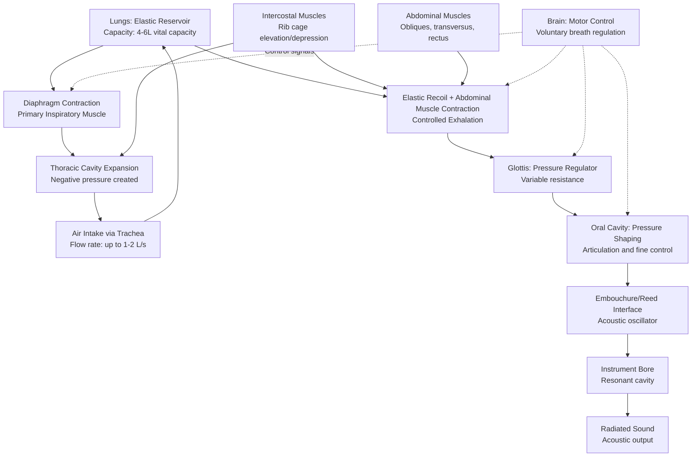

# Lesson 1: Breathing Techniques for Woodwind Performance

## 1. First-Principles Intuition & Invariants

The production of sound on woodwind instruments—flute, clarinet, oboe, bassoon, and saxophone—depends fundamentally on the controlled conversion of steady airflow into periodic acoustic oscillations. Breathing technique is not merely a performance enhancement but the primary energy source for the entire sound production system. Understanding the biomechanics and fluid dynamics of respiration provides the foundation for developing consistent tone, extended dynamic range, and endurance across all woodwind instruments.

### The Respiratory System as a Pneumatic Power Supply

The human respiratory system functions as a variable-pressure air reservoir coupled with a muscular pump. Air production for woodwind playing differs fundamentally from involuntary breathing: where resting respiration operates at approximately 12–20 cycles per minute with tidal volumes of 500 mL, musical breathing requires controlled exhalation lasting 10–30 seconds or longer, drawing on vital capacity (typically 4–6 liters in adults) and managing pressure differentials of 5–40 cm H₂O depending on the instrument and dynamic level.

The lungs themselves are passive elastic structures; all active work is performed by skeletal muscles. The diaphragm—a dome-shaped sheet of muscle and tendon attaching to the lower ribs, sternum, and lumbar vertebrae—generates approximately 70% of the inspiratory force during quiet breathing. During maximal inhalation for performance, the external intercostal muscles (which elevate the rib cage), scalenes, and sternocleidomastoid muscles contribute additional thoracic expansion, while during controlled exhalation, the internal intercostal muscles, abdominal muscles (rectus abdominis, external and internal obliques, transversus abdominis), and the elastic recoil of the lungs and thoracic wall work in coordinated opposition.

### Pressure, Flow, and Acoustic Impedance

The relationship between breath pressure, airflow velocity, and acoustic output follows principles from fluid dynamics and acoustics. For a woodwind instrument, sound production begins when airflow creates oscillations in a driving mechanism: the edge tone at a flute's embouchure, reed vibrations in single-reed (clarinet, saxophone) and double-reed (oboe, bassoon) instruments.

The required mouth pressure **P** varies by instrument:

- **Flute**: 2–8 cm H₂O (relatively low pressure, high flow rate ~20–40 L/min)
- **Clarinet**: 10–25 cm H₂O (moderate pressure, moderate flow ~15–25 L/min)
- **Oboe**: 20–40 cm H₂O (high pressure, low flow ~5–12 L/min)
- **Saxophone**: 8–20 cm H₂O (moderate pressure, moderate-high flow ~18–30 L/min)

The airflow rate **Q** through the instrument is governed by:

**Q = P / R**

where **R** represents the acoustic resistance of the embouchure-reed-bore system. The power delivered to the acoustic system scales approximately with **P × Q**, meaning that efficient breath support maximizes usable acoustic output while minimizing muscular effort and air consumption.

### Harmonic Content and Breath Quality

The stability and harmonic richness of woodwind tone depend critically on the steadiness of breath pressure. Fluctuations in subglottal pressure translate directly to amplitude and pitch variations. The fundamental frequency **f₀** of a vibrating reed or air column is approximately:

**f₀ = (v / 2L) × n**

where **v** is the speed of sound in air (~343 m/s at 20°C), **L** is the effective length of the air column, and **n** is the mode number (1 for the fundamental). While fingering determines **L**, breath pressure modulates the effective stiffness of the reed and the acoustic impedance of the system, causing subtle but perceptible pitch variations—a phenomenon every woodwind player must learn to control.

The harmonic spectrum of the resulting tone is shaped by the nonlinear dynamics of the reed or edge tone generator. Stable, supported breath pressure encourages regular oscillation with a rich, stable harmonic series. Insufficient or irregular pressure leads to unstable oscillation modes, resulting in airy, unfocused tone, pitch instability, or squeaks (multiphonic tones arising from competing resonance modes).

### Circular Breathing: Continuity Through Reservoir Management

Advanced techniques such as circular breathing exploit the oral cavity as a secondary air reservoir. By storing compressed air in the cheeks and pharynx while simultaneously inhaling through the nose, the player maintains continuous pressure to the instrument. This technique decouples the exhalation and inhalation cycles, allowing indefinite sustain of notes and phrases. The mechanics involve:

1. Building oral pressure by closing the throat and compressing the buccal cavity
2. Maintaining instrument pressure using cheek and tongue muscles
3. Rapidly inhaling through the nose
4. Resuming diaphragmatic exhalation while blending the reservoir and lung air sources

Mastery requires precise coordination of the soft palate (to separate oral and nasal passages during the nasal inhalation phase) and rapid switching between pressure sources without audible discontinuity.

## 2. Core Architecture & Mechanics

### Anatomical System Model

The respiratory system for woodwind performance can be modeled as a multi-stage pressure regulation and flow control system:

This diagram represents the complete breath-to-sound pathway, emphasizing the active muscular control at each stage and the feedback loop through which the player monitors and adjusts pressure and flow.

### Diaphragmatic Mechanics: The Primary Pump

The diaphragm is a musculotendinous dome separating the thoracic and abdominal cavities. At rest, it forms a convex upward dome. During contraction:

1. **Mechanical action**: The muscle fibers shorten, pulling the central tendon downward and outward against the abdominal contents
2. **Thoracic expansion**: Vertical expansion of the thoracic cavity increases by 1–2 cm; combined with rib cage elevation, total volume increase is approximately 2–3 liters during deep inhalation
3. **Pressure gradient**: Intrapleural pressure drops from approximately -5 cm H₂O at rest to -8 to -10 cm H₂O during inspiration, creating a pressure gradient that draws air into the alveoli

The downward movement of the diaphragm compresses the abdominal viscera, causing the anterior abdominal wall to protrude—the hallmark of diaphragmatic breathing observable as abdominal expansion during inhalation.

### Exhalation: Active Control and Elastic Recoil

Exhalation in performance is not passive. While elastic recoil of the lungs provides initial driving pressure, sustained controlled exhalation requires active muscular engagement:

**Phase 1: Elastic Recoil Phase** (first 1–2 seconds)
- Relaxation of the diaphragm and inspiratory muscles
- Passive lung deflation provides ~5–10 cm H₂O pressure
- Suitable for soft dynamics (piano, pianissimo)

**Phase 2: Active Abdominal Support** (remaining duration)
- Contraction of abdominal muscles increases intra-abdominal pressure
- Diaphragm is pushed upward, maintaining intrathoracic pressure
- Internal intercostals depress the rib cage
- Pressure can be sustained at 20–40 cm H₂O for forte passages on high-resistance instruments (oboe, bassoon)

The coordination between relaxing the diaphragm (allowing upward movement) while engaging the abdominals is the essence of "breath support." The diaphragm does not actively push air out; rather, the abdominals compress the abdominal cavity, which mechanically drives the diaphragm upward.

### Pressure Regulation and the Role of the Glottis

The glottis—the space between the vocal folds in the larynx—serves as a variable resistance valve. In speech and singing, the vocal folds oscillate to produce voiced sound. In woodwind playing, the folds remain abducted (open), but their degree of opening and tension can subtly modulate airflow.

Tension in the glottis or throat is generally counterproductive, increasing resistance and reducing control. An open, relaxed throat allows:

- Higher maximum flow rates
- Finer gradations of pressure control through abdominal engagement alone
- Reduced muscular fatigue

Some pedagogical approaches describe sensations such as "opening the throat" or "breathing as if sighing"—these cues promote glottal relaxation.

### Pressure Measurement and Biofeedback

Quantitative understanding of breath pressure can be achieved using a simple manometer (U-tube or digital pressure gauge) connected to a tube held in the mouth. Musicians can practice achieving and maintaining target pressures:

- **Flute**: Sustain 3–5 cm H₂O for soft passages, 6–8 cm H₂O for forte
- **Clarinet**: 12–15 cm H₂O for mezzo-forte, 20–25 cm H₂O for forte
- **Oboe**: 25–30 cm H₂O for mezzo-forte, 35–40 cm H₂O for forte

Consistent pressure over a 20–30 second exhalation is the benchmark of mature breath control.

## 3. High-Performance Optimization & Training Protocols

### Diagnostic Criteria: Identifying Inefficient Breathing Patterns

Common failure modes in woodwind breathing include:

**Clavicular (Chest) Breathing**
- Observable shoulder elevation during inhalation
- Minimal abdominal expansion
- Utilizes primarily apical (upper) lung lobes
- Reduced vital capacity engagement (~40–60% of potential)
- Increased tension in neck and shoulder musculature
- Results in shorter phrases, less stable tone, early fatigue

**Reverse Breathing**
- Abdominal contraction during inhalation, expansion during exhalation
- Mechanical opposition to diaphragmatic descent
- Severely reduced inspiratory capacity
- Common in individuals with postural dysfunction or anxiety-related breathing patterns

**Glottal Constriction**
- Audible airflow noise (unvoiced "h" sound)
- Increased resistance perceived as back-pressure in the throat
- Reduced maximum flow rate
- Often associated with tension in the tongue, jaw, or soft palate

### Foundational Exercises: Building Diaphragmatic Coordination

**Exercise 1: Isolated Diaphragmatic Breathing (Supine)**

*Objective*: Establish kinesthetic awareness of diaphragmatic excursion without interference from postural muscles.

1. Lie supine on a firm surface with knees bent, feet flat on the floor
2. Place one hand on the chest, one on the abdomen just below the rib cage
3. Inhale slowly through the nose over 4 counts, focusing on abdominal rise while keeping the chest relatively still
4. Exhale slowly through pursed lips over 6–8 counts, feeling the abdomen descend
5. Repeat for 10 cycles, 2–3 sets

*Rationale*: The supine position reduces the work of postural muscles and allows gravity to assist in abdominal relaxation during inhalation. The hand placement provides tactile biofeedback.

**Exercise 2: Breath Suspension and Abdominal Engagement (Standing)**

*Objective*: Develop independent control of inspiratory and expiratory muscle groups.

1. Stand with feet shoulder-width apart, shoulders relaxed
2. Inhale deeply to 80% of vital capacity over 4 counts
3. Hold the breath for 4 counts, maintaining thoracic expansion without glottal closure (hold with the diaphragm and intercostals, not the throat)
4. Exhale slowly and steadily through pursed lips over 12–16 counts, engaging the abdominals progressively to maintain constant flow
5. Repeat for 8 cycles

*Rationale*: The suspension phase develops the ability to maintain thoracic expansion against elastic recoil, simulating the muscular state required for sustained phrases. The extended exhalation trains abdominal engagement and steady flow control.

**Exercise 3: Pressure-Targeted Exhalation with Manometer**

*Objective*: Calibrate breath pressure to instrument-specific requirements.

1. Connect a U-tube manometer or digital pressure gauge to a mouthpiece or tube
2. Inhale deeply
3. Exhale into the device, targeting a specific pressure (e.g., 15 cm H₂O for clarinet)
4. Maintain pressure within ±2 cm H₂O for 20 seconds
5. Repeat 5 times, rest 1 minute between repetitions

*Rationale*: Direct pressure feedback allows precise calibration of abdominal engagement. This removes guesswork and accelerates the development of consistent breath support.

### Advanced Techniques: Maximizing Efficiency and Endurance

**Breath Pacing and Phrase Planning**

Efficient breath management requires anticipating phrase lengths and planning inhalation points. Unlike speech, which allows frequent, short breaths, musical phrasing often demands sustained exhalation over 10–30 seconds. Advanced players develop the ability to:

- Estimate required air volume based on phrase length, dynamic level, and instrument resistance
- Inhale to the appropriate lung volume (avoiding over-inflation, which increases muscular effort and reduces control)
- Modulate exhalation rate and pressure dynamically within a phrase

**Embouchure-Breath Integration**

The embouchure (lip, jaw, and oral cavity configuration) interacts with breath pressure to determine tone quality and intonation. Excessive embouchure tension can compensate for insufficient breath support but leads to a thin, pinched tone and rapid fatigue. Conversely, proper breath support allows a relaxed, efficient embouchure.

A useful diagnostic: if increasing breath pressure causes pitch to rise or tone to brighten significantly, embouchure resistance is too low. If increasing pressure has minimal effect or causes distortion, resistance is too high. The optimal embouchure allows pitch and timbre to be controlled primarily through fingering and oral cavity shaping, with breath pressure modulating dynamics and color within a stable framework.

**Circular Breathing: Implementation Protocol**

Circular breathing is achievable through systematic practice:

*Phase 1: Oral Reservoir Control (1–2 weeks)*
1. Fill the mouth with air, puff the cheeks
2. Close the throat, expel air slowly by squeezing the cheeks and moving the tongue forward
3. Practice maintaining steady pressure for 5–10 seconds
4. Repeat while simultaneously inhaling gently through the nose

*Phase 2: Integration with Instrument (2–4 weeks)*
1. Play a sustained middle-register note on the instrument (e.g., concert Bb on clarinet)
2. Build oral pressure while playing
3. At the moment of transition, close the throat and maintain note with buccal pressure alone
4. Inhale quickly through the nose (0.5–1 second)
5. Resume chest exhalation, blending the transition smoothly

*Phase 3: Musical Application (ongoing)*
- Practice on long tones, gradually reducing the audibility of the transition
- Apply to scalar passages, arpeggios, and melodic lines
- Use sparingly in performance—circular breathing is a tool, not a default

### Common Failure Modes and Corrections

| **Symptom** | **Root Cause** | **Correction Strategy** |
|-------------|----------------|------------------------|
| Rapid air depletion, short phrases | Excessive flow rate; insufficient abdominal support | Practice sustained exhalation with manometer feedback; reduce embouchure tension |
| Tone instability, pitch sag at phrase end | Declining breath pressure | Increase abdominal engagement as lung volume decreases; practice crescendo-diminuendo on long tones |
| Audible breath noise | Glottal or pharyngeal constriction | Practice sighing exhalation; visualize open throat; check for tongue tension |
| Shoulder/neck tension, fatigue | Clavicular breathing pattern | Retrain with supine diaphragmatic exercises; check posture (avoid collapsed chest or hyperextended neck) |
| Difficulty with soft dynamics | Over-pressurization; poor fine motor control | Practice pianissimo long tones; reduce breath pressure to minimum viable level; refine embouchure responsiveness |
| Multiphonics, squeaks | Pressure instability or mismatch between pressure and reed stiffness | Use manometer to stabilize pressure; check reed strength (softer reed for less pressure, harder for more); practice slow crescendos through registers |

### Physiological Adaptation and Long-Term Development

Consistent training over months to years produces measurable physiological adaptations:

- **Increased vital capacity**: Regular deep breathing and sustained exhalation stimulate lung elasticity and rib cage mobility (gains of 10–20% are common)
- **Enhanced respiratory muscle strength**: Abdominal and intercostal muscles develop both strength and endurance, increasing maximum sustainable pressure and reducing fatigue
- **Improved motor control precision**: Cerebellar and motor cortex adaptation refines the coordination of respiratory muscles, allowing finer gradations of pressure and flow
- **Cardiovascular efficiency**: While not aerobic exercise, controlled breathing during practice improves parasympathetic tone and reduces performance anxiety

Elite performers demonstrate breath control capabilities that approach the limits of human physiology: sustained phrases of 40–60 seconds, pressure stability within ±1 cm H₂O, and seamless circular breathing transitions indistinguishable from normal phrasing.

## 4. Practical Integration and Performance Context

### Warm-Up Routine: Breath-Focused Protocol

A performance-ready warm-up sequence integrating breath technique:

**Segment 1: Respiratory Activation (5 minutes)**
- Supine or seated diaphragmatic breathing: 10 cycles, 4-count inhale, 8-count exhale
- Standing breath suspension: 5 cycles, 4-4-12 pattern
- Pressure-targeted exhalation: 3 repetitions at instrument-specific pressure

**Segment 2: Instrument Integration (10 minutes)**
- Long tones on middle-register notes: 4 breaths, 20–30 seconds each, focus on steady pressure
- Crescendo-diminuendo on long tones: 4 repetitions, explore
