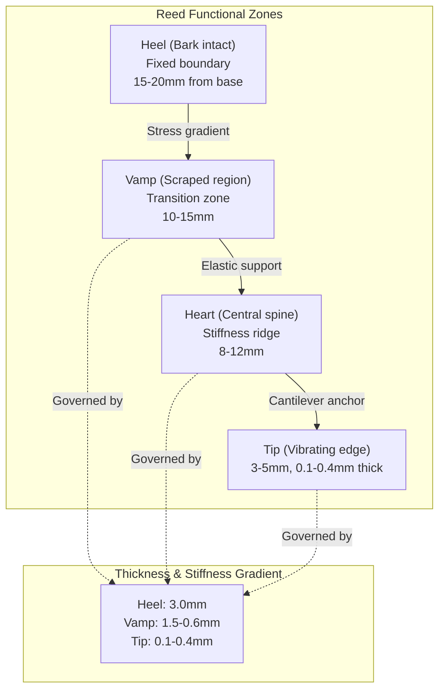
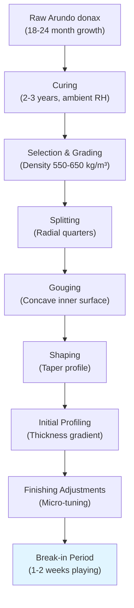
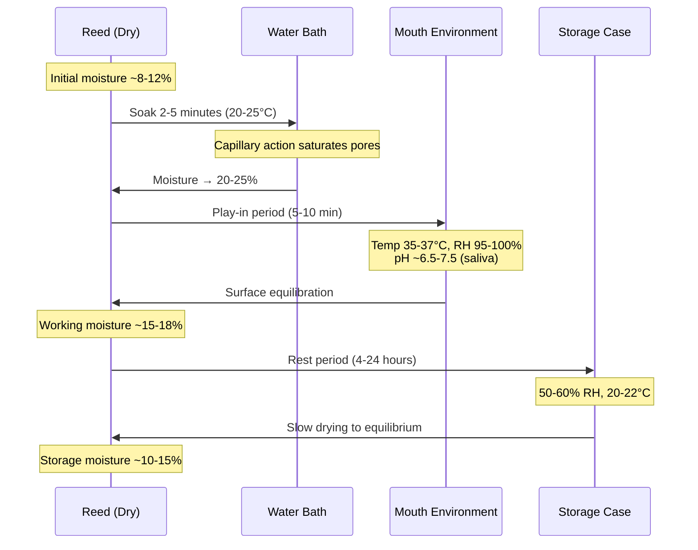

# Lesson 2: Reed Care and Maintenance

## 1. First-Principles Intuition & Invariants

The reed functions as a pressure-controlled flow modulator, converting steady breath pressure into periodic oscillations that excite the instrument's air column. Understanding this behavior requires examining three coupled systems: the player's breath mechanics, the reed's physical vibration, and the acoustic feedback from the instrument's bore.

### The Physics of Reed Oscillation

A reed vibrates as a cantilevered beam—one end clamped to the mouthpiece, the free end oscillating in response to airflow. The mechanism is self-sustaining: when you blow, air velocity increases at the reed-mouthpiece gap, creating a pressure drop (Bernoulli effect) that pulls the reed closed. As the gap closes, airflow decreases, pressure recovers, and the reed's elastic restoring force snaps it back open. This cycle repeats at the reed's natural frequency.

**Key invariants that govern reed behavior:**

1. **Frequency scales inversely with length squared**: Doubling the vibrating length reduces natural frequency by a factor of four. This is why bassoon reeds (longer) vibrate slower than clarinet reeds.
2. **Stiffness is proportional to thickness cubed**: A 10% thickness reduction decreases stiffness by approximately 27%. Small adjustments have large acoustic consequences.
3. **Moisture content changes mechanical properties**: Dry cane (<8% moisture) becomes brittle and harsh-sounding. Over-saturated cane (>25%) loses definition and responsiveness. Optimal moisture (12-18%) balances stiffness, damping, and dimensional stability.
4. **Material anisotropy matters**: Cane exhibits different elastic properties along the fiber direction versus perpendicular to it. Always scrape parallel to fibers to avoid tearing.

The reed's timbre depends not just on its fundamental frequency but on its spectrum of higher vibrational modes. Real reeds exhibit inharmonicity—overtones are not exact integer multiples of the fundamental—which contributes to the characteristic woodwind sound. The reed's damping (internal friction in the cane) shapes attack transients and decay envelopes: high damping smooths attacks but reduces brightness; low damping produces aggressive attacks but can cause squeaks and multiphonics.

### Material Science of Cane (Arundo donax)

Cane is a natural composite with vascular bundles (xylem, phloem, sclerenchyma fibers) embedded in a parenchyma matrix. The fiber bundles provide tensile strength along the cane's longitudinal axis; the lignin-rich matrix provides shear resistance. Cane exhibits both elastic and viscoelastic behavior: it responds immediately to stress (elastic) but gradually softens under sustained load (viscoelastic creep). This explains why reeds "play in" during a session and require rest periods.

Water molecules plasticize the hemicellulose matrix, reducing stiffness while increasing damping. This is why a dry reed sounds bright and harsh, while a properly hydrated reed sounds warm and responsive.

## 2. Core Reed Architecture & Functional Zones

A reed's geometry can be divided into distinct functional zones, each contributing specific vibrational properties:

**Heel**: The mechanical anchor. Retains the bark (epidermis and sclerenchyma layer) for maximum stiffness and wear resistance. Transfers vibrational energy to the mouthpiece.

**Vamp**: The scraped region where thickness is progressively reduced from heel to tip. The taper controls stiffness gradient and determines fundamental frequency. This is where most adjustments happen.

**Heart**: A subtle ridge running down the centerline, providing longitudinal stiffness that stabilizes vibration and prevents the reed from collapsing inward. Too prominent = stuffy response; too weak = unstable pitch.

**Tip**: The thinnest region (0.1-0.4mm), designed for maximum flexibility to facilitate rapid oscillation. The tip edges (rails) must be balanced symmetrically for even response.

### Typical Thickness Profile (B♭ Clarinet Reed)

Professional reed makers measure thickness at specific landmarks:

- **Tip**: 0.10-0.15mm
- **3mm from tip**: 0.30-0.40mm
- **6mm from tip**: 0.60-0.80mm
- **9mm from tip**: 1.20-1.60mm
- **Heel**: 2.5-3.0mm (bark intact)

These measurements are adjusted iteratively while testing response. Material removal is irreversible—work in conservative increments (0.01-0.02mm).

## 3. Reed Preparation and Break-In Protocol

### The Reed Preparation Workflow

Reed preparation transforms raw cane into a precision acoustic component:

**Curing** (2-3 years): Allows biochemical stabilization. Residual growth hormones and volatile compounds evaporate, lignin cross-linking increases, moisture content equilibrates. This reduces dimensional instability.

**Gouging**: Creates concave inner surface, reducing mass while preserving stiffness. Curvature radius (typically 10-15mm) affects reed's natural camber and resistance profile.

**Profiling**: Establishes the critical thickness gradient. Use precision reed gauges (dial indicators with specialized feet) to measure thickness. Adjust iteratively using reed knives, files, and sanding implements. Work in 0.01-0.02mm increments.

### Break-In Protocol for New Reeds

New reeds benefit from gradual conditioning to align fiber structure and establish stable moisture equilibrium:

**Day 1-2: Initial Conditioning**
- Soak in room-temperature water (20-25°C) for 2 minutes
- Play gently for 5 minutes only: pianissimo dynamic, middle register (written G3-C5 for clarinet)
- Focus on long tones, no tonguing
- Rest for 24 hours in reed case

**Day 3-4: Expansion**
- Soak for 2 minutes
- Play for 10 minutes: expand to mezzo-forte, full register
- Include gentle tonguing and basic articulation
- Rest for 24 hours

**Day 5-7: Full Integration**
- Soak for 2 minutes
- Play for 15-20 minutes: full dynamic range, all articulations
- Test altissimo register, check response across full range
- Begin normal rotation into playing set

**Why this works**: Gradual stress cycling prevents premature fatigue and allows the reed's viscoelastic properties to stabilize. Aggressive break-in (playing fortissimo immediately) causes fiber misalignment and premature softening.

## 4. Daily Maintenance and Moisture Management

### The Moisture Cycle

A reed's moisture state directly affects its mechanical impedance. Proper conditioning establishes optimal moisture distribution:

**Pre-session soaking**: Water penetrates via capillary action through vascular structure. Outer surface absorbs faster than interior, creating temporary moisture gradient. Playing redistributes moisture through mechanical agitation and heat transfer.

**Rest period**: Critical for viscoelastic recovery. Continuous playing induces creep deformation that accumulates without recovery time. Professional players rotate between 3-5 reeds to distribute mechanical fatigue and extend service life.

### Post-Session Care Protocol

**Immediately after playing:**
1. Remove excess surface moisture with lint-free cloth (gentle wipe, don't rub)
2. Place in reed case with adequate ventilation (not hermetically sealed)
3. Never leave wet reed on mouthpiece—promotes warping and bacterial growth

**Weekly maintenance:**
1. Rinse reeds under pH-neutral water (removes saliva residue: proteins, sugars)
2. Inspect tip under good light for microcracks or fiber damage
3. Check for warping by placing reed flat on glass surface—should sit flush

**Monthly deep maintenance:**
1. Sanitize with 70% ethanol or isopropanol (30-second soak, thorough rinse)
2. Kills bacteria without excessively drying the cane
3. Avoid chlorine-based disinfectants—degrade lignin
4. Re-evaluate thickness profile if response has changed

### Storage Protocol

**Environmental control:**
- **Humidity**: 50-60% RH (use two-way humidity control packs)
- **Temperature**: 18-22°C
- **Avoid**: >70% RH (mold growth), <40% RH (excessive drying and brittleness)

**Reed rotation strategy** (professional practice):
- 2 "primary" reeds in peak condition (20-40 hours playing time)
- 2 "break-in" reeds (0-20 hours, still stabilizing)
- 2 "backup" reeds (40+ hours, approaching end-of-life but usable)

This ensures consistent performance availability while distributing mechanical stress across multiple reeds.

## 5. Performance Optimization and Adjustment Techniques

### Material Selection Criteria

Premium cane exhibits:
- Fine, evenly spaced vascular bundles with minimal pith content
- Uniform coloration (golden-amber, no dark streaks or green patches)
- Density 550-650 kg/m³ for clarinet reeds (measure with precision scale and calipers: ρ = m/V)
- Outside this range: too flexible (low density) or too stiff (high density)

### Symmetry Verification

Asymmetry causes uneven vibration and pitch instability. Verify using precision measurements:

**Rail balance**: Measure thickness at corresponding points on left and right rails
- Tolerance: ±0.02mm
- Use reed gauge with feet positioned symmetrically

**Tip alignment**: Tip edge must be perpendicular to centerline
- Tolerance: ±0.5°
- Check with machinist's square or against straight edge

**Heart centering**: Central spine equidistant from both rails
- Tolerance: ±0.3mm
- Measure with calipers at multiple points along heart

### Micro-Adjustment Techniques

Fine-tuning involves targeted material removal based on specific acoustic symptoms:

| Symptom | Root Cause | Correction Method |
|---------|-----------|-------------------|
| **Stuffy response, flat pitch** | Excessive tip thickness | Thin tip region 0.01-0.02mm, focus on tip edges. Use fine-grit sanding stick (400-600 grit) with long strokes parallel to fibers |
| **Bright, harsh tone** | Insufficient damping, tip too thin | Increase vamp thickness slightly in transition zone, or reduce heart prominence. Work 3-6mm behind tip |
| **Weak low register** | Tip too thin relative to heart | Strengthen heart region by thinning surrounding vamp. Ensure gradual transition—no abrupt steps |
| **Squeaks in altissimo** | Asymmetric rails, tip misalignment | Balance rail thickness bilaterally. Check tip alignment with straight edge. Measure and match |
| **Slow attack** | Excessive overall stiffness | Reduce vamp thickness, particularly in transition zone (6-10mm from tip). Work gradually |
| **Poor resistance, reed closes too easily** | Tip too flexible, insufficient spine | Increase tip thickness OR reduce tip length by clipping. Strengthen heart if it's weak |
| **Too much resistance, reed won't open** | Excessive tip stiffness, over-prominent heart | Thin tip region carefully. Reduce heart prominence by thinning centerline |
| **Uneven response across registers** | Imbalanced thickness gradient | Check thickness profile against landmarks. Adjust transition zones for smooth gradient |

**Adjustment workflow:**
1. Identify specific symptom in playing test
2. Measure thickness at relevant landmarks with reed gauge
3. Make single targeted adjustment (0.01-0.02mm removal)
4. Test response immediately
5. Repeat if necessary, but never make multiple changes simultaneously

**Tools for adjustments:**
- **Reed knife**: Primary tool for vamp and heart adjustments. Hold at low angle (10-15°), pull toward you with controlled pressure
- **Sanding sticks**: Fine-grit (400-600 grit) for tip work and smoothing. Always sand parallel to fibers
- **Reed rush**: Natural abrasive for final surface finishing and micro-adjustments
- **Reed gauge**: Dial indicator with specialized feet for precision thickness measurement

### Crow Test for Quick Assessment

The "crow" test provides immediate feedback on reed stiffness. Place reed on mouthpiece (no instrument), seal lips, and blow:

**B♭ Clarinet optimal crow pitches:**
- **C#-D (550-587 Hz)**: Optimal stiffness
- **C or lower**: Reed too soft
- **D# or higher**: Reed too stiff

**Interpretation:**
- Clear, stable crow with distinct pitches = balanced reed
- Weak, unclear crow = tip too flexible or asymmetric
- No crow, only hissing = reed too stiff or poor seal

Test crow after each adjustment to track changes in stiffness.

## 6. Failure Modes and Degradation Mechanisms

### Understanding Reed Lifespan

Reeds fail through multiple mechanisms operating on different timescales:

**Mechanical fatigue** (20-40 playing hours):
- Cyclic stress induces microcrack propagation in fiber bundles
- Highest stress at tip where flexure is greatest
- Eventually causes tip splitting (catastrophic failure)
- At concert pitch (440 Hz), a reed accumulates ~10⁶ cycles per hour

**Viscoelastic degradation** (gradual over weeks):
- Repeated stress cycles cause irreversible structural rearrangement
- Manifests as gradual softening: less responsive, requires more embouchure pressure, loses brightness
- Partially reversible with extended rest (days to weeks), but never complete recovery

**Biochemical degradation** (months):
- Enzymatic hydrolysis by salivary amylase breaks glycosidic bonds in hemicellulose
- Bacterial colonization (Streptococcus species) accelerates process
- Rate depends on pH, temperature, moisture
- Maintaining pH below 7.0 (mildly acidic storage) significantly reduces degradation

**Moisture-induced warping**:
- Differential moisture absorption causes dimensional changes
- Outer surface dries faster than interior, creating stress gradients
- Causes reed to curl or twist
- Warped reeds seal poorly, causing air leaks and uneven response

### Failure Prevention Strategy

### Signs a Reed Needs Retirement

**Replace immediately if:**
- Visible tip crack or split extending into vamp
- Severe warping (doesn't sit flat on glass)
- Dark discoloration or visible mold growth
- Fiber separation at tip (ragged, torn appearance)

**Consider retiring if:**
- Response becomes consistently dull despite adjustments
- Requires excessive embouchure pressure to produce tone
- Pitch stability degrades (difficulty keeping pitch centered)
- Attack becomes sluggish across all registers
- Reed has 40+ hours of playing time with diminishing returns

**Extend service life by:**
- Rotating between multiple reeds (distribute stress)
- Proper moisture management (controlled soaking and drying)
- Regular sanitization (reduce biochemical degradation)
- Conservative adjustments (avoid over-scraping)
- Environmental control (stable humidity and temperature)

## 7. Quantitative Performance Metrics

Objective assessment enables data-driven optimization:

### Resistance Measurement

Measure pressure required to open reed at threshold oscillation using manometer or differential pressure sensor:

**Optimal resistance for B♭ clarinet:** 3-5 kPa differential pressure at onset
**Measurement method:**
1. Connect pressure gauge to mouthpiece chamber
2. Blow gently, increasing pressure gradually
3. Note pressure at which reed begins oscillating
4. Too low (<2 kPa) = too soft; too high (>6 kPa) = too stiff

### Microscopic Quality Assessment

Examine tip region under 10-40× magnification (jeweler's loupe or USB microscope):

**High-quality reed exhibits:**
- Uniform fiber orientation parallel to longitudinal axis
- Clean, smooth tip edge (no torn fibers or ragged edges)
- No visible microcracks or fiber separation
- Consistent vascular bundle spacing
- Translucent amber color at tip (not opaque or dark)

**Warning signs:**
- Torn or frayed fibers at tip edge
- Dark spots indicating high lignin concentration or decay
- Visible microcracks propagating from tip
- Irregular fiber spacing or crossed fibers

### Playing Test Checklist

Systematic evaluation across performance parameters:

**Response & Attack:**
- [ ] Clean attack in all registers (no delay, no squeak)
- [ ] Pianissimo response stable in low register
- [ ] Altissimo speaks cleanly without squeak or multiphonic

**Intonation:**
- [ ] Pitch centers easily without excessive embouchure correction
- [ ] No register-to-register pitch drift
- [ ] Pitch stable across full dynamic range

**Tone Quality:**
- [ ] Warm, resonant sound in middle register
- [ ] Low register projects without stuffiness
- [ ] Altissimo clear and focused without shrillness

**Dynamic Range:**
- [ ] Pianissimo possible without tone cutting out
- [ ] Fortissimo possible without harsh edge
- [ ] Smooth crescendo/diminuendo without pitch drift

**Articulation:**
- [ ] Clean single tonguing at MM=120 sixteenth notes
- [ ] Double tonguing evenness (if applicable)
- [ ] Staccato response crisp without pitch sag

Document performance over time to track degradation and optimize replacement timing.

## 8. Advanced Topics: Reed Customization

### Strength Modification

Commercial reeds are rated by strength (e.g., 2.5, 3, 3.5), but players often need intermediate values or asymmetric properties:

**To soften a reed:**
- Thin the vamp in the transition zone (6-10mm from tip)
- Reduce heart prominence slightly
- Work in 0.01mm increments, test frequently

**To stiffen a reed:**
- Clip the tip: remove 0.5-1.0mm from tip edge with sharp blade
- This shortens vibrating length, increasing natural frequency and stiffness
- Use straight cut perpendicular to centerline
- Smooth cut edge with fine sandpaper

**Asymmetric adjustments for embouchure compensation:**
- Some players have asymmetric embouchures (more pressure on one side)
- Balance rail thickness to compensate: thin the rail on the high-pressure side
- Requires careful measurement and incremental adjustment

### Alternative Reed Materials

**Synthetic reeds** (Légère, Forestone, etc.):
- Consistent properties, no moisture sensitivity
- Longer lifespan (months to years)
- Different timbre: often brighter, less complex overtone spectrum
- Useful for outdoor performance, extreme climates, doubling instruments
- Break-in period still required (polymer stress relief)

**Arundo donax alternatives:**
- **Arundo plinii**: Denser, stiffer than A. donax; used for oboe/bassoon
- **Synthetic cane composites**: Injection-molded polymer-fiber blends
- Each material exhibits different viscoelastic properties and requires adjusted preparation techniques

## 9. Practice Lab: Reed Adjustment Workshop

### Objective
Develop precision adjustment skills through systematic diagnosis and correction of common reed problems.

### Required Tools
- Reed knife (professional quality, properly sharpened)
- Sanding sticks (400, 600, 800 grit)
- Reed gauge (dial indicator or precision calipers)
- Reed rush or fine emery paper
- Flat glass surface (for flatness checking)
- Good lighting (LED desk lamp or natural light)
- Reed case with 3-5 reeds at different maturity stages

### Lab Procedure

**Part 1: Baseline Assessment (15 minutes)**

For each reed in your rotation:

1. **Visual inspection** (5 min):
   - Check tip symmetry against straight edge
   - Inspect for cracks, warping, fiber damage
   - Note coloration and moisture staining patterns

2. **Thickness mapping** (5 min):
   - Measure thickness at landmarks: tip, 3mm, 6mm, 9mm from tip
   - Record measurements for both rails and centerline
   - Calculate symmetry deviation (left rail - right rail)

3. **Playing test** (5 min):
   - Crow test: record pitch and stability
   - Full-range scale: note response anomalies by register
   - Dynamic test: pianissimo and fortissimo in middle C
   - Document issues in playing log

**Part 2: Diagnostic Practice (20 minutes)**

Select one reed with identified issues and systematically diagnose:

1. **Match symptom to root cause** using adjustment table (Section 5)
2. **Measure current thickness** at relevant landmarks
3. **Calculate target thickness** (0.01-0.02mm reduction)
4. **Plan adjustment sequence** (which zone, which tool)

**Part 3: Precision Adjustment (30 minutes)**

Execute planned adjustment on selected reed:

1. **Setup workstation**:
   - Secure reed on flat surface or reed holder
   - Position light for clear visibility
   - Have measuring tools within reach

2. **Make single adjustment**:
   - Use appropriate tool (knife, sanding stick, rush)
   - Work parallel to fibers, long smooth strokes
   - Remove material conservatively (0.01mm target)

3. **Measure result**:
   - Re-measure thickness at adjustment zone
   - Confirm material removal within target range

4. **Test response**:
   - Soak reed for 2 minutes
   - Perform playing test focusing on target symptom
   - Document change in response

5. **Iterate if necessary**:
   - If symptom persists, plan next adjustment
   - If symptom resolved, move to next reed
   - If symptom worsened, diagnose overcorrection

**Part 4: Long-Term Tracking (ongoing)**

Establish reed performance tracking system:

1. **Create reed logbook**:
   - Reed ID number and acquisition date
   - Initial thickness profile measurements
   - Playing hours log (cumulative)
   - Adjustment history with dates and descriptions
   - Performance notes (subjective ratings 1-10)

2. **Schedule maintenance**:
   - Weekly: visual inspection, rinse, moisture check
   - Monthly: deep sanitization, profile re-measurement
   - Quarterly: review rotation strategy, retire end-of-life reeds

3. **Analyze patterns**:
   - Which reeds last longest? (identify optimal initial profile)
   - Which adjustments most effective? (refine technique)
   - When does performance degrade? (optimize replacement timing)

### Success Metrics

After completing this lab, you should be able to:
- [ ] Diagnose specific reed problems from playing symptoms
- [ ] Measure reed thickness accurately within ±0.01mm
- [ ] Execute precision adjustments that improve specific symptoms
- [ ] Track reed performance over time with quantitative data
- [ ] Optimize reed rotation strategy for consistent performance

### Common Mistakes to Avoid

1. **Over-adjusting**: Making multiple changes before testing response
2. **Working too fast**: Removing too much material at once
3. **Ignoring symmetry**: Adjusting one side without balancing the other
4. **Poor lighting**: Missing subtle thickness variations
5. **Inconsistent measurement**: Not measuring from same landmarks
6. **Impatient break-in**: Playing new reeds at full intensity immediately
7. **Neglecting moisture**: Testing reeds at inconsistent hydration states
8. **Skipping documentation**: Losing track of what works and what doesn't

## 10. Conclusion: The Reed as a Precision Instrument Component

Reed maintenance is not ancillary to woodwind performance—it is central to it. The difference between mediocre and excellent playing often comes down to reed quality and consistent maintenance practices. By understanding the physics of reed vibration, the material science of cane, and the mechanical principles of adjustment, you gain control over this critical interface between breath and sound.

The investment in reed care skills pays dividends throughout your playing career:
- **Consistency**: Predictable response across practice and performance contexts
- **Economy**: Extended reed lifespan reduces replacement costs
- **Musicality**: Optimal tone quality and dynamic range enable expressive playing
- **Troubleshooting**: Rapid diagnosis and correction of performance issues
- **Independence**: Self-sufficiency rather than reliance on commercial reed availability

Approach reed care with the same rigor you apply to technical practice: systematic, incremental, documented. Over time, you'll develop intuition for reed behavior and the confidence to optimize reeds to your specific embouchure, instrument, and musical goals.

**Next steps:**
- Establish baseline measurements for your current reed rotation
- Implement daily moisture management protocol
- Practice precision adjustment techniques on retired reeds
- Begin systematic performance tracking in reed logbook
- Experiment with break-in protocols to optimize new reed conditioning

The reed is not a consumable—it's a tunable acoustic element. Treat it with the care and precision it deserves.
